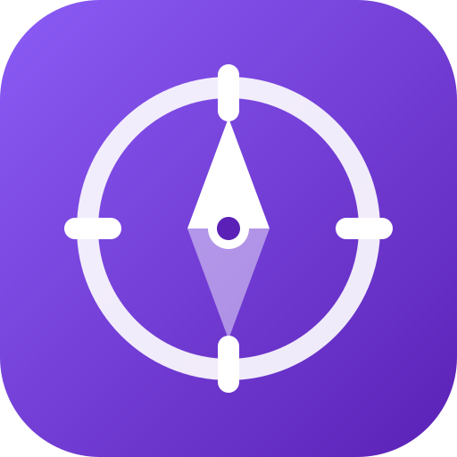

<p align="center">
  
</p>

<h1 align="center">Engineering Atlas</h1>

<p align="center">
  A free, open curriculum for software engineers in the AI era:<br>
  system design, low-level design, problem solving and incident response.
</p>

<p align="center">
  <a href="https://engineering-atlas.hogivano.dev"><b>Open the app</b></a> ·
  <a href="#whats-inside">What's inside</a> ·
  <a href="#run-it-yourself">Run it yourself</a> ·
  <a href="#contributing">Contributing</a>
</p>

---

AI agents now write much of the code. The skills that last are knowing how systems really work,
finding root causes, and staying calm when production breaks. Engineering Atlas teaches those
skills in depth, for free, with claims linked to sources you can check.

One idea runs through every lesson: **most software problems are the same few problems in
different domains.** Two riders matched to one driver and two withdrawals racing on one balance
are both *contention*. A retried card charge and an agent re-sending an email are both
*duplicates*. Once you can name the shape, you can reuse known solutions anywhere
([problem shapes](curriculum/problem-shapes.md)).

## What's inside

**457 original lessons** in six courses:

| Course | Lessons | Covers |
|---|---:|---|
| System Design Fundamentals | 163 | Networking, APIs, storage engines, caching, replication, consensus, messaging, observability |
| System Design Interviews | 111 | Interview method, building blocks, and 55 full "Design X" walkthroughs |
| Low-Level Design | 117 | Object-oriented design, design patterns, concurrency, classic machine-coding problems |
| Problem Solving & Incidents | 46 | Debugging, root-cause analysis, incident response, real postmortem case studies |
| Building AI Systems | 12 | RAG, agents, evals, LLM gateways, prompt injection, cost |
| Foundations | 8 | How computers run code, networking, databases, Linux, Git |

Every lesson follows the same shape:

- **In one minute**: the essential idea.
- **How it works** and **Down the stack**: the contract, the mechanism, and what really happens
  on the machine, with real numbers.
- **Diagram**, **worked example**, **trade-offs**, and **pitfalls in production**.
- **In the wild**: real incidents from company postmortems.
- **Check yourself** questions, plus a **mock interview** with a scoring rubric.
- **Practice**: a hands-on coding exercise in Python, TypeScript and Go, with tests.
- **Sources and further study**: papers, official docs, book chapters, and talks.

The app adds spaced review, a placement test, progress tracking, listen mode with natural
voices, an AI mock interviewer, and offline support.

## How the content is checked

Lessons are original writing. They are checked against many independent sources, never just one
course:

- primary papers, RFCs and specs;
- official docs of real systems, such as PostgreSQL, Redis, Kafka, Envoy and Kubernetes;
- public postmortems and engineering blogs;
- standard books, cited by chapter;
- other open curricula.

Specific numbers and claims link to the page that supports them. A second reviewer opens every
new link and checks a sample of the claims. Automated checks make sure every practice solution
passes its tests in all three languages and every diagram renders.

Read the full process in [docs/methodology.md](docs/methodology.md). Shared references live in
[sources/books.md](sources/books.md) (verified chapter lists) and
[sources/incidents/](sources/incidents/) (about 380 incidents from primary sources).

## Run it yourself

You only need Python 3. The site builder uses the standard library.

```bash
git clone https://github.com/hogivano/engineering-atlas.git
cd engineering-atlas
python3 site/build.py              # builds dist/ (static site) and site/index.html (single file)
python3 -m http.server -d dist 8000
```

Then open http://localhost:8000.

The static site works on its own. Optional features need a small API server and some
configuration:

- the AI mock interviewer and natural narration (an OpenAI key, or a local Kokoro voice engine);
- accounts and synced progress (Supabase);
- team features: assessments, certificates and organizations.

[docs/deploy.md](docs/deploy.md) covers Netlify, Docker self-hosting, and every environment
variable.

## Repository layout

| Path | What it holds |
|---|---|
| `lessons/` | The lessons, one Markdown file each, and the [style guide](lessons/STYLE.md) |
| `curriculum/` | Study plans, the 30-day sprint, books, projects, the resource hub, problem shapes |
| `site/` | The static site generator (`build.py`), app source, styles and icons |
| `server/`, `netlify/` | The optional API: AI interviewer, narration, accounts, team features |
| `supabase/` | Database migrations with row-level security |
| `sources/` | Shared references: verified book chapters and a catalogue of real incidents |
| `tools/` | Checks for practice code, diagrams, sources, plus the icon and narration tools |
| `docs/` | Methodology, deployment, design system, fact-check log and legal pages |

## Contributing

Contributions are welcome, and everything is Markdown. Good first contributions:

- **Fix a mistake.** Lessons cite their sources. If a fact is wrong or out of date, open an
  issue or a pull request with a link to a primary source.
- **Improve a lesson** following [lessons/STYLE.md](lessons/STYLE.md).
- **Add a real incident** to [sources/incidents/](sources/incidents/). It must link to the
  company's own postmortem or an official report.
- **Add a resource** to [curriculum/resource-hub.md](curriculum/resource-hub.md), or a problem
  shape to [curriculum/problem-shapes.md](curriculum/problem-shapes.md).
- **Verify a claim** listed in [docs/fact-check.md](docs/fact-check.md).

Before opening a pull request, run the checks for the lessons you changed:

```bash
python3 tools/check_sources.py lessons/sd/caching.md        # sections, citations, untouched practice
python3 lessons/check_practice.py lessons/sd/caching.md     # practice passes in Python, TypeScript, Go
cd tools && npm install && node check_diagrams.js           # every diagram renders
python3 site/build.py                                       # the site still builds
```

Two rules matter most. Write in your own words: never copy or closely paraphrase another
course, book or blog. And only cite pages you have actually opened, that support the claim.

## How this was made

Engineering Atlas is written with AI assistance. The maintainer designed the curriculum and directs
the work; lessons, exercises and checks were drafted and researched with Anthropic's Claude. Every
lesson is checked against the primary sources it cites, by automated checks and by a separate AI
fact-checking pass, and practice code is tested in all three languages.

The source-backed upgrade (inline citations, real incidents, Sources and further study) covers every
course except part of Low-Level Design, where about 100 lessons are still being upgraded. Human review of all 457 lessons is still in progress, so mistakes are possible. If you find one,
please [open an issue](https://github.com/hogivano/engineering-atlas/issues) with a link to a source.

## Acknowledgements

Topic coverage was compared with widely used curricula such as
[System Design Primer](https://github.com/donnemartin/system-design-primer),
[roadmap.sh](https://roadmap.sh) and [AlgoMaster](https://algomaster.io/), and with the standard
books. The outlines, titles and lessons here are this project's own. Thanks also to the many
engineers and companies who publish honest postmortems. The incident sections exist because of
them.

## License

- **Lessons and curriculum content** (everything in `lessons/`, `curriculum/`, `sources/` and `docs/`):
  [Creative Commons Attribution 4.0](LICENSE-CONTENT) (CC BY 4.0). Share and adapt it, even
  commercially, as long as you credit Engineering Atlas with a link and note your changes.
- **Code** (the site, server and tools): [MIT](LICENSE).

The licenses cover this project's own material only. Third-party material keeps its own terms: see
[THIRD_PARTY_NOTICES.md](THIRD_PARTY_NOTICES.md). That includes the Lucide icons, runtime
libraries, trademarks, book and chapter titles, and every linked page, paper and talk.
