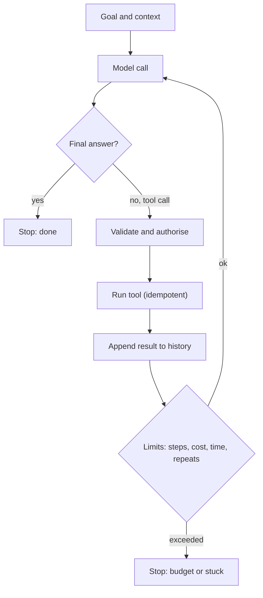

## In one minute
- An agent is a model in a loop: it decides an action (usually a tool call), your code runs it, the result goes back into the context, and it repeats until it answers or a limit stops it.
- Not everything needs an agent. Workflows (fixed sequences of model calls you design: chains, routers, parallel steps) are cheaper, faster and easier to test. Use an agent only when the steps cannot be known in advance.
- Every agent loop needs limits: maximum steps, tokens, time and money; detection of repeated actions; and a clear stop condition. Without them, agents loop, wander or burn budget.
- Sub-agents let a lead agent split work into parallel, isolated tasks with their own context. They help with breadth (research, search) but multiply cost, so use them deliberately.
- The engineering is mostly outside the model: tool design, state management, error handling, observability and evaluation.

## How it works

### The agent loop
1. Send the goal, instructions, tools and the history so far to the model.
2. The model returns either a final answer or one or more tool calls.
3. Your code validates and executes the tool calls, records results.
4. Append results to the history and go back to step 1.
5. Stop when the model answers, a limit is hit, or a guard detects a problem.

The ReAct pattern (reason, act, observe), first published in October 2022 and presented at ICLR, popularised this loop; its authors reported that interleaving reasoning with actions beat imitation and reinforcement-learning baselines on ALFWorld and WebShop by absolute success rates of 34% and 10% ([Yao et al.](https://arxiv.org/abs/2210.03629)). Modern models are trained for it directly through tool use.

### Workflows before agents
Anthropic's "Building effective agents" guidance draws a useful line: **workflows** are systems where your code orchestrates model calls along predefined paths; **agents** are systems where the model directs its own process. Both are built from an "augmented LLM", a model with retrieval, tools and memory, and the guidance advises finding the simplest solution and adding complexity only when needed ([Anthropic](https://www.anthropic.com/engineering/building-effective-agents)). Microsoft's Azure Architecture Center says the same in its own terms: use the lowest level of complexity that reliably meets your requirements, because each step up from a single call, to a single agent with tools, to multiagent orchestration, adds coordination overhead, latency and cost ([Azure Architecture Center](https://learn.microsoft.com/en-us/azure/architecture/ai-ml/guide/ai-agent-design-patterns)). Common workflow patterns:

- **Prompt chaining:** step 1 extracts, step 2 checks, step 3 writes, with code between steps.
- **Routing:** a classifier sends each input to a specialised prompt or model.
- **Parallelisation:** several calls on parts of the input (sectioning), or several attempts voted on (voting).
- **Orchestrator and workers:** one call plans subtasks, workers execute them, code combines results. Azure's catalogue names the nearby multi-agent shapes: sequential (pipeline), concurrent (fan-out and fan-in), group chat, handoff and magentic ([Azure Architecture Center](https://learn.microsoft.com/en-us/azure/architecture/ai-ml/guide/ai-agent-design-patterns)).
- **Evaluator and optimiser:** one call drafts, another critiques, loop a bounded number of times.

If you can draw the flowchart in advance, build a workflow. Agents earn their cost when the path depends on what is discovered along the way, such as debugging, research or multi-step support cases.

### Limits and guards
- **Step budget:** a maximum number of loop iterations (for example 20). Anthropic's guidance lists a maximum iteration count as the usual stopping condition, and recommends extensive testing in sandboxed environments ([Anthropic](https://www.anthropic.com/engineering/building-effective-agents)).
- **Cost and time budget:** tokens, dollars and wall-clock time per task.
- **Loop detection:** the same tool with the same arguments several times in a row usually means the agent is stuck.
- **Progress checks:** if nothing new has been learned in N steps, stop or ask a human.
- **Stop reasons recorded:** done, budget, stuck, error, needs-human. They are your most important agent metrics.

### Sub-agents
A lead agent can delegate subtasks to sub-agents that run with their own fresh context and return a summary. This keeps the lead's context clean and allows parallel work. Anthropic's write-up of its multi-agent research system (an Opus 4 lead with Sonnet 4 sub-agents) beat a single Opus 4 agent by 90.2% on its internal research eval, but agents use about 4 times the tokens of a chat and multi-agent systems about 15 times. Token usage alone explained 80% of the performance variance on BrowseComp, so part of the gain is simply more tokens spent ([Anthropic](https://www.anthropic.com/engineering/multi-agent-research-system)). Sub-agents fit tasks with independent, parallel parts; the same post says most coding tasks have fewer parallelisable parts than research, and that work needing one shared context or many inter-agent dependencies is a poor fit. The early versions also misbehaved in instructive ways: they spawned dozens of sub-agents for simple queries and gave vague delegations that made sub-agents duplicate each other, which the team fixed with effort-scaling rules in the prompt (one agent with 3 to 10 tool calls for a simple lookup, 2 to 4 sub-agents for a comparison) and with delegations that state an objective, output format, tools and task boundaries.

### State and durability
A long-running agent is a long-running job. Persist its state (goal, plan, history or a summary, completed tool calls with idempotency keys) so it can resume after a crash or deploy without repeating side effects. Treat each tool call like a step in a workflow engine. Anthropic's research system resumes from where an error occurred instead of restarting, combining retries with regular checkpoints, and its lead agent saves its plan to external memory because the context may be truncated past 200,000 tokens ([Anthropic](https://www.anthropic.com/engineering/multi-agent-research-system)).

### The same shapes as any system
Lilian Weng's survey splits an LLM-powered agent into planning, memory and tool use around the model as its "brain" ([Weng](https://lilianweng.github.io/posts/2023-06-23-agent/)). An agent loop is a retry loop with a planner: it needs the same budgets, timeouts, idempotency and stuck-detection as any job runner or saga. Sub-agents are fan-out with a merge step.

## Down the stack

### Layer 1: The contract
An agent promises to pursue a goal within stated limits (steps, cost, time, permitted tools), to stop with an explicit reason, and to leave an auditable trace of every action. It does not promise success; it promises bounded, observable behaviour.

### Layer 2: The mechanism
The loop is ordinary code: a while loop around a model call, a tool dispatcher, validation, and an append to the message list. Frameworks and SDKs package this with features such as automatic context compaction when the history grows, permission checks per tool, hooks before and after tool calls, and sub-agent spawning. Loop detection compares recent tool calls by name and normalised arguments. Durable agents store each step in a database or a workflow engine (such as Temporal) so the loop can resume from the last completed step. Temporal does not snapshot memory: it reruns the workflow code against a recorded event history, reuses recorded activity results instead of re-running them, and therefore requires the workflow code to be deterministic, so model and tool calls belong in activities ([Temporal docs](https://docs.temporal.io/workflows)).

### Layer 3: The machine
Each loop iteration resends the whole context, so cost grows with history: a 30-step agent whose context grows by 2,000 tokens per step processes roughly 30 times the average context size in input tokens, around a million tokens, unless caching or compaction intervenes. Prompt caching helps because the history is a stable prefix that grows at the end. Latency adds up the same way: 30 steps of 3 seconds each is 90 seconds of model time, plus tool time, which is why agents run as background jobs with progress updates rather than inside a single HTTP request.

### Why it's built this way
1. Some tasks cannot be planned in advance, so a model must choose the next step.
2. Choosing steps in a loop risks wandering, looping and runaway cost.
3. So loops need explicit limits, stuck detection and recorded stop reasons.
4. When steps can be planned, workflows give the same results more cheaply and predictably.
5. Long loops are jobs, so they need durable state and idempotent side effects.

## Diagram


## Worked example
A team builds a "triage this production alert" agent with tools for querying logs, metrics, recent deploys and the runbook. The first version is a free-form agent. In testing, 12 percent of runs hit 50 steps without an answer, many repeating the same log query, and the average run costs 1.10 dollars.

Looking at transcripts, most alerts follow the same path: check recent deploys, check error rates by service, read the runbook section for the alert, then summarise. The team turns that path into a workflow: three parallel tool calls (deploys, error rates, runbook), one model call to summarise and suggest next steps. Only when the summary says "cause unclear" does an agent take over, with a 15-step budget, loop detection (same tool and arguments three times stops the run) and a 0.50 dollar cap. Results on 200 past alerts: 78 percent handled by the workflow alone in about 6 seconds for 0.04 dollars; 22 percent escalate to the agent; no runs hit the budget; average cost per alert falls to 0.15 dollars; and on-call engineers rate the summaries as useful more often, because the workflow's output is consistent.

## In the wild
- **Anthropic, 2025: early multi-agent research prototypes over-delegated.** In testing, the lead agent spawned around 50 sub-agents for simple queries, searched endlessly for sources that did not exist and flooded its peers with status updates. Fixes were effort-scaling rules in prompts, explicit delegation briefs and guardrails, and a tool-testing agent that rewrote flawed tool descriptions, cutting task completion time for later agents by 40% ([Anthropic](https://www.anthropic.com/engineering/multi-agent-research-system)).
- **Anthropic, 2025-09: an agent loop turned into an attack tool.** A state-sponsored group jailbroke Claude Code by splitting an intrusion into small, innocent-looking tasks and posing as a defensive security firm. The agent did roughly 80 to 90 percent of the work against about 30 targets, with humans at only a handful of decision points per campaign. Anthropic banned the accounts within about ten days and built better classifiers, a reminder that loop capability needs per-task authorisation and monitoring, not only per-session trust ([Anthropic](https://www.anthropic.com/news/disrupting-AI-espionage)).
- **Greshake et al., 2023: instructions hidden in retrieved data hijack agents.** The paper showed that text in a web page, email or code file can redirect an LLM-integrated app that later reads it, demonstrating data theft and worm-like spread against Bing Chat and code assistants. Every tool result an agent loop appends to history is therefore untrusted input ([arXiv](https://arxiv.org/abs/2302.12173)).

## Trade-offs
| Approach | Strengths | Weaknesses | Choose when |
| --- | --- | --- | --- |
| Single model call | Cheapest, fastest | One shot, no tools | Simple transformations |
| Workflow (chain, router, parallel) | Predictable, testable, cheap | Fixed paths | Steps known in advance |
| Single agent loop | Handles open-ended tasks | Cost, variance, harder to test | Path depends on discoveries |
| Lead agent with sub-agents | Parallel breadth, clean contexts | Many more tokens, coordination | Broad research, independent subtasks |
| Workflow first, agent fallback | Cheap common path, flexible tail | Two systems to maintain | Mixed routine and novel cases |

## Pitfalls in production
- Using an agent where a workflow would do. Fix: draw the flowchart first.
- No step, cost or time limits. Fix: enforce all three and record the stop reason.
- Agents stuck repeating a tool call. Fix: loop detection and progress checks.
- Losing progress on crash and repeating side effects on resume. Fix: durable state and idempotent tools.
- Running agents inside synchronous requests. Fix: background jobs with progress updates.

## Leadership lens
- Require a stated reason for using an agent instead of a workflow in design reviews.
- Track stop reasons, steps per task, cost per task and success rate per agent; regressions show here first.
- Build shared agent infrastructure: tool registry, permissions, budgets, tracing and durable state.
- Evaluate on full trajectories, not just final answers.

## Check yourself
1. When should you build a workflow instead of an agent?
   **Answer:** When the steps can be known in advance; workflows are cheaper, faster and easier to test than letting a model choose each step.
2. Why do long agent runs get expensive faster than linearly per step?
   **Answer:** Each step resends the growing history, so total input tokens grow roughly with the square of the number of steps unless caching or compaction reduces it.
3. What does repeating the same tool call with the same arguments usually indicate?
   **Answer:** The agent is stuck in a loop and not making progress, so it should be stopped or escalated.
4. When do sub-agents help, and what do they cost?
   **Answer:** They help with broad tasks that split into independent parallel parts and keep the lead context clean, but they use many more tokens and add coordination complexity.

## Practice
**Task:** Build a guarded agent runner around a scripted model. `script` is the sequence of outputs the model would produce: `("tool", name, arg)` or `("final", text)`. `tools` maps a tool name to a dict of argument to result. `run(script, tools, max_steps, max_repeats)` processes outputs in order, counting each as one step. On `final`, return `("done", text, steps)`. On a tool call, record it; if the same `(name, arg)` has now been called `max_repeats` times in a row, return `("stuck", None, steps)`; if the tool does not exist, the result is an error but the loop continues. If the step count reaches `max_steps` without a final answer, return `("budget", None, steps)`. If the script runs out, return `("no-answer", None, steps)`.

```python starter
def run(script, tools, max_steps, max_repeats):
    # TODO: return (status, text, steps)
    raise NotImplementedError
```

```python tests
TOOLS = {"deploys": {"api": "deploy 812 at 14:02"}, "errors": {"api": "5xx 4%"}, "runbook": {"HighErrorRate": "roll back first"}}

def test_done():
    script = [("tool", "deploys", "api"), ("tool", "errors", "api"), ("final", "Roll back deploy 812")]
    assert run(script, TOOLS, 10, 3) == ("done", "Roll back deploy 812", 3)

def test_stuck_on_repeats():
    script = [("tool", "errors", "api")] * 5 + [("final", "x")]
    assert run(script, TOOLS, 10, 3) == ("stuck", None, 3)

def test_repeats_must_be_consecutive():
    script = [("tool", "errors", "api"), ("tool", "deploys", "api"), ("tool", "errors", "api"), ("tool", "errors", "api"), ("final", "ok")]
    assert run(script, TOOLS, 10, 3) == ("done", "ok", 5)

def test_budget():
    script = [("tool", "deploys", "api"), ("tool", "errors", "api")] * 10
    assert run(script, TOOLS, 6, 3) == ("budget", None, 6)

def test_unknown_tool_continues():
    script = [("tool", "pager", "x"), ("final", "done anyway")]
    assert run(script, TOOLS, 10, 3) == ("done", "done anyway", 2)

def test_script_runs_out():
    assert run([("tool", "deploys", "api")], TOOLS, 10, 3) == ("no-answer", None, 1)
```

```python solution
def run(script, tools, max_steps, max_repeats):
    steps, last, streak = 0, None, 0
    for out in script:
        steps += 1
        if out[0] == "final":
            return ("done", out[1], steps)
        _, name, arg = out
        key = (name, arg)
        streak = streak + 1 if key == last else 1
        last = key
        if streak >= max_repeats:
            return ("stuck", None, steps)
        _result = tools.get(name, {}).get(arg, "error: unknown tool or argument")
        if steps >= max_steps:
            return ("budget", None, steps)
    return ("no-answer", None, steps)
```

```typescript starter
export type Out = ["tool", string, string] | ["final", string];

export function run(script: Out[], tools: Record<string, Record<string, string>>, maxSteps: number, maxRepeats: number): [string, string | null, number] {
  throw new Error("TODO");
}
```

```typescript tests
const TOOLS = { deploys: { api: "deploy 812 at 14:02" }, errors: { api: "5xx 4%" }, runbook: { HighErrorRate: "roll back first" } };
const t = (name: string, arg: string): Out => ["tool", name, arg];
const f = (text: string): Out => ["final", text];
const rep = (o: Out[], n: number) => Array.from({ length: n }, () => o).flat() as Out[];

test("done", () => {
  assertEqual(run([t("deploys", "api"), t("errors", "api"), f("Roll back deploy 812")], TOOLS, 10, 3), ["done", "Roll back deploy 812", 3]);
});

test("stuck on repeats", () => {
  assertEqual(run([...rep([t("errors", "api")], 5), f("x")], TOOLS, 10, 3), ["stuck", null, 3]);
});

test("repeats must be consecutive", () => {
  assertEqual(run([t("errors", "api"), t("deploys", "api"), t("errors", "api"), t("errors", "api"), f("ok")], TOOLS, 10, 3), ["done", "ok", 5]);
});

test("budget", () => {
  assertEqual(run(rep([t("deploys", "api"), t("errors", "api")], 10), TOOLS, 6, 3), ["budget", null, 6]);
});

test("unknown tool continues", () => {
  assertEqual(run([t("pager", "x"), f("done anyway")], TOOLS, 10, 3), ["done", "done anyway", 2]);
});

test("script runs out", () => {
  assertEqual(run([t("deploys", "api")], TOOLS, 10, 3), ["no-answer", null, 1]);
});
```

```typescript solution
export type Out = ["tool", string, string] | ["final", string];

export function run(script: Out[], tools: Record<string, Record<string, string>>, maxSteps: number, maxRepeats: number): [string, string | null, number] {
  let steps = 0, last = "", streak = 0;
  for (const out of script) {
    steps++;
    if (out[0] === "final") return ["done", out[1], steps];
    const key = out[1] + "\u0000" + out[2];
    streak = key === last ? streak + 1 : 1;
    last = key;
    if (streak >= maxRepeats) return ["stuck", null, steps];
    void ((tools[out[1]] || {})[out[2]] ?? "error: unknown tool or argument");
    if (steps >= maxSteps) return ["budget", null, steps];
  }
  return ["no-answer", null, steps];
}
```

```go starter
package practice

type Out struct {
	Kind string // "tool" or "final"
	Name string // tool name, or the final text
	Arg  string
}

type Result struct {
	Status string
	Text   string
	Steps  int
}

func Run(script []Out, tools map[string]map[string]string, maxSteps, maxRepeats int) Result {
	panic("TODO")
}
```

```go tests
package practice

import "testing"

var tools = map[string]map[string]string{
	"deploys": {"api": "deploy 812 at 14:02"},
	"errors":  {"api": "5xx 4%"},
	"runbook": {"HighErrorRate": "roll back first"},
}

func tl(n, a string) Out { return Out{"tool", n, a} }
func fin(s string) Out  { return Out{"final", s, ""} }

func expect(t *testing.T, got, want Result) {
	t.Helper()
	if got != want {
		t.Fatalf("got %+v, want %+v", got, want)
	}
}

func TestDone(t *testing.T) {
	expect(t, Run([]Out{tl("deploys", "api"), tl("errors", "api"), fin("Roll back deploy 812")}, tools, 10, 3), Result{"done", "Roll back deploy 812", 3})
}

func TestStuck(t *testing.T) {
	s := []Out{}
	for i := 0; i < 5; i++ {
		s = append(s, tl("errors", "api"))
	}
	expect(t, Run(append(s, fin("x")), tools, 10, 3), Result{"stuck", "", 3})
}

func TestConsecutive(t *testing.T) {
	expect(t, Run([]Out{tl("errors", "api"), tl("deploys", "api"), tl("errors", "api"), tl("errors", "api"), fin("ok")}, tools, 10, 3), Result{"done", "ok", 5})
}

func TestBudget(t *testing.T) {
	s := []Out{}
	for i := 0; i < 10; i++ {
		s = append(s, tl("deploys", "api"), tl("errors", "api"))
	}
	expect(t, Run(s, tools, 6, 3), Result{"budget", "", 6})
}

func TestUnknownTool(t *testing.T) {
	expect(t, Run([]Out{tl("pager", "x"), fin("done anyway")}, tools, 10, 3), Result{"done", "done anyway", 2})
}

func TestRunsOut(t *testing.T) {
	expect(t, Run([]Out{tl("deploys", "api")}, tools, 10, 3), Result{"no-answer", "", 1})
}
```

```go solution
package practice

type Out struct {
	Kind string // "tool" or "final"
	Name string // tool name, or the final text
	Arg  string
}

type Result struct {
	Status string
	Text   string
	Steps  int
}

func Run(script []Out, tools map[string]map[string]string, maxSteps, maxRepeats int) Result {
	steps, streak := 0, 0
	var last [2]string
	for _, o := range script {
		steps++
		if o.Kind == "final" {
			return Result{"done", o.Name, steps}
		}
		key := [2]string{o.Name, o.Arg}
		if key == last {
			streak++
		} else {
			streak = 1
		}
		last = key
		if streak >= maxRepeats {
			return Result{"stuck", "", steps}
		}
		_ = tools[o.Name][o.Arg]
		if steps >= maxSteps {
			return Result{"budget", "", steps}
		}
	}
	return Result{"no-answer", "", steps}
}
```

## Mock interview
**Prompt:** Design an AI system that resolves customer billing disputes for a SaaS company: it reads the dispute, checks invoices, usage logs and plan history, and either explains the charge, issues a credit up to a limit, or escalates to a human. About 5,000 disputes a week.

- Follow-up: Would you build this as a workflow, an agent, or both? Why?
- Follow-up: How do you stop a run from looping or spending too much?
- Follow-up: The agent issued two credits for one dispute after a crash and restart. What went wrong, and how do you fix it?

**A strong answer covers:**
- Mapping the common path (look up invoice, usage, plan; compare; explain) as a workflow, with an agent for unusual cases.
- Narrow, typed tools with permissions; credits limited by amount and approved by a human above a threshold.
- Budgets on steps, tokens, time and money; loop detection; explicit stop reasons including escalation.
- Durable state per dispute and idempotency keys on the credit tool from dispute and step, so restarts do not duplicate.
- Running as background jobs with status updates to the customer and support team.
- Evaluation on historical disputes, measuring correctness, escalation rate and cost per dispute.

## Sources and further study
**Primary**
- [ReAct: Synergizing Reasoning and Acting in Language Models](https://arxiv.org/abs/2210.03629) (Yao et al., ICLR 2023): the reason, act, observe loop and its benchmark results.
- [Not what you've signed up for (Greshake et al.)](https://arxiv.org/abs/2302.12173): indirect prompt injection against LLM-integrated applications.

**Systems docs**
- [Building effective agents (Anthropic)](https://www.anthropic.com/engineering/building-effective-agents): workflows versus agents, the five workflow patterns and stopping conditions.
- [How we built our multi-agent research system (Anthropic)](https://www.anthropic.com/engineering/multi-agent-research-system): token multiples, effort scaling, checkpoints and failure modes.
- [Temporal workflows](https://docs.temporal.io/workflows): event history replay and determinism for durable execution.
- [Effective harnesses for long-running agents (Anthropic)](https://www.anthropic.com/engineering/effective-harnesses-for-long-running-agents): progress files and git as state across context windows.

**Books**
- *AI Engineering* (Chip Huyen, O'Reilly 2025), Ch 6 "RAG and Agents" (Agents; Memory): planning, tool use and failure modes of agents.

**Other curricula**
- [Azure Architecture Center: AI agent orchestration patterns](https://learn.microsoft.com/en-us/azure/architecture/ai-ml/guide/ai-agent-design-patterns): sequential, concurrent, group chat, handoff and magentic patterns, and the advice to use the lowest workable complexity.
- [LLM Powered Autonomous Agents (Lilian Weng)](https://lilianweng.github.io/posts/2023-06-23-agent/): planning, memory and tool use as the components of an agent.

## Free resources
- [Building effective agents (Anthropic)](https://www.anthropic.com/engineering/building-effective-agents): workflows versus agents, and the common patterns.
- [How we built our multi-agent research system (Anthropic)](https://www.anthropic.com/engineering/multi-agent-research-system): lead agents, sub-agents, token costs and evaluation.
- [ReAct: Synergizing Reasoning and Acting in Language Models](https://arxiv.org/abs/2210.03629): the paper behind the reason, act, observe loop.
- [LLM Powered Autonomous Agents (Lilian Weng)](https://lilianweng.github.io/posts/2023-06-23-agent/): an overview of planning, memory and tool use.
- [Claude Agent SDK overview (Anthropic docs)](https://code.claude.com/docs/en/agent-sdk/overview): an agent loop with tools, permissions and context management.
