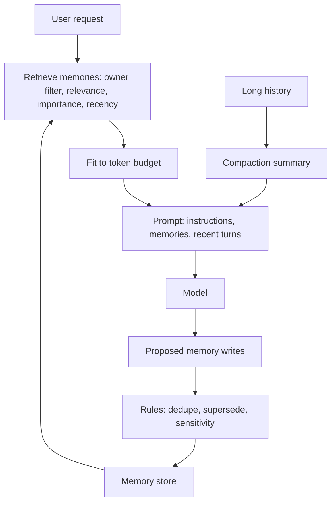

## In one minute
- Models are stateless. Everything an agent "remembers" is something your code chose to store and put back into a later prompt. Memory is a data design problem, not a model feature.
- Separate the kinds: working memory (this task's context), session state (this conversation), long-term memory (facts and preferences that outlive sessions) and durable task state (progress of a long job).
- Long-term memory needs the same care as any user data: what to store, how to retrieve it, when to forget it, who can see it, and how users can view and delete it.
- Retrieval decides usefulness: score memories by relevance to the current task, importance and recency, and fit them into a token budget.
- Compaction keeps long sessions alive: summarise older history into a short record of decisions and facts, keep recent turns verbatim, and store details outside the context where the agent can look them up.

## How it works

### Four kinds of state
The split follows the usual agent taxonomy: short-term memory is in-context, bounded by the finite context window, while long-term memory is an external store queried at retrieval time ([Weng](https://lilianweng.github.io/posts/2023-06-23-agent/)).

- **Working memory:** the current context window: instructions, recent turns, tool results. Fast and expensive, limited by tokens.
- **Session state:** the conversation so far, stored by your app and replayed or summarised on each call.
- **Long-term memory:** facts that should persist across sessions: "prefers metric units", "team uses Postgres 16", "customer is on the enterprise plan". Stored in a database or files, retrieved when relevant.
- **Task state:** for long-running agents, the plan, completed steps, tool-call results and idempotency keys, persisted so the task can resume after a crash.

### Writing memories
Decide what is worth remembering. Good candidates: stable preferences, decisions with their reasons, facts learned from tools that are expensive to recompute. Bad candidates: everything (noise drowns signal), transient details, and sensitive data you do not need. Many systems let the model propose memories through a tool ("remember: user prefers short answers"), then apply rules in code before storing: deduplicate, attach source and timestamp, classify sensitivity.

### Reading memories
At the start of a turn, retrieve memories relevant to the current request. Common scoring combines:
- **Relevance:** keyword overlap or embedding similarity with the request.
- **Importance:** a score given when the memory was written ("allergy" outranks "liked the blue theme").
- **Recency:** newer memories usually matter more, and stale ones may be wrong.

Fit the top memories into a fixed token budget (Huyen's *AI Engineering*, Ch 6, treats memory as a first-class part of agents next to planning and tools), and show where each came from so the model can weigh it. MemGPT framed this like an operating system: a main context (read-only instructions, a small read/write working-context block and a FIFO queue of recent messages) plus external recall and archival storage that the model pages in and out through function calls. It warns the model at about 70% of the window so it can save what matters, and at the limit evicts a set count of messages (for example 50% of the context window) into a recursive summary while the full messages stay searchable in recall storage ([Packer et al.](https://arxiv.org/abs/2310.08560)). The Generative Agents paper gave the scoring recipe most memory systems copy: min-max normalised recency (exponential decay, factor 0.995 per game hour), importance (an integer 1 to 10 rated by the model at write time) and relevance (embedding cosine similarity), summed with equal weights, plus periodic reflections triggered when recent importance sums past 150 ([Park et al.](https://arxiv.org/abs/2304.03442)).

### Compaction
Long sessions hit the context limit and degrade before that. Compaction replaces old history with a summary: decisions made, facts established, open questions, and pointers to stored details (files, notes). Keep the most recent turns verbatim. Some agent harnesses do this automatically when the context reaches a threshold; others ask the agent to maintain a notes file it can reread. Anthropic describes context as a finite resource whose recall degrades as it fills ("context rot"), and Claude Code's compaction keeps architectural decisions and unresolved bugs, drops redundant tool output, and continues with the summary plus the five most recently accessed files; clearing old tool results is the lightest form ([Anthropic](https://www.anthropic.com/engineering/effective-context-engineering-for-ai-agents)). For multi-session work, the pattern is an initializer session that creates a progress file, a feature checklist and a git history, so every later session starts by reading them and ends by updating them ([Anthropic](https://www.anthropic.com/engineering/effective-harnesses-for-long-running-agents)).

### Forgetting and privacy
Memories go stale ("works at Acme" after a job change) and can be wrong. Expire low-importance memories after some time, let newer facts supersede older ones, and give users a way to view, correct and delete what is stored. Anthropic's memory tool documentation tells implementers to cap file sizes, expire files that have not been accessed in a long time, and strip sensitive data before writing ([Claude docs](https://platform.claude.com/docs/en/agents-and-tools/tool-use/memory-tool)). Memories are personal data: apply retention limits, access control (one user's memories must never appear in another's context) and deletion on request.

### A concrete implementation: the memory tool
Anthropic's memory tool is client-side: Claude emits tool calls (`view`, `create`, `str_replace`, `insert`, `delete`, `rename`) against a `/memories` directory, and your application executes them against storage you control, such as a per-user directory or database keys. The API adds a system instruction to view the memory directory first and to assume the context may be reset at any moment. Because the model chooses the paths, your handler must canonicalise and reject anything outside `/memories`, including `../` and URL-encoded variants. The docs also pair it with server-side compaction: compaction shrinks the active context, and memory keeps what must survive summarisation ([Claude docs](https://platform.claude.com/docs/en/agents-and-tools/tool-use/memory-tool)).

### The same shapes as any system
Memory is a cache with eviction (what to keep in the expensive context), an index (finding relevant items fast) and a database with retention rules. Task state is a durable job record; a workflow engine such as Temporal rebuilds it by replaying a recorded event history rather than restoring a snapshot ([Temporal docs](https://docs.temporal.io/workflows)). Nothing about it is unique to AI except that the reader is a model.

## Down the stack

### Layer 1: The contract
An agent's memory system promises: relevant facts from earlier sessions are available when needed, within a token budget; memories are scoped to their owner; users can see and delete them; and long tasks resume from their last completed step without repeating side effects.

### Layer 2: The mechanism
Long-term memories are rows with fields such as owner, text, embedding, importance, created and last-used timestamps, source and sensitivity. Retrieval runs a filtered similarity search by owner, then re-scores with importance and recency, then truncates to the budget. Supersession is handled by keys ("preference:units") so a new value replaces the old. Compaction is a model call that summarises a span of history into a structured note, stored and inserted in place of that span. Task state is stored per step, often in a workflow engine or a table keyed by task ID and step number.

### Layer 3: The machine
Every remembered token placed into the prompt is processed again on every call: a 2,000-token memory block in a 20-turn conversation is 40,000 input tokens of cost and prefill latency. That is why budgets and ranking matter more than storage size; storing a million memories in a database is cheap, putting a thousand of them into each prompt is not. Prompt caching helps only if the memory block stays identical across calls, so systems often fix the memory block at the start of a session rather than changing it every turn.

### Why it's built this way
1. Models forget everything between calls, so state lives in your systems.
2. Context is expensive and attention is finite, so only relevant memories should enter it.
3. Relevance alone misses importance and staleness, so scoring combines several signals.
4. Memories are user data, so ownership, retention and deletion apply.
5. Long tasks fail midway, so their state must be durable and idempotent.

## Diagram


## Worked example
A personal coding assistant remembers project facts across sessions. Version one stores every message in a memory table and inserts the 30 most similar ones into each prompt. After two months, users report the assistant suggesting a library the team removed months ago, and prompts have grown to 9,000 memory tokens.

Version two changes three things. Writes go through rules: only facts and decisions, each with a key ("db:engine", "lint:tool"), importance from 1 to 10 and a source; a new fact with the same key replaces the old one. Reads score each memory as three times keyword or semantic overlap, plus importance, minus age in days for low-importance items, and take the top 8 within a 1,000-token budget. A weekly job forgets memories older than 90 days with importance below 4 that have not been used. Users get a "what do you remember about this project?" command that lists memories with delete buttons.

Results: memory tokens per prompt drop from 9,000 to under 1,000, the stale-library complaints stop because the newer "lint:tool" fact replaced the old one, and cost per session falls by about 40 percent.

## In the wild
- **Anthropic, 2025: long-running coding agents lose the thread across context windows.** Without scaffolding, agents tried to build the whole app in one pass and ran out of context mid-feature, later sessions declared the project finished too early, and features were marked done after unit tests without end-to-end checks. The fix was an initializer session, a progress file, a JSON feature list (over 200 items in the example) and git commits as recovery points ([Anthropic](https://www.anthropic.com/engineering/effective-harnesses-for-long-running-agents)).
- **Anthropic, 2025: memory-tool path traversal is a documented attack surface.** The docs warn that a path such as `/memories/../../secrets.env` can escape the memory directory unless every command validates paths, and list canonical-path checks and rejection of encoded traversal as required safeguards ([Claude docs](https://platform.claude.com/docs/en/agents-and-tools/tool-use/memory-tool)).
- **Greshake et al., 2023: poisoned retrieved content persists as attack payload.** Instructions planted in data an LLM app later retrieves can take over its behaviour, so anything an agent writes to long-term memory from untrusted tool output can re-inject itself in later sessions ([arXiv](https://arxiv.org/abs/2302.12173)).

## Trade-offs
| Approach | Strengths | Weaknesses | Choose when |
| --- | --- | --- | --- |
| Replay full history | Nothing lost | Grows without bound | Short conversations |
| Summary plus recent turns | Bounded size | Summaries can drop details | Long sessions |
| Retrieved long-term memories | Personalised, scalable | Retrieval errors, staleness | Repeat users and projects |
| Notes file the agent maintains | Transparent, editable | Agent must keep it current | Coding and research agents |
| Durable task state in a workflow engine | Resumable, auditable | Infrastructure | Long-running, side-effecting tasks |

## Pitfalls in production
- Storing everything and retrieving by similarity alone. Fix: write rules, keys for supersession, importance and recency in scoring.
- Memories leaking across users or tenants. Fix: owner filters enforced in the store, tested.
- Stale facts overriding new ones. Fix: keyed memories, timestamps, expiry.
- No user visibility or deletion. Fix: list, edit and delete controls, and retention limits.
- Memory blocks that change every turn and defeat caching. Fix: stable memory block per session.

## Leadership lens
- Treat memory as a product feature with a privacy review, not an implementation detail.
- Define memory types, write rules and retention per type in the design doc.
- Measure memory usefulness: how often retrieved memories are referenced, and complaints about stale or wrong recall.
- Build task state on durable infrastructure from the start; retrofitting resumability is painful.

## Check yourself
1. Why is "the model remembers" a misleading way to think about agent memory?
   **Answer:** The model keeps nothing between calls; your code stores information and chooses what to put back into each prompt.
2. Why combine relevance with importance and recency when retrieving memories?
   **Answer:** Relevance alone can surface trivial or outdated items; importance and recency help prefer critical and current facts.
3. What should compaction preserve?
   **Answer:** Decisions, established facts, open questions and pointers to stored details, while recent turns stay verbatim.
4. Why do memories need deletion and retention rules?
   **Answer:** They are user data that can be wrong, stale or sensitive, so users and laws require the ability to correct and remove them.

## Practice
**Task:** Build a small memory store. `MemoryStore()` has `remember(key, words, importance, t)`, where `words` is a list of keywords, `importance` is 1 to 10 and `t` is a time in hours; a memory with an existing key replaces the old one. `recall(query, now, k)` scores each memory as `3 * overlap + importance - age_days` where `overlap` is the number of query words in the memory's words and `age_days` is `(now - t) // 24`, keeps memories with `overlap > 0` and a positive score, and returns up to `k` keys sorted by score, then newer first, then key. `forget(now, max_age_hours, min_importance)` deletes memories older than `max_age_hours` with importance below `min_importance` and returns their keys sorted.

```python starter
class MemoryStore:
    def __init__(self):
        # TODO
        pass

    def remember(self, key, words, importance, t):
        # TODO
        raise NotImplementedError

    def recall(self, query, now, k):
        # TODO
        raise NotImplementedError

    def forget(self, now, max_age_hours, min_importance):
        # TODO
        raise NotImplementedError
```

```python tests
def store():
    s = MemoryStore()
    s.remember("db:engine", ["postgres", "database", "16"], 8, 0)
    s.remember("lint:tool", ["lint", "eslint"], 5, 0)
    s.remember("style:answers", ["short", "answers"], 3, 0)
    return s

def test_recall_by_relevance():
    assert store().recall(["database", "migration"], 24, 5) == ["db:engine"]

def test_supersede_by_key():
    s = store()
    s.remember("lint:tool", ["lint", "biome"], 5, 100)
    assert s.recall(["lint", "eslint"], 120, 5) == ["lint:tool"]
    assert s.recall(["eslint"], 120, 5) == []

def test_importance_and_recency_order():
    s = MemoryStore()
    s.remember("a", ["deploy"], 2, 0)
    s.remember("b", ["deploy"], 2, 48)
    s.remember("c", ["deploy"], 9, 0)
    assert s.recall(["deploy"], 72, 3) == ["c", "b", "a"]

def test_old_low_importance_scores_out():
    s = MemoryStore()
    s.remember("old", ["theme"], 1, 0)
    assert s.recall(["theme"], 24 * 10, 3) == []

def test_k_limit():
    s = store()
    assert s.recall(["postgres", "lint", "short"], 0, 2) == ["db:engine", "lint:tool"]

def test_forget():
    s = store()
    s.remember("recent", ["x"], 1, 2000)
    assert s.forget(2200, 1000, 4) == ["style:answers"]
    assert s.recall(["short"], 2200, 5) == []
```

```python solution
class MemoryStore:
    def __init__(self):
        self.items = {}

    def remember(self, key, words, importance, t):
        self.items[key] = (set(words), importance, t)

    def recall(self, query, now, k):
        q = set(query)
        scored = []
        for key, (words, imp, t) in self.items.items():
            overlap = len(q & words)
            score = 3 * overlap + imp - (now - t) // 24
            if overlap > 0 and score > 0:
                scored.append((-score, -t, key))
        return [key for _, _, key in sorted(scored)[:k]]

    def forget(self, now, max_age_hours, min_importance):
        gone = sorted(key for key, (_, imp, t) in self.items.items()
                      if now - t > max_age_hours and imp < min_importance)
        for key in gone:
            del self.items[key]
        return gone
```

```typescript starter
export class MemoryStore {
  remember(key: string, words: string[], importance: number, t: number): void {
    throw new Error("TODO");
  }

  recall(query: string[], now: number, k: number): string[] {
    throw new Error("TODO");
  }

  forget(now: number, maxAgeHours: number, minImportance: number): string[] {
    throw new Error("TODO");
  }
}
```

```typescript tests
const store = () => {
  const s = new MemoryStore();
  s.remember("db:engine", ["postgres", "database", "16"], 8, 0);
  s.remember("lint:tool", ["lint", "eslint"], 5, 0);
  s.remember("style:answers", ["short", "answers"], 3, 0);
  return s;
};

test("recall by relevance", () => {
  assertEqual(store().recall(["database", "migration"], 24, 5), ["db:engine"]);
});

test("supersede by key", () => {
  const s = store();
  s.remember("lint:tool", ["lint", "biome"], 5, 100);
  assertEqual(s.recall(["lint", "eslint"], 120, 5), ["lint:tool"]);
  assertEqual(s.recall(["eslint"], 120, 5), []);
});

test("importance and recency order", () => {
  const s = new MemoryStore();
  s.remember("a", ["deploy"], 2, 0);
  s.remember("b", ["deploy"], 2, 48);
  s.remember("c", ["deploy"], 9, 0);
  assertEqual(s.recall(["deploy"], 72, 3), ["c", "b", "a"]);
});

test("old low importance scores out", () => {
  const s = new MemoryStore();
  s.remember("old", ["theme"], 1, 0);
  assertEqual(s.recall(["theme"], 240, 3), []);
});

test("k limit", () => {
  assertEqual(store().recall(["postgres", "lint", "short"], 0, 2), ["db:engine", "lint:tool"]);
});

test("forget", () => {
  const s = store();
  s.remember("recent", ["x"], 1, 2000);
  assertEqual(s.forget(2200, 1000, 4), ["style:answers"]);
  assertEqual(s.recall(["short"], 2200, 5), []);
});
```

```typescript solution
export class MemoryStore {
  private items = new Map<string, { words: Set<string>; imp: number; t: number }>();

  remember(key: string, words: string[], importance: number, t: number): void {
    this.items.set(key, { words: new Set(words), imp: importance, t });
  }

  recall(query: string[], now: number, k: number): string[] {
    const scored: { key: string; score: number; t: number }[] = [];
    this.items.forEach((m, key) => {
      const overlap = Array.from(new Set(query)).filter(w => m.words.has(w)).length;
      const score = 3 * overlap + m.imp - Math.floor((now - m.t) / 24);
      if (overlap > 0 && score > 0) scored.push({ key, score, t: m.t });
    });
    scored.sort((a, b) => b.score - a.score || b.t - a.t || (a.key < b.key ? -1 : 1));
    return scored.slice(0, k).map(x => x.key);
  }

  forget(now: number, maxAgeHours: number, minImportance: number): string[] {
    const gone: string[] = [];
    this.items.forEach((m, key) => { if (now - m.t > maxAgeHours && m.imp < minImportance) gone.push(key); });
    gone.forEach(key => this.items.delete(key));
    return gone.sort();
  }
}
```

```go starter
package practice

type MemoryStore struct{}

func NewMemoryStore() *MemoryStore {
	return &MemoryStore{}
}

func (s *MemoryStore) Remember(key string, words []string, importance, t int) {
	panic("TODO")
}

func (s *MemoryStore) Recall(query []string, now, k int) []string {
	panic("TODO")
}

func (s *MemoryStore) Forget(now, maxAgeHours, minImportance int) []string {
	panic("TODO")
}
```

```go tests
package practice

import (
	"reflect"
	"testing"
)

func newStore() *MemoryStore {
	s := NewMemoryStore()
	s.Remember("db:engine", []string{"postgres", "database", "16"}, 8, 0)
	s.Remember("lint:tool", []string{"lint", "eslint"}, 5, 0)
	s.Remember("style:answers", []string{"short", "answers"}, 3, 0)
	return s
}

func same(t *testing.T, got, want []string) {
	t.Helper()
	if len(got) == 0 && len(want) == 0 {
		return
	}
	if !reflect.DeepEqual(got, want) {
		t.Fatalf("got %v, want %v", got, want)
	}
}

func TestRelevance(t *testing.T) {
	same(t, newStore().Recall([]string{"database", "migration"}, 24, 5), []string{"db:engine"})
}

func TestSupersede(t *testing.T) {
	s := newStore()
	s.Remember("lint:tool", []string{"lint", "biome"}, 5, 100)
	same(t, s.Recall([]string{"lint", "eslint"}, 120, 5), []string{"lint:tool"})
	same(t, s.Recall([]string{"eslint"}, 120, 5), nil)
}

func TestOrder(t *testing.T) {
	s := NewMemoryStore()
	s.Remember("a", []string{"deploy"}, 2, 0)
	s.Remember("b", []string{"deploy"}, 2, 48)
	s.Remember("c", []string{"deploy"}, 9, 0)
	same(t, s.Recall([]string{"deploy"}, 72, 3), []string{"c", "b", "a"})
}

func TestScoresOut(t *testing.T) {
	s := NewMemoryStore()
	s.Remember("old", []string{"theme"}, 1, 0)
	same(t, s.Recall([]string{"theme"}, 240, 3), nil)
}

func TestK(t *testing.T) {
	same(t, newStore().Recall([]string{"postgres", "lint", "short"}, 0, 2), []string{"db:engine", "lint:tool"})
}

func TestForget(t *testing.T) {
	s := newStore()
	s.Remember("recent", []string{"x"}, 1, 2000)
	same(t, s.Forget(2200, 1000, 4), []string{"style:answers"})
	same(t, s.Recall([]string{"short"}, 2200, 5), nil)
}
```

```go solution
package practice

import "sort"

type memory struct {
	words map[string]bool
	imp   int
	t     int
}

type MemoryStore struct{ items map[string]memory }

func NewMemoryStore() *MemoryStore {
	return &MemoryStore{items: map[string]memory{}}
}

func (s *MemoryStore) Remember(key string, words []string, importance, t int) {
	w := map[string]bool{}
	for _, x := range words {
		w[x] = true
	}
	s.items[key] = memory{w, importance, t}
}

func (s *MemoryStore) Recall(query []string, now, k int) []string {
	q := map[string]bool{}
	for _, x := range query {
		q[x] = true
	}
	type scored struct {
		key      string
		score, t int
	}
	var list []scored
	for key, m := range s.items {
		overlap := 0
		for w := range q {
			if m.words[w] {
				overlap++
			}
		}
		score := 3*overlap + m.imp - (now-m.t)/24
		if overlap > 0 && score > 0 {
			list = append(list, scored{key, score, m.t})
		}
	}
	sort.Slice(list, func(i, j int) bool {
		if list[i].score != list[j].score {
			return list[i].score > list[j].score
		}
		if list[i].t != list[j].t {
			return list[i].t > list[j].t
		}
		return list[i].key < list[j].key
	})
	out := []string{}
	for i := 0; i < len(list) && i < k; i++ {
		out = append(out, list[i].key)
	}
	return out
}

func (s *MemoryStore) Forget(now, maxAgeHours, minImportance int) []string {
	gone := []string{}
	for key, m := range s.items {
		if now-m.t > maxAgeHours && m.imp < minImportance {
			gone = append(gone, key)
		}
	}
	for _, key := range gone {
		delete(s.items, key)
	}
	sort.Strings(gone)
	return gone
}
```

## Mock interview
**Prompt:** Your company's AI assistant is used by 2 million people. Product wants it to "remember" users across conversations: preferences, ongoing projects and past decisions. Design the memory system.

- Follow-up: A user says the assistant keeps bringing up a job they left. What went wrong, and what is the fix?
- Follow-up: How do you prevent one user's memories from appearing in another's conversation?
- Follow-up: How do you measure whether memory makes the product better?

**A strong answer covers:**
- Memory types and what is stored: keyed facts and preferences with importance, source and timestamps, not raw transcripts.
- Write rules: model-proposed memories filtered by code, deduplicated, superseded by key, with sensitivity classification.
- Retrieval: owner-filtered similarity search, scoring with importance and recency, a token budget, stable memory block per session.
- User controls: view, edit and delete; retention limits and legal deletion.
- Isolation enforced in the storage layer and tested, never relying on prompts.
- Measurement: A/B tests on task success and satisfaction, rates of stale or wrong recall, cost per conversation.

## Sources and further study
**Primary**
- [MemGPT: Towards LLMs as Operating Systems](https://arxiv.org/abs/2310.08560) (Packer et al.): tiered memory, memory-pressure warnings and recursive summaries.
- [Generative Agents: Interactive Simulacra of Human Behavior](https://arxiv.org/abs/2304.03442) (Park et al.): recency, importance and relevance retrieval and reflection.

**Systems docs**
- [Memory tool (Claude docs)](https://platform.claude.com/docs/en/agents-and-tools/tool-use/memory-tool): commands, `/memories` layout and security considerations.
- [Compaction (Claude docs)](https://platform.claude.com/docs/en/build-with-claude/compaction): server-side summarisation as it nears the window limit.
- [Effective context engineering for AI agents (Anthropic)](https://www.anthropic.com/engineering/effective-context-engineering-for-ai-agents): context rot, compaction, note-taking and sub-agents.
- [Effective harnesses for long-running agents (Anthropic)](https://www.anthropic.com/engineering/effective-harnesses-for-long-running-agents): progress files and git across sessions.
- [Temporal workflows](https://docs.temporal.io/workflows): durable task state via event history replay.

**Books**
- *AI Engineering* (Chip Huyen, O'Reilly 2025), Ch 6 "RAG and Agents" (Agents; Memory): short-term versus long-term memory and retrieval.

**Other curricula**
- [LLM Powered Autonomous Agents (Lilian Weng)](https://lilianweng.github.io/posts/2023-06-23-agent/): frames agent memory as short-term (in-context) and long-term (external retrieval) components.

## Free resources
- [MemGPT: Towards LLMs as Operating Systems](https://arxiv.org/abs/2310.08560): paging information between context and external storage.
- [Memory tool (Anthropic docs)](https://platform.claude.com/docs/en/agents-and-tools/tool-use/memory-tool): letting an agent store and retrieve information across conversations.
- [Managing context on the Claude Developer Platform (Anthropic)](https://claude.com/resources/articles/context-management): context editing and memory for long-running agents.
- [Effective context engineering for AI agents (Anthropic)](https://www.anthropic.com/engineering/effective-context-engineering-for-ai-agents): compaction, notes and sub-agents.
- [Temporal workflows](https://docs.temporal.io/workflows): durable state for long-running tasks.
