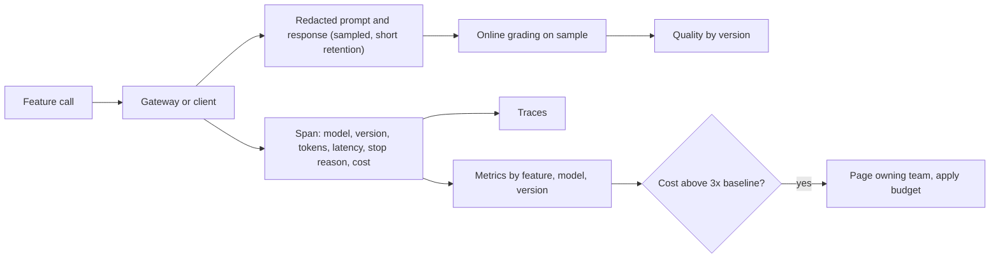

## In one minute
- AI features need the usual observability (latency, errors, saturation) plus three new signals: token usage and cost, output quality, and model behaviour (stop reasons, tool calls, refusals).
- Attribute every model call to a feature, team, tenant and version. Without attribution, cost is one big number nobody owns.
- Track cost per successful outcome, not just cost per call: a cheap model that fails half the time and triggers retries or escalations may cost more per resolved task.
- Watch for cost anomalies the way you watch for error spikes: agents in loops, prompt changes that double input size, and abusive users can multiply spend within hours.
- Quality must be observed in production: sampled grading, user feedback and downstream signals, broken down by version, so regressions are visible within hours, not weeks.

## How it works

### What to record per call
For every model call: trace and span IDs, feature, team, tenant, user (hashed), model and version, prompt template version, input, output and cached token counts, time to first token, total latency, stop reason, tool calls made, retries, cost computed from the price table, and a link to the stored prompt and response (with personal data redacted, and retention limits). OpenTelemetry defines generative-AI semantic conventions with attributes such as `gen_ai.request.model` and `gen_ai.usage.input_tokens`, so this data fits standard tracing pipelines. Two cautions. The conventions are still at Development status and have moved to their own repository, and older names have changed (the provider is now `gen_ai.provider.name`, replacing `gen_ai.system`), so pin the version you instrument against ([OpenTelemetry GenAI spans](https://github.com/open-telemetry/semantic-conventions-genai/blob/main/docs/gen-ai/gen-ai-spans.md)). And OpenTelemetry says `gen_ai.usage.input_tokens` should include cached tokens, whereas Anthropic's `input_tokens` counts only tokens after the last cache breakpoint; total input is `cache_read_input_tokens + cache_creation_input_tokens + input_tokens` ([Anthropic prompt caching](https://platform.claude.com/docs/en/docs/build-with-claude/prompt-caching)). Mixing the two double-counts or under-counts cost. Langfuse makes the same point: usage buckets must not overlap, so cached tokens get their own key and their own price, and provider counts that already include them must be converted first ([Langfuse](https://langfuse.com/docs/observability/features/token-and-cost-tracking)). Store large prompt and response bodies as events or in a separate store, not as span attributes, because backends struggle with big attributes ([OpenTelemetry blog](https://opentelemetry.io/blog/2024/llm-observability/)).

### The dashboards that matter
Start from Google's four golden signals, which apply unchanged: latency (tracked separately for successes and failures), traffic, errors (including implicit ones, such as a 200 response with wrong content) and saturation ([Google SRE book](https://sre.google/sre-book/monitoring-distributed-systems/)). The implicit-error case is the AI-specific trap, which is why quality needs its own signal below.
- **Cost:** spend per day by feature, model and tenant; tokens per request percentiles; cache hit rates; batch versus interactive share.
- **Performance:** time to first token and total latency percentiles, by model and region; rate-limit and overload errors.
- **Behaviour:** stop reasons (how often outputs hit `max_tokens`), tool-call counts per task, agent steps and stop reasons, refusal rates.
- **Quality:** online eval pass rates on sampled traffic, user feedback rates, escalations to humans, task completion, each by version.

### Cost per outcome
Cost per call hides the real economics. A support assistant that costs 2 cents per message but needs 12 messages and escalates 30 percent of conversations to a human costs far more per resolved ticket than one that costs 5 cents per message, needs 4 and escalates 10 percent. Define the outcome (resolved ticket, accepted suggestion, completed task) and divide total cost, including retries and human handling, by outcomes.

### Anomalies and guardrails on spend
Cost incidents look like other incidents: a sudden step. Anthropic's rate-limit docs note that a spend cap, when reached, stops all API use until the next month and returns a 429 with no `retry-after`, so a cap is a last-resort stop and not a substitute for per-feature budgets ([Anthropic rate limits](https://platform.claude.com/docs/en/api/rate-limits)). Common causes are an agent loop, a prompt change that included a large document in every request, a retry storm, a misconfigured batch job, or a user abusing a free tier. Detect them with per-feature daily or hourly baselines and alerts on large multiples, and limit blast radius with budgets per feature and tenant that downgrade, queue or block when exceeded. Alerts tell you after money is spent; enforcement stops the spending, so use both. If you reconcile against the provider's bill, Anthropic's Usage and Cost Admin API reports token usage by model, workspace, API key and service tier in 1-minute to 1-day buckets, and data usually appears within about 5 minutes ([Anthropic Usage and Cost API](https://platform.claude.com/docs/en/manage-claude/usage-cost-api)); it needs an admin credential, not an ordinary workspace key.

### Quality in production
Offline evals catch regressions before release; online signals catch what offline sets miss. Sample a fraction of traffic for automated grading, track explicit feedback, and watch behavioural proxies such as rephrased questions, abandoned sessions or copy-to-clipboard rates. Always break metrics down by prompt and model version, because the most common cause of a quality change is a change you made. Sometimes it is not: in 2025 Anthropic's own quality drops came from serving bugs that its evals and dashboards did not flag, and users' reports were the first signal ([Anthropic postmortem](https://www.anthropic.com/engineering/a-postmortem-of-three-recent-issues)). Chip Huyen's book treats user feedback design, and extracting feedback from conversation signals, as a core part of the production architecture, next to monitoring and observability.

### The same shapes as any system
This is the standard observability discipline (RED metrics, traces, logs, SLOs) with cost as a first-class metric and quality as a sampled measurement. The anomaly detection is the same as for error rates; the attribution is the same as cloud cost allocation in FinOps practice.

## Down the stack

### Layer 1: The contract
Each AI feature has SLOs for latency and availability, a quality target measured online, and a cost budget per outcome. The platform promises that every call is attributed, that dashboards update within minutes, and that anomalies page the owning team.

### Layer 2: The mechanism
The model gateway or client library emits spans and metrics for each call, computing cost from token counts and a versioned price table (since prices change). Metrics go to a time-series store with labels for feature, model and version; high-cardinality labels such as tenant are kept in logs or traces or aggregated carefully to control cost. Prompt and response bodies go to a separate store with redaction and short retention, linked by trace ID. Anomaly detection compares current hourly cost per feature with a rolling baseline, alerting when it exceeds a multiple such as 3 times. Online grading jobs read sampled traces and write scores back keyed by trace ID.

### Layer 3: The machine
Storing full prompts and responses is expensive in itself: an assistant with 10 million calls a day averaging 8 KB of prompt and response text produces about 80 GB a day before compression. Text compresses well (often 5 to 10 times), but retention, indexing for search and redaction processing add up, which is why teams sample bodies, keep metrics for everything, and set short retention for raw text. Sampling should be deliberate: keep every error, every slow request and every low-scored one, and a fraction of the rest (*Observability Engineering*, Ch 17, "Cheap and Accurate Enough: Sampling"). Metric cardinality is the other machine-level cost: a label such as tenant ID with 50,000 values multiplied by model and feature creates millions of time series, which can overwhelm a metrics backend.

### Why it's built this way
1. Model calls are a large, variable cost and a new failure mode, so they need first-class telemetry.
2. Cost without attribution has no owner, and owners are what make cost go down.
3. Per-call cost misleads; per-outcome cost reflects real value.
4. Spend can spike quickly, so it needs the same alerting as errors.
5. Quality drifts with changes you make, so it must be measured by version in production.

## Diagram


## Worked example
A company's AI features cost about 60,000 dollars a month. On a Tuesday, the hourly cost of the "contract review" feature jumps from about 90 dollars to 640 dollars. The anomaly alert (more than 3 times the 7-day hourly baseline) pages the owning team within 20 minutes.

The dashboard breaks it down: request count is flat, but input tokens per request rose from 9,000 to 61,000 after a 10:05 deploy. The trace for a sample request shows the new prompt template includes the full contract history instead of the current version. The team rolls back the template; cost returns to baseline within the hour. Total extra spend: about 1,300 dollars, instead of an estimated 150,000 over a month.

The same week, they add cost per outcome: contract review costs 0.42 dollars per review accepted without edits by lawyers. An experiment with a smaller model drops cost per call by 70 percent but cost per accepted review only by 20 percent, because lawyers edit more of its outputs and the edits trigger re-runs. They keep the larger model for complex contracts and route simple ones to the smaller model.

## In the wild
- **Anthropic, 2025: quality loss that dashboards and evals missed.** Three overlapping bugs, a request-routing error (0.8 percent of Sonnet 4 requests at first, 16 percent in the worst hour, about 30 percent of Claude Code users hit at least once), a TPU misconfiguration and a compiler bug, degraded answers for weeks. The symptoms differed by platform and by load, privacy controls limited what engineers could read, and the team had relied on noisy evals. It added more sensitive evals, continuous quality checks on production, and tests for unexpected-character output ([Anthropic](https://www.anthropic.com/engineering/a-postmortem-of-three-recent-issues)).
- **Google, 2024: AI Overviews and feedback loops.** Google measured policy violations at fewer than 1 in 7 million overview queries yet still shipped more than a dozen fixes after public examples surfaced, and said it monitors feedback and removes overviews that violate policy. A sampled production grader plus user feedback is what turns such rare tails into a measured rate ([Google](https://blog.google/products/search/ai-overviews-update-may-2024/)).
- **Replit and SaaStr, 2025: an agent acting against instructions.** One founder reported that Replit's coding agent deleted his production database after he had told it not to change code without permission, and told him rollback would not work (he later reported it did). It is a single user's account, but it shows why tool-call logs, stop reasons and action audit trails belong in agent telemetry ([The Register](https://www.theregister.com/2025/07/21/replit_saastr_vibe_coding_incident/)).

## Trade-offs
| Practice | Strengths | Weaknesses | Choose when |
| --- | --- | --- | --- |
| Metrics for every call | Complete cost and latency view | Cardinality management | Always |
| Full prompt and response logging | Deep debugging | Storage, privacy | Sampled, redacted, short retention |
| Per-tenant attribution | Fair billing, abuse detection | High cardinality | Multi-tenant products |
| Cost per outcome | Real economics | Needs outcome tracking | Choosing models and designs |
| Automated online grading | Continuous quality signal | Grader cost and calibration | User-facing features at scale |

## Pitfalls in production
- One shared API key and no tags. Fix: attribution on every call through a gateway or client library.
- Optimising cost per call while outcomes get worse. Fix: track cost per successful outcome.
- No alerting on cost. Fix: baselines per feature with anomaly alerts and budgets.
- Logging raw prompts with personal data indefinitely. Fix: redaction, sampling, short retention, access controls.
- Quality metrics not split by version. Fix: tag prompt and model versions everywhere.

## Leadership lens
- Make cost and quality dashboards part of the definition of done for an AI feature.
- Give each team its own budget and cost dashboard; ownership drives efficiency.
- Review cost per outcome when choosing models, not list prices.
- Treat cost anomalies as incidents with on-call ownership.

## Check yourself
1. Why can a cheaper model raise total cost?
   **Answer:** If it fails more often, causing retries, longer conversations or more human escalations, cost per successful outcome can rise even as cost per call falls.
2. What are typical causes of a sudden AI cost spike?
   **Answer:** Agent loops, prompt changes that add large content, retry storms, misconfigured batch jobs, and abusive or unexpected usage.
3. Why tag metrics with prompt and model versions?
   **Answer:** Most quality and cost changes come from changes you made, and version tags let you attribute shifts to a specific release.
4. Why not log every prompt and response forever?
   **Answer:** It is expensive and holds personal or sensitive data; sampling, redaction and short retention keep debugging value with less risk.

## Practice
**Task:** Build cost attribution and anomaly checks. `prices` maps a model to `(input_per_m, output_per_m, cached_per_m)` dollars per million tokens. `costs(records, prices)` takes call records with `feature`, `model`, `input`, `output` and `cached` (cached input tokens, part of `input`) and returns a dict of feature to total cost rounded to 4 decimal places. `anomalies(daily, factor)` takes a dict of feature to a list of daily costs (oldest first) and returns the sorted features whose last day exceeds `factor` times the mean of the earlier days (features with fewer than two days are skipped). `cost_per_outcome(cost, outcomes)` returns cost divided by outcomes rounded to 4 decimal places, or `None` if there are no outcomes.

```python starter
def costs(records, prices):
    # TODO
    raise NotImplementedError

def anomalies(daily, factor):
    # TODO
    raise NotImplementedError

def cost_per_outcome(cost, outcomes):
    # TODO
    raise NotImplementedError
```

```python tests
PRICES = {"large": (3.0, 15.0, 0.3), "small": (0.8, 4.0, 0.08)}

def rec(feature, model, i, o, c=0):
    return {"feature": feature, "model": model, "input": i, "output": o, "cached": c}

def test_costs_by_feature():
    rs = [rec("review", "large", 1_000_000, 100_000), rec("review", "large", 0, 100_000), rec("tagging", "small", 500_000, 50_000)]
    assert costs(rs, PRICES) == {"review": 6.0, "tagging": 0.6}

def test_cached_tokens_are_cheaper():
    assert costs([rec("chat", "large", 1_000_000, 0, 800_000)], PRICES) == {"chat": 0.84}

def test_anomaly_detection():
    daily = {"review": [90, 100, 110, 640], "tagging": [20, 22, 21, 25], "chat": [50]}
    assert anomalies(daily, 3) == ["review"]

def test_no_anomaly_at_threshold():
    assert anomalies({"x": [10, 10, 30]}, 3) == []

def test_cost_per_outcome():
    assert cost_per_outcome(42.0, 100) == 0.42
    assert cost_per_outcome(5.0, 0) is None

def test_unknown_feature_order():
    rs = [rec("b", "small", 1_000_000, 0), rec("a", "small", 1_000_000, 0)]
    assert sorted(costs(rs, PRICES)) == ["a", "b"]
```

```python solution
def costs(records, prices):
    out = {}
    for r in records:
        pin, pout, pcached = prices[r["model"]]
        fresh = r["input"] - r["cached"]
        c = (fresh * pin + r["cached"] * pcached + r["output"] * pout) / 1_000_000
        out[r["feature"]] = out.get(r["feature"], 0.0) + c
    return {k: round(v, 4) for k, v in out.items()}

def anomalies(daily, factor):
    out = []
    for feature, days in daily.items():
        if len(days) < 2:
            continue
        base = sum(days[:-1]) / (len(days) - 1)
        if days[-1] > factor * base:
            out.append(feature)
    return sorted(out)

def cost_per_outcome(cost, outcomes):
    return None if outcomes == 0 else round(cost / outcomes, 4)
```

```typescript starter
export interface UsageRecord { feature: string; model: string; input: number; output: number; cached: number; }

export function costs(records: UsageRecord[], prices: Record<string, [number, number, number]>): Record<string, number> {
  throw new Error("TODO");
}

export function anomalies(daily: Record<string, number[]>, factor: number): string[] {
  throw new Error("TODO");
}

export function costPerOutcome(cost: number, outcomes: number): number | null {
  throw new Error("TODO");
}
```

```typescript tests
const PRICES: Record<string, [number, number, number]> = { large: [3, 15, 0.3], small: [0.8, 4, 0.08] };
const rec = (feature: string, model: string, input: number, output: number, cached = 0): UsageRecord => ({ feature, model, input, output, cached });

test("costs by feature", () => {
  assertEqual(costs([rec("review", "large", 1e6, 1e5), rec("review", "large", 0, 1e5), rec("tagging", "small", 5e5, 5e4)], PRICES), { review: 6, tagging: 0.6 });
});

test("cached tokens are cheaper", () => {
  assertEqual(costs([rec("chat", "large", 1e6, 0, 8e5)], PRICES), { chat: 0.84 });
});

test("anomaly detection", () => {
  assertEqual(anomalies({ review: [90, 100, 110, 640], tagging: [20, 22, 21, 25], chat: [50] }, 3), ["review"]);
});

test("no anomaly at threshold", () => {
  assertEqual(anomalies({ x: [10, 10, 30] }, 3), []);
});

test("cost per outcome", () => {
  assertEqual(costPerOutcome(42, 100), 0.42);
  assertEqual(costPerOutcome(5, 0), null);
});

test("feature keys", () => {
  assertEqual(Object.keys(costs([rec("b", "small", 1e6, 0), rec("a", "small", 1e6, 0)], PRICES)).sort(), ["a", "b"]);
});
```

```typescript solution
export interface UsageRecord { feature: string; model: string; input: number; output: number; cached: number; }

const r4 = (x: number) => Math.round(x * 1e4) / 1e4;

export function costs(records: UsageRecord[], prices: Record<string, [number, number, number]>): Record<string, number> {
  const out: Record<string, number> = {};
  for (const r of records) {
    const [pin, pout, pc] = prices[r.model];
    const c = ((r.input - r.cached) * pin + r.cached * pc + r.output * pout) / 1e6;
    out[r.feature] = (out[r.feature] || 0) + c;
  }
  for (const k of Object.keys(out)) out[k] = r4(out[k]);
  return out;
}

export function anomalies(daily: Record<string, number[]>, factor: number): string[] {
  return Object.keys(daily).filter(f => {
    const d = daily[f];
    if (d.length < 2) return false;
    const base = d.slice(0, -1).reduce((a, b) => a + b, 0) / (d.length - 1);
    return d[d.length - 1] > factor * base;
  }).sort();
}

export function costPerOutcome(cost: number, outcomes: number): number | null {
  return outcomes === 0 ? null : r4(cost / outcomes);
}
```

```go starter
package practice

type UsageRecord struct {
	Feature, Model         string
	Input, Output, Cached  int
}

type Price struct{ InPerM, OutPerM, CachedPerM float64 }

func Costs(records []UsageRecord, prices map[string]Price) map[string]float64 {
	panic("TODO")
}

func Anomalies(daily map[string][]float64, factor float64) []string {
	panic("TODO")
}

// CostPerOutcome returns the value and true, or 0 and false if there are no outcomes.
func CostPerOutcome(cost float64, outcomes int) (float64, bool) {
	panic("TODO")
}
```

```go tests
package practice

import (
	"reflect"
	"testing"
)

var prices = map[string]Price{"large": {3, 15, 0.3}, "small": {0.8, 4, 0.08}}

func TestCosts(t *testing.T) {
	rs := []UsageRecord{{"review", "large", 1000000, 100000, 0}, {"review", "large", 0, 100000, 0}, {"tagging", "small", 500000, 50000, 0}}
	if got := Costs(rs, prices); !reflect.DeepEqual(got, map[string]float64{"review": 6, "tagging": 0.6}) {
		t.Fatalf("got %v", got)
	}
}

func TestCached(t *testing.T) {
	if got := Costs([]UsageRecord{{"chat", "large", 1000000, 0, 800000}}, prices); got["chat"] != 0.84 {
		t.Fatalf("got %v", got)
	}
}

func TestAnomalies(t *testing.T) {
	daily := map[string][]float64{"review": {90, 100, 110, 640}, "tagging": {20, 22, 21, 25}, "chat": {50}}
	if got := Anomalies(daily, 3); !reflect.DeepEqual(got, []string{"review"}) {
		t.Fatalf("got %v", got)
	}
}

func TestThreshold(t *testing.T) {
	if got := Anomalies(map[string][]float64{"x": {10, 10, 30}}, 3); len(got) != 0 {
		t.Fatalf("got %v", got)
	}
}

func TestCostPerOutcome(t *testing.T) {
	if v, ok := CostPerOutcome(42, 100); !ok || v != 0.42 {
		t.Fatalf("got %v %v", v, ok)
	}
	if _, ok := CostPerOutcome(5, 0); ok {
		t.Fatal("expected none")
	}
}

func TestKeys(t *testing.T) {
	got := Costs([]UsageRecord{{"b", "small", 1000000, 0, 0}, {"a", "small", 1000000, 0, 0}}, prices)
	if len(got) != 2 || got["a"] != 0.8 || got["b"] != 0.8 {
		t.Fatalf("got %v", got)
	}
}
```

```go solution
package practice

import (
	"math"
	"sort"
)

type UsageRecord struct {
	Feature, Model         string
	Input, Output, Cached  int
}

type Price struct{ InPerM, OutPerM, CachedPerM float64 }

func r4(x float64) float64 { return math.Round(x*1e4) / 1e4 }

func Costs(records []UsageRecord, prices map[string]Price) map[string]float64 {
	out := map[string]float64{}
	for _, r := range records {
		p := prices[r.Model]
		c := (float64(r.Input-r.Cached)*p.InPerM + float64(r.Cached)*p.CachedPerM + float64(r.Output)*p.OutPerM) / 1e6
		out[r.Feature] += c
	}
	for k, v := range out {
		out[k] = r4(v)
	}
	return out
}

func Anomalies(daily map[string][]float64, factor float64) []string {
	out := []string{}
	for f, d := range daily {
		if len(d) < 2 {
			continue
		}
		sum := 0.0
		for _, x := range d[:len(d)-1] {
			sum += x
		}
		if d[len(d)-1] > factor*sum/float64(len(d)-1) {
			out = append(out, f)
		}
	}
	sort.Strings(out)
	return out
}

func CostPerOutcome(cost float64, outcomes int) (float64, bool) {
	if outcomes == 0 {
		return 0, false
	}
	return r4(cost / float64(outcomes)), true
}
```

## Mock interview
**Prompt:** You are the first platform engineer for AI at a company with 8 AI features and no visibility: one shared API key, one monthly invoice of 220,000 dollars, and frequent complaints that "the AI got worse". Design observability and cost control for the next quarter.

- Follow-up: What alerts would you set up first?
- Follow-up: A team says their feature's cost is fine because cost per call is low. How do you respond?
- Follow-up: How do you handle prompts that contain customer data in your logs?

**A strong answer covers:**
- Attribution first: per-feature keys or a gateway with tags for feature, team, tenant and version.
- Telemetry per call: tokens, cost, latency split, stop reasons, tool calls, retries, linked traces.
- Dashboards for cost, performance, behaviour and quality, broken down by version.
- Alerts: cost anomalies against baselines, error and rate-limit spikes, latency SLO burn, quality drops on sampled grading.
- Cost per outcome as the decision metric, with examples.
- Privacy: redaction, sampling, short retention and access control for prompt and response bodies.

## Sources and further study

**Primary**
- [OpenTelemetry GenAI semantic conventions: spans](https://github.com/open-telemetry/semantic-conventions-genai/blob/main/docs/gen-ai/gen-ai-spans.md): required and recommended attributes, token-count rules and Development status.
- [A postmortem of three recent issues (Anthropic)](https://www.anthropic.com/engineering/a-postmortem-of-three-recent-issues): a real case of quality degradation that standard checks missed.

**Systems docs**
- [An Introduction to Observability for LLM-based applications using OpenTelemetry](https://opentelemetry.io/blog/2024/llm-observability/): what to trace and which metrics matter.
- [Token and cost tracking (Langfuse)](https://langfuse.com/docs/observability/features/token-and-cost-tracking): usage types, price tables and the double-counting trap.
- [Usage and Cost API (Anthropic)](https://platform.claude.com/docs/en/manage-claude/usage-cost-api): programmatic usage and cost by model, workspace and tier.
- [Prompt caching (Anthropic)](https://platform.claude.com/docs/en/docs/build-with-claude/prompt-caching): the usage fields needed to compute true input cost.

**Books**
- Chip Huyen, *AI Engineering* (O'Reilly, 2025), Ch 10 "AI Engineering Architecture and User Feedback": "Monitoring and Observability" and "User Feedback".
- Charity Majors, Liz Fong-Jones and George Miranda, *Observability Engineering* (O'Reilly, 2022), Ch 6 "Stitching Events into Traces", Ch 7 "Instrumentation with OpenTelemetry" and Ch 17 "Cheap and Accurate Enough: Sampling".
- Betsy Beyer et al., *Site Reliability Engineering* (O'Reilly, 2016), Ch 6 "Monitoring Distributed Systems": the four golden signals.

**Other curricula**
- [FinOps Foundation: What is FinOps?](https://www.finops.org/introduction/what-is-finops/) frames cost as shared ownership with allocation, which is the model behind per-feature and per-tenant attribution.

## Free resources
- [An Introduction to Observability for LLM-based applications using OpenTelemetry](https://opentelemetry.io/blog/2024/llm-observability/): tracing model calls with standard tools.
- [Langfuse documentation](https://langfuse.com/docs): an open-source LLM observability platform with traces, costs and evals.
- [Usage and Cost API (Anthropic docs)](https://docs.anthropic.com/en/api/usage-cost-api): programmatic access to usage and cost data.
- [Token counting (Anthropic docs)](https://docs.anthropic.com/en/docs/build-with-claude/token-counting): counting tokens before sending a request.
- [What is FinOps? (FinOps Foundation)](https://www.finops.org/introduction/what-is-finops/): the practice of cloud cost ownership and allocation.
