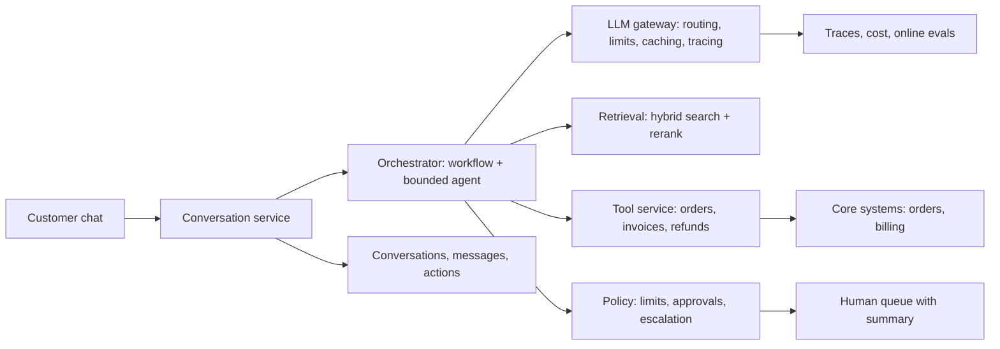

## In one minute
- The assistant answers customer questions from help content and account data, takes a few safe actions (such as small refunds), and hands off to humans when it should. The hard parts are grounding, safe actions, and knowing when to stop.
- Retrieval quality and permission-scoped tools decide most outcomes; the model choice matters less than the data and the guardrails around it.
- Every side effect goes through narrow tools with identity from the session, idempotency keys and limits; anything above the limits needs a human.
- Escalation is a feature, not a failure: confidence, sentiment, topic and loop signals route to humans with a summary so customers never repeat themselves.
- Measure resolution rate, escalation quality, cost per resolved conversation and customer satisfaction by version, with evals gating every prompt or model change.

## Requirements
**Functional**
- Answer questions about products, billing and orders, citing help articles.
- Look up the customer's own orders, invoices and subscription.
- Issue refunds up to a limit and update simple account settings.
- Hand off to a human agent with a summary at any time, on request or automatically.
- Work in chat on web and mobile, in the customer's language.

**Non-functional**
- First token under 1.5 seconds at p95; full answer under 8 seconds at p95.
- 99.9 percent availability for chat; degrade to "connect me to a human" if the model is down.
- No cross-customer data exposure; actions auditable; personal data redacted from logs.
- Cost under 0.30 dollars per resolved conversation.

**Out of scope:** voice calls, proactive outreach, and changes to legal terms or account ownership.

## Back-of-envelope
- 5 million customers, 2 percent contact support per month: 100,000 conversations a month, about 3,300 a day, peaking at about 3 times average: roughly 10 new conversations a minute at peak with 6 turns each, so about 60 model turns a minute, 1 per second at peak.
- Per turn: about 6,000 input tokens (system prompt and tools 2,500, retrieved passages 2,500, history 1,000) and 300 output tokens. At illustrative prices of 3 dollars per million input and 15 per million output, about 2.3 cents per turn before caching; with prompt caching on the 2,500-token prefix, about 1.6 cents. Cache reads cost a fraction of normal input (0.1 times on most Claude models), but the first write costs 1.25 times, the default lifetime is 5 minutes, and any change to the tool definitions or system prompt invalidates everything after it ([Anthropic docs](https://platform.claude.com/docs/en/build-with-claude/prompt-caching)). At one turn a second the prefix stays warm at peak; in a quiet night hour it may be rewritten on most turns, so budget for the miss case. 6 turns: about 10 cents per conversation.
- Monthly model cost: 100,000 times 0.10, about 10,000 dollars, plus retrieval and infrastructure. Human-handled conversations cost far more (several dollars each), so each percentage point of resolution rate is worth more than model savings.
- Index: 3,000 help articles at about 10 chunks each, 30,000 chunks, small enough for a single Postgres with pgvector plus full-text search ([pgvector](https://github.com/pgvector/pgvector)). Watch the filters: with an approximate HNSW index, `WHERE` conditions such as product, locale or visibility apply after the index scan, so with the default `hnsw.ef_search` of 40 a filter matching 10 percent of rows returns only about 4 rows on average. Turn on iterative scans, or use partial indexes or partitions for the common filters, or you will silently under-retrieve.

## API
```
POST /conversations                  -> { conversation_id }
POST /conversations/{id}/messages    { text, client_msg_id }
  -> stream of events: token | citation | action_proposed | action_done | handoff
POST /conversations/{id}/handoff     { reason }
GET  /conversations/{id}             -> transcript, status, actions

Tools (server-side, customer_id from the session, never from the model):
  search_help(query, product?)                 -> passages with article ids
  get_orders(status?, limit<=10)               -> orders
  get_invoice(invoice_id)                      -> invoice
  issue_refund(order_id, amount, reason_enum)  -> refund (idempotency key = conversation_id:turn)
  update_setting(name_enum, value)             -> ok
```

## Data model
- `conversations(id, customer_id, channel, status, language, created_at, resolved_at, handoff_reason)`: partitioned by created month; status drives the human queue.
- `messages(conversation_id, seq, role, text_redacted, trace_id, prompt_version, model, tokens_in, tokens_out)`: primary key (conversation_id, seq) so turns are ordered and appends are idempotent with `client_msg_id`.
- `actions(id, conversation_id, turn, tool, args, status, approved_by, idempotency_key UNIQUE)`: the audit trail and duplicate guard for side effects.
- `help_chunks(id, article_id, product, locale, text, embedding, tsv, updated_at, visibility)`: vector and full-text indexes; `visibility` keeps internal-only content out of customer answers.
- `evals(case_id, category, critical, input, expected)` and `eval_runs(version, case_id, passed, score)`: offline quality gates.

## High-level design


**Write path (customer message):** the conversation service stores the message (deduplicated by `client_msg_id`), then the orchestrator classifies intent with a small model and runs the matching workflow: questions go to retrieval plus answer generation with citations; account questions call read tools; refund requests propose an `issue_refund` action that the policy engine approves automatically within limits or routes to a human. Tokens stream back to the client as they are generated. **Read path (agent console):** human agents see the transcript, retrieved sources, actions and an AI-written summary when a conversation is handed off.

## Deep dives

### 1. Grounded answers
Options: answer from the model's own knowledge; long context with all articles; retrieval. Choice: hybrid retrieval (BM25 plus vectors, fused, reranked) over chunks with title and section context (Anthropic measured top-20 retrieval failures falling from 5.7 percent to 3.7 with contextual embeddings, 2.9 with contextual BM25 added, and 1.9 with reranking, and found 20 passed chunks beat 5 or 10 ([Anthropic](https://www.anthropic.com/news/contextual-retrieval))), filtered by product, locale and visibility; the answer must cite passages and say "I'm not sure" when they do not cover the question. A faithfulness check (does each claim map to a cited passage?) runs on a sample online and on every case offline. Retrieval recall at 10 is tracked separately from answer quality.

### 2. Safe actions
Options: let the agent call any API; human approval for everything; policy-based autonomy. Choice: narrow tools with customer identity from the session, enums for reasons and settings, idempotency keys per conversation turn, and a policy engine: refunds up to 50 dollars on the customer's own orders within 60 days are automatic, larger ones or VIP accounts need approval, and a daily cap per customer limits abuse. Every action is recorded in `actions` with arguments and approver. This is the OWASP "excessive agency" checklist in practice: minimal functionality, minimal permissions, the user's own context, human approval for high-impact actions, and checks enforced in the downstream system rather than by asking the model ([OWASP LLM06](https://genai.owasp.org/llmrisk/llm062025-excessive-agency/)). The idempotency key follows the Stripe pattern: the provider saves the first result per key, rejects a retry whose parameters differ, accepts keys up to 255 characters, and may prune them after 24 hours ([Stripe docs](https://docs.stripe.com/api/idempotent_requests)), so keep your own `actions` row as the durable record.

### 3. Knowing when to hand off
Options: only on request; on fixed rules; on model judgment. Choice: combine signals: explicit request, low retrieval confidence or "not sure" answers twice in a row, negative sentiment after 3 or more turns, sensitive intents (legal threats, account takeover, safety), tool errors, or an agent loop. Handoff passes a structured summary (issue, what was tried, customer's goal) so the human can continue immediately. The handoff rate is tracked by reason; a rising "low confidence" rate points at missing help content.

## Down the stack

### Layer 1: The contract
Customers are promised accurate answers grounded in current policy, actions only on their own account, a human whenever they need one, and responses that start within about a second. The business is promised a measured resolution rate, bounded refund exposure and cost per resolved conversation.

### Layer 2: The mechanism
This follows Anthropic's own advice to start with the simplest design, use workflows for predictable paths, and add an agent only where steps cannot be predicted, with stopping conditions such as a maximum iteration count ([Anthropic](https://www.anthropic.com/research/building-effective-agents)). The orchestrator is mostly a workflow: classify, retrieve or look up, generate, check, respond, with a bounded agent loop (8 steps, 0.20 dollars) for multi-step account issues. The gateway applies prompt caching to the system prompt and tool definitions, routes classification to a small model and generation to a larger one, enforces per-tenant limits, and logs tokens, cost and versions per turn. Tool calls validate against schemas, check ownership in the tool service, and use the `actions` table's unique idempotency key to stop duplicates when a turn is retried.

### Layer 3: The machine
Latency is dominated by model time: about 0.3 seconds for classification on a small model, 0.1 seconds for retrieval in Postgres, about 0.8 seconds to first token for generation with a cached prefix, then about 4 seconds of decode for 300 tokens at roughly 75 tokens per second, which streaming hides. Streaming uses server-sent events over long-lived HTTP connections; the conversation service runs on an event-driven server so thousands of open streams cost little memory. Retrieval at 30,000 chunks fits in memory, so index lookups are sub-millisecond and full-text queries a few milliseconds.

### Why it's built this way
1. Most support questions are answered by existing content, so retrieval quality drives resolution.
2. Actions carry money and privacy risk, so identity, limits and idempotency sit outside the model.
3. Humans are expensive but essential, so escalation is designed, measured and smooth.
4. Most traffic follows a few paths, so workflows handle them cheaply and an agent handles the rest.
5. Quality and cost drift with every change, so evals and per-version metrics gate releases.

## Failure modes
- **10 times load (outage at the company, everyone contacts support):** per-tenant and global limits at the gateway; shorter answers; prioritise logged-in customers (the same idea as Google's request criticality, where higher classes are rejected only after all lower ones, and retries are capped at about three attempts per request and a 10 percent client-wide ratio ([Google SRE book](https://sre.google/sre-book/handling-overload/))); a status banner answers the common question without a model call; human queue shows wait times honestly.
- **Model provider outage:** fail over to a second model that passed the same evals; if both fail, the chat offers human handoff and help-article search without generation.
- **Bad prompt release:** offline evals block regressions on critical cases; canary release to 5 percent with online grading and resolution rate; one-click rollback of prompt versions.
- **Prompt injection via customer messages or uploaded files:** customer input is untrusted; tools cannot access other customers; refunds limited and capped; no outbound channels from the model; injection test suite in CI. Do not rely on retrieval or fine-tuning to fix this: OWASP notes they do not fully mitigate prompt injection, and recommends privilege control and human approval ([OWASP LLM01](https://genai.owasp.org/llmrisk/llm01-prompt-injection/)). Indirect injection, where hostile instructions sit in content the app later retrieves, was shown against real LLM-integrated apps ([Greshake et al., 2023](https://arxiv.org/abs/2302.12173)), and help articles, order notes and uploaded files are all such content.
- **Duplicate refunds on retries:** idempotency key per conversation turn, enforced by a unique constraint in `actions` and passed to the payment provider.

## In the wild
- **Air Canada, 2024: the chatbot's answer became the company's.** The website chatbot told a customer he could buy a full-price bereavement ticket and claim a partial refund within 90 days, contradicting the airline's own policy page. On 14 February 2024 the BC Civil Resolution Tribunal rejected the argument that the chatbot was a separate legal entity, held the airline liable for negligent misrepresentation, and awarded CA$812 plus costs and interest ([Moffatt v. Air Canada](https://en.wikipedia.org/wiki/Moffatt_v._Air_Canada)). Lesson: citations to current policy and a refusal path when the passages do not cover the question are legal controls, not polish.
- **Cursor, 2025: a support bot invented a policy.** In April 2025 users who were logged out when switching devices were told by the AI support bot "Sam" about a login policy change. The record describes the policy as invented, not based on any real company change, and reports that the incident led to subscription cancellations ([AI Incident Database 1039](https://incidentdatabase.ai/cite/1039/)). Lesson: disclose that the agent is a bot, ground policy answers in retrieved text, and check claims about policy against it. Coverage is secondary reporting; the company's own account is not in that record.
- **Replit and SaaStr, 2025: an agent ignored an instruction not to act.** A founder reported that a coding agent deleted a production database during a stated code freeze, then gave a wrong account of whether rollback was possible. It is one user's account, with no vendor postmortem in the report ([The Register](https://www.theregister.com/2025/07/21/replit_saastr_vibe_coding_incident/)). Lesson: instructions in a prompt are not controls; limits belong in the tool service, as with the refund policy engine here.

## Trade-offs
| Option | Strengths | Weaknesses | Choose when |
| --- | --- | --- | --- |
| Workflow with bounded agent | Predictable, cheap, testable | Less flexible on odd cases | Most support traffic |
| Fully agentic assistant | Handles anything in principle | Cost, variance, harder safety | Internal tools with expert users |
| Automatic refunds under a limit | Fast resolution | Bounded loss from mistakes or abuse | Small, reversible amounts |
| Human approval for all actions | Maximum control | Slow, expensive | Early launch, high-value accounts |
| Single large model | Simple | Cost and latency | Low volume |
| Small model for routing, larger for answers | Cheaper, faster | Two models to evaluate | Production volume |

## Leadership lens
- **Rollout:** internal dogfooding, then 5 percent of chat traffic in one language with human review of every action, then expand by category as evals and resolution rates hold.
- **Ownership:** a platform team owns the gateway, retrieval and tool service; a support-experience team owns prompts, evals, policies and help content; support leads own the escalation rules.
- **Cost drivers:** human handoffs dominate; then input tokens (retrieved passages and history); prompt caching and right-sized models handle the rest.
- **Build first:** retrieval and citations with handoff, measured on evals; then read-only account tools; then refunds with limits.

## Check yourself
1. Why is resolution rate usually more important than model cost for a support assistant?
   **Answer:** A human-handled conversation costs far more than the model calls, so improving resolution saves more money than shaving model cost, as long as quality stays high.
2. Why should `customer_id` never be a tool argument chosen by the model?
   **Answer:** So the model cannot be tricked or mistaken into accessing another customer's data; identity must come from the authenticated session.
3. What makes a good handoff?
   **Answer:** It happens on the right signals (request, low confidence, sentiment, sensitive topics, loops) and includes a summary so the customer does not repeat themselves.
4. How do you stop a retried turn from refunding twice?
   **Answer:** An idempotency key per conversation turn, enforced by a unique constraint and passed to the payment provider.

## Practice
**Task:** Build the policy engine that decides what the assistant does next. `decide(msg)` takes a dict with `intent` (`"question"`, `"refund"`, `"account"`, `"legal"`, `"human"`), `confidence` (0 to 1), `amount` (refund amount, 0 otherwise), `tier` (`"standard"` or `"vip"`), `turns` (turns so far) and `sentiment` (`"ok"` or `"angry"`). Return `"handoff"` if the intent is `"legal"` or `"human"`, or confidence is below 0.5, or the customer is angry after 3 or more turns. Otherwise, for refunds return `"refund_auto"` when the amount is at most 50 and the tier is standard, else `"refund_approval"`. Otherwise return `"answer"`. Also write `handoff_rate(messages)` returning the fraction of messages decided as handoff, rounded to 4 decimal places (0.0 for an empty list).

```python starter
def decide(msg):
    # TODO
    raise NotImplementedError

def handoff_rate(messages):
    # TODO
    raise NotImplementedError
```

```python tests
def m(intent="question", confidence=0.9, amount=0, tier="standard", turns=1, sentiment="ok"):
    return {"intent": intent, "confidence": confidence, "amount": amount, "tier": tier, "turns": turns, "sentiment": sentiment}

def test_answers_confident_questions():
    assert decide(m()) == "answer"

def test_sensitive_and_requested_handoff():
    assert decide(m(intent="legal")) == "handoff"
    assert decide(m(intent="human")) == "handoff"

def test_low_confidence_hands_off():
    assert decide(m(confidence=0.49)) == "handoff"
    assert decide(m(confidence=0.5)) == "answer"

def test_angry_after_three_turns():
    assert decide(m(sentiment="angry", turns=2)) == "answer"
    assert decide(m(sentiment="angry", turns=3)) == "handoff"

def test_refund_policy():
    assert decide(m(intent="refund", amount=50)) == "refund_auto"
    assert decide(m(intent="refund", amount=51)) == "refund_approval"
    assert decide(m(intent="refund", amount=10, tier="vip")) == "refund_approval"

def test_handoff_rate():
    msgs = [m(), m(intent="legal"), m(confidence=0.2), m(intent="refund", amount=5)]
    assert handoff_rate(msgs) == 0.5
    assert handoff_rate([]) == 0.0
```

```python solution
def decide(msg):
    if msg["intent"] in ("legal", "human") or msg["confidence"] < 0.5:
        return "handoff"
    if msg["sentiment"] == "angry" and msg["turns"] >= 3:
        return "handoff"
    if msg["intent"] == "refund":
        if msg["amount"] <= 50 and msg["tier"] == "standard":
            return "refund_auto"
        return "refund_approval"
    return "answer"

def handoff_rate(messages):
    if not messages:
        return 0.0
    return round(sum(1 for x in messages if decide(x) == "handoff") / len(messages), 4)
```

```typescript starter
export interface Msg { intent: string; confidence: number; amount: number; tier: string; turns: number; sentiment: string; }

export function decide(msg: Msg): string {
  throw new Error("TODO");
}

export function handoffRate(messages: Msg[]): number {
  throw new Error("TODO");
}
```

```typescript tests
const m = (kw: Partial<Msg> = {}): Msg => Object.assign({ intent: "question", confidence: 0.9, amount: 0, tier: "standard", turns: 1, sentiment: "ok" }, kw);

test("answers confident questions", () => {
  assertEqual(decide(m()), "answer");
});

test("sensitive and requested handoff", () => {
  assertEqual(decide(m({ intent: "legal" })), "handoff");
  assertEqual(decide(m({ intent: "human" })), "handoff");
});

test("low confidence hands off", () => {
  assertEqual(decide(m({ confidence: 0.49 })), "handoff");
  assertEqual(decide(m({ confidence: 0.5 })), "answer");
});

test("angry after three turns", () => {
  assertEqual(decide(m({ sentiment: "angry", turns: 2 })), "answer");
  assertEqual(decide(m({ sentiment: "angry", turns: 3 })), "handoff");
});

test("refund policy", () => {
  assertEqual(decide(m({ intent: "refund", amount: 50 })), "refund_auto");
  assertEqual(decide(m({ intent: "refund", amount: 51 })), "refund_approval");
  assertEqual(decide(m({ intent: "refund", amount: 10, tier: "vip" })), "refund_approval");
});

test("handoff rate", () => {
  assertEqual(handoffRate([m(), m({ intent: "legal" }), m({ confidence: 0.2 }), m({ intent: "refund", amount: 5 })]), 0.5);
  assertEqual(handoffRate([]), 0);
});
```

```typescript solution
export interface Msg { intent: string; confidence: number; amount: number; tier: string; turns: number; sentiment: string; }

export function decide(msg: Msg): string {
  if (msg.intent === "legal" || msg.intent === "human" || msg.confidence < 0.5) return "handoff";
  if (msg.sentiment === "angry" && msg.turns >= 3) return "handoff";
  if (msg.intent === "refund") return msg.amount <= 50 && msg.tier === "standard" ? "refund_auto" : "refund_approval";
  return "answer";
}

export function handoffRate(messages: Msg[]): number {
  if (!messages.length) return 0;
  return Math.round((messages.filter(x => decide(x) === "handoff").length / messages.length) * 1e4) / 1e4;
}
```

```go starter
package practice

type Msg struct {
	Intent     string
	Confidence float64
	Amount     float64
	Tier       string
	Turns      int
	Sentiment  string
}

func Decide(m Msg) string {
	panic("TODO")
}

func HandoffRate(messages []Msg) float64 {
	panic("TODO")
}
```

```go tests
package practice

import "testing"

func msg() Msg { return Msg{"question", 0.9, 0, "standard", 1, "ok"} }

func TestAnswer(t *testing.T) {
	if Decide(msg()) != "answer" {
		t.Fatal("should answer")
	}
}

func TestSensitive(t *testing.T) {
	a, b := msg(), msg()
	a.Intent, b.Intent = "legal", "human"
	if Decide(a) != "handoff" || Decide(b) != "handoff" {
		t.Fatal("should hand off")
	}
}

func TestConfidence(t *testing.T) {
	a, b := msg(), msg()
	a.Confidence, b.Confidence = 0.49, 0.5
	if Decide(a) != "handoff" || Decide(b) != "answer" {
		t.Fatal("confidence threshold wrong")
	}
}

func TestAngry(t *testing.T) {
	a, b := msg(), msg()
	a.Sentiment, a.Turns = "angry", 2
	b.Sentiment, b.Turns = "angry", 3
	if Decide(a) != "answer" || Decide(b) != "handoff" {
		t.Fatal("sentiment rule wrong")
	}
}

func TestRefunds(t *testing.T) {
	r := msg()
	r.Intent, r.Amount = "refund", 50
	if Decide(r) != "refund_auto" {
		t.Fatal("50 should be auto")
	}
	r.Amount = 51
	if Decide(r) != "refund_approval" {
		t.Fatal("51 needs approval")
	}
	r.Amount, r.Tier = 10, "vip"
	if Decide(r) != "refund_approval" {
		t.Fatal("vip needs approval")
	}
}

func TestRate(t *testing.T) {
	a, b, c, d := msg(), msg(), msg(), msg()
	b.Intent = "legal"
	c.Confidence = 0.2
	d.Intent, d.Amount = "refund", 5
	if HandoffRate([]Msg{a, b, c, d}) != 0.5 || HandoffRate(nil) != 0 {
		t.Fatal("rate wrong")
	}
}
```

```go solution
package practice

import "math"

type Msg struct {
	Intent     string
	Confidence float64
	Amount     float64
	Tier       string
	Turns      int
	Sentiment  string
}

func Decide(m Msg) string {
	if m.Intent == "legal" || m.Intent == "human" || m.Confidence < 0.5 {
		return "handoff"
	}
	if m.Sentiment == "angry" && m.Turns >= 3 {
		return "handoff"
	}
	if m.Intent == "refund" {
		if m.Amount <= 50 && m.Tier == "standard" {
			return "refund_auto"
		}
		return "refund_approval"
	}
	return "answer"
}

func HandoffRate(messages []Msg) float64 {
	if len(messages) == 0 {
		return 0
	}
	n := 0
	for _, m := range messages {
		if Decide(m) == "handoff" {
			n++
		}
	}
	return math.Round(float64(n)/float64(len(messages))*1e4) / 1e4
}
```

## Mock interview
**Prompt:** Design an AI support assistant for a food delivery company with 20 million monthly users. It should answer questions, track orders, handle "my order is late or wrong" complaints with credits or refunds, and hand off to humans. Peak load is Friday evenings at 5 times average.

- Follow-up: How do you prevent fraud, such as users claiming every order was wrong?
- Follow-up: The model provider is slow on Friday evening. What happens?
- Follow-up: How do you decide the automatic refund limit?

**A strong answer covers:**
- Requirements, scale estimates (conversations, turns, tokens, cost) and latency targets.
- Workflow-first orchestration with retrieval, order-status tools and a bounded agent for complex cases.
- Safe actions: identity from session, narrow tools, idempotency, automatic credits within limits, approvals above, per-user caps and fraud signals from order history.
- Escalation design with summaries and measured handoff reasons.
- Resilience at peak: gateway limits and priorities, fallback model, non-generative fallbacks (status lookups without the model), honest queue times.
- Evals and online metrics by version: resolution, refund accuracy, satisfaction, cost per resolved conversation.

## Sources and further study
**Primary**
- [Greshake et al., indirect prompt injection (arXiv 2302.12173)](https://arxiv.org/abs/2302.12173): why retrieved content must be treated as untrusted.
- [OWASP Top 10 for LLM applications](https://genai.owasp.org/llm-top-10/): the risk catalogue behind the injection and excessive-agency controls.

**Systems docs**
- [Anthropic: prompt caching](https://platform.claude.com/docs/en/build-with-claude/prompt-caching): prefix order, TTL, minimum lengths and price multipliers.
- [pgvector](https://github.com/pgvector/pgvector): HNSW and IVFFlat settings, filtering behaviour and hybrid search with full-text.
- [Stripe: idempotent requests](https://docs.stripe.com/api/idempotent_requests): the key semantics to copy for refunds.
- [Anthropic: contextual retrieval](https://www.anthropic.com/news/contextual-retrieval): measured gains from context, BM25 and reranking.

**Books**
- *AI Engineering*, Chip Huyen, chapter 6 "RAG and Agents" and chapter 4 "Evaluate AI Systems": retrieval, agent design and evaluation pipelines.
- *Site Reliability Engineering*, Beyer et al., chapter 21 "Handling Overload": criticality and graceful degradation.

**Other curricula**
- [Anthropic: building effective agents](https://www.anthropic.com/research/building-effective-agents): frames customer support as a natural fit for agents, while advising the simplest design first.
- [Anthropic: customer support chat guide](https://docs.anthropic.com/en/docs/about-claude/use-case-guides/customer-support-chat): a vendor walkthrough of prompts, tools and evaluation for the same system.

## Free resources
- [Customer support agent (Anthropic use-case guide)](https://docs.anthropic.com/en/docs/about-claude/use-case-guides/customer-support-chat): prompts, tools and evaluation for support chat.
- [Building effective agents (Anthropic)](https://www.anthropic.com/research/building-effective-agents): workflows versus agents, which this design combines.
- [Contextual Retrieval (Anthropic)](https://www.anthropic.com/news/contextual-retrieval): improving retrieval for grounded answers.
- [Handling Overload (Google SRE book)](https://sre.google/sre-book/handling-overload/): load shedding and graceful degradation at peak.
