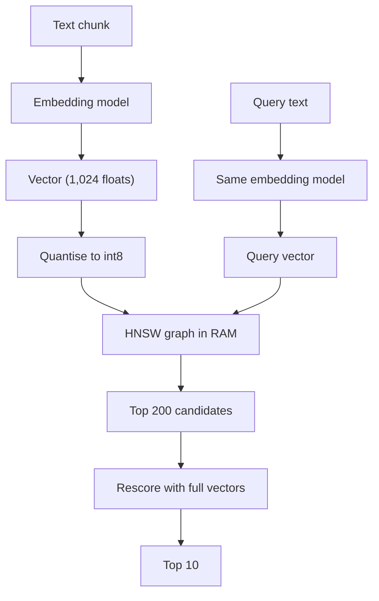

## In one minute
- An embedding model maps text (or images, code) to a vector so that similar meanings land close together. Search becomes "find the nearest vectors to the query vector".
- Exact nearest-neighbour search compares the query with every vector, which is too slow at millions of items. Approximate indexes (HNSW graphs, IVF clusters) find most of the true neighbours in milliseconds.
- Production vector search is a set of trade-offs you tune and measure: recall against exact search, latency, memory, and build and update cost. Quantisation cuts memory by 4 to 32 times at a small recall cost.
- Embeddings are tied to the model that produced them. Changing models means re-embedding everything and running both indexes during the switch.
- Often the best vector database is the one you already run: Postgres with pgvector, or your search engine's vector fields, until scale or features force a dedicated system.

## How it works

### What an embedding is
An embedding model is a neural network trained so that texts with related meaning produce vectors pointing in similar directions. Similarity is measured with cosine similarity (the angle between vectors) or the dot product; when vectors are normalised to length 1, the two are the same. Dimensions range from a few hundred to a few thousand; pgvector, for instance, can index `vector` columns only up to 2,000 dimensions and `halfvec` up to 4,000 ([pgvector README](https://github.com/pgvector/pgvector)). Models differ in languages, domains and maximum input length; public benchmarks such as MTEB compare them, but your own retrieval eval decides.

### Exact versus approximate search
Exact (brute-force) search is simple and perfectly accurate: compute the similarity of the query with every vector and keep the top k. At 100,000 vectors it takes milliseconds; at 100 million it is far too slow per query. Approximate nearest neighbour (ANN) indexes trade a little recall for orders of magnitude of speed. Faiss, the reference library, implements IVF, product quantisation and HNSW, and handles sets too big for RAM ([Faiss](https://faiss.ai/)):

- **HNSW** (Hierarchical Navigable Small World) builds a layered graph where each vector links to nearby vectors. Search starts at a top layer with few nodes, greedily moves toward the query, and descends. Each node's top layer is chosen at random, rarer for higher layers, and the authors claim logarithmic scaling of search ([Malkov and Yashunin](https://arxiv.org/abs/1603.09320)). Parameters such as `M` (links per node) and `ef_search` (candidates explored) trade memory and latency for recall; pgvector defaults to `m = 16`, `ef_construction = 64` and `hnsw.ef_search = 40` ([pgvector README](https://github.com/pgvector/pgvector)).
- **IVF** (inverted file) clusters vectors into, say, 4,096 groups; a query searches only the nearest few clusters (`nprobe`). It uses less memory than HNSW and builds faster, but recall depends on probing enough clusters. pgvector suggests `lists` of rows/1000 up to a million rows and sqrt(rows) beyond, `probes` starting near sqrt(lists) (the default is 1), and building the index only after the table holds data ([pgvector README](https://github.com/pgvector/pgvector)).

### Measuring recall
Recall at k for an ANN index means: of the true top k (from exact search), how many did the index return? Measure it on a sample of real queries by running both exact and approximate search. Aim for a target, often 0.95 or higher, and tune parameters to the cheapest setting that meets it. Remember that index recall is only part of the story: if the embedding model itself ranks the wrong passages highly, a perfect index returns the wrong passages perfectly.

### Quantisation
Storing vectors as 32-bit floats costs 4 bytes per dimension. Scalar quantisation stores each dimension as an 8-bit integer (4 times smaller); product quantisation compresses further by encoding groups of dimensions as codebook entries; binary quantisation keeps one bit per dimension (32 times smaller). A common pattern is to search compressed vectors to get candidates, then rescore the top few hundred with full-precision vectors. In one MTEB retrieval test, int8 kept about 97 percent of full-precision NDCG@10 (about 99 percent with rescoring) and binary kept about 92.5 percent (96.45 percent with rescoring), with exact-search speedups of roughly 3.7 and 25 times ([Hugging Face](https://huggingface.co/blog/embedding-quantization)). Treat those as one model's results and measure your own.

### Operating it
- **Updates and deletes.** HNSW handles inserts well, but deletes are often tombstones that degrade the graph until rebuilt. Plan periodic rebuilds.
- **Filtering.** "Nearest vectors where tenant = X and language = en" is hard: filtering after search can return too few results, filtering before can be slow. Check how your engine handles it, especially for multi-tenant permission filters. In pgvector the filter runs after the index scan, so with a 10 percent match rate and `ef_search = 40` a query returns about 4 rows on average. Version 0.8.0 (October 2024) added iterative index scans (`hnsw.iterative_scan`) that keep scanning until enough rows pass the filter, capped by `hnsw.max_scan_tuples` (default 20,000); partial indexes and partitioning cover selective filters ([pgvector README](https://github.com/pgvector/pgvector), [changelog](https://github.com/pgvector/pgvector/blob/master/CHANGELOG.md)).
- **Model changes.** New embedding model, new vector space: re-embed the corpus, build a new index, run both, compare on evals, switch reads, delete the old one. It is an expand-and-contract migration. Research is exploring shortcuts: Drift-Adapter trains a small mapping from new-model queries into the old space and reports recovering 95 to 99 percent of full re-embedding recall, though these are the authors' self-reported results ([arXiv:2509.23471](https://arxiv.org/abs/2509.23471)).

### The same shapes as any system
Vector search is the finding-things-fast shape with a new distance function. Every indexing lesson applies: build cost versus query cost, memory versus speed, freshness versus rebuild effort.

## Down the stack

### Layer 1: The contract
A vector search service promises top-k results for a query vector, with filters, at a latency target (for example p99 under 50 ms), with recall at 10 above a target measured against exact search, and with new or updated items searchable within a freshness window.

### Layer 2: The mechanism
HNSW stores, for each vector, a list of neighbour IDs per layer. Insertion picks a random top layer for the new node (with exponentially decreasing probability for higher layers), then connects it to its nearest neighbours found by searching from the entry point. Search keeps a priority queue of `ef_search` best candidates, expanding neighbours until no closer candidate is found. IVF trains k-means centroids on a sample, assigns each vector to its nearest centroid's list, and at query time scans the lists of the `nprobe` nearest centroids. Postgres's pgvector implements both as index types inside the database, so vector search can join with ordinary tables and use the same backups and transactions.

### Layer 3: The machine
Similarity is arithmetic: a dot product of two 1,024-dimension float vectors is 1,024 multiply-adds, which modern CPUs do 8 to 16 at a time with SIMD instructions (AVX2, AVX-512, NEON). The real bottleneck is memory: HNSW search jumps between nodes stored at random addresses, so each hop risks a cache miss costing around 100 ns from main memory, and a search touching a few thousand nodes spends most of its time waiting for memory. That is why keeping the index in RAM matters so much, and why quantisation, by shrinking vectors, speeds up search as well as saving space.

### Why it's built this way
1. Meaning-based similarity needs a vector representation and a distance function.
2. Exact search scales linearly with the corpus, too slow at large sizes.
3. Graph and cluster indexes cut the work per query at a small recall cost.
4. Memory capacity and bandwidth dominate cost, so compression pays off twice.
5. Vectors depend on the model that made them, so model changes are migrations.

## Diagram


## Worked example
A marketplace wants semantic search over 30 million product listings with 768-dimension embeddings. Raw float32 vectors take 30 million times 768 times 4 bytes, about 92 GB, before HNSW links (with `M = 16`, roughly another 30 million times 32 neighbour IDs times 4 bytes, about 4 GB per layer-0 level). That needs large-memory machines and replicas.

They measure on 2,000 real queries with exact search as ground truth. HNSW with float32 and `ef_search = 100` gives recall at 10 of 0.97 at p99 18 ms. Scalar int8 quantisation cuts vector memory to about 23 GB; recall drops to 0.94. Rescoring the top 100 candidates with float32 vectors stored on SSD restores recall to 0.97 with p99 26 ms. Filters on category and country are applied inside the index search. Total memory per replica falls from about 100 GB to about 30 GB, so they run three replicas on smaller machines instead of two large ones. When they later switch embedding models, they build the new index alongside the old, A/B test click-through for two weeks, then switch.

## In the wild
- **Cloudflare, 2025: R2 outage takes the Vectorize vector database with it.** On 6 February an operator disabled the R2 gateway for 59 minutes (08:14 to 09:13 UTC). Vectorize persists its data in R2, so all inserts, upserts and deletes failed and about 75 percent of queries failed, the rest served from cache. It recovered once R2 did. A vector index is a derived store with a hard dependency on its storage layer ([Cloudflare postmortem](https://blog.cloudflare.com/cloudflare-incident-on-february-6-2025/)).
- **pgvector, documented behaviour: filtered ANN queries return too few rows.** Because the filter runs after the approximate scan, a selective `WHERE` can leave a query with a handful of results. Iterative scans in 0.8.0 were added to address this ([pgvector changelog](https://github.com/pgvector/pgvector/blob/master/CHANGELOG.md)).
- **Research, 2025: embedding upgrades as a cost problem.** The Drift-Adapter paper frames a model swap as re-encoding the whole corpus and rebuilding the ANN index, and measures a query-side adapter as an alternative ([arXiv:2509.23471](https://arxiv.org/abs/2509.23471)).

## Trade-offs
| Choice | Strengths | Weaknesses | Choose when |
| --- | --- | --- | --- |
| Brute-force exact search | Perfect recall, no index | Linear cost | Under about 100k vectors, or as ground truth |
| HNSW | High recall, low latency | Memory-heavy, slow deletes | Most interactive search |
| IVF | Less memory, fast builds | Recall depends on probes | Very large, batch-built corpora |
| Quantisation plus rescoring | Much less memory, near-full recall | Extra step and tuning | Large corpora, memory-bound |
| pgvector in existing Postgres | One system, joins, transactions | Scale limits per node | Up to millions of vectors |
| Dedicated vector database | Scale, advanced filtering | Another system to run | Hundreds of millions, heavy filters |

## Pitfalls in production
- Mixing vectors from different embedding models in one index. Fix: one model per index, versioned.
- No recall measurement, only latency. Fix: compare against exact search on real queries.
- Post-filtering that returns too few results for selective filters. Fix: engines with filtered search, or partition by tenant.
- Indexes degraded by many deletes. Fix: scheduled rebuilds and monitoring of recall over time.
- Embedding documents and queries differently (prefixes, truncation). Fix: follow the model's instructions for queries versus documents.

## Leadership lens
- Start with the simplest store that meets scale (often pgvector); move only when measurements force it.
- Treat embedding model choice and changes as migrations with evals, dual indexes and rollback.
- Put recall at k, latency and memory on one dashboard; tune for the cheapest setting that meets targets.
- Budget for memory: it is usually the dominant cost of vector search at scale.

## Check yourself
1. Why can a perfectly accurate vector index still return irrelevant results?
   **Answer:** The index finds the nearest vectors exactly, but if the embedding model places irrelevant passages near the query, nearness does not mean relevance.
2. What does `ef_search` control in HNSW?
   **Answer:** How many candidates the search explores; higher values improve recall at the cost of latency.
3. Why does quantisation also make search faster, not just smaller?
   **Answer:** Search is memory-bound, so smaller vectors mean fewer bytes moved and more of the index in cache.
4. Why can't you add vectors from a new embedding model to an existing index?
   **Answer:** Each model defines its own vector space; distances between vectors from different models are meaningless.

## Practice
**Task:** Build the parts of a vector search you need to measure an index. `cosine(a, b)` returns cosine similarity rounded to 6 decimal places (0 if either vector is all zeros). `top_k(query, vectors, k)` takes a dict of ID to vector and returns the IDs of the `k` most similar vectors by cosine, highest first, ties broken by ID. `quantize(vec)` scales a vector so its largest absolute value maps to 127 and rounds each value to the nearest integer (half away from zero), returning a list of integers (all zeros stays all zeros). `recall(exact, approx)` returns the fraction of IDs in `exact` that also appear in `approx`, rounded to 4 decimal places.

```python starter
def cosine(a, b):
    # TODO
    raise NotImplementedError

def top_k(query, vectors, k):
    # TODO
    raise NotImplementedError

def quantize(vec):
    # TODO
    raise NotImplementedError

def recall(exact, approx):
    # TODO
    raise NotImplementedError
```

```python tests
VECS = {
    "refund-policy": [0.9, 0.1, 0.0],
    "returns-howto": [0.8, 0.3, 0.1],
    "shipping-times": [0.1, 0.9, 0.2],
    "careers": [0.0, 0.1, 0.95],
}

def test_cosine():
    assert cosine([1, 0], [1, 0]) == 1.0
    assert cosine([1, 0], [0, 1]) == 0.0
    assert cosine([0, 0], [1, 1]) == 0.0

def test_top_k():
    assert top_k([1.0, 0.2, 0.0], VECS, 2) == ["refund-policy", "returns-howto"]

def test_top_k_ties_by_id():
    assert top_k([1, 0], {"b": [2, 0], "a": [1, 0]}, 2) == ["a", "b"]

def test_quantize():
    assert quantize([0.5, -1.0, 0.25]) == [64, -127, 32]
    assert quantize([0.0, 0.0]) == [0, 0]

def test_quantized_search_keeps_order_here():
    q = {k: quantize(v) for k, v in VECS.items()}
    assert top_k(quantize([1.0, 0.2, 0.0]), q, 2) == top_k([1.0, 0.2, 0.0], VECS, 2)

def test_recall():
    assert recall(["a", "b", "c", "d"], ["a", "c", "x", "y"]) == 0.5
```

```python solution
import math

def cosine(a, b):
    na = math.sqrt(sum(x * x for x in a))
    nb = math.sqrt(sum(x * x for x in b))
    if na == 0 or nb == 0:
        return 0.0
    return round(sum(x * y for x, y in zip(a, b)) / (na * nb), 6)

def top_k(query, vectors, k):
    scored = sorted(vectors, key=lambda i: (-cosine(query, vectors[i]), i))
    return scored[:k]

def quantize(vec):
    m = max(abs(x) for x in vec)
    if m == 0:
        return [0 for _ in vec]
    out = []
    for x in vec:
        y = x / m * 127
        out.append(int(math.floor(abs(y) + 0.5)) * (1 if y >= 0 else -1))
    return out

def recall(exact, approx):
    a = set(approx)
    return round(sum(1 for e in exact if e in a) / len(exact), 4)
```

```typescript starter
export function cosine(a: number[], b: number[]): number {
  throw new Error("TODO");
}

export function topK(query: number[], vectors: Record<string, number[]>, k: number): string[] {
  throw new Error("TODO");
}

export function quantize(vec: number[]): number[] {
  throw new Error("TODO");
}

export function recall(exact: string[], approx: string[]): number {
  throw new Error("TODO");
}
```

```typescript tests
const VECS: Record<string, number[]> = {
  "refund-policy": [0.9, 0.1, 0.0],
  "returns-howto": [0.8, 0.3, 0.1],
  "shipping-times": [0.1, 0.9, 0.2],
  careers: [0.0, 0.1, 0.95],
};

test("cosine", () => {
  assertEqual(cosine([1, 0], [1, 0]), 1);
  assertEqual(cosine([1, 0], [0, 1]), 0);
  assertEqual(cosine([0, 0], [1, 1]), 0);
});

test("top k", () => {
  assertEqual(topK([1, 0.2, 0], VECS, 2), ["refund-policy", "returns-howto"]);
});

test("top k ties by id", () => {
  assertEqual(topK([1, 0], { b: [2, 0], a: [1, 0] }, 2), ["a", "b"]);
});

test("quantize", () => {
  assertEqual(quantize([0.5, -1, 0.25]), [64, -127, 32]);
  assertEqual(quantize([0, 0]), [0, 0]);
});

test("quantized search keeps order here", () => {
  const q: Record<string, number[]> = {};
  for (const k of Object.keys(VECS)) q[k] = quantize(VECS[k]);
  assertEqual(topK(quantize([1, 0.2, 0]), q, 2), topK([1, 0.2, 0], VECS, 2));
});

test("recall", () => {
  assertEqual(recall(["a", "b", "c", "d"], ["a", "c", "x", "y"]), 0.5);
});
```

```typescript solution
export function cosine(a: number[], b: number[]): number {
  const na = Math.sqrt(a.reduce((s, x) => s + x * x, 0));
  const nb = Math.sqrt(b.reduce((s, x) => s + x * x, 0));
  if (na === 0 || nb === 0) return 0;
  const dot = a.reduce((s, x, i) => s + x * b[i], 0);
  return Math.round((dot / (na * nb)) * 1e6) / 1e6;
}

export function topK(query: number[], vectors: Record<string, number[]>, k: number): string[] {
  return Object.keys(vectors)
    .sort((x, y) => cosine(query, vectors[y]) - cosine(query, vectors[x]) || (x < y ? -1 : x > y ? 1 : 0))
    .slice(0, k);
}

export function quantize(vec: number[]): number[] {
  const m = Math.max(...vec.map(Math.abs));
  if (m === 0) return vec.map(() => 0);
  return vec.map(x => { const y = (x / m) * 127; return Math.sign(y) * Math.floor(Math.abs(y) + 0.5) || 0; });
}

export function recall(exact: string[], approx: string[]): number {
  const a = new Set(approx);
  return Math.round((exact.filter(e => a.has(e)).length / exact.length) * 1e4) / 1e4;
}
```

```go starter
package practice

func Cosine(a, b []float64) float64 {
	panic("TODO")
}

func TopK(query []float64, vectors map[string][]float64, k int) []string {
	panic("TODO")
}

func Quantize(vec []float64) []float64 {
	panic("TODO")
}

func Recall(exact, approx []string) float64 {
	panic("TODO")
}
```

```go tests
package practice

import (
	"reflect"
	"testing"
)

var vecs = map[string][]float64{
	"refund-policy":  {0.9, 0.1, 0.0},
	"returns-howto":  {0.8, 0.3, 0.1},
	"shipping-times": {0.1, 0.9, 0.2},
	"careers":        {0.0, 0.1, 0.95},
}

func TestCosine(t *testing.T) {
	if Cosine([]float64{1, 0}, []float64{1, 0}) != 1 || Cosine([]float64{1, 0}, []float64{0, 1}) != 0 || Cosine([]float64{0, 0}, []float64{1, 1}) != 0 {
		t.Fatal("cosine wrong")
	}
}

func TestTopK(t *testing.T) {
	if got := TopK([]float64{1, 0.2, 0}, vecs, 2); !reflect.DeepEqual(got, []string{"refund-policy", "returns-howto"}) {
		t.Fatalf("got %v", got)
	}
}

func TestTies(t *testing.T) {
	if got := TopK([]float64{1, 0}, map[string][]float64{"b": {2, 0}, "a": {1, 0}}, 2); !reflect.DeepEqual(got, []string{"a", "b"}) {
		t.Fatalf("got %v", got)
	}
}

func TestQuantize(t *testing.T) {
	if got := Quantize([]float64{0.5, -1, 0.25}); !reflect.DeepEqual(got, []float64{64, -127, 32}) {
		t.Fatalf("got %v", got)
	}
	if got := Quantize([]float64{0, 0}); !reflect.DeepEqual(got, []float64{0, 0}) {
		t.Fatalf("got %v", got)
	}
}

func TestQuantizedOrder(t *testing.T) {
	q := map[string][]float64{}
	for k, v := range vecs {
		q[k] = Quantize(v)
	}
	if !reflect.DeepEqual(TopK(Quantize([]float64{1, 0.2, 0}), q, 2), TopK([]float64{1, 0.2, 0}, vecs, 2)) {
		t.Fatal("order changed")
	}
}

func TestRecall(t *testing.T) {
	if Recall([]string{"a", "b", "c", "d"}, []string{"a", "c", "x", "y"}) != 0.5 {
		t.Fatal("recall wrong")
	}
}
```

```go solution
package practice

import (
	"math"
	"sort"
)

func Cosine(a, b []float64) float64 {
	var dot, na, nb float64
	for i := range a {
		dot += a[i] * b[i]
		na += a[i] * a[i]
		nb += b[i] * b[i]
	}
	if na == 0 || nb == 0 {
		return 0
	}
	return math.Round(dot/(math.Sqrt(na)*math.Sqrt(nb))*1e6) / 1e6
}

func TopK(query []float64, vectors map[string][]float64, k int) []string {
	ids := make([]string, 0, len(vectors))
	for id := range vectors {
		ids = append(ids, id)
	}
	sort.Slice(ids, func(i, j int) bool {
		ci, cj := Cosine(query, vectors[ids[i]]), Cosine(query, vectors[ids[j]])
		if ci != cj {
			return ci > cj
		}
		return ids[i] < ids[j]
	})
	if k > len(ids) {
		k = len(ids)
	}
	return ids[:k]
}

func Quantize(vec []float64) []float64 {
	m := 0.0
	for _, x := range vec {
		m = math.Max(m, math.Abs(x))
	}
	out := make([]float64, len(vec))
	if m == 0 {
		return out
	}
	for i, x := range vec {
		y := x / m * 127
		r := math.Floor(math.Abs(y) + 0.5)
		if y < 0 {
			r = -r
		}
		out[i] = r
	}
	return out
}

func Recall(exact, approx []string) float64 {
	set := map[string]bool{}
	for _, a := range approx {
		set[a] = true
	}
	hits := 0
	for _, e := range exact {
		if set[e] {
			hits++
		}
	}
	return math.Round(float64(hits)/float64(len(exact))*1e4) / 1e4
}
```

## Mock interview
**Prompt:** Design semantic search for a code hosting platform: 400 million code files across 20 million repositories, searchable by natural language ("function that retries HTTP requests with backoff"), with results limited to repositories the user can access.

- Follow-up: How much memory does your index need, and how do you reduce it?
- Follow-up: How do you handle permission filtering when most users can see only a tiny fraction of repositories?
- Follow-up: You want to switch to a better embedding model. What is the plan?

**A strong answer covers:**
- What to embed: chunks of functions or files, with metadata (repository, language, path, permissions).
- Index choice and sizing: vector count times dimensions times bytes, plus graph overhead; quantisation and rescoring; sharding by repository or tenant.
- Filtering strategy for selective permissions: per-tenant or per-organisation partitions, filtered ANN, or hybrid with keyword pre-filtering.
- Measuring recall against exact search on sampled queries, alongside latency.
- Hybrid search for exact identifiers and function names.
- Model migration as expand and contract: re-embed, dual indexes, evals and A/B tests, cutover, cleanup.

## Sources and further study

**Primary**
- [Malkov and Yashunin, HNSW (2016)](https://arxiv.org/abs/1603.09320): layered proximity graphs with random layer assignment.
- [Drift-Adapter (2025)](https://arxiv.org/abs/2509.23471): cheaper embedding-model upgrades, with self-reported results.

**Systems docs**
- [pgvector README](https://github.com/pgvector/pgvector): HNSW and IVFFlat parameters, dimension limits, filtering and iterative scans.
- [pgvector changelog](https://github.com/pgvector/pgvector/blob/master/CHANGELOG.md): what 0.8.0 changed.
- [Faiss](https://faiss.ai/): IVF, PQ, HNSW and GPU indexes.
- [Hugging Face, Embedding quantization](https://huggingface.co/blog/embedding-quantization): memory, speed and retained quality, measured.

**Books**
- Chip Huyen, *AI Engineering* (O'Reilly, 2025), ch. 6 "RAG and Agents", Retrieval Algorithms and Retrieval Optimization ([ToC](https://github.com/chiphuyen/aie-book/blob/main/ToC.md)).

**Other curricula**
- [Azure Architecture Center, RAG solution design](https://learn.microsoft.com/en-us/azure/architecture/ai-ml/guide/rag/rag-solution-design-and-evaluation-guide): treats the embedding model and search index configuration as separate phases to choose and evaluate.

## Free resources
- [Efficient and robust approximate nearest neighbor search using HNSW (Malkov and Yashunin)](https://arxiv.org/abs/1603.09320): the HNSW paper.
- [HNSW explained (Pinecone)](https://www.pinecone.io/learn/series/faiss/hnsw/): an illustrated walk through the graph and its parameters.
- [Faiss](https://faiss.ai/): Meta's library for similarity search, with documentation on IVF, PQ and HNSW.
- [Embedding quantization (Hugging Face)](https://huggingface.co/blog/embedding-quantization): scalar and binary quantisation with rescoring, measured.
- [ANN-Benchmarks](https://ann-benchmarks.com/): recall versus speed comparisons of ANN libraries.
- [MTEB leaderboard (Hugging Face)](https://huggingface.co/spaces/mteb/leaderboard): comparing embedding models across tasks.
