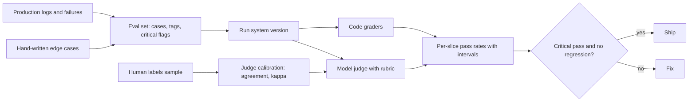

## In one minute
- Evals are the test suite of an AI feature: a set of real inputs, a way to grade each output, and a number you track over time. Without them, every prompt or model change is a guess.
- Grade with the cheapest reliable method: code checks first (exact match, schema, contains a citation), then a model as judge with a written rubric, then humans for the cases that matter most and to calibrate the judge.
- Treat scores as measurements with error bars. A pass rate of 85 percent on 100 cases could plausibly be anywhere from about 77 to 91 percent; small eval sets cannot detect small changes.
- Calibrate model judges against human labels and track agreement. A judge you have not checked is an untested test.
- Run evals offline before every change and online on production traffic, and feed production failures back into the eval set.

## How it works

### What goes in an eval set
Start from real inputs: logged production requests (anonymised), support tickets, user-reported failures, and hand-written cases for important edge cases. For each case, store what a good output must satisfy: an expected value, required facts, forbidden content, or a rubric. Tag cases by category and importance so you can report per-slice results, and mark critical cases that must always pass. Fifty good cases beat five hundred random ones at the start; grow the set from every failure you find. Husain suggests starting near 30 examples and adding until new ones stop revealing new failure modes, then about 100 labelled examples per failure mode when validating a judge; below roughly 60, he notes, the confidence intervals are usually too wide to conclude anything ([Husain](https://hamel.dev/blog/posts/llm-judge/)).

### Three kinds of graders
- **Code-based:** exact match for classification, JSON schema validation for extraction, "contains a citation that exists in the retrieved sources", length limits, regexes for forbidden content. Cheap, fast, deterministic: use them wherever possible.
- **Model-based (LLM as judge):** a model scores the output against a rubric ("Does the answer state the refund window? Does it avoid promising things not in the policy?"). Scales to open-ended outputs. Prefer binary or few-level judgments on specific criteria over vague 1 to 10 scores, ask the judge to explain before deciding, and use a capable model. Hamel Husain's field guide makes the same case for pass/fail with a written critique from a domain expert, and uses those critiques as few-shot examples in the judge prompt ([Husain](https://hamel.dev/blog/posts/llm-judge/)).
- **Human:** domain experts label a sample. Expensive and slow, but the ground truth for calibrating everything else.

### Judges need calibration
Model judges have known biases ([Zheng et al.](https://arxiv.org/abs/2306.05685)): preferring longer answers, preferring their own model's style, being swayed by answer position when comparing two. The MT-Bench study (Zheng et al., 2023) found that strong judges such as GPT-4 reach over 80 percent agreement with human preferences, the same level humans reach with each other, and named position, verbosity and self-enhancement bias as the failure modes ([Zheng et al.](https://arxiv.org/abs/2306.05685)). The biases can be large: in studies Eugene Yan reviews, some judges preferred padded, longer answers more than 90 percent of the time, and swapping the order of the two answers and checking for a consistent verdict is the standard control for position bias ([Yan](https://eugeneyan.com/writing/llm-evaluators/)). Measure your own judge: have humans label 100 to 200 outputs, run the judge on the same ones, and compute agreement and Cohen's kappa (agreement corrected for chance). Also report the judge's true positive rate and true negative rate separately, because raw agreement misleads when failures are rare: if 5 percent of cases fail, a judge that always says pass agrees 95 percent of the time and catches nothing ([Husain](https://hamel.dev/blog/posts/llm-judge/)). If kappa or the failure-catching rate is low, refine the rubric, split criteria, or use humans for that criterion. Keep some labelled data out of the judge prompt and test on it once, as you would with a model.

### Statistics, briefly
A pass rate from n cases is an estimate. The Wilson score interval gives a sensible 95 percent range even for small n or rates near 0 or 1. On 100 cases, 85 percent passing has an interval of roughly 77 to 91 percent; on 1,000 cases, roughly 83 to 87 percent. Two versions whose intervals overlap heavily may not really differ. Practical rules: compare versions on the same cases (paired comparison), look at which cases changed rather than only the totals, run noisy cases several times, and size the set for the smallest difference you care about. Anthropic's research note recommends exactly this toolkit: report the standard error of the mean and a 95 percent interval of 1.96 standard errors, use paired differences because model scores on the same questions correlate (0.3 to 0.7 for frontier models, so pairing removes real noise), resample and average chain-of-thought answers per question, and run a power analysis to decide how many questions a given difference needs ([Anthropic](https://www.anthropic.com/research/statistical-approach-to-model-evals)). One more trap from the same note: if questions share a unit, such as several questions about one document, cluster the standard errors on that unit, because naive errors can be over three times too small. The Wilson interval above is the better choice for small n and rates near 0 or 1 ([Wikipedia](https://en.wikipedia.org/wiki/Binomial_proportion_confidence_interval)).

### Offline and online
Offline evals run in CI on every prompt, model or retrieval change and block releases that regress critical cases. Online evals score a sample of production traffic with the same graders, plus product signals: thumbs up or down, escalation to humans, task completion, follow-up questions that indicate confusion. Online failures become new offline cases, which is how the eval set stays representative. The need is real: Anthropic's 2025 postmortem found that offline evals alone missed three overlapping serving bugs, and the fix was continuous quality evaluation on production traffic ([Anthropic](https://www.anthropic.com/engineering/a-postmortem-of-three-recent-issues)).

### The same shapes as any system
Evals are trust but verify, made quantitative. They play the role tests and monitoring play for deterministic software, with the extra step that the grader itself must be verified.

## Down the stack

### Layer 1: The contract
An AI feature commits to target pass rates per slice on a versioned eval set, 100 percent on critical cases, judge agreement with humans above a threshold (for example kappa of at least 0.6) for model-graded criteria, and an online quality signal watched after every release.

### Layer 2: The mechanism
An eval harness loads cases, runs the system under test with fixed configuration, applies graders, and stores results per case and version so runs can be diffed. Judge prompts are versioned like code. Results feed a dashboard with per-slice pass rates and confidence intervals. Human labelling uses a simple tool showing input, output and rubric, with disagreements between labellers reviewed to sharpen the rubric. Online sampling takes, say, 1 percent of traffic, strips personal data, and runs graders asynchronously.

### Layer 3: The machine
Running evals costs model calls: 500 cases times 3 repetitions times (one system call plus one judge call) is 3,000 calls per run, which at a few cents each is tens of dollars, and minutes of wall time if run in parallel within rate limits. Batch APIs cut the cost of large or nightly runs. Caching system outputs keyed by input and configuration lets you re-grade with a new judge without re-running the system. These costs are small next to shipping a regression to millions of users, but they shape how often you can run the full suite versus a fast subset.

### Why it's built this way
1. AI outputs vary and fail silently, so behaviour must be measured, not assumed.
2. Code checks are reliable but limited; model judges scale but can be biased; humans are accurate but slow.
3. So graders are layered, and model judges are calibrated against humans.
4. Every measurement has sampling error, so decisions need intervals and paired comparisons.
5. Production is the best source of new failures, so online results feed the offline set.

## Diagram


## Worked example
A legal-tech company's contract-summary feature has an eval of 120 contracts with lawyer-written key points. Version A scores 82 percent of key points found; version B, a new prompt, scores 86 percent. The team is about to ship B.

Before deciding, they compute intervals: 82 percent of 1,440 key points is roughly 80 to 84 percent, and 86 percent roughly 84 to 88 percent. Those intervals treat key points as independent, but they cluster by contract, so the honest interval is wider; computed over 120 contracts, it is perhaps twice as wide, and the improvement is plausible rather than certain. But the per-slice view shows B dropping from 95 to 81 percent on indemnity clauses, a critical category, while improving on boilerplate. They also check the judge: lawyers had labelled 150 outputs, and the model judge agrees with them on 88 percent with kappa 0.71, acceptable overall, but only 70 percent on indemnity clauses, where the judge misses subtle carve-outs.

Decisions: fix the prompt's handling of indemnity before shipping; mark indemnity cases as critical; for that category, use a stricter rubric that asks the judge to quote the clause and list each carve-out, raising agreement to 86 percent; and add 40 more indemnity contracts to the set. B ships a week later with 87 percent overall and 96 percent on indemnity.

## In the wild
- **Anthropic, 2025: three bugs that evals missed.** Between August and September 2025 three infrastructure bugs degraded Claude's answers: requests misrouted to the wrong server type (0.8 percent of Sonnet 4 requests at first, 16 percent in the worst hour, and about 30 percent of Claude Code users hit at least once), a TPU misconfiguration and a compiler bug. Anthropic's evals did not catch them, in part because the model recovers well from isolated mistakes, and privacy controls limited what engineers could inspect. The fix included more sensitive evals and continuous quality evaluation on real production traffic ([Anthropic postmortem](https://www.anthropic.com/engineering/a-postmortem-of-three-recent-issues)).
- **Google, 2024: AI Overviews and satire.** After launch, AI Overviews answered some odd queries from satirical pages and forum jokes. Google said it had red-teamed and tested on a share of traffic, but real use at scale produced novel queries testing missed. It reported policy violations on fewer than 1 in 7 million overview queries and shipped more than a dozen fixes, including limits on satire and user-generated content ([Google](https://blog.google/products/search/ai-overviews-update-may-2024/)).
- **Air Canada, 2024: the chatbot's wrong refund advice.** A chatbot told a customer he could claim a bereavement fare retroactively within 90 days, contradicting the airline's own policy page. The British Columbia tribunal held the airline responsible for what its chatbot said and awarded CA$812 plus costs and interest. An eval case built from policy questions, graded against the policy text, is exactly the check that was missing ([Moffatt v. Air Canada, 2024 BCCRT 149](https://en.wikipedia.org/wiki/Moffatt_v._Air_Canada)).

## Trade-offs
| Grader | Strengths | Weaknesses | Choose when |
| --- | --- | --- | --- |
| Exact match and rules | Cheap, deterministic | Only fits structured outputs | Classification, extraction, format checks |
| Model judge with rubric | Scales to open-ended text | Biases, needs calibration | Summaries, answers, tone |
| Pairwise model comparison | Sensitive to small differences | Position and length bias | Choosing between two versions |
| Human experts | Ground truth | Slow, costly | Calibration, critical categories |
| Online product signals | Real-world impact | Noisy, delayed | Monitoring after release |

## Pitfalls in production
- Tiny eval sets that cannot detect real changes. Fix: grow the set, use intervals and paired comparisons.
- Uncalibrated model judges. Fix: measure agreement and kappa against human labels, per criterion.
- Only averages, no slices. Fix: per-category results and critical cases that must pass.
- Eval sets that stop reflecting production. Fix: add production failures continuously.
- Vague 1 to 10 scores. Fix: specific binary criteria with explanations.

## Leadership lens
- Make an eval set and grading plan a launch requirement for AI features.
- Version eval sets, judge prompts and results; store per-case outcomes for diffing.
- Budget human labelling time every month for calibration and new cases.
- Report quality with intervals, not single numbers, to avoid overreacting to noise.

## Check yourself
1. Why prefer code-based graders where possible?
   **Answer:** They are cheap, fast and deterministic, so they add no grader noise; model or human grading is only needed where code cannot judge.
2. What does Cohen's kappa add over raw agreement?
   **Answer:** It corrects for agreement expected by chance, which matters when one label is much more common than the other.
3. Two versions score 84 and 86 percent on 100 cases. Can you conclude the second is better?
   **Answer:** Not confidently; with 100 cases the intervals overlap heavily, so look at paired per-case differences or use more cases.
4. Why should production failures be added to the eval set?
   **Answer:** They show real failure modes the set missed, keeping it representative and preventing the same failure from returning.

## Practice
**Task:** Build the statistics an eval dashboard needs. `wilson(passes, n)` returns the 95 percent Wilson score interval `(low, high)` for a pass rate, with `z = 1.96`, each bound rounded to 4 decimal places and clamped to the range 0 to 1 (return `(0.0, 1.0)` when `n` is 0). `likely_better(a_passes, a_n, b_passes, b_n)` returns true if B's interval low is above A's interval high. `agreement(human, judge)` takes two equal-length lists of booleans and returns `(observed agreement, Cohen's kappa)`, each rounded to 4 decimal places, where expected agreement is `ph*pj + (1-ph)*(1-pj)` with `ph` and `pj` the fractions of true labels; if expected agreement is 1, kappa is 1.0.

```python starter
def wilson(passes, n):
    # TODO
    raise NotImplementedError

def likely_better(a_passes, a_n, b_passes, b_n):
    # TODO
    raise NotImplementedError

def agreement(human, judge):
    # TODO
    raise NotImplementedError
```

```python tests
def test_wilson_100_cases():
    assert wilson(85, 100) == (0.7672, 0.9069)

def test_wilson_1000_cases_is_narrower():
    assert wilson(850, 1000) == (0.8265, 0.8708)

def test_wilson_edges():
    assert wilson(0, 10) == (0.0, 0.2775)
    assert wilson(10, 10) == (0.7225, 1.0)
    assert wilson(0, 0) == (0.0, 1.0)

def test_likely_better_needs_enough_data():
    assert not likely_better(85, 100, 90, 100)
    assert likely_better(850, 1000, 900, 1000)

def test_agreement_and_kappa():
    human = [True] * 8 + [False] * 2
    judge = [True] * 7 + [False, True, False]
    assert agreement(human, judge) == (0.8, 0.375)

def test_chance_level_and_perfect():
    assert agreement([True, True, False, False], [True, False, True, False]) == (0.5, 0.0)
    assert agreement([True] * 4, [True] * 4) == (1.0, 1.0)
```

```python solution
import math

def wilson(passes, n):
    if n == 0:
        return (0.0, 1.0)
    z = 1.96
    p = passes / n
    d = 1 + z * z / n
    centre = (p + z * z / (2 * n)) / d
    margin = z * math.sqrt(p * (1 - p) / n + z * z / (4 * n * n)) / d
    low = max(0.0, round(centre - margin, 4))
    high = min(1.0, round(centre + margin, 4))
    return (low + 0.0, high)

def likely_better(a_passes, a_n, b_passes, b_n):
    return wilson(b_passes, b_n)[0] > wilson(a_passes, a_n)[1]

def agreement(human, judge):
    n = len(human)
    po = sum(1 for h, j in zip(human, judge) if h == j) / n
    ph = sum(human) / n
    pj = sum(judge) / n
    pe = ph * pj + (1 - ph) * (1 - pj)
    kappa = 1.0 if pe == 1 else (po - pe) / (1 - pe)
    return (round(po, 4), round(kappa, 4))
```

```typescript starter
export function wilson(passes: number, n: number): [number, number] {
  throw new Error("TODO");
}

export function likelyBetter(aPasses: number, aN: number, bPasses: number, bN: number): boolean {
  throw new Error("TODO");
}

export function agreement(human: boolean[], judge: boolean[]): [number, number] {
  throw new Error("TODO");
}
```

```typescript tests
test("wilson 100 cases", () => {
  assertEqual(wilson(85, 100), [0.7672, 0.9069]);
});

test("wilson 1000 cases is narrower", () => {
  assertEqual(wilson(850, 1000), [0.8265, 0.8708]);
});

test("wilson edges", () => {
  assertEqual(wilson(0, 10), [0, 0.2775]);
  assertEqual(wilson(10, 10), [0.7225, 1]);
  assertEqual(wilson(0, 0), [0, 1]);
});

test("likely better needs enough data", () => {
  assert(!likelyBetter(85, 100, 90, 100), "overlapping");
  assert(likelyBetter(850, 1000, 900, 1000), "separated");
});

test("agreement and kappa", () => {
  const human = [...Array(8).fill(true), false, false];
  const judge = [...Array(7).fill(true), false, true, false];
  assertEqual(agreement(human, judge), [0.8, 0.375]);
});

test("chance level and perfect", () => {
  assertEqual(agreement([true, true, false, false], [true, false, true, false]), [0.5, 0]);
  assertEqual(agreement([true, true, true, true], [true, true, true, true]), [1, 1]);
});
```

```typescript solution
const r4 = (x: number) => Math.round(x * 1e4) / 1e4;

export function wilson(passes: number, n: number): [number, number] {
  if (n === 0) return [0, 1];
  const z = 1.96, p = passes / n, d = 1 + (z * z) / n;
  const centre = (p + (z * z) / (2 * n)) / d;
  const margin = (z * Math.sqrt((p * (1 - p)) / n + (z * z) / (4 * n * n))) / d;
  return [Math.max(0, r4(centre - margin)) + 0, Math.min(1, r4(centre + margin))];
}

export function likelyBetter(aPasses: number, aN: number, bPasses: number, bN: number): boolean {
  return wilson(bPasses, bN)[0] > wilson(aPasses, aN)[1];
}

export function agreement(human: boolean[], judge: boolean[]): [number, number] {
  const n = human.length;
  const po = human.filter((h, i) => h === judge[i]).length / n;
  const ph = human.filter(Boolean).length / n, pj = judge.filter(Boolean).length / n;
  const pe = ph * pj + (1 - ph) * (1 - pj);
  const kappa = pe === 1 ? 1 : (po - pe) / (1 - pe);
  return [r4(po), r4(kappa)];
}
```

```go starter
package practice

func Wilson(passes, n int) (float64, float64) {
	panic("TODO")
}

func LikelyBetter(aPasses, aN, bPasses, bN int) bool {
	panic("TODO")
}

func Agreement(human, judge []bool) (float64, float64) {
	panic("TODO")
}
```

```go tests
package practice

import "testing"

func pair(t *testing.T, a, b, wa, wb float64) {
	t.Helper()
	if a != wa || b != wb {
		t.Fatalf("got (%v, %v), want (%v, %v)", a, b, wa, wb)
	}
}

func TestWilson100(t *testing.T) {
	a, b := Wilson(85, 100)
	pair(t, a, b, 0.7672, 0.9069)
}

func TestWilson1000(t *testing.T) {
	a, b := Wilson(850, 1000)
	pair(t, a, b, 0.8265, 0.8708)
}

func TestWilsonEdges(t *testing.T) {
	a, b := Wilson(0, 10)
	pair(t, a, b, 0, 0.2775)
	a, b = Wilson(10, 10)
	pair(t, a, b, 0.7225, 1)
	a, b = Wilson(0, 0)
	pair(t, a, b, 0, 1)
}

func TestLikelyBetter(t *testing.T) {
	if LikelyBetter(85, 100, 90, 100) || !LikelyBetter(850, 1000, 900, 1000) {
		t.Fatal("likely better wrong")
	}
}

func TestAgreement(t *testing.T) {
	human := []bool{true, true, true, true, true, true, true, true, false, false}
	judge := []bool{true, true, true, true, true, true, true, false, true, false}
	a, k := Agreement(human, judge)
	pair(t, a, k, 0.8, 0.375)
}

func TestChancePerfect(t *testing.T) {
	a, k := Agreement([]bool{true, true, false, false}, []bool{true, false, true, false})
	pair(t, a, k, 0.5, 0)
	a, k = Agreement([]bool{true, true, true, true}, []bool{true, true, true, true})
	pair(t, a, k, 1, 1)
}
```

```go solution
package practice

import "math"

func r4(x float64) float64 { return math.Round(x*1e4) / 1e4 }

func Wilson(passes, n int) (float64, float64) {
	if n == 0 {
		return 0, 1
	}
	z, nf := 1.96, float64(n)
	p := float64(passes) / nf
	d := 1 + z*z/nf
	centre := (p + z*z/(2*nf)) / d
	margin := z * math.Sqrt(p*(1-p)/nf+z*z/(4*nf*nf)) / d
	return math.Max(0, r4(centre-margin)) + 0, math.Min(1, r4(centre+margin))
}

func LikelyBetter(aPasses, aN, bPasses, bN int) bool {
	_, aHigh := Wilson(aPasses, aN)
	bLow, _ := Wilson(bPasses, bN)
	return bLow > aHigh
}

func Agreement(human, judge []bool) (float64, float64) {
	n := float64(len(human))
	agree, h, j := 0.0, 0.0, 0.0
	for i := range human {
		if human[i] == judge[i] {
			agree++
		}
		if human[i] {
			h++
		}
		if judge[i] {
			j++
		}
	}
	po, ph, pj := agree/n, h/n, j/n
	pe := ph*pj + (1-ph)*(1-pj)
	kappa := 1.0
	if pe != 1 {
		kappa = (po - pe) / (1 - pe)
	}
	return r4(po), r4(kappa)
}
```

## Mock interview
**Prompt:** You lead an AI team shipping a medical-information chatbot for a health insurer, answering questions about coverage. Design the evaluation strategy from launch through the first year.

- Follow-up: You want to use a model to grade answers. How do you know you can trust it?
- Follow-up: A new prompt improves the overall score from 88 to 90 percent on 200 cases. Do you ship?
- Follow-up: How do production conversations feed back into your evals?

**A strong answer covers:**
- An eval set from real questions and expert-written cases, tagged by category and risk, with critical cases (dangerous advice, wrong coverage claims) that must always pass.
- Layered grading: rules for forbidden content and citations, rubric-based model judges for correctness and clarity, human experts for calibration and critical categories.
- Judge calibration with agreement and kappa per criterion, and rubric refinement where agreement is low.
- Statistical care: intervals, paired comparisons, per-slice results; a 2-point change on 200 cases is not conclusive alone.
- Online evaluation on sampled traffic, user signals and escalations, with failures added to the offline set.
- Process: evals in CI blocking regressions, versioned sets and judges, regular expert review.

## Sources and further study

**Primary**
- [Judging LLM-as-a-Judge with MT-Bench and Chatbot Arena (Zheng et al., 2023)](https://arxiv.org/abs/2306.05685): over 80 percent agreement with human preferences, and the position, verbosity and self-enhancement biases.
- [A statistical approach to model evaluations (Anthropic)](https://www.anthropic.com/research/statistical-approach-to-model-evals): standard errors, clustering, paired differences and power analysis for evals.

**Systems docs**
- [A postmortem of three recent issues (Anthropic engineering)](https://www.anthropic.com/engineering/a-postmortem-of-three-recent-issues): why offline evals missed real degradation and what monitoring was added.
- [Creating a LLM-as-a-Judge That Drives Business Results (Hamel Husain)](https://hamel.dev/blog/posts/llm-judge/): pass/fail judgments, critiques, data splits and reporting true positive and negative rates.
- [Evaluating the Effectiveness of LLM-Evaluators (Eugene Yan)](https://eugeneyan.com/writing/llm-evaluators/): measured biases and when to use pairwise versus direct scoring.

**Books**
- Chip Huyen, *AI Engineering* (O'Reilly, 2025), Ch 3 "Evaluation Methodology" (including "AI as a Judge") and Ch 4 "Evaluate AI Systems" ("Design Your Evaluation Pipeline").
- Charity Majors, Liz Fong-Jones and George Miranda, *Observability Engineering* (O'Reilly, 2022), Ch 12 "Using Service-Level Objectives for Reliability", for turning a quality target into an SLO.

**Other curricula**
- Google SRE Workbook, Ch 2 "Implementing SLOs": the same measure-then-gate habit applied to reliability instead of answer quality.

## Free resources
- [A statistical approach to model evaluations (Anthropic)](https://www.anthropic.com/research/statistical-approach-to-model-evals): confidence intervals, paired differences and sample sizes for evals.
- [Judging LLM-as-a-Judge (Zheng et al.)](https://arxiv.org/abs/2306.05685): how well model judges agree with humans, and their biases.
- [Creating a LLM-as-a-Judge That Drives Business Results (Hamel Husain)](https://hamel.dev/blog/posts/llm-judge/): building and calibrating judges with domain experts.
- [Evaluating the Effectiveness of LLM-Evaluators (Eugene Yan)](https://eugeneyan.com/writing/llm-evaluators/): a review of LLM-as-judge techniques and results.
- [Binomial proportion confidence interval (Wikipedia)](https://en.wikipedia.org/wiki/Binomial_proportion_confidence_interval): the Wilson interval and alternatives.
- [Cohen's kappa (Wikipedia)](https://en.wikipedia.org/wiki/Cohen%27s_kappa): agreement corrected for chance.
