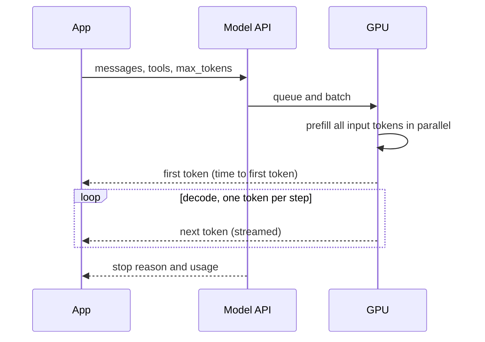

## In one minute
- A language model reads a sequence of tokens and predicts the next one, over and over. Everything an LLM feature does is built on that loop: your prompt, retrieved documents and tool results are all just tokens in the context window.
- Tokens drive the three numbers you will be judged on: cost (priced per million input and output tokens), latency (input is processed in a fast parallel "prefill"; output is generated one token at a time in a slower "decode") and quality (what fits in context, and how focused it is).
- Latency has two parts users feel: time to first token, which grows with input size, and generation time, which grows with output length. Streaming hides the second; shorter prompts and caching cut the first.
- The context window is a budget shared by system prompt, tools, history, retrieved text and the answer. Overflow is a design bug, not an edge case.
- The model is stateless between calls. "Memory", "conversations" and "agents" are all application code that decides what to put back into the next prompt.

## How it works

### Tokens, not words
Models do not see characters or words; they see tokens from a fixed vocabulary, typically tens of thousands to a few hundred thousand entries, produced by an algorithm such as byte-pair encoding, which was adapted from data compression to split rare words into subword units ([Sennrich et al., 2015](https://arxiv.org/abs/1508.07909)). Common English words are usually one token, rarer words split into several, and code, numbers and non-English text often use more tokens per character. A rough rule for English prose is about 4 characters or 0.75 words per token, but always measure with the provider's token counter for your real data: a JSON-heavy prompt can cost twice what the word count suggests.

### The request
An API call sends a list of messages (system instructions, user turns, assistant turns, tool results) plus parameters: the model, the maximum output tokens, sampling settings such as temperature, and optionally tool definitions. The provider turns this into one long token sequence, runs the model, and returns generated tokens and usage counts. Nothing is remembered afterwards: the next call must resend whatever context it needs. If you pass tools, the provider also adds a hidden tool-use system prompt: Anthropic lists roughly 286 to 675 extra input tokens depending on the model, on top of your own schemas ([Anthropic tool use docs](https://platform.claude.com/docs/en/agents-and-tools/tool-use/overview)).

### Prefill and decode
The model processes all input tokens together in one parallel pass, called prefill. That is fast per token, since GPUs are good at large matrix multiplications, but it still grows with input size. Then it generates output one token at a time, called decode, where each step depends on the previous one. Decode speed is often tens to a few hundred tokens per second per request. So time to first token is dominated by prefill plus queueing and network, and total time by output length. A 2,000-token answer at 80 tokens per second takes 25 seconds no matter how fast prefill was.

### Streaming
Streaming returns tokens as they are generated, using server-sent events. One catch is that an error can arrive after the HTTP 200 has already been sent, so streaming clients need a separate path for mid-stream errors ([Anthropic errors](https://platform.claude.com/docs/en/api/errors)). The same page recommends streaming or batch for requests expected to run past 10 minutes, since idle connections may be dropped. It does not make the total faster, but users perceive a response that starts in under a second as fast. Any UI that shows model output to a person should stream; background jobs usually do not need to.

### The context window
Every model has a maximum context, the sum of input and output tokens it can handle in one call, from tens of thousands to a million or more depending on the model. Plan the budget explicitly: system prompt and tool definitions (often thousands of tokens), conversation history, retrieved documents, and room for the answer. Long contexts cost more, take longer to prefill and can reduce answer quality, as the context engineering lesson explains, so bigger is not automatically better. In one study, models answered best when the relevant passage sat at the start or end of the input and noticeably worse when it was buried in the middle ([Liu et al., 2023](https://arxiv.org/abs/2307.03172)).

### Prompt caching
Providers can cache the processed prefix of a prompt. If many requests start with the same system prompt, tools and documents, cached input tokens are billed at a fraction of the normal price and prefill is faster. Order your prompt with stable content first and per-request content last to benefit.

The details differ by provider and change often. On Anthropic's API a cache read costs 0.1x the base input price for most models (0.05x on the newest Sonnet and Opus), a 5-minute cache write costs 1.25x and a 1-hour write 2x. The default lifetime is 5 minutes and each hit refreshes it. The prefix is built in the order tools, system, messages, and a change at one level invalidates everything after it. Prompts below a model-specific minimum (512 to 4,096 tokens) are simply not cached, with no error, so check `cache_read_input_tokens` in the usage block to confirm hits ([Anthropic prompt caching](https://platform.claude.com/docs/en/docs/build-with-claude/prompt-caching)). OpenAI caches automatically for prefixes of 1,024 tokens or more, and reuse needs the whole rendered prefix to match ([OpenAI prompt caching](https://developers.openai.com/api/docs/guides/prompt-caching)). Cached reads also do not count toward Anthropic's input-tokens-per-minute rate limit on most models, so caching raises throughput as well as cutting cost ([Anthropic rate limits](https://platform.claude.com/docs/en/api/rate-limits)).

### The same shapes as any system
An LLM call is a slow, expensive, variable-latency remote dependency. Everything you know applies: timeouts, retries with idempotency, caching, rate limits, fallbacks and budgets. The model is just a new kind of backend.

## Down the stack

### Layer 1: The contract
A model API promises: given messages and parameters, return a completion of at most `max_tokens` output tokens, with usage counts and a stop reason (natural end, a stop sequence, the token limit or a tool call). It does not promise determinism, a fixed latency or that the content is correct.

### Layer 2: The mechanism
Inside, a transformer turns each token into a vector, passes the sequence through dozens of layers of attention and feed-forward networks, and outputs a probability for every token in the vocabulary. A sampler picks the next token: greedy picks the most likely; temperature reshapes the distribution; top-p limits choices to the most likely tokens whose probabilities sum to p. Do not assume you can set these: Anthropic's API now returns a 400 for non-default `temperature`, `top_p` or `top_k` on Claude 4.7 and later models ([Anthropic deprecations](https://platform.claude.com/docs/en/about-claude/model-deprecations)). During decode, a key-value cache stores each layer's attention keys and values for previous tokens, so each new token needs only incremental work. This cache is the main memory consumer in serving: it grows and shrinks per request, and naive allocation wasted so much GPU memory to fragmentation that the vLLM authors' paged layout raised throughput 2 to 4 times at similar latency ([Kwon et al., 2023](https://arxiv.org/abs/2309.06180)). Serving systems batch many users' requests together on each GPU to keep it busy, which is why your latency depends partly on other people's traffic.

### Layer 3: The machine
Decode is limited by memory bandwidth more than arithmetic: for every generated token, the GPU must read the model's weights from high-bandwidth memory. A model with tens of billions of parameters stored in 16-bit precision is tens to over a hundred gigabytes, and a GPU with a few terabytes per second of bandwidth can read it only so many times per second; batching amortises each read across many requests. The key-value cache also grows with context length, consuming GPU memory per request, which is one reason long contexts cost more and reduce how many requests fit on a GPU at once.

### Why it's built this way
1. Text is split into tokens so a fixed vocabulary can represent any input.
2. Input tokens can be processed in parallel, output tokens cannot, so prefill and decode behave differently.
3. GPU memory bandwidth and capacity limit decode speed and context length, so providers price by tokens.
4. The model has no memory between calls, so applications manage context explicitly.
5. Caching repeated prefixes saves the most expensive repeated work.

## Diagram


## Worked example
A team builds a summarise-this-ticket button. Each request sends a 1,500-token system prompt and tools, a ticket thread averaging 3,000 tokens, and asks for a 300-token summary. They see time to first token of about 1.2 seconds and total latency of about 5 seconds, with decode at about 80 tokens per second.

Cost at an illustrative price of 3 dollars per million input tokens and 15 per million output tokens: input 4,500 tokens is 0.0135 dollars, output 300 tokens is 0.0045, so about 1.8 cents per summary. At 200,000 summaries a month, that is about 3,600 dollars.

Three changes. Put the static system prompt and tool definitions first and enable prompt caching: cached reads cost a fraction of the base input price, so the 1,500 stable tokens drop to around a tenth of their cost on a read (the first request that writes the cache pays a 1.25x premium on Anthropic, and some models only cache prompts above 2,048 or 4,096 tokens, so check the minimum for yours). Trim quoted email signatures and repeated history from tickets, cutting average input from 3,000 to 1,800 tokens. Ask for a 120-word summary instead of open-ended text, cutting output to about 170 tokens. Total cost falls by roughly half, time to first token improves because prefill is shorter, and total latency drops below 3 seconds because there are fewer output tokens. Streaming makes the remaining wait feel instant.

## In the wild
- **Anthropic, 2025: a routing bug sent short requests to long-context servers.** From 5 August 2025 some Sonnet 4 requests were routed to servers set up for the larger context window, affecting 0.8% of requests at first and 16% in the worst hour (31 August), and about 30% of Claude Code users had at least one message misrouted. Sticky routing and load dependence made it hard to see, and the fix shipped on 4 September ([Anthropic postmortem](https://www.anthropic.com/engineering/a-postmortem-of-three-recent-issues)).
- **Anthropic, 2025: a compiler bug dropped the most likely token.** A miscompiled approximate top-k operation on TPU servers sometimes excluded the highest-probability token, and a separate misconfiguration occasionally boosted wildly unlikely tokens. Both showed up as odd outputs, not errors, so the sampler and serving stack are part of answer quality (same [postmortem](https://www.anthropic.com/engineering/a-postmortem-of-three-recent-issues)).

## Trade-offs
| Choice | Strengths | Weaknesses | Choose when |
| --- | --- | --- | --- |
| Long context, include everything | Simple, nothing missed | Cost, latency, distraction | Small inputs, prototypes |
| Selective context (retrieval, trimming) | Cheaper, faster, focused | Can miss information | Production features |
| Streaming responses | Fast perceived latency | More complex client handling | Anything a human waits for |
| Prompt caching | Lower cost and prefill time | Needs a stable prefix | Repeated system prompts, tools, documents |
| Short, structured outputs | Faster and cheaper | Less nuance | Summaries, extraction, classification |

## Pitfalls in production
- Estimating cost from word counts. Fix: count tokens with the provider's tool on real data.
- No `max_tokens` limit, so a runaway answer costs money and time. Fix: set it per feature, and check the stop reason.
- Truncated outputs treated as complete. Fix: if the stop reason is the token limit, retry with a higher limit or ask for less.
- Volatile content at the start of the prompt, defeating caching. Fix: stable first, variable last.
- Treating the model as stateful. Fix: design what each call needs to see.
- Assuming caching is working. Fix: the prompt may be below the model's minimum or the prefix may change on every call; alert on a low cache-read ratio in usage.

## Leadership lens
- Make token budgets part of feature design: input, output, cost per request and latency target.
- Instrument every call with token counts, latency split into time to first token and total, and stop reason.
- Standardise streaming for user-facing features and caching-friendly prompt layout in a shared client library.
- Treat the model as a dependency with timeouts, retries, fallbacks and a budget, like any other.

## Check yourself
1. Why does a long answer take much longer than a long prompt?
   **Answer:** Input tokens are processed in parallel during prefill, but output tokens are generated one at a time during decode, so total time grows with output length.
2. What does streaming improve, and what does it not?
   **Answer:** It improves perceived latency by showing the first tokens quickly; it does not reduce total generation time or cost.
3. Why should static content come first in a prompt?
   **Answer:** Prompt caching reuses the processed prefix, so a stable beginning can be cached and reused across requests, cutting cost and prefill time.
4. What should your code do if the stop reason says the output hit the token limit?
   **Answer:** Treat the output as incomplete: retry with a higher limit, ask for a shorter answer, or handle it explicitly rather than using a truncated result.

## Practice
**Task:** Build the estimator a team uses to budget an LLM feature. `latency_ms(input_tokens, output_tokens, prefill_tps, decode_tps, overhead_ms)` returns `overhead_ms` plus input tokens divided by prefill speed plus output tokens divided by decode speed (speeds in tokens per second), in milliseconds, rounded to the nearest integer. `cost_usd(input_tokens, output_tokens, in_per_m, out_per_m, cached_tokens, cached_per_m)` returns the dollar cost, where `cached_tokens` of the input are billed at the cached price and the rest at the normal input price, rounded to 6 decimal places. `fits(window, input_tokens, max_output)` returns true if input plus the maximum output fit in the context window.

```python starter
def latency_ms(input_tokens, output_tokens, prefill_tps, decode_tps, overhead_ms):
    # TODO
    raise NotImplementedError

def cost_usd(input_tokens, output_tokens, in_per_m, out_per_m, cached_tokens, cached_per_m):
    # TODO
    raise NotImplementedError

def fits(window, input_tokens, max_output):
    # TODO
    raise NotImplementedError
```

```python tests
def test_latency_dominated_by_output():
    assert latency_ms(4500, 300, 9000, 80, 300) == 300 + 500 + 3750

def test_latency_long_prompt_short_answer():
    assert latency_ms(90000, 50, 9000, 80, 300) == 300 + 10000 + 625

def test_cost_without_cache():
    assert cost_usd(4500, 300, 3.0, 15.0, 0, 0.3) == 0.018

def test_cost_with_cache():
    assert cost_usd(4500, 300, 3.0, 15.0, 1500, 0.3) == 0.01395

def test_fits_window():
    assert fits(200000, 190000, 8000)
    assert not fits(200000, 195000, 8000)

def test_zero_output():
    assert latency_ms(1000, 0, 10000, 100, 0) == 100
```

```python solution
def latency_ms(input_tokens, output_tokens, prefill_tps, decode_tps, overhead_ms):
    return round(overhead_ms + input_tokens / prefill_tps * 1000 + output_tokens / decode_tps * 1000)

def cost_usd(input_tokens, output_tokens, in_per_m, out_per_m, cached_tokens, cached_per_m):
    fresh = input_tokens - cached_tokens
    total = (fresh * in_per_m + cached_tokens * cached_per_m + output_tokens * out_per_m) / 1_000_000
    return round(total, 6)

def fits(window, input_tokens, max_output):
    return input_tokens + max_output <= window
```

```typescript starter
export function latencyMs(inputTokens: number, outputTokens: number, prefillTps: number, decodeTps: number, overheadMs: number): number {
  throw new Error("TODO");
}

export function costUsd(inputTokens: number, outputTokens: number, inPerM: number, outPerM: number, cachedTokens: number, cachedPerM: number): number {
  throw new Error("TODO");
}

export function fits(window: number, inputTokens: number, maxOutput: number): boolean {
  throw new Error("TODO");
}
```

```typescript tests
test("latency dominated by output", () => {
  assertEqual(latencyMs(4500, 300, 9000, 80, 300), 300 + 500 + 3750);
});

test("latency long prompt short answer", () => {
  assertEqual(latencyMs(90000, 50, 9000, 80, 300), 300 + 10000 + 625);
});

test("cost without cache", () => {
  assertEqual(costUsd(4500, 300, 3, 15, 0, 0.3), 0.018);
});

test("cost with cache", () => {
  assertEqual(costUsd(4500, 300, 3, 15, 1500, 0.3), 0.01395);
});

test("fits window", () => {
  assert(fits(200000, 190000, 8000), "fits");
  assert(!fits(200000, 195000, 8000), "does not fit");
});

test("zero output", () => {
  assertEqual(latencyMs(1000, 0, 10000, 100, 0), 100);
});
```

```typescript solution
export function latencyMs(inputTokens: number, outputTokens: number, prefillTps: number, decodeTps: number, overheadMs: number): number {
  return Math.round(overheadMs + (inputTokens / prefillTps) * 1000 + (outputTokens / decodeTps) * 1000);
}

export function costUsd(inputTokens: number, outputTokens: number, inPerM: number, outPerM: number, cachedTokens: number, cachedPerM: number): number {
  const fresh = inputTokens - cachedTokens;
  const total = (fresh * inPerM + cachedTokens * cachedPerM + outputTokens * outPerM) / 1e6;
  return Math.round(total * 1e6) / 1e6;
}

export function fits(window: number, inputTokens: number, maxOutput: number): boolean {
  return inputTokens + maxOutput <= window;
}
```

```go starter
package practice

func LatencyMs(inputTokens, outputTokens int, prefillTps, decodeTps, overheadMs float64) int {
	panic("TODO")
}

func CostUSD(inputTokens, outputTokens int, inPerM, outPerM float64, cachedTokens int, cachedPerM float64) float64 {
	panic("TODO")
}

func Fits(window, inputTokens, maxOutput int) bool {
	panic("TODO")
}
```

```go tests
package practice

import "testing"

func TestLatencyOutput(t *testing.T) {
	if got := LatencyMs(4500, 300, 9000, 80, 300); got != 4550 {
		t.Fatalf("got %d", got)
	}
}

func TestLatencyLongPrompt(t *testing.T) {
	if got := LatencyMs(90000, 50, 9000, 80, 300); got != 10925 {
		t.Fatalf("got %d", got)
	}
}

func TestCostNoCache(t *testing.T) {
	if got := CostUSD(4500, 300, 3, 15, 0, 0.3); got != 0.018 {
		t.Fatalf("got %v", got)
	}
}

func TestCostCache(t *testing.T) {
	if got := CostUSD(4500, 300, 3, 15, 1500, 0.3); got != 0.01395 {
		t.Fatalf("got %v", got)
	}
}

func TestFits(t *testing.T) {
	if !Fits(200000, 190000, 8000) || Fits(200000, 195000, 8000) {
		t.Fatal("fits wrong")
	}
}

func TestZeroOutput(t *testing.T) {
	if got := LatencyMs(1000, 0, 10000, 100, 0); got != 100 {
		t.Fatalf("got %d", got)
	}
}
```

```go solution
package practice

import "math"

func LatencyMs(inputTokens, outputTokens int, prefillTps, decodeTps, overheadMs float64) int {
	return int(math.Round(overheadMs + float64(inputTokens)/prefillTps*1000 + float64(outputTokens)/decodeTps*1000))
}

func CostUSD(inputTokens, outputTokens int, inPerM, outPerM float64, cachedTokens int, cachedPerM float64) float64 {
	fresh := float64(inputTokens - cachedTokens)
	total := (fresh*inPerM + float64(cachedTokens)*cachedPerM + float64(outputTokens)*outPerM) / 1e6
	return math.Round(total*1e6) / 1e6
}

func Fits(window, inputTokens, maxOutput int) bool {
	return inputTokens+maxOutput <= window
}
```

## Mock interview
**Prompt:** Your product manager wants an "explain this dashboard" button that sends a dashboard's data (about 20,000 tokens of JSON) to a model and shows a written explanation. Expected use is 50,000 clicks a day. Estimate latency and cost, and design the request so it feels fast and stays affordable.

- Follow-up: Users complain they wait 15 seconds staring at a spinner. What changes?
- Follow-up: Finance says the monthly bill is three times the estimate. Where do you look?
- Follow-up: The explanation sometimes stops mid-sentence. Why, and what do you do?

**A strong answer covers:**
- Token arithmetic: input and output tokens per request, price per million, daily and monthly cost.
- Latency split into time to first token (prefill on 20,000 tokens) and generation time (output length divided by decode speed).
- Reducing input: summarise or pre-aggregate the JSON, send only fields that matter.
- Streaming for perceived latency, a bounded output length, and prompt caching for static instructions.
- Cost investigation via logged token usage per request: retries, oversized inputs, missing caching.
- Detecting truncation from the stop reason and handling it explicitly.

## Sources and further study
**Primary**
- [Sennrich, Haddow and Birch: subword units for NMT](https://arxiv.org/abs/1508.07909): the paper that brought byte-pair encoding to language models.
- [Kwon et al.: PagedAttention and vLLM](https://arxiv.org/abs/2309.06180): why the KV cache dominates serving memory.
- [Liu et al.: Lost in the Middle](https://arxiv.org/abs/2307.03172): position effects in long contexts.

**Systems docs**
- [Anthropic prompt caching](https://platform.claude.com/docs/en/docs/build-with-claude/prompt-caching): prices, lifetimes, minimum lengths and usage fields.
- [OpenAI prompt caching](https://developers.openai.com/api/docs/guides/prompt-caching): the automatic, prefix-matched alternative.
- [Anthropic rate limits](https://platform.claude.com/docs/en/api/rate-limits): token-bucket limits and cache-aware input limits.
- [Anthropic errors](https://platform.claude.com/docs/en/api/errors): status codes, mid-stream errors and long requests.

**Books**
- Chip Huyen, *AI Engineering* (O'Reilly, 2025), chapter 2 (sampling) and chapter 9 (inference optimization).

**Other curricula**
- Azure Architecture Center, [Retry pattern](https://learn.microsoft.com/en-us/azure/architecture/patterns/retry): the generic remote-dependency framing this lesson applies to model calls.

## Watch
- [Intro to Large Language Models (Andrej Karpathy)](https://www.youtube.com/watch?v=zjkBMFhNj_g): what an LLM is, how it is trained and how it generates text.
- [Let's build the GPT Tokenizer (Andrej Karpathy)](https://www.youtube.com/watch?v=zduSFxRajkE): why tokens behave the way they do.
- [Transformers, the tech behind LLMs (3Blue1Brown)](https://www.youtube.com/watch?v=wjZofJX0v4M): a visual explanation of the architecture.

## Free resources
- [Context windows (Anthropic docs)](https://docs.anthropic.com/en/docs/build-with-claude/context-windows): how input and output share the context window.
- [Prompt caching (Anthropic docs)](https://docs.anthropic.com/en/docs/build-with-claude/prompt-caching): how cached prefixes reduce cost and latency.
- [Streaming messages (Anthropic docs)](https://docs.anthropic.com/en/docs/build-with-claude/streaming): server-sent events and partial output.
- [The Illustrated Transformer (Jay Alammar)](https://jalammar.github.io/illustrated-transformer/): attention explained with diagrams.
- [Hugging Face LLM Course](https://huggingface.co/learn/llm-course/chapter1/1): a free course on transformer models and tokenizers.
