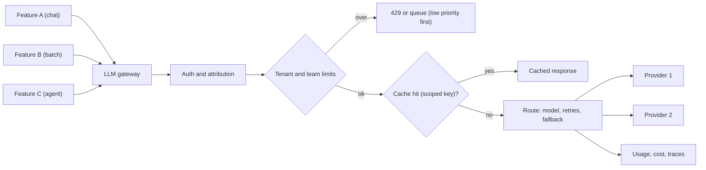

## In one minute
- Once several teams call models, put a gateway in the middle: one service that handles authentication, routing, retries, fallbacks, rate limits, budgets, caching and logging for every model call.
- Model providers rate limit by requests and by tokens per minute per organisation. Without your own per-team and per-tenant limits, one batch job or one heavy customer can exhaust the quota for everyone.
- Caching saves money and latency at three levels: provider prompt caching (repeated prefixes), exact response caching (identical requests), and semantic caching (similar questions), each with different safety trade-offs.
- Budgets turn cost into an operational signal: per team, per feature and per tenant spending limits with alerts, not a surprise at the end of the month.
- A gateway is shared infrastructure on the critical path, so it must be fast, highly available and boring.

## How it works

### Why a gateway
Without one, every team writes its own client with its own retry logic, its own API keys, no shared rate limiting and no unified view of cost. A gateway centralises the cross-cutting concerns: the same reason companies use an API gateway for HTTP services. Open-source proxies such as LiteLLM and managed services such as Cloudflare AI Gateway offer much of this; larger companies often build their own on top of an existing proxy. Azure's architecture guidance lists the same duties (federated authentication, rate limiting, load balancing with circuit breaking, queueing low-priority work, caching, cost attribution) and also warns not to add a gateway if it would put your availability or latency targets at risk ([Azure Architecture Center](https://learn.microsoft.com/en-us/azure/architecture/ai-ml/guide/azure-openai-gateway-guide)).

### Rate limits at two levels
Providers enforce limits per organisation, typically requests per minute (RPM) and input and output tokens per minute (ITPM, OTPM). Anthropic's API uses a token bucket, so capacity refills continuously instead of resetting on a fixed minute, and a nominal 60 RPM can be enforced as one request per second, so short bursts fail. Exceeding a limit returns HTTP 429, usually with a `retry-after` header, and a sharp traffic ramp can trigger separate acceleration limits ([Anthropic rate limits](https://platform.claude.com/docs/en/api/rate-limits)). One 429 should not be retried at all: when a monthly spend cap is reached, the response has no `retry-after` and every retry fails until the cap resets (same page). Your gateway adds its own limits beneath the provider's:
- **Per team or feature:** so a nightly backfill cannot starve the customer-facing chatbot.
- **Per tenant or user:** so one customer's script cannot consume everyone's capacity, and to enforce plan limits.
- **Priority:** interactive traffic before batch; when near the provider limit, shed or queue low-priority work first.

Token-based limits matter more than request counts, because one request with 100,000 tokens costs as much as a thousand small ones. Know how your provider counts, because it changes your gateway's accounting. For most Claude models only uncached input tokens count toward ITPM (cache reads do not), and OTPM is measured on tokens actually generated, with `max_tokens` not part of the calculation ([Anthropic rate limits](https://platform.claude.com/docs/en/api/rate-limits)). A gateway that budgets its own tenants still needs a pessimistic estimate up front, because output length is unknown in advance, so it reserves `input + max_tokens` and corrects the count afterwards. Read the provider's `anthropic-ratelimit-*-remaining` response headers to see how close you are.

### Three kinds of caching
- **Provider prompt caching:** the provider reuses processed prefixes. Safe and transparent; you just structure prompts with stable content first. Details differ by vendor. Anthropic caches in the order tools, system, then messages, so a change early in the prefix invalidates everything after it; the default lifetime is 5 minutes, refreshed on each hit, with a 1-hour option; writes cost 1.25 times (5 minutes) or 2 times (1 hour) the base input price and reads about 0.1 times for most models; and prompts below a model-specific minimum (512 to 4,096 tokens) are silently not cached, so check `cache_read_input_tokens` ([Anthropic prompt caching](https://platform.claude.com/docs/en/docs/build-with-claude/prompt-caching)). OpenAI enables caching by default on supported models, needs a prefix of about 1,024 tokens on current models, and offers `prompt_cache_key` to influence routing ([OpenAI prompt caching](https://developers.openai.com/api/docs/guides/prompt-caching)).
- **Exact response caching:** store responses keyed by a hash of model, parameters and full prompt. Safe when the output should not change for identical input (classification, extraction, embeddings, deterministic settings). Include everything that affects the answer in the key, and set a TTL. Cloudflare's gateway, for example, hashes provider, endpoint, model, auth header and full request body with SHA-256, allows TTLs from 60 seconds to a month, and warns that two identical requests arriving at once can both reach the provider because the first is not yet cached ([Cloudflare AI Gateway](https://developers.cloudflare.com/ai-gateway/features/caching/)). LiteLLM likewise keys on a hash of the whole request and recommends Redis once you run more than one worker, since an in-memory cache is per process ([LiteLLM](https://docs.litellm.ai/docs/proxy/caching)).
- **Semantic caching:** embed the question and reuse an answer for a similar earlier question above a similarity threshold. Saves more, but risks returning an answer to a different question ("refund policy for annual plans" versus "for monthly plans"). Use only for low-risk, non-personalised content, with conservative thresholds and evals. A published case study shows why: a bank FAQ assistant on a semantic cache sent a customer who wanted to close a business account to automatic-payment cancellation steps at 84.9 percent confidence in a benchmark of 1,000 queries, and false positives were as high as 99 percent for some embedding models at a 0.7 threshold. Preloading verified answers and filtering vague queries before caching cut them to 3.8 percent in the best case ([InfoQ](https://www.infoq.com/articles/reducing-false-positives-retrieval-augmented-generation/)). LiteLLM's docs also caution that semantic caching can go badly wrong on agentic traffic.

Never share cached answers across users when the prompt includes user-specific data or permissions; include the tenant and permission scope in the cache key.

### Budgets and attribution
Tag every call with team, feature, tenant and environment. The gateway records input, output and cached tokens and computes cost, so dashboards show spend by feature and tenant in near real time. Budgets with soft alerts (80 percent) and hard actions (downgrade model, queue, or block) prevent month-end surprises and runaway agents.

### The same shapes as any system
The gateway is the overload and hot-spot shapes: shared capacity, fair allocation, backpressure, caching for hot requests. It is the same design as an API gateway or a database connection pooler, applied to a new expensive dependency.

## Down the stack

### Layer 1: The contract
The gateway promises: every model call is authenticated, attributed and logged; no team or tenant exceeds its allocation; interactive traffic gets priority; transient provider errors are retried within a deadline and failed over where configured; cached responses are only served when safe by policy; and added latency stays small (for example under 10 ms at p99 excluding the model call).

### Layer 2: The mechanism
Rate limiting uses token buckets or windowed counters per key (team, tenant, model), usually in Redis with atomic scripts so many gateway replicas share state. Token reservation subtracts `input + max_tokens` up front and refunds the unused output after the response. Exact caching stores a hash key (for example SHA-256 of a canonical JSON request including tenant scope) to the response with a TTL. Semantic caching stores question embeddings in a vector index per scope, returning a cached answer only above a similarity threshold. Streaming responses complicate caching and accounting, so the gateway buffers token counts from the final usage event, and it must allow long-lived connections without premature timeouts or buffering ([Azure Architecture Center](https://learn.microsoft.com/en-us/azure/architecture/ai-ml/guide/azure-openai-gateway-guide)).

### Layer 3: The machine
The gateway sits on every request, so its own cost must be tiny relative to a model call that takes seconds: a Redis round trip within a data centre is about 0.2 to 1 ms, a SHA-256 hash of a 50 KB prompt takes microseconds, and an embedding call for semantic caching costs tens of milliseconds, which is why semantic lookups are only worth it when they avoid multi-second generations. Streaming responses are passed through as server-sent events with small buffers, so the gateway holds many long-lived connections; an event-driven proxy (such as Envoy or one built on async I/O) handles tens of thousands of concurrent streams per node.

### Why it's built this way
1. Many teams share limited, expensive model capacity.
2. Without central control, limits, retries and costs are inconsistent and unfair.
3. A gateway enforces allocation, priority and budgets in one place.
4. Repeated work is common, so caching at the right level saves money and time.
5. The gateway is on every request, so it must be fast and highly available itself.

## Diagram


## Worked example
A company with 6 AI features shares one provider organisation with a limit of 2 million input tokens per minute. Every Monday at 09:00 a reporting job submits 40,000 summarisation requests, hits the limit within minutes, and customer-facing chat starts failing with 429 errors for half an hour.

They introduce a gateway. Limits: chat gets a guaranteed 1.2 million tokens per minute; the reporting job is tagged low priority and capped at 400,000 tokens per minute, and moved to the provider's batch API overnight. Per-tenant limits stop any single customer from using more than 5 percent of chat capacity. An exact cache for the classification feature (identical ticket texts are common because of templates) serves 18 percent of its requests from cache. Prompt caching is enabled for chat's 3,000-token system prompt. Monthly cost falls by 31 percent, and the Monday incident does not recur. A budget alert later catches an agent bug that loops on a tool call, capping its spend at 200 dollars instead of the 9,000 it would have reached over the weekend.

## In the wild
- **Bank FAQ assistant (InfoQ case study): a semantic cache that answered the wrong question.** A semantic cache in a bank FAQ benchmark of 1,000 queries returned confident wrong answers, for example a business-account question routed to payment-cancellation steps at 84.9 percent confidence. Across embedding models the false-positive rate ranged from 19.3 percent to 99 percent at a 0.7 threshold; tuning thresholds only reduced hits and raised LLM calls, while preloading gold answers plus distractors and filtering typos, slang and vague queries brought the best model to 3.8 percent ([InfoQ](https://www.infoq.com/articles/reducing-false-positives-retrieval-augmented-generation/)).
- **Anthropic, 2025: a routing bug on the serving path.** A routing bug, made worse by a load-balancing change on 29 August, sent some Sonnet 4 requests to servers set up for a different context window, and sticky routing kept affected users there: 0.8 percent of requests at first, 16 percent in the worst hour, and about 30 percent of Claude Code users at least once. It is the same lesson a gateway owner needs: a routing layer is on every request, so its rollouts need per-route quality monitoring ([Anthropic postmortem](https://www.anthropic.com/engineering/a-postmortem-of-three-recent-issues)).

## Trade-offs
| Choice | Strengths | Weaknesses | Choose when |
| --- | --- | --- | --- |
| Direct provider calls per team | Simple start | No shared limits, cost visibility or policy | One team, one feature |
| Central gateway | Fairness, budgets, observability, failover | New critical-path service | Several teams or features |
| Exact response cache | Safe, simple | Low hit rate for varied input | Deterministic tasks, repeated inputs |
| Semantic cache | High hit rate on FAQ-like traffic | Wrong-answer risk, extra embedding cost | Low-risk, non-personalised answers |
| Token reservation by max_tokens | Prevents overshoot | Conservative, needs refunds | Token-based provider limits |

## Pitfalls in production
- Cache keys missing tenant or permission scope, leaking answers between customers. Fix: scope in the key, always.
- Counting requests but not tokens. Fix: token-based limits with reservation and correction.
- Retrying 429s inside the gateway and from clients too. Fix: one retry layer with backoff and a deadline.
- Semantic cache thresholds tuned by intuition. Fix: evals of cached versus fresh answers.
- The gateway as a single point of failure. Fix: multiple replicas, simple stateless design, fast failover.

## Leadership lens
- Introduce a gateway as soon as a second team calls models; retrofitting attribution later is painful.
- Allocate provider capacity explicitly between features and enforce priorities.
- Make cost per feature and per tenant visible daily, with budgets and alerts.
- Treat caching policy as a product and security decision, not just an optimisation.

## Check yourself
1. Why rate limit by tokens rather than requests?
   **Answer:** Requests vary enormously in size, and providers limit and charge by tokens, so token budgets reflect real capacity and cost.
2. Why reserve `max_tokens` before a call?
   **Answer:** Output length is unknown in advance; reserving the maximum prevents exceeding the limit, and the unused part is refunded afterwards.
3. When is semantic caching dangerous?
   **Answer:** When small differences in questions change the correct answer, or answers depend on the user, so a similar question can get a wrong or another user's answer.
4. What must be in an exact cache key?
   **Answer:** Everything that affects the output: model, parameters, full prompt including system and tools, and the tenant or permission scope.

## Practice
**Task:** Build the core of an LLM gateway. `Gateway(limits, ttl)` takes a dict of tenant to tokens per minute and a cache TTL in seconds. `request(tenant, key, tokens, now)` returns `"cache"` if the same tenant has a cached response for `key` that is younger than `ttl` (cache entries are per tenant); otherwise, using fixed one-minute windows (`now // 60`), returns `"limited"` if the tenant's tokens in the current window plus `tokens` would exceed its limit (unknown tenants have limit 0); otherwise records the tokens, caches `key` for the tenant at time `now`, and returns `"model"`. `used(tenant, now)` returns the tokens counted for the tenant in the current window.

```python starter
class Gateway:
    def __init__(self, limits, ttl):
        # TODO
        pass

    def request(self, tenant, key, tokens, now):
        # TODO
        raise NotImplementedError

    def used(self, tenant, now):
        # TODO
        raise NotImplementedError
```

```python tests
def test_first_call_goes_to_model_then_cached():
    g = Gateway({"acme": 10000}, 300)
    assert g.request("acme", "classify:abc", 2000, 0) == "model"
    assert g.request("acme", "classify:abc", 2000, 10) == "cache"

def test_cache_is_per_tenant():
    g = Gateway({"acme": 10000, "beta": 10000}, 300)
    g.request("acme", "faq:refunds", 1000, 0)
    assert g.request("beta", "faq:refunds", 1000, 5) == "model"

def test_cache_expires():
    g = Gateway({"acme": 10000}, 300)
    g.request("acme", "k", 1000, 0)
    assert g.request("acme", "k", 1000, 300) == "model"

def test_limit_per_window():
    g = Gateway({"acme": 5000}, 300)
    assert g.request("acme", "a", 3000, 0) == "model"
    assert g.request("acme", "b", 3000, 30) == "limited"
    assert g.used("acme", 30) == 3000
    assert g.request("acme", "b", 3000, 60) == "model"
    assert g.used("acme", 61) == 3000

def test_cache_hits_do_not_use_budget():
    g = Gateway({"acme": 3000}, 300)
    g.request("acme", "a", 3000, 0)
    assert g.request("acme", "a", 3000, 1) == "cache"
    assert g.used("acme", 2) == 3000

def test_unknown_tenant_is_limited():
    assert Gateway({}, 300).request("ghost", "k", 1, 0) == "limited"
```

```python solution
class Gateway:
    def __init__(self, limits, ttl):
        self.limits = limits
        self.ttl = ttl
        self.cache = {}    # (tenant, key) -> time cached
        self.windows = {}  # (tenant, window) -> tokens

    def request(self, tenant, key, tokens, now):
        t = self.cache.get((tenant, key))
        if t is not None and now - t < self.ttl:
            return "cache"
        w = (tenant, now // 60)
        if self.windows.get(w, 0) + tokens > self.limits.get(tenant, 0):
            return "limited"
        self.windows[w] = self.windows.get(w, 0) + tokens
        self.cache[(tenant, key)] = now
        return "model"

    def used(self, tenant, now):
        return self.windows.get((tenant, now // 60), 0)
```

```typescript starter
export class Gateway {
  constructor(limits: Record<string, number>, ttl: number) {}

  request(tenant: string, key: string, tokens: number, now: number): string {
    throw new Error("TODO");
  }

  used(tenant: string, now: number): number {
    throw new Error("TODO");
  }
}
```

```typescript tests
test("first call goes to model then cached", () => {
  const g = new Gateway({ acme: 10000 }, 300);
  assertEqual(g.request("acme", "classify:abc", 2000, 0), "model");
  assertEqual(g.request("acme", "classify:abc", 2000, 10), "cache");
});

test("cache is per tenant", () => {
  const g = new Gateway({ acme: 10000, beta: 10000 }, 300);
  g.request("acme", "faq:refunds", 1000, 0);
  assertEqual(g.request("beta", "faq:refunds", 1000, 5), "model");
});

test("cache expires", () => {
  const g = new Gateway({ acme: 10000 }, 300);
  g.request("acme", "k", 1000, 0);
  assertEqual(g.request("acme", "k", 1000, 300), "model");
});

test("limit per window", () => {
  const g = new Gateway({ acme: 5000 }, 300);
  assertEqual(g.request("acme", "a", 3000, 0), "model");
  assertEqual(g.request("acme", "b", 3000, 30), "limited");
  assertEqual(g.used("acme", 30), 3000);
  assertEqual(g.request("acme", "b", 3000, 60), "model");
  assertEqual(g.used("acme", 61), 3000);
});

test("cache hits do not use budget", () => {
  const g = new Gateway({ acme: 3000 }, 300);
  g.request("acme", "a", 3000, 0);
  assertEqual(g.request("acme", "a", 3000, 1), "cache");
  assertEqual(g.used("acme", 2), 3000);
});

test("unknown tenant is limited", () => {
  assertEqual(new Gateway({}, 300).request("ghost", "k", 1, 0), "limited");
});
```

```typescript solution
export class Gateway {
  private cache = new Map<string, number>();
  private windows = new Map<string, number>();
  constructor(private limits: Record<string, number>, private ttl: number) {}

  request(tenant: string, key: string, tokens: number, now: number): string {
    const ck = tenant + "\u0000" + key, t = this.cache.get(ck);
    if (t !== undefined && now - t < this.ttl) return "cache";
    const wk = tenant + "\u0000" + Math.floor(now / 60), used = this.windows.get(wk) || 0;
    if (used + tokens > (this.limits[tenant] || 0)) return "limited";
    this.windows.set(wk, used + tokens);
    this.cache.set(ck, now);
    return "model";
  }

  used(tenant: string, now: number): number {
    return this.windows.get(tenant + "\u0000" + Math.floor(now / 60)) || 0;
  }
}
```

```go starter
package practice

type Gateway struct{}

func NewGateway(limits map[string]int, ttl int) *Gateway {
	return &Gateway{}
}

func (g *Gateway) Request(tenant, key string, tokens, now int) string {
	panic("TODO")
}

func (g *Gateway) Used(tenant string, now int) int {
	panic("TODO")
}
```

```go tests
package practice

import "testing"

func eqs(t *testing.T, got, want string) {
	t.Helper()
	if got != want {
		t.Fatalf("got %s, want %s", got, want)
	}
}

func TestModelThenCache(t *testing.T) {
	g := NewGateway(map[string]int{"acme": 10000}, 300)
	eqs(t, g.Request("acme", "classify:abc", 2000, 0), "model")
	eqs(t, g.Request("acme", "classify:abc", 2000, 10), "cache")
}

func TestPerTenantCache(t *testing.T) {
	g := NewGateway(map[string]int{"acme": 10000, "beta": 10000}, 300)
	g.Request("acme", "faq:refunds", 1000, 0)
	eqs(t, g.Request("beta", "faq:refunds", 1000, 5), "model")
}

func TestExpiry(t *testing.T) {
	g := NewGateway(map[string]int{"acme": 10000}, 300)
	g.Request("acme", "k", 1000, 0)
	eqs(t, g.Request("acme", "k", 1000, 300), "model")
}

func TestWindowLimit(t *testing.T) {
	g := NewGateway(map[string]int{"acme": 5000}, 300)
	eqs(t, g.Request("acme", "a", 3000, 0), "model")
	eqs(t, g.Request("acme", "b", 3000, 30), "limited")
	if g.Used("acme", 30) != 3000 {
		t.Fatal("used wrong")
	}
	eqs(t, g.Request("acme", "b", 3000, 60), "model")
	if g.Used("acme", 61) != 3000 {
		t.Fatal("new window wrong")
	}
}

func TestCacheNoBudget(t *testing.T) {
	g := NewGateway(map[string]int{"acme": 3000}, 300)
	g.Request("acme", "a", 3000, 0)
	eqs(t, g.Request("acme", "a", 3000, 1), "cache")
	if g.Used("acme", 2) != 3000 {
		t.Fatal("cache used budget")
	}
}

func TestUnknownTenant(t *testing.T) {
	eqs(t, NewGateway(map[string]int{}, 300).Request("ghost", "k", 1, 0), "limited")
}
```

```go solution
package practice

type cacheKey struct{ tenant, key string }
type windowKey struct {
	tenant string
	window int
}

type Gateway struct {
	limits  map[string]int
	ttl     int
	cache   map[cacheKey]int
	windows map[windowKey]int
}

func NewGateway(limits map[string]int, ttl int) *Gateway {
	return &Gateway{limits: limits, ttl: ttl, cache: map[cacheKey]int{}, windows: map[windowKey]int{}}
}

func (g *Gateway) Request(tenant, key string, tokens, now int) string {
	if t, ok := g.cache[cacheKey{tenant, key}]; ok && now-t < g.ttl {
		return "cache"
	}
	w := windowKey{tenant, now / 60}
	if g.windows[w]+tokens > g.limits[tenant] {
		return "limited"
	}
	g.windows[w] += tokens
	g.cache[cacheKey{tenant, key}] = now
	return "model"
}

func (g *Gateway) Used(tenant string, now int) int {
	return g.windows[windowKey{tenant, now / 60}]
}
```

## Mock interview
**Prompt:** Your company has 15 teams building AI features against two model providers, spending 400,000 dollars a month. There have been three incidents where one team's traffic caused rate-limit failures for others, and finance cannot tell which features cost what. Design the platform layer.

- Follow-up: A team wants semantic caching for their support bot. What do you require before allowing it?
- Follow-up: One provider has an outage. What happens to traffic?
- Follow-up: How do you keep the gateway itself from becoming the next outage?

**A strong answer covers:**
- A central gateway with authentication, attribution tags, logging and cost accounting per team, feature and tenant.
- Allocated capacity per team with token-based limits, reservation and refunds, and priority for interactive traffic.
- Budgets with alerts and automatic actions, and batch APIs for offline work.
- Caching policy: provider prompt caching by default, exact caching with scoped keys, semantic caching only with evals, thresholds and non-personalised content.
- Failover between providers per feature, based on evals of the alternative model.
- Gateway reliability: stateless replicas, shared state in a replicated store, small latency budget, and a tested bypass for emergencies.

## Sources and further study

**Primary**
- [GPT Semantic Cache (arXiv:2411.05276)](https://arxiv.org/abs/2411.05276): reducing cost and latency with embedding-based caching, and its trade-offs.
- [Reducing false positives in semantic caching for RAG and FAQ systems (InfoQ)](https://www.infoq.com/articles/reducing-false-positives-retrieval-augmented-generation/): measured false-positive rates by embedding model and threshold, and cache-side fixes.

**Systems docs**
- [Rate limits (Anthropic)](https://platform.claude.com/docs/en/api/rate-limits): RPM, ITPM and OTPM, token bucket, headers, spend caps and the cache-aware ITPM rule.
- [Prompt caching (Anthropic)](https://platform.claude.com/docs/en/docs/build-with-claude/prompt-caching): prefix order, TTLs, price multipliers, minimum lengths and isolation per workspace.
- [Prompt caching (OpenAI)](https://developers.openai.com/api/docs/guides/prompt-caching): automatic caching, minimum prefix, retention and `prompt_cache_key`.
- [Caching (Cloudflare AI Gateway)](https://developers.cloudflare.com/ai-gateway/features/caching/): exact-match cache key, TTL bounds and the concurrent-request caveat.
- [Caching (LiteLLM)](https://docs.litellm.ai/docs/proxy/caching): backends, whole-request keys and semantic cache warnings.

**Books**
- Chip Huyen, *AI Engineering* (O'Reilly, 2025), Ch 10 "AI Engineering Architecture and User Feedback": the steps "Add Model Router and Gateway" and "Reduce Latency with Caches".
- Michael Nygard, *Release It!* (2nd ed., 2018), Ch 5 "Stability Patterns": timeouts, circuit breaker and bulkheads, the patterns a gateway applies to a flaky dependency.

**Other curricula**
- [Access language models through a gateway (Azure Architecture Center)](https://learn.microsoft.com/en-us/azure/architecture/ai-ml/guide/azure-openai-gateway-guide): frames the gateway as the Gateway Offloading pattern, with the single-point-of-failure caveat.

## Free resources
- [Rate limits (Anthropic API docs)](https://docs.anthropic.com/en/api/rate-limits): request and token limits, headers and handling 429s.
- [LiteLLM documentation](https://docs.litellm.ai/docs/): an open-source gateway with routing, budgets and fallbacks.
- [Cloudflare AI Gateway](https://developers.cloudflare.com/ai-gateway/): a managed gateway with caching, rate limiting and analytics.
- [Envoy rate limiting](https://www.envoyproxy.io/docs/envoy/latest/configuration/other_features/rate_limit): global rate limiting in a widely used proxy.
- [GPT Semantic Cache (paper)](https://arxiv.org/abs/2411.05276): reducing cost and latency with embedding-based caching, and its trade-offs.
