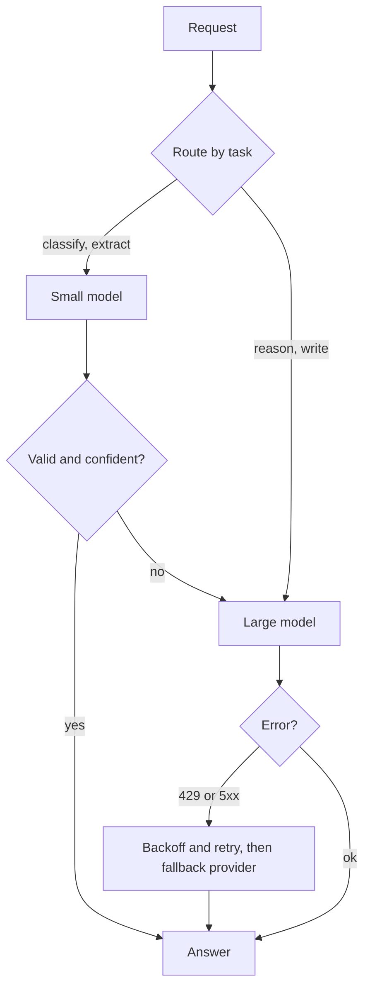

## In one minute
- There is no best model, only the best model for a task at a price and latency. Large models are smarter, slower and more expensive; small models are fast and cheap and often good enough.
- Choose with evidence: build an eval set for the task, run candidate models on it, and plot quality against cost and latency. Public leaderboards are a starting point, not an answer.
- Route by task: a cheap model for classification and extraction, a capable one for reasoning and writing, and sometimes a cascade that tries the cheap model first and escalates when it is unsure.
- Call models like any unreliable remote dependency: timeouts, retries with backoff on rate limits and overloads, a fallback model or provider, and a budget per request.
- Use batch APIs for work that can wait: both Anthropic and OpenAI price batch requests at 50% of the synchronous rate.

## How it works

### The three-way trade-off
Every model sits somewhere on quality, cost and latency. Within one provider's family, larger models score higher on hard reasoning and writing, cost several times more per token, and generate fewer tokens per second. The right choice depends on the task: a support router that labels tickets into 12 categories needs consistency and speed, while a code review assistant needs reasoning. Using the biggest model everywhere is the most common and expensive mistake; using the smallest everywhere is the second most common.

### Choosing with evals
Public benchmarks and arenas tell you roughly how models compare in general. Your task is not general. Build an eval set of 100 to 500 real inputs with checks (see the evals lesson), run each candidate, and record pass rate, cost per request and latency percentiles. Often a smaller model reaches 95 percent of the larger one's quality at a fifth of the cost; sometimes the gap is large on exactly the cases that matter. Rerun when providers release new models or change versions.

### Routing and cascades
- **Static routing:** each feature uses the model its eval chose.
- **Classifier routing:** a cheap model or rules decide which model handles each request, for example by length, language or detected difficulty.
- **Cascades:** a small model answers first; if it signals low confidence, fails a check (invalid JSON, missing citation) or the task is flagged hard, the request goes to a larger model. Research systems showed large savings this way: the FrugalGPT authors report matching GPT-4 quality with up to 98% lower cost on their tasks ([Chen et al., 2023](https://arxiv.org/abs/2305.05176)), while RouteLLM reports cutting cost by over 2 times in certain cases ([Ong et al., 2024](https://arxiv.org/abs/2406.18665)). Treat both as best cases measured on specific benchmarks, not promises for your traffic. The expected cost is the small model's cost plus the escalation rate times the large model's cost, so cascades pay off when escalation is rare.

### Calling models reliably
Model APIs fail in familiar ways: rate limits (HTTP 429), overloads (Anthropic returns 529), server errors (500) and timeouts (504) ([Anthropic errors](https://platform.claude.com/docs/en/api/errors)). Treat them like any dependency: set a timeout that matches the expected generation time, retry transient errors with exponential backoff and jitter, honour `retry-after` headers, and never retry indefinitely. Two 429 traps: a monthly spend-cap 429 carries no `retry-after` and keeps failing until the next month, so retrying it is pointless, and a spend limit you set yourself returns a 400 instead ([Anthropic rate limits](https://platform.claude.com/docs/en/api/rate-limits)). Anthropic's official SDKs already retry twice by default with backoff and honour `retry-after`, so stacking your own retry loop on top multiplies attempts; the Azure Architecture Center warns against nested retry layers for the same reason ([Retry pattern](https://learn.microsoft.com/en-us/azure/architecture/patterns/retry)). A sharp traffic ramp can also trigger 429s from acceleration limits, so ramp up gradually. Keep a fallback: a second model, a second region or provider, or a degraded non-AI path ("we could not generate a summary; here is the raw ticket"). Make side-effecting tool calls idempotent, because a retried request can repeat them.

### Batch and asynchronous work
Many AI workloads do not need an answer in seconds: nightly classification, document enrichment, eval runs, backfills. Batch APIs accept a set of requests and return results within a window of up to 24 hours at 50% of the standard price. Anthropic says most batches finish within an hour, caps a batch at 100,000 requests or 256 MB, and keeps results for 29 days ([Anthropic batch docs](https://platform.claude.com/docs/en/docs/build-with-claude/batch-processing)). OpenAI's equivalent has a 24-hour window, up to 50,000 requests and 200 MB per file, and its own separate rate-limit pool ([OpenAI Batch API](https://developers.openai.com/api/docs/guides/batch)). Anthropic's batches have their own queue limits too (for example 200,000 queued batch requests on the Start tier), so they are not unlimited. Moving even a quarter of traffic to batch can noticeably lower the bill.

### The same shapes as any system
Model selection is a classic capacity and cost trade-off, and the cascade is the same pattern as a cache in front of a database: handle the common case cheaply and fall through to the expensive path only when needed.

## Down the stack

### Layer 1: The contract
For each AI feature, the team commits to a quality target on its eval set, a cost per request and a latency target (often p95 time to first token and total time). The model choice, routing and retry policy are the mechanism to meet that contract, and they change whenever a cheaper or better option meets it.

### Layer 2: The mechanism
A model client library usually provides: per-feature configuration (model, max tokens, temperature, timeout), retry policy with backoff, fallback chains, token and cost accounting, and routing hooks. Rate limits are applied by the provider per organisation in requests per minute and tokens per minute; the client should track remaining quota from response headers (Anthropic sends `anthropic-ratelimit-*-remaining` and `-reset` values) and slow down before hitting the limit, rather than after. Limits use a token bucket that refills continuously, so a short burst can fail even when your per-minute average is fine, and on most Anthropic models cache reads do not count toward the input-token limit, which makes prompt caching a rate-limit tool as well as a cost tool ([Anthropic rate limits](https://platform.claude.com/docs/en/api/rate-limits)). Cascades need a cheap, reliable escalation signal: a schema validation failure, a self-reported confidence field, a check against retrieved sources, or a classifier.

### Layer 3: The machine
The price difference between models reflects hardware time. Larger models have more parameters to read from GPU memory for every generated token and need more GPUs per replica, so each output token occupies more expensive hardware for longer. Batch pricing is lower because the provider gains scheduling freedom: with a 24-hour window it can fill spare capacity and form larger GPU batches. The providers document the discount and the window, not the scheduling internals, so treat that explanation as a reasonable inference. Latency differences come from the same place: more parameters per token means more memory traffic per decode step.

### Why it's built this way
1. Model capability, cost and speed trade against each other because of hardware limits.
2. Tasks differ in how much capability they need.
3. So each feature should use the cheapest model that meets its measured quality bar.
4. Mixed difficulty within a feature makes routing and cascades worthwhile.
5. Model APIs are remote dependencies with limits, so standard resilience patterns apply.

## Diagram


## Worked example
A company tags incoming support tickets with one of 15 categories and a priority, about 400,000 tickets a month, and also drafts replies for agents. Today both use the largest model.

They build a 300-ticket eval for tagging and a 150-ticket eval for drafting, graded by support leads. For tagging, the small model scores 96 percent against the large model's 97 percent at about one tenth of the cost and a third of the latency. For drafting, the small model scores 71 percent against 89 percent; the mid-size model scores 87 percent at about a third of the large model's cost.

New design: tagging on the small model, with escalation to the mid-size model when the small model's output fails schema validation or picks "other" (about 6 percent of tickets). Drafting on the mid-size model, with the large model available for escalated VIP tickets. Overnight re-tagging of old tickets moves to the batch API. The monthly bill falls by about 70 percent, p95 tagging latency drops from 2.4 to 0.8 seconds, and measured quality stays within one point on both evals.

## In the wild
- **Anthropic, 2025: three overlapping bugs quietly degraded answers.** A routing error, a TPU misconfiguration and a compiler bug in approximate top-k hit between August and September 2025. At the worst hour 16% of Sonnet 4 requests were misrouted, and about 30% of Claude Code users saw at least one bad message. Anthropic's evals had not caught them, and the fixes added production quality monitoring and more sensitive evals. The lesson for model choice is that a provider's model can regress without a version change, so keep your own eval running in production ([Anthropic postmortem](https://www.anthropic.com/engineering/a-postmortem-of-three-recent-issues)).
- **Anthropic, 2026: forced model migrations on a fixed clock.** Claude Sonnet 4 and Opus 4 were deprecated on 14 April 2026 and retired on 15 June 2026, and Opus 4.1 was announced on 5 June and retired on 5 August 2026, each with a recommended replacement. Teams without pinned IDs and an eval set had about two months to re-validate prompts, cost and latency ([Anthropic model deprecations](https://platform.claude.com/docs/en/about-claude/model-deprecations)).

## Trade-offs
| Approach | Strengths | Weaknesses | Choose when |
| --- | --- | --- | --- |
| Largest model everywhere | Best quality, simple | Highest cost and latency | Prototypes, low volume |
| Per-feature model chosen by eval | Right-sized cost | Eval upkeep | Most production features |
| Cascade small to large | Big savings when escalation is rare | Extra latency on escalated requests | Mixed-difficulty traffic |
| Multiple providers with fallback | Resilience to outages | More integration and evals | Critical features |
| Batch API | Much cheaper, no rate-limit pressure | Hours of latency | Offline and bulk work |

## Pitfalls in production
- Choosing models from leaderboards alone. Fix: evals on your own data.
- Retrying on 429 immediately in a tight loop, or retrying a spend-cap 429 at all. Fix: backoff with jitter, honour `retry-after`, and stop when there is no header and the error details say the spend limit was reached.
- Floating model aliases that change behaviour silently. Fix: pin dated model IDs and upgrade deliberately with evals. Models do get retired: Anthropic promises at least 60 days' notice, and Sonnet 4 and Opus 4 were announced on 14 April 2026 and retired on 15 June 2026 ([Anthropic deprecations](https://platform.claude.com/docs/en/about-claude/model-deprecations)).
- Cascades with unreliable escalation signals. Fix: use checkable signals such as schema validation and citation checks.
- No degraded path when the model is unavailable. Fix: design a non-AI fallback for critical flows.

## Leadership lens
- Require an eval-backed model choice and a cost per request estimate in every AI feature's design doc.
- Centralise model calls in one client with routing, retries, fallbacks and cost accounting.
- Review model choices quarterly; prices and capabilities change fast.
- Move every non-interactive workload you can to batch.

## Check yourself
1. Why not use the most capable model for every feature?
   **Answer:** It costs more and is slower, and many tasks such as classification or extraction reach nearly the same quality on a smaller model, so you pay for capability you do not need.
2. When does a cascade save money?
   **Answer:** When the small model handles most requests well and escalation is rare, so the small model's cost plus escalation rate times the large model's cost is below the large model's cost alone.
3. How should a client respond to HTTP 429 from a model API?
   **Answer:** Back off exponentially with jitter, respect any retry-after header, and slow down overall request rate rather than retrying immediately.
4. Why is batch processing cheaper?
   **Answer:** The provider gets up to 24 hours of scheduling freedom, which lets it improve GPU utilisation, so it charges 50% less in exchange for slower turnaround.

## Practice
**Task:** Build a model router. Each model has `name`, `quality` (eval pass rate 0 to 1), `cost` (dollars per request) and `p95_ms`. `pick(models, min_quality, max_p95)` returns the name of the cheapest model meeting both bounds (ties broken by lower `p95_ms`, then name), or `None`. `fallback_chain(models, min_quality, max_p95)` returns the names of all eligible models ordered the same way. `cascade_cost(small_cost, large_cost, escalation_rate)` returns the expected cost per request of trying the small model and escalating a fraction of requests to the large one, rounded to 6 decimal places.

```python starter
def pick(models, min_quality, max_p95):
    # TODO
    raise NotImplementedError

def fallback_chain(models, min_quality, max_p95):
    # TODO
    raise NotImplementedError

def cascade_cost(small_cost, large_cost, escalation_rate):
    # TODO
    raise NotImplementedError
```

```python tests
def m(name, q, cost, p95):
    return {"name": name, "quality": q, "cost": cost, "p95_ms": p95}

MODELS = [m("large", 0.97, 0.0200, 2400), m("mid", 0.95, 0.0070, 1500), m("small", 0.90, 0.0020, 800)]

def test_cheapest_that_meets_quality():
    assert pick(MODELS, 0.94, 3000) == "mid"

def test_latency_bound():
    assert pick(MODELS, 0.96, 2000) is None

def test_low_bar_picks_small():
    assert pick(MODELS, 0.85, 1000) == "small"

def test_fallback_chain_order():
    assert fallback_chain(MODELS, 0.90, 3000) == ["small", "mid", "large"]

def test_tie_broken_by_latency_then_name():
    ms = [m("b", 0.9, 0.01, 900), m("a", 0.9, 0.01, 900), m("c", 0.9, 0.01, 500)]
    assert fallback_chain(ms, 0.5, 1000) == ["c", "a", "b"]

def test_cascade_cost():
    assert cascade_cost(0.002, 0.007, 0.06) == 0.00242
    assert cascade_cost(0.002, 0.02, 1.0) == 0.022
```

```python solution
def fallback_chain(models, min_quality, max_p95):
    ok = [x for x in models if x["quality"] >= min_quality and x["p95_ms"] <= max_p95]
    ok.sort(key=lambda x: (x["cost"], x["p95_ms"], x["name"]))
    return [x["name"] for x in ok]

def pick(models, min_quality, max_p95):
    chain = fallback_chain(models, min_quality, max_p95)
    return chain[0] if chain else None

def cascade_cost(small_cost, large_cost, escalation_rate):
    return round(small_cost + escalation_rate * large_cost, 6)
```

```typescript starter
export interface Model { name: string; quality: number; cost: number; p95_ms: number; }

export function pick(models: Model[], minQuality: number, maxP95: number): string | null {
  throw new Error("TODO");
}

export function fallbackChain(models: Model[], minQuality: number, maxP95: number): string[] {
  throw new Error("TODO");
}

export function cascadeCost(smallCost: number, largeCost: number, escalationRate: number): number {
  throw new Error("TODO");
}
```

```typescript tests
const m = (name: string, quality: number, cost: number, p95_ms: number): Model => ({ name, quality, cost, p95_ms });
const MODELS = [m("large", 0.97, 0.02, 2400), m("mid", 0.95, 0.007, 1500), m("small", 0.9, 0.002, 800)];

test("cheapest that meets quality", () => {
  assertEqual(pick(MODELS, 0.94, 3000), "mid");
});

test("latency bound", () => {
  assertEqual(pick(MODELS, 0.96, 2000), null);
});

test("low bar picks small", () => {
  assertEqual(pick(MODELS, 0.85, 1000), "small");
});

test("fallback chain order", () => {
  assertEqual(fallbackChain(MODELS, 0.9, 3000), ["small", "mid", "large"]);
});

test("tie broken by latency then name", () => {
  assertEqual(fallbackChain([m("b", 0.9, 0.01, 900), m("a", 0.9, 0.01, 900), m("c", 0.9, 0.01, 500)], 0.5, 1000), ["c", "a", "b"]);
});

test("cascade cost", () => {
  assertEqual(cascadeCost(0.002, 0.007, 0.06), 0.00242);
  assertEqual(cascadeCost(0.002, 0.02, 1), 0.022);
});
```

```typescript solution
export interface Model { name: string; quality: number; cost: number; p95_ms: number; }

export function fallbackChain(models: Model[], minQuality: number, maxP95: number): string[] {
  return models.filter(x => x.quality >= minQuality && x.p95_ms <= maxP95)
    .sort((a, b) => a.cost - b.cost || a.p95_ms - b.p95_ms || (a.name < b.name ? -1 : a.name > b.name ? 1 : 0))
    .map(x => x.name);
}

export function pick(models: Model[], minQuality: number, maxP95: number): string | null {
  const chain = fallbackChain(models, minQuality, maxP95);
  return chain.length ? chain[0] : null;
}

export function cascadeCost(smallCost: number, largeCost: number, escalationRate: number): number {
  return Math.round((smallCost + escalationRate * largeCost) * 1e6) / 1e6;
}
```

```go starter
package practice

type Model struct {
	Name    string
	Quality float64
	Cost    float64
	P95Ms   int
}

// Pick returns the chosen model name, or "" if none qualifies.
func Pick(models []Model, minQuality float64, maxP95 int) string {
	panic("TODO")
}

func FallbackChain(models []Model, minQuality float64, maxP95 int) []string {
	panic("TODO")
}

func CascadeCost(smallCost, largeCost, escalationRate float64) float64 {
	panic("TODO")
}
```

```go tests
package practice

import (
	"reflect"
	"testing"
)

var models = []Model{{"large", 0.97, 0.02, 2400}, {"mid", 0.95, 0.007, 1500}, {"small", 0.90, 0.002, 800}}

func TestPickMid(t *testing.T) {
	if got := Pick(models, 0.94, 3000); got != "mid" {
		t.Fatalf("got %s", got)
	}
}

func TestLatencyBound(t *testing.T) {
	if got := Pick(models, 0.96, 2000); got != "" {
		t.Fatalf("got %s", got)
	}
}

func TestLowBar(t *testing.T) {
	if got := Pick(models, 0.85, 1000); got != "small" {
		t.Fatalf("got %s", got)
	}
}

func TestChain(t *testing.T) {
	if got := FallbackChain(models, 0.90, 3000); !reflect.DeepEqual(got, []string{"small", "mid", "large"}) {
		t.Fatalf("got %v", got)
	}
}

func TestTies(t *testing.T) {
	ms := []Model{{"b", 0.9, 0.01, 900}, {"a", 0.9, 0.01, 900}, {"c", 0.9, 0.01, 500}}
	if got := FallbackChain(ms, 0.5, 1000); !reflect.DeepEqual(got, []string{"c", "a", "b"}) {
		t.Fatalf("got %v", got)
	}
}

func TestCascade(t *testing.T) {
	if CascadeCost(0.002, 0.007, 0.06) != 0.00242 || CascadeCost(0.002, 0.02, 1.0) != 0.022 {
		t.Fatal("cascade cost wrong")
	}
}
```

```go solution
package practice

import (
	"math"
	"sort"
)

type Model struct {
	Name    string
	Quality float64
	Cost    float64
	P95Ms   int
}

func FallbackChain(models []Model, minQuality float64, maxP95 int) []string {
	var ok []Model
	for _, m := range models {
		if m.Quality >= minQuality && m.P95Ms <= maxP95 {
			ok = append(ok, m)
		}
	}
	sort.Slice(ok, func(i, j int) bool {
		if ok[i].Cost != ok[j].Cost {
			return ok[i].Cost < ok[j].Cost
		}
		if ok[i].P95Ms != ok[j].P95Ms {
			return ok[i].P95Ms < ok[j].P95Ms
		}
		return ok[i].Name < ok[j].Name
	})
	out := []string{}
	for _, m := range ok {
		out = append(out, m.Name)
	}
	return out
}

func Pick(models []Model, minQuality float64, maxP95 int) string {
	chain := FallbackChain(models, minQuality, maxP95)
	if len(chain) == 0 {
		return ""
	}
	return chain[0]
}

func CascadeCost(smallCost, largeCost, escalationRate float64) float64 {
	return math.Round((smallCost+escalationRate*largeCost)*1e6) / 1e6
}
```

## Mock interview
**Prompt:** Your company spends 180,000 dollars a month on model API calls across 9 features, all using the same large model. The CFO asks you to cut the bill in half within a quarter without users noticing. How do you approach it?

- Follow-up: One team insists their feature needs the largest model. How do you decide?
- Follow-up: How do you protect the features from a provider outage?
- Follow-up: What happens to your choices when the provider releases a new model generation?

**A strong answer covers:**
- Measuring first: cost and token usage per feature, request volume, latency, and where the money actually goes.
- Eval sets per feature to compare models on real data, with explicit quality bars.
- Right-sizing per feature, cascades for mixed difficulty, prompt caching, trimming inputs and bounding outputs.
- Moving offline work to batch APIs.
- Resilience: timeouts, backoff on 429 and overloads, fallback models or providers, degraded non-AI paths.
- A repeatable process to re-evaluate when models or prices change, with pinned versions.

## Sources and further study
**Primary**
- [FrugalGPT (Chen, Zaharia, Zou)](https://arxiv.org/abs/2305.05176): LLM cascades, with up to 98% cost reduction reported on the authors' tasks.
- [RouteLLM (Ong et al.)](https://arxiv.org/abs/2406.18665): learned routers between strong and weak models.

**Systems docs**
- [Anthropic Message Batches](https://platform.claude.com/docs/en/docs/build-with-claude/batch-processing): 50% price, limits, 24-hour window, 29-day result retention.
- [OpenAI Batch API](https://developers.openai.com/api/docs/guides/batch): the same pattern with a 50,000-request cap.
- [Anthropic errors](https://platform.claude.com/docs/en/api/errors): status codes and SDK retry defaults.
- [Anthropic rate limits](https://platform.claude.com/docs/en/api/rate-limits): token bucket, spend caps and headers.
- [Anthropic model deprecations](https://platform.claude.com/docs/en/about-claude/model-deprecations): lifecycle states and notice periods.

**Books**
- Chip Huyen, *AI Engineering* (O'Reilly, 2025), chapter 4 (Evaluate AI Systems, including model selection) and chapter 10 (architecture).

**Other curricula**
- Azure Architecture Center, [Retry pattern](https://learn.microsoft.com/en-us/azure/architecture/patterns/retry): when to cancel, retry immediately or retry after a delay, and the idempotency caveat.

## Free resources
- [Choosing a model (Anthropic docs)](https://docs.anthropic.com/en/docs/about-claude/models/choosing-a-model): matching model size to task, cost and latency.
- [Batch processing (Anthropic docs)](https://docs.anthropic.com/en/docs/build-with-claude/batch-processing): asynchronous requests at lower cost.
- [Errors (Anthropic API docs)](https://docs.anthropic.com/en/api/errors): rate limit and overload errors and how to handle them.
- [FrugalGPT (Chen, Zaharia and Zou)](https://arxiv.org/abs/2305.05176): cascades and routing to cut LLM cost.
- [RouteLLM (LMSYS)](https://arxiv.org/abs/2406.18665): learning to route between strong and weak models.
- [Artificial Analysis](https://artificialanalysis.ai/): independent comparisons of model quality, speed and price.
