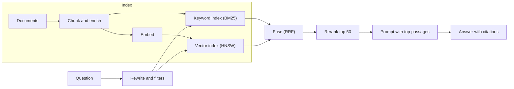

## In one minute
- Retrieval-augmented generation (RAG) answers questions from your own data by retrieving relevant passages and putting them into the prompt. The model writes the answer; retrieval decides what it knows.
- The pipeline has two halves. Indexing: split documents into chunks, embed and index them. Querying: rewrite the question, retrieve candidates, rerank, assemble the prompt, generate with citations.
- Most RAG failures are retrieval failures: the right passage was never in the context. Measure retrieval separately (recall at k) before tuning prompts.
- Hybrid search, combining keyword search (BM25) with vector search and fusing the results, beats either alone on most real data, especially for names, codes and exact phrases.
- Treat the index like any derived data store: keep it fresh, versioned, permission-aware and observable.

## How it works

### Why RAG
Models know what was in their training data, up to a cutoff, and nothing about your company's documents, tickets or policies. Putting everything into the prompt does not scale and dilutes attention. RAG retrieves a small, relevant subset at query time, so answers can use current, private data and cite their sources. The 2020 paper that named the technique (Lewis et al.) combined a pre-trained neural retriever over a dense vector index of Wikipedia (the non-parametric memory) with a seq2seq generator (the parametric memory) ([arXiv:2005.11401](https://arxiv.org/abs/2005.11401)). Today the generator is usually a general-purpose LLM behind an API. A fixed pipeline like the one below always searches once; when a question needs several searches or a choice of index, newer designs let an agent call retrieval as a tool ([Azure Architecture Center](https://learn.microsoft.com/en-us/azure/architecture/ai-ml/guide/rag/rag-solution-design-and-evaluation-guide)).

### Indexing
1. **Load and clean.** Extract text from PDFs, HTML, tickets and wikis; strip navigation, boilerplate and duplicates.
2. **Chunk.** Split into passages of a few hundred tokens, usually with some overlap so sentences that span boundaries are not lost. Split on structure where possible (headings, paragraphs), and keep metadata: source, title, section, date, access permissions.
3. **Enrich.** Optionally prepend context to each chunk, such as the document title and a one-line summary of where it sits. Anthropic's "contextual retrieval" write-up measured the top-20 retrieval failure rate falling from 5.7 percent to 3.7 percent with contextual embeddings, to 2.9 percent when contextual BM25 was added, and to 1.9 percent with reranking, which are reductions of 35, 49 and 67 percent ([Anthropic](https://www.anthropic.com/news/contextual-retrieval)). Those are one vendor's numbers on its own datasets, so re-measure on yours. Microsoft's guidance likewise treats chunk enrichment (title, summary, keywords) as its own phase to evaluate ([Azure Architecture Center](https://learn.microsoft.com/en-us/azure/architecture/ai-ml/guide/rag/rag-solution-design-and-evaluation-guide)).
4. **Index.** Embed each chunk into a vector and store it in a vector index, and also index the text for keyword search.

### Querying
1. **Understand the question.** Rewrite follow-ups into standalone queries ("what about for annual plans?" becomes "refund policy for annual plans"), and extract filters (product, region, date).
2. **Retrieve candidates.** Run keyword search and vector search, each returning, say, the top 50, with metadata filters including the user's permissions.
3. **Fuse and rerank.** Combine the lists, for example with reciprocal rank fusion, then optionally rerank the top candidates with a cross-encoder or a small model that scores query and passage together.
4. **Assemble.** Put the top 5 to 10 passages into the prompt with their sources, ordered sensibly, within a token budget.
5. **Generate with citations.** Instruct the model to answer only from the passages, cite them, and say when the answer is not there.

### Hybrid search
Vector search finds passages with similar meaning even when words differ ("cancel my subscription" matches "terminate your plan"). Keyword search with BM25 finds exact terms vector search can miss: product codes, error messages, names, rare words. Reciprocal rank fusion merges ranked lists by summing 1 / (k + rank) for each document across lists, which needs no score calibration between systems. The original paper fixed k at 60 after a pilot and found it near-optimal, and RRF equalled or beat Condorcet Fuse and CombMNZ ([Cormack et al., SIGIR 2009](http://cormack.uwaterloo.ca/cormacksigir09-rrf.pdf)). Elasticsearch ships RRF as a retriever and defaults `rank_constant` to 60 ([Elastic docs](https://www.elastic.co/docs/reference/elasticsearch/rest-apis/reciprocal-rank-fusion)).

### Evaluating RAG
Evaluate the two halves separately; Azure's RAG guide says to evaluate each step independently while remembering that users experience the end result, and it scores generation on groundedness, completeness, utilization and relevancy ([Azure Architecture Center](https://learn.microsoft.com/en-us/azure/architecture/ai-ml/guide/rag/rag-solution-design-and-evaluation-guide)). Huyen covers retrieval algorithms and retrieval optimisation in the RAG chapter of *AI Engineering* ([ToC](https://github.com/chiphuyen/aie-book/blob/main/ToC.md)). Retrieval: for a set of questions with known relevant passages, measure recall at k (did the right passage appear in the top k?) and mean reciprocal rank. Generation: given the right passages, is the answer correct, complete and faithful to them? A drop in answer quality with stable retrieval points at the prompt or model; a drop in retrieval points at chunking, embeddings or the index.

### The same shapes as any system
RAG is the finding-things-fast shape (indexes, ranking) plus multi-step consistency (the index is a derived copy that must stay in sync with sources) plus trust but verify (citations and faithfulness checks).

## Down the stack

### Layer 1: The contract
A RAG feature promises that answers are grounded in permitted, current sources, cite them, and say "I don't know" when the sources do not cover the question. Operationally: index freshness within a stated delay (for example, document edits searchable within 10 minutes), retrieval recall at 10 above a target on the eval set, and no passage returned to a user who lacks access to its source.

### Layer 2: The mechanism
Keyword search uses an inverted index: for each term, a posting list of documents containing it, scored with BM25, which rewards terms that are frequent in the passage but rare in the collection and normalises for passage length. Vector search uses an approximate nearest neighbour index such as HNSW (a layered graph you walk greedily toward the query vector) or IVF (clusters you probe), trading a little recall for large speedups. Metadata filters, including permission filters, are applied during or before the search so restricted chunks are never returned. Rerankers score the top candidates with a model that reads query and passage together, which is more accurate but too slow to apply to the whole corpus.

### Layer 3: The machine
An embedding is a vector of a few hundred to a few thousand floating-point numbers. A million chunks at 1,024 dimensions in 32-bit floats is about 4 GB of raw vectors, before index overhead, which is why vector indexes often quantise vectors to 8-bit or smaller codes: int8 is exactly 4 times smaller and binary 32 times, and in one benchmark a 41-million-text index needed about 5.2 GB in binary form against roughly 200 GB in float32 ([Hugging Face](https://huggingface.co/blog/embedding-quantization)). Each similarity is a dot product, a few hundred to a few thousand multiply-adds that CPUs vectorise with SIMD instructions; HNSW keeps the number of comparisons per query in the low thousands instead of millions, so search takes milliseconds. Inverted index lookups are dominated by reading and intersecting compressed posting lists from memory or disk.

### Why it's built this way
1. Models lack private and current knowledge, and long prompts dilute attention.
2. Retrieving a small relevant subset solves both, if retrieval is good.
3. Meaning-based and exact-term matching fail differently, so hybrid search covers both.
4. Fast first-stage retrieval plus slower reranking balances recall, precision and latency.
5. The index is derived data, so freshness, permissions and evaluation are ongoing engineering work.

## Diagram


## Worked example
A SaaS company answers support questions from 12,000 help articles and 400,000 resolved tickets. The first version embeds whole articles, retrieves the top 3 by vector similarity, and answers. On a 300-question eval, answer accuracy is 64 percent. Looking at failures, 70 percent of wrong answers had no relevant passage in the context.

Changes, measured one at a time on retrieval recall at 10: chunking articles by section at about 400 tokens with 50 tokens of overlap (recall 58 to 71 percent); prepending article title and section path to each chunk (71 to 78); adding BM25 keyword search fused with RRF, which fixed questions containing error codes like `E-4012` (78 to 86); a reranker over the top 50 (86 to 91). Answer accuracy rises to 85 percent with the same model and prompt. Then permission filters are added so internal-only articles are never retrieved for customers, and an indexing pipeline listens for article edits so changes are searchable within 5 minutes.

## In the wild
- **Google, 2024: AI Overviews answers drawn from jokes and sarcasm.** Within weeks of launch, answers told users to put glue on pizza. Google's own account blamed a satirical page republished on a legitimate site, sarcastic forum posts, and "data voids" with little good content. Fixes included better detection of nonsensical queries, limits on satire and user-generated content, and tighter triggers. The generator was fine; retrieval pulled the wrong sources ([Google, 30 May 2024](https://blog.google/products/search/ai-overviews-update-may-2024/)).
- **Slack, 2024: Slack AI leaks private-channel data through retrieval.** PromptArmor showed that an attacker could post an instruction in a public channel they alone belonged to. When a victim asked Slack AI about an API key stored in a private channel, the instruction was retrieved alongside it and produced a link that put the key in a URL parameter. Slack had begun ingesting uploaded files on 14 August, widening the surface, and first judged the report insufficient because public-channel messages are searchable by design ([PromptArmor, 20 Aug 2024](https://promptarmor.substack.com/p/data-exfiltration-from-slack-ai-via)). The lesson: retrieved text is untrusted input, and permission filters alone do not make it safe.

## Trade-offs
| Choice | Strengths | Weaknesses | Choose when |
| --- | --- | --- | --- |
| Vector search only | Handles paraphrase | Misses exact codes and names | Conversational text without identifiers |
| Keyword (BM25) only | Exact matches, cheap, explainable | Misses paraphrase | Logs, code, IDs, small corpora |
| Hybrid with RRF | Robust across query types | Two indexes to run | Most production RAG |
| Reranker | Better precision at the top | Added latency and cost | When top-k quality matters |
| Long context instead of RAG | Simple | Cost, latency, distraction, size limits | Small, fixed document sets |

## Pitfalls in production
- Tuning prompts when retrieval is the problem. Fix: measure recall at k first.
- Chunks that lose context ("it" with no subject, tables split in half). Fix: structure-aware chunking and contextual headers.
- Stale indexes. Fix: change-driven reindexing and freshness monitoring.
- Permission leaks through retrieval. Fix: filter by the user's access at query time, from the source system's permissions.
- No citations, so wrong answers cannot be checked. Fix: require citations and verify they support the claims.

## Leadership lens
- Build the retrieval eval set before the feature; it is the most valuable asset in a RAG project.
- Own the index as a data product: freshness SLOs, versioning, backfills and permission sync.
- Start with hybrid search and a reranker as the default architecture.
- Make "I don't know" an acceptable, measured outcome rather than a failure.

## Check yourself
1. Why measure retrieval recall separately from answer accuracy?
   **Answer:** If the right passage is not retrieved, no prompt or model can answer correctly; separating them shows whether to fix retrieval or generation.
2. Why combine keyword and vector search?
   **Answer:** Vector search handles paraphrase but misses exact identifiers and rare terms; keyword search does the opposite; fusing them covers both kinds of queries.
3. How does reciprocal rank fusion combine two ranked lists?
   **Answer:** Each document gets the sum of 1/(k + rank) over the lists it appears in, so documents ranked high in either or both lists rise, without needing comparable scores.
4. Where must permission filtering happen in RAG?
   **Answer:** At retrieval time, using the requesting user's access, so restricted passages never enter the prompt.

## Practice
**Task:** Build three RAG building blocks. `chunk(n_tokens, size, overlap)` returns `(start, end)` token ranges covering a document of `n_tokens` tokens, each at most `size` long, each starting `size - overlap` after the previous, ending when a chunk reaches the end. `rrf(rankings, k)` takes a list of ranked lists of document IDs and returns all IDs sorted by fused score `sum(1 / (k + rank))` with rank starting at 1, ties broken by ID. `recall_at_k(retrieved, relevant, k)` returns the fraction of relevant IDs found in the first `k` retrieved, rounded to 4 decimal places (1.0 if there are no relevant IDs).

```python starter
def chunk(n_tokens, size, overlap):
    # TODO
    raise NotImplementedError

def rrf(rankings, k):
    # TODO
    raise NotImplementedError

def recall_at_k(retrieved, relevant, k):
    # TODO
    raise NotImplementedError
```

```python tests
def test_chunk_with_overlap():
    assert chunk(1000, 400, 50) == [(0, 400), (350, 750), (700, 1000)]

def test_chunk_short_document():
    assert chunk(120, 400, 50) == [(0, 120)]

def test_chunk_no_overlap():
    assert chunk(800, 400, 0) == [(0, 400), (400, 800)]

def test_rrf_rewards_agreement():
    keyword = ["a", "b", "c"]
    vector = ["b", "d", "a"]
    assert rrf([keyword, vector], 60) == ["b", "a", "d", "c"]

def test_rrf_ties_by_id():
    assert rrf([["x"], ["y"]], 60) == ["x", "y"]

def test_recall_at_k():
    assert recall_at_k(["d1", "d7", "d3", "d9"], ["d3", "d4"], 3) == 0.5
    assert recall_at_k(["d1"], [], 3) == 1.0
```

```python solution
def chunk(n_tokens, size, overlap):
    out, start, step = [], 0, size - overlap
    while True:
        end = min(start + size, n_tokens)
        out.append((start, end))
        if end >= n_tokens:
            return out
        start += step

def rrf(rankings, k):
    score = {}
    for ranking in rankings:
        for rank, doc in enumerate(ranking, start=1):
            score[doc] = score.get(doc, 0.0) + 1.0 / (k + rank)
    return sorted(score, key=lambda d: (-score[d], d))

def recall_at_k(retrieved, relevant, k):
    if not relevant:
        return 1.0
    top = set(retrieved[:k])
    return round(sum(1 for r in relevant if r in top) / len(relevant), 4)
```

```typescript starter
export function chunk(nTokens: number, size: number, overlap: number): [number, number][] {
  throw new Error("TODO");
}

export function rrf(rankings: string[][], k: number): string[] {
  throw new Error("TODO");
}

export function recallAtK(retrieved: string[], relevant: string[], k: number): number {
  throw new Error("TODO");
}
```

```typescript tests
test("chunk with overlap", () => {
  assertEqual(chunk(1000, 400, 50), [[0, 400], [350, 750], [700, 1000]]);
});

test("chunk short document", () => {
  assertEqual(chunk(120, 400, 50), [[0, 120]]);
});

test("chunk no overlap", () => {
  assertEqual(chunk(800, 400, 0), [[0, 400], [400, 800]]);
});

test("rrf rewards agreement", () => {
  assertEqual(rrf([["a", "b", "c"], ["b", "d", "a"]], 60), ["b", "a", "d", "c"]);
});

test("rrf ties by id", () => {
  assertEqual(rrf([["x"], ["y"]], 60), ["x", "y"]);
});

test("recall at k", () => {
  assertEqual(recallAtK(["d1", "d7", "d3", "d9"], ["d3", "d4"], 3), 0.5);
  assertEqual(recallAtK(["d1"], [], 3), 1);
});
```

```typescript solution
export function chunk(nTokens: number, size: number, overlap: number): [number, number][] {
  const out: [number, number][] = [];
  let start = 0;
  for (;;) {
    const end = Math.min(start + size, nTokens);
    out.push([start, end]);
    if (end >= nTokens) return out;
    start += size - overlap;
  }
}

export function rrf(rankings: string[][], k: number): string[] {
  const score = new Map<string, number>();
  for (const ranking of rankings) ranking.forEach((doc, i) => score.set(doc, (score.get(doc) || 0) + 1 / (k + i + 1)));
  return Array.from(score.keys()).sort((a, b) => score.get(b)! - score.get(a)! || (a < b ? -1 : a > b ? 1 : 0));
}

export function recallAtK(retrieved: string[], relevant: string[], k: number): number {
  if (!relevant.length) return 1;
  const top = new Set(retrieved.slice(0, k));
  return Math.round((relevant.filter(r => top.has(r)).length / relevant.length) * 10000) / 10000;
}
```

```go starter
package practice

type Range struct{ Start, End int }

func Chunk(nTokens, size, overlap int) []Range {
	panic("TODO")
}

func RRF(rankings [][]string, k float64) []string {
	panic("TODO")
}

func RecallAtK(retrieved, relevant []string, k int) float64 {
	panic("TODO")
}
```

```go tests
package practice

import (
	"reflect"
	"testing"
)

func TestChunkOverlap(t *testing.T) {
	if got := Chunk(1000, 400, 50); !reflect.DeepEqual(got, []Range{{0, 400}, {350, 750}, {700, 1000}}) {
		t.Fatalf("got %v", got)
	}
}

func TestChunkShort(t *testing.T) {
	if got := Chunk(120, 400, 50); !reflect.DeepEqual(got, []Range{{0, 120}}) {
		t.Fatalf("got %v", got)
	}
}

func TestChunkNoOverlap(t *testing.T) {
	if got := Chunk(800, 400, 0); !reflect.DeepEqual(got, []Range{{0, 400}, {400, 800}}) {
		t.Fatalf("got %v", got)
	}
}

func TestRRF(t *testing.T) {
	if got := RRF([][]string{{"a", "b", "c"}, {"b", "d", "a"}}, 60); !reflect.DeepEqual(got, []string{"b", "a", "d", "c"}) {
		t.Fatalf("got %v", got)
	}
}

func TestRRFTies(t *testing.T) {
	if got := RRF([][]string{{"x"}, {"y"}}, 60); !reflect.DeepEqual(got, []string{"x", "y"}) {
		t.Fatalf("got %v", got)
	}
}

func TestRecall(t *testing.T) {
	if RecallAtK([]string{"d1", "d7", "d3", "d9"}, []string{"d3", "d4"}, 3) != 0.5 || RecallAtK([]string{"d1"}, nil, 3) != 1 {
		t.Fatal("recall wrong")
	}
}
```

```go solution
package practice

import (
	"math"
	"sort"
)

type Range struct{ Start, End int }

func Chunk(nTokens, size, overlap int) []Range {
	var out []Range
	for start := 0; ; start += size - overlap {
		end := start + size
		if end > nTokens {
			end = nTokens
		}
		out = append(out, Range{start, end})
		if end >= nTokens {
			return out
		}
	}
}

func RRF(rankings [][]string, k float64) []string {
	score := map[string]float64{}
	for _, ranking := range rankings {
		for i, doc := range ranking {
			score[doc] += 1 / (k + float64(i+1))
		}
	}
	docs := make([]string, 0, len(score))
	for d := range score {
		docs = append(docs, d)
	}
	sort.Slice(docs, func(i, j int) bool {
		if score[docs[i]] != score[docs[j]] {
			return score[docs[i]] > score[docs[j]]
		}
		return docs[i] < docs[j]
	})
	return docs
}

func RecallAtK(retrieved, relevant []string, k int) float64 {
	if len(relevant) == 0 {
		return 1
	}
	if k > len(retrieved) {
		k = len(retrieved)
	}
	top := map[string]bool{}
	for _, r := range retrieved[:k] {
		top[r] = true
	}
	hits := 0
	for _, r := range relevant {
		if top[r] {
			hits++
		}
	}
	return math.Round(float64(hits)/float64(len(relevant))*10000) / 10000
}
```

## Mock interview
**Prompt:** Design a question-answering assistant over a company's internal knowledge: 50,000 Confluence pages, 2 million Slack messages and 300,000 Jira tickets, for 8,000 employees. Answers must respect existing permissions and cite sources.

- Follow-up: Accuracy is 60 percent. How do you find out why?
- Follow-up: A page is edited to fix a wrong policy. How quickly does the assistant reflect it, and how?
- Follow-up: An employee asks about a project they should not know about. What prevents a leak?

**A strong answer covers:**
- Indexing pipeline per source: extraction, structure-aware chunking, contextual headers, embeddings and a keyword index, with metadata including permissions.
- Query pipeline: rewriting, hybrid retrieval with permission filters, fusion, reranking, a token-budgeted prompt, answers with citations and "I don't know".
- Separate evaluation of retrieval (recall at k) and generation (correctness, faithfulness).
- Change-driven reindexing with a freshness target, deletions handled, permission changes propagated quickly.
- Scale: estimated chunk counts, vector storage and quantisation, query latency budget.
- Monitoring: citation rates, unanswered rates, user feedback, freshness lag.

## Sources and further study

**Primary**
- [Lewis et al., Retrieval-Augmented Generation for Knowledge-Intensive NLP Tasks (2020)](https://arxiv.org/abs/2005.11401): the paper that named RAG.
- [Cormack, Clarke and Buettcher, Reciprocal Rank Fusion (SIGIR 2009)](http://cormack.uwaterloo.ca/cormacksigir09-rrf.pdf): the fusion method, with k = 60.
- [Anthropic, Contextual Retrieval](https://www.anthropic.com/news/contextual-retrieval): measured gains from context, BM25 and reranking.

**Systems docs**
- [Elasticsearch reciprocal rank fusion reference](https://www.elastic.co/docs/reference/elasticsearch/rest-apis/reciprocal-rank-fusion): `rank_constant` and `rank_window_size` defaults.
- [pgvector README](https://github.com/pgvector/pgvector): filtered approximate search and iterative scans, relevant when permission filters are applied.

**Books**
- Chip Huyen, *AI Engineering* (O'Reilly, 2025), ch. 6 "RAG and Agents": RAG architecture, retrieval algorithms and optimisation ([ToC](https://github.com/chiphuyen/aie-book/blob/main/ToC.md)).

**Other curricula**
- [Azure Architecture Center, Design and develop a RAG solution](https://learn.microsoft.com/en-us/azure/architecture/ai-ml/guide/rag/rag-solution-design-and-evaluation-guide): a phase-by-phase design and evaluation series, from chunking to end-to-end evaluation.

## Free resources
- [Retrieval-Augmented Generation for Knowledge-Intensive NLP Tasks (Lewis et al.)](https://arxiv.org/abs/2005.11401): the paper that named RAG.
- [Contextual Retrieval (Anthropic)](https://www.anthropic.com/news/contextual-retrieval): adding context to chunks, hybrid search and reranking, with measured gains.
- [Reciprocal Rank Fusion (Cormack, Clarke and Buettcher, PDF)](https://plg.uwaterloo.ca/~gvcormac/cormacksigir09-rrf.pdf): the original RRF paper.
- [Chunking strategies (Pinecone)](https://www.pinecone.io/learn/chunking-strategies/): practical trade-offs in splitting documents.
- [Okapi BM25 (Wikipedia)](https://en.wikipedia.org/wiki/Okapi_BM25): the keyword ranking function behind most search engines.
- [Retrieval-Augmented Generation for Large Language Models: A Survey](https://arxiv.org/abs/2312.10997): an overview of RAG techniques.
