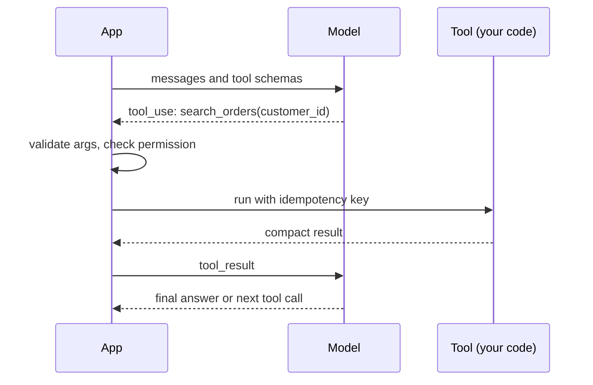

## In one minute
- Most production LLM features need machine-readable output, not prose: a category, an extracted record, a decision, or a request to call a function. That is structured output and tool use.
- Tool use works like this: you describe tools with names, descriptions and JSON schemas; the model replies with a tool call (name plus arguments); your code validates and runs it, and sends the result back; the model continues.
- The model proposes, your code disposes. Every tool call is untrusted input: validate arguments against the schema, check permissions, and make side effects idempotent.
- Tool descriptions are prompts. Clear names, precise descriptions and tight schemas (enums, required fields, ranges) improve accuracy more than clever instructions.
- Expect failures: invalid JSON, missing fields, wrong tool, hallucinated IDs. Validate, return a helpful error to the model, retry a bounded number of times, then fall back.

## How it works

### Why structure
Prose is for people. Code needs fields it can trust: `{"category": "billing", "priority": 2}`. Asking for "JSON please" in the prompt works most of the time, which in production means it fails some of the time. Providers now offer stronger mechanisms: tool and function calling with schemas, and constrained decoding that only allows output matching a schema. Anthropic's structured outputs (`output_config.format`, plus `strict: true` on tools) are generally available ([Anthropic structured outputs](https://platform.claude.com/docs/en/build-with-claude/structured-outputs)), and OpenAI distinguishes plain JSON mode, which only guarantees valid JSON, from Structured Outputs with `strict: true`, which guarantees the schema ([OpenAI structured outputs](https://developers.openai.com/api/docs/guides/structured-outputs)). The old trick of prefilling the assistant turn with `{` no longer works on Claude 4.6 and later, which return a 400 for a prefilled last message ([Anthropic errors](https://platform.claude.com/docs/en/api/errors)). Even then, you validate, because a value can be well-formed and still wrong.

### The tool-use loop
1. Your request includes tool definitions: `name`, `description`, and `input_schema` (JSON Schema for the arguments).
2. The model decides whether to call a tool. If it does, the response contains a tool-use block with an ID, the tool name and arguments, and the stop reason is `tool_use` ([Anthropic tool use](https://platform.claude.com/docs/en/agents-and-tools/tool-use/overview)). With the default `tool_choice` of auto the model may also answer directly. Forcing a call with `tool_choice` of any or tool is rejected with a 400 on the newest Claude models, so use strict schemas with auto instead ([Anthropic errors](https://platform.claude.com/docs/en/api/errors)).
3. Your code validates the arguments, checks permissions, runs the tool, and sends back a tool-result block with the same ID, containing the output or an error.
4. The model reads the result and either calls another tool or answers.

This loop is the core of every agent. The model never executes anything; your code does, so your code is where safety lives.

### Designing good tools
- **Few, purposeful tools.** `search_orders(customer_id, status)` beats a generic `run_sql(query)`, for both accuracy and safety. Anthropic's tool-design guidance goes further: consolidate related operations into one tool, and prefix names by service (`asana_search`, `jira_search`) so the model picks the right one ([Anthropic, Writing tools for agents](https://www.anthropic.com/engineering/writing-tools-for-agents)).
- **Names and descriptions as documentation.** Say what the tool does, when to use it and when not to, and what it returns.
- **Tight schemas.** Use enums for fixed choices, required fields, string formats, numeric ranges. Each constraint is one less way for the model to be wrong.
- **Useful results.** Return compact, relevant data, not 50 KB of JSON; include IDs the model will need for follow-up calls. In Anthropic's example a concise response used about a third of the tokens of a detailed one (72 versus 206), and Claude Code caps tool responses at 25,000 tokens by default ([same article](https://www.anthropic.com/engineering/writing-tools-for-agents)).
- **Helpful errors.** "customer_id must look like C-12345; you sent 12345" lets the model correct itself.

### Validation and repair
Validate every tool call and every structured response against its schema, even with constrained decoding, because the guarantee has holes. A refusal (`stop_reason: "refusal"`) can return output that does not match, a `max_tokens` stop can truncate the JSON, and Claude may change the capitalisation of enum values ([Anthropic structured outputs](https://platform.claude.com/docs/en/build-with-claude/structured-outputs)). OpenAI likewise returns a `refusal` item in place of schema-shaped output and can stop incomplete at the output-token limit ([OpenAI structured outputs](https://developers.openai.com/api/docs/guides/structured-outputs)). If it fails, return the validation errors as the tool result (or a follow-up message) and let the model try again, at most once or twice. If it still fails, fall back: a default, a human, or a clear error. Log every failure; rising rates usually mean a prompt or model change broke something.

### Side effects
Tools that change things (create a refund, send an email, update a record) need the same care as any API: idempotency keys derived from the conversation and step, permission checks based on the end user, not the model's claims, and approval for high-risk actions. A retried model call can repeat a tool call, so design for duplicates.

### The same shapes as any system
Tool calls are remote procedure calls with an unusual client, and retries follow the usual rule: only repeat an operation that is idempotent ([Azure Retry pattern](https://learn.microsoft.com/en-us/azure/architecture/patterns/retry)). Every API design rule applies: validate input, authorise, make writes idempotent, return clear errors. The trust-but-verify shape is the heart of it.

## Down the stack

### Layer 1: The contract
A tool-using feature promises that only valid, authorised tool calls execute, that side effects happen at most once per intent, and that invalid model output never reaches downstream systems unvalidated. Each tool has a written contract: inputs, outputs, errors and side effects.

### Layer 2: The mechanism
Tool definitions are sent as part of the prompt, so they consume input tokens and influence behaviour like any instruction. The model was trained to emit tool calls in a specific structured format, which the API parses into tool-use blocks. Validators such as JSON Schema libraries, Pydantic in Python or Zod in TypeScript turn the schema into code that returns precise errors. With constrained decoding, the server restricts which tokens can be sampled at each step to those that keep the output valid against a grammar derived from the schema, which removes syntax errors but not wrong values. Supported schema features are narrower than full JSON Schema. Anthropic's strict mode requires `additionalProperties: false`, and does not support `minimum`, `maximum`, `minLength`, `maxLength` or recursive schemas; there are also complexity limits (20 strict tools and 24 optional parameters per request) and extra latency on the first request with a new schema while the grammar compiles, cached for 24 hours after last use ([Anthropic structured outputs](https://platform.claude.com/docs/en/build-with-claude/structured-outputs)). OpenAI's strict mode similarly wants every property in `required` and `additionalProperties` false, with a slower first request per schema. So range checks such as "limit between 1 and 20" still belong in your own validator.

### Layer 3: The machine
Constrained decoding works at the sampling step: before choosing the next token, the server masks the logits of every token that would make the output invalid, so the model can only pick from allowed ones. Building that mask requires tracking a parser state for the schema as tokens stream, which adds a small amount of CPU work per token. Without it, a model generating JSON is just predicting likely characters; a missing quote or comma is a sampling accident, which is why validation is still needed when constraints are not available.

### Why it's built this way
1. Code needs structured, trustworthy data, but models produce text.
2. Schemas give the model a clear target and your code a precise check.
3. The model cannot be trusted to call tools safely, so execution and authorisation stay in your code.
4. Failures will happen, so validation plus bounded repair plus fallback is the robust loop.
5. Tool calls can repeat, so side effects need idempotency like any API.

## Diagram


## Worked example
An e-commerce support assistant has one tool, `run_sql(query)`, and a prompt explaining the schema. It works in demos. In production, 3 percent of calls produce SQL errors, some queries scan the entire orders table, and a red-team test gets it to read another customer's orders.

The team replaces it with three tools: `get_order(order_id)`, `list_orders(status, limit)` and `create_return(order_id, item_ids, reason)`. Schemas require `order_id` to match `^O-[0-9]{8}$`, `status` to be an enum of five values, `limit` between 1 and 20, and `reason` to be an enum. The customer ID is not an argument at all: the server takes it from the authenticated session. `create_return` takes an idempotency key built from the conversation ID and step number.

On 2,000 replayed conversations, tool-call validation failures drop from 3 percent to 0.4 percent, and each failure returns an error message the model uses to correct itself on the next try; after one retry, 0.05 percent still fail and go to a human. The cross-customer read becomes impossible, because the model never chooses whose data to read.

## In the wild
- **Air Canada, 2024: the company was held to what its chatbot said.** A website chatbot told a grieving customer he could claim a bereavement fare retroactively, which the airline's policy did not allow. British Columbia's Civil Resolution Tribunal rejected the argument that the chatbot was a separate entity responsible for its own actions and ordered a total of 812.02 Canadian dollars (650.88 damages, 36.14 interest, 125 fees). The sum is small, but it settled that unvalidated model output is the operator's output ([Mondaq summary of Moffatt v. Air Canada](https://www.mondaq.com/canada/new-technology/1427926/airline-ordered-to-compensate-a-bc-man-because-its-chatbot-provided-inaccurate-information)).
- **Greshake et al., 2023: tool results can carry instructions.** The authors showed that text a model retrieves, in a web page, email or code file, can hijack an LLM-integrated app, including Bing's GPT-4 chat and code assistants, leading to data theft and manipulated answers, because the model cannot reliably separate data from instructions. This is why tool arguments and tool results are both untrusted ([paper](https://arxiv.org/abs/2302.12173)).
- **Anthropic, 2025: an AI coding agent used as an intrusion operator.** A group assessed as state-sponsored jailbroke Claude Code by splitting an attack into small innocent-looking tasks, then aimed it at about 30 targets; the AI did roughly 80 to 90% of the work. Anthropic banned the accounts within about ten days and built better classifiers, a reminder that a tool-using agent is only as safe as the tools and monitoring around it ([Anthropic report](https://www.anthropic.com/news/disrupting-AI-espionage)).

## Trade-offs
| Approach | Strengths | Weaknesses | Choose when |
| --- | --- | --- | --- |
| "Return JSON" in the prompt | Simple, any model | Occasional invalid output | Prototypes, with validation |
| Tool calling with schemas | Reliable structure, multi-step | Needs a loop in your code | Most production features |
| Constrained decoding | No syntax errors | Not available everywhere; values can still be wrong | Strict formats, extraction |
| Generic tools (run_sql, run_shell) | Flexible | Hard to validate and secure | Sandboxed developer tools only |
| Narrow, typed tools | Accurate and safe | More tools to build | User-facing and production agents |

## Pitfalls in production
- Trusting arguments because they parsed. Fix: validate values, authorise against the real user, and check IDs exist.
- Putting a numeric range in a strict schema and assuming it is enforced. Fix: Anthropic's strict mode rejects `minimum` and `maximum` with a 400 (SDK helpers may strip them and validate client-side); enforce ranges in your own code.
- Letting the model choose whose data to access. Fix: take identity from the session, not from tool arguments.
- Retrying invalid output forever. Fix: one or two repair attempts, then fall back.
- Huge tool results that flood the context. Fix: return compact summaries and IDs, with pagination.
- Side-effecting tools without idempotency. Fix: keys from conversation and step, enforced server-side.

## Leadership lens
- Review tool definitions like public APIs: names, schemas, errors and permissions.
- Track tool-call validation failure rates per tool and per model version.
- Ban generic execution tools in user-facing agents; give them narrow, typed tools instead.
- Keep authorisation and identity out of model control.

## Check yourself
1. Why is a tool call's arguments untrusted input even though your own model produced them?
   **Answer:** The model can be wrong, can be manipulated by prompt injection, and can hallucinate values, so arguments must be validated and authorised like any external request.
2. What should happen when a tool call fails schema validation?
   **Answer:** Return the specific validation errors to the model and allow a bounded retry, then fall back to a default, a human or an error if it still fails.
3. Why take the customer ID from the session instead of a tool argument?
   **Answer:** So the model cannot be tricked or mistaken into accessing another customer's data; identity comes from authentication, not from generated text.
4. What does constrained decoding guarantee, and what does it not?
   **Answer:** It guarantees syntactically valid output matching the schema; it does not guarantee that the values are correct.

## Practice
**Task:** Build the validator that runs on every tool call. A schema maps field names to rules: `type` (`"string"`, `"integer"`, `"number"`, `"boolean"` or `"enum"`), `required` (bool), `values` (allowed values for enums), `min` and `max` (for integer and number), and `pattern_prefix` (a required string prefix). `validate(args, schema)` returns a sorted list of errors: `"missing:<field>"` for required fields that are absent, `"unknown:<field>"` for fields not in the schema, `"type:<field>"` for wrong types (booleans are not integers or numbers; integers count as numbers), `"enum:<field>"`, `"range:<field>"` and `"prefix:<field>"` for the other rule violations. An empty list means the call is valid.

```python starter
def validate(args, schema):
    # TODO: return sorted error list
    raise NotImplementedError
```

```python tests
SCHEMA = {
    "order_id": {"type": "string", "required": True, "pattern_prefix": "O-"},
    "status": {"type": "enum", "required": False, "values": ["open", "shipped", "returned"]},
    "limit": {"type": "integer", "required": False, "min": 1, "max": 20},
    "refund": {"type": "number", "required": False, "min": 0, "max": 500},
    "notify": {"type": "boolean", "required": False},
}

def test_valid_call():
    assert validate({"order_id": "O-12345678", "status": "open", "limit": 5}, SCHEMA) == []

def test_missing_and_unknown():
    assert validate({"customer_id": "C-1"}, SCHEMA) == ["missing:order_id", "unknown:customer_id"]

def test_type_errors():
    assert validate({"order_id": 123, "limit": "5", "notify": "yes"}, SCHEMA) == ["type:limit", "type:notify", "type:order_id"]

def test_booleans_are_not_numbers():
    assert validate({"order_id": "O-1", "limit": True}, SCHEMA) == ["type:limit"]

def test_enum_range_prefix():
    assert validate({"order_id": "12345678", "status": "lost", "limit": 50, "refund": -1}, SCHEMA) == ["enum:status", "prefix:order_id", "range:limit", "range:refund"]

def test_integer_counts_as_number():
    assert validate({"order_id": "O-1", "refund": 20}, SCHEMA) == []
```

```python solution
def _type_ok(v, t):
    if t == "string":
        return isinstance(v, str)
    if t == "boolean":
        return isinstance(v, bool)
    if t == "integer":
        return isinstance(v, int) and not isinstance(v, bool)
    if t == "number":
        return isinstance(v, (int, float)) and not isinstance(v, bool)
    return True

def validate(args, schema):
    errors = []
    for field, rule in schema.items():
        if rule.get("required") and field not in args:
            errors.append("missing:" + field)
    for field, v in args.items():
        rule = schema.get(field)
        if rule is None:
            errors.append("unknown:" + field)
            continue
        t = rule["type"]
        if not _type_ok(v, t):
            errors.append("type:" + field)
            continue
        if t == "enum" and v not in rule.get("values", []):
            errors.append("enum:" + field)
        if t in ("integer", "number") and (("min" in rule and v < rule["min"]) or ("max" in rule and v > rule["max"])):
            errors.append("range:" + field)
        if t == "string" and "pattern_prefix" in rule and not v.startswith(rule["pattern_prefix"]):
            errors.append("prefix:" + field)
    return sorted(errors)
```

```typescript starter
export interface Rule { type: string; required?: boolean; values?: unknown[]; min?: number; max?: number; pattern_prefix?: string; }

export function validate(args: Record<string, unknown>, schema: Record<string, Rule>): string[] {
  throw new Error("TODO");
}
```

```typescript tests
const SCHEMA: Record<string, Rule> = {
  order_id: { type: "string", required: true, pattern_prefix: "O-" },
  status: { type: "enum", values: ["open", "shipped", "returned"] },
  limit: { type: "integer", min: 1, max: 20 },
  refund: { type: "number", min: 0, max: 500 },
  notify: { type: "boolean" },
};

test("valid call", () => {
  assertEqual(validate({ order_id: "O-12345678", status: "open", limit: 5 }, SCHEMA), []);
});

test("missing and unknown", () => {
  assertEqual(validate({ customer_id: "C-1" }, SCHEMA), ["missing:order_id", "unknown:customer_id"]);
});

test("type errors", () => {
  assertEqual(validate({ order_id: 123, limit: "5", notify: "yes" }, SCHEMA), ["type:limit", "type:notify", "type:order_id"]);
});

test("booleans are not numbers", () => {
  assertEqual(validate({ order_id: "O-1", limit: true }, SCHEMA), ["type:limit"]);
});

test("enum range prefix", () => {
  assertEqual(validate({ order_id: "12345678", status: "lost", limit: 50, refund: -1 }, SCHEMA), ["enum:status", "prefix:order_id", "range:limit", "range:refund"]);
});

test("integer counts as number", () => {
  assertEqual(validate({ order_id: "O-1", refund: 20 }, SCHEMA), []);
});
```

```typescript solution
export interface Rule { type: string; required?: boolean; values?: unknown[]; min?: number; max?: number; pattern_prefix?: string; }

function typeOk(v: unknown, t: string): boolean {
  if (t === "string") return typeof v === "string";
  if (t === "boolean") return typeof v === "boolean";
  if (t === "integer") return typeof v === "number" && Number.isInteger(v);
  if (t === "number") return typeof v === "number";
  return true;
}

export function validate(args: Record<string, unknown>, schema: Record<string, Rule>): string[] {
  const errors: string[] = [];
  for (const f of Object.keys(schema)) if (schema[f].required && !(f in args)) errors.push("missing:" + f);
  for (const f of Object.keys(args)) {
    const rule = schema[f], v = args[f];
    if (!rule) { errors.push("unknown:" + f); continue; }
    if (!typeOk(v, rule.type)) { errors.push("type:" + f); continue; }
    if (rule.type === "enum" && !(rule.values || []).includes(v)) errors.push("enum:" + f);
    if ((rule.type === "integer" || rule.type === "number") &&
        ((rule.min !== undefined && (v as number) < rule.min) || (rule.max !== undefined && (v as number) > rule.max))) errors.push("range:" + f);
    if (rule.type === "string" && rule.pattern_prefix !== undefined && !(v as string).startsWith(rule.pattern_prefix)) errors.push("prefix:" + f);
  }
  return errors.sort();
}
```

```go starter
package practice

type Rule struct {
	Type          string
	Required      bool
	Values        []interface{}
	Min, Max      *float64
	PatternPrefix string
}

// Validate checks args (values may be string, int, float64 or bool) against the schema.
func Validate(args map[string]interface{}, schema map[string]Rule) []string {
	panic("TODO")
}
```

```go tests
package practice

import (
	"reflect"
	"testing"
)

func f(x float64) *float64 { return &x }

var schema = map[string]Rule{
	"order_id": {Type: "string", Required: true, PatternPrefix: "O-"},
	"status":   {Type: "enum", Values: []interface{}{"open", "shipped", "returned"}},
	"limit":    {Type: "integer", Min: f(1), Max: f(20)},
	"refund":   {Type: "number", Min: f(0), Max: f(500)},
	"notify":   {Type: "boolean"},
}

func eq(t *testing.T, got, want []string) {
	t.Helper()
	if len(got) == 0 && len(want) == 0 {
		return
	}
	if !reflect.DeepEqual(got, want) {
		t.Fatalf("got %v, want %v", got, want)
	}
}

func TestValid(t *testing.T) {
	eq(t, Validate(map[string]interface{}{"order_id": "O-12345678", "status": "open", "limit": 5}, schema), nil)
}

func TestMissingUnknown(t *testing.T) {
	eq(t, Validate(map[string]interface{}{"customer_id": "C-1"}, schema), []string{"missing:order_id", "unknown:customer_id"})
}

func TestTypes(t *testing.T) {
	eq(t, Validate(map[string]interface{}{"order_id": 123, "limit": "5", "notify": "yes"}, schema), []string{"type:limit", "type:notify", "type:order_id"})
}

func TestBoolNotNumber(t *testing.T) {
	eq(t, Validate(map[string]interface{}{"order_id": "O-1", "limit": true}, schema), []string{"type:limit"})
}

func TestRules(t *testing.T) {
	eq(t, Validate(map[string]interface{}{"order_id": "12345678", "status": "lost", "limit": 50, "refund": -1.0}, schema),
		[]string{"enum:status", "prefix:order_id", "range:limit", "range:refund"})
}

func TestIntAsNumber(t *testing.T) {
	eq(t, Validate(map[string]interface{}{"order_id": "O-1", "refund": 20}, schema), nil)
}
```

```go solution
package practice

import (
	"sort"
	"strings"
)

type Rule struct {
	Type          string
	Required      bool
	Values        []interface{}
	Min, Max      *float64
	PatternPrefix string
}

func asNumber(v interface{}) (float64, bool, bool) {
	switch n := v.(type) {
	case int:
		return float64(n), true, true
	case float64:
		return n, true, n == float64(int64(n))
	}
	return 0, false, false
}

// Validate checks args (values may be string, int, float64 or bool) against the schema.
func Validate(args map[string]interface{}, schema map[string]Rule) []string {
	errs := []string{}
	for field, r := range schema {
		if _, ok := args[field]; r.Required && !ok {
			errs = append(errs, "missing:"+field)
		}
	}
	for field, v := range args {
		r, ok := schema[field]
		if !ok {
			errs = append(errs, "unknown:"+field)
			continue
		}
		switch r.Type {
		case "string":
			s, ok := v.(string)
			if !ok {
				errs = append(errs, "type:"+field)
				continue
			}
			if r.PatternPrefix != "" && !strings.HasPrefix(s, r.PatternPrefix) {
				errs = append(errs, "prefix:"+field)
			}
		case "boolean":
			if _, ok := v.(bool); !ok {
				errs = append(errs, "type:"+field)
			}
		case "integer", "number":
			n, isNum, isInt := asNumber(v)
			if !isNum || (r.Type == "integer" && !isInt) {
				errs = append(errs, "type:"+field)
				continue
			}
			if (r.Min != nil && n < *r.Min) || (r.Max != nil && n > *r.Max) {
				errs = append(errs, "range:"+field)
			}
		case "enum":
			found := false
			for _, a := range r.Values {
				if a == v {
					found = true
				}
			}
			if !found {
				errs = append(errs, "enum:"+field)
			}
		}
	}
	sort.Strings(errs)
	return errs
}
```

## Mock interview
**Prompt:** You are adding tool use to a banking assistant so it can show balances, list recent transactions and move money between a customer's own accounts. Design the tools, their schemas and the execution path. Assume 300,000 conversations a day.

- Follow-up: The model sometimes sends an account number from earlier in the conversation that belongs to a different customer. What stops it from working?
- Follow-up: A transfer tool call times out and the model retries. What happens?
- Follow-up: How would you know if a new model version made tool calls worse?

**A strong answer covers:**
- Narrow, typed tools with tight schemas: enums, formats, amount ranges, and descriptions that say when to use each.
- Identity and authorisation from the authenticated session, with account ownership checked server-side.
- Validation of every call, helpful error results, bounded retries and fallbacks to a human.
- Idempotency keys on transfers from conversation and step, enforced by the transfer service, and human approval above thresholds.
- Compact tool results to keep context small.
- Monitoring validation failure rates and an eval set of tool-use scenarios run on every model or prompt change.

## Sources and further study
**Primary**
- [Greshake et al.: indirect prompt injection](https://arxiv.org/abs/2302.12173): why tool results are untrusted input.
- [JSON Schema: understanding JSON Schema](https://json-schema.org/understanding-json-schema/): the specification behind tool inputs, and the parts providers do not support.

**Systems docs**
- [Anthropic structured outputs](https://platform.claude.com/docs/en/build-with-claude/structured-outputs): constrained decoding, limits and caveats.
- [Anthropic tool use overview](https://platform.claude.com/docs/en/agents-and-tools/tool-use/overview): the loop, client versus server tools, token overhead.
- [Anthropic errors](https://platform.claude.com/docs/en/api/errors): prefill and forced-tool-use rejections on newer models.
- [OpenAI structured outputs](https://developers.openai.com/api/docs/guides/structured-outputs): JSON mode versus strict schemas, refusals.
- [Anthropic: Writing tools for agents](https://www.anthropic.com/engineering/writing-tools-for-agents): consolidation, namespacing and token-efficient results.

**Books**
- Chip Huyen, *AI Engineering* (O'Reilly, 2025), chapter 5 (Prompt Engineering, including defensive prompting) and chapter 6 (RAG and Agents).

**Other curricula**
- Azure Architecture Center, [Retry pattern](https://learn.microsoft.com/en-us/azure/architecture/patterns/retry): why a retried non-idempotent call needs protection, which is the tool-side duplicate problem.

## Free resources
- [Tool use overview (Anthropic docs)](https://docs.anthropic.com/en/docs/agents-and-tools/tool-use/overview): defining tools, the tool-use loop and tool results.
- [Increase output consistency (Anthropic docs)](https://docs.anthropic.com/en/docs/test-and-evaluate/strengthen-guardrails/increase-consistency): techniques for reliable structured output.
- [Understanding JSON Schema](https://json-schema.org/understanding-json-schema/): the schema language used for tool inputs.
- [Pydantic](https://docs.pydantic.dev/latest/): schema validation for Python.
- [Zod](https://zod.dev/): schema validation for TypeScript.
