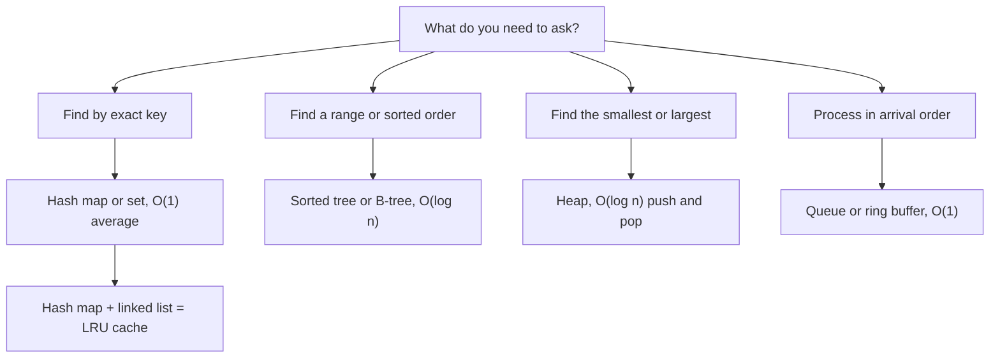

## In one minute
- A handful of structures do almost all the work in backend code: arrays, hash maps, sets, queues, heaps, trees and linked lists. Databases, caches, schedulers and message brokers are built from the same few pieces.
- Each structure is a promise about cost. A hash map promises lookup by key in constant time on average; a sorted tree promises ordered scans and range queries in logarithmic time; a heap promises the smallest item in constant time. Pick by the questions you need to ask of the data.
- Big-O tells you how cost grows. The machine decides the constant: a structure that walks memory in order can beat one with a better Big-O but scattered pointers.
- Real systems combine structures. An LRU cache is a hash map plus a linked list; a Redis sorted set is a hash map plus a skip list; a database index is a B-tree whose nodes are disk pages.
- The problem shape is "finding things fast". The same choice between hashing, sorting and indexing appears in a session store, a search engine, a ride-hailing map and an AI retrieval system.

## How it works

### Arrays and dynamic arrays
An array is a block of memory holding elements of the same size side by side. Element `i` lives at `start + i * size`, so reading any element is one address calculation and one memory load. Python lists, Go slices and JavaScript arrays are dynamic arrays: when full, they allocate a bigger block and copy everything across. Because the new block is a multiple of the old size, copying averages out to a constant cost per append ("amortised O(1)"). Inserting or deleting in the middle is O(n), because everything after that point must shift.

### Hash maps and sets
A hash map stores key-value pairs in an array of slots. A hash function turns the key into a number, and that number modulo the array size picks a slot. Two keys can land on the same slot (a collision), so every implementation needs a rule for that: chain the entries in a small list, or probe the next slots until a free one turns up. Lookups, inserts and deletes are O(1) on average, as long as the table is not too full. When it fills past a threshold, the map grows and rehashes every entry into a bigger array. A set is a hash map with keys and no values, and it is the standard tool for deduplication: "have I seen this request ID before?"

Hash maps give you no order. For "all orders between 9:00 and 10:00", a hash map has to look at every entry.

### Sorted trees and B-trees
A balanced search tree keeps keys in sorted order, so lookups, inserts and deletes cost O(log n), and range scans are cheap: find the start, then walk forward. In-memory libraries use red-black trees or similar; the Linux CFS scheduler kept runnable tasks in a red-black tree ordered by how much CPU time each had had ([kernel docs](https://www.kernel.org/doc/html/latest/scheduler/sched-design-CFS.html)). Since Linux 6.6 CFS has been giving way to the EEVDF scheduler, which picks by virtual deadline instead ([kernel docs](https://docs.kernel.org/scheduler/sched-eevdf.html)), a reminder that even a textbook structure choice is an implementation detail. Databases use B-trees, where each node is a page holding hundreds of keys. With hundreds of children per node, a tree only three or four levels deep can index billions of rows.

### Queues, stacks and ring buffers
A queue is first in, first out; a stack is last in, first out. Queues sit everywhere work is handed from producers to consumers: a web server's accept queue, a job queue, a channel between goroutines. A ring buffer is a fixed-size array used as a queue, with a head index and a tail index that wrap around. It never allocates after creation, which is why log buffers, network card receive queues and Linux `io_uring` use rings: io_uring's submission and completion queues are ring buffers shared between user space and the kernel ([man page](https://man7.org/linux/man-pages/man7/io_uring.7.html)). When a ring is full, the producer must block or data is dropped: a design decision, not an accident.

### Heaps and priority queues
A binary heap is an array arranged so each parent is no larger than its children. The smallest item is always at index 0; pushing and popping cost O(log n). Heaps power priority queues: timers ("which deadline expires next?"), schedulers, Dijkstra's shortest path, and "top 10 of a million" queries, where you keep a heap of size 10 and drop anything smaller than its minimum. Python's [`heapq`](https://docs.python.org/3/library/heapq.html) is a binary min-heap on a list, and Go's [`container/heap`](https://pkg.go.dev/container/heap) works on any slice that implements its interface, with `Push` and `Pop` both O(log n). Both are min-heaps, so a max-heap needs negated keys or a reversed `Less`.

### Linked lists
A linked list stores each element in its own node with a pointer to the next (and, in a doubly linked list, the previous). Inserting or removing a node you already hold costs O(1), with no shifting. Finding a node costs O(n), and every step is a pointer jump to a different place in memory. Linked lists are rarely the main store of data in a backend, but they are a perfect partner for a hash map: the map finds the node, the list keeps the order.

### The same shape everywhere
Every structure answers "how do I find what I need without looking at everything?" A session store hashes the token. A ride-hailing service buckets drivers by map cell so it only checks nearby ones. A search engine keeps an inverted index from word to documents. An AI assistant doing retrieval keeps a vector index so it compares a question with a few thousand candidates, not millions. Hash, sort, bucket or index: the four answers repeat in every domain.

## Down the stack

### Layer 1: The contract
Each structure promises a cost curve, not a time. A hash map promises O(1) average lookups and O(n) in the worst case, when many keys collide. A dynamic array promises O(1) amortised append, which means most appends are cheap and an occasional one copies the whole array. A B-tree promises O(log n) lookups and ordered iteration. A heap promises O(1) access to the minimum and nothing about the order of the rest. Iteration order is part of the contract too: Python dicts keep insertion order by language guarantee since 3.7 ([Python docs](https://docs.python.org/3/library/stdtypes.html)), Go's spec leaves map iteration order unspecified and the runtime randomises it so nobody depends on it ([Go spec](https://go.dev/ref/spec)), and a sorted tree iterates in key order.

### Layer 2: The mechanism
CPython's dict uses open addressing with a compact layout: a small array of indices (`dk_indices`) points into a dense array of entries stored in insertion order, which is how it keeps order cheaply. It resizes when the table is about two thirds full (`USABLE_FRACTION` in [`dictobject.c`](https://github.com/python/cpython/blob/3.12/Objects/dictobject.c)). Go maps for many years used buckets of 8 slots with an overflow chain and grew incrementally, moving a few buckets on each write so no single insert paid for the whole copy. Go 1.24 switched to a Swiss table design that probes groups of 8 slots using a control byte per slot, and splits each map into tables of at most 1024 entries so one insert never copies the whole map ([Go blog](https://go.dev/blog/swisstable)). Redis sorted sets combine a hash table (member to score) with a skip list (ordered by score), so both "what is Alice's score?" and "who is ranked 100 to 110?" are fast ([`t_zset.c`](https://raw.githubusercontent.com/redis/redis/unstable/src/t_zset.c)); small sets use a compact listpack encoding instead, by default up to 128 entries of 64 bytes each ([`redis.conf`](https://raw.githubusercontent.com/redis/redis/unstable/redis.conf)). Postgres B-tree indexes store keys in 8 KB pages, with each internal page pointing to child pages and every level linked as a doubly linked list of pages for range scans; duplicate keys are merged into posting lists by default ([Postgres docs](https://www.postgresql.org/docs/current/btree.html)).

### Layer 3: The machine
On real hardware, the cost that dominates is usually memory access, not comparisons. A RAM access that misses the CPU cache costs about 100 ns, while a comparison costs under 1 ns. A hash map lookup typically costs one hash computation plus one or two cache misses. A linked list of one million nodes can cost a cache miss per step, so walking it takes around 100 ms, while summing an array of one million integers takes well under 1 ms. B-trees exist because a disk or SSD reads whole pages: fetching an 8 KB page costs about the same as fetching 8 bytes, so you pack hundreds of keys into each node and binary search inside it in RAM. Resizes are real events too: growing a map of 10 million entries allocates a new table of hundreds of MB and touches every entry, which shows up as a latency spike.

### Why it's built this way
1. Programs mostly ask a few questions: find by key, find in a range, find the smallest, process in arrival order.
2. Scanning everything is too slow once data is large, so each question gets a structure that avoids the scan.
3. Memory is fast in order and slow when scattered, so the best real structures are array-backed or page-backed rather than one node per item.
4. Storage reads whole pages, so on-disk structures make each node as big as a page and keep trees shallow.
5. No single structure answers every question, so production systems pair them, accepting double the bookkeeping to make two kinds of query fast.

## Diagram


## Worked example
A login service stores 1 million active sessions and handles 2,000 requests per second, each of which must find the session for a token.

The first version keeps sessions in a list and scans for a matching token: on average 500,000 string comparisons, plus cache misses as it walks the objects, so a few milliseconds per lookup. At 2,000 requests per second that is several cores busy just on lookups, and it grows with the user count. Switching to a hash map keyed by token makes each lookup a hash plus a cache miss or two: well under a microsecond. The service now spends more time parsing JSON than finding sessions.

Next, the product team wants "the 10 users with the most logins today". Sorting 1 million users costs about 20 million comparisons (n log n). A heap of size 10 needs one pass: each user is compared to the heap's minimum and only pushed if bigger, about 1 million comparisons plus a few heap operations. For a dashboard refreshed every few seconds, that difference matters.

Finally, sessions should expire when the store holds more than 1 million entries, dropping the least recently used. A hash map alone cannot say which entry is oldest without a full scan. Adding a doubly linked list ordered by last use fixes it: on every access, the map finds the node and the list moves it to the front in O(1); on eviction, remove the node at the back. Each entry now carries two extra pointers (16 bytes on a 64-bit machine), or about 16 MB for a million sessions, which is a fair price for O(1) eviction.

## In the wild
- **Uber, 2016: a geofence service without a spatial tree.** Uber's highest-QPS service skipped R-trees and S2 cells for a two-level city-then-fence scan that cut candidates from tens of thousands to hundreds. On New Year's Eve 2015 it served 170,000 QPS on 40 machines at 35% CPU, with p99 under 50 ms ([Uber Engineering](https://www.uber.com/en-DE/blog/go-geofence-highest-query-per-second-service/)).
- **Akamai, 2015: Bloom filters for cache admission.** About 74% of cached objects in a typical cluster were requested only once in two days. Admitting an object only on its second request, tracked with rotating Bloom filters, raised byte hit rate from about 74% to 83% and cut disk writes by 44% ([Akamai paper, UMass hosted](https://people.cs.umass.edu/~ramesh/Site/HOME_files/CCRpaper_1.pdf)).

## Trade-offs
| Structure | Strengths | Weaknesses | Choose when |
| --- | --- | --- | --- |
| Array or slice | Fast index and in-order scans, cache friendly | Slow middle inserts, occasional resize copy | Lists you iterate or index by position |
| Hash map or set | O(1) average lookup, insert, delete | No order, resize spikes, memory overhead | Lookup by exact key, deduplication |
| Sorted tree or B-tree | Ordered iteration, range queries | O(log n), more complex | Ranges, prefixes, "next after X" |
| Heap | Cheap smallest or largest | Rest of the items unordered | Timers, schedulers, top-k |
| Queue or ring buffer | O(1) at both ends, fixed memory for a ring | Ring is full means block or drop | Handing work between producers and consumers |
| Linked list | O(1) insert and remove at a known node | Slow search, scattered memory | Paired with a map to keep order |

## Pitfalls in production
- Using a list where a set belongs, for example checking `if id in seen_ids` on a growing list inside a loop, which turns a linear job into a quadratic one. Fix: use a set or map for membership checks.
- Unbounded maps used as caches, which grow until the process runs out of memory. Fix: cap the size with an eviction policy such as LRU, or add a TTL.
- Hash flooding: attackers send many keys that collide, turning O(1) into O(n). Fix: use a language runtime with randomised hash seeds (Python, Go and modern JavaScript engines do this) and limit request sizes.
- Depending on map iteration order, which differs between languages and versions and breaks tests or output. Fix: sort keys explicitly when order matters.
- Latency spikes when a huge map or slice resizes in the middle of a request. Fix: pre-size with a known capacity, such as `make(map[string]int, n)` in Go.
- Sharing a map between threads without a lock, which in Go crashes the process with "concurrent map writes". Fix: guard it with a mutex or use a structure built for concurrency.

## Leadership lens
- Ask "what questions will we ask of this data?" before choosing a structure or a database; the access pattern decides, not habit.
- In review, look for scans hidden in loops; quadratic code passes tests on 100 rows and fails on 1 million.
- Every in-memory cache needs a size limit and an eviction policy written down, with an alert when it is reached.
- Prefer the standard library's structures; a custom tree or hash map is a maintenance cost that rarely pays back.

## Check yourself
1. Why can a hash map not answer "all keys between A and C" efficiently, while a B-tree can?
   **Answer:** Hashing scatters keys across slots with no relation to their order, so the map must check every entry; a B-tree keeps keys sorted, so it finds A and walks forward until C.
2. A dynamic array occasionally copies all its elements on append. Why is append still called O(1)?
   **Answer:** The array grows by a multiple of its size, so copies get rarer as it grows and the total copying work divided by the number of appends is a constant. The single append that triggers a copy is still slow.
3. Why is an LRU cache built from a hash map and a linked list rather than either one alone?
   **Answer:** The map finds an entry by key in O(1) but has no notion of recency; the list keeps recency order and can move or remove a known node in O(1) but cannot find one quickly. Together they make get, put and evict all O(1).
4. Why do database indexes use B-trees with hundreds of keys per node instead of binary trees?
   **Answer:** Storage reads whole pages, so one 8 KB read can bring in hundreds of keys; wide nodes keep the tree three or four levels deep, so a lookup costs a few page reads instead of about 30.

## Practice
**Task:** Build an LRU (least recently used) cache with a fixed capacity. `get(key)` returns the stored value and marks the key as most recently used, or returns "missing" (`None` in Python, `undefined` in TypeScript, `ok == false` in Go). `put(key, value)` inserts or updates the value and marks the key as most recently used; if the cache then holds more than `capacity` keys, it evicts the least recently used key. `keys()` returns the keys ordered from most to least recently used. A capacity of 0 stores nothing. Aim for O(1) `get` and `put` by pairing a hash map with a doubly linked list.

```python starter
class LRUCache:
    def __init__(self, capacity):
        self.capacity = capacity

    def get(self, key):
        # TODO
        raise NotImplementedError

    def put(self, key, value):
        # TODO
        raise NotImplementedError

    def keys(self):
        # TODO
        raise NotImplementedError
```

```python tests
def test_get_and_put():
    c = LRUCache(2)
    c.put("a", 1)
    c.put("b", 2)
    assert c.get("a") == 1
    assert c.get("zzz") is None

def test_evicts_least_recent():
    c = LRUCache(2)
    c.put("a", 1)
    c.put("b", 2)
    c.put("c", 3)
    assert c.get("a") is None, "a was least recently used"
    assert c.keys() == ["c", "b"]

def test_get_refreshes_recency():
    c = LRUCache(2)
    c.put("a", 1)
    c.put("b", 2)
    c.get("a")
    c.put("c", 3)
    assert c.get("b") is None
    assert c.keys() == ["c", "a"]

def test_update_existing_key():
    c = LRUCache(2)
    c.put("a", 1)
    c.put("b", 2)
    c.put("a", 10)
    assert c.keys() == ["a", "b"]
    c.put("c", 3)
    assert c.get("a") == 10
    assert c.get("b") is None

def test_capacity_zero():
    c = LRUCache(0)
    c.put("a", 1)
    assert c.get("a") is None
    assert c.keys() == []

def test_capacity_one():
    c = LRUCache(1)
    c.put("a", 1)
    c.put("b", 2)
    assert c.keys() == ["b"]
    assert c.get("b") == 2
```

```python solution
class _Node:
    def __init__(self, key, value):
        self.key = key
        self.value = value
        self.prev = None
        self.next = None

class LRUCache:
    def __init__(self, capacity):
        self.capacity = capacity
        self.map = {}
        self.head = _Node(None, None)
        self.tail = _Node(None, None)
        self.head.next = self.tail
        self.tail.prev = self.head

    def _unlink(self, node):
        node.prev.next = node.next
        node.next.prev = node.prev

    def _push_front(self, node):
        node.prev = self.head
        node.next = self.head.next
        self.head.next.prev = node
        self.head.next = node

    def get(self, key):
        node = self.map.get(key)
        if node is None:
            return None
        self._unlink(node)
        self._push_front(node)
        return node.value

    def put(self, key, value):
        if self.capacity <= 0:
            return
        node = self.map.get(key)
        if node is not None:
            node.value = value
            self._unlink(node)
            self._push_front(node)
            return
        node = _Node(key, value)
        self.map[key] = node
        self._push_front(node)
        if len(self.map) > self.capacity:
            last = self.tail.prev
            self._unlink(last)
            del self.map[last.key]

    def keys(self):
        out = []
        node = self.head.next
        while node is not self.tail:
            out.append(node.key)
            node = node.next
        return out
```

```typescript starter
export class LRUCache {
  constructor(public capacity: number) {}

  get(key: string): number | undefined {
    throw new Error("TODO");
  }

  put(key: string, value: number): void {
    throw new Error("TODO");
  }

  keys(): string[] {
    throw new Error("TODO");
  }
}
```

```typescript tests
test("get and put", () => {
  const c = new LRUCache(2);
  c.put("a", 1);
  c.put("b", 2);
  assertEqual(c.get("a"), 1);
  assert(c.get("zzz") === undefined, "missing key");
});

test("evicts least recent", () => {
  const c = new LRUCache(2);
  c.put("a", 1);
  c.put("b", 2);
  c.put("c", 3);
  assert(c.get("a") === undefined, "a was least recently used");
  assertEqual(c.keys(), ["c", "b"]);
});

test("get refreshes recency", () => {
  const c = new LRUCache(2);
  c.put("a", 1);
  c.put("b", 2);
  c.get("a");
  c.put("c", 3);
  assert(c.get("b") === undefined, "b evicted");
  assertEqual(c.keys(), ["c", "a"]);
});

test("update existing key", () => {
  const c = new LRUCache(2);
  c.put("a", 1);
  c.put("b", 2);
  c.put("a", 10);
  assertEqual(c.keys(), ["a", "b"]);
  c.put("c", 3);
  assertEqual(c.get("a"), 10);
  assert(c.get("b") === undefined, "b evicted");
});

test("capacity zero", () => {
  const c = new LRUCache(0);
  c.put("a", 1);
  assert(c.get("a") === undefined, "nothing stored");
  assertEqual(c.keys(), []);
});

test("capacity one", () => {
  const c = new LRUCache(1);
  c.put("a", 1);
  c.put("b", 2);
  assertEqual(c.keys(), ["b"]);
  assertEqual(c.get("b"), 2);
});
```

```typescript solution
class LNode {
  prev: LNode | null = null;
  next: LNode | null = null;
  constructor(public key: string, public value: number) {}
}

export class LRUCache {
  private map = new Map<string, LNode>();
  private head = new LNode("", 0);
  private tail = new LNode("", 0);

  constructor(public capacity: number) {
    this.head.next = this.tail;
    this.tail.prev = this.head;
  }

  private unlink(n: LNode): void {
    n.prev!.next = n.next;
    n.next!.prev = n.prev;
  }

  private pushFront(n: LNode): void {
    n.prev = this.head;
    n.next = this.head.next;
    this.head.next!.prev = n;
    this.head.next = n;
  }

  get(key: string): number | undefined {
    const n = this.map.get(key);
    if (!n) return undefined;
    this.unlink(n);
    this.pushFront(n);
    return n.value;
  }

  put(key: string, value: number): void {
    if (this.capacity <= 0) return;
    const existing = this.map.get(key);
    if (existing) {
      existing.value = value;
      this.unlink(existing);
      this.pushFront(existing);
      return;
    }
    const n = new LNode(key, value);
    this.map.set(key, n);
    this.pushFront(n);
    if (this.map.size > this.capacity) {
      const last = this.tail.prev!;
      this.unlink(last);
      this.map.delete(last.key);
    }
  }

  keys(): string[] {
    const out: string[] = [];
    let n = this.head.next;
    while (n && n !== this.tail) {
      out.push(n.key);
      n = n.next;
    }
    return out;
  }
}
```

```go starter
package practice

type LRUCache struct {
	capacity int
}

func NewLRUCache(capacity int) *LRUCache {
	return &LRUCache{capacity: capacity}
}

func (c *LRUCache) Get(key string) (int, bool) {
	panic("TODO")
}

func (c *LRUCache) Put(key string, value int) {
	panic("TODO")
}

func (c *LRUCache) Keys() []string {
	panic("TODO")
}
```

```go tests
package practice

import (
	"reflect"
	"testing"
)

func TestGetAndPut(t *testing.T) {
	c := NewLRUCache(2)
	c.Put("a", 1)
	c.Put("b", 2)
	if v, ok := c.Get("a"); !ok || v != 1 {
		t.Fatalf("got %v %v", v, ok)
	}
	if _, ok := c.Get("zzz"); ok {
		t.Fatal("missing key found")
	}
}

func TestEvictsLeastRecent(t *testing.T) {
	c := NewLRUCache(2)
	c.Put("a", 1)
	c.Put("b", 2)
	c.Put("c", 3)
	if _, ok := c.Get("a"); ok {
		t.Fatal("a should be evicted")
	}
	if got := c.Keys(); !reflect.DeepEqual(got, []string{"c", "b"}) {
		t.Fatalf("keys %v", got)
	}
}

func TestGetRefreshesRecency(t *testing.T) {
	c := NewLRUCache(2)
	c.Put("a", 1)
	c.Put("b", 2)
	c.Get("a")
	c.Put("c", 3)
	if _, ok := c.Get("b"); ok {
		t.Fatal("b should be evicted")
	}
	if got := c.Keys(); !reflect.DeepEqual(got, []string{"c", "a"}) {
		t.Fatalf("keys %v", got)
	}
}

func TestUpdateExistingKey(t *testing.T) {
	c := NewLRUCache(2)
	c.Put("a", 1)
	c.Put("b", 2)
	c.Put("a", 10)
	if got := c.Keys(); !reflect.DeepEqual(got, []string{"a", "b"}) {
		t.Fatalf("keys %v", got)
	}
	c.Put("c", 3)
	if v, ok := c.Get("a"); !ok || v != 10 {
		t.Fatalf("a = %v %v", v, ok)
	}
	if _, ok := c.Get("b"); ok {
		t.Fatal("b should be evicted")
	}
}

func TestCapacityZero(t *testing.T) {
	c := NewLRUCache(0)
	c.Put("a", 1)
	if _, ok := c.Get("a"); ok {
		t.Fatal("nothing should be stored")
	}
	if got := c.Keys(); len(got) != 0 {
		t.Fatalf("keys %v", got)
	}
}

func TestCapacityOne(t *testing.T) {
	c := NewLRUCache(1)
	c.Put("a", 1)
	c.Put("b", 2)
	if got := c.Keys(); !reflect.DeepEqual(got, []string{"b"}) {
		t.Fatalf("keys %v", got)
	}
	if v, ok := c.Get("b"); !ok || v != 2 {
		t.Fatalf("b = %v %v", v, ok)
	}
}
```

```go solution
package practice

type node struct {
	key        string
	value      int
	prev, next *node
}

type LRUCache struct {
	capacity   int
	items      map[string]*node
	head, tail *node
}

func NewLRUCache(capacity int) *LRUCache {
	head, tail := &node{}, &node{}
	head.next = tail
	tail.prev = head
	return &LRUCache{capacity: capacity, items: map[string]*node{}, head: head, tail: tail}
}

func (c *LRUCache) unlink(n *node) {
	n.prev.next = n.next
	n.next.prev = n.prev
}

func (c *LRUCache) pushFront(n *node) {
	n.prev = c.head
	n.next = c.head.next
	c.head.next.prev = n
	c.head.next = n
}

func (c *LRUCache) Get(key string) (int, bool) {
	n, ok := c.items[key]
	if !ok {
		return 0, false
	}
	c.unlink(n)
	c.pushFront(n)
	return n.value, true
}

func (c *LRUCache) Put(key string, value int) {
	if c.capacity <= 0 {
		return
	}
	if n, ok := c.items[key]; ok {
		n.value = value
		c.unlink(n)
		c.pushFront(n)
		return
	}
	n := &node{key: key, value: value}
	c.items[key] = n
	c.pushFront(n)
	if len(c.items) > c.capacity {
		last := c.tail.prev
		c.unlink(last)
		delete(c.items, last.key)
	}
}

func (c *LRUCache) Keys() []string {
	out := []string{}
	for n := c.head.next; n != c.tail; n = n.next {
		out = append(out, n.key)
	}
	return out
}
```

## Mock interview
**Prompt:** An internal API keeps a per-customer cache of pricing rules in a plain map. After a big customer onboarding, memory grows from 2 GB to 14 GB over a week and the process is killed. How would you fix it, and what structure would you use?

- Follow-up: How do you make both lookup and eviction O(1), and what does each entry cost in memory?
- Follow-up: Two requests update the cache at the same moment. What can go wrong, and how do you prevent it?
- Follow-up: When would you choose a TTL over LRU, or move the cache out of process into Redis?

**A strong answer covers:**
- Naming the root cause: an unbounded map used as a cache, with no eviction policy.
- A bounded LRU built from a hash map and a doubly linked list, with O(1) get, put and evict, and the pointer overhead per entry.
- Sizing the cache from the working set: estimate bytes per entry times entries, and set a limit with headroom.
- Concurrency: guard the map and list with a mutex, or shard the cache into several locked segments to reduce contention.
- Trade-offs: TTL for data that goes stale, LRU for data that is reused unevenly, and a shared Redis cache when several processes need the same data.

## Sources and further study
**Primary**
- [Go blog: Faster Go maps with Swiss Tables](https://go.dev/blog/swisstable): why Go 1.24 replaced its map, and how growth stays incremental.
- [Python docs: heapq](https://docs.python.org/3/library/heapq.html): the heap invariant and when `nlargest` beats sorting.

**Systems docs**
- [CPython `dictobject.c`](https://github.com/python/cpython/blob/3.12/Objects/dictobject.c): the compact dict layout and its two-thirds load limit.
- [Redis sorted sets](https://redis.io/docs/latest/develop/data-types/sorted-sets/): the user-facing contract of the structure that pairs a hash table with a skip list.
- [Postgres: B-Tree Indexes](https://www.postgresql.org/docs/current/btree.html): page structure, sibling links and deduplication.
- [Linux kernel: EEVDF scheduler](https://docs.kernel.org/scheduler/sched-eevdf.html): the scheduler that began replacing CFS in 6.6.

**Books**
- *Designing Data-Intensive Applications* (1st ed.) by Martin Kleppmann, Ch 3: Storage and Retrieval (hash indexes, SSTables, B-trees).
- *Database Internals* by Alex Petrov, Ch 2: B-Tree Basics and Ch 4: Implementing B-Trees.

**Other curricula**
- [System design primer](https://github.com/donnemartin/system-design-primer): pairs a review of data-structure costs with the system-level choices that depend on them.

## Watch
- [Data Structures Easy to Advanced Course (freeCodeCamp.org)](https://www.youtube.com/watch?v=RBSGKlAvoiM): a long beginner course on arrays, lists, stacks, queues, heaps, hash tables and trees.
- [4. Hashing (MIT OpenCourseWare)](https://www.youtube.com/watch?v=Nu8YGneFCWE): how hash tables work and why they are fast on average.
- [Understanding B-Trees: The Data Structure Behind Modern Databases (Spanning Tree)](https://www.youtube.com/watch?v=K1a2Bk8NrYQ): why databases use wide, shallow trees.

## Free resources
- [Hash table (Wikipedia)](https://en.wikipedia.org/wiki/Hash_table): collision handling, load factor and resizing.
- [B-tree (Wikipedia)](https://en.wikipedia.org/wiki/B-tree): the structure behind most database indexes.
- [CPython dict implementation notes](https://github.com/python/cpython/blob/main/Objects/dictnotes.txt): design notes from the people who built Python's dict.
- [Go maps in action (Go blog)](https://go.dev/blog/maps): how to use Go maps, including iteration order and concurrency.
- [Redis data types](https://redis.io/docs/latest/develop/data-types/): the structures Redis offers and what each is for.
- [PostgreSQL B-tree indexes](https://www.postgresql.org/docs/current/btree.html): how Postgres implements and uses B-trees.
