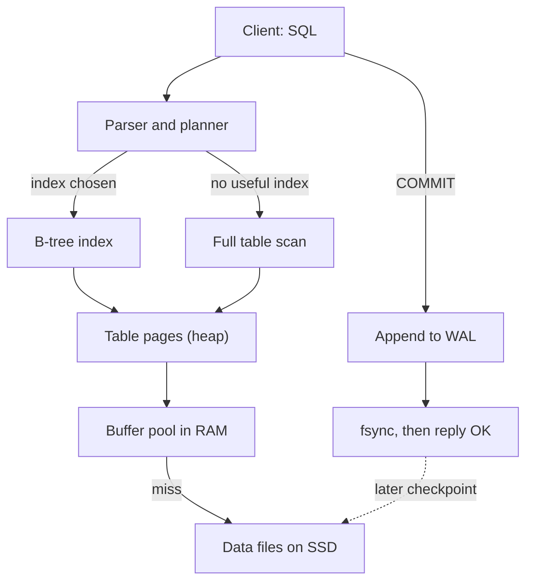

## In one minute
- A relational database stores data in tables: rows are records, columns are typed fields, and a primary key names each row uniquely. You ask questions in SQL by describing the result you want, and the database works out how to get it.
- Without an index, finding rows means reading the whole table. An index is a sorted copy of one or more columns (usually a B-tree) that turns a scan of millions of rows into a handful of page reads. Every index speeds up some reads and slows down every write.
- A transaction groups several changes so they all happen or none do, even if the server crashes halfway. ACID names the promises: atomicity, consistency, isolation and durability.
- Durability comes from a write-ahead log: the database appends the change to a log file and calls `fsync` before saying "committed". The table files themselves are updated later.
- Two problem shapes live here. Indexes are "finding things fast"; transactions handle "contention" and "multi-step consistency". You will meet both again in caches, search engines, queues and payment systems.

## How it works

### Tables, rows and keys
Picture a shop with two tables:

```sql
CREATE TABLE customers (
  id    BIGINT PRIMARY KEY,
  email TEXT NOT NULL UNIQUE,
  city  TEXT
);
CREATE TABLE orders (
  id          BIGINT PRIMARY KEY,
  customer_id BIGINT NOT NULL REFERENCES customers(id),
  total_cents INTEGER NOT NULL CHECK (total_cents >= 0),
  created_at  TIMESTAMP NOT NULL
);
```

Each order points to its customer through `customer_id`, a foreign key. The database enforces the rules you declare: no two customers share an email, no order points to a customer who does not exist, no total is negative. Rules in the schema hold no matter which service, script or engineer writes the data, which is why they are worth more than the same check in application code.

### Asking questions with SQL
SQL is declarative. You say what you want:

```sql
SELECT c.email, SUM(o.total_cents) AS spent
FROM orders o JOIN customers c ON c.id = o.customer_id
WHERE o.created_at >= '2026-01-01'
GROUP BY c.email ORDER BY spent DESC LIMIT 10;
```

A component called the query planner decides how: which table to read first, whether to use an index, and which join algorithm to run. `EXPLAIN` shows you the plan it chose. Learning to read it is the single most useful database skill for an application engineer.

### Indexes
A table's rows sit in no useful order. To find the orders of customer 42, the database has to read every row unless it has an index on `customer_id`. An index works like the index at the back of a book: a sorted list of values, each pointing to where the full row lives. Because it is sorted, the database can jump to the right place in a few steps, and it can also answer range queries (`created_at` between two dates) and `ORDER BY` without sorting.

The price is paid on writes. Every insert, and every update to an indexed column, must also update each index, and each index takes disk space and memory. A table with eight indexes does nine writes for one insert.

### Transactions and ACID
Moving 100 dollars from Ana to Budi is two updates. If the server crashes between them, money vanishes. A transaction wraps them:

```sql
BEGIN;
UPDATE accounts SET balance = balance - 100 WHERE id = 1 AND balance >= 100;
UPDATE accounts SET balance = balance + 100 WHERE id = 2;
COMMIT;
```

- **Atomicity:** both updates happen or neither does. `ROLLBACK`, or a crash before `COMMIT`, undoes everything.
- **Consistency:** the declared rules (keys, `CHECK`, `NOT NULL`) hold after every committed transaction.
- **Isolation:** concurrent transactions do not see each other's half-finished work. How strictly this holds depends on the isolation level.
- **Durability:** once `COMMIT` returns, the change survives a crash or power cut.

### Concurrent writers
Two requests read a stock count of 1, both subtract one, both write 0, and two customers buy the last item. This is a lost update, and the default isolation level in Postgres, Read Committed, does not prevent it when the read and the write are separate statements. A single `UPDATE` is safe there, because a blocked updater re-checks its `WHERE` clause against the newly committed row ([Postgres docs](https://www.postgresql.org/docs/current/transaction-iso.html)). The fixes: do the check and the change in one statement (`UPDATE stock SET qty = qty - 1 WHERE id = 7 AND qty > 0`, then check that one row changed), lock the row first with `SELECT ... FOR UPDATE`, or run at Serializable isolation and retry when the database reports a conflict.

### The same shapes elsewhere
An index is "finding things fast", the same idea as a search engine's inverted index or a geospatial index for nearby drivers: pay at write time to build a structure that makes reads cheap. A transaction is "multi-step consistency": order, stock and payment must agree. When those steps span several services instead of one database, you no longer get `BEGIN` and `COMMIT` for free and need patterns such as sagas and the outbox, which later courses cover.

## Down the stack

### Layer 1: The contract
When `COMMIT` returns successfully, the transaction's changes are durable and visible to transactions that start afterwards. If the client loses its connection before `COMMIT` returns, the outcome is unknown, just as with an HTTP timeout, so it must check rather than blindly retry. The isolation level defines what concurrent transactions may observe: Read Committed (the Postgres default) shows each statement only committed data but lets a second read in the same transaction see newer commits; Repeatable Read keeps one snapshot for the whole transaction and is the [MySQL InnoDB default](https://dev.mysql.com/doc/refman/8.4/en/innodb-transaction-isolation-levels.html); Serializable promises the result equals some one-at-a-time order, aborting transactions when it cannot. Postgres reports those aborts, and Repeatable Read update conflicts too, as SQLSTATE `40001`, and its docs say to retry the whole transaction ([Postgres docs](https://www.postgresql.org/docs/current/transaction-iso.html)).

### Layer 2: The mechanism
Postgres stores each table as a heap file of 8 KB pages, and each row version carries a 23-byte header with `t_xmin` and `t_xmax`: the IDs of the transactions that created and deleted it ([Postgres docs](https://www.postgresql.org/docs/current/storage-page-layout.html)). An update writes a new row version instead of overwriting, so readers see the version that matches their snapshot without taking locks (MVCC, multi-version concurrency control). `VACUUM` later reclaims versions nobody can see. Indexes are B-trees: pages of sorted keys, where inner pages point to child pages and leaf pages point to row locations (a page number and item slot, the `ctid`). Before any data page changes, the database appends a record describing the change to the write-ahead log in `pg_wal`, in segment files that default to [16 MB](https://www.postgresql.org/docs/current/app-initdb.html). MySQL's InnoDB uses [16 KB pages](https://dev.mysql.com/doc/refman/8.4/en/innodb-physical-structure.html), keeps rows inside the primary key B-tree itself, and stores old versions in an undo log that `ROLLBACK` replays backwards.

### Layer 3: The machine
A B-tree page of 8 KB holds a few hundred keys, so a tree only 3 levels deep covers tens of millions of rows and 4 levels covers billions. The top levels are read so often that they stay in the database's buffer pool in RAM; a lookup typically costs one or two real disk reads, each about 100 µs on an NVMe SSD, or nothing if the pages are cached. A full scan of a 10 GB table reads at perhaps 2 GB/s from SSD: about 5 seconds. On commit, the WAL is written sequentially and `fsync` forces it to stable storage, typically 0.05 to 2 ms depending on the drive. Databases batch the commits of many concurrent transactions into one `fsync` (group commit; Postgres exposes `commit_delay` and `commit_siblings` for it, see the [WAL docs](https://www.postgresql.org/docs/current/wal-configuration.html)), which is how a single server sustains tens of thousands of commits per second. The ordering matters as much as the flush: SQLite's [atomic commit write-up](https://www.sqlite.org/atomiccommit.html) shows the journal must be durable before the database file changes, because the OS may reorder writes.

### Why it's built this way
1. Disks and SSDs are slow at random small writes and fast at sequential ones, so commits append to a log instead of updating table pages in place.
2. A log alone is slow to search, so data also lives in pages with B-tree indexes, updated lazily and rebuilt from the log after a crash.
3. Disk reads come in pages, so B-trees are wide and shallow, packing hundreds of keys into each page to minimise reads per lookup.
4. Locking every row a reader touches would make readers block writers, so engines keep multiple versions and give each transaction a snapshot.
5. Old versions pile up, so the engine needs background cleanup (`VACUUM`, undo purge), and long-running transactions that pin old snapshots make that cleanup fall behind.

## Diagram


## Worked example
An `orders` table has 50 million rows of about 200 bytes each, so about 10 GB. The customer page runs `SELECT * FROM orders WHERE customer_id = 42 ORDER BY created_at DESC LIMIT 20`. With no index on `customer_id`, `EXPLAIN` shows a sequential scan: the database reads all 10 GB, about 5 seconds from SSD, and the query blocks a connection the whole time. At 50 requests per second this would need hundreds of seconds of disk reading per second, so the site falls over.

Add `CREATE INDEX ON orders (customer_id, created_at)`. The B-tree has 4 levels. The database walks from the root to the first leaf entry for customer 42 (the upper levels are cached, so maybe one disk read), reads the 20 newest entries already in `created_at` order, and fetches 20 rows from the heap. That is about 20 random page reads, under 3 ms even with a cold cache, and no sort. The query got about 2,000 times faster.

The cost: the index is about 1.5 GB, and each of the 300 inserts per second now also writes to it. That is fine here. Ten more indexes "just in case" would multiply write work and memory pressure, so index for the queries you actually run.

Now the payment path. Checkout inserts an order, decrements stock and records a payment. Inside one transaction, a crash after the stock update rolls all three back. Outside one, the shop can sell stock it never took payment for, and someone has to write a reconciliation script to find those rows.

## In the wild
- **Sentry, 2015: Postgres transaction-ID wraparound.** On July 20, 2015 Sentry's Postgres stopped accepting writes as it neared transaction-ID wraparound, because autovacuum was too lax and one run never finished a large table. The service ran read-only for hours; the fix was to free XIDs by truncating a large table, then tune autovacuum aggressively ([Sentry engineering blog](https://blog.sentry.io/transaction-id-wraparound-in-postgres/)).
- **Mailchimp (Mandrill), 2019: wraparound on a hot shard.** One shard took a disproportionate share of writes, autovacuum fell behind and the database shut itself down. A standalone VACUUM was estimated at days to weeks, so the team truncated two tables; the outage lasted roughly two days, from the 05:35 UTC shutdown on February 4 to normal operation after 01:00 UTC on February 6 ([Mailchimp](https://mailchimp.com/what-we-learned-from-the-recent-mandrill-outage/)).
- **Uber, 2016: write amplification from indexes.** Each row update in Postgres wrote new entries to every index, and physical WAL replication carried all of it across data centers. Uber moved most databases to MySQL ([Uber Engineering](https://www.uber.com/en-US/blog/postgres-to-mysql-migration/)).

## Trade-offs
| Choice | Strengths | Weaknesses | Choose when |
| --- | --- | --- | --- |
| No index on a column | Fast writes, no extra space | Every lookup scans the table | Small tables, columns never filtered on |
| B-tree index | Fast equality, range and sorted reads | Slower writes, uses memory and disk | Columns in frequent `WHERE`, `JOIN`, `ORDER BY` |
| Composite index (a, b) | One index serves filter plus sort | Useless for queries on `b` alone | Queries that filter on `a` and sort by `b` |
| Read Committed | Few conflicts, good throughput | Lost updates possible without care | Default for most web workloads |
| Serializable | Behaves like one transaction at a time | Aborts under conflict, needs retry logic | Money, inventory, invariants across rows |
| Relational database | Schema, constraints, joins, transactions | Harder to scale writes beyond one node | Default choice for business data |
| Key-value store | Simple, very fast single-key access | No joins, weak multi-key transactions | Caches, sessions, very high write rates |

## Pitfalls in production
- Missing index on a foreign key or a common filter, found only when the table grows. Fix: check `EXPLAIN` for new queries in review and watch slow-query logs.
- Wrapping an indexed column in a function, as in `WHERE lower(email) = ...`, so the index cannot be used. Fix: compare the raw column, or create an index on the expression.
- Read-modify-write in application code (read the balance, compute, write it back), losing updates under concurrency. Fix: a single conditional `UPDATE`, `SELECT ... FOR UPDATE`, or a version column checked on write.
- Long transactions, such as one held open across an HTTP call, that hold locks and stop cleanup of old row versions. Fix: keep transactions short and never wait on the network inside one. In Postgres this also protects against transaction-ID wraparound, which is a hard write stop when vacuum cannot keep up.
- `CREATE INDEX` on a large live table blocking writes for minutes. Fix: use the online variant (`CREATE INDEX CONCURRENTLY` in Postgres), which scans the table twice, cannot run inside a transaction block, and on failure leaves an `INVALID` index that you must drop or rebuild ([Postgres docs](https://www.postgresql.org/docs/current/sql-createindex.html)). Schedule migrations deliberately.
- Retrying a failed commit without knowing whether it succeeded, creating duplicate rows. Fix: a unique key on a client-supplied request ID so the retry fails harmlessly.

## Leadership lens
- Make the schema part of design review: constraints, keys and indexes are cheap to get right at the start and expensive to change on a table with a billion rows.
- Ask for the query list before approving indexes; every index should name the query it serves.
- Set a team default isolation level and a rule for which code paths (money, stock, quotas) need row locks or Serializable with retries.
- Treat migrations on large tables as production changes with a rollout plan, not as routine deploy steps.

## Check yourself
1. Why does adding an index make reads faster but writes slower?
   **Answer:** The index is a sorted structure the database can search in a few page reads instead of scanning every row, but every insert or change to the indexed column must also update that structure.
2. Two requests both run "read stock, subtract one, write stock" at Read Committed. What can go wrong and how do you fix it?
   **Answer:** Both can read the same value and one write overwrites the other, selling stock twice. Do the check and subtraction in one conditional `UPDATE`, lock the row with `SELECT ... FOR UPDATE`, or use Serializable and retry on conflict.
3. How can a database promise durability on commit without writing every changed table page to disk?
   **Answer:** It appends a description of the changes to the write-ahead log and `fsync`s that sequential log before replying; after a crash it replays the log to rebuild the pages.
4. Why can a B-tree over a billion rows answer a lookup in about four page reads?
   **Answer:** Each page holds hundreds of keys, so each level multiplies coverage by hundreds; four levels of a few hundred keys each reach billions of entries.

## Practice
**Task:** Build a tiny in-memory table with an optional index and transactions. `Table(columns)` stores rows of string values keyed by an auto-increment id starting at 1. `insert(row)` takes a map of column to value (missing columns become `""`, an unknown column is an error) and returns the new id; ids are never reused, even after a rollback, just like database sequences. `get(id)` returns a copy of the row with every column, or nothing if absent. `update(id, column, value)` returns false if the row or column does not exist. `create_index(column)` indexes existing and future rows. `find(column, value)` returns `[ids in ascending order, rows_examined]`, where rows_examined is the number of matches when the column is indexed and the number of rows in the table otherwise. `begin()`, `commit()` and `rollback()` return false if called in the wrong state (begin inside a transaction, or commit or rollback outside one); `rollback` must undo every insert and update since `begin`, keeping indexes correct. Writes outside a transaction take effect immediately.

```python starter
class Table:
    def __init__(self, columns):
        # TODO
        pass

    def insert(self, row):
        raise NotImplementedError

    def get(self, row_id):
        raise NotImplementedError

    def update(self, row_id, column, value):
        raise NotImplementedError

    def create_index(self, column):
        raise NotImplementedError

    def find(self, column, value):
        raise NotImplementedError

    def begin(self):
        raise NotImplementedError

    def commit(self):
        raise NotImplementedError

    def rollback(self):
        raise NotImplementedError
```

```python tests
def make():
    t = Table(["name", "city"])
    for name, city in [("ana", "jkt"), ("budi", "sby"), ("citra", "jkt"), ("dewi", "bdg"), ("eko", "jkt")]:
        t.insert({"name": name, "city": city})
    return t

def test_insert_and_get():
    t = Table(["name", "city"])
    assert t.insert({"name": "ana", "city": "jkt"}) == 1
    assert t.insert({"name": "budi"}) == 2
    assert t.get(1) == {"name": "ana", "city": "jkt"}
    assert t.get(2) == {"name": "budi", "city": ""}
    assert t.get(99) is None

def test_unknown_column_rejected():
    t = Table(["name"])
    try:
        t.insert({"age": "3"})
        assert False, "expected an error"
    except ValueError:
        pass
    assert t.update(1, "name", "x") is False

def test_scan_versus_index():
    t = make()
    assert t.find("city", "jkt") == [[1, 3, 5], 5]
    t.create_index("city")
    assert t.find("city", "jkt") == [[1, 3, 5], 3]
    assert t.find("city", "mdn") == [[], 0]

def test_index_follows_updates():
    t = make()
    t.create_index("city")
    assert t.update(3, "city", "bdg") is True
    assert t.find("city", "jkt") == [[1, 5], 2]
    assert t.find("city", "bdg") == [[3, 4], 2]
    assert t.update(99, "city", "x") is False

def test_rollback_undoes_everything():
    t = make()
    t.create_index("city")
    assert t.begin() is True
    assert t.insert({"name": "fajar", "city": "jkt"}) == 6
    t.update(1, "city", "sby")
    t.update(1, "name", "ani")
    assert t.rollback() is True
    assert t.get(6) is None
    assert t.get(1) == {"name": "ana", "city": "jkt"}
    assert t.find("city", "jkt") == [[1, 3, 5], 3]
    assert t.find("city", "sby") == [[2], 1]
    assert t.insert({"name": "gita"}) == 7

def test_commit_and_state_errors():
    t = make()
    assert t.commit() is False
    assert t.rollback() is False
    assert t.begin() is True
    assert t.begin() is False
    t.update(2, "city", "jkt")
    assert t.commit() is True
    assert t.rollback() is False
    assert t.find("city", "jkt") == [[1, 2, 3, 5], 5]
```

```python solution
class Table:
    def __init__(self, columns):
        self.columns = list(columns)
        self.rows = {}
        self.next_id = 1
        self.indexes = {}
        self.undo = None

    def _index_add(self, row_id, row):
        for col, idx in self.indexes.items():
            idx.setdefault(row[col], set()).add(row_id)

    def _index_remove(self, row_id, row):
        for col, idx in self.indexes.items():
            idx[row[col]].discard(row_id)

    def insert(self, row):
        for col in row:
            if col not in self.columns:
                raise ValueError("unknown column " + col)
        full = {c: row.get(c, "") for c in self.columns}
        row_id = self.next_id
        self.next_id += 1
        self.rows[row_id] = full
        self._index_add(row_id, full)
        if self.undo is not None:
            self.undo.append(("insert", row_id, None, None))
        return row_id

    def get(self, row_id):
        row = self.rows.get(row_id)
        return dict(row) if row is not None else None

    def _set(self, row_id, column, value):
        row = self.rows[row_id]
        self._index_remove(row_id, row)
        row[column] = value
        self._index_add(row_id, row)

    def update(self, row_id, column, value):
        if row_id not in self.rows or column not in self.columns:
            return False
        if self.undo is not None:
            self.undo.append(("update", row_id, column, self.rows[row_id][column]))
        self._set(row_id, column, value)
        return True

    def create_index(self, column):
        self.indexes[column] = {}
        for row_id, row in self.rows.items():
            self.indexes[column].setdefault(row[column], set()).add(row_id)

    def find(self, column, value):
        if column in self.indexes:
            ids = sorted(self.indexes[column].get(value, set()))
            return [ids, len(ids)]
        ids = sorted(i for i, r in self.rows.items() if r.get(column) == value)
        return [ids, len(self.rows)]

    def begin(self):
        if self.undo is not None:
            return False
        self.undo = []
        return True

    def commit(self):
        if self.undo is None:
            return False
        self.undo = None
        return True

    def rollback(self):
        if self.undo is None:
            return False
        for kind, row_id, column, old in reversed(self.undo):
            if kind == "insert":
                self._index_remove(row_id, self.rows[row_id])
                del self.rows[row_id]
            else:
                self._set(row_id, column, old)
        self.undo = None
        return True
```

```typescript starter
export class Table {
  constructor(columns: string[]) {}

  insert(row: Record<string, string>): number {
    throw new Error("TODO");
  }

  get(id: number): Record<string, string> | null {
    throw new Error("TODO");
  }

  update(id: number, column: string, value: string): boolean {
    throw new Error("TODO");
  }

  createIndex(column: string): void {
    throw new Error("TODO");
  }

  // Returns [ids, rowsExamined].
  find(column: string, value: string): [number[], number] {
    throw new Error("TODO");
  }

  begin(): boolean {
    throw new Error("TODO");
  }

  commit(): boolean {
    throw new Error("TODO");
  }

  rollback(): boolean {
    throw new Error("TODO");
  }
}
```

```typescript tests
function make(): Table {
  const t = new Table(["name", "city"]);
  const data: [string, string][] = [["ana", "jkt"], ["budi", "sby"], ["citra", "jkt"], ["dewi", "bdg"], ["eko", "jkt"]];
  for (const [name, city] of data) t.insert({ name, city });
  return t;
}

test("insert and get", () => {
  const t = new Table(["name", "city"]);
  assertEqual(t.insert({ name: "ana", city: "jkt" }), 1);
  assertEqual(t.insert({ name: "budi" }), 2);
  assertEqual(t.get(1), { name: "ana", city: "jkt" });
  assertEqual(t.get(2), { name: "budi", city: "" });
  assertEqual(t.get(99), null);
});

test("unknown column rejected", () => {
  const t = new Table(["name"]);
  let threw = false;
  try { t.insert({ age: "3" }); } catch (e) { threw = true; }
  assert(threw, "expected an error");
  assertEqual(t.update(1, "name", "x"), false);
});

test("scan versus index", () => {
  const t = make();
  assertEqual(t.find("city", "jkt"), [[1, 3, 5], 5]);
  t.createIndex("city");
  assertEqual(t.find("city", "jkt"), [[1, 3, 5], 3]);
  assertEqual(t.find("city", "mdn"), [[], 0]);
});

test("index follows updates", () => {
  const t = make();
  t.createIndex("city");
  assertEqual(t.update(3, "city", "bdg"), true);
  assertEqual(t.find("city", "jkt"), [[1, 5], 2]);
  assertEqual(t.find("city", "bdg"), [[3, 4], 2]);
  assertEqual(t.update(99, "city", "x"), false);
});

test("rollback undoes everything", () => {
  const t = make();
  t.createIndex("city");
  assertEqual(t.begin(), true);
  assertEqual(t.insert({ name: "fajar", city: "jkt" }), 6);
  t.update(1, "city", "sby");
  t.update(1, "name", "ani");
  assertEqual(t.rollback(), true);
  assertEqual(t.get(6), null);
  assertEqual(t.get(1), { name: "ana", city: "jkt" });
  assertEqual(t.find("city", "jkt"), [[1, 3, 5], 3]);
  assertEqual(t.find("city", "sby"), [[2], 1]);
  assertEqual(t.insert({ name: "gita" }), 7);
});

test("commit and state errors", () => {
  const t = make();
  assertEqual(t.commit(), false);
  assertEqual(t.rollback(), false);
  assertEqual(t.begin(), true);
  assertEqual(t.begin(), false);
  t.update(2, "city", "jkt");
  assertEqual(t.commit(), true);
  assertEqual(t.rollback(), false);
  assertEqual(t.find("city", "jkt"), [[1, 2, 3, 5], 5]);
});
```

```typescript solution
type Undo = { kind: "insert" | "update"; id: number; column: string; old: string };

export class Table {
  private columns: string[];
  private rows = new Map<number, Record<string, string>>();
  private nextId = 1;
  private indexes = new Map<string, Map<string, Set<number>>>();
  private undo: Undo[] | null = null;

  constructor(columns: string[]) {
    this.columns = columns.slice();
  }

  private indexAdd(id: number, row: Record<string, string>): void {
    for (const [col, idx] of this.indexes) {
      if (!idx.has(row[col])) idx.set(row[col], new Set());
      idx.get(row[col])!.add(id);
    }
  }

  private indexRemove(id: number, row: Record<string, string>): void {
    for (const [col, idx] of this.indexes) idx.get(row[col])?.delete(id);
  }

  insert(row: Record<string, string>): number {
    for (const col of Object.keys(row)) {
      if (!this.columns.includes(col)) throw new Error("unknown column " + col);
    }
    const full: Record<string, string> = {};
    for (const c of this.columns) full[c] = row[c] ?? "";
    const id = this.nextId++;
    this.rows.set(id, full);
    this.indexAdd(id, full);
    if (this.undo) this.undo.push({ kind: "insert", id, column: "", old: "" });
    return id;
  }

  get(id: number): Record<string, string> | null {
    const row = this.rows.get(id);
    return row ? { ...row } : null;
  }

  private set(id: number, column: string, value: string): void {
    const row = this.rows.get(id)!;
    this.indexRemove(id, row);
    row[column] = value;
    this.indexAdd(id, row);
  }

  update(id: number, column: string, value: string): boolean {
    const row = this.rows.get(id);
    if (!row || !this.columns.includes(column)) return false;
    if (this.undo) this.undo.push({ kind: "update", id, column, old: row[column] });
    this.set(id, column, value);
    return true;
  }

  createIndex(column: string): void {
    const idx = new Map<string, Set<number>>();
    this.indexes.set(column, idx);
    for (const [id, row] of this.rows) {
      if (!idx.has(row[column])) idx.set(row[column], new Set());
      idx.get(row[column])!.add(id);
    }
  }

  find(column: string, value: string): [number[], number] {
    const idx = this.indexes.get(column);
    if (idx) {
      const ids = Array.from(idx.get(value) ?? []).sort((a, b) => a - b);
      return [ids, ids.length];
    }
    const ids: number[] = [];
    for (const [id, row] of this.rows) if (row[column] === value) ids.push(id);
    ids.sort((a, b) => a - b);
    return [ids, this.rows.size];
  }

  begin(): boolean {
    if (this.undo) return false;
    this.undo = [];
    return true;
  }

  commit(): boolean {
    if (!this.undo) return false;
    this.undo = null;
    return true;
  }

  rollback(): boolean {
    if (!this.undo) return false;
    for (let i = this.undo.length - 1; i >= 0; i--) {
      const u = this.undo[i];
      if (u.kind === "insert") {
        this.indexRemove(u.id, this.rows.get(u.id)!);
        this.rows.delete(u.id);
      } else {
        this.set(u.id, u.column, u.old);
      }
    }
    this.undo = null;
    return true;
  }
}
```

```go starter
package practice

type Table struct{}

func NewTable(columns []string) *Table {
	return &Table{}
}

func (t *Table) Insert(row map[string]string) (int, error) {
	panic("TODO")
}

// Get returns a copy of the row and whether it exists.
func (t *Table) Get(id int) (map[string]string, bool) {
	panic("TODO")
}

func (t *Table) Update(id int, column, value string) bool {
	panic("TODO")
}

func (t *Table) CreateIndex(column string) {
	panic("TODO")
}

// Find returns matching ids in ascending order and the number of rows examined.
func (t *Table) Find(column, value string) ([]int, int) {
	panic("TODO")
}

func (t *Table) Begin() bool {
	panic("TODO")
}

func (t *Table) Commit() bool {
	panic("TODO")
}

func (t *Table) Rollback() bool {
	panic("TODO")
}
```

```go tests
package practice

import (
	"reflect"
	"testing"
)

func makeTable(t *testing.T) *Table {
	tb := NewTable([]string{"name", "city"})
	data := [][2]string{{"ana", "jkt"}, {"budi", "sby"}, {"citra", "jkt"}, {"dewi", "bdg"}, {"eko", "jkt"}}
	for _, d := range data {
		if _, err := tb.Insert(map[string]string{"name": d[0], "city": d[1]}); err != nil {
			t.Fatal(err)
		}
	}
	return tb
}

func checkFind(t *testing.T, tb *Table, value string, wantIDs []int, wantExamined int) {
	t.Helper()
	ids, examined := tb.Find("city", value)
	if len(ids) == 0 && len(wantIDs) == 0 {
		ids = wantIDs
	}
	if !reflect.DeepEqual(ids, wantIDs) || examined != wantExamined {
		t.Fatalf("find %s: got %v %d, want %v %d", value, ids, examined, wantIDs, wantExamined)
	}
}

func TestInsertAndGet(t *testing.T) {
	tb := NewTable([]string{"name", "city"})
	if id, _ := tb.Insert(map[string]string{"name": "ana", "city": "jkt"}); id != 1 {
		t.Fatalf("id %d", id)
	}
	if id, _ := tb.Insert(map[string]string{"name": "budi"}); id != 2 {
		t.Fatalf("id %d", id)
	}
	if row, ok := tb.Get(2); !ok || !reflect.DeepEqual(row, map[string]string{"name": "budi", "city": ""}) {
		t.Fatalf("row %v", row)
	}
	if _, ok := tb.Get(99); ok {
		t.Fatal("row 99 should not exist")
	}
}

func TestUnknownColumn(t *testing.T) {
	tb := NewTable([]string{"name"})
	if _, err := tb.Insert(map[string]string{"age": "3"}); err == nil {
		t.Fatal("expected an error")
	}
	if tb.Update(1, "name", "x") {
		t.Fatal("update of missing row should fail")
	}
}

func TestScanVersusIndex(t *testing.T) {
	tb := makeTable(t)
	checkFind(t, tb, "jkt", []int{1, 3, 5}, 5)
	tb.CreateIndex("city")
	checkFind(t, tb, "jkt", []int{1, 3, 5}, 3)
	checkFind(t, tb, "mdn", []int{}, 0)
}

func TestIndexFollowsUpdates(t *testing.T) {
	tb := makeTable(t)
	tb.CreateIndex("city")
	if !tb.Update(3, "city", "bdg") {
		t.Fatal("update failed")
	}
	checkFind(t, tb, "jkt", []int{1, 5}, 2)
	checkFind(t, tb, "bdg", []int{3, 4}, 2)
	if tb.Update(99, "city", "x") {
		t.Fatal("update of missing row should fail")
	}
}

func TestRollback(t *testing.T) {
	tb := makeTable(t)
	tb.CreateIndex("city")
	if !tb.Begin() {
		t.Fatal("begin")
	}
	if id, _ := tb.Insert(map[string]string{"name": "fajar", "city": "jkt"}); id != 6 {
		t.Fatalf("id %d", id)
	}
	tb.Update(1, "city", "sby")
	tb.Update(1, "name", "ani")
	if !tb.Rollback() {
		t.Fatal("rollback")
	}
	if _, ok := tb.Get(6); ok {
		t.Fatal("row 6 should be gone")
	}
	if row, _ := tb.Get(1); !reflect.DeepEqual(row, map[string]string{"name": "ana", "city": "jkt"}) {
		t.Fatalf("row 1 %v", row)
	}
	checkFind(t, tb, "jkt", []int{1, 3, 5}, 3)
	checkFind(t, tb, "sby", []int{2}, 1)
	if id, _ := tb.Insert(map[string]string{"name": "gita"}); id != 7 {
		t.Fatalf("id after rollback %d", id)
	}
}

func TestCommitAndStateErrors(t *testing.T) {
	tb := makeTable(t)
	if tb.Commit() || tb.Rollback() {
		t.Fatal("no transaction is open")
	}
	if !tb.Begin() || tb.Begin() {
		t.Fatal("begin twice")
	}
	tb.Update(2, "city", "jkt")
	if !tb.Commit() || tb.Rollback() {
		t.Fatal("commit")
	}
	checkFind(t, tb, "jkt", []int{1, 2, 3, 5}, 5)
}
```

```go solution
package practice

import (
	"fmt"
	"sort"
)

type undoEntry struct {
	insert bool
	id     int
	column string
	old    string
}

type Table struct {
	columns []string
	rows    map[int]map[string]string
	nextID  int
	indexes map[string]map[string]map[int]bool
	undo    []undoEntry
	inTx    bool
}

func NewTable(columns []string) *Table {
	return &Table{columns: append([]string{}, columns...), rows: map[int]map[string]string{},
		nextID: 1, indexes: map[string]map[string]map[int]bool{}}
}

func (t *Table) hasColumn(c string) bool {
	for _, col := range t.columns {
		if col == c {
			return true
		}
	}
	return false
}

func (t *Table) indexAdd(id int, row map[string]string) {
	for col, idx := range t.indexes {
		if idx[row[col]] == nil {
			idx[row[col]] = map[int]bool{}
		}
		idx[row[col]][id] = true
	}
}

func (t *Table) indexRemove(id int, row map[string]string) {
	for col, idx := range t.indexes {
		delete(idx[row[col]], id)
	}
}

func (t *Table) Insert(row map[string]string) (int, error) {
	for col := range row {
		if !t.hasColumn(col) {
			return 0, fmt.Errorf("unknown column %q", col)
		}
	}
	full := map[string]string{}
	for _, c := range t.columns {
		full[c] = row[c]
	}
	id := t.nextID
	t.nextID++
	t.rows[id] = full
	t.indexAdd(id, full)
	if t.inTx {
		t.undo = append(t.undo, undoEntry{insert: true, id: id})
	}
	return id, nil
}

func (t *Table) Get(id int) (map[string]string, bool) {
	row, ok := t.rows[id]
	if !ok {
		return nil, false
	}
	out := map[string]string{}
	for k, v := range row {
		out[k] = v
	}
	return out, true
}

func (t *Table) set(id int, column, value string) {
	row := t.rows[id]
	t.indexRemove(id, row)
	row[column] = value
	t.indexAdd(id, row)
}

func (t *Table) Update(id int, column, value string) bool {
	row, ok := t.rows[id]
	if !ok || !t.hasColumn(column) {
		return false
	}
	if t.inTx {
		t.undo = append(t.undo, undoEntry{id: id, column: column, old: row[column]})
	}
	t.set(id, column, value)
	return true
}

func (t *Table) CreateIndex(column string) {
	idx := map[string]map[int]bool{}
	t.indexes[column] = idx
	for id, row := range t.rows {
		if idx[row[column]] == nil {
			idx[row[column]] = map[int]bool{}
		}
		idx[row[column]][id] = true
	}
}

func (t *Table) Find(column, value string) ([]int, int) {
	ids := []int{}
	if idx, ok := t.indexes[column]; ok {
		for id := range idx[value] {
			ids = append(ids, id)
		}
		sort.Ints(ids)
		return ids, len(ids)
	}
	for id, row := range t.rows {
		if row[column] == value {
			ids = append(ids, id)
		}
	}
	sort.Ints(ids)
	return ids, len(t.rows)
}

func (t *Table) Begin() bool {
	if t.inTx {
		return false
	}
	t.inTx, t.undo = true, nil
	return true
}

func (t *Table) Commit() bool {
	if !t.inTx {
		return false
	}
	t.inTx, t.undo = false, nil
	return true
}

func (t *Table) Rollback() bool {
	if !t.inTx {
		return false
	}
	for i := len(t.undo) - 1; i >= 0; i-- {
		u := t.undo[i]
		if u.insert {
			t.indexRemove(u.id, t.rows[u.id])
			delete(t.rows, u.id)
		} else {
			t.set(u.id, u.column, u.old)
		}
	}
	t.inTx, t.undo = false, nil
	return true
}
```

## Mock interview
**Prompt:** Your order history page was fast at launch and now takes 4 seconds for some customers. The `orders` table has grown to 80 million rows and receives 500 inserts per second. Walk me through how you diagnose and fix it.

- Follow-up: You add an index and the page is fast, but checkout writes got slower. Why, and how do you decide which indexes to keep?
- Follow-up: Two checkouts for the last unit of a product both succeed. What happened, and what are your options?
- Follow-up: How do you add an index to an 80-million-row table without taking the site down?

**A strong answer covers:**
- Starting from evidence: the slow-query log, then `EXPLAIN ANALYZE` on the exact query to confirm a sequential scan or a sort over many rows.
- A composite index matching the filter and the sort, such as `(customer_id, created_at)`, with an estimate of the speedup from rows scanned versus a few page reads.
- The write cost of indexes, measured per index, and dropping unused ones (Postgres tracks index usage in `pg_stat_user_indexes`).
- Naming the lost update, and fixing it with a conditional `UPDATE ... WHERE qty > 0`, a row lock, or Serializable with retries, plus a unique constraint where duplicates are possible.
- Online index creation (`CREATE INDEX CONCURRENTLY`), run off-peak with monitoring and a plan if it fails partway.

## Sources and further study
**Primary**
- [Postgres: Transaction Isolation](https://www.postgresql.org/docs/current/transaction-iso.html): exact behaviour of Read Committed, Repeatable Read and Serializable, including retry guidance.
- [SQLite: Atomic Commit](https://www.sqlite.org/atomiccommit.html): the rollback-journal protocol and its write-ordering assumptions.

**Systems docs**
- [Postgres: Database Page Layout](https://www.postgresql.org/docs/current/storage-page-layout.html): 8 kB pages, tuple headers, `xmin`, `xmax`, `ctid`.
- [Postgres: CREATE INDEX](https://www.postgresql.org/docs/current/sql-createindex.html): the `CONCURRENTLY` build phases and failure behaviour.
- [Postgres: WAL configuration](https://www.postgresql.org/docs/current/wal-configuration.html): checkpoints, `fsync`, group commit settings.
- [MySQL 8.4: InnoDB isolation levels](https://dev.mysql.com/doc/refman/8.4/en/innodb-transaction-isolation-levels.html) and [physical structure](https://dev.mysql.com/doc/refman/8.4/en/innodb-physical-structure.html): defaults and page size.

**Books**
- *Designing Data-Intensive Applications* (1st ed.) by Martin Kleppmann, Ch 3: Storage and Retrieval, and Ch 7: Transactions (2nd ed.: Ch 4 and Ch 8).
- *Database Internals* by Alex Petrov, Ch 2: B-Tree Basics, and Ch 5: Transaction Processing and Recovery.

**Other curricula**
- [System design primer: Database](https://github.com/donnemartin/system-design-primer#database): frames the topic as RDBMS ACID, replication and scaling choices, and treats indexes as a read-versus-write trade.

## Watch
- [Database Indexing Explained (with PostgreSQL) (Hussein Nasser)](https://www.youtube.com/watch?v=-qNSXK7s7_w): builds a large table, runs queries with and without indexes and reads the plans.
- [SQL Tutorial - Full Database Course for Beginners (freeCodeCamp.org)](https://www.youtube.com/watch?v=HXV3zeQKqGY): a long, gentle introduction to tables, keys, queries and joins.

## Free resources
- [Use The Index, Luke (Markus Winand)](https://use-the-index-luke.com/): the best free guide to how B-tree indexes work and how to write queries that use them.
- [PostgreSQL tutorial](https://www.postgresql.org/docs/current/tutorial.html): official hands-on introduction to tables, queries, joins and transactions.
- [PostgreSQL: Indexes](https://www.postgresql.org/docs/current/indexes.html): index types, composite indexes and when the planner uses them.
- [PostgreSQL: Transaction Isolation](https://www.postgresql.org/docs/current/transaction-iso.html): precise definitions of each isolation level and the anomalies it allows.
- [Atomic Commit in SQLite](https://www.sqlite.org/atomiccommit.html): a step-by-step account of how a real database survives a crash mid-commit.
- [CMU 15-445/645 Database Systems](https://15445.courses.cs.cmu.edu/): free lectures and notes on storage, indexes, transactions and recovery.
