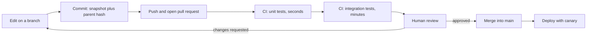

## In one minute
- Git records snapshots of your whole project, each identified by a hash of its content and its parents. Branches are just names pointing at snapshots, which is why branching is cheap and history is hard to change silently.
- Tests are code that checks code. A healthy suite is shaped like a pyramid: many fast unit tests for logic, fewer integration tests for the places your code meets a database, a queue or another service, and a handful of end-to-end tests for the critical user journeys.
- Unit test decisions and calculations; integration test boundaries. If a bug would come from your logic, a unit test catches it. If it would come from SQL, serialisation, configuration or a network call, only an integration test will.
- Code review is a second pair of eyes on correctness, design and risk before code ships. Small pull requests get better reviews than large ones.
- Code written by an AI agent needs the same review as code from a new teammate, with extra attention to tests that were weakened, APIs that do not exist and changes outside the task. The problem shape is trust but verify.

## How it works

### Git stores snapshots
A commit is a snapshot of every file in the project at one moment, plus a message, an author, a timestamp and a pointer to its parent commit (or two parents, for a merge). Git names each commit by a hash of all of that, such as `9b1f411` ([Pro Git, Git Objects](https://git-scm.com/book/en/v2/Git-Internals-Git-Objects)). Change one byte anywhere, in a file or in a parent, and the hash changes. History is therefore a chain of commits where each one vouches for everything before it.

You work in three places: the working directory (files you edit), the staging area or index (what the next commit will contain, filled by `git add`), and the repository (commits, created by `git commit`). `git status` shows the difference between them; `git diff` shows the lines that changed.

### Branches, merges and pull requests
A branch is a movable name for a commit. `git switch -c feature` creates a name pointing at the current commit; each new commit moves it forward. Meanwhile `main` moves forward with other people's work. To combine them, Git finds the merge base, the most recent commit both branches share, and compares each side's changes against it. Changes to different places combine automatically. Changes to the same lines in different ways are a conflict that a human must resolve. A rebase replays your commits on top of the latest `main` instead, giving a straight history at the cost of rewriting your commits' hashes, so only rebase branches nobody else has pulled.

Teams rarely merge straight into `main`. You push a branch and open a pull request (PR), continuous integration (CI) runs the tests, a reviewer reads the change, and only then is it merged. Branch strategy is a team choice too: Software Engineering at Google (Ch 16, Version Control and Branch Management) explains why Google keeps one trunk, and Pro Git's branching chapters show the workflow most other teams use.

### What a test is
A test sets up a situation, runs the code, and asserts the result: "given a cart with two items at 10 and 15, the total is 25". A good test fails for one clear reason, runs fast, gives the same answer every time, and reads like a description of behaviour. Tests that depend on the current time, random numbers, test order or a shared database are flaky: they fail sometimes without a code change, and teams soon learn to ignore them. Inject the clock and the random source as parameters, as every practice exercise in this course does.

### The test pyramid
The shape comes from Mike Cohn's *Succeeding with Agile*: lots of small, fast unit tests, some coarser service tests, very few tests through the UI. Fowler adds a working rule: if a higher-level test finds a bug and no lower-level test fails, write the lower-level test too ([Fowler](https://martinfowler.com/articles/practical-test-pyramid.html)). An inverted pyramid, mostly end-to-end tests, is the "ice-cream cone" he warns against. Google's testing blog makes the same argument for its own teams ([Google Testing Blog](https://testing.googleblog.com/2015/04/just-say-no-to-more-end-to-end-tests.html)); the Software Engineering at Google book covers sizing tests by resources used, not by name (Ch 11 Testing Overview, Ch 14 Larger Testing).

| Level | What it exercises | Typical speed | Rough share |
| --- | --- | --- | --- |
| Unit | One function or class, in memory, no I/O | Microseconds to milliseconds | Most tests |
| Integration | Your code plus one real dependency: database, queue, HTTP client, file system | Tens of ms to seconds | A solid layer |
| End-to-end | The deployed system through its real interface | Seconds to minutes | A handful |

Unit test pure logic and edge cases: pricing rules, validation, parsing, state transitions, retry and backoff calculations, permission checks. These are cheap to write and pin down exactly what the code decides.

Integration test the boundaries: SQL queries and migrations against a real database (often in a container), unique constraints and transactions, JSON serialisation of API responses, HTTP handlers with their routing and middleware, message encoding for a queue, and configuration loading. Mocking a database in a unit test proves only that your code calls the mock the way you expected; the real database may still reject the query.

Keep end-to-end tests for the few journeys whose failure would be an incident: sign up, log in, pay. They are slow and brittle, so each one must earn its place.

### Code review
A reviewer checks, roughly in this order: does the change do what the PR says, is it correct on edge cases and failures, are there tests that would catch a regression, is it secure (input validation, authorisation, secrets), will it be operable (logging, metrics, a safe rollout), and is it readable. Style questions that a formatter or linter can settle should be left to the tools. Comments should be specific and explain why: "this retries a non-idempotent POST, so a timeout could charge twice" is useful; "I don't like this" is not. Google's reviewer guide treats about 100 lines as a reasonable change and 1,000 as usually too large, and counts files too: 200 lines in one file may be fine, spread across 50 files probably is not ([Google eng-practices](https://google.github.io/eng-practices/review/developer/small-cls.html)). Authors should also expect speed from reviewers: Google's rule is a first response within one business day at most ([Google eng-practices](https://google.github.io/eng-practices/review/reviewer/speed.html)), because a slow review pushes authors to batch work into bigger changes.

### Reviewing code written by an agent
AI agents now write a large share of code, and their output looks confident whether it is right or not. Review it as you would a capable new teammate's work, and check these specifically:
- **Tests that bend to the code.** Did the change edit or delete an existing assertion, add a skip, or loosen a check so the suite passes? A changed expected value needs a reason.
- **Tests that assert nothing.** A test that calls the function and checks only that it did not crash proves little. Look for real assertions on outputs and side effects.
- **Invented or outdated APIs.** A library function, flag or config key that does not exist, or existed two versions ago. CI catches some of this; read the imports.
- **Scope creep.** Reformatting, renames or "improvements" outside the task make the real change hard to see. Ask for them in a separate PR.
- **Plausible but wrong edge cases.** Off-by-one boundaries, time zones, money in floating point, missing error handling on network calls.

Run the code yourself for anything risky. The agent's summary of what it did is a claim, not evidence.

### The same shape everywhere
Git hashes, tests, CI and review are all "trust but verify": accept work quickly, but check it with an independent mechanism before it can do damage. The same shape appears in payments, where a daily reconciliation compares your ledger with the bank's, and in operations, where a canary release checks a new version on 1% of traffic before it reaches everyone.

## Down the stack

### Layer 1: The contract
Git promises that a commit hash identifies exactly one snapshot and its full history: if two people have the same commit hash, they have the same files and the same past (barring a hash collision, which is why the SHA-256 transition exists). Branches promise nothing except "this name points at that commit now". A merge promises to apply both sides' changes relative to the merge base, and to stop and ask when they overlap. A test suite's contract is narrower than people assume: a green run means these specific assertions held on this code, in this environment, this time. It says nothing about paths no test exercised.

### Layer 2: The mechanism
Inside `.git/objects`, Git stores four kinds of object. A blob is a file's content. A tree is a directory listing that maps names to blob or tree hashes. A commit points to one tree plus parent commits, author and message. An annotated tag points to a commit. Each object's name is the SHA-1 hash of a header such as `blob 12` followed by a zero byte and the content, and the object is stored zlib-compressed in a file named by the hash, with the first two hex characters as the directory ([Pro Git, Git Objects](https://git-scm.com/book/en/v2/Git-Internals-Git-Objects)). Since Git 2.13 that SHA-1 is a hardened implementation that resists the SHAttered collision attack, and a repository can opt in to SHA-256 with `extensions.objectFormat`; such repositories cannot be read by older Git versions, and the transition plan keeps SHA-1 and SHA-256 names convertible during migration ([Git hash-function-transition](https://git-scm.com/docs/hash-function-transition)). A branch is a small file such as `.git/refs/heads/main` holding a commit hash, and `.git/HEAD` says which branch you are on. Because identical content gives an identical hash, a file unchanged across 1,000 commits is stored once. `git merge` walks the commit graph to find the best common ancestor (`git merge-base` shows it), then does a three-way comparison of base, ours and theirs.

### Layer 3: The machine
Hashing is fast, hundreds of MB per second per core, but rehashing a large repository on every `git status` would still be slow. So the index file records each tracked file's `stat` data (ctime, mtime, device, inode, size and more), and `git status` calls `stat` on each file and only rehashes ones whose metadata changed ([Git index format](https://git-scm.com/docs/gitformat-index)). Loose objects are later packed into packfiles that store similar objects as deltas against each other, which is why a repository with years of history is often smaller than you would expect. Test speed follows the latency numbers from the first lesson: a unit test runs in memory in microseconds; an integration test opens sockets, crosses process boundaries and waits for a database to `fsync`, so it costs milliseconds; an end-to-end test drives a browser over the network and costs seconds.

### Why it's built this way
1. Many people change one codebase at once, so history must be shared without trusting every copy.
2. Content hashes make tampering and corruption detectable and make identical content free to store, so Git names everything by hash.
3. Snapshots plus a common ancestor are enough to merge two lines of work automatically most of the time.
4. Checking correctness by hand does not scale, so we encode expectations as tests; fast tests run on every change, so most tests must be fast and in memory.
5. Tests only check what someone thought of, so a human reviewer adds judgement about intent, risk and design that automation cannot.

## Diagram


## Worked example
An agent opens a PR adding discount codes to checkout: 420 changed lines across 9 files, with the summary "Added discount codes, all tests pass." CI agrees: 1,180 unit tests in 25 seconds and 140 integration tests against a Postgres container in 3 minutes, all green.

The reviewer starts with the diff of the test files, not the code. Three things stand out. First, an existing test `test_total_rounds_half_up` now expects 10.00 instead of 10.01; the agent changed the rounding rule and then updated the test to match. Second, the new discount logic has eight unit tests, but none for a code that has expired or one applied twice. Third, there is no integration test for the new `discount_redemptions` table, which has a unique constraint on `(order_id, code)` that the code relies on to stop double use.

Then the code. Discounts are computed with floating-point numbers, so 3 items at 19.99 with 15% off gives 50.974499999... and rounds the wrong way about once in a few thousand orders. Two files were reformatted, adding 160 lines of noise.

The review asks for: reverting the rounding change and the reformatting; money in integer cents; unit tests for expiry, a zero total and double application; and one integration test that inserts the same redemption twice and asserts the second fails. The revised PR is 230 lines, CI adds 40 seconds, and the double-use bug, which would have let one code be redeemed by two concurrent checkouts, never reaches production. Total review time: about 40 minutes, against an incident that would have cost a day and real money.

## In the wild
- **Knight Capital, 2012: a half-finished deploy.** New trading code was installed on 7 of 8 servers; on the eighth, a reused flag woke up retired "Power Peg" logic. In about 45 minutes it sent millions of unintended orders and lost roughly $460M. During the response, staff removed the new code from the seven good servers, which made all eight misbehave. The SEC cited missing deployment review and incident procedures ([SEC order](https://www.sec.gov/litigation/admin/2013/34-70694.pdf)).
- **CrowdStrike, 2024: a content update that passed its validator.** On 19 July a new template type defined 21 input fields but the sensor supplied only 20, so the interpreter read past the end of an array. The Content Validator had a logic error, testing covered too narrow a range of matching criteria, and the update was not staged. CrowdStrike's fixes include bounds checks and staged deployment ([CrowdStrike root cause analysis](https://www.crowdstrike.com/wp-content/uploads/2024/08/Channel-File-291-Incident-Root-Cause-Analysis-08.06.2024.pdf)).
- **xz Utils, 2024: a backdoor hidden in test files.** Obfuscated payloads sat in test files and were pulled in by a build line present only in release tarballs, not in the git tree. Andres Freund found it by noticing sshd logins using about 0.5 s of CPU instead of 0.01 s. Reviewing the git history alone would not have shown it ([oss-security post](https://www.openwall.com/lists/oss-security/2024/03/29/4)).

## Trade-offs
| Choice | Strengths | Weaknesses | Choose when |
| --- | --- | --- | --- |
| Unit tests | Fast, precise, easy to debug | Miss integration bugs, can over-mock | Logic, calculations, edge cases |
| Integration tests | Catch SQL, schema, wire format and config bugs | Slower, need real dependencies | Every boundary your code owns |
| End-to-end tests | Test what users see | Slow, flaky, hard to diagnose | A few critical journeys |
| Merge commits | Preserve true history, no rewriting | Busier graph | Shared branches, long-lived work |
| Rebase and fast-forward | Linear, readable history | Rewrites hashes, risky on shared branches | Your own short-lived branches |
| Small PRs | Faster, deeper reviews, easy rollback | More PRs to coordinate | Almost always |

## Pitfalls in production
- Mocking everything, so the suite passes while the real query fails. Fix: test each database query and external call at least once against a real instance.
- Flaky tests that everyone reruns until green. Fix: quarantine and fix them quickly; inject clocks and randomness; isolate test data.
- Committing secrets such as API keys, which stay in history even after deletion. Fix: use secret scanning in CI and pre-commit hooks, and rotate any key that was ever committed.
- Force-pushing over a shared branch and erasing a teammate's commits. Fix: protect `main`, use `git push --force-with-lease`, and rebase only your own branches.
- Rubber-stamp approvals on large or agent-written PRs. Fix: cap PR size, require tests for behaviour changes, and read test diffs first.
- Coverage targets gamed with tests that assert nothing. Fix: treat coverage as a map of untested code, not a score, and review assertions.

## Leadership lens
- Set the team's testing strategy explicitly: what must have unit tests, which boundaries need integration tests, and which few journeys get end-to-end tests.
- Keep CI fast, ideally under 10 minutes; when it gets slow, people batch changes into big risky PRs.
- Write down how agent-written code is reviewed: same bar as human code, test diffs read first, and a named human accountable for every merge.
- Protect `main` with required checks and reviews, and make reverting a bad merge a routine, blameless action.

## Check yourself
1. Why does changing an old commit's message change the hash of every commit after it?
   **Answer:** Each commit's hash covers its parent's hash, so a new hash for the old commit changes the parent field of its child, which changes the child's hash, and so on to the tip.
2. A service's repository code builds an SQL query and the unit test mocks the database. What kind of bug can that test never catch?
   **Answer:** Any bug in how the real database treats the query: a syntax error, a wrong column name, a missing index, a violated constraint or a transaction behaving differently. Only an integration test against a real database catches those.
3. An agent's PR changes an expected value in an existing test. What should a reviewer do?
   **Answer:** Treat it as a behaviour change and ask why: either the old expectation was wrong and the PR should say so, or the new code broke something and the test was bent to hide it.
4. Why is a suite with 10,000 end-to-end tests and no unit tests a poor design?
   **Answer:** It is slow, so it runs rarely; flaky, so failures get ignored; and hard to diagnose, because a failure could be anywhere in the stack. Most checks belong at the unit level, where they are fast and precise.

## Practice
**Task:** Implement the two steps of a Git merge. `merge_base(parents, a, b)` receives a commit graph as a map from commit ID to a list of parent IDs (a root commit has none) and returns the sorted list of best common ancestors of `a` and `b`: commits reachable from both (counting each commit as reachable from itself) that are not an ancestor of another such commit. Unrelated histories give an empty list; criss-cross merges can give more than one. `merge3(base, ours, theirs)` performs a three-way merge of three key-value maps, where a missing key means deleted: for each key, if ours and theirs agree, keep that; if only one side differs from base, take that side; if both differ from base and from each other, it is a conflict. Return the merged map (without conflicting keys) and the sorted list of conflicting keys.

```python starter
def merge_base(parents, a, b):
    # TODO
    raise NotImplementedError

def merge3(base, ours, theirs):
    # Return (merged_dict, sorted_conflict_keys).
    raise NotImplementedError
```

```python tests
def test_merge_base_linear_and_same():
    g = {"A": [], "B": ["A"], "C": ["B"], "D": ["C"]}
    assert merge_base(g, "D", "B") == ["B"]
    assert merge_base(g, "C", "C") == ["C"]

def test_merge_base_fork_and_after_merge():
    g = {"A": [], "B": ["A"], "C": ["B"], "D": ["B"], "E": ["C", "D"], "F": ["D"]}
    assert merge_base(g, "C", "D") == ["B"]
    assert merge_base(g, "E", "F") == ["D"]

def test_merge_base_criss_cross_and_unrelated():
    g = {"A": [], "B": ["A"], "C": ["A"], "D": ["B", "C"], "E": ["C", "B"], "X": []}
    assert merge_base(g, "D", "E") == ["B", "C"]
    assert merge_base(g, "D", "X") == []

def test_merge3_one_side_changes():
    base = {"port": "80", "host": "a"}
    assert merge3(base, {"port": "80", "host": "a"}, {"port": "8080", "host": "a"}) == ({"port": "8080", "host": "a"}, [])
    assert merge3(base, {"port": "81", "host": "a"}, {"port": "80", "host": "b"}) == ({"port": "81", "host": "b"}, [])

def test_merge3_same_change_and_conflict():
    base = {"port": "80", "mode": "x"}
    merged, conflicts = merge3(base, {"port": "90", "mode": "y"}, {"port": "90", "mode": "z"})
    assert merged == {"port": "90"}
    assert conflicts == ["mode"]

def test_merge3_deletions_and_additions():
    base = {"a": "1", "b": "2"}
    ours = {"b": "2", "c": "new"}
    theirs = {"a": "1", "b": "3", "c": "other"}
    assert merge3(base, ours, theirs) == ({"b": "3"}, ["c"])
    assert merge3(base, {"b": "2"}, {"a": "9", "b": "2"}) == ({"b": "2"}, ["a"]), "delete vs modify"
```

```python solution
def _ancestors(parents, start):
    seen = set()
    stack = [start]
    while stack:
        c = stack.pop()
        if c in seen:
            continue
        seen.add(c)
        stack.extend(parents.get(c, []))
    return seen

def merge_base(parents, a, b):
    common = _ancestors(parents, a) & _ancestors(parents, b)
    best = []
    for c in common:
        dominated = False
        for d in common:
            if d != c and c in _ancestors(parents, d):
                dominated = True
                break
        if not dominated:
            best.append(c)
    return sorted(best)

def merge3(base, ours, theirs):
    merged = {}
    conflicts = []
    for k in sorted(set(base) | set(ours) | set(theirs)):
        b, o, t = base.get(k), ours.get(k), theirs.get(k)
        if o == t:
            value = o
        elif o == b:
            value = t
        elif t == b:
            value = o
        else:
            conflicts.append(k)
            continue
        if value is not None:
            merged[k] = value
    return (merged, conflicts)
```

```typescript starter
export function mergeBase(parents: Record<string, string[]>, a: string, b: string): string[] {
  throw new Error("TODO");
}

export function merge3(
  base: Record<string, string>,
  ours: Record<string, string>,
  theirs: Record<string, string>
): { merged: Record<string, string>; conflicts: string[] } {
  throw new Error("TODO");
}
```

```typescript tests
test("merge base linear and same", () => {
  const g = { A: [], B: ["A"], C: ["B"], D: ["C"] };
  assertEqual(mergeBase(g, "D", "B"), ["B"]);
  assertEqual(mergeBase(g, "C", "C"), ["C"]);
});

test("merge base fork and after merge", () => {
  const g = { A: [], B: ["A"], C: ["B"], D: ["B"], E: ["C", "D"], F: ["D"] };
  assertEqual(mergeBase(g, "C", "D"), ["B"]);
  assertEqual(mergeBase(g, "E", "F"), ["D"]);
});

test("merge base criss cross and unrelated", () => {
  const g = { A: [], B: ["A"], C: ["A"], D: ["B", "C"], E: ["C", "B"], X: [] };
  assertEqual(mergeBase(g, "D", "E"), ["B", "C"]);
  assertEqual(mergeBase(g, "D", "X"), []);
});

test("merge3 one side changes", () => {
  const base = { host: "a", port: "80" };
  assertEqual(merge3(base, { host: "a", port: "80" }, { host: "a", port: "8080" }), { merged: { host: "a", port: "8080" }, conflicts: [] });
  assertEqual(merge3(base, { host: "a", port: "81" }, { host: "b", port: "80" }), { merged: { host: "b", port: "81" }, conflicts: [] });
});

test("merge3 same change and conflict", () => {
  const r = merge3({ mode: "x", port: "80" }, { mode: "y", port: "90" }, { mode: "z", port: "90" });
  assertEqual(r.merged, { port: "90" });
  assertEqual(r.conflicts, ["mode"]);
});

test("merge3 deletions and additions", () => {
  const base = { a: "1", b: "2" };
  assertEqual(merge3(base, { b: "2", c: "new" }, { a: "1", b: "3", c: "other" }), { merged: { b: "3" }, conflicts: ["c"] });
  assertEqual(merge3(base, { b: "2" }, { a: "9", b: "2" }), { merged: { b: "2" }, conflicts: ["a"] });
});
```

```typescript solution
function ancestors(parents: Record<string, string[]>, start: string): Set<string> {
  const seen = new Set<string>();
  const stack = [start];
  while (stack.length > 0) {
    const c = stack.pop()!;
    if (seen.has(c)) continue;
    seen.add(c);
    for (const p of parents[c] ?? []) stack.push(p);
  }
  return seen;
}

export function mergeBase(parents: Record<string, string[]>, a: string, b: string): string[] {
  const fromB = ancestors(parents, b);
  const common = Array.from(ancestors(parents, a)).filter((c) => fromB.has(c));
  const best = common.filter((c) => !common.some((d) => d !== c && ancestors(parents, d).has(c)));
  return best.sort();
}

export function merge3(
  base: Record<string, string>,
  ours: Record<string, string>,
  theirs: Record<string, string>
): { merged: Record<string, string>; conflicts: string[] } {
  const keys = Array.from(new Set([...Object.keys(base), ...Object.keys(ours), ...Object.keys(theirs)])).sort();
  const merged: Record<string, string> = {};
  const conflicts: string[] = [];
  for (const k of keys) {
    const b = base[k], o = ours[k], t = theirs[k];
    let value: string | undefined;
    if (o === t) value = o;
    else if (o === b) value = t;
    else if (t === b) value = o;
    else {
      conflicts.push(k);
      continue;
    }
    if (value !== undefined) merged[k] = value;
  }
  return { merged, conflicts };
}
```

```go starter
package practice

func MergeBase(parents map[string][]string, a, b string) []string {
	panic("TODO")
}

// Merge3 returns the merged map and the sorted conflicting keys.
func Merge3(base, ours, theirs map[string]string) (map[string]string, []string) {
	panic("TODO")
}
```

```go tests
package practice

import (
	"reflect"
	"testing"
)

func TestMergeBaseLinearAndSame(t *testing.T) {
	g := map[string][]string{"A": {}, "B": {"A"}, "C": {"B"}, "D": {"C"}}
	if got := MergeBase(g, "D", "B"); !reflect.DeepEqual(got, []string{"B"}) {
		t.Fatalf("got %v", got)
	}
	if got := MergeBase(g, "C", "C"); !reflect.DeepEqual(got, []string{"C"}) {
		t.Fatalf("got %v", got)
	}
}

func TestMergeBaseForkAndAfterMerge(t *testing.T) {
	g := map[string][]string{"A": {}, "B": {"A"}, "C": {"B"}, "D": {"B"}, "E": {"C", "D"}, "F": {"D"}}
	if got := MergeBase(g, "C", "D"); !reflect.DeepEqual(got, []string{"B"}) {
		t.Fatalf("fork %v", got)
	}
	if got := MergeBase(g, "E", "F"); !reflect.DeepEqual(got, []string{"D"}) {
		t.Fatalf("after merge %v", got)
	}
}

func TestMergeBaseCrissCrossAndUnrelated(t *testing.T) {
	g := map[string][]string{"A": {}, "B": {"A"}, "C": {"A"}, "D": {"B", "C"}, "E": {"C", "B"}, "X": {}}
	if got := MergeBase(g, "D", "E"); !reflect.DeepEqual(got, []string{"B", "C"}) {
		t.Fatalf("criss-cross %v", got)
	}
	if got := MergeBase(g, "D", "X"); len(got) != 0 {
		t.Fatalf("unrelated %v", got)
	}
}

func TestMerge3OneSideChanges(t *testing.T) {
	base := map[string]string{"port": "80", "host": "a"}
	m, c := Merge3(base, map[string]string{"port": "80", "host": "a"}, map[string]string{"port": "8080", "host": "a"})
	if !reflect.DeepEqual(m, map[string]string{"port": "8080", "host": "a"}) || len(c) != 0 {
		t.Fatalf("theirs only: %v %v", m, c)
	}
	m, c = Merge3(base, map[string]string{"port": "81", "host": "a"}, map[string]string{"port": "80", "host": "b"})
	if !reflect.DeepEqual(m, map[string]string{"port": "81", "host": "b"}) || len(c) != 0 {
		t.Fatalf("both sides: %v %v", m, c)
	}
}

func TestMerge3SameChangeAndConflict(t *testing.T) {
	m, c := Merge3(map[string]string{"port": "80", "mode": "x"}, map[string]string{"port": "90", "mode": "y"}, map[string]string{"port": "90", "mode": "z"})
	if !reflect.DeepEqual(m, map[string]string{"port": "90"}) || !reflect.DeepEqual(c, []string{"mode"}) {
		t.Fatalf("got %v %v", m, c)
	}
}

func TestMerge3DeletionsAndAdditions(t *testing.T) {
	base := map[string]string{"a": "1", "b": "2"}
	m, c := Merge3(base, map[string]string{"b": "2", "c": "new"}, map[string]string{"a": "1", "b": "3", "c": "other"})
	if !reflect.DeepEqual(m, map[string]string{"b": "3"}) || !reflect.DeepEqual(c, []string{"c"}) {
		t.Fatalf("got %v %v", m, c)
	}
	m, c = Merge3(base, map[string]string{"b": "2"}, map[string]string{"a": "9", "b": "2"})
	if !reflect.DeepEqual(m, map[string]string{"b": "2"}) || !reflect.DeepEqual(c, []string{"a"}) {
		t.Fatalf("delete vs modify: %v %v", m, c)
	}
}
```

```go solution
package practice

import "sort"

func ancestors(parents map[string][]string, start string) map[string]bool {
	seen := map[string]bool{}
	stack := []string{start}
	for len(stack) > 0 {
		c := stack[len(stack)-1]
		stack = stack[:len(stack)-1]
		if seen[c] {
			continue
		}
		seen[c] = true
		stack = append(stack, parents[c]...)
	}
	return seen
}

func MergeBase(parents map[string][]string, a, b string) []string {
	fromB := ancestors(parents, b)
	common := []string{}
	for c := range ancestors(parents, a) {
		if fromB[c] {
			common = append(common, c)
		}
	}
	best := []string{}
	for _, c := range common {
		dominated := false
		for _, d := range common {
			if d != c && ancestors(parents, d)[c] {
				dominated = true
				break
			}
		}
		if !dominated {
			best = append(best, c)
		}
	}
	sort.Strings(best)
	return best
}

func Merge3(base, ours, theirs map[string]string) (map[string]string, []string) {
	keys := map[string]bool{}
	for _, m := range []map[string]string{base, ours, theirs} {
		for k := range m {
			keys[k] = true
		}
	}
	merged := map[string]string{}
	conflicts := []string{}
	for k := range keys {
		b, bok := base[k]
		o, ook := ours[k]
		t, tok := theirs[k]
		same := func(x string, xok bool, y string, yok bool) bool { return xok == yok && x == y }
		var v string
		var vok bool
		switch {
		case same(o, ook, t, tok):
			v, vok = o, ook
		case same(o, ook, b, bok):
			v, vok = t, tok
		case same(t, tok, b, bok):
			v, vok = o, ook
		default:
			conflicts = append(conflicts, k)
			continue
		}
		if vok {
			merged[k] = v
		}
	}
	sort.Strings(conflicts)
	return merged, conflicts
}
```

## Mock interview
**Prompt:** You join a team whose CI takes 45 minutes, fails about one run in five for no clear reason, and mostly consists of 600 browser-driven end-to-end tests. Half the team's PRs are now written by coding agents. How would you fix the testing and review process over the next quarter?

- Follow-up: Which of the 600 end-to-end tests would you keep, and what replaces the rest?
- Follow-up: A flaky test fails only when the suite runs in parallel. How do you find the cause?
- Follow-up: What review rules would you set for agent-written PRs, and how would you know they work?

**A strong answer covers:**
- Measuring first: per-test duration and failure rate, then quarantining the flakiest tests so CI becomes trustworthy again.
- Reshaping toward the pyramid: keep end-to-end tests for a handful of critical journeys, and move the logic they check into unit tests and the boundaries into integration tests against real dependencies.
- Diagnosing parallel flakiness as shared state: shared database rows, fixed ports, global clocks or test order, fixed by isolating data and injecting time.
- Review rules for agent PRs: size limits, test diffs read first, no weakened assertions without justification, a named human owner, and CI as a required check.
- Tracking outcomes: CI time, flake rate, escaped defects and review turnaround, reviewed every few weeks.

## Sources and further study

**Primary**
- [Git: hash-function-transition](https://git-scm.com/docs/hash-function-transition): how Git is moving from SHA-1 to SHA-256 and what interoperates.
- [Git: index file format](https://git-scm.com/docs/gitformat-index): the per-file stat data behind a fast `git status`.
- [Google eng-practices: small CLs](https://google.github.io/eng-practices/review/developer/small-cls.html): size guidance and why it helps review.

**Systems docs**
- [Pro Git, Git Objects](https://git-scm.com/book/en/v2/Git-Internals-Git-Objects): blob, tree and commit storage with worked commands.
- [Google eng-practices: review speed](https://google.github.io/eng-practices/review/reviewer/speed.html): the one-business-day response rule.
- [Fowler: The Practical Test Pyramid](https://martinfowler.com/articles/practical-test-pyramid.html): layers, proportions and the ice-cream cone anti-pattern.

**Books**
- Software Engineering at Google (Winters, Manshreck, Wright), Ch 9 Code Review, Ch 11 Testing Overview, Ch 14 Larger Testing, Ch 16 Version Control and Branch Management: [free online](https://abseil.io/resources/swe-book/html/toc.html).
- Pro Git (Chacon and Straub): chapters on branching and Git internals, free at git-scm.com.

**Other curricula**
- [roadmap.sh: Git and GitHub](https://roadmap.sh/git-github): treats Git as a command and workflow skills path.
- [roadmap.sh: QA](https://roadmap.sh/qa): lists test types and levels as a learning map.

## Watch
- [Lecture 6: Version Control (git) (Missing Semester)](https://www.youtube.com/watch?v=2sjqTHE0zok): Git's data model of blobs, trees and commits, explained from the ground up.
- [Git Internals by John Britton of GitHub (CS50)](https://www.youtube.com/watch?v=lG90LZotrpo): what happens inside `.git` when you add, commit and branch.
- [TDD, Where Did It All Go Wrong (Ian Cooper)](https://www.youtube.com/watch?v=EZ05e7EMOLM): testing behaviour rather than implementation details, and why over-mocking hurts.

## Free resources
- [Pro Git, Git Internals: Git Objects](https://git-scm.com/book/en/v2/Git-Internals-Git-Objects): the official book's explanation of blobs, trees and commits.
- [git merge-base documentation](https://git-scm.com/docs/git-merge-base): how Git defines the best common ancestor, including criss-cross merges.
- [The Practical Test Pyramid (Martin Fowler's site)](https://martinfowler.com/articles/practical-test-pyramid.html): a long, concrete guide to unit, integration and end-to-end tests.
- [Just Say No to More End-to-End Tests (Google Testing Blog)](https://testing.googleblog.com/2015/04/just-say-no-to-more-end-to-end-tests.html): why a suite built from end-to-end tests fails its team.
- [Google Engineering Practices: Code Review](https://google.github.io/eng-practices/review/): how Google reviewers and authors approach a code review.
- [What to look for in a code review (Google)](https://google.github.io/eng-practices/review/reviewer/looking-for.html): a checklist from design to tests to naming.
