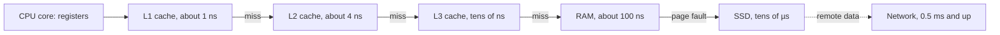

## In one minute
- A CPU does one simple thing very fast: fetch an instruction, decode it, execute it, repeat, billions of times a second. Every program, from a shell script to a model server, ends up as that loop.
- Data lives in a hierarchy: registers, CPU caches, main memory (RAM), then disk or SSD, then the network. Each step down is bigger and cheaper and roughly 10 to 1000 times slower.
- Most "slow code" is not slow arithmetic. It is waiting: for memory, for disk, for the network. Knowing the rough latency numbers lets you guess where time goes before you profile.
- Caches work because programs reuse data (temporal locality) and touch nearby data (spatial locality). Code that walks memory in order is often several times faster than code doing the same work in a scattered order.
- The same shape repeats at every level of the stack: a small fast store in front of a big slow one. CPU caches, a page cache, Redis in front of a database and a CDN in front of an origin are one idea in four domains.

## How it works

### From source code to instructions
You write Python, TypeScript or Go. Something turns it into machine instructions the CPU understands. Go is compiled ahead of time to a native binary. TypeScript compiles to JavaScript, which a runtime such as V8 interprets and then just-in-time compiles hot functions to machine code. CPython compiles your file to bytecode and runs it in an interpreter loop, which is itself a compiled C program. The paths differ, but at the bottom a CPU core is executing machine instructions such as "load this address into a register", "add two registers", "jump if zero".

### The fetch-decode-execute loop
A core keeps a program counter: the address of the next instruction. It fetches the instruction from memory, decodes what it means, executes it (an arithmetic operation, a memory load or store, or a branch), and moves on. Modern cores overlap many instructions in a pipeline, run several at once, guess which way branches will go and execute ahead speculatively. A 3 GHz core can finish several instructions per nanosecond when its data is ready. When the data is not ready, it waits.

### The memory hierarchy
| Level | Typical size | Rough latency |
| --- | --- | --- |
| Registers | Hundreds of bytes | Under 1 ns |
| L1 cache | Tens of KB per core | About 1 ns |
| L2 cache | Hundreds of KB to a few MB per core | About 4 ns |
| L3 cache | Tens of MB shared | About 10 to 40 ns |
| Main memory (RAM) | GBs | About 100 ns |
| NVMe SSD random read | TBs | About 10 to 100 µs |
| Network round trip in a data centre | | About 0.5 ms |
| Spinning disk seek | TBs | About 5 to 10 ms |
| Round trip across a continent | | About 50 to 150 ms |

The exact numbers vary by hardware and year; the ratios are what matter. The figures above match the interactive table by Colin Scott, which extrapolates a classic list forward by year and holds the data-centre round trip fixed ([Colin Scott's interactive latency table](https://colin-scott.github.io/personal_website/research/interactive_latency.html)). The older 2012 list that many people quote has L1 at 0.5 ns, L2 at 7 ns, a 4 KB SSD read at 150 µs and a disk seek at 10 ms ([Bonér's latency gist](https://gist.github.com/jboner/2841832)). Treat both as orders of magnitude and measure your own machine. If an L1 hit were one second, a RAM access would be about two minutes, an SSD read a few hours to a day and a cross-continent round trip two to five years.

### Caches and locality
The CPU never fetches a single byte from RAM. It fetches a cache line, usually 64 bytes, and keeps it in cache ([Drepper, What Every Programmer Should Know About Memory, section 3](https://www.akkadia.org/drepper/cpumemory.pdf)). If the next access falls in the same line, it is almost free. If the program jumps around memory, every access can miss and pay the RAM price. Two kinds of locality make caches work:
- **Temporal locality:** recently used data is likely to be used again soon (a loop counter, a hot config object).
- **Spatial locality:** data next to recently used data is likely to be used soon (the next element of an array).

Arrays and slices are laid out contiguously, so walking them in order is cache friendly. Linked lists, maps of pointers and objects scattered across the heap are not. Hardware prefetchers also spot simple sequential or fixed-stride access and fetch lines before the program asks for them, which is why sequential code often looks nearly free; Drepper devotes section 6.3 to prefetching and shows in section 6.2.1 how reordering a matrix multiply to walk memory sequentially cuts its run time sharply.

### Disk, files and the page cache
Disks and SSDs store data in blocks of a few KB. The operating system keeps recently read file blocks in RAM in the page cache, so the second read of a file is often a memory read, not a disk read. Writes usually land in the page cache first and reach the disk later, when kernel flusher threads write out data that has been dirty long enough or when dirty memory passes a threshold ([Linux vm sysctl docs](https://docs.kernel.org/admin-guide/sysctl/vm.html)). `fsync` blocks until the file's data and metadata are on the device, including flushing the drive's own write cache, but it does not make the file's directory entry durable: for a newly created file you must also `fsync` the directory ([fsync(2)](https://www.man7.org/linux/man-pages/man2/fsync.2.html)). That is why databases call `fsync` on commit, and why "it was written" and "it survives a power cut" are different claims.

A failed write-back is the nasty case. After a buffered write fails at the hardware level, Linux filesystems typically drop the affected pages and mark them clean, so a later `fsync` can report success for data that never reached the disk ([LWN: PostgreSQL's fsync() surprise](https://lwn.net/Articles/752063/)). Error reporting improved in Linux 4.13 and later, and PostgreSQL now defaults `data_sync_retry` to off, so a failed flush crashes the server and recovers from the write-ahead log instead of retrying ([PostgreSQL docs](https://www.postgresql.org/docs/current/runtime-config-error-handling.html)).

### The same shape everywhere
A small, fast, expensive store in front of a big, slow, cheap one, with a policy for what to keep: that is the L1 cache, the OS page cache, an application cache, Redis, and a CDN. Hit rate, eviction, invalidation and warm-up are the same questions at every level. Learn them once here and you will recognise them in every system design interview.

## Down the stack

### Layer 1: The contract
Your program sees a flat address space: memory is a long array of bytes, every load returns the last value stored, and files are byte streams that persist. Latency is not part of this contract. Two programs that are equally correct can differ in speed by ten times purely because of how they touch memory and storage.

### Layer 2: The mechanism
Each process gets virtual memory: addresses that the CPU's memory management unit translates to physical RAM pages, usually 4 KB each, through page tables cached in a translation lookaside buffer (TLB) ([OSTEP, Ch 18: Paging and Ch 19: TLBs](https://pages.cs.wisc.edu/~remzi/OSTEP/)). Caches are split into sets; an address maps to one set, and when a set is full the hardware evicts a line, roughly least recently used. When a page is not in RAM, a page fault hands control to the OS, which loads it from disk or swap ([OSTEP, Ch 21: Swapping](https://pages.cs.wisc.edu/~remzi/OSTEP/)). Linux's `vm.swappiness` (default 60, range 0 to 200) sets how eagerly it swaps anonymous memory instead of dropping file cache ([Linux vm sysctl docs](https://docs.kernel.org/admin-guide/sysctl/vm.html)). Storage devices read and write whole blocks, and the OS batches and reorders I/O.

### Layer 3: The machine
RAM is far from the core in time, not distance: each access goes through the memory controller and DRAM rows have to be opened and read. Caches are SRAM built into the CPU die, much faster but much more expensive per byte, which is why they are small. SSDs are flash chips behind a controller that maps logical blocks to physical pages, erases in large blocks and writes in small pages. Spinning disks must physically move a head and wait for the platter to rotate, which is why random reads on them cost milliseconds.

### Why it's built this way
1. Fast memory is expensive and small; cheap memory is big and slow. Physics and cost force a trade-off.
2. Real programs reuse data and touch nearby data.
3. So a hierarchy of caches gives most accesses the speed of the small store at the price of the big one.
4. When a workload breaks locality, it falls through to the slow level and performance collapses.
5. The same economics produce caches in software and across networks, with the same failure modes.

## Diagram


## Worked example
A service computes a daily report by summing a 10,000 by 10,000 grid of 8-byte numbers (800 MB) stored row by row. A new engineer writes the loop with the column index outside and the row index inside. It takes about 9 seconds. Swapping the loops so the code walks each row in order brings it under 1 second, with the same arithmetic.

Why: in row order, each 64-byte cache line holds 8 consecutive numbers, so one RAM fetch serves 8 additions, and the hardware prefetcher sees the sequential pattern and fetches ahead. In column order, consecutive accesses are 80,000 bytes apart, so every access touches a new line (and a new 4 KB page, which also strains the TLB), and by the time the loop comes back to a line it has often been pushed out of L1 and sometimes out of the whole cache. Almost every addition pays a deep-cache or RAM latency. The 9 and 1 second figures are illustrative; the gap on real hardware depends on cache sizes and associativity, so measure rather than trust them. Drepper's matrix example in section 6.2.1 shows the same effect with measured numbers ([Drepper](https://www.akkadia.org/drepper/cpumemory.pdf)).

The same team later finds the report reading 2 GB of input files. The first run of the day takes 40 seconds; reruns take 6. The difference is the page cache: the first run reads from SSD, later runs read file blocks already in RAM. The fix is to read the files once, in large sequential chunks, rather than to buy a faster disk.

A back-of-envelope check helps here: 100 million random RAM accesses at about 100 ns each is 10 seconds; 100 million sequential cache-friendly reads is a fraction of a second. You can make that estimate before writing any code.

## In the wild
- **PostgreSQL community, 2018: fsync errors that Linux swallowed.** In March 2018 a report to the pgsql-hackers list showed that PostgreSQL could lose data with no error: its checkpointer often opened files before calling `fsync`, and on Linux a failed write-back could be dropped as clean pages or consumed by another caller, so a later `fsync` returned success. The thread led to Linux error-reporting changes and to PostgreSQL treating a failed flush as a reason to crash and replay the WAL ([LWN](https://lwn.net/Articles/752063/), [PostgreSQL docs](https://www.postgresql.org/docs/current/runtime-config-error-handling.html)).
- **NATS JetStream, 2025: acknowledged before durable.** Jepsen found that JetStream 2.12.1 acknowledged publishes immediately but fsynced only every two minutes by default. A simulated power failure lost 131,418 of 930,005 messages, roughly 30 seconds of writes. NATS documented the hazard rather than changing the default ([Jepsen](https://jepsen.io/analyses/nats-2.12.1)).

## Trade-offs
| Choice | Strengths | Weaknesses | Choose when |
| --- | --- | --- | --- |
| Contiguous arrays or slices | Cache friendly, prefetchable | Costly inserts in the middle | Iteration-heavy data |
| Pointer-based structures (lists, trees) | Cheap inserts and deletes | Scattered memory, cache misses | Frequent structural changes |
| Keep data in RAM | Nanosecond access | Limited size, lost on crash | Hot working sets |
| Read from SSD on demand | Huge capacity, durable | Microseconds per random read | Cold or large data |
| Large sequential I/O | High throughput | Reads more than you may need | Scans, batch jobs |
| Small random I/O | Reads only what you need | Pays latency per request | Point lookups with an index |

## Pitfalls in production
- Assuming the database or network call is fast because it is fast on your laptop. Fix: know the latency numbers and measure in the real environment.
- Calling a remote service inside a loop (the N+1 pattern). Fix: batch the requests; one round trip instead of a thousand.
- Benchmarking with a warm cache and deploying to a cold one. Fix: measure both cold and warm runs.
- Trusting that a write is durable before `fsync`, or that a successful `fsync` covers the new file's directory entry. Fix: use a database, or `fsync` both the file and its directory, and treat an `fsync` error as fatal rather than retrying.
- Running out of RAM so the OS starts swapping and latency jumps a thousand times. Fix: set memory limits and alert on swap and page faults; Brendan Gregg's *Systems Performance* (2nd ed., Ch 7: Memory) covers the memory methodology and the Linux tools for it.

## Leadership lens
- Ask "where does the time go: CPU, memory, disk or network?" before anyone optimises code.
- Teach the latency table; a team that knows the ratios makes better design choices without a profiler.
- Treat every cache, from CPU to CDN, as the same pattern with the same review questions: hit rate, eviction, invalidation, cold start.
- Prefer batching and sequential access in designs; they are the cheapest performance wins.
- Ask what a storage acknowledgement means: "written" to the page cache, to the drive cache, or to stable media. Many data-loss stories are a gap between those.

## Check yourself
1. Why is iterating over an array usually faster than iterating over a linked list of the same length?
   **Answer:** The array is contiguous, so each cache line fetched from RAM holds several elements and the prefetcher can load ahead; list nodes are scattered, so each step can be a cache miss costing about 100 ns.
2. Roughly how much slower is a RAM access than an L1 cache hit, and a data-centre round trip than a RAM access?
   **Answer:** About 100 times for RAM versus L1, and about 5,000 times for a 0.5 ms round trip versus a 100 ns RAM access.
3. Why does the second run of a file-processing job often finish much faster than the first?
   **Answer:** The OS page cache kept the file blocks in RAM after the first read, so the second run reads from memory instead of disk.
4. What do a CPU cache and a CDN have in common?
   **Answer:** Both are small fast stores in front of a big slow one, rely on locality of access, and face the same questions of hit rate, eviction, invalidation and cold start.

## Practice
**Task:** Build a tiny model of a CPU cache and a latency estimator. `traversal(rows, cols, elem_size, by_row)` returns the byte addresses visited when walking a row-major `rows` by `cols` grid of `elem_size`-byte elements starting at address 0, row by row if `by_row` is true, otherwise column by column. `cache_sim(addresses, lines, line_size)` simulates a direct-mapped cache with `lines` slots of `line_size` bytes: an address belongs to block `address // line_size`, which can only live in slot `block % lines`; an access is a hit if that slot currently holds the block, otherwise a miss that loads it. Return `[hits, misses]`. `estimate_ns(counts)` takes a map from operation name to count and returns the total nanoseconds using `l1` = 1, `l2` = 4, `ram` = 100, `ssd` = 16000, `dc_round_trip` = 500000; ignore unknown names.

```python starter
def traversal(rows, cols, elem_size, by_row):
    # TODO
    raise NotImplementedError

def cache_sim(addresses, lines, line_size):
    # TODO
    raise NotImplementedError

def estimate_ns(counts):
    # TODO
    raise NotImplementedError
```

```python tests
def test_traversal_orders():
    assert traversal(2, 3, 4, True) == [0, 4, 8, 12, 16, 20]
    assert traversal(2, 3, 4, False) == [0, 12, 4, 16, 8, 20]

def test_sequential_mostly_hits():
    assert cache_sim(list(range(0, 128, 8)), 4, 64) == [14, 2]

def test_repeated_address():
    assert cache_sim([0, 0, 0], 4, 64) == [2, 1]

def test_conflict_misses():
    assert cache_sim([0, 256, 0, 256], 4, 64) == [0, 4]

def test_row_versus_column():
    assert cache_sim(traversal(8, 8, 8, True), 4, 64) == [56, 8]
    assert cache_sim(traversal(8, 8, 8, False), 4, 64) == [0, 64]

def test_estimate():
    assert estimate_ns({"l1": 100, "ram": 10}) == 1100
    assert estimate_ns({"ssd": 2, "dc_round_trip": 1, "gpu": 9}) == 532000
    assert estimate_ns({}) == 0
```

```python solution
LATENCY = {"l1": 1, "l2": 4, "ram": 100, "ssd": 16000, "dc_round_trip": 500000}

def traversal(rows, cols, elem_size, by_row):
    if by_row:
        return [(r * cols + c) * elem_size for r in range(rows) for c in range(cols)]
    return [(r * cols + c) * elem_size for c in range(cols) for r in range(rows)]

def cache_sim(addresses, lines, line_size):
    slots = [None] * lines
    hits = misses = 0
    for a in addresses:
        block = a // line_size
        i = block % lines
        if slots[i] == block:
            hits += 1
        else:
            misses += 1
            slots[i] = block
    return [hits, misses]

def estimate_ns(counts):
    return sum(LATENCY[k] * n for k, n in counts.items() if k in LATENCY)
```

```typescript starter
export function traversal(rows: number, cols: number, elemSize: number, byRow: boolean): number[] {
  throw new Error("TODO");
}

export function cacheSim(addresses: number[], lines: number, lineSize: number): number[] {
  throw new Error("TODO");
}

export function estimateNs(counts: Record<string, number>): number {
  throw new Error("TODO");
}
```

```typescript tests
test("traversal orders", () => {
  assertEqual(traversal(2, 3, 4, true), [0, 4, 8, 12, 16, 20]);
  assertEqual(traversal(2, 3, 4, false), [0, 12, 4, 16, 8, 20]);
});

test("sequential mostly hits", () => {
  const addrs: number[] = [];
  for (let a = 0; a < 128; a += 8) addrs.push(a);
  assertEqual(cacheSim(addrs, 4, 64), [14, 2]);
});

test("repeated address", () => {
  assertEqual(cacheSim([0, 0, 0], 4, 64), [2, 1]);
});

test("conflict misses", () => {
  assertEqual(cacheSim([0, 256, 0, 256], 4, 64), [0, 4]);
});

test("row versus column", () => {
  assertEqual(cacheSim(traversal(8, 8, 8, true), 4, 64), [56, 8]);
  assertEqual(cacheSim(traversal(8, 8, 8, false), 4, 64), [0, 64]);
});

test("estimate", () => {
  assertEqual(estimateNs({ l1: 100, ram: 10 }), 1100);
  assertEqual(estimateNs({ ssd: 2, dc_round_trip: 1, gpu: 9 }), 532000);
  assertEqual(estimateNs({}), 0);
});
```

```typescript solution
const LATENCY: Record<string, number> = { l1: 1, l2: 4, ram: 100, ssd: 16000, dc_round_trip: 500000 };

export function traversal(rows: number, cols: number, elemSize: number, byRow: boolean): number[] {
  const out: number[] = [];
  if (byRow) {
    for (let r = 0; r < rows; r++) for (let c = 0; c < cols; c++) out.push((r * cols + c) * elemSize);
  } else {
    for (let c = 0; c < cols; c++) for (let r = 0; r < rows; r++) out.push((r * cols + c) * elemSize);
  }
  return out;
}

export function cacheSim(addresses: number[], lines: number, lineSize: number): number[] {
  const slots: (number | null)[] = new Array(lines).fill(null);
  let hits = 0, misses = 0;
  for (const a of addresses) {
    const block = Math.floor(a / lineSize);
    const i = block % lines;
    if (slots[i] === block) hits++;
    else { misses++; slots[i] = block; }
  }
  return [hits, misses];
}

export function estimateNs(counts: Record<string, number>): number {
  let total = 0;
  for (const k of Object.keys(counts)) if (k in LATENCY) total += LATENCY[k] * counts[k];
  return total;
}
```

```go starter
package practice

func Traversal(rows, cols, elemSize int, byRow bool) []int {
	panic("TODO")
}

// CacheSim returns []int{hits, misses}.
func CacheSim(addresses []int, lines, lineSize int) []int {
	panic("TODO")
}

func EstimateNs(counts map[string]int) int {
	panic("TODO")
}
```

```go tests
package practice

import (
	"reflect"
	"testing"
)

func TestTraversal(t *testing.T) {
	if got := Traversal(2, 3, 4, true); !reflect.DeepEqual(got, []int{0, 4, 8, 12, 16, 20}) {
		t.Fatalf("row order %v", got)
	}
	if got := Traversal(2, 3, 4, false); !reflect.DeepEqual(got, []int{0, 12, 4, 16, 8, 20}) {
		t.Fatalf("column order %v", got)
	}
}

func TestSequential(t *testing.T) {
	var addrs []int
	for a := 0; a < 128; a += 8 {
		addrs = append(addrs, a)
	}
	if got := CacheSim(addrs, 4, 64); !reflect.DeepEqual(got, []int{14, 2}) {
		t.Fatalf("got %v", got)
	}
}

func TestRepeated(t *testing.T) {
	if got := CacheSim([]int{0, 0, 0}, 4, 64); !reflect.DeepEqual(got, []int{2, 1}) {
		t.Fatalf("got %v", got)
	}
}

func TestConflict(t *testing.T) {
	if got := CacheSim([]int{0, 256, 0, 256}, 4, 64); !reflect.DeepEqual(got, []int{0, 4}) {
		t.Fatalf("got %v", got)
	}
}

func TestRowVersusColumn(t *testing.T) {
	if got := CacheSim(Traversal(8, 8, 8, true), 4, 64); !reflect.DeepEqual(got, []int{56, 8}) {
		t.Fatalf("row %v", got)
	}
	if got := CacheSim(Traversal(8, 8, 8, false), 4, 64); !reflect.DeepEqual(got, []int{0, 64}) {
		t.Fatalf("column %v", got)
	}
}

func TestEstimate(t *testing.T) {
	if EstimateNs(map[string]int{"l1": 100, "ram": 10}) != 1100 {
		t.Fatal("l1 and ram")
	}
	if EstimateNs(map[string]int{"ssd": 2, "dc_round_trip": 1, "gpu": 9}) != 532000 {
		t.Fatal("ssd and network")
	}
	if EstimateNs(map[string]int{}) != 0 {
		t.Fatal("empty")
	}
}
```

```go solution
package practice

var latency = map[string]int{"l1": 1, "l2": 4, "ram": 100, "ssd": 16000, "dc_round_trip": 500000}

func Traversal(rows, cols, elemSize int, byRow bool) []int {
	out := []int{}
	if byRow {
		for r := 0; r < rows; r++ {
			for c := 0; c < cols; c++ {
				out = append(out, (r*cols+c)*elemSize)
			}
		}
	} else {
		for c := 0; c < cols; c++ {
			for r := 0; r < rows; r++ {
				out = append(out, (r*cols+c)*elemSize)
			}
		}
	}
	return out
}

func CacheSim(addresses []int, lines, lineSize int) []int {
	slots := make([]int, lines)
	for i := range slots {
		slots[i] = -1
	}
	hits, misses := 0, 0
	for _, a := range addresses {
		block := a / lineSize
		i := block % lines
		if slots[i] == block {
			hits++
		} else {
			misses++
			slots[i] = block
		}
	}
	return []int{hits, misses}
}

func EstimateNs(counts map[string]int) int {
	total := 0
	for k, n := range counts {
		if v, ok := latency[k]; ok {
			total += v * n
		}
	}
	return total
}
```

## Mock interview
**Prompt:** A batch job that used to take 5 minutes now takes 50 after the data doubled in size. The code did not change. Walk me through how you find out why.

- Follow-up: How would you tell whether the job is CPU-bound, memory-bound or I/O-bound?
- Follow-up: The working set used to fit in RAM and no longer does. What changes, and what are your options?
- Follow-up: How would you estimate the job's run time before running it on the new data?

**A strong answer covers:**
- Noticing the non-linear jump: doubling data should roughly double time, so a tenfold jump suggests crossing a threshold such as a cache size or available RAM.
- Measuring CPU utilisation, memory use, page faults, swap and disk I/O wait to locate the bottleneck.
- Explaining that falling out of RAM turns nanosecond accesses into microsecond or millisecond ones.
- Options: more memory, processing in sequential chunks, better data layout, sorting or partitioning to restore locality, or streaming.
- A back-of-envelope estimate using access counts and the latency table.

## Sources and further study

**Primary**
- [Ulrich Drepper, *What Every Programmer Should Know About Memory*](https://www.akkadia.org/drepper/cpumemory.pdf): cache lines, associativity, prefetching and the matrix-walk experiments (sections 3 and 6).
- [Colin Scott, interactive latency numbers](https://colin-scott.github.io/personal_website/research/interactive_latency.html): the latency table by year, with its extrapolation assumptions visible in the page source.
- [Bonér, Latency numbers every programmer should know](https://gist.github.com/jboner/2841832): the 2012 list most people quote.

**Systems docs**
- [Linux kernel vm sysctl documentation](https://docs.kernel.org/admin-guide/sysctl/vm.html): dirty-page thresholds, flusher threads and swappiness.
- [fsync(2) man page](https://www.man7.org/linux/man-pages/man2/fsync.2.html): what `fsync` guarantees, the directory caveat and error semantics.
- [PostgreSQL error-handling settings](https://www.postgresql.org/docs/current/runtime-config-error-handling.html): `data_sync_retry` and why retrying a failed flush is unsafe.

**Books**
- *Operating Systems: Three Easy Pieces* (Arpaci-Dusseau), Ch 13 Address Spaces, Ch 18 Paging, Ch 19 TLBs, Ch 21 to 22 Swapping, Ch 37 Hard Disk Drives, Ch 44 Flash-based SSDs: free online at [the OSTEP site](https://pages.cs.wisc.edu/~remzi/OSTEP/).
- *Systems Performance*, 2nd ed. (Brendan Gregg), Ch 6 CPUs, Ch 7 Memory, Ch 8 File Systems, Ch 9 Disks: methodology for finding which of these resources is the bottleneck.

**Other curricula**
- [System Design Primer](https://github.com/donnemartin/system-design-primer): lists latency numbers as an appendix and treats caching at the client, CDN, web server, database and application levels, which is the same hierarchy idea at larger scale.

## Watch
- [The Fetch-Execute Cycle: What's Your Computer Actually Doing? (Tom Scott)](https://www.youtube.com/watch?v=Z5JC9Ve1sfI): a clear walk through what a CPU does every cycle.
- [Fetch Decode Execute Cycle in more detail (Computer Science Lessons)](https://www.youtube.com/watch?v=jFDMZpkUWCw): registers, the program counter and the cycle step by step.

## Free resources
- [Latency numbers every programmer should know (Jonas Bonér)](https://gist.github.com/jboner/2841832): the classic table of rough latencies.
- [Interactive latency numbers by year (Colin Scott)](https://colin-scott.github.io/personal_website/research/interactive_latency.html): how those numbers changed over time.
- [Operating Systems: Three Easy Pieces](https://pages.cs.wisc.edu/~remzi/OSTEP/): a free book on virtualisation, concurrency and persistence.
- [What Every Programmer Should Know About Memory (Ulrich Drepper)](https://www.akkadia.org/drepper/cpumemory.pdf): the deep dive on caches and RAM.
- [CPU cache (Wikipedia)](https://en.wikipedia.org/wiki/CPU_cache): cache lines, associativity and replacement.
- [Teach Yourself Computer Science](https://teachyourselfcs.com/): a curated self-study path for the fundamentals.
