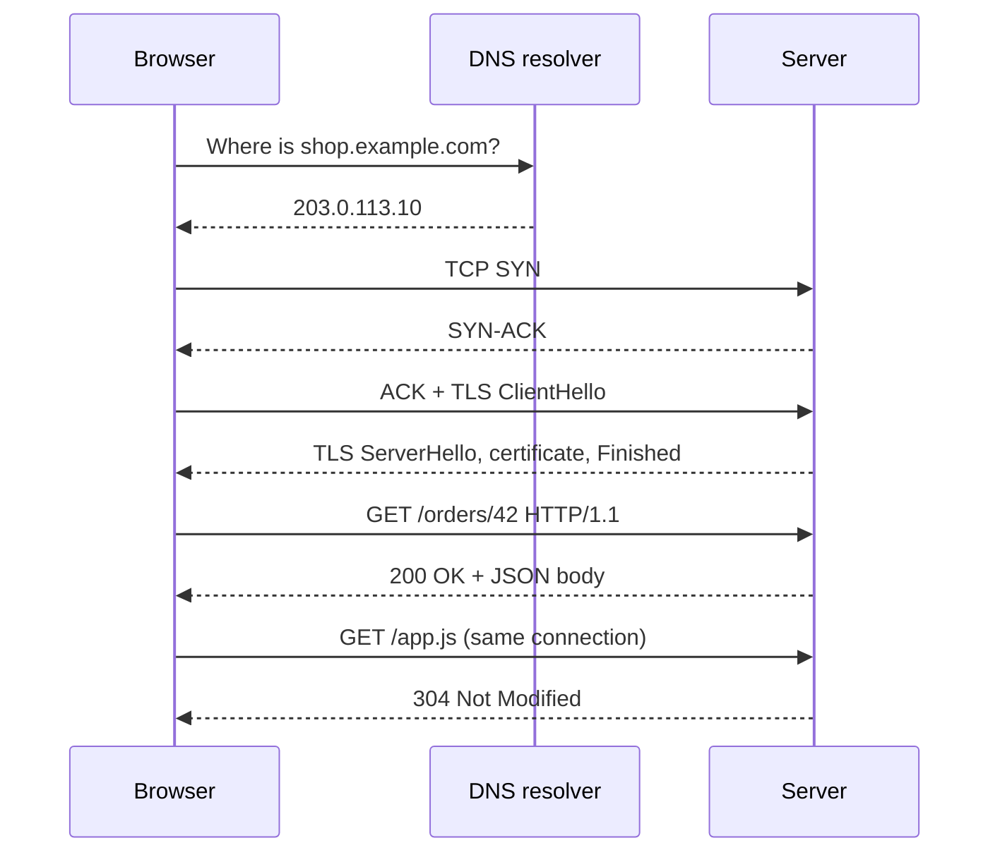

## In one minute
- HTTP is a simple text conversation: a client sends a request (a method, a path, some headers, maybe a body) and a server sends back a response (a status code, headers, maybe a body). Browsers, mobile apps, microservices and AI model APIs all speak it.
- Before the first byte of HTTP moves, the client needs a DNS lookup, a TCP connection and, for HTTPS, a TLS handshake. Each costs at least one network round trip, so distance often matters more than server speed.
- HTTP itself is stateless: each request carries everything the server needs. Logins, carts and sessions are built on top with cookies or tokens.
- Methods carry promises. GET is safe (it should not change anything) and PUT and DELETE are idempotent (repeating them has the same effect as doing them once). Those promises are what make retries and caching safe.
- A timeout tells you nothing about whether the server acted. That is the "partial failure" and "duplicates" problem shape, and it shows up in every system that sends requests over a network.

## How it works

### What happens when you open a URL
Take `https://shop.example.com/orders/42?view=full`. The browser splits it into a scheme (`https`), a host (`shop.example.com`), a path (`/orders/42`) and a query string (`view=full`). It asks DNS for the host's IP address, opens a TCP connection to port 443, runs a TLS handshake to agree on encryption keys and check the server's certificate, and only then sends the HTTP request. The server replies, and the browser parses the HTML, finds the CSS, JavaScript and images it references, and fetches those too, often dozens of extra requests.

### Anatomy of a request
An HTTP/1.1 request is lines of text separated by carriage return and line feed (`\r\n`):

```
GET /orders/42?view=full HTTP/1.1
Host: shop.example.com
Accept: application/json
Authorization: Bearer eyJhbGciOi...

```

The first line is the request line: method, target and version. Then come headers, one `Name: value` per line, then an empty line that marks the end of the headers. A request with a body (such as a POST) adds a `Content-Length` header so the server knows exactly how many bytes of body follow. Header names are case insensitive: `content-length` and `Content-Length` are the same header.

### Anatomy of a response
```
HTTP/1.1 200 OK
Content-Type: application/json
Content-Length: 27
Cache-Control: max-age=60

{"id":42,"status":"paid"}
```

The status line holds a three-digit code and a human-readable reason. The first digit is the class: 2xx success, 3xx redirect or "use your cached copy", 4xx the client did something wrong (400 bad request, 401 not logged in, 403 not allowed, 404 not found, 429 slow down), and 5xx the server failed (500 bug, 502 bad gateway, 503 overloaded or down, 504 an upstream timed out). Clients, proxies and monitoring all key off that first digit, so choosing the right class matters more than the exact code.

### Methods and their promises
| Method | Typical use | Safe | Idempotent |
| --- | --- | --- | --- |
| GET | Read a resource | Yes | Yes |
| HEAD | Read only the headers | Yes | Yes |
| POST | Create something, run an action | No | No |
| PUT | Replace a resource at a known URL | No | Yes |
| PATCH | Change part of a resource | No | Not guaranteed |
| DELETE | Remove a resource | No | Yes |

The standard lists GET, HEAD, OPTIONS and TRACE as safe, PUT and DELETE as idempotent, and POST and PATCH as neither ([RFC 9110](https://www.rfc-editor.org/rfc/rfc9110)). These are promises the server makes, not things HTTP enforces. If your GET endpoint sends an email, a browser prefetch or a crawler will send emails. Keep the promises and the rest of the web (caches, retries, proxies) can work for you.

### Stateless, then cookies
The server does not remember the previous request on its own. To keep you logged in, it sends a `Set-Cookie` header, and the browser returns that value in a `Cookie` header on every later request to the same site. APIs more often use an `Authorization` header with a token. Either way, the state lives in the request or in a store the server looks up, which is why any server behind a load balancer can answer any request.

### Caching
A response can say how long it may be reused: `Cache-Control: max-age=60` means "fresh for 60 seconds". Within that window, the browser or a CDN serves its copy without asking the origin ([RFC 9111](https://www.rfc-editor.org/rfc/rfc9111)). After it, the client can revalidate: it sends `If-None-Match` with the response's `ETag` and the server answers `304 Not Modified` with no body if nothing changed. This is the same small-fast-store-in-front-of-a-big-slow-one shape as a CPU cache, with the same questions: what to keep, for how long, and how to invalidate.

### HTTP/1.1, HTTP/2 and HTTP/3
HTTP/1.1 sends one request at a time per connection, so browsers open about six connections per host. HTTP/2 keeps one connection and interleaves many requests on it as binary frames. HTTP/3 does the same over QUIC, which runs on UDP so one lost packet stalls only its own stream, not every request on the connection ([RFC 9114](https://www.rfc-editor.org/rfc/rfc9114)). A server advertises it with an `Alt-Svc` header, and clients fall back to TCP when UDP is blocked. The meaning of methods, headers and status codes is the same in all three; only the framing changes.

## Down the stack

### Layer 1: The contract
A client sends a request and gets back at most one final response. HTTP promises the format and meaning of messages, not delivery. If the connection drops or the client times out, the client cannot know whether the server never saw the request, processed it and failed to reply, or is still working on it. Safe methods may be repeated freely; idempotent methods may be retried after a timeout, and a proxy must never retry a non-idempotent request on its own ([RFC 9110](https://www.rfc-editor.org/rfc/rfc9110)). A POST may only be retried safely if the server deduplicates, usually with an `Idempotency-Key` header the client generates once per logical operation, as Stripe's API does ([Stripe](https://stripe.com/blog/idempotency)). That header is still only an IETF Internet-Draft, now expired, not a standard ([draft-ietf-httpapi-idempotency-key-header](https://datatracker.ietf.org/doc/draft-ietf-httpapi-idempotency-key-header/)), so agree on its exact behaviour in your own API docs.

### Layer 2: The mechanism
In HTTP/1.1 (RFC 9112), the server reads bytes until it sees `\r\n\r\n`, parses the request line and headers, then finds the end of the body in one of two ways: `Content-Length: N` (read exactly N more bytes) or `Transfer-Encoding: chunked` (read hex-sized chunks until a zero-length chunk). If both headers are present, `Transfer-Encoding` wins, the message may be an attempted request smuggling, and a server that accepts it must close the connection afterwards ([RFC 9112](https://www.rfc-editor.org/rfc/rfc9112)). Getting this right matters: when a proxy and a server disagree about where a body ends, an attacker can smuggle a second request inside the first. Connections are persistent by default, so the next request follows on the same socket. HTTP/2 ([RFC 9113](https://www.rfc-editor.org/rfc/rfc9113), which also recommends allowing at least 100 concurrent streams) replaces text lines with binary frames (`HEADERS`, `DATA`, `SETTINGS`, `WINDOW_UPDATE`, `RST_STREAM`, `GOAWAY`), each tagged with a stream ID, and compresses headers with HPACK (RFC 7541), a table of previously sent headers so a repeated `Authorization` costs a few bytes instead of hundreds.

### Layer 3: The machine
On the wire, a request is TCP segments of up to about 1,460 bytes of payload on a typical Ethernet path. A new TCP connection costs one round trip (SYN, SYN-ACK, ACK). TLS 1.3 adds one more for a full handshake ([RFC 8446](https://www.rfc-editor.org/rfc/rfc8446)); resuming with 0-RTT early data can skip it but offers no replay protection across connections, so only send safe requests that way. A new connection can send only about 10 segments (roughly 14 KB) before waiting for acknowledgements, because the initial window is 10 segments ([RFC 6928](https://www.rfc-editor.org/rfc/rfc6928)), so a 100 KB response on a fresh connection takes several round trips even on a fast link. On the server, a process like nginx or a Go program calls `accept` to take a connection, then `epoll_wait` to learn which of thousands of sockets have data, and `read` to copy bytes from the kernel's socket buffer into user memory. Parsing a request takes microseconds. The round trips around it take tens to hundreds of milliseconds.

### Why it's built this way
1. Text messages were easy to write, read and debug with a terminal, which helped the web spread in the 1990s.
2. Statelessness lets any server answer any request, so a site scales by adding servers behind a load balancer.
3. Round trips, not bandwidth, dominate page load time, so later versions focus on reusing connections and sending many requests in parallel.
4. Binary framing in HTTP/2 made multiplexing possible, but its own spec admits TCP head-of-line blocking is not addressed ([RFC 9113](https://www.rfc-editor.org/rfc/rfc9113)): TCP still delivers bytes in order, so one lost packet stalls everything.
5. QUIC moves streams into the transport over UDP, so HTTP/3 removes that last head-of-line block and merges the transport and TLS handshakes.

## Diagram


## Worked example
A shop's servers are in Virginia and a customer opens the site from Jakarta, about 220 ms round trip away. The browser's DNS answer comes from a nearby resolver in 20 ms. Then TCP costs one round trip (220 ms), TLS 1.3 another (220 ms) and the request itself a third (220 ms) plus 30 ms of server work. The first byte of HTML arrives after about 690 ms, before any CSS, scripts or images. If the page then fetches 12 API calls one after another, each on the warm connection, that is another 12 × 250 ms = 3 seconds.

Three fixes, in order of payoff. First, put a CDN edge in Singapore, 15 ms away: TCP and TLS now finish with the edge in 30 ms, and cached assets come back in one more 15 ms round trip. Only uncached API calls still travel to Virginia, over connections the CDN keeps open. Second, issue the 12 API calls in parallel over HTTP/2, so they cost about one round trip instead of twelve. Third, add `Cache-Control: max-age=31536000` to versioned static files such as `app.3f9c.js`, so repeat visitors fetch nothing at all. The page goes from about 4 seconds to under 1 without making the server any faster.

## In the wild
- **Google, Cloudflare and AWS, 2023: HTTP/2 Rapid Reset.** Attackers opened a stream and cancelled it at once with `RST_STREAM`, in a loop. Cancelled streams stopped counting against the concurrent-stream limit while servers still did the work of starting each request. The largest attack Google saw peaked above 398 million requests per second, and the recommended defence was closing abusive connections with `GOAWAY` ([Google Cloud](https://cloud.google.com/blog/products/identity-security/how-it-works-the-novel-http2-rapid-reset-ddos-attack)).
- **Stripe, 2017: retries made safe with idempotency keys.** A timed-out payment request leaves the client unable to tell whether the charge happened. Stripe has clients send a unique `Idempotency-Key` with each POST, replays the saved result on a repeat, and has clients retry with exponential backoff and jitter ([Stripe](https://stripe.com/blog/idempotency)).

## Trade-offs
| Choice | Strengths | Weaknesses | Choose when |
| --- | --- | --- | --- |
| HTTP/1.1 | Simple, universal, readable on the wire | One request at a time per connection | Internal tools, simple clients, debugging |
| HTTP/2 | Many requests on one connection, header compression | A lost packet stalls all streams | Default for browsers and gRPC services |
| HTTP/3 (QUIC) | No transport head-of-line blocking, faster setup | UDP sometimes blocked, more CPU per byte | Mobile and lossy networks, global audiences |
| Long `max-age` caching | Zero requests for repeat visits | Stale content until expiry | Versioned static assets |
| Short `max-age` plus ETag | Fresh data, cheap 304 checks | Still one round trip per check | Pages and API responses that change |
| Cookies for sessions | Sent automatically by browsers | Need CSRF protection, size limits | Browser apps on one site |
| Bearer tokens | Work for any client, easy across services | Client must store and attach them | Public APIs, mobile apps, service to service |

## Pitfalls in production
- Retrying a POST after a timeout and charging a customer twice. Fix: send an `Idempotency-Key` and have the server store the result per key, returning it on a repeat.
- Returning 200 with `{"error": ...}` in the body. Fix: use the right status class so clients, load balancers and dashboards see failures.
- No client timeout, so a slow dependency ties up every worker thread. Fix: set connect and read timeouts on every HTTP client, shorter than your own caller's timeout.
- Caching responses that depend on the user, so one customer sees another's account page through a CDN. Fix: mark personal responses `Cache-Control: private`, which shared caches must not store, or `no-store`, and use `Vary` for headers that change the response ([RFC 9111](https://www.rfc-editor.org/rfc/rfc9111)). Note that `no-cache` does not mean "do not store"; it means revalidate before reuse.
- Opening a new connection for every outgoing request, paying TCP and TLS each time and running out of ephemeral ports. Fix: reuse one pooled client per process.

## Leadership lens
- Make timeouts, retries and idempotency part of every API review: "what happens if this call times out halfway?" is the question that prevents double charges.
- Agree on status code conventions and an error body format once, across teams, so clients and on-call engineers do not have to learn each service separately.
- Treat latency as a geography problem first: a CDN or a nearer region often beats months of code optimisation.
- Decide caching policy deliberately per endpoint and write it down; accidental caching of private data is a security incident, not a bug.

## Check yourself
1. Why is it safe for a client library to retry a PUT after a timeout but not a plain POST?
   **Answer:** PUT is idempotent, so applying it twice leaves the same state as once. A POST may create a second order or charge, unless the server deduplicates with an idempotency key.
2. A response has `Cache-Control: max-age=60` and an `ETag`. What happens on a request 30 seconds later, and 90 seconds later?
   **Answer:** At 30 seconds the cached copy is fresh and is used without contacting the server. At 90 seconds the client revalidates with `If-None-Match`, and gets either `304 Not Modified` with no body or a new 200 response.
3. How does an HTTP/1.1 server know where a request body ends?
   **Answer:** From `Content-Length`, which gives the exact byte count, or from `Transfer-Encoding: chunked`, where the body ends with a zero-length chunk.
4. Why can moving servers closer to users speed up a page more than making the server code faster?
   **Answer:** A fresh HTTPS request needs several round trips (TCP, TLS, request), each costing the full network distance, while server processing is often only tens of milliseconds.

## Practice
**Task:** Write the two ends of an HTTP/1.1 exchange. `parse_request(raw)` takes a request string with `\r\n` line endings and returns `method`, `path`, `query`, `version`, `headers` and `body`, or nothing (None, null or an error) if the request is malformed. The request line must have exactly three space-separated parts and the version must start with `HTTP/`; the target splits at the first `?` into path and query (query is `""` when absent); every header line needs a colon, names are lower-cased and names and values are trimmed; a repeated header joins its values with `", "`. Headers end at the first empty line; if it is missing, the request is malformed. Without `Content-Length` the body is `""`; with it, the value must be all digits and the body is exactly that many characters (extra bytes belong to the next request; too few means malformed). `build_response(status, content_type, body)` returns `HTTP/1.1 <code> <reason>`, then `Content-Type` and `Content-Length` headers, a blank line and the body (assume ASCII). Reasons: 200 OK, 201 Created, 204 No Content, 304 Not Modified, 400 Bad Request, 404 Not Found, 500 Internal Server Error, 503 Service Unavailable, otherwise Unknown. Statuses 204 and 304 never carry a body, so they return only the status line and a blank line.

```python starter
def parse_request(raw):
    # TODO
    raise NotImplementedError

def build_response(status, content_type, body):
    # TODO
    raise NotImplementedError
```

```python tests
def test_simple_get():
    r = parse_request("GET /orders/42?view=full HTTP/1.1\r\nHost: shop.example.com\r\n\r\n")
    assert r == {"method": "GET", "path": "/orders/42", "query": "view=full", "version": "HTTP/1.1",
                 "headers": {"host": "shop.example.com"}, "body": ""}

def test_post_with_body_and_pipelined_extra():
    raw = "POST /pay HTTP/1.1\r\nContent-Length: 5\r\nContent-Type: text/plain\r\n\r\nhelloGET / HTTP/1.1"
    r = parse_request(raw)
    assert r["body"] == "hello"
    assert r["query"] == ""
    assert r["headers"]["content-type"] == "text/plain"

def test_header_names_case_and_repeats():
    raw = "GET / HTTP/1.1\r\nACCEPT:  text/html \r\naccept: application/json\r\n\r\n"
    assert parse_request(raw)["headers"] == {"accept": "text/html, application/json"}

def test_malformed_requests():
    assert parse_request("GET /\r\n\r\n") is None
    assert parse_request("GET / FTP/1.0\r\n\r\n") is None
    assert parse_request("GET / HTTP/1.1\r\nBadHeader\r\n\r\n") is None
    assert parse_request("GET / HTTP/1.1\r\nHost: a\r\n") is None

def test_bad_or_short_content_length():
    assert parse_request("POST / HTTP/1.1\r\nContent-Length: -1\r\n\r\n") is None
    assert parse_request("POST / HTTP/1.1\r\nContent-Length: 10\r\n\r\nshort") is None

def test_build_response():
    assert build_response(200, "text/plain", "hi") == "HTTP/1.1 200 OK\r\nContent-Type: text/plain\r\nContent-Length: 2\r\n\r\nhi"
    assert build_response(404, "application/json", "{}") == "HTTP/1.1 404 Not Found\r\nContent-Type: application/json\r\nContent-Length: 2\r\n\r\n{}"

def test_no_body_statuses_and_unknown():
    assert build_response(304, "text/plain", "ignored") == "HTTP/1.1 304 Not Modified\r\n\r\n"
    assert build_response(204, "text/plain", "") == "HTTP/1.1 204 No Content\r\n\r\n"
    assert build_response(418, "text/plain", "") == "HTTP/1.1 418 Unknown\r\nContent-Type: text/plain\r\nContent-Length: 0\r\n\r\n"
```

```python solution
REASONS = {200: "OK", 201: "Created", 204: "No Content", 304: "Not Modified", 400: "Bad Request",
           404: "Not Found", 500: "Internal Server Error", 503: "Service Unavailable"}

def parse_request(raw):
    end = raw.find("\r\n\r\n")
    if end < 0:
        return None
    lines = raw[:end].split("\r\n")
    rest = raw[end + 4:]
    parts = lines[0].split(" ")
    if len(parts) != 3 or not parts[2].startswith("HTTP/"):
        return None
    method, target, version = parts
    path, query = target, ""
    q = target.find("?")
    if q >= 0:
        path, query = target[:q], target[q + 1:]
    headers = {}
    for line in lines[1:]:
        colon = line.find(":")
        if colon < 0:
            return None
        name = line[:colon].strip().lower()
        value = line[colon + 1:].strip()
        headers[name] = headers[name] + ", " + value if name in headers else value
    body = ""
    if "content-length" in headers:
        cl = headers["content-length"]
        if cl == "" or not all(ch in "0123456789" for ch in cl):
            return None
        n = int(cl)
        if len(rest) < n:
            return None
        body = rest[:n]
    return {"method": method, "path": path, "query": query, "version": version,
            "headers": headers, "body": body}

def build_response(status, content_type, body):
    line = "HTTP/1.1 %d %s\r\n" % (status, REASONS.get(status, "Unknown"))
    if status == 204 or status == 304:
        return line + "\r\n"
    return line + "Content-Type: %s\r\nContent-Length: %d\r\n\r\n%s" % (content_type, len(body), body)
```

```typescript starter
export interface HttpRequest {
  method: string;
  path: string;
  query: string;
  version: string;
  headers: Record<string, string>;
  body: string;
}

export function parseRequest(raw: string): HttpRequest | null {
  throw new Error("TODO");
}

export function buildResponse(status: number, contentType: string, body: string): string {
  throw new Error("TODO");
}
```

```typescript tests
test("simple get", () => {
  const r = parseRequest("GET /orders/42?view=full HTTP/1.1\r\nHost: shop.example.com\r\n\r\n");
  assertEqual(r, { method: "GET", path: "/orders/42", query: "view=full", version: "HTTP/1.1",
    headers: { host: "shop.example.com" }, body: "" });
});

test("post with body and pipelined extra", () => {
  const r = parseRequest("POST /pay HTTP/1.1\r\nContent-Length: 5\r\nContent-Type: text/plain\r\n\r\nhelloGET / HTTP/1.1");
  assert(r !== null, "should parse");
  assertEqual(r!.body, "hello");
  assertEqual(r!.query, "");
  assertEqual(r!.headers["content-type"], "text/plain");
});

test("header names case and repeats", () => {
  const r = parseRequest("GET / HTTP/1.1\r\nACCEPT:  text/html \r\naccept: application/json\r\n\r\n");
  assertEqual(r!.headers, { accept: "text/html, application/json" });
});

test("malformed requests", () => {
  assertEqual(parseRequest("GET /\r\n\r\n"), null);
  assertEqual(parseRequest("GET / FTP/1.0\r\n\r\n"), null);
  assertEqual(parseRequest("GET / HTTP/1.1\r\nBadHeader\r\n\r\n"), null);
  assertEqual(parseRequest("GET / HTTP/1.1\r\nHost: a\r\n"), null);
});

test("bad or short content length", () => {
  assertEqual(parseRequest("POST / HTTP/1.1\r\nContent-Length: -1\r\n\r\n"), null);
  assertEqual(parseRequest("POST / HTTP/1.1\r\nContent-Length: 10\r\n\r\nshort"), null);
});

test("build response", () => {
  assertEqual(buildResponse(200, "text/plain", "hi"), "HTTP/1.1 200 OK\r\nContent-Type: text/plain\r\nContent-Length: 2\r\n\r\nhi");
  assertEqual(buildResponse(404, "application/json", "{}"), "HTTP/1.1 404 Not Found\r\nContent-Type: application/json\r\nContent-Length: 2\r\n\r\n{}");
});

test("no body statuses and unknown", () => {
  assertEqual(buildResponse(304, "text/plain", "ignored"), "HTTP/1.1 304 Not Modified\r\n\r\n");
  assertEqual(buildResponse(204, "text/plain", ""), "HTTP/1.1 204 No Content\r\n\r\n");
  assertEqual(buildResponse(418, "text/plain", ""), "HTTP/1.1 418 Unknown\r\nContent-Type: text/plain\r\nContent-Length: 0\r\n\r\n");
});
```

```typescript solution
export interface HttpRequest {
  method: string;
  path: string;
  query: string;
  version: string;
  headers: Record<string, string>;
  body: string;
}

const REASONS: Record<number, string> = {
  200: "OK", 201: "Created", 204: "No Content", 304: "Not Modified", 400: "Bad Request",
  404: "Not Found", 500: "Internal Server Error", 503: "Service Unavailable",
};

export function parseRequest(raw: string): HttpRequest | null {
  const end = raw.indexOf("\r\n\r\n");
  if (end < 0) return null;
  const lines = raw.slice(0, end).split("\r\n");
  const rest = raw.slice(end + 4);
  const parts = lines[0].split(" ");
  if (parts.length !== 3 || !parts[2].startsWith("HTTP/")) return null;
  const [method, target, version] = parts;
  let path = target, query = "";
  const q = target.indexOf("?");
  if (q >= 0) { path = target.slice(0, q); query = target.slice(q + 1); }
  const headers: Record<string, string> = {};
  for (const line of lines.slice(1)) {
    const colon = line.indexOf(":");
    if (colon < 0) return null;
    const name = line.slice(0, colon).trim().toLowerCase();
    const value = line.slice(colon + 1).trim();
    headers[name] = name in headers ? headers[name] + ", " + value : value;
  }
  let body = "";
  if ("content-length" in headers) {
    const cl = headers["content-length"];
    if (!/^[0-9]+$/.test(cl)) return null;
    const n = parseInt(cl, 10);
    if (rest.length < n) return null;
    body = rest.slice(0, n);
  }
  return { method, path, query, version, headers, body };
}

export function buildResponse(status: number, contentType: string, body: string): string {
  const line = `HTTP/1.1 ${status} ${REASONS[status] ?? "Unknown"}\r\n`;
  if (status === 204 || status === 304) return line + "\r\n";
  return line + `Content-Type: ${contentType}\r\nContent-Length: ${body.length}\r\n\r\n${body}`;
}
```

```go starter
package practice

type Request struct {
	Method  string
	Path    string
	Query   string
	Version string
	Headers map[string]string
	Body    string
}

// ParseRequest returns an error if raw is malformed.
func ParseRequest(raw string) (*Request, error) {
	panic("TODO")
}

func BuildResponse(status int, contentType, body string) string {
	panic("TODO")
}
```

```go tests
package practice

import (
	"reflect"
	"testing"
)

func TestSimpleGet(t *testing.T) {
	r, err := ParseRequest("GET /orders/42?view=full HTTP/1.1\r\nHost: shop.example.com\r\n\r\n")
	if err != nil {
		t.Fatal(err)
	}
	want := &Request{Method: "GET", Path: "/orders/42", Query: "view=full", Version: "HTTP/1.1",
		Headers: map[string]string{"host": "shop.example.com"}, Body: ""}
	if !reflect.DeepEqual(r, want) {
		t.Fatalf("got %+v", r)
	}
}

func TestPostWithBody(t *testing.T) {
	r, err := ParseRequest("POST /pay HTTP/1.1\r\nContent-Length: 5\r\nContent-Type: text/plain\r\n\r\nhelloGET / HTTP/1.1")
	if err != nil {
		t.Fatal(err)
	}
	if r.Body != "hello" || r.Query != "" || r.Headers["content-type"] != "text/plain" {
		t.Fatalf("got %+v", r)
	}
}

func TestHeaderCaseAndRepeats(t *testing.T) {
	r, err := ParseRequest("GET / HTTP/1.1\r\nACCEPT:  text/html \r\naccept: application/json\r\n\r\n")
	if err != nil {
		t.Fatal(err)
	}
	if !reflect.DeepEqual(r.Headers, map[string]string{"accept": "text/html, application/json"}) {
		t.Fatalf("got %v", r.Headers)
	}
}

func TestMalformed(t *testing.T) {
	bad := []string{
		"GET /\r\n\r\n",
		"GET / FTP/1.0\r\n\r\n",
		"GET / HTTP/1.1\r\nBadHeader\r\n\r\n",
		"GET / HTTP/1.1\r\nHost: a\r\n",
		"POST / HTTP/1.1\r\nContent-Length: -1\r\n\r\n",
		"POST / HTTP/1.1\r\nContent-Length: 10\r\n\r\nshort",
	}
	for _, raw := range bad {
		if _, err := ParseRequest(raw); err == nil {
			t.Fatalf("expected error for %q", raw)
		}
	}
}

func TestBuildResponse(t *testing.T) {
	if got := BuildResponse(200, "text/plain", "hi"); got != "HTTP/1.1 200 OK\r\nContent-Type: text/plain\r\nContent-Length: 2\r\n\r\nhi" {
		t.Fatalf("got %q", got)
	}
	if got := BuildResponse(404, "application/json", "{}"); got != "HTTP/1.1 404 Not Found\r\nContent-Type: application/json\r\nContent-Length: 2\r\n\r\n{}" {
		t.Fatalf("got %q", got)
	}
}

func TestNoBodyAndUnknown(t *testing.T) {
	if got := BuildResponse(304, "text/plain", "ignored"); got != "HTTP/1.1 304 Not Modified\r\n\r\n" {
		t.Fatalf("got %q", got)
	}
	if got := BuildResponse(204, "text/plain", ""); got != "HTTP/1.1 204 No Content\r\n\r\n" {
		t.Fatalf("got %q", got)
	}
	if got := BuildResponse(418, "text/plain", ""); got != "HTTP/1.1 418 Unknown\r\nContent-Type: text/plain\r\nContent-Length: 0\r\n\r\n" {
		t.Fatalf("got %q", got)
	}
}
```

```go solution
package practice

import (
	"errors"
	"fmt"
	"strconv"
	"strings"
)

type Request struct {
	Method  string
	Path    string
	Query   string
	Version string
	Headers map[string]string
	Body    string
}

var reasons = map[int]string{200: "OK", 201: "Created", 204: "No Content", 304: "Not Modified",
	400: "Bad Request", 404: "Not Found", 500: "Internal Server Error", 503: "Service Unavailable"}

var errMalformed = errors.New("malformed request")

func ParseRequest(raw string) (*Request, error) {
	end := strings.Index(raw, "\r\n\r\n")
	if end < 0 {
		return nil, errMalformed
	}
	lines := strings.Split(raw[:end], "\r\n")
	rest := raw[end+4:]
	parts := strings.Split(lines[0], " ")
	if len(parts) != 3 || !strings.HasPrefix(parts[2], "HTTP/") {
		return nil, errMalformed
	}
	r := &Request{Method: parts[0], Path: parts[1], Version: parts[2], Headers: map[string]string{}}
	if q := strings.Index(parts[1], "?"); q >= 0 {
		r.Path, r.Query = parts[1][:q], parts[1][q+1:]
	}
	for _, line := range lines[1:] {
		colon := strings.Index(line, ":")
		if colon < 0 {
			return nil, errMalformed
		}
		name := strings.ToLower(strings.TrimSpace(line[:colon]))
		value := strings.TrimSpace(line[colon+1:])
		if prev, ok := r.Headers[name]; ok {
			value = prev + ", " + value
		}
		r.Headers[name] = value
	}
	if cl, ok := r.Headers["content-length"]; ok {
		if cl == "" || strings.Trim(cl, "0123456789") != "" {
			return nil, errMalformed
		}
		n, err := strconv.Atoi(cl)
		if err != nil || len(rest) < n {
			return nil, errMalformed
		}
		r.Body = rest[:n]
	}
	return r, nil
}

func BuildResponse(status int, contentType, body string) string {
	reason, ok := reasons[status]
	if !ok {
		reason = "Unknown"
	}
	line := fmt.Sprintf("HTTP/1.1 %d %s\r\n", status, reason)
	if status == 204 || status == 304 {
		return line + "\r\n"
	}
	return line + fmt.Sprintf("Content-Type: %s\r\nContent-Length: %d\r\n\r\n%s", contentType, len(body), body)
}
```

## Mock interview
**Prompt:** Users in Southeast Asia report that your web app takes 5 seconds to load, while your servers in the US report a median response time of 40 ms. Walk me through where the time is going and what you would change.

- Follow-up: How would you measure the breakdown of DNS, connection, TLS and server time for real users?
- Follow-up: The checkout call sometimes times out and the client retries. Some customers were charged twice. What happened and how do you fix it?
- Follow-up: Would you switch to HTTP/3? What would you gain and what could go wrong?

**A strong answer covers:**
- Separating server time from network time: 40 ms on the server says nothing about several 200 ms round trips for DNS, TCP, TLS and each request.
- Using browser timing data (the Navigation and Resource Timing APIs) or real-user monitoring to see each phase, rather than guessing.
- Cutting round trips: a CDN edge near users, connection reuse, parallel requests over HTTP/2, and long cache lifetimes for versioned assets.
- Explaining that a timeout leaves the outcome unknown, and fixing the double charge with an idempotency key stored by the server, not by removing retries.
- Weighing HTTP/3: faster setup and better behaviour on lossy mobile networks, against UDP being blocked on some networks (so keep HTTP/2 fallback) and less mature tooling.

## Sources and further study
**Primary**
- [RFC 9110: HTTP Semantics](https://www.rfc-editor.org/rfc/rfc9110): safe and idempotent methods, retry rules and status codes.
- [RFC 9111: HTTP Caching](https://www.rfc-editor.org/rfc/rfc9111): freshness, `Vary`, `private`, `no-store` and revalidation with 304.
- [RFC 9112: HTTP/1.1](https://www.rfc-editor.org/rfc/rfc9112): message framing and why conflicting length headers are dangerous.
- [RFC 9113: HTTP/2](https://www.rfc-editor.org/rfc/rfc9113): frames, streams and the TCP head-of-line caveat.
- [RFC 9114: HTTP/3](https://www.rfc-editor.org/rfc/rfc9114): streams over QUIC and `Alt-Svc` discovery.
- [RFC 8446: TLS 1.3](https://www.rfc-editor.org/rfc/rfc8446): the one-round-trip handshake and 0-RTT replay warning.

**Systems docs**
- [Stripe: Designing robust and predictable APIs with idempotency](https://stripe.com/blog/idempotency): how a production API makes POST retries safe.

**Books**
- *High Performance Browser Networking*, Ilya Grigorik, chapters 11 to 13 (HTTP/1.x, HTTP/2, optimizing delivery).
- *Computer Networking: A Top-Down Approach*, Kurose and Ross, chapter 2 (the Web and HTTP).

**Other curricula**
- [donnemartin/system-design-primer](https://github.com/donnemartin/system-design-primer): covers HTTP as a request/response protocol over TCP and treats CDNs and caching as separate scaling steps.

## Watch
- [What happens when you type a URL into your browser? (ByteByteGo)](https://www.youtube.com/watch?v=AlkDbnbv7dk): DNS, TCP, TLS and the request in one short animated walk-through.
- [HTTP/1 to HTTP/2 to HTTP/3 (ByteByteGo)](https://www.youtube.com/watch?v=a-sBfyiXysI): why each version was created and what it changed.
- [HTTP Crash Course & Exploration (Traversy Media)](https://www.youtube.com/watch?v=iYM2zFP3Zn0): methods, headers and status codes, explored in browser developer tools.

## Free resources
- [An overview of HTTP (MDN)](https://developer.mozilla.org/en-US/docs/Web/HTTP/Guides/Overview): the clearest beginner introduction to clients, servers, messages and proxies.
- [HTTP caching (MDN)](https://developer.mozilla.org/en-US/docs/Web/HTTP/Guides/Caching): `Cache-Control`, freshness, ETags and revalidation explained with examples.
- [HTTP response status codes (MDN)](https://developer.mozilla.org/en-US/docs/Web/HTTP/Reference/Status): a reference for every status code and when to use it.
- [RFC 9110: HTTP Semantics](https://www.rfc-editor.org/rfc/rfc9110): the standard that defines methods, safety, idempotency and status codes.
- [RFC 9112: HTTP/1.1](https://www.rfc-editor.org/rfc/rfc9112): the exact message format, including how body length is determined.
- [High Performance Browser Networking (Ilya Grigorik)](https://hpbn.co/): a free book on TCP, TLS, HTTP/2 and why latency dominates the web.
