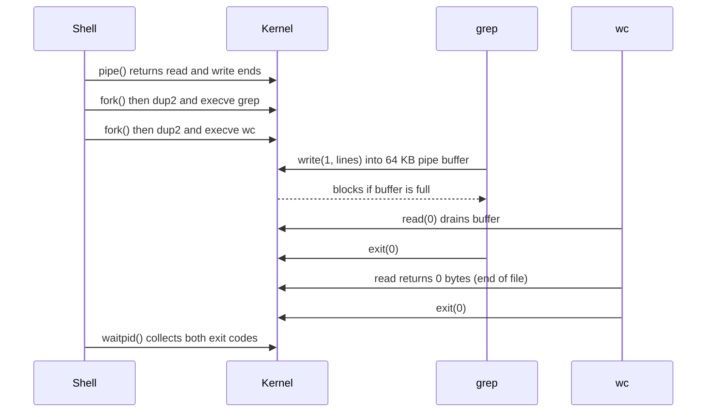

## In one minute
- Almost every backend runs on Linux, and when something breaks in production, the shell is often the only tool you have. A dozen commands answer most debugging questions: what is running, what is it doing, what did it log, and what is it waiting for.
- Every command is a process with arguments, environment variables, three standard streams (input, output, errors) and an exit code. Pipes connect one process's output to the next one's input, so small tools combine into a query language for logs and system state.
- Linux exposes its own state as files. `/proc` shows every process, its open files, memory and limits ([proc(5)](https://man7.org/linux/man-pages/man5/proc.5.html)); `/sys` shows devices. Tools like `ps`, `top` and `lsof` are mostly readers of those files.
- Debug from the outside in: is the process alive, is the machine short of CPU, memory, disk or network, what do the logs say, and only then what system calls is it making.
- A pipe is a bounded queue between a fast producer and a slower consumer. The writer blocks when it is full: the same backpressure shape you will meet in message brokers, HTTP servers and AI agent pipelines.

## How it works

### Processes, files and the shell
A running program is a process with a numeric process ID (PID), an owner, a current directory, environment variables and a list of open files. The shell (usually `bash` or `zsh`) is itself a program: it reads your command line, starts processes and waits for them; in a pipeline it waits for every command before it returns a status ([bash(1)](https://man7.org/linux/man-pages/man1/bash.1.html)). Linux follows the idea that "everything is a file": regular files, directories, sockets, pipes and devices are all accessed through file descriptors, small integers that index the process's table of open files.

### Streams, redirection and exit codes
Each process starts with three file descriptors: 0 is standard input, 1 is standard output, 2 is standard error. By default all three point at your terminal. Redirection changes that: `cmd > out.txt` sends output to a file, `2>&1` sends errors to the same place as output, and `< in.txt` reads input from a file. When a process finishes, it returns an exit code: 0 means success, anything else means failure. `echo $?` shows the last one. Scripts and CI pipelines depend on this, so a tool that prints an error but exits 0 is a bug.

### Pipes
`cmd1 | cmd2` connects the output of `cmd1` to the input of `cmd2`. Both run at the same time. This lets you build answers from small tools, for example the five most common error paths in a log:

```
grep ' 500 ' access.log | awk '{print $3}' | sort | uniq -c | sort -rn | head -5
```

`grep` keeps matching lines, `awk` picks the third field, `sort` groups identical paths together, `uniq -c` counts each group, `sort -rn` orders by count, and `head` keeps the top five.

### The debugging toolkit
| Question | Commands |
| --- | --- |
| Is it running? | `ps aux`, `pgrep -a name`, `systemctl status name` |
| What did it log? | `tail -f file`, `less file`, `journalctl -u name --since "10 min ago"`, `grep` |
| Is the machine busy? | `top` or `htop`, `uptime`, `vmstat 1` (load average counts waiting tasks too, see below) |
| Is memory short? | `free -m`, `dmesg` (look for the OOM killer) |
| Is the disk full? | `df -h`, `du -sh dir/*` |
| What is listening or connected? | `ss -tlnp`, `ss -tan` |
| What files and sockets does it hold? | `lsof -p PID`, `ls -l /proc/PID/fd` |
| Can I reach the service? | `curl -v URL`, `dig name`, `nc -zv host port` |
| What is it doing right now? | `strace -p PID`, `perf top` |

### Signals and permissions
Signals are small notifications the kernel delivers to a process. `kill PID` sends SIGTERM, which asks the process to shut down cleanly; a well-written server finishes in-flight requests and exits. `kill -9 PID` sends SIGKILL, which cannot be caught: the process dies immediately, possibly mid-write. Every file has an owner, a group and read, write and execute permissions for each, shown by `ls -l`. "Permission denied" usually means the process runs as a different user than you expect.

### A debugging routine
Start broad and narrow down. First, is the process up and what do its last log lines say? Second, check resources with the USE method: for every resource (CPU, memory, disk, network), look at utilisation, saturation (extra work queued that it cannot service) and errors ([Gregg, USE Method](https://www.brendangregg.com/usemethod.html)). One trap is the load average: on Linux it counts tasks that are runnable and tasks in uninterruptible sleep (state `D` in `ps`, usually blocked on disk or network storage), so a load of 40 with 5% CPU points at I/O, not computation ([Gregg, Linux Load Averages](https://www.brendangregg.com/blog/2017-08-08/linux-load-averages.html)). Third, reproduce the symptom with `curl` from the same machine. Only then reach for heavy tools like `strace`. This order finds the full disk or the crashed process in two minutes, before you spend an hour reading code.

## Down the stack

### Layer 1: The contract
A command is a program that receives a list of string arguments, an environment, and three open streams, and returns an 8-bit exit status. In a pipeline, all commands run concurrently, and the shell's exit status is the last command's unless `set -o pipefail` is on, in which case it is the last (rightmost) command that failed ([bash(1)](https://man7.org/linux/man-pages/man1/bash.1.html)). Writes smaller than `PIPE_BUF` (4096 bytes on Linux) are atomic, so two writers cannot interleave inside one small write ([pipe(7)](https://man7.org/linux/man-pages/man7/pipe.7.html)). If a process is killed by signal N, the shell reports exit code 128 + N: 137 means SIGKILL (often the out-of-memory killer), 143 means SIGTERM. Container runtimes reserve a few codes of their own; Docker uses 125 when the daemon fails and 126 or 127 when the command cannot be run or found ([Docker docs](https://docs.docker.com/engine/containers/run/)).

### Layer 2: The mechanism
To run `grep x f | wc -l`, the shell calls `pipe()` to get a read end and a write end, then `fork()` twice to create two child processes. In the first child it uses `dup2()` to make the pipe's write end become file descriptor 1, then calls `execve()` to replace itself with `grep`. The second child makes the read end its descriptor 0 and becomes `wc`. The shell closes its copies and calls `waitpid()` for both. Neither program knows it is in a pipeline; each just reads descriptor 0 and writes descriptor 1. `/proc` is a virtual file system: reading `/proc/1234/status` asks the kernel to generate text about process 1234 on the spot, so `ps` is just a program that reads `/proc` ([proc(5)](https://man7.org/linux/man-pages/man5/proc.5.html)).

### Layer 3: The machine
Each `read` or `write` is a system call, a switch from user mode into the kernel that costs on the order of 100 ns to a few µs. A Linux pipe is a kernel buffer, 64 KB (16 pages) by default since Linux 2.6.11, though newer kernels hand out less when a user already holds many pipes; a program can resize it with `F_SETPIPE_SZ`, up to 1 MiB for unprivileged users by default ([pipe(7)](https://man7.org/linux/man-pages/man7/pipe.7.html)). When it is full, the writer sleeps until the reader drains it; when it is empty, the reader sleeps. If the reader exits early, as `head` does, the next write gets SIGPIPE and the writer stops ([pipe(7)](https://man7.org/linux/man-pages/man7/pipe.7.html)), which is why `huge-command | head` returns quickly. `grep` over a file reads blocks from the page cache, so a second search of the same log is far faster than the first. `strace` uses the `ptrace` interface to stop the target at every system call, which can slow a syscall-heavy process by more than 100 times in the worst case (Brendan Gregg measured a `dd` run going from 0.10 s to 46 s) ([Gregg, strace](https://www.brendangregg.com/blog/2014-05-11/strace-wow-much-syscall.html)). Use it briefly in production, or prefer `perf trace`, which buffers events and costs far less.

### Why it's built this way
1. Early Unix machines were small, so programs were small and did one job.
2. Small programs are only useful if they compose, so they all speak plain text over standard streams.
3. Composition needs concurrency without huge buffers, so pipes are small bounded buffers that block the faster side.
4. Treating devices, sockets and process state as files means one set of tools (`cat`, `grep`, `ls`) inspects all of them.
5. The result has lasted 50 years: the same commands work on a laptop, a container and a 500-node fleet.

## Diagram


## Worked example
At 14:05, alerts show an order API returning HTTP 502 from its load balancer for about 30% of requests. You SSH into one of its three hosts.

`systemctl status orders` says the service is active, but it restarted at 14:02. `journalctl -u orders --since 13:55` shows normal request logs, then "write /var/log/orders/app.log: no space left on device", then a crash and restart. `df -h` confirms: `/var` is at 100% of 50 GB.

`du -sh /var/log/*` shows `/var/log/orders` using only 3 GB. Where did 47 GB go? `lsof +L1` selects open files that have been unlinked ([lsof(8)](https://man7.org/linux/man-pages/man8/lsof.8.html)), meaning deleted but still held open, and there it is: a 44 GB `debug.log` that someone deleted an hour ago while an old log shipper process still had it open. A deleted file's space is only freed when the last file descriptor to it closes. Restarting the log shipper frees 44 GB in a second.

Now the counts. `grep ' 502 ' /var/log/nginx/access.log | wc -l` gives 18,240 lines in the last half hour, and the pipeline from earlier shows 17,900 of them on `POST /orders`, the one endpoint that writes a log line per request. The other two hosts had more free space and were fine, which explains 30% rather than 100%.

The lasting fixes come from the debugging: disk-usage alerts at 80%, log rotation with size limits, and a runbook entry for `lsof +L1`. Total time to diagnosis was about 10 minutes, using six commands and no code changes.

## In the wild
- **GitLab, 2017: wrong-host deletion.** While rebuilding a lagging replica late on 31 January, an engineer wiped the data directory on the primary instead, removing about 300 GB before the command was stopped. The usual backup routes turned out to be broken or missing (a silently failing `pg_dump`, no recent Azure disk snapshot of the database), so GitLab.com restored from a six-hour-old snapshot after about 18 hours, losing about six hours of changes (roughly 5,000 projects, 5,000 comments and 700 new user accounts affected). Changes included hourly snapshots, restore testing and a named owner for data durability ([GitLab postmortem](https://about.gitlab.com/blog/2017/02/10/postmortem-of-database-outage-of-january-31/)).
- **LinkedIn, 2016: file-descriptor limits.** Load tests of server-sent-event messaging hit a default accept backlog of 128 and then a per-process file-descriptor limit (at roughly 20,000 open descriptors per node) long before CPU ran out. Raising those limits and the JVM heap let each node hold about 100,000 persistent connections ([LinkedIn Engineering](https://www.linkedin.com/blog/engineering/archive/instant-messaging-at-linkedin-scaling-to-hundreds-of-thousands-)).
- **Honeycomb, 2025: disks filling on Kafka brokers.** After a cluster lost redundancy, unbalanced brokers filled their disks and ingest was switched off with under 5% free. Turning off tiered storage freed space but made metadata damage permanent, and customers saw about six hours of full ingest outage ([Honeycomb incident](https://status.honeycomb.io/incidents/pjzh0mtqw3vt)).

## Trade-offs
| Approach | Strengths | Weaknesses | Choose when |
| --- | --- | --- | --- |
| Shell on the host | Fast, always there, sees everything | Manual, one machine at a time, risky with write access | Live incidents, one host misbehaving |
| Central logs and metrics | Fleet-wide, searchable, history | Delay, sampling, may miss the crash moment | Patterns across many hosts, trends |
| `strace` and `perf` | See exact system calls and hot functions | Overhead, needs privileges, noisy output | A process is stuck or slow and logs say nothing |
| Shell pipelines over logs | Quick ad hoc queries, no setup | Hard to repeat, fragile parsing | One-off questions during an investigation |
| Scripts in the repo | Repeatable, reviewed, testable | Slower to write | Questions you ask every week |

## Pitfalls in production
- Deleting a large log file to free space while a process still holds it open, so nothing is freed. Fix: truncate with `: > file` or restart the holder, and find such files with `lsof +L1`.
- Running `kill -9` first, which skips cleanup and can corrupt state or lose in-flight work. Fix: send SIGTERM, wait, and only then SIGKILL.
- Pipelines that hide failures because the exit code is the last command's. Fix: use `set -euo pipefail` in scripts.
- Hitting "too many open files" because the process leaks sockets or the limit is low. Fix: check `ls /proc/PID/fd | wc -l` against `cat /proc/PID/limits` and fix the leak before raising the limit.
- Leaving `strace` or debug logging running on a busy production process. Fix: attach for seconds, capture to a file, detach.
- Typing destructive commands on the wrong host. Fix: show the hostname and environment in the prompt and prefer read-only commands during an incident.

## Leadership lens
- Make sure every engineer on call can answer "is it up, is it out of resources, what did it log" from a shell; pair new engineers on this before their first on-call shift.
- Turn repeated incident commands into runbooks and scripts in the repository, so the knowledge is reviewed and not trapped in one person's shell history.
- Limit who has write access to production hosts and log what they run; debugging should mostly be read-only.
- Treat a disk, memory or file-descriptor alert as cheap insurance; most "mystery outages" in this lesson are resource exhaustion.

## Check yourself
1. A container stops and its runtime reports exit code 137. What most likely happened?
   **Answer:** 137 is 128 + 9, so the process was killed with SIGKILL, very often by the kernel's out-of-memory killer, which picks a task to sacrifice when reclaim cannot free memory ([kernel docs](https://www.kernel.org/doc/html/latest/admin-guide/mm/concepts.html)); check `dmesg` or the container runtime's events for an OOM message.
2. Why does `cat huge.log | head -1` finish immediately instead of reading the whole file?
   **Answer:** `head` exits after one line and closes the pipe, so `cat`'s next write receives SIGPIPE and `cat` stops.
3. You deleted a 20 GB file but `df` still shows the disk full. Why?
   **Answer:** A process still has the file open; its blocks are only released when the last file descriptor to it closes, so find it with `lsof +L1` and restart or signal that process.
4. Why does a pipe have a small fixed buffer instead of growing as needed?
   **Answer:** Blocking the writer when the buffer is full applies backpressure, so a fast producer cannot run a slow consumer out of memory; the two processes run at the speed of the slower one.

## Practice
**Task:** Rebuild the classic log pipeline `grep | awk | sort | uniq -c | sort -rn | head` as code. Each access-log line has five space-separated fields, such as `2026-10-15T14:03:01Z POST /orders 502 31ms`: timestamp, method, path, status code, and latency in milliseconds with an `ms` suffix. `parse_line(line)` returns the method, path, status (an integer) and latency (an integer), or nothing for a malformed line (wrong field count, non-numeric status, or a latency without the `ms` suffix or with non-digits before it). `top_paths(lines, status_prefix, k)` skips malformed lines, keeps lines whose status code as text starts with `status_prefix` (an empty prefix keeps all), counts lines per path, and returns the top `k` as `[path, count]` pairs, ordered by count descending and then path ascending.

```python starter
def parse_line(line):
    # Return (method, path, status, ms) or None.
    raise NotImplementedError

def top_paths(lines, status_prefix, k):
    # TODO
    raise NotImplementedError
```

```python tests
LOG = [
    "2026-10-15T14:03:01Z POST /orders 502 31ms",
    "2026-10-15T14:03:02Z GET /health 200 1ms",
    "2026-10-15T14:03:02Z POST /orders 502 29ms",
    "2026-10-15T14:03:03Z GET /users 500 12ms",
    "garbage line",
    "2026-10-15T14:03:04Z GET /users 503 40ms",
    "2026-10-15T14:03:05Z GET /cart 500 8ms",
]

def test_parse_valid():
    assert parse_line("2026-10-15T14:03:01Z POST /orders 502 31ms") == ("POST", "/orders", 502, 31)

def test_parse_malformed():
    assert parse_line("garbage line") is None
    assert parse_line("t GET /x abc 5ms") is None
    assert parse_line("t GET /x 200 5") is None
    assert parse_line("t GET /x 200 fastms") is None

def test_top_server_errors():
    assert top_paths(LOG, "5", 2) == [["/orders", 2], ["/users", 2]]

def test_ties_sorted_by_path():
    assert top_paths(LOG, "5", 10) == [["/orders", 2], ["/users", 2], ["/cart", 1]]

def test_empty_prefix_keeps_all():
    assert top_paths(LOG, "", 1) == [["/orders", 2]]
    assert top_paths(LOG, "", 10)[-1] == ["/health", 1]

def test_no_matches():
    assert top_paths(LOG, "4", 3) == []
    assert top_paths([], "5", 3) == []
```

```python solution
def parse_line(line):
    parts = line.split()
    if len(parts) != 5:
        return None
    _, method, path, status, latency = parts
    if not status.isdigit():
        return None
    if not latency.endswith("ms") or not latency[:-2].isdigit():
        return None
    return (method, path, int(status), int(latency[:-2]))

def top_paths(lines, status_prefix, k):
    counts = {}
    for line in lines:
        entry = parse_line(line)
        if entry is None:
            continue
        if not str(entry[2]).startswith(status_prefix):
            continue
        counts[entry[1]] = counts.get(entry[1], 0) + 1
    ranked = sorted(counts.items(), key=lambda kv: (-kv[1], kv[0]))
    return [[p, c] for p, c in ranked[:k]]
```

```typescript starter
export interface Entry {
  method: string;
  path: string;
  status: number;
  ms: number;
}

export function parseLine(line: string): Entry | null {
  throw new Error("TODO");
}

export function topPaths(lines: string[], statusPrefix: string, k: number): [string, number][] {
  throw new Error("TODO");
}
```

```typescript tests
const LOG = [
  "2026-10-15T14:03:01Z POST /orders 502 31ms",
  "2026-10-15T14:03:02Z GET /health 200 1ms",
  "2026-10-15T14:03:02Z POST /orders 502 29ms",
  "2026-10-15T14:03:03Z GET /users 500 12ms",
  "garbage line",
  "2026-10-15T14:03:04Z GET /users 503 40ms",
  "2026-10-15T14:03:05Z GET /cart 500 8ms",
];

test("parse valid", () => {
  assertEqual(parseLine("2026-10-15T14:03:01Z POST /orders 502 31ms"), { method: "POST", path: "/orders", status: 502, ms: 31 });
});

test("parse malformed", () => {
  assert(parseLine("garbage line") === null, "too few fields");
  assert(parseLine("t GET /x abc 5ms") === null, "bad status");
  assert(parseLine("t GET /x 200 5") === null, "no ms suffix");
  assert(parseLine("t GET /x 200 fastms") === null, "non-numeric latency");
});

test("top server errors", () => {
  assertEqual(topPaths(LOG, "5", 2), [["/orders", 2], ["/users", 2]]);
});

test("ties sorted by path", () => {
  assertEqual(topPaths(LOG, "5", 10), [["/orders", 2], ["/users", 2], ["/cart", 1]]);
});

test("empty prefix keeps all", () => {
  assertEqual(topPaths(LOG, "", 1), [["/orders", 2]]);
  const all = topPaths(LOG, "", 10);
  assertEqual(all[all.length - 1], ["/health", 1]);
});

test("no matches", () => {
  assertEqual(topPaths(LOG, "4", 3), []);
  assertEqual(topPaths([], "5", 3), []);
});
```

```typescript solution
export interface Entry {
  method: string;
  path: string;
  status: number;
  ms: number;
}

const DIGITS = /^[0-9]+$/;

export function parseLine(line: string): Entry | null {
  const parts = line.split(/\s+/).filter((p) => p.length > 0);
  if (parts.length !== 5) return null;
  const [, method, path, status, latency] = parts;
  if (!DIGITS.test(status)) return null;
  if (!latency.endsWith("ms") || !DIGITS.test(latency.slice(0, -2))) return null;
  return { method, path, status: parseInt(status, 10), ms: parseInt(latency.slice(0, -2), 10) };
}

export function topPaths(lines: string[], statusPrefix: string, k: number): [string, number][] {
  const counts = new Map<string, number>();
  for (const line of lines) {
    const e = parseLine(line);
    if (e === null) continue;
    if (!String(e.status).startsWith(statusPrefix)) continue;
    counts.set(e.path, (counts.get(e.path) ?? 0) + 1);
  }
  const ranked = Array.from(counts.entries()).sort((a, b) =>
    b[1] !== a[1] ? b[1] - a[1] : a[0] < b[0] ? -1 : a[0] > b[0] ? 1 : 0
  );
  return ranked.slice(0, k);
}
```

```go starter
package practice

type Entry struct {
	Method string
	Path   string
	Status int
	Ms     int
}

type PathCount struct {
	Path  string
	Count int
}

func ParseLine(line string) (Entry, bool) {
	panic("TODO")
}

func TopPaths(lines []string, statusPrefix string, k int) []PathCount {
	panic("TODO")
}
```

```go tests
package practice

import (
	"reflect"
	"testing"
)

var log = []string{
	"2026-10-15T14:03:01Z POST /orders 502 31ms",
	"2026-10-15T14:03:02Z GET /health 200 1ms",
	"2026-10-15T14:03:02Z POST /orders 502 29ms",
	"2026-10-15T14:03:03Z GET /users 500 12ms",
	"garbage line",
	"2026-10-15T14:03:04Z GET /users 503 40ms",
	"2026-10-15T14:03:05Z GET /cart 500 8ms",
}

func TestParseValid(t *testing.T) {
	e, ok := ParseLine("2026-10-15T14:03:01Z POST /orders 502 31ms")
	if !ok || e != (Entry{"POST", "/orders", 502, 31}) {
		t.Fatalf("got %v %v", e, ok)
	}
}

func TestParseMalformed(t *testing.T) {
	for _, line := range []string{"garbage line", "t GET /x abc 5ms", "t GET /x 200 5", "t GET /x 200 fastms"} {
		if _, ok := ParseLine(line); ok {
			t.Fatalf("accepted %q", line)
		}
	}
}

func TestTopServerErrors(t *testing.T) {
	want := []PathCount{{"/orders", 2}, {"/users", 2}}
	if got := TopPaths(log, "5", 2); !reflect.DeepEqual(got, want) {
		t.Fatalf("got %v", got)
	}
}

func TestTiesSortedByPath(t *testing.T) {
	want := []PathCount{{"/orders", 2}, {"/users", 2}, {"/cart", 1}}
	if got := TopPaths(log, "5", 10); !reflect.DeepEqual(got, want) {
		t.Fatalf("got %v", got)
	}
}

func TestEmptyPrefixKeepsAll(t *testing.T) {
	if got := TopPaths(log, "", 1); !reflect.DeepEqual(got, []PathCount{{"/orders", 2}}) {
		t.Fatalf("got %v", got)
	}
	all := TopPaths(log, "", 10)
	if all[len(all)-1] != (PathCount{"/health", 1}) {
		t.Fatalf("got %v", all)
	}
}

func TestNoMatches(t *testing.T) {
	if got := TopPaths(log, "4", 3); len(got) != 0 {
		t.Fatalf("got %v", got)
	}
	if got := TopPaths(nil, "5", 3); len(got) != 0 {
		t.Fatalf("got %v", got)
	}
}
```

```go solution
package practice

import (
	"sort"
	"strconv"
	"strings"
)

type Entry struct {
	Method string
	Path   string
	Status int
	Ms     int
}

type PathCount struct {
	Path  string
	Count int
}

func allDigits(s string) bool {
	if s == "" {
		return false
	}
	for _, r := range s {
		if r < '0' || r > '9' {
			return false
		}
	}
	return true
}

func ParseLine(line string) (Entry, bool) {
	parts := strings.Fields(line)
	if len(parts) != 5 || !allDigits(parts[3]) {
		return Entry{}, false
	}
	lat := parts[4]
	if !strings.HasSuffix(lat, "ms") || !allDigits(strings.TrimSuffix(lat, "ms")) {
		return Entry{}, false
	}
	status, _ := strconv.Atoi(parts[3])
	ms, _ := strconv.Atoi(strings.TrimSuffix(lat, "ms"))
	return Entry{Method: parts[1], Path: parts[2], Status: status, Ms: ms}, true
}

func TopPaths(lines []string, statusPrefix string, k int) []PathCount {
	counts := map[string]int{}
	for _, line := range lines {
		e, ok := ParseLine(line)
		if !ok || !strings.HasPrefix(strconv.Itoa(e.Status), statusPrefix) {
			continue
		}
		counts[e.Path]++
	}
	out := []PathCount{}
	for p, c := range counts {
		out = append(out, PathCount{p, c})
	}
	sort.Slice(out, func(i, j int) bool {
		if out[i].Count != out[j].Count {
			return out[i].Count > out[j].Count
		}
		return out[i].Path < out[j].Path
	})
	if len(out) > k {
		out = out[:k]
	}
	return out
}
```

## Mock interview
**Prompt:** You are on call. A service on a single Linux VM has started timing out for about half of its requests, and the dashboards show nothing unusual. You have SSH access. Walk me through the first 15 minutes.

- Follow-up: CPU is at 5% but the load average is 40. What does that tell you, and what do you check next?
- Follow-up: The logs stop at 02:13 with no error. How do you find out whether the process is stuck, and on what?
- Follow-up: When would you use `strace` in production, and what are the risks?

**A strong answer covers:**
- A fixed order: process alive and recent logs, then CPU, memory, disk and network with the USE method, then reproduce with `curl` locally.
- Reading high load with low CPU as many processes waiting, often in uninterruptible I/O sleep (state `D` in `ps`), pointing at disk or network storage.
- Checking for resource exhaustion: `df -h`, `free -m`, `dmesg` for the OOM killer, open file descriptors against `/proc/PID/limits`.
- Using `strace -p PID` or `/proc/PID/stack` briefly to see what call the process is blocked in, aware of the overhead.
- Preferring reversible, read-only steps, writing down what was run, and turning findings into alerts and a runbook.

## Sources and further study

**Primary**
- [pipe(7)](https://man7.org/linux/man-pages/man7/pipe.7.html): the pipe contract, capacity, `PIPE_BUF` atomicity and SIGPIPE.
- [proc(5)](https://man7.org/linux/man-pages/man5/proc.5.html): what each `/proc` file means.
- [signal(7)](https://man7.org/linux/man-pages/man7/signal.7.html): default signal actions and which signals cannot be caught.

**Systems docs**
- [bash(1)](https://man7.org/linux/man-pages/man1/bash.1.html): exit status rules, `pipefail`, pipelines.
- [lsof(8)](https://man7.org/linux/man-pages/man8/lsof.8.html): `+L1` and the other selectors.
- [Docker: run reference](https://docs.docker.com/engine/containers/run/): container exit codes 125, 126, 127.
- [Brendan Gregg: Linux Load Averages](https://www.brendangregg.com/blog/2017-08-08/linux-load-averages.html): why load includes uninterruptible sleep.

**Books**
- Systems Performance, 2nd ed. (Gregg), Ch 2 Methodologies and Appendix A "USE Method: Linux": the checklist behind the debugging routine.
- Systems Performance, 2nd ed. (Gregg), Ch 4 Observability Tools: where `strace`, `perf` and `/proc` fit.

**Other curricula**
- [roadmap.sh: Linux](https://roadmap.sh/linux): frames Linux as a skills ladder from shell basics to process and network tooling.

## Watch
- [Lecture 1: Course Overview + The Shell (Missing Semester)](https://www.youtube.com/watch?v=Z56Jmr9Z34Q): MIT's practical introduction to the shell, streams and pipes.
- [Lecture 4: Data Wrangling (Missing Semester)](https://www.youtube.com/watch?v=sz_dsktIjt4): building log analysis pipelines with `grep`, `sed`, `awk`, `sort` and `uniq`.
- [Linux Performance Tools, part 1 of 2 (Brendan Gregg)](https://www.youtube.com/watch?v=FJW8nGV4jxY): a tour of the tools for finding where a Linux system spends its time.

## Free resources
- [The Missing Semester of Your CS Education (MIT)](https://missing.csail.mit.edu/): free lectures and notes on the shell, scripting, debugging and version control.
- [The USE Method (Brendan Gregg)](https://www.brendangregg.com/usemethod.html): a checklist for finding resource bottlenecks quickly.
- [Linux performance (Brendan Gregg)](https://www.brendangregg.com/linuxperf.html): a map of which tool observes which part of the system.
- [pipe(7) manual page](https://man7.org/linux/man-pages/man7/pipe.7.html): pipe capacity, blocking and `PIPE_BUF` atomicity.
- [proc(5) manual page](https://man7.org/linux/man-pages/man5/proc.5.html): every file under `/proc` and what it means.
- [signal(7) manual page](https://man7.org/linux/man-pages/man7/signal.7.html): the signals, their defaults and which can be caught.
