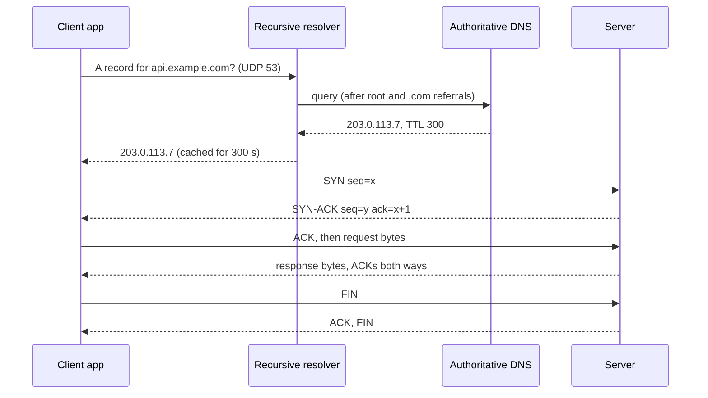

## In one minute
- The internet moves small packets, not files or requests. IP gets each packet towards an address on a best-effort basis: packets can be lost, duplicated, delayed or arrive out of order.
- TCP builds a reliable, ordered byte stream on top of that unreliable delivery, using sequence numbers, acknowledgements and retransmission. UDP adds almost nothing: ports and a checksum, with no guarantees, which is exactly what some applications want.
- DNS turns names like `api.example.com` into IP addresses through a chain of servers and caches. Every cached answer has a time to live (TTL), which is why DNS changes take time to spread.
- Every new connection pays round trips before the first useful byte: DNS lookup, TCP handshake, usually a TLS handshake. On a 100 ms link that is several hundred milliseconds, which is why connection reuse matters so much.
- The problem shapes here are partial failure ("did my packet arrive?"), duplicates and ordering. TCP's sequence numbers and acknowledgements solve the same problem as idempotency keys and sequence numbers in payments and messaging.

## How it works

### Layers: each one solves one problem
Networking is built in layers. The link layer (Ethernet, Wi-Fi) moves frames between machines on the same local network, identified by MAC addresses. The network layer (IP) moves packets between networks, hop by hop through routers. The transport layer (TCP, UDP) moves data between programs, identified by port numbers. The application layer (HTTP, DNS, SMTP, gRPC) defines what the bytes mean. Each layer wraps the data in its own header, like envelopes inside envelopes, and the receiver unwraps them in reverse.

### IP: addresses and best-effort delivery
An IPv4 address is 32 bits, written as four numbers such as `203.0.113.7`. There are only about 4.3 billion of them, so most devices sit on private ranges (`10.0.0.0/8`, `172.16.0.0/12`, `192.168.0.0/16`) behind a router doing network address translation (NAT), which rewrites addresses and ports as packets leave and return. IPv6 uses 128-bit addresses and removes the shortage.

The `/8` in `10.0.0.0/8` is a prefix length: the first 8 bits name the network and the rest name hosts in it. Routers forward packets by looking up the longest matching prefix in their routing table and sending the packet to the next hop. No router knows the full path; each makes one local decision. Every packet carries a TTL counter that each router decrements, so a packet stuck in a routing loop is eventually dropped.

IP promises nothing beyond trying. A router with a full queue drops packets, and two packets can take different paths and arrive out of order.

### Ports and sockets
An IP address finds a machine; a port finds a program on it. A server listens on a well-known port (443 for HTTPS, 53 for DNS, 5432 for Postgres). The client's OS picks a temporary ephemeral port for its side. A TCP connection is identified by four values: source IP, source port, destination IP and destination port. In code you never see packets; you see a socket, a file descriptor you can read and write.

### TCP: a reliable stream over an unreliable network
TCP numbers every byte. The receiver sends back acknowledgements (ACKs) saying "I have everything up to byte N". If the sender gets no ACK within a timeout, it sends the data again. The receiver uses sequence numbers to put out-of-order segments back in order and to throw away duplicates. Your program sees a clean stream of bytes, in order, with no gaps.

Before data flows, the two sides do a three-way handshake ([High Performance Browser Networking, ch. 2](https://hpbn.co/building-blocks-of-tcp/)): the client sends SYN, the server replies SYN-ACK, the client sends ACK. This agrees on starting sequence numbers and costs one full round trip. TCP also controls speed: flow control stops a fast sender from overrunning a slow receiver, and congestion control stops senders from overloading the network, starting slowly and speeding up while ACKs keep arriving.

One consequence surprises new engineers: TCP is a stream, not a sequence of messages. Two `write` calls of 100 bytes can arrive as one `read` of 200 bytes, or as reads of 37 and 163. Protocols on top of TCP must frame their messages, with a length prefix or a delimiter.

### UDP: just send it
UDP sends independent datagrams with an 8-byte header: source port, destination port, length and checksum ([RFC 768](https://www.rfc-editor.org/rfc/rfc768)). No handshake, no retransmission, no ordering. That sounds worse, but it suits cases where late data is useless (voice, video, games) or where the application wants its own reliability rules. DNS queries usually travel over UDP because one small question and one small answer do not need a connection. QUIC, the transport under HTTP/3, runs over UDP and implements its own reliability and encryption in user space.

### DNS: the internet's phone book, with caches
When your code connects to `api.example.com`, the OS first checks `/etc/hosts` and its local cache, then asks a recursive resolver (your company's, your ISP's, or a public one such as `1.1.1.1`). If the resolver has no cached answer, it asks a root server, which points to the `.com` servers, which point to the authoritative servers for `example.com`, which return the record. Common record types are `A` (IPv4 address), `AAAA` (IPv6 address), `CNAME` (an alias for another name), `MX` (mail server) and `NS` (which servers are authoritative). Each answer carries a TTL in seconds, and every resolver along the way may cache it that long; a TTL of 0 means use it only for the current transaction ([RFC 1035](https://www.rfc-editor.org/rfc/rfc1035)).

## Down the stack

### Layer 1: The contract
IP promises best-effort delivery of individual packets, with no promise of arrival, order or uniqueness. TCP promises that bytes are delivered to the receiving application exactly once and in order, or the connection fails with an error; it does not promise when, and it says nothing about whether the remote application processed the data. UDP promises only that a datagram, if delivered, is intact (when the checksum is used). DNS promises an answer that was correct at some point within the record's TTL, not the current truth.

### Layer 2: The mechanism
A TCP segment header is at least 20 bytes ([RFC 9293](https://www.rfc-editor.org/rfc/rfc9293)) and carries source and destination ports, a 32-bit sequence number, a 32-bit acknowledgement number, flags (`SYN`, `ACK`, `FIN`, `RST`, `PSH`), and a 16-bit receive window that tells the sender how much buffer space is free. Connections move through states such as `LISTEN`, `SYN_SENT`, `ESTABLISHED`, `CLOSE_WAIT` and `TIME_WAIT`. The side that closes first waits in `TIME_WAIT` so late packets from the old connection cannot be mistaken for a new one. The spec sets that wait to twice the maximum segment lifetime, and takes the lifetime as 2 minutes, so 4 minutes ([RFC 9293](https://www.rfc-editor.org/rfc/rfc9293)); Linux hard-codes a shorter 60 seconds.

Retransmission uses a timeout computed from measured round-trip time (RFC 6298), plus fast retransmit: three duplicate ACKs for the same byte suggest a single lost segment, which is resent without waiting. Congestion control keeps a congestion window. Modern stacks start at 10 segments, at most 14,600 bytes ([RFC 6928](https://www.rfc-editor.org/rfc/rfc6928)), double it each round trip in slow start, and cut it back on loss. Linux distributions usually ship CUBIC, but the default is a kernel build setting and `reno` is always available ([kernel docs](https://www.kernel.org/doc/html/latest/networking/ip-sysctl.html)); BBR is an alternative that models bandwidth and delay.

A DNS message has a 12-byte header (an ID, flags, and counts of questions and answers) followed by questions and resource records. Classic DNS over UDP limits responses to 512 bytes and sets the truncated (`TC`) flag when an answer does not fit ([RFC 1035](https://www.rfc-editor.org/rfc/rfc1035)). The EDNS(0) extension allows larger ones, but big UDP answers get fragmented and fragments are unreliable and easier to spoof, so the 2020 DNS flag day settled on a default buffer of 1,232 bytes (the IPv6 minimum MTU of 1,280 less 48 bytes of headers) and a retry over TCP beyond that ([DNS Flag Day 2020](https://www.dnsflagday.net/2020/)).

### Layer 3: The machine
A standard Ethernet frame carries at most 1,500 bytes of payload (the MTU). Subtract 20 bytes of IPv4 header and 20 of TCP header and each segment holds at most 1,460 bytes of your data. The network card writes arriving frames into a ring buffer in RAM and signals the kernel, which runs the IP and TCP code and appends the payload to the socket's receive buffer. Your `read` call copies from that buffer into your program. A `write` copies into the send buffer and usually returns before anything is on the wire.

Speed of light in fibre is about 200,000 km/s, so 5,000 km one way costs 25 ms and a round trip at least 50 ms before any router or queue delay. Bandwidth can be bought; latency mostly cannot. Linux assigns ephemeral ports from 32768 to 60999 by default ([kernel docs](https://www.kernel.org/doc/html/latest/networking/ip-sysctl.html)), about 28,000 ports, so a client opening short-lived connections to one server at a high rate can run out while old connections sit in `TIME_WAIT`.

### Why it's built this way
1. Physical links drop and corrupt data, and a network of millions of routers cannot coordinate a global path, so IP does simple local forwarding and promises nothing.
2. Keeping routers simple pushed reliability to the endpoints, so TCP adds sequence numbers, ACKs and retransmission in the operating systems at each end.
3. Retransmitting blindly would collapse a congested network, so TCP measures round trips and adapts its sending rate.
4. Reliability costs round trips and head-of-line blocking (one lost segment holds up everything behind it), so UDP exists for applications that would rather handle loss themselves.
5. Asking the authoritative servers for every lookup would overload them and add latency, so DNS caches at every level and accepts that answers can be stale for up to the TTL.

## Diagram


## Worked example
A mobile app in Jakarta calls an API hosted in Virginia. The round trip time is about 220 ms. On a cold start the first request pays:

- DNS: the phone's resolver has the answer cached, so about 20 ms.
- TCP handshake: 1 round trip, 220 ms.
- TLS 1.3 handshake: 1 more round trip, 220 ms.
- The request and the first response bytes: 1 round trip, 220 ms.

That is about 680 ms before the first byte, of which the server's own work might be 15 ms. A second request on the same connection costs one round trip, 220 ms.

Now the response is 1 MB. With an initial congestion window of 10 segments of 1,460 bytes, the first round trip delivers about 14.6 KB. Slow start doubles the window each round trip: 14.6, 29.2, 58.4, 116.8, 233.6 and 467.2 KB, a running total of about 920 KB after 6 round trips, so the transfer needs 7 round trips, about 1.5 seconds, even on a fast link. The bandwidth is not the limit; the round trips are.

The fixes follow from the arithmetic: keep connections alive and reuse them, serve from a region or CDN edge near the user (a 20 ms round trip makes the same cold start about 70 ms), and send less data. Upgrading the server's network card would change almost nothing.

## In the wild
- **AWS, 2025: a DNS race empties the DynamoDB endpoint.** Two automation components that write DNS plans for the regional DynamoDB endpoint raced: a delayed one applied an old plan after a newer one, and cleanup then deleted the plan in use, leaving the endpoint with no IP addresses in US-East. Services that depend on DynamoDB, and many that depend on those, failed until engineers repaired the record by hand, which shows how much sits behind one name ([AWS post-event summary](https://aws.amazon.com/message/101925/)).
- **Meta, 2021: a backbone command pulls DNS off the internet.** A maintenance command meant to check backbone capacity disconnected every backbone link. DNS servers then withdrew their own BGP routes because they could not reach the data centers, so even healthy name servers became unreachable and the outage lasted hours ([Meta engineering](https://engineering.fb.com/2021/10/05/networking-traffic/outage-details/)).
- **Slack, 2021: a DNSSEC rollout and cached negative answers.** Enabling DNSSEC on a domain with a wildcard record made validating resolvers cache "no such record type" answers, and rolling back was slow because resolvers had cached the DS record (the parent zone's pointer to the signing key) for up to 24 hours. Under 1% of users were affected, for about a day: the TTL rule in action ([Slack engineering](https://slack.engineering/what-happened-during-slacks-dnssec-rollout/)).

## Trade-offs
| Choice | Strengths | Weaknesses | Choose when |
| --- | --- | --- | --- |
| TCP | Reliable, ordered, congestion-aware, universal | Handshake cost, head-of-line blocking | Most request/response and streaming traffic |
| UDP | No handshake, no head-of-line blocking, tiny header | No delivery, order or congestion guarantees | Real-time media, games, DNS, custom protocols |
| QUIC (over UDP) | Fast setup, independent streams, built-in TLS | More CPU, some middleboxes block UDP | Web and mobile clients on lossy networks |
| Long DNS TTL (hours) | Fewer lookups, resilient to DNS outages | Slow to move traffic during incidents | Stable addresses that rarely change |
| Short DNS TTL (seconds to a minute) | Fast failover and traffic shifting | More queries, more exposure to resolver issues | Load-balanced or failover endpoints |

## Pitfalls in production
- Opening a new connection per request. Each one pays the handshakes and starts slow start from scratch. Fix: connection pooling and HTTP keep-alive.
- Treating a TCP read as one message. Messages get split or merged. Fix: frame messages with a length prefix or delimiter and loop until a full message is read.
- No timeouts on connect or read, so a silently dropped peer hangs a thread forever. Fix: set connect, read and overall deadlines on every network call.
- Lowering a DNS TTL right before a migration. Resolvers still hold the old answer for the old TTL. Fix: lower the TTL at least one old-TTL period ahead, then make the change.
- Ephemeral port exhaustion from many short-lived outbound connections stuck in `TIME_WAIT`. Fix: reuse connections, and monitor socket states with `ss -s`. Do not reach for `tcp_tw_reuse` first: on current kernels it defaults to 2, which enables reuse for loopback traffic only ([kernel docs](https://www.kernel.org/doc/html/latest/networking/ip-sysctl.html)).
- Assuming a sent request was not processed because the response timed out. The server may have done the work. Fix: make retried operations idempotent.

## Leadership lens
- Ask how many round trips a user-facing flow makes, not just how fast the server is. Round trips across regions dominate latency budgets.
- Make connection reuse, timeouts and retries a shared library default, not something each team remembers.
- Treat DNS as part of incident response: know your TTLs, who can change records, and how long a failover really takes to reach clients.
- Teach the partial-failure rule: a timeout means "unknown", not "failed". It shapes API design (idempotency keys) across every team.

## Check yourself
1. Why does TCP need sequence numbers if IP already delivers packets to the right address?
   **Answer:** IP can drop, duplicate and reorder packets; sequence numbers let the receiver put bytes back in order, discard duplicates and tell the sender what is missing so it can retransmit.
2. A client sends two 50-byte messages over one TCP connection and the server's first read returns 100 bytes. Is this a bug?
   **Answer:** No. TCP is a byte stream with no message boundaries, so the application must frame messages itself, for example with a length prefix.
3. You changed a DNS record's IP five minutes ago, but some users still reach the old server. Why?
   **Answer:** Resolvers and clients cached the old answer and may keep it for up to the record's TTL, which was longer than five minutes.
4. Why would a video call prefer UDP over TCP?
   **Answer:** A lost audio or video packet is useless once its moment has passed; TCP would retransmit it and hold up newer data behind it, while UDP lets the app skip the gap and keep playing.

## Practice
**Task:** Implement two small pieces of the network stack. `Reassembler` models the receiving side of TCP: `receive(seq, data)` accepts a segment whose first byte has offset `seq`, and returns the cumulative ACK, the offset of the next byte it expects. Bytes are delivered in order exactly once; out-of-order segments are buffered until the gap is filled, duplicates are ignored, and a segment overlapping already-delivered bytes contributes only its new tail. `read()` returns the in-order bytes delivered since the last `read`. `DnsCache` models a resolver cache with an injected clock: `put(name, ip, ttl, now)` stores an answer, and `get(name, now)` returns the IP while `now` is before the time it was stored plus `ttl`, otherwise nothing. Names are case-insensitive and a trailing dot is ignored.

```python starter
class Reassembler:
    def receive(self, seq, data):
        # TODO
        raise NotImplementedError

    def read(self):
        # TODO
        raise NotImplementedError

class DnsCache:
    def put(self, name, ip, ttl, now):
        # TODO
        raise NotImplementedError

    def get(self, name, now):
        # TODO
        raise NotImplementedError
```

```python tests
def test_in_order():
    r = Reassembler()
    assert r.receive(0, "hel") == 3
    assert r.receive(3, "lo") == 5
    assert r.read() == "hello"
    assert r.read() == ""

def test_out_of_order_and_gaps():
    r = Reassembler()
    assert r.receive(6, "gh") == 0
    assert r.receive(3, "def") == 0
    assert r.read() == ""
    assert r.receive(0, "abc") == 8
    assert r.read() == "abcdefgh"

def test_duplicates_and_overlap():
    r = Reassembler()
    assert r.receive(0, "abcd") == 4
    assert r.receive(0, "abcd") == 4
    assert r.receive(2, "cdef") == 6
    assert r.read() == "abcdef"

def test_dns_ttl_expiry():
    c = DnsCache()
    c.put("api.example.com", "10.0.0.5", 300, 1000)
    assert c.get("api.example.com", 1299) == "10.0.0.5"
    assert c.get("api.example.com", 1300) is None

def test_dns_name_normalisation_and_miss():
    c = DnsCache()
    c.put("API.Example.com.", "10.0.0.6", 60, 0)
    assert c.get("api.example.com", 10) == "10.0.0.6"
    assert c.get("other.example.com", 10) is None

def test_dns_zero_ttl_and_overwrite():
    c = DnsCache()
    c.put("a.test", "1.1.1.1", 0, 5)
    assert c.get("a.test", 5) is None
    c.put("a.test", "2.2.2.2", 10, 5)
    c.put("a.test", "3.3.3.3", 10, 12)
    assert c.get("a.test", 20) == "3.3.3.3"
```

```python solution
class Reassembler:
    def __init__(self):
        self.next = 0
        self.pending = {}
        self.out = []

    def _deliver(self, seq, data):
        self.out.append(data[self.next - seq:])
        self.next = seq + len(data)

    def receive(self, seq, data):
        if seq + len(data) <= self.next:
            return self.next
        if seq > self.next:
            if len(data) > len(self.pending.get(seq, "")):
                self.pending[seq] = data
            return self.next
        self._deliver(seq, data)
        progress = True
        while progress:
            progress = False
            for s in sorted(self.pending):
                if s > self.next:
                    break
                d = self.pending.pop(s)
                if s + len(d) > self.next:
                    self._deliver(s, d)
                progress = True
                break
        return self.next

    def read(self):
        s = "".join(self.out)
        self.out = []
        return s

def _norm(name):
    name = name.lower()
    return name[:-1] if name.endswith(".") else name

class DnsCache:
    def __init__(self):
        self.entries = {}

    def put(self, name, ip, ttl, now):
        self.entries[_norm(name)] = (ip, now + ttl)

    def get(self, name, now):
        key = _norm(name)
        entry = self.entries.get(key)
        if entry is None:
            return None
        if now >= entry[1]:
            del self.entries[key]
            return None
        return entry[0]
```

```typescript starter
export class Reassembler {
  receive(seq: number, data: string): number {
    throw new Error("TODO");
  }

  read(): string {
    throw new Error("TODO");
  }
}

export class DnsCache {
  put(name: string, ip: string, ttl: number, now: number): void {
    throw new Error("TODO");
  }

  get(name: string, now: number): string | null {
    throw new Error("TODO");
  }
}
```

```typescript tests
test("in order", () => {
  const r = new Reassembler();
  assertEqual(r.receive(0, "hel"), 3);
  assertEqual(r.receive(3, "lo"), 5);
  assertEqual(r.read(), "hello");
  assertEqual(r.read(), "");
});

test("out of order and gaps", () => {
  const r = new Reassembler();
  assertEqual(r.receive(6, "gh"), 0);
  assertEqual(r.receive(3, "def"), 0);
  assertEqual(r.read(), "");
  assertEqual(r.receive(0, "abc"), 8);
  assertEqual(r.read(), "abcdefgh");
});

test("duplicates and overlap", () => {
  const r = new Reassembler();
  assertEqual(r.receive(0, "abcd"), 4);
  assertEqual(r.receive(0, "abcd"), 4);
  assertEqual(r.receive(2, "cdef"), 6);
  assertEqual(r.read(), "abcdef");
});

test("dns ttl expiry", () => {
  const c = new DnsCache();
  c.put("api.example.com", "10.0.0.5", 300, 1000);
  assertEqual(c.get("api.example.com", 1299), "10.0.0.5");
  assertEqual(c.get("api.example.com", 1300), null);
});

test("dns name normalisation and miss", () => {
  const c = new DnsCache();
  c.put("API.Example.com.", "10.0.0.6", 60, 0);
  assertEqual(c.get("api.example.com", 10), "10.0.0.6");
  assertEqual(c.get("other.example.com", 10), null);
});

test("dns zero ttl and overwrite", () => {
  const c = new DnsCache();
  c.put("a.test", "1.1.1.1", 0, 5);
  assertEqual(c.get("a.test", 5), null);
  c.put("a.test", "2.2.2.2", 10, 5);
  c.put("a.test", "3.3.3.3", 10, 12);
  assertEqual(c.get("a.test", 20), "3.3.3.3");
});
```

```typescript solution
export class Reassembler {
  private next = 0;
  private pending = new Map<number, string>();
  private out: string[] = [];

  private deliver(seq: number, data: string): void {
    this.out.push(data.slice(this.next - seq));
    this.next = seq + data.length;
  }

  receive(seq: number, data: string): number {
    if (seq + data.length <= this.next) return this.next;
    if (seq > this.next) {
      const old = this.pending.get(seq) ?? "";
      if (data.length > old.length) this.pending.set(seq, data);
      return this.next;
    }
    this.deliver(seq, data);
    let progress = true;
    while (progress) {
      progress = false;
      const keys = Array.from(this.pending.keys()).sort((a, b) => a - b);
      if (keys.length > 0 && keys[0] <= this.next) {
        const s = keys[0];
        const d = this.pending.get(s) as string;
        this.pending.delete(s);
        if (s + d.length > this.next) this.deliver(s, d);
        progress = true;
      }
    }
    return this.next;
  }

  read(): string {
    const s = this.out.join("");
    this.out = [];
    return s;
  }
}

function norm(name: string): string {
  const n = name.toLowerCase();
  return n.endsWith(".") ? n.slice(0, -1) : n;
}

export class DnsCache {
  private entries = new Map<string, { ip: string; expires: number }>();

  put(name: string, ip: string, ttl: number, now: number): void {
    this.entries.set(norm(name), { ip, expires: now + ttl });
  }

  get(name: string, now: number): string | null {
    const key = norm(name);
    const e = this.entries.get(key);
    if (!e) return null;
    if (now >= e.expires) {
      this.entries.delete(key);
      return null;
    }
    return e.ip;
  }
}
```

```go starter
package practice

type Reassembler struct{}

func NewReassembler() *Reassembler {
	return &Reassembler{}
}

func (r *Reassembler) Receive(seq int, data string) int {
	panic("TODO")
}

func (r *Reassembler) Read() string {
	panic("TODO")
}

type DNSCache struct{}

func NewDNSCache() *DNSCache {
	return &DNSCache{}
}

func (c *DNSCache) Put(name, ip string, ttl, now int) {
	panic("TODO")
}

// Get returns the cached IP and true, or "" and false if missing or expired.
func (c *DNSCache) Get(name string, now int) (string, bool) {
	panic("TODO")
}
```

```go tests
package practice

import "testing"

func TestInOrder(t *testing.T) {
	r := NewReassembler()
	if r.Receive(0, "hel") != 3 || r.Receive(3, "lo") != 5 {
		t.Fatal("wrong ack")
	}
	if got := r.Read(); got != "hello" {
		t.Fatalf("got %q", got)
	}
	if got := r.Read(); got != "" {
		t.Fatalf("second read got %q", got)
	}
}

func TestOutOfOrderAndGaps(t *testing.T) {
	r := NewReassembler()
	if r.Receive(6, "gh") != 0 || r.Receive(3, "def") != 0 {
		t.Fatal("ack should stay at 0 while a gap exists")
	}
	if got := r.Read(); got != "" {
		t.Fatalf("got %q", got)
	}
	if got := r.Receive(0, "abc"); got != 8 {
		t.Fatalf("ack got %d", got)
	}
	if got := r.Read(); got != "abcdefgh" {
		t.Fatalf("got %q", got)
	}
}

func TestDuplicatesAndOverlap(t *testing.T) {
	r := NewReassembler()
	if r.Receive(0, "abcd") != 4 || r.Receive(0, "abcd") != 4 || r.Receive(2, "cdef") != 6 {
		t.Fatal("wrong ack")
	}
	if got := r.Read(); got != "abcdef" {
		t.Fatalf("got %q", got)
	}
}

func TestDNSTTLExpiry(t *testing.T) {
	c := NewDNSCache()
	c.Put("api.example.com", "10.0.0.5", 300, 1000)
	if ip, ok := c.Get("api.example.com", 1299); !ok || ip != "10.0.0.5" {
		t.Fatalf("got %q %v", ip, ok)
	}
	if _, ok := c.Get("api.example.com", 1300); ok {
		t.Fatal("entry should have expired")
	}
}

func TestDNSNameNormalisationAndMiss(t *testing.T) {
	c := NewDNSCache()
	c.Put("API.Example.com.", "10.0.0.6", 60, 0)
	if ip, ok := c.Get("api.example.com", 10); !ok || ip != "10.0.0.6" {
		t.Fatalf("got %q %v", ip, ok)
	}
	if _, ok := c.Get("other.example.com", 10); ok {
		t.Fatal("unknown name should miss")
	}
}

func TestDNSZeroTTLAndOverwrite(t *testing.T) {
	c := NewDNSCache()
	c.Put("a.test", "1.1.1.1", 0, 5)
	if _, ok := c.Get("a.test", 5); ok {
		t.Fatal("zero TTL should not be served")
	}
	c.Put("a.test", "2.2.2.2", 10, 5)
	c.Put("a.test", "3.3.3.3", 10, 12)
	if ip, ok := c.Get("a.test", 20); !ok || ip != "3.3.3.3" {
		t.Fatalf("got %q %v", ip, ok)
	}
}
```

```go solution
package practice

import (
	"sort"
	"strings"
)

type Reassembler struct {
	next    int
	pending map[int]string
	out     strings.Builder
}

func NewReassembler() *Reassembler {
	return &Reassembler{pending: map[int]string{}}
}

func (r *Reassembler) deliver(seq int, data string) {
	r.out.WriteString(data[r.next-seq:])
	r.next = seq + len(data)
}

func (r *Reassembler) Receive(seq int, data string) int {
	if seq+len(data) <= r.next {
		return r.next
	}
	if seq > r.next {
		if len(data) > len(r.pending[seq]) {
			r.pending[seq] = data
		}
		return r.next
	}
	r.deliver(seq, data)
	for {
		keys := make([]int, 0, len(r.pending))
		for k := range r.pending {
			keys = append(keys, k)
		}
		sort.Ints(keys)
		if len(keys) == 0 || keys[0] > r.next {
			break
		}
		s := keys[0]
		d := r.pending[s]
		delete(r.pending, s)
		if s+len(d) > r.next {
			r.deliver(s, d)
		}
	}
	return r.next
}

func (r *Reassembler) Read() string {
	s := r.out.String()
	r.out.Reset()
	return s
}

type dnsEntry struct {
	ip      string
	expires int
}

type DNSCache struct {
	entries map[string]dnsEntry
}

func NewDNSCache() *DNSCache {
	return &DNSCache{entries: map[string]dnsEntry{}}
}

func norm(name string) string {
	return strings.TrimSuffix(strings.ToLower(name), ".")
}

func (c *DNSCache) Put(name, ip string, ttl, now int) {
	c.entries[norm(name)] = dnsEntry{ip: ip, expires: now + ttl}
}

func (c *DNSCache) Get(name string, now int) (string, bool) {
	key := norm(name)
	e, ok := c.entries[key]
	if !ok {
		return "", false
	}
	if now >= e.expires {
		delete(c.entries, key)
		return "", false
	}
	return e.ip, true
}
```

## Mock interview
**Prompt:** Users in Southeast Asia report that your app's first screen takes over 4 seconds to load, while users in the US see under 1 second. The backend is in one US region and its server-side latency is 30 ms everywhere. Explain where the time goes and what you would change.

- Follow-up: The first screen makes 6 sequential API calls, each on a new connection. Estimate the cost from Singapore with a 230 ms round trip.
- Follow-up: You plan to fail over to a second region using DNS. What decides how quickly clients actually move?
- Follow-up: A teammate proposes switching the API to UDP to avoid handshakes. What would you say?

**A strong answer covers:**
- Breaking the time into DNS, TCP handshake, TLS handshake and request round trips, and noting that server time is a small fraction.
- Estimating: about 3 round trips per new connection times 6 calls is roughly 18 round trips, over 4 seconds at 230 ms, versus about 8 (two for setup, then one per call) on a single reused connection.
- Fixes: connection reuse and keep-alive, batching or parallelising calls, terminating TLS at a nearby edge or CDN, and a regional deployment.
- Explaining that DNS failover speed depends on the TTL and on clients and resolvers that ignore or extend it.
- Pointing out that UDP alone gives up reliability; QUIC (HTTP/3) is the practical way to get faster setup while keeping reliability.

## Sources and further study
**Primary**
- [RFC 9293: Transmission Control Protocol](https://www.rfc-editor.org/rfc/rfc9293): handshake, states, TIME-WAIT and the 2 minute segment lifetime.
- [RFC 6928: Increasing TCP's Initial Window](https://www.rfc-editor.org/rfc/rfc6928): where the 10-segment, 14,600-byte start comes from.
- [RFC 1035: Domain Names, Implementation and Specification](https://www.rfc-editor.org/rfc/rfc1035): message format, 512-byte limit, TC bit and TTL.
- [RFC 768: User Datagram Protocol](https://www.rfc-editor.org/rfc/rfc768): the whole UDP header.
- [DNS Flag Day 2020](https://www.dnsflagday.net/2020/): why resolvers moved to a 1,232-byte UDP buffer.

**Systems docs**
- [Linux kernel: IP sysctl](https://www.kernel.org/doc/html/latest/networking/ip-sysctl.html): ephemeral port range, congestion control selection and `tcp_tw_reuse` behaviour.

**Books**
- *Computer Networking: A Top-Down Approach*, Kurose and Ross, chapters 2 (DNS), 3 (UDP, TCP, congestion control) and 4 (IPv4, addressing).
- *High Performance Browser Networking*, Ilya Grigorik, chapters 1 to 3 (latency, TCP, UDP).

**Other curricula**
- [donnemartin/system-design-primer](https://github.com/donnemartin/system-design-primer): has short DNS, TCP and UDP sections framed around trade-offs and when to pick each.

## Watch
- [The Internet: IP Addresses and DNS (Code.org)](https://www.youtube.com/watch?v=5o8CwafCxnU): a short, clear introduction to addressing and name lookup.
- [The Internet: Packets, Routing and Reliability (Code.org)](https://www.youtube.com/watch?v=AYdF7b3nMto): how data is split into packets, routed and made reliable.
- [TCP vs UDP Comparison (PowerCert Animated Videos)](https://www.youtube.com/watch?v=uwoD5YsGACg): an animated side-by-side of the two transports.

## Free resources
- [High Performance Browser Networking: Building Blocks of TCP (Ilya Grigorik)](https://hpbn.co/building-blocks-of-tcp/): handshakes, slow start and why latency dominates, with numbers.
- [Beej's Guide to Network Programming](https://beej.us/guide/bgnet/): a friendly, practical guide to sockets.
- [How DNS Works](https://howdns.works/): an illustrated walk through a DNS lookup.
- [Mess With DNS (Julia Evans)](https://messwithdns.net/): a playground for making real DNS records and watching the queries.
- [RFC 9293: Transmission Control Protocol](https://www.rfc-editor.org/rfc/rfc9293): the current TCP specification.
- [RFC 768: User Datagram Protocol](https://www.rfc-editor.org/rfc/rfc768): the entire UDP specification, three pages long.
