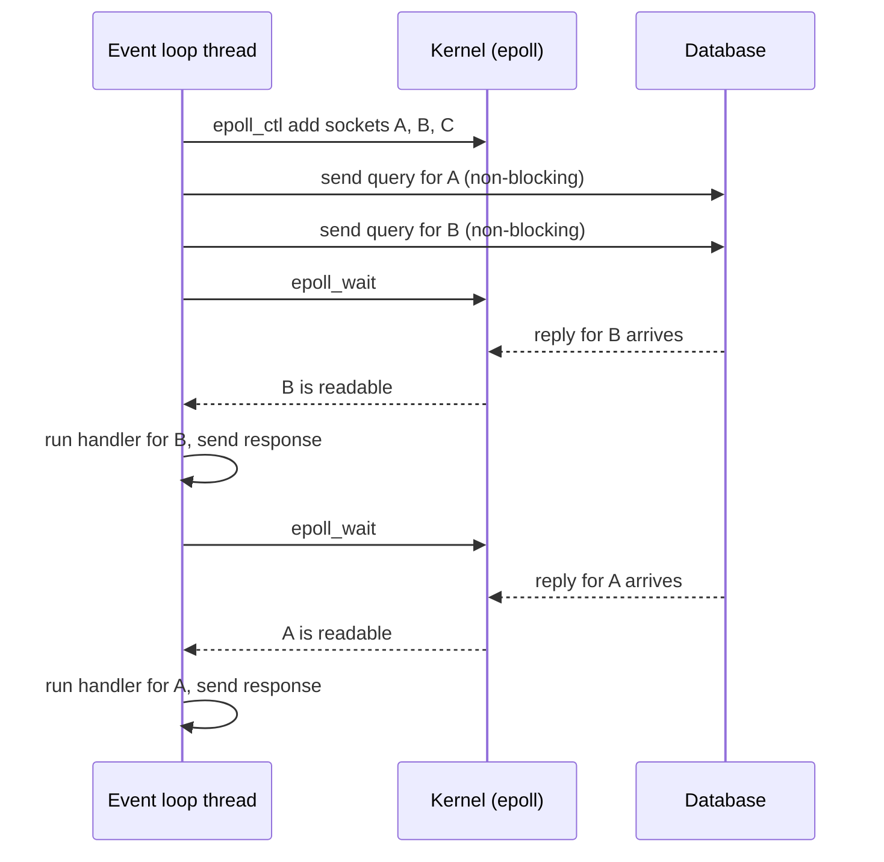

## In one minute
- A process is a running program with its own private memory, open files and at least one thread. The operating system keeps processes apart, so one crashing process does not corrupt another.
- A thread is one line of execution inside a process. Threads in the same process share memory, which makes them cheap to coordinate and easy to get wrong: two threads updating the same value at once is a race.
- Most server code spends its time waiting on the network, a database or a disk. Concurrency is about doing useful work during that waiting; parallelism is about using several CPU cores at the same moment. They are different tools for different bottlenecks.
- Async I/O lets one thread juggle thousands of waiting connections: it asks the kernel "tell me which of these are ready" and only runs code when there is something to do. The price is that one slow, blocking call stalls everything on that thread.
- The underlying problem shape is contention: many workers, one shared thing. It shows up as a data race between threads, two riders matched to the same driver, or two agents editing the same file, and the fixes (locks, single writers, message passing) are the same.

## How it works

### Processes: a program with walls around it
When you start a program, the operating system creates a process. It gets a process ID, its own virtual address space (address 0x1000 in one process means nothing in another), a table of open file descriptors (files, sockets, pipes), and one thread to run `main`. The walls are the point: a bug that scribbles over memory in one process cannot touch another, and the OS can kill a process and reclaim everything it held.

Processes talk only through channels the OS provides: pipes, sockets, files, or explicitly shared memory. A web server that runs 8 worker processes behind one listening socket, as Nginx and Gunicorn do, gets crash isolation and uses 8 cores, but the workers cannot share an in-memory cache without extra machinery.

### Threads: several workers in one house
A thread is a program counter, a set of registers and a stack. Every thread in a process sees the same heap, globals and open files. Creating one is cheaper than creating a process, and passing data between threads is just passing a pointer.

The danger is that sharing is the default. Consider `count = count + 1` run by two threads. Each reads `count` (say 41), adds one, and writes back 42. One increment is lost. This is a race condition: the result depends on the timing of instructions you do not control. The fix is to make the read-modify-write happen as one step, with a mutex (only one thread inside the critical section at a time), an atomic instruction, or by giving the data a single owner that other threads send messages to.

### Concurrency versus parallelism
Concurrency means several tasks are in progress at once, possibly taking turns on one core. Parallelism means several tasks are executing at the same instant on different cores. A chef with three pans on the stove is concurrent; three chefs are parallel. If your work is CPU-bound (image resizing, compression, model inference on CPU), you need parallelism, which means more cores and more threads or processes. If your work is I/O-bound (most web backends), you need concurrency: plenty of requests in flight while each one waits.

### Blocking I/O and the thread-per-request model
The simplest server gives each request its own thread. The thread calls `read` on a socket, and if no data has arrived, the OS puts the thread to sleep until it does. This is blocking I/O, and the code reads top to bottom like a script. It works well up to a few hundred or a few thousand concurrent connections. Beyond that, each thread costs memory for its stack and the scheduler spends more time switching between threads than running them.

### Async I/O and the event loop
The alternative is to mark sockets non-blocking and use one thread to watch many of them. The thread asks the kernel, "of these 10,000 sockets, which have data now?", handles the ready ones, and asks again. This is an event loop. Node.js, Python's `asyncio`, Nginx and Redis are built this way. In code it appears as callbacks, promises, or `async`/`await`: each `await` is a point where your function says "I am waiting; run something else and come back to me".

The event loop has one hard rule: never block it. A 200 ms synchronous call (a CPU-heavy hash, a blocking file read, a synchronous HTTP client) freezes every other connection on that loop for 200 ms. Runtimes push such work to a separate thread pool, and you should too.

### Green threads: the best of both
Go takes a third path. Goroutines look like ordinary blocking threads in code, but they are managed by the Go runtime, not the OS. They start with a stack of a few KB that grows as needed (2 KB in early versions; since Go 1.19 the starting size follows the average stack use seen so far) ([Go FAQ](https://go.dev/doc/faq#goroutines), [Go 1.19 notes](https://go.dev/doc/go1.19)), and when one blocks on a socket, the runtime parks it and registers the socket with the same kernel readiness mechanism an event loop uses. You write simple sequential code; the runtime does the event loop for you. Java's virtual threads, final in Java 21, follow the same idea: the JDK schedules them onto a small set of carrier threads and unmounts them when they block on most I/O, and the JEP says never to pool them and to use a semaphore to limit concurrency instead ([JEP 444](https://openjdk.org/jeps/444)). In Java 21 a virtual thread blocking inside `synchronized` stayed pinned to its carrier; Java 24 removed that limitation ([JEP 491](https://openjdk.org/jeps/491)).

## Down the stack

### Layer 1: The contract
The OS promises each process an isolated address space and its own file descriptors, and promises that runnable threads will each get CPU time eventually, in no particular order. It does not promise when a thread runs or for how long, and without synchronisation other threads may see shared memory updates late or reordered. A non-blocking `read` promises either some bytes or an immediate "would block" error (`EAGAIN`); it never sleeps.

### Layer 2: The mechanism
On Linux, a process and a thread are both a `task_struct` in the kernel. `fork` creates a task with a copy-on-write copy of the parent's memory; `pthread_create` calls `clone` with flags such as `CLONE_VM` and `CLONE_FILES`, so the new task shares memory and open files; `CLONE_THREAD` puts it in the same thread group, so all threads share one process ID ([clone(2)](https://www.man7.org/linux/man-pages/man2/clone.2.html)). The scheduler keeps runnable tasks per core and gives each a slice of CPU time. Linux used CFS for years and began moving to EEVDF in 6.6, which also lets a task request a specific slice through `sched_setattr()` ([kernel EEVDF docs](https://docs.kernel.org/scheduler/sched-eevdf.html)).

The event loop is built on `epoll`: `epoll_create1` makes an interest list, `epoll_ctl` adds sockets to it, and `epoll_wait` sleeps until at least one is ready, then returns only the ready ones ([epoll(7)](https://www.man7.org/linux/man-pages/man7/epoll.7.html)). Its cost tracks ready sockets, not watched ones. By default epoll is level-triggered, like `poll` but faster; edge-triggered mode (`EPOLLET`) reports only changes and requires non-blocking sockets read until `EAGAIN`. Node's libuv wraps `epoll` (`kqueue` on macOS) plus a default pool of 4 threads (`UV_THREADPOOL_SIZE`, maximum 1024) for work with no non-blocking form, such as file system calls and DNS lookups through `getaddrinfo` ([libuv docs](https://docs.libuv.org/en/v1.x/threadpool.html), [Node.js guide](https://nodejs.org/en/learn/asynchronous-work/dont-block-the-event-loop)). That small pool is itself a trap: four slow `fs` or `dns.lookup` calls leave everything else queued behind them. Go's runtime scheduler multiplexes goroutines (G) onto OS threads (M) through logical processors (P, one per `GOMAXPROCS`), and its netpoller uses `epoll` underneath.

### Layer 3: The machine
A context switch between threads saves and restores registers and switches stacks. One careful measurement on Linux found about 1.2 to 1.5 µs per switch when pinned to a core and about 2.2 µs unpinned ([Bendersky](https://eli.thegreenplace.net/2018/measuring-context-switching-and-memory-overheads-for-linux-threads/)). The hidden cost is larger: the new thread's data is not in the L1 and L2 caches, so it runs slowly for a while. Each OS thread reserves virtual memory for its stack: the default comes from the `RLIMIT_STACK` soft limit, typically 8 MB, and only touched pages use RAM ([pthread_create(3)](https://www.man7.org/linux/man-pages/man3/pthread_create.3.html)). In that same measurement, 10,000 threads showed about 80 GB virtual but only about 80 MB resident. So 10,000 threads is feasible but heavy, while 100,000 goroutines at a few KB each is routine.

When a packet arrives, the kernel appends its bytes to the socket's receive buffer and marks the socket ready, waking whichever thread sleeps in `epoll_wait` or `read`. An uncontended mutex is one atomic compare-and-swap, tens of nanoseconds. Under contention, the losing thread sleeps in the kernel via `futex`, which is entered only when blocking is likely, and the lock's cache line bounces between cores ([futex(2)](https://www.man7.org/linux/man-pages/man2/futex.2.html)).

### Why it's built this way
1. Programs crash and misbehave, so the OS isolates them in processes with separate address spaces.
2. Isolation makes sharing expensive, so threads exist to share memory cheaply inside one process.
3. Servers spend most of their time waiting, and a sleeping OS thread per waiting connection wastes memory and scheduler time.
4. So kernels added readiness APIs (`select`, then `poll`, then `epoll` and `kqueue`) that let one thread wait on many sockets at a cost tied to activity, not connection count.
5. Callback-style code is hard to write, so languages added `async`/`await` and runtimes such as Go's hide the event loop behind ordinary-looking blocking code.

## Diagram


## Worked example
An API endpoint spends 2 ms of CPU per request and 98 ms waiting on a database. Peak traffic is 2,000 requests per second.

Thread-per-request with a fixed pool: by Little's law (the JEP 444 text uses the same law to explain why thread-per-request caps throughput), requests in flight equal arrival rate times time in system, 2,000 × 0.1 s = 200, so the service needs at least 200 threads plus headroom. CPU needed is 2,000 × 2 ms = 4 core-seconds per second, so 4 cores busy. If the pool were capped at 100 threads, the service could only finish 100 / 0.1 s = 1,000 requests per second, and the rest would queue, even though the CPUs sit half idle. That is the classic sign of thread pool exhaustion: latency climbs while CPU stays low.

Event loop: one thread can hold all 200 in-flight requests because waiting costs only a registered socket. Its limit is CPU: 1 s / 2 ms = 500 requests per second per loop, so run 4 to 5 processes (one loop per core) behind a load balancer.

Now someone adds a synchronous password hash that takes 50 ms to one endpoint, called on the event loop. Each loop can now finish at most 20 of those per second, and every other request on that loop waits behind it. p99 latency jumps from about 100 ms to several seconds. The fix is to move the hash to a worker thread pool (Node's `worker_threads`, Python's `run_in_executor`) so the loop keeps serving.

## In the wild
- **AWS Kinesis, 2020: capacity add hits the OS thread limit.** Each Kinesis front-end server created OS threads for every other server in the fleet, so a small capacity addition on 25 November 2020 pushed every server over the OS thread limit. Shard-map caches could not be built, and Kinesis was impaired until late that evening Pacific time, with CloudWatch, Cognito and others affected. AWS moved to fewer, larger servers, added alarms on thread use and began moving the cache to a dedicated fleet ([AWS post-event summary](https://aws.amazon.com/message/11201/)).
- **Roblox, 2021: 73-hour outage from contention on one Go channel.** After enabling Consul's streaming feature, heavy read and write load caused contention on a single Go channel that blocked writes. A separate BoltDB freelist problem made each log append rewrite a 7.8 MB freelist. Disabling streaming cut median KV write latency from about 2 s to 300 ms ([Roblox post-mortem](https://about.roblox.com/newsroom/2022/01/roblox-return-to-service-10-28-10-31-2021)).
- **Node.js, ongoing: one regex or sync call stalls every client.** The official guide shows a nested-quantifier regex that can block the event loop effectively forever on a short crafted input, and a 50 MB `JSON.parse` that takes about 1.3 s ([Node.js guide](https://nodejs.org/en/learn/asynchronous-work/dont-block-the-event-loop)).

## Trade-offs
| Model | Strengths | Weaknesses | Choose when |
| --- | --- | --- | --- |
| Multiple processes | Crash isolation, uses all cores, no shared-memory races | Higher memory, coordination via IPC | Isolation matters; runtimes with a global lock |
| OS threads, blocking I/O | Simple sequential code, true parallelism | Memory per thread, switch cost, data races | Hundreds to low thousands of connections, CPU work |
| Event loop, async I/O | Tens of thousands of connections per thread | One blocking call stalls all, harder code paths | I/O-bound services, proxies, chat, gateways |
| Green threads (goroutines, virtual threads) | Sequential code with event-loop efficiency | Runtime-specific, still need locks for shared data | High-concurrency services in Go or modern Java |

## Pitfalls in production
- Blocking the event loop with CPU work or a synchronous library call. Fix: measure event loop lag, and move blocking or CPU-heavy work to a worker pool. Beware catastrophic regex backtracking and synchronous `*Sync` APIs too: both run on the loop ([Node.js guide](https://nodejs.org/en/learn/asynchronous-work/dont-block-the-event-loop)).
- Unsynchronised shared state, such as a counter or a map updated from several threads. Fix: protect it with a mutex or atomic, or give it one owner; run the race detector (`go test -race`) in CI.
- Thread pool exhaustion when a downstream slows down: every thread waits, new requests queue, latency explodes while CPU looks idle. Fix: timeouts on every outbound call, bounded queues, and rejecting work early (backpressure).
- Deadlock from two locks taken in opposite orders by two threads. Fix: always acquire locks in one global order and keep critical sections short.
- Expecting threads to speed up CPU-bound Python. CPython's global interpreter lock lets only one thread run Python bytecode at a time (an optional free-threaded build arrived experimentally in 3.13 and became officially supported, but still optional, in 3.14; the GIL build remains the default) ([PEP 779](https://peps.python.org/pep-0779/)). Fix: use processes for CPU-bound Python.
- Unlimited concurrency: spawning a goroutine or promise per item for a million items can overwhelm a database. Fix: cap concurrency with a semaphore or worker pool.

## Leadership lens
- In design review, ask "is this workload CPU-bound or I/O-bound?" first. The answer picks the concurrency model, the instance type and the scaling metric.
- Standardise one concurrency model per service and per team. Mixing blocking and async libraries in one codebase is a steady source of outages.
- Require timeouts and concurrency limits on every outbound call; they turn a slow dependency into a handled error rather than a full outage.
- Watch event loop lag, thread pool queue depth and saturation alongside CPU. Low CPU with high latency is a concurrency problem, not a capacity problem.

## Check yourself
1. A service has low CPU usage but rising latency and a growing request queue. What is a likely cause?
   **Answer:** All worker threads are blocked waiting on a slow dependency (thread pool exhaustion), so new requests queue even though the CPUs are idle.
2. Why can one event loop thread handle 10,000 connections while 10,000 OS threads struggle?
   **Answer:** A waiting connection on an event loop costs only a registered socket, and `epoll_wait` returns just the ready ones; each OS thread costs stack memory, kernel structures and context switches.
3. Two threads each run `x = x + 1` a million times on a shared `x` without a lock. Why can the result be less than two million?
   **Answer:** The increment is a separate read, add and write; if both threads read the same value before either writes, one update overwrites the other and is lost.
4. When would you choose processes over threads for parallel work?
   **Answer:** When you need crash isolation, or the runtime cannot run threads in parallel (such as CPython with its global interpreter lock) for CPU-bound work.

## Practice
**Task:** Compare three ways of serving the same requests. Each request is a pair `[cpu, wait]`: it needs `cpu` ms of CPU, then waits `wait` ms for I/O, and all requests arrive at time 0. `sequential_ms(reqs)` returns the total time when one thread handles requests one after another. `pool_ms(reqs, workers)` models a pool of `workers` threads, each with its own core: requests are taken in order, each assigned to the worker that becomes free earliest (lowest index on ties), and a worker is busy for `cpu + wait`; return the time the last request finishes. `event_loop_ms(reqs)` models one async thread: CPU parts run one at a time in request order, while waits overlap freely, so request `i` finishes at the sum of the CPU times of requests `0..i` plus its own `wait`; return the latest finish time. All three return 0 for no requests.

```python starter
def sequential_ms(reqs):
    # TODO
    raise NotImplementedError

def pool_ms(reqs, workers):
    # TODO
    raise NotImplementedError

def event_loop_ms(reqs):
    # TODO
    raise NotImplementedError
```

```python tests
IO_BOUND = [[1, 10], [1, 10], [1, 10]]
CPU_BOUND = [[10, 0], [10, 0], [10, 0]]

def test_sequential():
    assert sequential_ms(IO_BOUND) == 33
    assert sequential_ms(CPU_BOUND) == 30

def test_pool_limited_by_workers():
    assert pool_ms(IO_BOUND, 2) == 22
    assert pool_ms(IO_BOUND, 3) == 11

def test_pool_picks_earliest_free_worker():
    assert pool_ms([[5, 0], [1, 0], [1, 0]], 2) == 5

def test_event_loop_overlaps_waits():
    assert event_loop_ms(IO_BOUND) == 13
    assert event_loop_ms([[2, 50], [5, 1]]) == 52

def test_event_loop_does_not_help_cpu_work():
    assert event_loop_ms(CPU_BOUND) == 30
    assert pool_ms(CPU_BOUND, 3) == 10

def test_empty():
    assert sequential_ms([]) == 0
    assert pool_ms([], 4) == 0
    assert event_loop_ms([]) == 0
```

```python solution
import heapq

def sequential_ms(reqs):
    return sum(c + w for c, w in reqs)

def pool_ms(reqs, workers):
    free = [(0, i) for i in range(workers)]
    heapq.heapify(free)
    end = 0
    for c, w in reqs:
        t, i = heapq.heappop(free)
        done = t + c + w
        end = max(end, done)
        heapq.heappush(free, (done, i))
    return end

def event_loop_ms(reqs):
    cpu_clock = 0
    end = 0
    for c, w in reqs:
        cpu_clock += c
        end = max(end, cpu_clock + w)
    return end
```

```typescript starter
export function sequentialMs(reqs: number[][]): number {
  throw new Error("TODO");
}

export function poolMs(reqs: number[][], workers: number): number {
  throw new Error("TODO");
}

export function eventLoopMs(reqs: number[][]): number {
  throw new Error("TODO");
}
```

```typescript tests
const IO_BOUND = [[1, 10], [1, 10], [1, 10]];
const CPU_BOUND = [[10, 0], [10, 0], [10, 0]];

test("sequential", () => {
  assertEqual(sequentialMs(IO_BOUND), 33);
  assertEqual(sequentialMs(CPU_BOUND), 30);
});

test("pool limited by workers", () => {
  assertEqual(poolMs(IO_BOUND, 2), 22);
  assertEqual(poolMs(IO_BOUND, 3), 11);
});

test("pool picks earliest free worker", () => {
  assertEqual(poolMs([[5, 0], [1, 0], [1, 0]], 2), 5);
});

test("event loop overlaps waits", () => {
  assertEqual(eventLoopMs(IO_BOUND), 13);
  assertEqual(eventLoopMs([[2, 50], [5, 1]]), 52);
});

test("event loop does not help cpu work", () => {
  assertEqual(eventLoopMs(CPU_BOUND), 30);
  assertEqual(poolMs(CPU_BOUND, 3), 10);
});

test("empty", () => {
  assertEqual(sequentialMs([]), 0);
  assertEqual(poolMs([], 4), 0);
  assertEqual(eventLoopMs([]), 0);
});
```

```typescript solution
export function sequentialMs(reqs: number[][]): number {
  let total = 0;
  for (const [c, w] of reqs) total += c + w;
  return total;
}

export function poolMs(reqs: number[][], workers: number): number {
  const free: number[] = new Array(workers).fill(0);
  let end = 0;
  for (const [c, w] of reqs) {
    let best = 0;
    for (let i = 1; i < workers; i++) if (free[i] < free[best]) best = i;
    free[best] += c + w;
    end = Math.max(end, free[best]);
  }
  return end;
}

export function eventLoopMs(reqs: number[][]): number {
  let cpuClock = 0;
  let end = 0;
  for (const [c, w] of reqs) {
    cpuClock += c;
    end = Math.max(end, cpuClock + w);
  }
  return end;
}
```

```go starter
package practice

// Each request is [cpu, wait] in milliseconds.

func SequentialMs(reqs [][2]int) int {
	panic("TODO")
}

func PoolMs(reqs [][2]int, workers int) int {
	panic("TODO")
}

func EventLoopMs(reqs [][2]int) int {
	panic("TODO")
}
```

```go tests
package practice

import "testing"

var ioBound = [][2]int{{1, 10}, {1, 10}, {1, 10}}
var cpuBound = [][2]int{{10, 0}, {10, 0}, {10, 0}}

func TestSequential(t *testing.T) {
	if got := SequentialMs(ioBound); got != 33 {
		t.Fatalf("io bound: got %d", got)
	}
	if got := SequentialMs(cpuBound); got != 30 {
		t.Fatalf("cpu bound: got %d", got)
	}
}

func TestPoolLimitedByWorkers(t *testing.T) {
	if got := PoolMs(ioBound, 2); got != 22 {
		t.Fatalf("2 workers: got %d", got)
	}
	if got := PoolMs(ioBound, 3); got != 11 {
		t.Fatalf("3 workers: got %d", got)
	}
}

func TestPoolPicksEarliestFreeWorker(t *testing.T) {
	if got := PoolMs([][2]int{{5, 0}, {1, 0}, {1, 0}}, 2); got != 5 {
		t.Fatalf("got %d", got)
	}
}

func TestEventLoopOverlapsWaits(t *testing.T) {
	if got := EventLoopMs(ioBound); got != 13 {
		t.Fatalf("io bound: got %d", got)
	}
	if got := EventLoopMs([][2]int{{2, 50}, {5, 1}}); got != 52 {
		t.Fatalf("long wait first: got %d", got)
	}
}

func TestEventLoopDoesNotHelpCPUWork(t *testing.T) {
	if got := EventLoopMs(cpuBound); got != 30 {
		t.Fatalf("event loop: got %d", got)
	}
	if got := PoolMs(cpuBound, 3); got != 10 {
		t.Fatalf("pool: got %d", got)
	}
}

func TestEmpty(t *testing.T) {
	if SequentialMs(nil) != 0 || PoolMs(nil, 4) != 0 || EventLoopMs(nil) != 0 {
		t.Fatal("empty input should take 0 ms")
	}
}
```

```go solution
package practice

func SequentialMs(reqs [][2]int) int {
	total := 0
	for _, r := range reqs {
		total += r[0] + r[1]
	}
	return total
}

func PoolMs(reqs [][2]int, workers int) int {
	free := make([]int, workers)
	end := 0
	for _, r := range reqs {
		best := 0
		for i := 1; i < workers; i++ {
			if free[i] < free[best] {
				best = i
			}
		}
		free[best] += r[0] + r[1]
		if free[best] > end {
			end = free[best]
		}
	}
	return end
}

func EventLoopMs(reqs [][2]int) int {
	cpuClock, end := 0, 0
	for _, r := range reqs {
		cpuClock += r[0]
		if cpuClock+r[1] > end {
			end = cpuClock + r[1]
		}
	}
	return end
}
```

## Mock interview
**Prompt:** A Node.js API gateway handles 5,000 requests per second at about 40 ms p99. After a release that added request signing, p99 jumps to 3 seconds while CPU sits at 25% on a 4-core machine. Walk me through what is happening and how you fix it.

- Follow-up: How would you prove the event loop is blocked, and which metric would you add so you catch this next time?
- Follow-up: You move signing to a worker pool and the database starts timing out under the same traffic. Why, and what do you add?
- Follow-up: Would rewriting the gateway in Go with a goroutine per request have avoided the problem? What would it have changed?

**A strong answer covers:**
- Recognising that 25% CPU on 4 cores is one core pegged: a single event loop thread is saturated by synchronous signing work.
- Measuring event loop lag or a CPU profile to find the blocking call, and adding event loop lag as an alerting metric.
- Moving CPU-heavy work off the loop to worker threads, and running one process per core to use all cores.
- Bounding concurrency toward downstreams (semaphores, connection pool limits, timeouts) so the faster gateway does not overload the database.
- Explaining that goroutines would spread CPU work across cores automatically, but shared state and downstream limits still need the same care.

## Sources and further study

**Primary**
- [JEP 444: Virtual Threads](https://openjdk.org/jeps/444) and [JEP 491](https://openjdk.org/jeps/491): thread-per-request, Little's law and the pinning limitation and its removal.
- [PEP 779: free-threaded Python](https://peps.python.org/pep-0779/): the phases from experimental to supported.
- [Go 1.19 release notes](https://go.dev/doc/go1.19): adaptive initial goroutine stack size.

**Systems docs**
- [epoll(7)](https://www.man7.org/linux/man-pages/man7/epoll.7.html), [clone(2)](https://www.man7.org/linux/man-pages/man2/clone.2.html), [futex(2)](https://www.man7.org/linux/man-pages/man2/futex.2.html) and [pthread_create(3)](https://www.man7.org/linux/man-pages/man3/pthread_create.3.html): the Linux mechanisms this lesson names.
- [libuv thread pool docs](https://docs.libuv.org/en/v1.x/threadpool.html) and [Node.js: Don't Block the Event Loop](https://nodejs.org/en/learn/asynchronous-work/dont-block-the-event-loop): what runs on the loop and what on the pool.
- [Go FAQ: goroutines](https://go.dev/doc/faq#goroutines): how goroutines multiplex onto threads and what `GOMAXPROCS` controls.
- [Linux EEVDF scheduler docs](https://docs.kernel.org/scheduler/sched-eevdf.html): the move away from CFS.

**Books**
- *Operating Systems: Three Easy Pieces*, Ch 4 Processes, Ch 5 Process API, Ch 6 Direct Execution, Ch 7 CPU Scheduling, Ch 27 Thread API, Ch 28 Locks, Ch 33 Event-based Concurrency: free at [the OSTEP site](https://pages.cs.wisc.edu/~remzi/OSTEP/).
- *Systems Performance*, 2nd ed. (Brendan Gregg), Ch 3 Operating Systems and Ch 6 CPUs: scheduling, context switches and CPU saturation.

**Other curricula**
- [System Design Primer](https://github.com/donnemartin/system-design-primer): treats asynchronism (message queues, task queues, back pressure) as a way to move slow work off the request path, the system-level cousin of not blocking the event loop.

## Watch
- [What the heck is the event loop anyway? (Philip Roberts, JSConf EU)](https://www.youtube.com/watch?v=8aGhZQkoFbQ): the call stack, callback queue and event loop shown visually.
- [Concurrency is not Parallelism (Rob Pike)](https://www.youtube.com/watch?v=oV9rvDllKEg): why structuring work concurrently is different from running it in parallel.

## Free resources
- [Operating Systems: Three Easy Pieces](https://pages.cs.wisc.edu/~remzi/OSTEP/): free chapters on processes, scheduling, threads, locks and event-based concurrency.
- [The Node.js event loop, timers and process.nextTick](https://nodejs.org/en/learn/asynchronous-work/event-loop-timers-and-nexttick): the phases of a real event loop, from the official docs.
- [Python asyncio documentation](https://docs.python.org/3/library/asyncio.html): the standard library's event loop, tasks and executors.
- [epoll(7) man page](https://man7.org/linux/man-pages/man7/epoll.7.html): the Linux readiness API behind most event loops.
- [Concurrency is not parallelism (Go blog)](https://go.dev/blog/waza-talk): slides and notes for Rob Pike's talk.
- [Thread (computing) on Wikipedia](https://en.wikipedia.org/wiki/Thread_%28computing%29): background on threads, processes and scheduling models.
