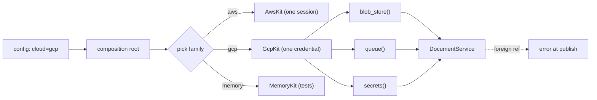

## In one minute
- An abstract factory is one object that creates a whole family of related objects: a blob store, a queue and a secrets client for one cloud, or a connection, statements and transactions for one database driver. Callers get every product through the same factory, so the products are guaranteed to belong together.
- Factory Method answers "which implementation of this one thing?". Abstract Factory answers "which consistent set of things?", and it turns several configuration choices that must agree into a single choice.
- In modern code it is usually an interface with a few `new_x()` methods, a struct of constructor functions, or a dependency-injection module or profile. The most common second family is the in-memory one used by tests.
- The pattern makes adding a family easy and adding a product type expensive: a new product means a new method on every family. Keep families small, and only group products that really share state or conventions.
- Agents scatter `if cloud == "aws"` checks across each product's construction site. Review asks for one place that picks the family and for products that can only be obtained from it.

## How it works

### The problem
A document-processing service runs on AWS for most customers, on GCP for one large customer with a data-residency contract, and fully in memory in tests. It needs three things from its environment: object storage for uploaded files, a queue to hand work to processors, and a secrets client. The first version picks each one separately:

```python
store   = S3Store(cfg.bucket)      if cfg.storage == "s3"  else GcsStore(cfg.bucket)
queue   = SqsQueue(cfg.queue_url)  if cfg.queue == "sqs"   else PubSubQueue(cfg.topic)
secrets = AwsSecrets(cfg.region)   if cfg.secrets == "aws" else GcpSecrets(cfg.project)
```

Three independent switches allow eight combinations, and only two work. With `storage=gcs` and `queue=sqs`, uploads land in GCS while processors try to read them with AWS credentials. Nothing fails at startup; jobs fail one by one at runtime. The products are related in ways the code does not express: shared credentials, region, HTTP client, and the format of an object reference.

### The shape
Make the family a type:

```python
class CloudKit(Protocol):
    def blob_store(self) -> BlobStore: ...
    def queue(self) -> Queue: ...
    def secrets(self) -> Secrets: ...

kit = {"aws": AwsKit, "gcp": GcpKit, "memory": MemoryKit}[cfg.cloud](cfg)
service = DocumentService(kit)
```

`AwsKit` builds one boto3 session and hands it to every product; `GcpKit` does the same with one set of Google credentials. Configuration has one key, `cloud`, so broken combinations cannot be expressed, and `DocumentService` never names a vendor. Choosing the kit is a factory-method decision (see the Factory Method lesson); what the kit adds is that every later creation agrees with that one choice.

### Factories you already use
- **Database drivers.** In Go's `database/sql/driver`, a `Driver` opens a `Conn`, and the `Conn` creates the `Stmt` and `Tx` objects that only make sense on that connection. JDBC's `Connection.prepareStatement` and Python DB-API's `conn.cursor()` follow the same idea: the connection is the factory, and its products are bound to it.
- **Event loops.** A Python asyncio loop creates futures, tasks, timers and transports (`loop.create_future()`, `loop.create_task()`, `loop.create_connection()`). Installing uvloop swaps the whole family at once. Mixing families is detected: awaiting a future from another loop raises `RuntimeError` saying the future is attached to a different loop.
- **DI profiles.** A Spring `@Profile("test")` or a Guice module swaps a whole set of bindings at once, which is an abstract factory at application scale.

### The axis problem
Picture a table with families as rows and products as columns. Adding a row (a new cloud) is one new class that fills in every column, and nothing else changes. Adding a column (a new product, say a cache) means editing every row, including families owned by other teams. This is the expression problem in miniature. Three things keep it manageable: keep each family to the few products that genuinely share state; split unrelated products into separate, smaller factories; and make a missing product a compile-time or startup error (Python ABCs refuse to instantiate a class with an unimplemented abstract method, TypeScript checks `implements`, and Go code can assert `var _ CloudKit = (*GcpKit)(nil)`).

### When not to use it
- **The products are unrelated.** If storage and queue share nothing and could be mixed safely, two independent factories are simpler and let each vary on its own.
- **There is one family and no tests that need another.** Create the objects directly in the composition root.
- **The "family" is really configuration.** If AWS and GCP differ only in an endpoint URL and a region, one implementation with two configs beats two class hierarchies.

### Reviewing agent-written code
Asked to "add GCP support", an agent will usually add an `elif` in each place a client is built, plus a new config key per product. The diff looks small and correct, and it re-creates the eight-combination problem. Steer it to one `cloud` key, one kit per cloud, and a service that receives the kit or the products. Then check three things: the products a kit creates share its session and credentials rather than each building their own; a product from one kit handed to another kit's product fails loudly; and the in-memory kit is used in tests instead of patching vendor clients.

### The same shape elsewhere
This is close to the *multi-step consistency* shape: several choices must agree, so you collapse them into one. TLS 1.2 cipher suites do the same: `TLS_ECDHE_RSA_WITH_AES_128_GCM_SHA256` names a key exchange, authentication method, cipher and hash analysed together, instead of negotiating four independent choices. A hardware vendor's board support package bundles drivers tested together for the same reason.

## Down the stack

### Layer 1: The contract
Every product created by one factory works with every other product of that factory. Products from different factories are not required to interoperate, and when they are mixed the result must be a clear error at the point of mixing, not silent corruption later. The factory owns resources its products share (sessions, credential caches, connection pools); closing the factory closes them, so products must not outlive it. Whether repeated calls return new products or handles to shared state (two `queue()` calls returning views of the same queue) is part of the contract.

### Layer 2: The mechanism
In Go's `database/sql/driver`, `Driver.Open(name)` returns a `driver.Conn` whose `Prepare` returns a `driver.Stmt` and whose `Begin` returns a `driver.Tx`. The `sql` package keeps each `Stmt` tied to the connection that prepared it and re-prepares it on another pooled connection when needed, because a statement handle from one server session is meaningless on another. In CPython's asyncio, `Task` checks each awaited future's loop with `futures._get_loop(fut)` and raises if it is not the task's own loop. Java's `DocumentBuilderFactory.newInstance()` chooses a family at runtime: a system property, then a `jaxp.properties` file, then `ServiceLoader`, then the platform default. In Python, `abc.ABCMeta` computes `__abstractmethods__` when the class is created, and `object.__new__` raises `TypeError` if any remain, which is how a family missing a product fails at construction time.

### Layer 3: The machine
A kit is a hand-built vtable: an object whose methods each return a product. In Go, an interface value is two words, an itab pointer and a data pointer. The itab holds the concrete type, a hash, and the method addresses for that (interface, type) pair; conversions known at compile time use statically generated itabs, and dynamic ones are computed once by `runtime.getitab` and cached in a global hash table. Each product call is a load from the itab and an indirect call, about 1 to 2 ns when predicted.

That prediction is nearly perfect here. A process runs with one family, so every call site sees one concrete type for its whole life. CPU branch predictors learn the target, JVM and V8 inline caches stay monomorphic and inline the method, and Go's profile-guided optimisation can devirtualise hot sites. The dispatch cost of the pattern rounds to zero.

The real costs are resources. If each product builds its own SDK client, a kit with three products opens three connection pools, resolves credentials three times and pays three sets of TLS handshakes, each one or two round trips plus a few milliseconds of CPU. Sharing one session or HTTP client across the family is the main runtime benefit of the pattern, and forgetting to do it is the main runtime mistake.

### Why it's built this way
1. Some objects are only correct in combination: they share credentials, sessions, connections or reference formats.
2. Choosing each one separately makes invalid combinations expressible, and they fail late, at runtime.
3. So the choice is made once, as a family, and every product is created through that family.
4. Products of a family should share expensive resources, so the factory owns them and controls their lifetime.
5. Adding a product type touches every family, so families stay small and limited to products that truly belong together.

## Diagram


## Worked example
The service above had 38 places that built a storage, queue or secrets client from separate config keys. During the rollout for the data-residency customer, one region was configured with `storage=gcs` and `queue=sqs`. Uploads succeeded, processors failed on every message, and 11,000 documents waited six hours before someone traced the mismatch.

The fix introduced `CloudKit` with three products and three families. Configuration went from three keys per region to one, and the 38 construction sites to zero: services take a kit or its products in their constructors, and `main` builds the kit once. Sharing one SDK session per kit cut processor cold start from 2.1 s to 1.4 s, since credentials were resolved once instead of three times. References carry the kit's scheme (`gs://`, `s3://`) and queues reject foreign ones at publish, so a mismatch now fails on the first upload in staging.

Tests moved from LocalStack containers to `MemoryKit`, and the integration suite dropped from 14 minutes to 3. The cost appeared six months later when a cache product was proposed: three kits to update, one owned by another team. The cache got its own factory instead, because it shared nothing with the others.

## Trade-offs
| Option | Strengths | Weaknesses | Choose when |
| --- | --- | --- | --- |
| Construct each product directly | Simplest; explicit | Invalid combinations possible; vendor names everywhere | One environment, no test doubles |
| Independent factory per product | Each varies freely | Nothing prevents mixing families | Products share nothing |
| Abstract factory (kit interface) | One choice; consistent products; shared resources | New product edits every family | Products share state or conventions |
| Struct or record of constructor functions | Light; easy to override one entry in tests | Consistency depends on how it is filled | Go and TS code that wants a family without classes |
| DI container profiles or modules | Swaps large graphs; lifetimes managed | Indirection; errors at container start | Large applications already using DI |

## Pitfalls in production
- Separate config keys for products that must agree. Fix: one family key, validated at startup.
- Each product creating its own client, pool or credential chain. Fix: the kit creates them once and passes them to every product.
- Products that outlive the kit that owns their session, failing after `close()`. Fix: tie lifetimes together and close the kit last in shutdown.
- Mixed-family objects accepted silently (a `s3://` reference in a GCP queue). Fix: tag products or references with their family and reject foreign ones where they meet.
- One kit growing a method for every new dependency until it is a service locator. Fix: keep products that share state; move unrelated ones to their own factories.
- Families drifting apart in behaviour (in-memory queue delivers exactly once, real one at least once). Fix: one contract test suite run against every family.

## Leadership lens
- Ask which products actually share state. That answer decides the family boundary, and a family drawn too wide makes every new dependency a cross-team change.
- Treat each family as a supported environment with an owner and contract tests. An untested family is a production incident scheduled for its first real use.
- Count configuration combinations. If the number of valid combinations is much smaller than the number of expressible ones, collapse the keys into a family choice.
- For agent work, make the instruction concrete: "new environment = new kit implementing the interface plus contract tests; no environment checks outside `main`."

## Check yourself
1. Three config keys select storage, queue and secrets separately, and only two of eight combinations work. What does an abstract factory change?
   **Answer:** It replaces three choices with one family choice, so the six broken combinations can no longer be configured.
2. Why is adding a new product type harder than adding a new family?
   **Answer:** A new family is one new class implementing existing methods, while a new product adds a method that every existing family, including other teams', must implement.
3. Where does the pattern's runtime cost really come from?
   **Answer:** Not dispatch, which is monomorphic per process and well predicted, but resources: products that each build their own client, pool or credential chain instead of sharing the kit's.
4. When should two products not be in the same factory?
   **Answer:** When they share no state or conventions and mixing implementations is safe; then separate factories let each vary independently and keep the family small.

## Practice
**Task:** Implement an in-memory cloud kit and a client that uses only the kit. `MemoryKit(name)` has `blob_store()` and `queue()`; every product from one kit shares that kit's state, so two `blob_store()` handles see the same blobs and two `queue()` handles see the same messages. `put(key, data)` stores data and returns the reference `"<name>://<key>"`; an empty key fails with `empty key`. `publish(ref)` appends a reference to the queue: a reference not starting with `"<name>://"` fails with `foreign ref: <ref>`, and a reference whose key is not stored fails with `missing blob: <ref>`; nothing is queued on failure. `consume()` removes the oldest reference and returns the data stored under it, or `None` (TypeScript `undefined`, Go `("", false)`) when the queue is empty. `publish_report(kit, key, data)` puts the data with the kit's store, publishes the reference with the kit's queue, and returns the reference; it must work with any kit. Python raises `ValueError`, TypeScript throws `Error`, Go returns an error.

```python starter
class MemoryKit:
    def __init__(self, name):
        self.name = name

    def blob_store(self):
        # TODO: return a store sharing this kit's state
        raise NotImplementedError

    def queue(self):
        # TODO: return a queue sharing this kit's state
        raise NotImplementedError

def publish_report(kit, key, data):
    # TODO
    raise NotImplementedError
```

```python tests
def error_of(fn):
    try:
        fn()
    except ValueError as e:
        return str(e)
    return None

def test_family_round_trip():
    kit = MemoryKit("mem")
    ref = publish_report(kit, "r1.pdf", "hello")
    assert ref == "mem://r1.pdf"
    assert kit.queue().consume() == "hello"

def test_products_share_kit_state():
    kit = MemoryKit("mem")
    kit.blob_store().put("a", "1")
    kit.queue().publish("mem://a")
    assert kit.queue().consume() == "1"
    assert kit.queue().consume() is None

def test_foreign_ref_rejected():
    a, b = MemoryKit("a"), MemoryKit("ab")
    ref = a.blob_store().put("k", "v")
    assert error_of(lambda: b.queue().publish(ref)) == "foreign ref: a://k"
    assert b.queue().consume() is None

def test_missing_blob_rejected():
    kit = MemoryKit("mem")
    assert error_of(lambda: kit.queue().publish("mem://nope")) == "missing blob: mem://nope"
    assert kit.queue().consume() is None

def test_fifo_and_latest_data():
    kit = MemoryKit("mem")
    publish_report(kit, "x", "1")
    publish_report(kit, "y", "2")
    kit.blob_store().put("x", "1b")
    q = kit.queue()
    assert [q.consume(), q.consume(), q.consume()] == ["1b", "2", None]

def test_kits_are_isolated():
    a, b = MemoryKit("a"), MemoryKit("b")
    publish_report(a, "k", "from a")
    assert b.queue().consume() is None
    assert error_of(lambda: b.queue().publish("b://k")) == "missing blob: b://k"

def test_empty_key_rejected():
    kit = MemoryKit("mem")
    assert error_of(lambda: kit.blob_store().put("", "x")) == "empty key"
    assert error_of(lambda: publish_report(kit, "", "x")) == "empty key"
    assert kit.queue().consume() is None

class RecordingKit:
    def __init__(self):
        self.log = []
    def blob_store(self):
        kit = self
        class S:
            def put(self, key, data):
                kit.log.append("put " + key)
                return "rec:" + key
        return S()
    def queue(self):
        kit = self
        class Q:
            def publish(self, ref):
                kit.log.append("publish " + ref)
        return Q()

def test_client_works_with_any_family():
    kit = RecordingKit()
    assert publish_report(kit, "k", "d") == "rec:k"
    assert kit.log == ["put k", "publish rec:k"]
```

```python solution
class _Shared:
    def __init__(self):
        self.blobs = {}
        self.messages = []

class MemoryBlobStore:
    def __init__(self, name, shared):
        self.name, self.shared = name, shared

    def put(self, key, data):
        if key == "":
            raise ValueError("empty key")
        self.shared.blobs[key] = data
        return self.name + "://" + key

class MemoryQueue:
    def __init__(self, name, shared):
        self.name, self.shared = name, shared

    def publish(self, ref):
        prefix = self.name + "://"
        if not ref.startswith(prefix):
            raise ValueError("foreign ref: " + ref)
        if ref[len(prefix):] not in self.shared.blobs:
            raise ValueError("missing blob: " + ref)
        self.shared.messages.append(ref)

    def consume(self):
        if not self.shared.messages:
            return None
        ref = self.shared.messages.pop(0)
        return self.shared.blobs[ref[len(self.name) + 3:]]

class MemoryKit:
    def __init__(self, name):
        self.name = name
        self.shared = _Shared()

    def blob_store(self):
        return MemoryBlobStore(self.name, self.shared)

    def queue(self):
        return MemoryQueue(self.name, self.shared)

def publish_report(kit, key, data):
    ref = kit.blob_store().put(key, data)
    kit.queue().publish(ref)
    return ref
```

```typescript starter
export interface BlobStore { put(key: string, data: string): string; }
export interface Queue {
  publish(ref: string): void;
  consume(): string | undefined;
}
export interface Kit {
  blobStore(): BlobStore;
  queue(): Queue;
}

export class MemoryKit implements Kit {
  constructor(public readonly name: string) {}
  blobStore(): BlobStore { throw new Error("TODO"); }
  queue(): Queue { throw new Error("TODO"); }
}

export function publishReport(kit: Kit, key: string, data: string): string {
  throw new Error("TODO");
}
```

```typescript tests
function errorOf(fn: () => unknown): string | undefined {
  try { fn(); } catch (e) { return (e as Error).message; }
  return undefined;
}

test("family round trip", () => {
  const kit = new MemoryKit("mem");
  assertEqual(publishReport(kit, "r1.pdf", "hello"), "mem://r1.pdf");
  assertEqual(kit.queue().consume(), "hello");
});

test("products share kit state", () => {
  const kit = new MemoryKit("mem");
  kit.blobStore().put("a", "1");
  kit.queue().publish("mem://a");
  assertEqual(kit.queue().consume(), "1");
  assert(kit.queue().consume() === undefined, "queue drained");
});

test("foreign ref rejected", () => {
  const a = new MemoryKit("a"), b = new MemoryKit("ab");
  const ref = a.blobStore().put("k", "v");
  assertEqual(errorOf(() => b.queue().publish(ref)), "foreign ref: a://k");
  assert(b.queue().consume() === undefined, "nothing queued");
});

test("missing blob rejected", () => {
  const kit = new MemoryKit("mem");
  assertEqual(errorOf(() => kit.queue().publish("mem://nope")), "missing blob: mem://nope");
  assert(kit.queue().consume() === undefined, "nothing queued");
});

test("fifo and latest data", () => {
  const kit = new MemoryKit("mem");
  publishReport(kit, "x", "1");
  publishReport(kit, "y", "2");
  kit.blobStore().put("x", "1b");
  const q = kit.queue();
  assertEqual([q.consume(), q.consume()], ["1b", "2"]);
  assert(q.consume() === undefined, "empty");
});

test("kits are isolated", () => {
  const a = new MemoryKit("a"), b = new MemoryKit("b");
  publishReport(a, "k", "from a");
  assert(b.queue().consume() === undefined, "b has no messages");
  assertEqual(errorOf(() => b.queue().publish("b://k")), "missing blob: b://k");
});

test("empty key rejected", () => {
  const kit = new MemoryKit("mem");
  assertEqual(errorOf(() => kit.blobStore().put("", "x")), "empty key");
  assertEqual(errorOf(() => publishReport(kit, "", "x")), "empty key");
  assert(kit.queue().consume() === undefined, "nothing queued");
});

class RecordingKit implements Kit {
  log: string[] = [];
  blobStore(): BlobStore {
    return { put: (key: string, _data: string) => { this.log.push("put " + key); return "rec:" + key; } };
  }
  queue(): Queue {
    return {
      publish: (ref: string) => { this.log.push("publish " + ref); },
      consume: () => undefined,
    };
  }
}

test("client works with any family", () => {
  const kit = new RecordingKit();
  assertEqual(publishReport(kit, "k", "d"), "rec:k");
  assertEqual(kit.log, ["put k", "publish rec:k"]);
});
```

```typescript solution
export interface BlobStore { put(key: string, data: string): string; }
export interface Queue {
  publish(ref: string): void;
  consume(): string | undefined;
}
export interface Kit {
  blobStore(): BlobStore;
  queue(): Queue;
}

interface Shared {
  blobs: Map<string, string>;
  messages: string[];
}

class MemoryBlobStore implements BlobStore {
  constructor(private name: string, private shared: Shared) {}
  put(key: string, data: string): string {
    if (key === "") throw new Error("empty key");
    this.shared.blobs.set(key, data);
    return this.name + "://" + key;
  }
}

class MemoryQueue implements Queue {
  constructor(private name: string, private shared: Shared) {}
  publish(ref: string): void {
    const prefix = this.name + "://";
    if (!ref.startsWith(prefix)) throw new Error("foreign ref: " + ref);
    if (!this.shared.blobs.has(ref.slice(prefix.length))) throw new Error("missing blob: " + ref);
    this.shared.messages.push(ref);
  }
  consume(): string | undefined {
    const ref = this.shared.messages.shift();
    if (ref === undefined) return undefined;
    return this.shared.blobs.get(ref.slice(this.name.length + 3));
  }
}

export class MemoryKit implements Kit {
  private shared: Shared = { blobs: new Map(), messages: [] };
  constructor(public readonly name: string) {}
  blobStore(): BlobStore { return new MemoryBlobStore(this.name, this.shared); }
  queue(): Queue { return new MemoryQueue(this.name, this.shared); }
}

export function publishReport(kit: Kit, key: string, data: string): string {
  const ref = kit.blobStore().put(key, data);
  kit.queue().publish(ref);
  return ref;
}
```

```go starter
package practice

type BlobStore interface {
	Put(key, data string) (string, error)
}

type Queue interface {
	Publish(ref string) error
	Consume() (string, bool)
}

type Kit interface {
	BlobStore() BlobStore
	Queue() Queue
}

type MemoryKit struct {
	Name string
}

func NewMemoryKit(name string) *MemoryKit { return &MemoryKit{Name: name} }

func (k *MemoryKit) BlobStore() BlobStore { panic("TODO") }
func (k *MemoryKit) Queue() Queue         { panic("TODO") }

func PublishReport(kit Kit, key, data string) (string, error) {
	panic("TODO")
}
```

```go tests
package practice

import (
	"reflect"
	"testing"
)

func errText(err error) string {
	if err == nil {
		return ""
	}
	return err.Error()
}

func TestFamilyRoundTrip(t *testing.T) {
	kit := NewMemoryKit("mem")
	ref, err := PublishReport(kit, "r1.pdf", "hello")
	if err != nil || ref != "mem://r1.pdf" {
		t.Fatalf("got %q %v", ref, err)
	}
	if v, ok := kit.Queue().Consume(); !ok || v != "hello" {
		t.Fatalf("got %q %v", v, ok)
	}
}

func TestProductsShareKitState(t *testing.T) {
	kit := NewMemoryKit("mem")
	kit.BlobStore().Put("a", "1")
	if err := kit.Queue().Publish("mem://a"); err != nil {
		t.Fatal(err)
	}
	if v, ok := kit.Queue().Consume(); !ok || v != "1" {
		t.Fatalf("got %q %v", v, ok)
	}
	if _, ok := kit.Queue().Consume(); ok {
		t.Fatal("queue should be drained")
	}
}

func TestForeignRefRejected(t *testing.T) {
	a, b := NewMemoryKit("a"), NewMemoryKit("ab")
	ref, _ := a.BlobStore().Put("k", "v")
	if got := errText(b.Queue().Publish(ref)); got != "foreign ref: a://k" {
		t.Fatalf("got %q", got)
	}
	if _, ok := b.Queue().Consume(); ok {
		t.Fatal("nothing should be queued")
	}
}

func TestMissingBlobRejected(t *testing.T) {
	kit := NewMemoryKit("mem")
	if got := errText(kit.Queue().Publish("mem://nope")); got != "missing blob: mem://nope" {
		t.Fatalf("got %q", got)
	}
	if _, ok := kit.Queue().Consume(); ok {
		t.Fatal("nothing should be queued")
	}
}

func TestFIFOAndLatestData(t *testing.T) {
	kit := NewMemoryKit("mem")
	PublishReport(kit, "x", "1")
	PublishReport(kit, "y", "2")
	kit.BlobStore().Put("x", "1b")
	q := kit.Queue()
	v1, _ := q.Consume()
	v2, _ := q.Consume()
	_, ok := q.Consume()
	if v1 != "1b" || v2 != "2" || ok {
		t.Fatalf("got %q %q %v", v1, v2, ok)
	}
}

func TestKitsAreIsolated(t *testing.T) {
	a, b := NewMemoryKit("a"), NewMemoryKit("b")
	PublishReport(a, "k", "from a")
	if _, ok := b.Queue().Consume(); ok {
		t.Fatal("b should have no messages")
	}
	if got := errText(b.Queue().Publish("b://k")); got != "missing blob: b://k" {
		t.Fatalf("got %q", got)
	}
}

func TestEmptyKeyRejected(t *testing.T) {
	kit := NewMemoryKit("mem")
	if _, err := kit.BlobStore().Put("", "x"); errText(err) != "empty key" {
		t.Fatalf("got %v", err)
	}
	if _, err := PublishReport(kit, "", "x"); errText(err) != "empty key" {
		t.Fatalf("got %v", err)
	}
	if _, ok := kit.Queue().Consume(); ok {
		t.Fatal("nothing should be queued")
	}
}

type recordingKit struct{ log []string }
type recStore struct{ k *recordingKit }
type recQueue struct{ k *recordingKit }

func (s recStore) Put(key, data string) (string, error) {
	s.k.log = append(s.k.log, "put "+key)
	return "rec:" + key, nil
}
func (q recQueue) Publish(ref string) error {
	q.k.log = append(q.k.log, "publish "+ref)
	return nil
}
func (q recQueue) Consume() (string, bool) { return "", false }
func (k *recordingKit) BlobStore() BlobStore { return recStore{k} }
func (k *recordingKit) Queue() Queue         { return recQueue{k} }

func TestClientWorksWithAnyFamily(t *testing.T) {
	kit := &recordingKit{}
	ref, err := PublishReport(kit, "k", "d")
	if err != nil || ref != "rec:k" {
		t.Fatalf("got %q %v", ref, err)
	}
	if !reflect.DeepEqual(kit.log, []string{"put k", "publish rec:k"}) {
		t.Fatalf("log %v", kit.log)
	}
}
```

```go solution
package practice

import (
	"errors"
	"strings"
)

type BlobStore interface {
	Put(key, data string) (string, error)
}

type Queue interface {
	Publish(ref string) error
	Consume() (string, bool)
}

type Kit interface {
	BlobStore() BlobStore
	Queue() Queue
}

type shared struct {
	blobs    map[string]string
	messages []string
}

type memStore struct {
	name string
	s    *shared
}

func (m memStore) Put(key, data string) (string, error) {
	if key == "" {
		return "", errors.New("empty key")
	}
	m.s.blobs[key] = data
	return m.name + "://" + key, nil
}

type memQueue struct {
	name string
	s    *shared
}

func (m memQueue) Publish(ref string) error {
	key, ok := strings.CutPrefix(ref, m.name+"://")
	if !ok {
		return errors.New("foreign ref: " + ref)
	}
	if _, found := m.s.blobs[key]; !found {
		return errors.New("missing blob: " + ref)
	}
	m.s.messages = append(m.s.messages, ref)
	return nil
}

func (m memQueue) Consume() (string, bool) {
	if len(m.s.messages) == 0 {
		return "", false
	}
	ref := m.s.messages[0]
	m.s.messages = m.s.messages[1:]
	return m.s.blobs[strings.TrimPrefix(ref, m.name+"://")], true
}

type MemoryKit struct {
	Name string
	s    *shared
}

func NewMemoryKit(name string) *MemoryKit {
	return &MemoryKit{Name: name, s: &shared{blobs: map[string]string{}}}
}

func (k *MemoryKit) BlobStore() BlobStore { return memStore{k.Name, k.s} }
func (k *MemoryKit) Queue() Queue         { return memQueue{k.Name, k.s} }

func PublishReport(kit Kit, key, data string) (string, error) {
	ref, err := kit.BlobStore().Put(key, data)
	if err != nil {
		return "", err
	}
	if err := kit.Queue().Publish(ref); err != nil {
		return "", err
	}
	return ref, nil
}
```

## Mock interview
**Prompt:** Your SaaS runs on AWS today. Sales has signed two customers who require deployment in their own GCP and Azure accounts within six months, and the service uses object storage, a queue, a KMS for envelope encryption and a secrets store, built in about 60 places. Design how the code base supports three clouds without tripling its complexity.

- Follow-up: Which of the four products belong in one family, and which could vary independently?
- Follow-up: A queue message carries a storage reference and an encrypted data key. What breaks if storage and KMS come from different clouds, and how is that prevented?
- Follow-up: How do you make sure the Azure family behaves like the AWS one before the first customer finds out it does not?

**A strong answer covers:**
- A cloud kit interface owned by the domain, one implementation per cloud plus an in-memory one, and one configuration key that selects it in the composition root.
- Grouping by shared state: storage, KMS and secrets share credentials and reference formats; anything that shares nothing gets its own factory.
- References and encrypted keys tagged with their family, rejected at the boundary when foreign, and startup checks that every product of the chosen family can reach its service.
- Shared sessions and connection pools owned by the kit, with explicit lifetime and shutdown order.
- A contract test suite run against every family in CI, including delivery semantics, consistency and error mapping, so families cannot silently drift.

## Watch
- [Abstract Factory Pattern, Design Patterns ep 5 (Christopher Okhravi)](https://www.youtube.com/watch?v=v-GiuMmsXj4): the Gang of Four structure built up on a whiteboard, with how it differs from Factory Method.

## Free resources
- [The Abstract Factory Pattern (Brandon Rhodes, python-patterns.guide)](https://python-patterns.guide/gang-of-four/abstract-factory/): why Python often passes classes or callables instead, and where the pattern still fits.
- [database/sql/driver (Go docs)](https://pkg.go.dev/database/sql/driver): `Driver`, `Conn`, `Stmt` and `Tx`, a real product family bound to one connection.
- [Event loop (Python docs)](https://docs.python.org/3/library/asyncio-eventloop.html): the loop as a factory for futures, tasks and transports, and how alternative loops replace the family.
- [DocumentBuilderFactory (Java SE docs)](https://docs.oracle.com/en/java/javase/21/docs/api/java.xml/javax/xml/parsers/DocumentBuilderFactory.html): runtime selection of an implementation family through properties and `ServiceLoader`.
- [Go Data Structures: Interfaces (Russ Cox)](https://research.swtch.com/interfaces): how itabs are built and cached, which is the cost of calling through a kit.
- [Environment abstraction and profiles (Spring docs)](https://docs.spring.io/spring-framework/reference/core/beans/environment.html): swapping whole sets of beans per environment, the pattern at application scale.
