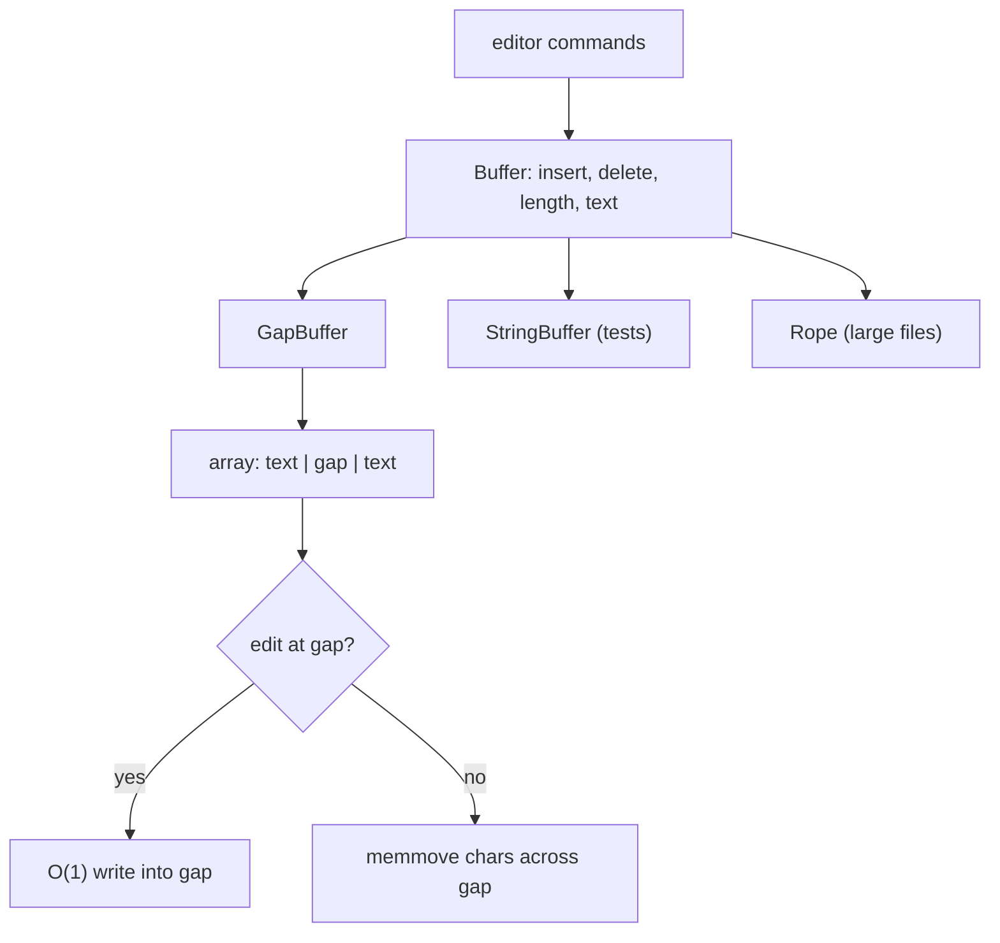

## In one minute
- An abstraction is a simplified model that lets you use something without knowing how it works: a file instead of disk blocks, a `Buffer` instead of an array with a gap. It is a choice of what to show and what to hide.
- Good abstractions are deep: a small interface over a lot of useful work. Shallow ones add a layer that hides nothing and just renames calls.
- Every abstraction has three parts: the operations, the cost model (how fast each one is) and the failure model (what can go wrong). Most abstractions only document the first, and the other two leak.
- Abstract too early and you get the wrong abstraction: a shared base class with flags for every caller's special case. Duplicating code a little is cheaper than a model that does not fit.
- Agents generate abstractions fluently (base classes, managers, generic helpers) because they pattern-match on structure. Ask what each layer hides and what it would cost to delete.

## How it works

### The problem: everything at one level
A text editor's command handler, written quickly:

```python
def on_key(editor, ch):
    s = editor.chars                  # a Python list of characters
    s.insert(editor.cursor, ch)       # shifts everything after the cursor
    editor.cursor += 1
    editor.dirty_lines.add(editor.line_of(editor.cursor))
    if len(s) > editor.autosave_limit:
        write_file(editor.path, "".join(s))
```

Key handling, storage, line tracking and saving are mixed together. Changing the storage, because inserting into a 50 MB list per keystroke is slow, means touching every command that reaches into `editor.chars`. The code handles the *how* of storage when it only cares about the *what*: "put this text here".

### Separate what from how
An abstraction names the what:

```python
class Buffer(Protocol):
    def insert(self, pos: int, text: str) -> None: ...
    def delete(self, pos: int, n: int) -> None: ...
    def length(self) -> int: ...
    def text(self) -> str: ...
```

Behind `Buffer`, storage can be a plain string for tests, a gap buffer (an array with a movable hole at the cursor, as in Emacs), a rope (a balanced tree of chunks) or a piece table (VS Code's choice). Commands do not change when storage does: a decision that may change is hidden behind one that will not.

The Interfaces lesson covers how languages dispatch such a contract, and the Encapsulation lesson covers keeping the hidden part safe. Abstraction is the step before both: deciding which concept to expose.

### Deep and shallow
John Ousterhout's measure is depth: the functionality a module provides divided by the size of its interface. Unix file I/O is deep: five calls (`open`, `read`, `write`, `lseek`, `close`) hide block allocation, caching, permissions, device drivers and dozens of filesystems. A `UserManager` whose methods each forward to one `UserRepository` method is shallow: it adds a file, a name and a stack frame, and hides nothing.

A useful test: inline the layer in your head. If callers would be just as clear calling the thing underneath, the layer is shallow and costs reading time for nothing.

### Abstract classes
An abstract class is a partial implementation with holes that subclasses fill. It fits when implementations share real code that runs in a fixed order (the Template Method lesson). It is the wrong tool for sharing helpers, because it ties every subclass to the base forever, and in Java or C# spends the single base class; a helper module or composition does that job without the coupling.

### The wrong abstraction
Two report exporters share 60 percent of their code, so someone extracts a `BaseExporter`. A third exporter needs one step skipped, so the base gets a `skip_header` flag. A fourth needs a different order, so the base gets a hook. After a year the base class has nine flags, and every change risks one of six subclasses. Sandi Metz's advice applies: duplication is far cheaper than the wrong abstraction. When an abstraction needs flags to serve its callers, inline it back into them and look for the real shared concept again. A common rule is to wait until the third instance before extracting.

### Leaky abstractions
Joel Spolsky's law: all non-trivial abstractions leak. TCP presents a reliable byte stream, but a pulled cable still surfaces as a timeout minutes later. An ORM presents objects, but a loop that touches `order.customer` issues one query per order (the N+1 problem). A `List` presents indexing, but a linked list makes `get(i)` linear. The leak is usually in the cost model or the failure model, which the interface does not mention. The honest response is to document them as part of the contract, as Down the stack shows.

### Reviewing agent-written code
Agents produce abstraction-shaped code quickly: an `AbstractBaseProcessor`, a `ProcessorFactory`, a `ProcessorManager`, generic type parameters nobody instantiates twice. It looks designed and passes tests. In review, ask for each layer: what decision does it hide, and how many implementations exist today? Push back on base classes that only share helpers, on managers that only forward, and on generic code with one concrete use. Ask for the cost and failure notes on any abstraction others will build on.

### The same shape elsewhere
An abstraction boundary is a contract between levels, the same shape as a storage engine API or a cloud service. Amazon S3's original model hid replication behind "put then get", and for years list-after-write was only eventually consistent, a leak that broke data pipelines until S3 became strongly consistent in 2020. Kubernetes presents "desired state" but leaks scheduling and eviction to anyone running stateful workloads.

## Down the stack

### Layer 1: The contract
A complete abstraction states three things: operations (inputs and outputs), costs (which operations are cheap, which are linear, which do I/O) and failures (what errors exist, and what state is left after one). A gap buffer's contract is: `insert` and `delete` at or near the previous edit are O(1) amortised; an edit far away costs O(distance) to move the gap; `text()` is O(n). Callers can then write code that is fast on purpose, not by luck.

### Layer 2: The mechanism
Abstract types are enforced differently in each language. Python's `abc.ABC` records abstract methods at class creation and refuses to instantiate a class that leaves any unimplemented; a `Protocol` describes the shape for type checkers only. Java marks the class `ACC_ABSTRACT`, so the JVM throws `InstantiationError` on `new`, and an abstract method has no bytecode; a subclass compiled against an older base that missed a new abstract method throws `AbstractMethodError` at the call. TypeScript `abstract` is checked by `tsc` and erased: the emitted class is ordinary JavaScript. Go has no abstract classes: an interface plus a struct you embed gives the same split between required methods and shared code.

Leaks come from mechanisms below the abstraction. A `write()` on Linux returns once bytes are copied into the page cache; durability needs `fsync` on the file and, after a rename or create, on the directory, because the "file" abstraction does not promise either. An array presents uniform O(1) access, but memory is fetched in 64-byte cache lines and 4 KB pages, so access order changes speed. A Python list presents "insert anywhere", implemented as a `memmove` of every element after the position.

### Layer 3: The machine
The numbers are what make the leaks matter. Writing to the page cache takes microseconds; `fsync` on an NVMe SSD takes tens of microseconds to a few milliseconds, and on a network disk several milliseconds, so a "save" that calls `fsync` per keystroke is 1,000 times slower than one that does not. Summing a 4096 x 4096 matrix of 4-byte integers row by row reads each 64-byte cache line once; column by column touches a new line, and often a new page, on every access, and runs several times slower for the same O(n) work.

The editor example shows the same at small scale. Inserting one character at the start of a 10 MB document held as a Python list of characters moves 10 million 8-byte pointers, about 80 MB of memory traffic at roughly 10 GB/s, so 8 ms per keystroke, enough to drop frames. A gap buffer at the cursor moves nothing; jumping 1 MB away moves 1 MB once, about 100 us, after which typing is free again. The abstraction is identical; the cost model is not, and the cost model is what the user feels.

### Why it's built this way
1. Programs are too large to hold in one head, so each part must be usable without knowing its inside.
2. Hiding the inside lets the implementation change, so abstractions are drawn around decisions likely to change (Parnas's information hiding).
3. Hardware is not uniform (caches, pages, disks, networks), so any simple model of it is approximate and some cost leaks.
4. Leaks cannot be removed without giving up the simplicity, so good abstractions document their cost and failure models instead.

## Diagram


## Worked example
A notes app stored each document as a single string and rebuilt it on every keystroke: `doc = doc[:pos] + ch + doc[pos:]`. For a 20 KB note that is a 20 KB copy, about 2 us, invisible. Then customers pasted log files into notes. At 5 MB a keystroke cost about 1 ms to copy, plus allocating a 5 MB string that the garbage collector had to reclaim; typing stuttered at roughly 30 to 60 ms per key once GC pauses landed.

Because every edit already went through a `Buffer` interface with `insert`, `delete` and `text`, the team swapped in a gap buffer in one pull request of about 150 lines. Typing cost fell to under 1 us per key regardless of document size. The leak they then found was `text()`: the autosave and the word counter each called it on every keystroke, materialising the whole 5 MB document twice per key. Adding `length()` and an incremental word count to the abstraction, and debouncing autosave to once per second, removed it. The interface grew by two operations, both motivated by the cost model.

## Trade-offs
| Option | Strengths | Weaknesses | Choose when |
| --- | --- | --- | --- |
| No abstraction, direct use | Nothing to learn; no indirection | Callers change when the detail changes | One caller; detail unlikely to change |
| Deep module (small interface, much hidden) | Simplifies every caller; implementation can change | Harder to design; cost model must be documented | Many callers; volatile implementation |
| Shallow wrapper | Looks tidy | Extra layer that hides nothing | Rarely; only to adapt a foreign API |
| Abstract base class | Shares code and fixed-order steps | Couples subclasses to the base | Real shared algorithm, few variants |
| Duplication until the third use | Avoids the wrong abstraction | Copies can drift | The shared concept is not clear yet |

## Pitfalls in production
- Abstractions that hide cost, such as a property that runs a database query, called in a loop. Fix: name expensive operations as operations (`load_customer()`), and document costs.
- Base classes grown flags for every subclass. Fix: inline the abstraction back into callers and re-extract what is truly shared.
- Hiding failures, such as a storage interface that swallows `fsync` errors. Fix: make the failure model part of the contract and surface errors.
- Shallow layers added "for future flexibility". Fix: delete them; add the layer when the second implementation exists.
- Tests that only use the simple fake behind an abstraction, never the real implementation's cost or failure behaviour. Fix: run the contract tests against the real one too, including slow paths.

## Leadership lens
- In design review, ask what each new layer hides and what decision it lets you change later. "Nothing yet" means it can wait.
- Require abstractions shared across teams to document cost and failure models, not just method signatures. That is where integrations break.
- Budget time to remove wrong abstractions. Inlining a bad base class is real work that rarely gets scheduled unless someone owns it.
- Treat a growing list of flags or special cases on a shared abstraction as a signal to revisit the model, not as normal growth.

## Check yourself
1. Why is a class whose every method forwards to one method of another class considered shallow?
   **Answer:** Its interface is as large as what it hides, so callers gain nothing: they learn a new name and still deal with the same concepts. Depth is a lot of functionality behind a small interface.
2. Your storage interface has `save(doc)`. A user loses a document after a power cut although `save` returned. What leaked?
   **Answer:** The failure and durability model: `save` wrote into the OS page cache but did not `fsync` the file or its directory, so the data was not on disk. The contract must say whether `save` means durable.
3. When should you not extract an abstraction from two similar functions?
   **Answer:** When you cannot yet name the shared concept or the differences are still changing. Waiting for a third instance usually reveals the real abstraction, and duplication is cheaper than undoing a wrong one.
4. Why does a gap buffer make typing cheap but jumping across a large file expensive?
   **Answer:** Edits at the gap write straight into free space, while moving the edit point shifts every character between the old and new positions across the gap.

## Practice
**Task:** Implement a gap buffer behind a `Buffer` abstraction and an edit applier that works with any buffer. `GapBuffer(capacity)` stores characters in an array with a gap at the edit point. `insert(pos, text)` requires `0 <= pos <= length()`; `delete(pos, n)` requires `pos >= 0`, `n >= 0` and `pos + n <= length()`; both otherwise fail with `bad position: <pos>`. `length()` and `text()` do what they say. When the gap is too small, grow the array to at least double its capacity. `moved()` returns how many characters gap movement has shifted so far (growth does not count), so edits at the previous edit point cost zero. `apply_edits(buf, edits)` applies a list of edits to any buffer and returns its text: `["ins", pos, text]`, `["del", pos, n]` and `["end", text]` (insert at the end); any other op fails with `unknown op: <op>`. In Go, edits are `Edit{Op, Pos, N, Text}`. Python raises `ValueError`, TypeScript throws `Error`, Go returns an error.

```python starter
class GapBuffer:
    def __init__(self, capacity=16):
        self._buf = [""] * max(1, capacity)
        self._gap_start = 0
        self._gap_end = len(self._buf)
        self._moved = 0

    def length(self):
        # TODO
        raise NotImplementedError

    def insert(self, pos, text):
        # TODO: move the gap to pos, grow if needed, write into the gap
        raise NotImplementedError

    def delete(self, pos, n):
        # TODO: move the gap to pos, then widen it by n
        raise NotImplementedError

    def text(self):
        # TODO
        raise NotImplementedError

    def moved(self):
        return self._moved

def apply_edits(buf, edits):
    # TODO
    raise NotImplementedError
```

```python tests
class StringBuffer:
    def __init__(self):
        self.s = ""
    def insert(self, pos, text):
        if pos < 0 or pos > len(self.s):
            raise ValueError("bad position: %d" % pos)
        self.s = self.s[:pos] + text + self.s[pos:]
    def delete(self, pos, n):
        if pos < 0 or n < 0 or pos + n > len(self.s):
            raise ValueError("bad position: %d" % pos)
        self.s = self.s[:pos] + self.s[pos + n:]
    def length(self):
        return len(self.s)
    def text(self):
        return self.s

SCRIPT = [["end", "hello world"], ["ins", 5, ","], ["del", 0, 1], ["ins", 0, "J"],
          ["end", "!"], ["del", 6, 6], ["ins", 6, " there"], ["ins", 0, ">> "]]

def error_of(fn):
    try:
        fn()
    except ValueError as e:
        return str(e)
    return None

def test_basic_insert_and_delete():
    b = GapBuffer(4)
    b.insert(0, "abc")
    b.insert(3, "def")
    b.insert(1, "XY")
    assert b.text() == "aXYbcdef" and b.length() == 8
    b.delete(1, 2)
    assert b.text() == "abcdef"

def test_same_script_same_result_on_any_buffer():
    want = apply_edits(StringBuffer(), SCRIPT)
    assert want == ">> Jello, there!"
    assert apply_edits(GapBuffer(2), SCRIPT) == want

def test_typing_at_cursor_moves_nothing():
    b = GapBuffer(2)
    for ch in "x" * 500:
        b.insert(b.length(), ch)
    assert b.length() == 500 and b.moved() == 0

def test_jumping_moves_the_characters_in_between():
    b = GapBuffer(8)
    b.insert(0, "abcdefghij")
    b.insert(4, "-")
    assert b.moved() == 6
    b.insert(5, "+")
    assert b.moved() == 6
    b.delete(0, 1)
    assert b.moved() == 12
    assert b.text() == "bcd-+efghij"

def test_bad_positions():
    b = GapBuffer()
    b.insert(0, "abc")
    assert error_of(lambda: b.insert(4, "x")) == "bad position: 4"
    assert error_of(lambda: b.insert(-1, "x")) == "bad position: -1"
    assert error_of(lambda: b.delete(2, 2)) == "bad position: 2"
    assert b.text() == "abc"

def test_unknown_op():
    assert error_of(lambda: apply_edits(GapBuffer(), [["ins", 0, "a"], ["upcase"]])) == "unknown op: upcase"

def test_empty_and_zero_length_edits():
    b = GapBuffer(1)
    assert b.text() == "" and b.length() == 0
    b.insert(0, "")
    b.delete(0, 0)
    assert b.text() == ""
```

```python solution
class GapBuffer:
    def __init__(self, capacity=16):
        self._buf = [""] * max(1, capacity)
        self._gap_start = 0
        self._gap_end = len(self._buf)
        self._moved = 0

    def length(self):
        return len(self._buf) - (self._gap_end - self._gap_start)

    def _move_gap(self, pos):
        while self._gap_start > pos:
            self._gap_start -= 1
            self._gap_end -= 1
            self._buf[self._gap_end] = self._buf[self._gap_start]
            self._moved += 1
        while self._gap_start < pos:
            self._buf[self._gap_start] = self._buf[self._gap_end]
            self._gap_start += 1
            self._gap_end += 1
            self._moved += 1

    def _ensure_gap(self, need):
        gap = self._gap_end - self._gap_start
        if gap >= need:
            return
        new_cap = max(2 * len(self._buf), self.length() + need)
        extra = new_cap - len(self._buf)
        self._buf = (self._buf[:self._gap_start] + [""] * (gap + extra)
                     + self._buf[self._gap_end:])
        self._gap_end += extra

    def insert(self, pos, text):
        if pos < 0 or pos > self.length():
            raise ValueError("bad position: %d" % pos)
        self._move_gap(pos)
        self._ensure_gap(len(text))
        for ch in text:
            self._buf[self._gap_start] = ch
            self._gap_start += 1

    def delete(self, pos, n):
        if pos < 0 or n < 0 or pos + n > self.length():
            raise ValueError("bad position: %d" % pos)
        self._move_gap(pos)
        self._gap_end += n

    def text(self):
        return "".join(self._buf[:self._gap_start] + self._buf[self._gap_end:])

    def moved(self):
        return self._moved

def apply_edits(buf, edits):
    for e in edits:
        op = e[0]
        if op == "ins":
            buf.insert(e[1], e[2])
        elif op == "del":
            buf.delete(e[1], e[2])
        elif op == "end":
            buf.insert(buf.length(), e[1])
        else:
            raise ValueError("unknown op: " + str(op))
    return buf.text()
```

```typescript starter
export interface Buffer {
  insert(pos: number, text: string): void;
  delete(pos: number, n: number): void;
  length(): number;
  text(): string;
}

export type Edit = ["ins", number, string] | ["del", number, number] | ["end", string];

export class GapBuffer implements Buffer {
  constructor(capacity = 16) {}
  insert(pos: number, text: string): void { throw new Error("TODO"); }
  delete(pos: number, n: number): void { throw new Error("TODO"); }
  length(): number { throw new Error("TODO"); }
  text(): string { throw new Error("TODO"); }
  moved(): number { throw new Error("TODO"); }
}

export function applyEdits(buf: Buffer, edits: Edit[]): string {
  throw new Error("TODO");
}
```

```typescript tests
class StringBuffer implements Buffer {
  s = "";
  insert(pos: number, text: string): void {
    if (pos < 0 || pos > this.s.length) throw new Error("bad position: " + pos);
    this.s = this.s.slice(0, pos) + text + this.s.slice(pos);
  }
  delete(pos: number, n: number): void {
    if (pos < 0 || n < 0 || pos + n > this.s.length) throw new Error("bad position: " + pos);
    this.s = this.s.slice(0, pos) + this.s.slice(pos + n);
  }
  length(): number { return this.s.length; }
  text(): string { return this.s; }
}

const SCRIPT: Edit[] = [["end", "hello world"], ["ins", 5, ","], ["del", 0, 1], ["ins", 0, "J"],
  ["end", "!"], ["del", 6, 6], ["ins", 6, " there"], ["ins", 0, ">> "]];

function errorOf(fn: () => void): string | undefined {
  try { fn(); } catch (e) { return (e as Error).message; }
  return undefined;
}

test("basic insert and delete", () => {
  const b = new GapBuffer(4);
  b.insert(0, "abc");
  b.insert(3, "def");
  b.insert(1, "XY");
  assertEqual(b.text(), "aXYbcdef");
  assertEqual(b.length(), 8);
  b.delete(1, 2);
  assertEqual(b.text(), "abcdef");
});

test("same script same result on any buffer", () => {
  const want = applyEdits(new StringBuffer(), SCRIPT);
  assertEqual(want, ">> Jello, there!");
  assertEqual(applyEdits(new GapBuffer(2), SCRIPT), want);
});

test("typing at cursor moves nothing", () => {
  const b = new GapBuffer(2);
  for (let i = 0; i < 500; i++) b.insert(b.length(), "x");
  assertEqual(b.length(), 500);
  assertEqual(b.moved(), 0);
});

test("jumping moves the characters in between", () => {
  const b = new GapBuffer(8);
  b.insert(0, "abcdefghij");
  b.insert(4, "-");
  assertEqual(b.moved(), 6);
  b.insert(5, "+");
  assertEqual(b.moved(), 6);
  b.delete(0, 1);
  assertEqual(b.moved(), 12);
  assertEqual(b.text(), "bcd-+efghij");
});

test("bad positions", () => {
  const b = new GapBuffer();
  b.insert(0, "abc");
  assertEqual(errorOf(() => b.insert(4, "x")), "bad position: 4");
  assertEqual(errorOf(() => b.insert(-1, "x")), "bad position: -1");
  assertEqual(errorOf(() => b.delete(2, 2)), "bad position: 2");
  assertEqual(b.text(), "abc");
});

test("unknown op", () => {
  const edits = [["ins", 0, "a"], ["upcase"]] as unknown as Edit[];
  assertEqual(errorOf(() => applyEdits(new GapBuffer(), edits)), "unknown op: upcase");
});

test("empty and zero-length edits", () => {
  const b = new GapBuffer(1);
  assertEqual(b.text(), "");
  assertEqual(b.length(), 0);
  b.insert(0, "");
  b.delete(0, 0);
  assertEqual(b.text(), "");
});
```

```typescript solution
export interface Buffer {
  insert(pos: number, text: string): void;
  delete(pos: number, n: number): void;
  length(): number;
  text(): string;
}

export type Edit = ["ins", number, string] | ["del", number, number] | ["end", string];

export class GapBuffer implements Buffer {
  #buf: string[];
  #gapStart = 0;
  #gapEnd: number;
  #moved = 0;

  constructor(capacity = 16) {
    this.#buf = new Array<string>(Math.max(1, capacity)).fill("");
    this.#gapEnd = this.#buf.length;
  }

  length(): number { return this.#buf.length - (this.#gapEnd - this.#gapStart); }

  #moveGap(pos: number): void {
    while (this.#gapStart > pos) {
      this.#gapStart--;
      this.#gapEnd--;
      this.#buf[this.#gapEnd] = this.#buf[this.#gapStart];
      this.#moved++;
    }
    while (this.#gapStart < pos) {
      this.#buf[this.#gapStart] = this.#buf[this.#gapEnd];
      this.#gapStart++;
      this.#gapEnd++;
      this.#moved++;
    }
  }

  #ensureGap(need: number): void {
    const gap = this.#gapEnd - this.#gapStart;
    if (gap >= need) return;
    const newCap = Math.max(2 * this.#buf.length, this.length() + need);
    const extra = newCap - this.#buf.length;
    this.#buf = [
      ...this.#buf.slice(0, this.#gapStart),
      ...new Array<string>(gap + extra).fill(""),
      ...this.#buf.slice(this.#gapEnd),
    ];
    this.#gapEnd += extra;
  }

  insert(pos: number, text: string): void {
    if (pos < 0 || pos > this.length()) throw new Error("bad position: " + pos);
    this.#moveGap(pos);
    this.#ensureGap(text.length);
    for (const ch of text) this.#buf[this.#gapStart++] = ch;
  }

  delete(pos: number, n: number): void {
    if (pos < 0 || n < 0 || pos + n > this.length()) throw new Error("bad position: " + pos);
    this.#moveGap(pos);
    this.#gapEnd += n;
  }

  text(): string {
    return this.#buf.slice(0, this.#gapStart).join("") + this.#buf.slice(this.#gapEnd).join("");
  }

  moved(): number { return this.#moved; }
}

export function applyEdits(buf: Buffer, edits: Edit[]): string {
  for (const e of edits) {
    switch (e[0]) {
      case "ins": buf.insert(e[1], e[2]); break;
      case "del": buf.delete(e[1], e[2]); break;
      case "end": buf.insert(buf.length(), e[1]); break;
      default: throw new Error("unknown op: " + String((e as unknown[])[0]));
    }
  }
  return buf.text();
}
```

```go starter
package practice

type Buffer interface {
	Insert(pos int, text string) error
	Delete(pos, n int) error
	Len() int
	String() string
}

type Edit struct {
	Op   string // "ins", "del" or "end"
	Pos  int
	N    int
	Text string
}

type GapBuffer struct {
	buf      []byte
	gapStart int
	gapEnd   int
	moved    int
}

func NewGapBuffer(capacity int) *GapBuffer {
	if capacity < 1 {
		capacity = 1
	}
	return &GapBuffer{buf: make([]byte, capacity), gapEnd: capacity}
}

func (g *GapBuffer) Insert(pos int, text string) error { panic("TODO") }
func (g *GapBuffer) Delete(pos, n int) error          { panic("TODO") }
func (g *GapBuffer) Len() int                         { panic("TODO") }
func (g *GapBuffer) String() string                   { panic("TODO") }
func (g *GapBuffer) Moved() int                       { return g.moved }

func ApplyEdits(b Buffer, edits []Edit) (string, error) {
	panic("TODO")
}
```

```go tests
package practice

import (
	"fmt"
	"strings"
	"testing"
)

type stringBuffer struct{ s string }

func (b *stringBuffer) Insert(pos int, text string) error {
	if pos < 0 || pos > len(b.s) {
		return fmt.Errorf("bad position: %d", pos)
	}
	b.s = b.s[:pos] + text + b.s[pos:]
	return nil
}

func (b *stringBuffer) Delete(pos, n int) error {
	if pos < 0 || n < 0 || pos+n > len(b.s) {
		return fmt.Errorf("bad position: %d", pos)
	}
	b.s = b.s[:pos] + b.s[pos+n:]
	return nil
}

func (b *stringBuffer) Len() int       { return len(b.s) }
func (b *stringBuffer) String() string { return b.s }

var script = []Edit{
	{Op: "end", Text: "hello world"}, {Op: "ins", Pos: 5, Text: ","}, {Op: "del", Pos: 0, N: 1},
	{Op: "ins", Pos: 0, Text: "J"}, {Op: "end", Text: "!"}, {Op: "del", Pos: 6, N: 6},
	{Op: "ins", Pos: 6, Text: " there"}, {Op: "ins", Pos: 0, Text: ">> "},
}

func mustDo(t *testing.T, err error) {
	t.Helper()
	if err != nil {
		t.Fatal(err)
	}
}

func TestBasicInsertAndDelete(t *testing.T) {
	b := NewGapBuffer(4)
	mustDo(t, b.Insert(0, "abc"))
	mustDo(t, b.Insert(3, "def"))
	mustDo(t, b.Insert(1, "XY"))
	if b.String() != "aXYbcdef" || b.Len() != 8 {
		t.Fatalf("got %q len %d", b.String(), b.Len())
	}
	mustDo(t, b.Delete(1, 2))
	if b.String() != "abcdef" {
		t.Fatalf("got %q", b.String())
	}
}

func TestSameScriptSameResultOnAnyBuffer(t *testing.T) {
	want, err := ApplyEdits(&stringBuffer{}, script)
	if err != nil || want != ">> Jello, there!" {
		t.Fatalf("reference got %q %v", want, err)
	}
	got, err := ApplyEdits(NewGapBuffer(2), script)
	if err != nil || got != want {
		t.Fatalf("gap buffer got %q %v", got, err)
	}
}

func TestTypingAtCursorMovesNothing(t *testing.T) {
	b := NewGapBuffer(2)
	for i := 0; i < 500; i++ {
		mustDo(t, b.Insert(b.Len(), "x"))
	}
	if b.Len() != 500 || b.Moved() != 0 || b.String() != strings.Repeat("x", 500) {
		t.Fatalf("len %d moved %d", b.Len(), b.Moved())
	}
}

func TestJumpingMovesTheCharactersInBetween(t *testing.T) {
	b := NewGapBuffer(8)
	mustDo(t, b.Insert(0, "abcdefghij"))
	mustDo(t, b.Insert(4, "-"))
	if b.Moved() != 6 {
		t.Fatalf("moved %d", b.Moved())
	}
	mustDo(t, b.Insert(5, "+"))
	if b.Moved() != 6 {
		t.Fatalf("moved %d", b.Moved())
	}
	mustDo(t, b.Delete(0, 1))
	if b.Moved() != 12 || b.String() != "bcd-+efghij" {
		t.Fatalf("moved %d text %q", b.Moved(), b.String())
	}
}

func TestBadPositions(t *testing.T) {
	b := NewGapBuffer(16)
	mustDo(t, b.Insert(0, "abc"))
	cases := []struct {
		err  error
		want string
	}{
		{b.Insert(4, "x"), "bad position: 4"},
		{b.Insert(-1, "x"), "bad position: -1"},
		{b.Delete(2, 2), "bad position: 2"},
	}
	for _, c := range cases {
		if c.err == nil || c.err.Error() != c.want {
			t.Errorf("want %q, got %v", c.want, c.err)
		}
	}
	if b.String() != "abc" {
		t.Fatalf("got %q", b.String())
	}
}

func TestUnknownOp(t *testing.T) {
	_, err := ApplyEdits(NewGapBuffer(16), []Edit{{Op: "ins", Text: "a"}, {Op: "upcase"}})
	if err == nil || err.Error() != "unknown op: upcase" {
		t.Fatalf("got %v", err)
	}
}

func TestEmptyAndZeroLengthEdits(t *testing.T) {
	b := NewGapBuffer(1)
	if b.String() != "" || b.Len() != 0 {
		t.Fatal("not empty")
	}
	mustDo(t, b.Insert(0, ""))
	mustDo(t, b.Delete(0, 0))
	if b.String() != "" {
		t.Fatalf("got %q", b.String())
	}
}
```

```go solution
package practice

import "fmt"

type Buffer interface {
	Insert(pos int, text string) error
	Delete(pos, n int) error
	Len() int
	String() string
}

type Edit struct {
	Op   string // "ins", "del" or "end"
	Pos  int
	N    int
	Text string
}

type GapBuffer struct {
	buf      []byte
	gapStart int
	gapEnd   int
	moved    int
}

func NewGapBuffer(capacity int) *GapBuffer {
	if capacity < 1 {
		capacity = 1
	}
	return &GapBuffer{buf: make([]byte, capacity), gapEnd: capacity}
}

func (g *GapBuffer) Len() int { return len(g.buf) - (g.gapEnd - g.gapStart) }

func (g *GapBuffer) moveGap(pos int) {
	if pos < g.gapStart {
		n := g.gapStart - pos
		copy(g.buf[g.gapEnd-n:g.gapEnd], g.buf[pos:g.gapStart])
		g.gapStart -= n
		g.gapEnd -= n
		g.moved += n
	} else if pos > g.gapStart {
		n := pos - g.gapStart
		copy(g.buf[g.gapStart:g.gapStart+n], g.buf[g.gapEnd:g.gapEnd+n])
		g.gapStart += n
		g.gapEnd += n
		g.moved += n
	}
}

func (g *GapBuffer) ensureGap(need int) {
	gap := g.gapEnd - g.gapStart
	if gap >= need {
		return
	}
	newCap := max(2*len(g.buf), g.Len()+need)
	extra := newCap - len(g.buf)
	nb := make([]byte, newCap)
	copy(nb, g.buf[:g.gapStart])
	copy(nb[g.gapEnd+extra:], g.buf[g.gapEnd:])
	g.buf = nb
	g.gapEnd += extra
}

func (g *GapBuffer) Insert(pos int, text string) error {
	if pos < 0 || pos > g.Len() {
		return fmt.Errorf("bad position: %d", pos)
	}
	g.moveGap(pos)
	g.ensureGap(len(text))
	g.gapStart += copy(g.buf[g.gapStart:], text)
	return nil
}

func (g *GapBuffer) Delete(pos, n int) error {
	if pos < 0 || n < 0 || pos+n > g.Len() {
		return fmt.Errorf("bad position: %d", pos)
	}
	g.moveGap(pos)
	g.gapEnd += n
	return nil
}

func (g *GapBuffer) String() string {
	return string(g.buf[:g.gapStart]) + string(g.buf[g.gapEnd:])
}

func (g *GapBuffer) Moved() int { return g.moved }

func ApplyEdits(b Buffer, edits []Edit) (string, error) {
	for _, e := range edits {
		var err error
		switch e.Op {
		case "ins":
			err = b.Insert(e.Pos, e.Text)
		case "del":
			err = b.Delete(e.Pos, e.N)
		case "end":
			err = b.Insert(b.Len(), e.Text)
		default:
			err = fmt.Errorf("unknown op: %s", e.Op)
		}
		if err != nil {
			return "", err
		}
	}
	return b.String(), nil
}
```

## Mock interview
**Prompt:** You are designing the storage abstraction for a collaborative document editor. Documents range from a paragraph to 50 MB of pasted logs, 200,000 users edit concurrently, and the same core must run in the browser and on the server. Define the abstraction the editor's commands use and explain what it hides.

- Follow-up: The word counter, the search box and autosave all need the text. What do you add to the abstraction so they do not each copy 50 MB per keystroke?
- Follow-up: An engineer proposes a `BaseDocument` class with subclasses for small and large documents. What do you ask?

**A strong answer covers:**
- A small buffer interface (`insert`, `delete`, `length`, `slice(range)`, change notifications) that hides the representation, so a gap buffer, rope or piece table can be chosen per document size.
- The cost model as part of the contract: which operations are O(1) at the cursor, which are O(n), and that full-text materialisation is expensive; incremental consumers subscribe to changes instead of calling `text()`.
- Composition over a base class: one interface with several implementations selected by size, rather than a hierarchy with shared helpers.
- A failure and durability model for saving: what "saved" means (acknowledged by a replicated log, or `fsync` on the server), surfaced to the user honestly.

## Watch
- [A Philosophy of Software Design (John Ousterhout, Talks at Google)](https://www.youtube.com/watch?v=bmSAYlu0NcY): deep versus shallow modules, and why interface size is the cost of an abstraction.
- [All the Little Things (Sandi Metz, RailsConf 2014)](https://www.youtube.com/watch?v=8bZh5LMaSmE): refactoring tangled conditionals into small objects, and when duplication beats the wrong abstraction.

## Free resources
- [The Law of Leaky Abstractions (Joel Spolsky)](https://www.joelonsoftware.com/2002/11/11/the-law-of-leaky-abstractions/): the original essay with TCP, SQL and string examples.
- [The Wrong Abstraction (Sandi Metz)](https://sandimetz.com/blog/2016/1/20/the-wrong-abstraction): why flag-laden shared code should be inlined back before it is re-extracted.
- [On the Criteria To Be Used in Decomposing Systems into Modules (David Parnas, 1972)](https://www.win.tue.nl/~wstomv/edu/2ip30/references/criteria_for_modularization.pdf): drawing module boundaries around decisions likely to change.
- [The Humble Programmer (Edsger Dijkstra, EWD340)](https://www.cs.utexas.edu/~EWD/transcriptions/EWD03xx/EWD340.html): abstraction as the tool for creating a level where one can be absolutely precise.
- [Files are hard (Dan Luu)](https://danluu.com/file-consistency/): how the file abstraction leaks durability and ordering failures.
- [What Every Programmer Should Know About Memory (Ulrich Drepper)](https://people.freebsd.org/~lstewart/articles/cpumemory.pdf): the cache and page behaviour hidden behind "memory is an array".
