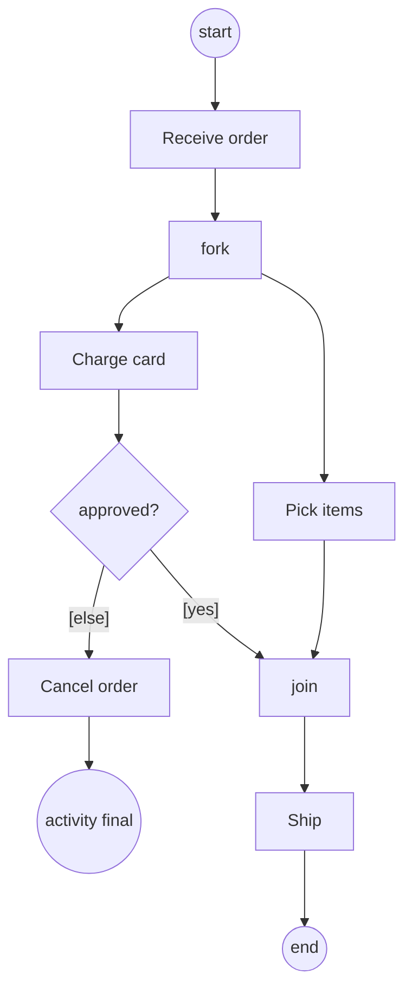

## In one minute
- An activity diagram models a process as actions connected by control flows: what happens, in what order, under which conditions, and what runs in parallel. It is the UML descendant of the flowchart, with concurrency built in.
- Decision and merge diamonds choose one path; fork and join bars split into concurrent paths and wait for all of them. Confusing merge with join is the classic bug: a merge passes every token through, a join waits for one on every input.
- UML defines the semantics as tokens moving along edges, borrowed from Petri nets. Reasoning in tokens explains deadlocks (a join waiting for a token that will never come) and duplicated work (a merge letting two tokens through).
- Swimlanes (partitions) show who performs each action, which makes handoffs between teams or services visible.
- The same model runs in production as BPMN in Camunda, a `Parallel` state in AWS Step Functions, an Airflow DAG, or `Promise.all` and `errgroup` in code.

## How it works

### The nodes
An order fulfilment process at a warehouse makes a good example. It starts at the **initial node** (a filled circle). **Actions** are rounded rectangles: Receive order, Charge card, Pick items, Ship. **Control flows** are arrows between them.

A **decision** (diamond, one input) picks exactly one outgoing edge, each labelled with a guard such as `[approved]` or `[else]`. A **merge** (diamond, several inputs) rejoins alternative paths without waiting. Both use the same shape, so label them.

A **fork** (thick bar, one input) starts concurrent flows: after Receive order, charging and picking run in parallel. A **join** (thick bar, several inputs) waits until every incoming flow has arrived.

There are two ends. The **activity final** (bullseye) stops the whole activity, including any flows still running elsewhere. The **flow final** (circle with an X) ends only the flow that reaches it ([UML 2.5.1, 15.3.3.2](https://www.omg.org/spec/UML/2.5.1/PDF)). Using an activity final at the end of one branch of a fork silently kills the other branches, which is sometimes intended (cancel everything on fraud) and often not.

### Tokens
The UML specification defines activity semantics as token flow ([UML 2.5.1, clause 15](https://www.omg.org/spec/UML/2.5.1/PDF)). The initial node places a token on its outgoing edge. An action fires when a token arrives, and when it completes it offers a token on its outgoing edges. A decision routes its token down one edge; a fork copies it onto every edge; a merge passes each token through as it arrives; a join waits until it holds one token from each incoming edge, then emits one.

This is the Petri net model, where places hold tokens and transitions consume and produce them. Questions such as "can it deadlock?" or "can an action run twice for one order?" become questions about where tokens can end up.

Two bugs follow directly. If a decision inside one fork branch sends its token somewhere other than the join, the join waits forever: a deadlock. If two fork branches end at a merge instead of a join, the action after the merge runs twice.

### Swimlanes, objects and signals
**Partitions** split the diagram into lanes, one per actor, team or service: Customer, Payments, Warehouse. Every arrow that crosses a lane is a handoff, and handoffs are where delays, lost messages and blame live.

**Object nodes** show data passed between actions, such as an `Invoice`. **Send signal** and **accept event** actions show asynchronous messages and waits, an hourglass shows a timer, and an **interruptible region** (dashed box with a lightning-bolt edge) cancels everything inside when an event such as "Order cancelled" arrives.

### Choosing activity over sequence
Use an activity diagram for control flow: branches, loops, parallelism and who does what. Use a sequence diagram for which component calls which, in what order. A checkout often needs both.

### Drawing it in Mermaid
Mermaid still has no activity diagram type, so a flowchart stands in (a separate swimlane diagram type, added in v11.16.0 and marked as new, draws lanes by owner, [Mermaid swimlanes](https://mermaid.js.org/syntax/swimlanes.html)): diamonds `{"..."}` for decisions, labelled edges for guards, and plain nodes named "fork" and "join" for the bars. PlantUML's activity syntax has `fork`, `fork again` and `end fork` keywords, swimlanes with `|Lane|`, and `kill` and `detach` for the two finals.

### Reviewing agent-written workflows
Agents generating workflow definitions or `Promise.all` code make the token bugs above: a decision in a parallel branch that skips the join, a merge where a join was needed, an early `return` that leaves other branches running. Ask where every token goes on every path, or run the model through an executor like the practice task's.

### The same shape elsewhere
Fork and join are the *fan-out* shape: scatter, then gather under a policy (all, any, quorum). A search engine querying 50 shards and a quorum write waiting for two of three replicas face the same choices, and the join policy and straggler handling matter more than the fork.

## Down the stack

### Layer 1: The contract
A well-formed activity promises: an action runs once per token it receives; a decision emits exactly one token, so its guards must cover every case (an `[else]` edge guarantees it); a join emits only after receiving a token on every incoming edge; an activity final terminates all flows immediately, and a flow final consumes one token and nothing else. The activity is complete when a token reaches an activity final, or when no tokens remain. If tokens remain and nothing can fire, the activity is deadlocked.

### Layer 2: The mechanism
Workflow engines implement this contract directly. BPMN 2.0, the process notation from the same standards body as UML, has an exclusive gateway (decision), a parallel gateway (fork when it has several outputs, join when it has several inputs) and an inclusive gateway (fire some outputs, then wait only for those). Camunda's Zeebe engine records, per process instance, which incoming sequence flows of a joining parallel gateway have been taken, and activates the gateway when all of them have. The paths run concurrently, not as parallel threads, because all records of one process instance go to a single partition and one stream processor ([Camunda docs](https://docs.camunda.io/docs/components/modeler/bpmn/parallel-gateways/)).

AWS Step Functions models fork and join as a `Parallel` state with a `Branches` array. It starts every branch, waits for all of them, and passes on an array of their outputs; if any branch fails, the whole state fails and the other branches are stopped, unless a `Catch` handles it. Stopped does not mean undone: Lambda functions already invoked keep running, and activity workers holding a task token are not stopped, so branches need idempotent actions or compensation ([Step Functions docs](https://docs.aws.amazon.com/step-functions/latest/dg/state-parallel.html)). Airflow expresses joins as trigger rules on a task: `all_success` (the default), `all_done`, `one_success`, `none_failed`. Temporal leaves it to code: start activities as futures, then wait on all of them.

In code, a Go fork is `go f()` and a join is `sync.WaitGroup.Wait` or `errgroup.Group.Wait`, which also cancels a shared context on the first error. `Promise.all` is a fail-fast join and `Promise.allSettled` waits for all. Java's `ForkJoinPool` adds work-stealing deques per worker thread.

### Layer 3: The machine
In-process forks are cheap. A goroutine starts with a 2 KB stack and is created in well under a microsecond; an OS thread reserves megabytes of virtual stack and takes tens of microseconds to create, which is why thread pools exist. A join on a WaitGroup is an atomic counter decrement per branch plus, for the waiter, a futex sleep and wakeup costing a few microseconds.

Durable engines persist every token move so the process survives crashes. Step Functions Standard workflows bill each state transition, retries included ([pricing](https://aws.amazon.com/step-functions/pricing/)), Zeebe appends each move to a replicated log, and Temporal caps a workflow's event history at 51,200 events or 50 MB, with a warning at 10,240 events or 10 MB ([Temporal limits](https://docs.temporal.io/cloud/limits)), so long loops use continue-as-new. At 50 transitions per instance and 2 million instances a month, that is 100 million transitions, a real line item.

### Why it's built this way
1. Business processes branch, run in parallel and span teams, so the notation needs decisions, forks and lanes, not just sequence.
2. Pictures of concurrency are easy to misread, so UML gives them precise token semantics borrowed from Petri nets.
3. Precise semantics make the diagram executable, so BPMN engines and workflow services run the model itself.
4. Long-running processes must survive crashes, so engines persist every token move, which makes each transition cost money and latency.

## Diagram


## Worked example
A retailer runs order fulfilment on a workflow engine at 40,000 orders a day. The diagram in the design doc forks after Receive order into Charge card and Pick items, with a join before Ship. Declined cards go to Cancel order, which the team drew ending in a flow final, because "only the payment branch is cancelled".

About 3 percent of cards are declined, 1,200 orders a day. In each, the payment branch's token is consumed by the flow final and the picking branch's token waits at the join forever. The engine shows 1,200 new instances a day stuck "active". Each holds a picked tote on a shelf, and after a week 8,400 totes block the packing area. Nobody gets an error, because a waiting join is a legal state.

An activity final would stop the picking branch but could leave it half done. The team instead routed Cancel order into an interrupting event that also runs Return items to stock, and added a review rule: every fork branch must reach the join, an activity final, or a compensating interrupt. A token-flow executor in CI now runs each process definition under every guard combination, which takes milliseconds.

## In the wild
- **Knight Capital, 2012: one missed step in a release.** On 1 August 2012 Knight lost more than $460 million. In late July it had incorrectly deployed new code to an automated equity router, which triggered a defective function left over from a 2005 change. Knight later agreed to a $12 million penalty and an independent review of its controls ([SEC press release](https://www.sec.gov/newsroom/press-releases/2013-222)). A release is an activity: a fork over servers needs a join that proves every branch finished, which is the join discipline in this lesson.
- **Temporal, documented limit: histories are bounded.** A workflow execution's event history is capped at 51,200 events or 50 MB, with warnings at 10,240 events or 10 MB, so a process that loops forever must restart itself with continue-as-new ([Temporal limits](https://docs.temporal.io/cloud/limits), [continue-as-new](https://docs.temporal.io/workflow-execution/continue-as-new)). The activity diagram needs an explicit loop boundary for the same reason.
- **AWS Step Functions, documented behaviour: a stopped branch is not an undone branch.** When one `Parallel` branch fails the other branches are stopped, but Lambda functions already invoked continue to run ([docs](https://docs.aws.amazon.com/step-functions/latest/dg/state-parallel.html)). Compensation has to be drawn as its own action.

## Trade-offs
| Option | Strengths | Weaknesses | Choose when |
| --- | --- | --- | --- |
| UML activity diagram | Readable, precise token semantics | Not executable by itself | Design discussion, documenting processes |
| BPMN on an engine (Camunda, Zeebe) | The diagram is the program, auditable | Engine to operate, per-transition cost | Long-running business processes with human steps |
| Step Functions or Airflow definitions | Managed, durable, retries built in | JSON or Python DSL hides the picture | Cloud workflows, data pipelines |
| Workflow as code (Temporal) | Full language, testable | Diagram must be drawn separately | Complex logic, developer-owned processes |
| Plain code (`errgroup`, `Promise.all`) | Fast, no infrastructure | Lost on crash, no audit trail | Short in-process concurrency |

## Pitfalls in production
- A decision inside a fork branch routes away from the join, leaving instances waiting forever. Fix: every branch reaches the join, an activity final, or a compensating interrupt; check it mechanically.
- Two parallel branches converge on a merge, so the next action runs twice (two shipments, two emails). Fix: use a join, and make the downstream action idempotent anyway.
- An activity final at the end of one branch kills in-flight work in the others, such as a half-written ledger entry. Fix: use flow finals in branches and compensate explicitly.
- Guards that do not cover all cases leave tokens stuck at a decision. Fix: always include `[else]`, and test every guard combination.
- Fan-out without a bound: a fork over a 50,000-item list starts 50,000 parallel branches and hits engine or API limits. Fix: batch, or use a bounded map with a concurrency limit, such as the `MaxConcurrency` field on a Step Functions `Map` state.

## Leadership lens
- Ask, for every fork in a design, what the join policy is (all, any, quorum), what happens to stragglers, and how a failure in one branch reaches the others.
- Choose between an engine and plain code by duration and audit needs: minutes and in-process means code; days, humans or regulators means a durable engine with a diagram people can read.
- Make "stuck instances older than N hours" a standard alert on every workflow engine; deadlocked joins are silent otherwise.

## Check yourself
1. Two parallel branches end at a diamond with two inputs and one output. Is that a merge or a join, and what goes wrong?
   **Answer:** A diamond is a merge, so it passes both tokens through and the next action runs twice. A join bar is needed to wait for both and emit one token.
2. Why does a flow final in one branch of a fork usually cause a deadlock?
   **Answer:** It consumes that branch's token, so the join never receives a token on that edge and waits forever.
3. How does an activity final differ from a flow final when other branches are still running?
   **Answer:** The activity final terminates the whole activity, including the other branches; a flow final ends only the token that reached it.
4. Which AWS Step Functions behaviour corresponds to a join with fail-fast semantics?
   **Answer:** The `Parallel` state: it waits for all branches, and if one fails the state fails and the remaining branches are stopped unless caught.

## Practice
**Task:** Write a token-flow executor for activity diagrams. `nodes` maps an id to a kind: `initial`, `action`, `decision`, `merge`, `fork`, `join`, `final` or `flowfinal`; `edges` is a list of `(from, to, guard)`. `run(nodes, edges, vars, limit)` starts with one token on each edge out of the single initial node (else fail `expected 1 initial node`). A join is enabled when every incoming edge holds a token and consumes one from each; any other node is enabled when some incoming edge holds a token and consumes one from the first such edge in list order. Each round first settles control nodes: repeatedly fire every enabled non-action node in sorted id order until none is enabled; a decision emits on its first edge in list order whose guard holds (`""` always holds, `x` holds when `vars[x]` is true, `!x` when it is not), else on its `else` edge, else fails `no branch at <id>`; `final` ends the run immediately; `flowfinal` emits nothing; others emit on every outgoing edge. Then every enabled action fires once, in sorted order, emitting on all outgoing edges, and that sorted list is appended as one round. If no action is enabled, return the rounds when no tokens remain, or fail `deadlock at <ids>` listing the sorted, comma-joined target nodes of edges still holding tokens. Fail with `step limit` if more than `limit` rounds would run.

```python starter
def run(nodes, edges, vars, limit):
    # TODO: token game with control settling and action rounds
    raise NotImplementedError
```

```python tests
def fulfilment(cancel_end):
    nodes = {"i": "initial", "receive": "action", "f": "fork", "charge": "action", "pick": "action",
             "d": "decision", "j": "join", "ship": "action", "cancel": "action",
             "end": "final", "stop": cancel_end}
    edges = [("i", "receive", ""), ("receive", "f", ""), ("f", "charge", ""), ("f", "pick", ""),
             ("charge", "d", ""), ("d", "j", "approved"), ("d", "cancel", "else"),
             ("pick", "j", ""), ("j", "ship", ""), ("ship", "end", ""), ("cancel", "stop", "")]
    return nodes, edges

def expect_error(fn, msg):
    try:
        fn()
        assert False, "expected ValueError"
    except ValueError as e:
        assert str(e) == msg

def test_fork_join_happy_path():
    nodes, edges = fulfilment("final")
    assert run(nodes, edges, {"approved": True}, 10) == [["receive"], ["charge", "pick"], ["ship"]]

def test_activity_final_kills_other_branches():
    nodes, edges = fulfilment("final")
    assert run(nodes, edges, {"approved": False}, 10) == [["receive"], ["charge", "pick"], ["cancel"]]

def test_flow_final_in_branch_deadlocks_join():
    nodes, edges = fulfilment("flowfinal")
    expect_error(lambda: run(nodes, edges, {}, 10), "deadlock at j")

def test_merge_lets_both_tokens_through():
    nodes = {"i": "initial", "f": "fork", "x": "action", "y": "action", "m": "merge",
             "log": "action", "ff": "flowfinal"}
    edges = [("i", "f", ""), ("f", "x", ""), ("f", "y", ""), ("x", "m", ""), ("y", "m", ""),
             ("m", "log", ""), ("log", "ff", "")]
    assert run(nodes, edges, {}, 10) == [["x", "y"], ["log"], ["log"]]

def test_loop_negated_guard_and_limit():
    nodes = {"i": "initial", "attempt": "action", "d": "decision", "e": "final"}
    edges = [("i", "attempt", ""), ("attempt", "d", ""), ("d", "attempt", "retry"), ("d", "e", "!retry")]
    assert run(nodes, edges, {"retry": False}, 5) == [["attempt"]]
    expect_error(lambda: run(nodes, edges, {"retry": True}, 3), "step limit")

def test_no_branch_and_bad_initial():
    nodes = {"i": "initial", "d": "decision", "a": "action", "b": "action"}
    edges = [("i", "d", ""), ("d", "a", "x"), ("d", "b", "y")]
    expect_error(lambda: run(nodes, edges, {"x": False}, 5), "no branch at d")
    expect_error(lambda: run({"a": "action"}, [], {}, 5), "expected 1 initial node")

def test_leftover_tokens_on_several_nodes():
    nodes = {"i": "initial", "f": "fork", "j1": "join", "j2": "join", "a": "action"}
    edges = [("i", "f", ""), ("f", "j2", ""), ("f", "j1", ""), ("a", "j1", ""), ("a", "j2", "")]
    expect_error(lambda: run(nodes, edges, {}, 5), "deadlock at j1,j2")
```

```python solution
def run(nodes, edges, vars, limit):
    initials = [n for n in nodes if nodes[n] == "initial"]
    if len(initials) != 1:
        raise ValueError("expected 1 initial node")
    tokens = [0] * len(edges)
    inc = {n: [] for n in nodes}
    out = {n: [] for n in nodes}
    for i, (src, dst, _) in enumerate(edges):
        out[src].append(i)
        inc[dst].append(i)
    for i in out[initials[0]]:
        tokens[i] += 1

    def enabled(n):
        if nodes[n] == "join":
            return len(inc[n]) > 0 and all(tokens[i] > 0 for i in inc[n])
        return any(tokens[i] > 0 for i in inc[n])

    def holds(g):
        if g == "":
            return True
        if g.startswith("!"):
            return not vars.get(g[1:], False)
        return bool(vars.get(g, False))

    def fire(n):
        kind = nodes[n]
        if kind == "join":
            for i in inc[n]:
                tokens[i] -= 1
        else:
            for i in inc[n]:
                if tokens[i] > 0:
                    tokens[i] -= 1
                    break
        if kind == "decision":
            chosen = [i for i in out[n] if edges[i][2] != "else" and holds(edges[i][2])]
            if not chosen:
                chosen = [i for i in out[n] if edges[i][2] == "else"]
            if not chosen:
                raise ValueError("no branch at " + n)
            tokens[chosen[0]] += 1
        elif kind not in ("final", "flowfinal"):
            for i in out[n]:
                tokens[i] += 1

    order = sorted(nodes)
    rounds = []
    while True:
        changed = True
        while changed:
            changed = False
            for n in order:
                if nodes[n] not in ("action", "initial") and enabled(n):
                    fire(n)
                    changed = True
                    if nodes[n] == "final":
                        return rounds
        ready = [n for n in order if nodes[n] == "action" and enabled(n)]
        if not ready:
            waiting = sorted({edges[i][1] for i in range(len(edges)) if tokens[i] > 0})
            if waiting:
                raise ValueError("deadlock at " + ",".join(waiting))
            return rounds
        if len(rounds) == limit:
            raise ValueError("step limit")
        for n in ready:
            fire(n)
        rounds.append(ready)
```

```typescript starter
export type Edge = [string, string, string];

export function run(nodes: Record<string, string>, edges: Edge[], vars: Record<string, boolean>, limit: number): string[][] {
  throw new Error("TODO");
}
```

```typescript tests
function fulfilment(cancelEnd: string): [Record<string, string>, Edge[]] {
  const nodes: Record<string, string> = {
    i: "initial", receive: "action", f: "fork", charge: "action", pick: "action",
    d: "decision", j: "join", ship: "action", cancel: "action", end: "final", stop: cancelEnd,
  };
  const edges: Edge[] = [["i", "receive", ""], ["receive", "f", ""], ["f", "charge", ""], ["f", "pick", ""],
    ["charge", "d", ""], ["d", "j", "approved"], ["d", "cancel", "else"],
    ["pick", "j", ""], ["j", "ship", ""], ["ship", "end", ""], ["cancel", "stop", ""]];
  return [nodes, edges];
}

function errorOf(fn: () => unknown): string {
  try { fn(); } catch (e) { return (e as Error).message; }
  return "";
}

test("fork join happy path", () => {
  const [nodes, edges] = fulfilment("final");
  assertEqual(run(nodes, edges, { approved: true }, 10), [["receive"], ["charge", "pick"], ["ship"]]);
});

test("activity final kills other branches", () => {
  const [nodes, edges] = fulfilment("final");
  assertEqual(run(nodes, edges, { approved: false }, 10), [["receive"], ["charge", "pick"], ["cancel"]]);
});

test("flow final in branch deadlocks join", () => {
  const [nodes, edges] = fulfilment("flowfinal");
  assertEqual(errorOf(() => run(nodes, edges, {}, 10)), "deadlock at j");
});

test("merge lets both tokens through", () => {
  const nodes = { i: "initial", f: "fork", x: "action", y: "action", m: "merge", log: "action", ff: "flowfinal" };
  const edges: Edge[] = [["i", "f", ""], ["f", "x", ""], ["f", "y", ""], ["x", "m", ""], ["y", "m", ""],
    ["m", "log", ""], ["log", "ff", ""]];
  assertEqual(run(nodes, edges, {}, 10), [["x", "y"], ["log"], ["log"]]);
});

test("loop negated guard and limit", () => {
  const nodes = { i: "initial", attempt: "action", d: "decision", e: "final" };
  const edges: Edge[] = [["i", "attempt", ""], ["attempt", "d", ""], ["d", "attempt", "retry"], ["d", "e", "!retry"]];
  assertEqual(run(nodes, edges, { retry: false }, 5), [["attempt"]]);
  assertEqual(errorOf(() => run(nodes, edges, { retry: true }, 3)), "step limit");
});

test("no branch and bad initial", () => {
  const nodes = { i: "initial", d: "decision", a: "action", b: "action" };
  const edges: Edge[] = [["i", "d", ""], ["d", "a", "x"], ["d", "b", "y"]];
  assertEqual(errorOf(() => run(nodes, edges, { x: false }, 5)), "no branch at d");
  assertEqual(errorOf(() => run({ a: "action" }, [], {}, 5)), "expected 1 initial node");
});

test("leftover tokens on several nodes", () => {
  const nodes = { i: "initial", f: "fork", j1: "join", j2: "join", a: "action" };
  const edges: Edge[] = [["i", "f", ""], ["f", "j2", ""], ["f", "j1", ""], ["a", "j1", ""], ["a", "j2", ""]];
  assertEqual(errorOf(() => run(nodes, edges, {}, 5)), "deadlock at j1,j2");
});
```

```typescript solution
export type Edge = [string, string, string];

export function run(nodes: Record<string, string>, edges: Edge[], vars: Record<string, boolean>, limit: number): string[][] {
  const ids = Object.keys(nodes).sort();
  const initials = ids.filter((n) => nodes[n] === "initial");
  if (initials.length !== 1) throw new Error("expected 1 initial node");
  const tokens = edges.map(() => 0);
  const inc: Record<string, number[]> = {};
  const out: Record<string, number[]> = {};
  for (const n of ids) { inc[n] = []; out[n] = []; }
  edges.forEach(([src, dst], i) => { out[src].push(i); inc[dst].push(i); });
  for (const i of out[initials[0]]) tokens[i]++;

  const enabled = (n: string): boolean =>
    nodes[n] === "join"
      ? inc[n].length > 0 && inc[n].every((i) => tokens[i] > 0)
      : inc[n].some((i) => tokens[i] > 0);

  const holds = (g: string): boolean => {
    if (g === "") return true;
    if (g.startsWith("!")) return !vars[g.slice(1)];
    return !!vars[g];
  };

  const fire = (n: string): void => {
    const kind = nodes[n];
    if (kind === "join") {
      for (const i of inc[n]) tokens[i]--;
    } else {
      const i = inc[n].find((k) => tokens[k] > 0)!;
      tokens[i]--;
    }
    if (kind === "decision") {
      let chosen = out[n].find((i) => edges[i][2] !== "else" && holds(edges[i][2]));
      if (chosen === undefined) chosen = out[n].find((i) => edges[i][2] === "else");
      if (chosen === undefined) throw new Error("no branch at " + n);
      tokens[chosen]++;
    } else if (kind !== "final" && kind !== "flowfinal") {
      for (const i of out[n]) tokens[i]++;
    }
  };

  const rounds: string[][] = [];
  for (;;) {
    let changed = true;
    while (changed) {
      changed = false;
      for (const n of ids) {
        if (nodes[n] !== "action" && nodes[n] !== "initial" && enabled(n)) {
          fire(n);
          changed = true;
          if (nodes[n] === "final") return rounds;
        }
      }
    }
    const ready = ids.filter((n) => nodes[n] === "action" && enabled(n));
    if (ready.length === 0) {
      const waiting = [...new Set(edges.filter((_, i) => tokens[i] > 0).map((e) => e[1]))].sort();
      if (waiting.length) throw new Error("deadlock at " + waiting.join(","));
      return rounds;
    }
    if (rounds.length === limit) throw new Error("step limit");
    for (const n of ready) fire(n);
    rounds.push(ready);
  }
}
```

```go starter
package practice

type Edge struct {
	From, To, Guard string
}

func Run(nodes map[string]string, edges []Edge, vars map[string]bool, limit int) ([][]string, error) {
	panic("TODO")
}
```

```go tests
package practice

import (
	"reflect"
	"testing"
)

func fulfilment(cancelEnd string) (map[string]string, []Edge) {
	nodes := map[string]string{
		"i": "initial", "receive": "action", "f": "fork", "charge": "action", "pick": "action",
		"d": "decision", "j": "join", "ship": "action", "cancel": "action", "end": "final", "stop": cancelEnd,
	}
	edges := []Edge{{"i", "receive", ""}, {"receive", "f", ""}, {"f", "charge", ""}, {"f", "pick", ""},
		{"charge", "d", ""}, {"d", "j", "approved"}, {"d", "cancel", "else"},
		{"pick", "j", ""}, {"j", "ship", ""}, {"ship", "end", ""}, {"cancel", "stop", ""}}
	return nodes, edges
}

func expectRounds(t *testing.T, nodes map[string]string, edges []Edge, vars map[string]bool, limit int, want [][]string) {
	t.Helper()
	got, err := Run(nodes, edges, vars, limit)
	if err != nil {
		t.Fatal(err)
	}
	if !reflect.DeepEqual(got, want) {
		t.Fatalf("got %q\nwant %q", got, want)
	}
}

func expectErr(t *testing.T, nodes map[string]string, edges []Edge, vars map[string]bool, limit int, msg string) {
	t.Helper()
	_, err := Run(nodes, edges, vars, limit)
	if err == nil || err.Error() != msg {
		t.Fatalf("got %v, want %s", err, msg)
	}
}

func TestForkJoinHappyPath(t *testing.T) {
	nodes, edges := fulfilment("final")
	expectRounds(t, nodes, edges, map[string]bool{"approved": true}, 10,
		[][]string{{"receive"}, {"charge", "pick"}, {"ship"}})
}

func TestActivityFinalKillsOtherBranches(t *testing.T) {
	nodes, edges := fulfilment("final")
	expectRounds(t, nodes, edges, map[string]bool{"approved": false}, 10,
		[][]string{{"receive"}, {"charge", "pick"}, {"cancel"}})
}

func TestFlowFinalInBranchDeadlocksJoin(t *testing.T) {
	nodes, edges := fulfilment("flowfinal")
	expectErr(t, nodes, edges, nil, 10, "deadlock at j")
}

func TestMergeLetsBothTokensThrough(t *testing.T) {
	nodes := map[string]string{"i": "initial", "f": "fork", "x": "action", "y": "action", "m": "merge", "log": "action", "ff": "flowfinal"}
	edges := []Edge{{"i", "f", ""}, {"f", "x", ""}, {"f", "y", ""}, {"x", "m", ""}, {"y", "m", ""}, {"m", "log", ""}, {"log", "ff", ""}}
	expectRounds(t, nodes, edges, nil, 10, [][]string{{"x", "y"}, {"log"}, {"log"}})
}

func TestLoopNegatedGuardAndLimit(t *testing.T) {
	nodes := map[string]string{"i": "initial", "attempt": "action", "d": "decision", "e": "final"}
	edges := []Edge{{"i", "attempt", ""}, {"attempt", "d", ""}, {"d", "attempt", "retry"}, {"d", "e", "!retry"}}
	expectRounds(t, nodes, edges, map[string]bool{"retry": false}, 5, [][]string{{"attempt"}})
	expectErr(t, nodes, edges, map[string]bool{"retry": true}, 3, "step limit")
}

func TestNoBranchAndBadInitial(t *testing.T) {
	nodes := map[string]string{"i": "initial", "d": "decision", "a": "action", "b": "action"}
	edges := []Edge{{"i", "d", ""}, {"d", "a", "x"}, {"d", "b", "y"}}
	expectErr(t, nodes, edges, map[string]bool{"x": false}, 5, "no branch at d")
	expectErr(t, map[string]string{"a": "action"}, nil, nil, 5, "expected 1 initial node")
}

func TestLeftoverTokensOnSeveralNodes(t *testing.T) {
	nodes := map[string]string{"i": "initial", "f": "fork", "j1": "join", "j2": "join", "a": "action"}
	edges := []Edge{{"i", "f", ""}, {"f", "j2", ""}, {"f", "j1", ""}, {"a", "j1", ""}, {"a", "j2", ""}}
	expectErr(t, nodes, edges, nil, 5, "deadlock at j1,j2")
}
```

```go solution
package practice

import (
	"errors"
	"sort"
	"strings"
)

type Edge struct {
	From, To, Guard string
}

type machine struct {
	nodes    map[string]string
	edges    []Edge
	vars     map[string]bool
	tokens   []int
	inc, out map[string][]int
}

func (m *machine) enabled(n string) bool {
	if m.nodes[n] == "join" {
		if len(m.inc[n]) == 0 {
			return false
		}
		for _, i := range m.inc[n] {
			if m.tokens[i] == 0 {
				return false
			}
		}
		return true
	}
	for _, i := range m.inc[n] {
		if m.tokens[i] > 0 {
			return true
		}
	}
	return false
}

func (m *machine) holds(g string) bool {
	if g == "" {
		return true
	}
	if strings.HasPrefix(g, "!") {
		return !m.vars[g[1:]]
	}
	return m.vars[g]
}

func (m *machine) fire(n string) error {
	kind := m.nodes[n]
	if kind == "join" {
		for _, i := range m.inc[n] {
			m.tokens[i]--
		}
	} else {
		for _, i := range m.inc[n] {
			if m.tokens[i] > 0 {
				m.tokens[i]--
				break
			}
		}
	}
	switch kind {
	case "decision":
		chosen := -1
		for _, i := range m.out[n] {
			if g := m.edges[i].Guard; g != "else" && m.holds(g) {
				chosen = i
				break
			}
		}
		if chosen < 0 {
			for _, i := range m.out[n] {
				if m.edges[i].Guard == "else" {
					chosen = i
					break
				}
			}
		}
		if chosen < 0 {
			return errors.New("no branch at " + n)
		}
		m.tokens[chosen]++
	case "final", "flowfinal":
	default:
		for _, i := range m.out[n] {
			m.tokens[i]++
		}
	}
	return nil
}

func Run(nodes map[string]string, edges []Edge, vars map[string]bool, limit int) ([][]string, error) {
	ids := make([]string, 0, len(nodes))
	var initials []string
	for n, kind := range nodes {
		ids = append(ids, n)
		if kind == "initial" {
			initials = append(initials, n)
		}
	}
	if len(initials) != 1 {
		return nil, errors.New("expected 1 initial node")
	}
	sort.Strings(ids)
	m := &machine{nodes: nodes, edges: edges, vars: vars, tokens: make([]int, len(edges)),
		inc: map[string][]int{}, out: map[string][]int{}}
	for i, e := range edges {
		m.out[e.From] = append(m.out[e.From], i)
		m.inc[e.To] = append(m.inc[e.To], i)
	}
	for _, i := range m.out[initials[0]] {
		m.tokens[i]++
	}
	rounds := [][]string{}
	for {
		for changed := true; changed; {
			changed = false
			for _, n := range ids {
				if k := nodes[n]; k != "action" && k != "initial" && m.enabled(n) {
					if err := m.fire(n); err != nil {
						return nil, err
					}
					changed = true
					if k == "final" {
						return rounds, nil
					}
				}
			}
		}
		var ready []string
		for _, n := range ids {
			if nodes[n] == "action" && m.enabled(n) {
				ready = append(ready, n)
			}
		}
		if len(ready) == 0 {
			seen := map[string]bool{}
			var waiting []string
			for i, e := range edges {
				if m.tokens[i] > 0 && !seen[e.To] {
					seen[e.To] = true
					waiting = append(waiting, e.To)
				}
			}
			if len(waiting) > 0 {
				sort.Strings(waiting)
				return nil, errors.New("deadlock at " + strings.Join(waiting, ","))
			}
			return rounds, nil
		}
		if len(rounds) == limit {
			return nil, errors.New("step limit")
		}
		for _, n := range ready {
			if err := m.fire(n); err != nil {
				return nil, err
			}
		}
		rounds = append(rounds, ready)
	}
}
```

## Mock interview
**Prompt:** Design the onboarding process for a business bank account: identity checks on the directors, a sanctions screen, a credit check, document review by a human analyst, and account opening. 3,000 applications a day; some take a week because of the human step. Draw the activity diagram and explain how it runs in production.

- Follow-up: The sanctions screen returns a hit while the credit check and document review are still running. What happens to them?
- Follow-up: An analyst rejects the documents. How do you make sure no instance is left waiting at a join?
- Follow-up: Workflow engine or plain code with a database table, and why?

**A strong answer covers:**
- Swimlanes for applicant, automated checks and analyst, with a fork for the independent checks and a join before account opening.
- A sanctions hit as an interrupting event that cancels the other branches and runs compensation (withdraw credit inquiry, notify compliance), not a flow final.
- `[else]` on every decision, every branch reaching the join or an interrupt, and an alert on instances stuck longer than the expected human turnaround.
- A durable engine (BPMN or Step Functions) because the process spans days, needs an audit trail, and must survive deploys; cost estimated per transition.
- Idempotent actions, since engines retry steps after crashes.

## Sources and further study
**Primary**
- [UML 2.5.1 specification, PDF (OMG)](https://www.omg.org/spec/UML/2.5.1/PDF): clause 15 defines token semantics, fork, join, merge and the two kinds of final node.
- [SEC press release on Knight Capital](https://www.sec.gov/newsroom/press-releases/2013-222): the regulator's summary of the 2012 router failure.

**Systems docs**
- [Camunda: parallel gateways](https://docs.camunda.io/docs/components/modeler/bpmn/parallel-gateways/): fork and join in a BPMN engine, concurrent but not threaded.
- [AWS Step Functions: Parallel state](https://docs.aws.amazon.com/step-functions/latest/dg/state-parallel.html): failure semantics for branches.
- [Temporal: limits](https://docs.temporal.io/cloud/limits): event history caps that shape long workflows.
- [Temporal: continue-as-new](https://docs.temporal.io/workflow-execution/continue-as-new): restarting a long workflow with a fresh history.
- [Mermaid swimlanes](https://mermaid.js.org/syntax/swimlanes.html): the diagram type for ownership lanes.

**Books**
- *Release It!*, Michael Nygard (2nd edition): the stability patterns for timeouts, bulkheads and circuit breakers that every fork branch needs.
- *Designing Data-Intensive Applications*, Martin Kleppmann: the material on fault tolerance and distributed transactions behind join policies.

**Other curricula**
- [donnemartin/system-design-primer](https://github.com/donnemartin/system-design-primer): treats asynchronism and queues as boxes and arrows, with no token semantics.

## Watch
- [UML 2.0 Activity Diagrams (Derek Banas)](https://www.youtube.com/watch?v=XFTAIj2N2Lc): the notation, including forks, joins, swimlanes and signals, with worked examples.

## Free resources
- [Activity diagram (Wikipedia)](https://en.wikipedia.org/wiki/Activity_diagram): notation summary and relationship to Petri nets.
- [Petri net (Wikipedia)](https://en.wikipedia.org/wiki/Petri_net): the token model behind activity semantics, with reachability and deadlock analysis.
- [Activity diagram (PlantUML)](https://plantuml.com/activity-diagram-beta): fork, join, swimlanes and finals as diagram-as-code.
- [Parallel gateways (Camunda)](https://docs.camunda.io/docs/components/modeler/bpmn/parallel-gateways/): how a BPMN engine forks and joins tokens.
- [Parallel workflow state (AWS Step Functions)](https://docs.aws.amazon.com/step-functions/latest/dg/state-parallel.html): fork and join with fail-fast semantics in a managed service.
- [Business Process Model and Notation (Wikipedia)](https://en.wikipedia.org/wiki/Business_Process_Model_and_Notation): gateways, events and how BPMN relates to UML activities.
