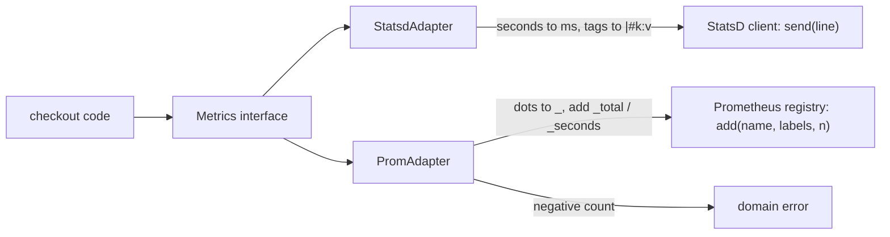

## In one minute
- An adapter makes an existing component usable through an interface it was not written for. It sits between code you own (the *target* interface) and code you cannot or should not change (the *adaptee*: a vendor SDK, a legacy module, a standard library type).
- The adapter's real job is translation, not forwarding: names, units, argument order, error types, null conventions and missing capabilities. A thin adapter that only renames methods is fine; one that hides a semantic mismatch is a bug waiting to happen.
- Adapters are how ports-and-adapters (hexagonal) architecture is built: the domain owns the interface, and each vendor gets one adapter. Swapping vendors becomes a new adapter plus a wiring change, not edits across the codebase.
- At runtime an adapter costs one extra indirect call per operation, which is negligible, plus whatever data conversion it does, which is not always negligible.
- Agents generate adapters quickly and often leak the adaptee through them (vendor exceptions, vendor field names, vendor units). Review the adapter as the place where the vendor's world stops.

## How it works

### The problem
A checkout service records metrics. It was written against a StatsD client, so 180 call sites look like `statsd.timing("checkout.payment", ms, tags=["region:eu"])`. The platform team is moving to Prometheus, which has different rules: metric names may not contain dots, counters must never decrease, durations are measured in seconds, and labels are key-value pairs, not `"k:v"` strings. Rewriting 180 call sites is risky and would have to be repeated at the next migration.

The fix is to stop letting call sites speak a vendor's language. Define the interface the service actually wants, in its own terms:

```python
class Metrics(Protocol):
    def count(self, name: str, value: int, tags: dict[str, str]) -> None: ...
    def timing(self, name: str, seconds: float, tags: dict[str, str]) -> None: ...
```

Then write one adapter per backend. The StatsD adapter turns seconds into milliseconds and tags into `|#k:v` suffixes. The Prometheus adapter turns `checkout.payment` into `checkout_payment_seconds`, rejects negative counts and passes labels as a map. Call sites move once, to `metrics.timing(...)`, and never move again.

### Object adapter and class adapter
The Gang of Four describe two forms. An *object adapter* holds a reference to the adaptee and implements the target interface by calling it. A *class adapter* inherits from the adaptee and implements the target interface at the same time. Prefer the object adapter almost always: it works with final classes and with interfaces, it can wrap any implementation of the adaptee (including a fake in tests), and it does not expose the adaptee's whole public surface through inheritance. Go has no inheritance, so every Go adapter is an object adapter, sometimes a struct that embeds the adaptee (which, note, re-exports all its methods).

### Function adapters
Many adapters are tiny. Go's `http.HandlerFunc` is a function type with a `ServeHTTP` method that calls the function itself, which adapts any `func(w, r)` to the `http.Handler` interface. Python's `io.TextIOWrapper` adapts a binary stream to the text-stream interface by decoding bytes. `strings.NewReader` adapts a string to `io.Reader`. These are adapters too, and they show the ideal: small, obvious, and translating exactly one mismatch.

### What an adapter must translate
- **Names and shapes.** `send_email(template_id, dynamic_template_data)` becomes `notify(user, message)`.
- **Units and encodings.** Milliseconds versus seconds, cents versus decimal amounts, UTF-8 versus UTF-16, epoch seconds versus `datetime`.
- **Errors.** A vendor's `ThrottlingException` becomes the domain's `RateLimited`; a 404 on delete becomes "already gone" if the target contract says delete is idempotent.
- **Missing capabilities.** If the target promises `list(prefix)` and the adaptee cannot filter, the adapter filters client side, or the interface admits the capability is optional. Never pretend.

### Where adapters live
In ports-and-adapters architecture, the domain package defines the interfaces (ports) and imports nothing from vendors; an `adapters` package imports both. That direction is the dependency inversion described in the DIP lesson, and the contract test suite from the LSP lesson is how you prove every adapter honours the port. At a larger scale, Domain-Driven Design calls a whole layer of adapters around a legacy or third-party system an *anti-corruption layer*: a boundary where the other system's model is translated so it does not leak into yours.

### Adapter, decorator, facade
The three are all wrappers and differ by intent. An adapter changes the interface and keeps the behaviour. A decorator keeps the interface and adds behaviour. A facade offers a new, simpler interface over several components. If a wrapper changes both interface and behaviour, it is probably doing two jobs; split it.

### Reviewing agent-written code
Asked to "add a Prometheus backend", an agent will often write `PrometheusMetrics` whose methods mirror the vendor client, then change call sites to match. Or it will write an adapter that forwards `timing(ms)` straight into a histogram measured in seconds, which silently multiplies every latency by 1000. Check three things in review: the interface is named in domain terms and owned by the caller; units and errors are converted inside the adapter and asserted in its tests; no vendor type appears in a signature outside the adapter package.

### The same shape elsewhere
Adapters are *trust but verify* at a type boundary: the adaptee's guarantees differ from the target's, and the adapter is where you check and translate. The same shape appears in network protocol gateways (gRPC-JSON transcoding translates HTTP/JSON requests into gRPC calls), in device drivers (a kernel's block-device layer presents one interface over NVMe, SATA and virtio disks) and in payment orchestration (one `charge` interface over processors with different decline codes).

## Down the stack

### Layer 1: The contract
An adapter promises that it satisfies the target interface's full contract, not just its method signatures: the same units, error types, idempotency, ordering and thread-safety guarantees that any other implementation gives. It also promises that adaptee details do not escape: callers never see vendor exceptions, vendor types or vendor units. When the adaptee cannot meet part of the contract, the adapter must fail loudly with a domain error rather than approximate silently. Lossy translations (rounding milliseconds, truncating labels) must be documented and tested.

### Layer 2: The mechanism
In Go, `type HandlerFunc func(ResponseWriter, *Request)` plus `func (f HandlerFunc) ServeHTTP(w ResponseWriter, r *Request) { f(w, r) }` is the whole adapter; the conversion `http.HandlerFunc(fn)` costs nothing at runtime. `database/sql` adapts many drivers to one API and handles optional capabilities by type assertion: if a connection implements `driver.QueryerContext` it calls it directly, and if it does not, the package falls back to preparing a statement, executing it and closing it. `slog.NewLogLogger` goes the other way, wrapping a structured `slog.Handler` so old code that wants a `*log.Logger` can still log. Python's `io.TextIOWrapper` holds a buffered binary stream and an incremental decoder from `codecs`, so `read()` pulls bytes, decodes them and keeps partial multi-byte sequences between calls.

### Layer 3: The machine
A Go interface value is two words: a pointer to an *itab* (the type descriptor plus a table of method pointers) and a pointer to the data. The runtime builds an itab the first time a concrete type is converted to an interface and caches it in a global hash table, so later conversions are a lookup. Calling through an adapter therefore means one load of the method pointer and one indirect call, about 1 to 2 ns when the branch predictor has seen it, and the call cannot be inlined unless profile-guided optimisation devirtualises it. Storing a non-pointer value larger than a word in an interface allocates on the heap; a pointer receiver adapter does not.

In CPython each layer is an attribute lookup plus a call, roughly 30 to 60 ns, so a pure forwarding adapter costs about as much as a dictionary update. In V8, adapter objects built by the same constructor share a hidden class and keep the call site monomorphic; a call site that sees many different adapter shapes becomes megamorphic and falls back to slower generic lookups.

The real costs are in translation. Converting a Go `[]byte` to `string` copies and allocates. Building a tag string for every StatsD packet allocates per metric call; at 50,000 calls a second that is real garbage collection work, which is why production clients cache formatted tag sets. For concurrency, a stateless adapter is exactly as thread-safe as its adaptee. If the adaptee is not safe for concurrent use (many vendor clients document this), the adapter must serialise access with a mutex or keep one adaptee per goroutine, because the target interface usually promises more.

### Why it's built this way
1. Code you do not own will not change to fit your interfaces, so something must translate.
2. Translating at every call site duplicates conversions, and the copies disagree on units and errors.
3. Putting translation in one object behind a caller-owned interface makes vendor swaps additive.
4. A wrapper is one indirect call, which is cheap compared with network or disk I/O behind most adaptees.
5. Conversions of data can be expensive, so the adapter is also the place to cache and to measure them.

## Diagram


## Worked example
A company with 40 services emits about 600 distinct metrics, 3 million metric calls per second at peak across the fleet. Each service called a StatsD client directly. The migration to Prometheus started as 40 pull requests that changed call sites, and the first two produced dashboards off by a factor of 1000 because some calls passed seconds and some milliseconds.

The team stopped and introduced a shared `Metrics` interface with two adapters, StatsD and Prometheus, plus a `DualWrite` implementation that called both during the cutover. Each service changed once, mechanically, to call the interface; a lint rule then banned importing the vendor clients outside the adapters package. The adapter tests assert units explicitly: `timing("x", 0.25)` must produce `x:250|ms` and `x_seconds_sum += 0.25`.

The first load test showed the Prometheus adapter adding 900 ns per call, much more than the expected few nanoseconds. The cause was sanitising the metric name and rebuilding the label map on every call. Caching sanitised names in a map (600 entries) brought it to 120 ns. With the cutover done, removing StatsD was deleting one adapter and one line of wiring.

## Trade-offs
| Option | Strengths | Weaknesses | Choose when |
| --- | --- | --- | --- |
| Call the vendor SDK directly | No extra code; every feature available | Vendor types and units spread everywhere; migrations touch every caller | Prototypes, or a vendor you will never replace |
| Object adapter behind a domain interface | One place for translation; easy fakes; swappable | Lowest-common-denominator interface; one extra hop | Most integrations with external systems |
| Class adapter (inheritance) | Less forwarding code | Exposes adaptee's surface; fragile to adaptee changes | Rarely; when a framework requires subclassing |
| Anti-corruption layer (many adapters plus model translation) | Protects a whole domain model | Significant code and mapping to maintain | Integrating a large legacy or partner system |
| Optional capability interfaces | Use rich features when present | Callers must handle both paths | Backends differ in what they can do |

## Pitfalls in production
- Unit mismatches crossing the adapter untested, such as milliseconds into a seconds histogram. Fix: assert units in adapter tests with exact values.
- Vendor exceptions leaking, so callers catch `botocore.ClientError` and match strings. Fix: map every adaptee error to a domain error inside the adapter.
- Silent degradation: the adaptee lacks a feature and the adapter quietly ignores it (drops a label, skips a filter). Fix: fail with an explicit error or make the capability optional in the interface.
- Interfaces shaped like the first vendor, so the second adapter has to fake concepts that do not exist. Fix: design the port from the caller's needs, then write two adapters before declaring it stable.
- Per-call conversion cost on hot paths. Fix: cache derived names and formatted strings, and benchmark the adapter alone.
- Assuming the adaptee is thread-safe because the interface is. Fix: read the vendor's concurrency docs and serialise inside the adapter if needed.

## Leadership lens
- Insist that external dependencies enter the codebase through caller-owned interfaces. It is cheap at the start and very expensive to retrofit across 200 call sites.
- Make "no vendor imports outside adapters" a lint rule, not a convention. Agents and new engineers follow rules that fail the build.
- Budget for a shared contract test suite per port; it is what makes a vendor migration a project measured in weeks, not quarters.
- In design review, ask "what does this adapter lose or approximate?" The answer belongs in the adapter's documentation and in its tests.

## Check yourself
1. What is the difference between an adapter and a decorator?
   **Answer:** An adapter changes the interface a component is used through and keeps its behaviour; a decorator keeps the interface and adds behaviour such as caching or retries.
2. Why is the object adapter usually preferred over the class adapter?
   **Answer:** It can wrap any implementation of the adaptee, including fakes, works with final classes and interfaces, and does not expose the adaptee's whole public surface through inheritance.
3. The adaptee cannot do something the target interface promises. What should the adapter do?
   **Answer:** Implement it on top of what the adaptee offers if that is correct, or fail with a clear domain error, or change the interface to make the capability optional. It must not approximate silently.
4. Where should the interface an adapter implements be defined, and why?
   **Answer:** In the caller's package, in the caller's terms. Then the domain imports nothing from vendors and each vendor is an additive adapter.

## Practice
**Task:** Write two adapters that let code written against a `Metrics` interface (`count(name, value, tags)` and `timing(name, seconds, tags)`, where tags map strings to strings) emit to two different backends. `StatsdAdapter(sender, prefix)` calls `sender.send(line)`: the name is `prefix + "." + name` when the prefix is not empty; a count produces `<name>:<value>|c`; a timing produces `<name>:<ms>|ms` where `ms` is `seconds * 1000` rounded to the nearest integer; if there are tags, append `|#k1:v1,k2:v2` with keys sorted. `PromAdapter(registry)` calls `registry.add(name, labels, amount)`: the metric name and every label key are sanitised by replacing each character outside `A-Z`, `a-z`, `0-9` and `_` with `_`, then prefixing `_` if the result starts with a digit; a count adds `value` to `<name>_total`; a timing adds `seconds` to `<name>_seconds_sum` and `1` to `<name>_seconds_count`. The Prometheus adapter rejects a negative count with `negative count: <name>` and a negative timing with `negative timing: <name>` (original name), sending nothing. Both adapters reject an empty name with `empty metric name`. Python raises `ValueError`, TypeScript throws `Error`, Go returns an error.

```python starter
class StatsdAdapter:
    def __init__(self, sender, prefix=""):
        self.sender = sender
        self.prefix = prefix

    def count(self, name, value, tags):
        # TODO
        raise NotImplementedError

    def timing(self, name, seconds, tags):
        # TODO
        raise NotImplementedError

def sanitize(name):
    # TODO
    raise NotImplementedError

class PromAdapter:
    def __init__(self, registry):
        self.registry = registry

    def count(self, name, value, tags):
        # TODO
        raise NotImplementedError

    def timing(self, name, seconds, tags):
        # TODO
        raise NotImplementedError
```

```python tests
class Sender:
    def __init__(self):
        self.lines = []
    def send(self, line):
        self.lines.append(line)

class Registry:
    def __init__(self):
        self.calls = []
    def add(self, name, labels, amount):
        self.calls.append((name, dict(labels), amount))

def error_of(fn):
    try:
        fn()
    except ValueError as e:
        return str(e)
    return None

def record_checkout(metrics, seconds):
    metrics.count("checkout.done", 1, {"region": "eu"})
    metrics.timing("checkout.latency", seconds, {})

def test_statsd_count_prefix_and_sorted_tags():
    s = Sender()
    StatsdAdapter(s, "shop").count("orders.created", 2, {"region": "eu", "method": "card"})
    assert s.lines == ["shop.orders.created:2|c|#method:card,region:eu"]

def test_statsd_timing_converts_to_ms():
    s = Sender()
    a = StatsdAdapter(s)
    a.timing("db.query", 0.25, {})
    a.timing("db.query", 0.0123, {"db": "main"})
    assert s.lines == ["db.query:250|ms", "db.query:12|ms|#db:main"]

def test_prom_count_sanitizes_names_and_labels():
    r = Registry()
    a = PromAdapter(r)
    a.count("orders.created", 3, {"http.method": "GET"})
    a.count("5xx-errors", 1, {})
    assert r.calls == [("orders_created_total", {"http_method": "GET"}, 3),
                       ("_5xx_errors_total", {}, 1)]

def test_prom_timing_emits_sum_and_count():
    r = Registry()
    PromAdapter(r).timing("db.query", 0.25, {"db": "main"})
    assert r.calls == [("db_query_seconds_sum", {"db": "main"}, 0.25),
                       ("db_query_seconds_count", {"db": "main"}, 1)]

def test_prom_rejects_negative_values():
    r = Registry()
    a = PromAdapter(r)
    assert error_of(lambda: a.count("stock.level", -1, {})) == "negative count: stock.level"
    assert error_of(lambda: a.timing("x", -0.5, {})) == "negative timing: x"
    assert r.calls == []

def test_empty_name_rejected_by_both():
    assert error_of(lambda: StatsdAdapter(Sender()).count("", 1, {})) == "empty metric name"
    assert error_of(lambda: PromAdapter(Registry()).timing("", 1.0, {})) == "empty metric name"

def test_same_caller_code_works_with_both():
    s, r = Sender(), Registry()
    record_checkout(StatsdAdapter(s, "api"), 1.5)
    record_checkout(PromAdapter(r), 1.5)
    assert s.lines == ["api.checkout.done:1|c|#region:eu", "api.checkout.latency:1500|ms"]
    assert [c[0] for c in r.calls] == ["checkout_done_total", "checkout_latency_seconds_sum",
                                       "checkout_latency_seconds_count"]
```

```python solution
import string

ALLOWED = set(string.ascii_letters + string.digits + "_")

def tag_suffix(tags):
    if not tags:
        return ""
    return "|#" + ",".join(k + ":" + tags[k] for k in sorted(tags))

class StatsdAdapter:
    def __init__(self, sender, prefix=""):
        self.sender = sender
        self.prefix = prefix

    def _name(self, name):
        if name == "":
            raise ValueError("empty metric name")
        return self.prefix + "." + name if self.prefix else name

    def count(self, name, value, tags):
        self.sender.send(self._name(name) + ":" + str(value) + "|c" + tag_suffix(tags))

    def timing(self, name, seconds, tags):
        ms = int(round(seconds * 1000))
        self.sender.send(self._name(name) + ":" + str(ms) + "|ms" + tag_suffix(tags))

def sanitize(name):
    out = "".join(c if c in ALLOWED else "_" for c in name)
    if out and out[0] in string.digits:
        out = "_" + out
    return out

class PromAdapter:
    def __init__(self, registry):
        self.registry = registry

    def _prepare(self, name, value, kind, tags):
        if name == "":
            raise ValueError("empty metric name")
        if value < 0:
            raise ValueError("negative " + kind + ": " + name)
        labels = {sanitize(k): v for k, v in tags.items()}
        return sanitize(name), labels

    def count(self, name, value, tags):
        base, labels = self._prepare(name, value, "count", tags)
        self.registry.add(base + "_total", labels, value)

    def timing(self, name, seconds, tags):
        base, labels = self._prepare(name, seconds, "timing", tags)
        self.registry.add(base + "_seconds_sum", labels, seconds)
        self.registry.add(base + "_seconds_count", labels, 1)
```

```typescript starter
export type Tags = Record<string, string>;

export interface Metrics {
  count(name: string, value: number, tags: Tags): void;
  timing(name: string, seconds: number, tags: Tags): void;
}

export interface Sender { send(line: string): void; }
export interface PromRegistry { add(name: string, labels: Tags, amount: number): void; }

export class StatsdAdapter implements Metrics {
  constructor(private sender: Sender, private prefix: string = "") {}
  count(name: string, value: number, tags: Tags): void { throw new Error("TODO"); }
  timing(name: string, seconds: number, tags: Tags): void { throw new Error("TODO"); }
}

export function sanitize(name: string): string {
  throw new Error("TODO");
}

export class PromAdapter implements Metrics {
  constructor(private registry: PromRegistry) {}
  count(name: string, value: number, tags: Tags): void { throw new Error("TODO"); }
  timing(name: string, seconds: number, tags: Tags): void { throw new Error("TODO"); }
}
```

```typescript tests
class FakeSender implements Sender {
  lines: string[] = [];
  send(line: string): void { this.lines.push(line); }
}

class FakeRegistry implements PromRegistry {
  calls: [string, Tags, number][] = [];
  add(name: string, labels: Tags, amount: number): void { this.calls.push([name, { ...labels }, amount]); }
}

function errorOf(fn: () => unknown): string | undefined {
  try { fn(); } catch (e) { return (e as Error).message; }
  return undefined;
}

function recordCheckout(m: Metrics, seconds: number): void {
  m.count("checkout.done", 1, { region: "eu" });
  m.timing("checkout.latency", seconds, {});
}

test("statsd count prefix and sorted tags", () => {
  const s = new FakeSender();
  new StatsdAdapter(s, "shop").count("orders.created", 2, { region: "eu", method: "card" });
  assertEqual(s.lines, ["shop.orders.created:2|c|#method:card,region:eu"]);
});

test("statsd timing converts to ms", () => {
  const s = new FakeSender();
  const a = new StatsdAdapter(s);
  a.timing("db.query", 0.25, {});
  a.timing("db.query", 0.0123, { db: "main" });
  assertEqual(s.lines, ["db.query:250|ms", "db.query:12|ms|#db:main"]);
});

test("prom count sanitizes names and labels", () => {
  const r = new FakeRegistry();
  const a = new PromAdapter(r);
  a.count("orders.created", 3, { "http.method": "GET" });
  a.count("5xx-errors", 1, {});
  assertEqual(r.calls, [["orders_created_total", { http_method: "GET" }, 3], ["_5xx_errors_total", {}, 1]]);
});

test("prom timing emits sum and count", () => {
  const r = new FakeRegistry();
  new PromAdapter(r).timing("db.query", 0.25, { db: "main" });
  assertEqual(r.calls, [["db_query_seconds_sum", { db: "main" }, 0.25], ["db_query_seconds_count", { db: "main" }, 1]]);
});

test("prom rejects negative values", () => {
  const r = new FakeRegistry();
  const a = new PromAdapter(r);
  assertEqual(errorOf(() => a.count("stock.level", -1, {})), "negative count: stock.level");
  assertEqual(errorOf(() => a.timing("x", -0.5, {})), "negative timing: x");
  assertEqual(r.calls.length, 0);
});

test("empty name rejected by both", () => {
  assertEqual(errorOf(() => new StatsdAdapter(new FakeSender()).count("", 1, {})), "empty metric name");
  assertEqual(errorOf(() => new PromAdapter(new FakeRegistry()).timing("", 1, {})), "empty metric name");
});

test("same caller code works with both", () => {
  const s = new FakeSender();
  const r = new FakeRegistry();
  recordCheckout(new StatsdAdapter(s, "api"), 1.5);
  recordCheckout(new PromAdapter(r), 1.5);
  assertEqual(s.lines, ["api.checkout.done:1|c|#region:eu", "api.checkout.latency:1500|ms"]);
  assertEqual(r.calls.map((c) => c[0]), ["checkout_done_total", "checkout_latency_seconds_sum", "checkout_latency_seconds_count"]);
});
```

```typescript solution
export type Tags = Record<string, string>;

export interface Metrics {
  count(name: string, value: number, tags: Tags): void;
  timing(name: string, seconds: number, tags: Tags): void;
}

export interface Sender { send(line: string): void; }
export interface PromRegistry { add(name: string, labels: Tags, amount: number): void; }

function tagSuffix(tags: Tags): string {
  const keys = Object.keys(tags).sort();
  if (keys.length === 0) return "";
  return "|#" + keys.map((k) => k + ":" + tags[k]).join(",");
}

export class StatsdAdapter implements Metrics {
  constructor(private sender: Sender, private prefix: string = "") {}

  private fullName(name: string): string {
    if (name === "") throw new Error("empty metric name");
    return this.prefix ? this.prefix + "." + name : name;
  }

  count(name: string, value: number, tags: Tags): void {
    this.sender.send(this.fullName(name) + ":" + value + "|c" + tagSuffix(tags));
  }

  timing(name: string, seconds: number, tags: Tags): void {
    const ms = Math.round(seconds * 1000);
    this.sender.send(this.fullName(name) + ":" + ms + "|ms" + tagSuffix(tags));
  }
}

export function sanitize(name: string): string {
  const out = name.replace(/[^A-Za-z0-9_]/g, "_");
  return /^[0-9]/.test(out) ? "_" + out : out;
}

export class PromAdapter implements Metrics {
  constructor(private registry: PromRegistry) {}

  private prepare(name: string, value: number, kind: string, tags: Tags): [string, Tags] {
    if (name === "") throw new Error("empty metric name");
    if (value < 0) throw new Error("negative " + kind + ": " + name);
    const labels: Tags = {};
    for (const k of Object.keys(tags)) labels[sanitize(k)] = tags[k];
    return [sanitize(name), labels];
  }

  count(name: string, value: number, tags: Tags): void {
    const [base, labels] = this.prepare(name, value, "count", tags);
    this.registry.add(base + "_total", labels, value);
  }

  timing(name: string, seconds: number, tags: Tags): void {
    const [base, labels] = this.prepare(name, seconds, "timing", tags);
    this.registry.add(base + "_seconds_sum", labels, seconds);
    this.registry.add(base + "_seconds_count", labels, 1);
  }
}
```

```go starter
package practice

type Metrics interface {
	Count(name string, value int64, tags map[string]string) error
	Timing(name string, seconds float64, tags map[string]string) error
}

type Sender interface{ Send(line string) }

type PromRegistry interface {
	Add(name string, labels map[string]string, amount float64)
}

type StatsdAdapter struct {
	Sender Sender
	Prefix string
}

func (a *StatsdAdapter) Count(name string, value int64, tags map[string]string) error {
	panic("TODO")
}

func (a *StatsdAdapter) Timing(name string, seconds float64, tags map[string]string) error {
	panic("TODO")
}

func Sanitize(name string) string { panic("TODO") }

type PromAdapter struct {
	Registry PromRegistry
}

func (a *PromAdapter) Count(name string, value int64, tags map[string]string) error {
	panic("TODO")
}

func (a *PromAdapter) Timing(name string, seconds float64, tags map[string]string) error {
	panic("TODO")
}
```

```go tests
package practice

import (
	"reflect"
	"testing"
)

type fakeSender struct{ lines []string }

func (f *fakeSender) Send(line string) { f.lines = append(f.lines, line) }

type call struct {
	name   string
	labels map[string]string
	amount float64
}

type fakeRegistry struct{ calls []call }

func (f *fakeRegistry) Add(name string, labels map[string]string, amount float64) {
	f.calls = append(f.calls, call{name, labels, amount})
}

func errText(err error) string {
	if err == nil {
		return ""
	}
	return err.Error()
}

func recordCheckout(m Metrics, seconds float64) {
	m.Count("checkout.done", 1, map[string]string{"region": "eu"})
	m.Timing("checkout.latency", seconds, map[string]string{})
}

func TestStatsdCountPrefixAndSortedTags(t *testing.T) {
	s := &fakeSender{}
	a := &StatsdAdapter{Sender: s, Prefix: "shop"}
	if err := a.Count("orders.created", 2, map[string]string{"region": "eu", "method": "card"}); err != nil {
		t.Fatal(err)
	}
	want := []string{"shop.orders.created:2|c|#method:card,region:eu"}
	if !reflect.DeepEqual(s.lines, want) {
		t.Fatalf("got %v", s.lines)
	}
}

func TestStatsdTimingConvertsToMs(t *testing.T) {
	s := &fakeSender{}
	a := &StatsdAdapter{Sender: s}
	a.Timing("db.query", 0.25, nil)
	a.Timing("db.query", 0.0123, map[string]string{"db": "main"})
	want := []string{"db.query:250|ms", "db.query:12|ms|#db:main"}
	if !reflect.DeepEqual(s.lines, want) {
		t.Fatalf("got %v", s.lines)
	}
}

func TestPromCountSanitizesNamesAndLabels(t *testing.T) {
	r := &fakeRegistry{}
	a := &PromAdapter{Registry: r}
	a.Count("orders.created", 3, map[string]string{"http.method": "GET"})
	a.Count("5xx-errors", 1, map[string]string{})
	want := []call{
		{"orders_created_total", map[string]string{"http_method": "GET"}, 3},
		{"_5xx_errors_total", map[string]string{}, 1},
	}
	if !reflect.DeepEqual(r.calls, want) {
		t.Fatalf("got %#v", r.calls)
	}
}

func TestPromTimingEmitsSumAndCount(t *testing.T) {
	r := &fakeRegistry{}
	(&PromAdapter{Registry: r}).Timing("db.query", 0.25, map[string]string{"db": "main"})
	want := []call{
		{"db_query_seconds_sum", map[string]string{"db": "main"}, 0.25},
		{"db_query_seconds_count", map[string]string{"db": "main"}, 1},
	}
	if !reflect.DeepEqual(r.calls, want) {
		t.Fatalf("got %#v", r.calls)
	}
}

func TestPromRejectsNegativeValues(t *testing.T) {
	r := &fakeRegistry{}
	a := &PromAdapter{Registry: r}
	if got := errText(a.Count("stock.level", -1, nil)); got != "negative count: stock.level" {
		t.Errorf("count: %q", got)
	}
	if got := errText(a.Timing("x", -0.5, nil)); got != "negative timing: x" {
		t.Errorf("timing: %q", got)
	}
	if len(r.calls) != 0 {
		t.Fatalf("sent %v", r.calls)
	}
}

func TestEmptyNameRejectedByBoth(t *testing.T) {
	if got := errText((&StatsdAdapter{Sender: &fakeSender{}}).Count("", 1, nil)); got != "empty metric name" {
		t.Errorf("statsd: %q", got)
	}
	if got := errText((&PromAdapter{Registry: &fakeRegistry{}}).Timing("", 1, nil)); got != "empty metric name" {
		t.Errorf("prom: %q", got)
	}
}

func TestSameCallerCodeWorksWithBoth(t *testing.T) {
	s, r := &fakeSender{}, &fakeRegistry{}
	recordCheckout(&StatsdAdapter{Sender: s, Prefix: "api"}, 1.5)
	recordCheckout(&PromAdapter{Registry: r}, 1.5)
	wantLines := []string{"api.checkout.done:1|c|#region:eu", "api.checkout.latency:1500|ms"}
	if !reflect.DeepEqual(s.lines, wantLines) {
		t.Fatalf("statsd: %v", s.lines)
	}
	var names []string
	for _, c := range r.calls {
		names = append(names, c.name)
	}
	wantNames := []string{"checkout_done_total", "checkout_latency_seconds_sum", "checkout_latency_seconds_count"}
	if !reflect.DeepEqual(names, wantNames) {
		t.Fatalf("prom: %v", names)
	}
}
```

```go solution
package practice

import (
	"errors"
	"math"
	"sort"
	"strconv"
	"strings"
)

type Metrics interface {
	Count(name string, value int64, tags map[string]string) error
	Timing(name string, seconds float64, tags map[string]string) error
}

type Sender interface{ Send(line string) }

type PromRegistry interface {
	Add(name string, labels map[string]string, amount float64)
}

var errEmptyName = errors.New("empty metric name")

type StatsdAdapter struct {
	Sender Sender
	Prefix string
}

func (a *StatsdAdapter) fullName(name string) (string, error) {
	if name == "" {
		return "", errEmptyName
	}
	if a.Prefix != "" {
		return a.Prefix + "." + name, nil
	}
	return name, nil
}

func tagSuffix(tags map[string]string) string {
	if len(tags) == 0 {
		return ""
	}
	keys := make([]string, 0, len(tags))
	for k := range tags {
		keys = append(keys, k)
	}
	sort.Strings(keys)
	parts := make([]string, len(keys))
	for i, k := range keys {
		parts[i] = k + ":" + tags[k]
	}
	return "|#" + strings.Join(parts, ",")
}

func (a *StatsdAdapter) Count(name string, value int64, tags map[string]string) error {
	n, err := a.fullName(name)
	if err != nil {
		return err
	}
	a.Sender.Send(n + ":" + strconv.FormatInt(value, 10) + "|c" + tagSuffix(tags))
	return nil
}

func (a *StatsdAdapter) Timing(name string, seconds float64, tags map[string]string) error {
	n, err := a.fullName(name)
	if err != nil {
		return err
	}
	ms := int64(math.Round(seconds * 1000))
	a.Sender.Send(n + ":" + strconv.FormatInt(ms, 10) + "|ms" + tagSuffix(tags))
	return nil
}

func Sanitize(name string) string {
	b := []byte(name)
	for i, c := range b {
		ok := c == '_' || (c >= 'a' && c <= 'z') || (c >= 'A' && c <= 'Z') || (c >= '0' && c <= '9')
		if !ok {
			b[i] = '_'
		}
	}
	out := string(b)
	if len(out) > 0 && out[0] >= '0' && out[0] <= '9' {
		out = "_" + out
	}
	return out
}

type PromAdapter struct {
	Registry PromRegistry
}

func prepare(name string, value float64, kind string, tags map[string]string) (string, map[string]string, error) {
	if name == "" {
		return "", nil, errEmptyName
	}
	if value < 0 {
		return "", nil, errors.New("negative " + kind + ": " + name)
	}
	labels := make(map[string]string, len(tags))
	for k, v := range tags {
		labels[Sanitize(k)] = v
	}
	return Sanitize(name), labels, nil
}

func (a *PromAdapter) Count(name string, value int64, tags map[string]string) error {
	base, labels, err := prepare(name, float64(value), "count", tags)
	if err != nil {
		return err
	}
	a.Registry.Add(base+"_total", labels, float64(value))
	return nil
}

func (a *PromAdapter) Timing(name string, seconds float64, tags map[string]string) error {
	base, labels, err := prepare(name, seconds, "timing", tags)
	if err != nil {
		return err
	}
	a.Registry.Add(base+"_seconds_sum", labels, seconds)
	a.Registry.Add(base+"_seconds_count", labels, 1)
	return nil
}
```

## Mock interview
**Prompt:** Your company sends 4 million payments a day through one card processor, and finance wants to add a second processor in Southeast Asia within a quarter. The processors differ in amounts (minor units versus decimal strings), idempotency (a header versus a body field), decline codes (about 60 versus about 200) and refunds (synchronous versus webhook). Design the integration layer.

- Follow-up: The new processor confirms refunds only by webhook, while your `refund()` returns the final status. What changes?
- Follow-up: How do you test that both adapters behave the same when processor sandboxes are flaky?
- Follow-up: Would you route by country inside the adapter or outside it?

**A strong answer covers:**
- A caller-owned `PaymentProcessor` port in domain terms (money as integer minor units with currency, an idempotency key, a domain decline taxonomy), with one adapter per processor.
- Translation inside each adapter: amounts, idempotency mechanics, and a mapping table from processor decline codes to a small domain set, with unmapped codes logged and treated conservatively.
- Recognising that an asynchronous refund cannot be hidden behind a synchronous contract; the port changes to return `pending` plus a status lookup or event, and callers are updated.
- A shared contract suite run against both adapters with recorded responses and fault injection, plus a nightly run against real sandboxes.
- Routing as a separate component that chooses an adapter, so adapters stay single-purpose and routing rules can change without touching translation code.

## Watch
- [Adapter Pattern (Christopher Okhravi)](https://www.youtube.com/watch?v=2PKQtcJjYvc): the Gang of Four structure, object versus class adapter, drawn step by step.
- [10 Design Patterns Explained in 10 Minutes (Fireship)](https://www.youtube.com/watch?v=tv-_1er1mWI): a fast tour that places adapter next to the other structural patterns.

## Free resources
- [Hexagonal Architecture (Alistair Cockburn)](https://alistair.cockburn.us/hexagonal-architecture/): the original description of ports and adapters.
- [Anti-corruption Layer pattern (Azure Architecture Center)](https://learn.microsoft.com/en-us/azure/architecture/patterns/anti-corruption-layer): adapters at system scale, between a new service and a legacy one.
- [net/http HandlerFunc (Go docs)](https://pkg.go.dev/net/http#HandlerFunc): the smallest useful adapter in the Go standard library.
- [database/sql/driver (Go docs)](https://pkg.go.dev/database/sql/driver): the driver interfaces, including the optional ones the `sql` package adapts around.
- [Go interfaces (Russ Cox)](https://research.swtch.com/interfaces): how interface values and itabs are laid out and dispatched.
- [Metric and label naming (Prometheus docs)](https://prometheus.io/docs/practices/naming/): the naming and unit rules a Prometheus adapter must translate into.
