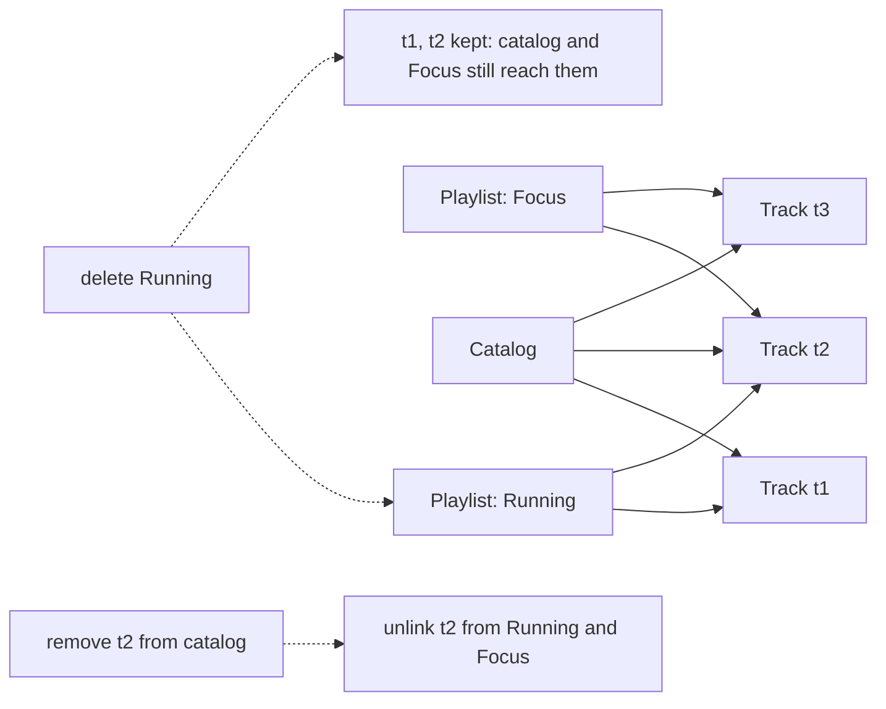

## In one minute
- Aggregation is a whole-part association where the parts have their own lives. A playlist holds tracks; deleting the playlist leaves every track in the catalog.
- Parts can be shared. The same track sits in many playlists, and the same engineer is on several teams.
- Because the whole does not own its parts, it must not create, copy or destroy them. It holds references or ids and nothing more.
- The hard question is the other direction: what happens to every whole when a shared part goes away. Decide it explicitly: block, unlink, or tolerate a dangling id.
- UML's hollow diamond has no precise standard meaning. Write down lifetime and sharing rules instead.

## How it works

### The problem: who is allowed to delete a part
A music service has 40 million tracks and 300 million playlists. An early design gives `Playlist` a cascade delete on its tracks, and in staging a tester deletes a test playlist and 50 tracks vanish from every other playlist that held them. The model said "part of" when it meant "refers to". Aggregation is that weaker relationship: a whole that groups parts it does not own, which can belong to several wholes and outlive all of them.

### Shared parts and independent lifetimes
Three questions separate aggregation from composition. Can the part exist with no whole? Can it be in two wholes at once? Should copying the whole leave the parts shared? For a playlist and its tracks all three answers are yes: duplicating a playlist should point at the same tracks, not create 50 new track records.

In code this means the whole stores references or ids and accepts parts from outside: `playlist.add(track)`, never `playlist.new_track(...)`. Its constructor does not build parts and its teardown does not destroy them. A shallow copy is the correct copy.

### The removal question
Independent lifetimes cut both ways: a label can withdraw a track from under every playlist holding it. Decide once, centrally, what happens:

- **Restrict.** Refuse to remove a part that any whole still uses. Safe, but a widely used part becomes impossible to remove.
- **Unlink.** Remove the part and strip it from every whole. Needs a fast way to find those wholes, which means a reverse index from part to wholes.
- **Tolerate.** Leave the id in place and have readers skip or grey out missing parts. Cheap at write time, and the normal choice across service boundaries where you cannot update every holder atomically.

A common split is unlink within one database and tolerate across services, where the client shows "no longer available" for missing ids.

### Shared mutable parts
If a shared part is mutable, a change made through one whole is visible through every other. That is the point when a track's title is corrected, and a bug when a team lead edits "their" copy of an engineer's hours and changes them for every team. Keep shared parts immutable, or make every mutation go through the part's own methods with its own locking, never through a whole.

### When aggregation is the wrong model
If a part makes no sense without its whole (an order line without an order) or must never be shared, you want composition. If the "whole" is only a query result, such as "tracks by this artist", do not store it as an aggregate at all; compute it.

### Reviewing agent-written code
Agents often add cascades and deep copies because they look thorough. Check that wholes never construct or destroy shared parts, that clones are shallow for aggregated fields, and that part removal has one documented answer.

### The same shape elsewhere
Hard links and symlinks have the same shape: a file survives until its last directory entry goes, and a symlink that outlives its target dangles. Container registries share image layers and need a garbage collection pass to find unused ones.

## Down the stack

### Layer 1: The contract
A whole promises to hold references to parts and to expose them, nothing more. It does not promise the part exists: callers must handle a part that has been removed, unless the system enforces restrict or unlink. Removing a whole must leave every part, and every other whole, unchanged.

### Layer 2: The mechanism
In garbage-collected runtimes, aggregation is simply reachability. A tracing collector (Go's, the JVM's G1) frees a part only when no live path reaches it, and CPython frees it when its reference count hits zero. The language cannot say "this playlist does not own this track"; only your code's behaviour does.

Rust makes the distinction visible. A plain field owns its value, so sharing requires `Rc<T>` or, across threads, `Arc<T>`: a compiler-checked hollow diamond.

In a relational database, the part's table has its own primary key, and the whole references it through a join table (`playlist_track(playlist_id, track_id, position)`). The foreign key's `ON DELETE` clause is the removal policy: `RESTRICT` or `NO ACTION` blocks deleting a track in use; `CASCADE` on the join table's `track_id` deletes the link rows, not the playlists; `SET NULL` suits a one-to-many column such as `employee.team_id`. Postgres enforces these through internal triggers on both tables, which is why an index on the referencing column matters: without it, every track delete scans the join table.

### Layer 3: The machine
A playlist of 50 tracks is an array of 50 pointers or 50 8-byte ids. The tracks themselves live elsewhere on the heap or on other database pages, so rendering the playlist is 50 dependent loads. In memory, each miss costs about 100 ns; in Postgres, fetching 50 tracks by primary key may touch 50 different 8 KB pages, each a buffer cache hit of a microsecond or so, or an SSD read of roughly 100 us when cold. That scattering is the price of sharing: one copy per part, many readers.

Shared parts across threads carry a second cost. Atomic reference counts (`Arc`, Swift's ARC, `shared_ptr`) bounce one cache line between cores on every clone and drop; under contention each increment can take tens to hundreds of nanoseconds instead of about one. Immutable parts can be read concurrently with no locks at all, which is the main argument for making shared parts immutable.

### Why it's built this way
1. Many wholes want the same part, and copying it would let the copies drift apart, so each part is stored once and referenced.
2. A part referenced from many places cannot be destroyed by any single one of them, so its lifetime is independent.
3. Independent parts can still be removed, so every holder needs a defined reaction: restrict, unlink or tolerate.
4. Unlinking needs to find holders fast, so systems keep a reverse index or rely on the collector's reachability scan.

## Diagram


## Worked example
A team-management tool has 12,000 employees and 1,800 teams. Each employee is on 1 to 4 teams, 21,000 memberships in total. Teams aggregate employees: disbanding a team must never delete a person.

The first schema stored id arrays on both `employee` and `team`. Disbanding a team scanned all 12,000 employees, and the arrays drifted when one update failed. The second schema used `membership(team_id, employee_id)` with a composite primary key and an index on `employee_id`, plus `ON DELETE CASCADE` on both foreign keys. Disbanding a team of 15 now deletes 15 link rows through the primary key; offboarding an employee deletes their 1 to 4 link rows through the second index. Neither touches the other side's main table. The remaining issue was shared mutation. Team leads could edit a member's "role" from the team page, which wrote to `employee.title` and changed it on every team. Moving `role` onto the membership row fixed it: the person is shared, the role is per team.

## Trade-offs
| Option | Strengths | Weaknesses | Choose when |
| --- | --- | --- | --- |
| Restrict removal | No dangling references ever | Popular parts become hard to remove | Parts are rarely removed and integrity matters most |
| Unlink on removal | Wholes stay clean | Needs a reverse index; large fan-out deletes | One database, moderate fan-out |
| Tolerate dangling ids | Cheap writes, works across services | Every reader handles missing parts | Parts and wholes live in different systems |
| Copy parts into the whole | No sharing bugs, simple reads | Copies drift, more storage | Snapshots that must not change, such as an invoice |

## Pitfalls in production
- Cascade delete configured from whole to shared part, so deleting one group destroys data other groups use. Fix: cascade only to the link rows, never to the part table.
- Deep copy when duplicating a whole, creating thousands of near-identical parts. Fix: shallow copy aggregated fields and test that ids are unchanged.
- Per-whole data stored on the shared part, such as a team role on the employee. Fix: move it onto the link.
- Missing index on the referencing column, so every part delete scans the link table under lock. Fix: index both foreign key columns of a join table.

## Leadership lens
- In design review, ask for each "has" relationship: can the part exist alone, can it be shared, and who may delete it. Those three answers matter more than the diagram symbol.
- Make the removal policy a written decision per relationship; it is the source of most data-loss incidents in this area.
- Shared parts across team boundaries need an owner. The team that owns the catalog owns removals, and consumers must tolerate them.
- Ask for worst-case fan-out: one part in 2 million wholes turns an unlink into a migration.

## Check yourself
1. What is the quickest test for aggregation versus composition?
   **Answer:** Ask whether the part can exist without the whole and be in two wholes at once. If yes, it is aggregation and the whole must not destroy it.
2. Why should duplicating a playlist not duplicate its tracks?
   **Answer:** The playlist only refers to tracks it does not own. Copying them would create distinct tracks that drift apart, so the new playlist should hold the same references.
3. A track is deleted and the join table has `ON DELETE CASCADE` on `track_id`. What is deleted?
   **Answer:** The track row and the link rows that reference it. The playlists themselves stay, now without that track.
4. Why is `Arc<Track>` in a Rust struct a stronger signal than a hollow diamond in UML?
   **Answer:** The compiler enforces it: holding one track in several places requires shared ownership, and the track lives until the last holder drops it.

## Practice
**Task:** Build a catalog of tracks and playlists where playlists aggregate tracks. `add_track(id, title)` fails with `duplicate track: <id>`. `create_playlist(name)` fails with `duplicate playlist: <name>`. `add_to_playlist(name, id)` checks `no such playlist: <name>`, then `no such track: <id>`, then `already in playlist: <id>`, and appends. `titles(name)` returns titles in insertion order. `delete_playlist(name)` removes the playlist, keeps every track, and returns how many tracks it held. `remove_track(id)` fails with `no such track: <id>`, otherwise removes the track from the catalog and every playlist and returns the sorted names of affected playlists. `usage(id)` is the number of playlists holding the track, and `orphans()` returns sorted ids of tracks in no playlist. Python raises `ValueError`, TypeScript throws `Error`, Go returns an `error`.

```python starter
class Catalog:
    def __init__(self):
        pass

    def add_track(self, track_id, title):
        raise NotImplementedError

    def create_playlist(self, name):
        raise NotImplementedError

    def add_to_playlist(self, name, track_id):
        raise NotImplementedError

    def titles(self, name):
        raise NotImplementedError

    def delete_playlist(self, name):
        raise NotImplementedError

    def remove_track(self, track_id):
        raise NotImplementedError

    def usage(self, track_id):
        raise NotImplementedError

    def orphans(self):
        raise NotImplementedError
```

```python tests
def expect_error(fn, msg):
    try:
        fn()
    except ValueError as e:
        assert str(e) == msg, str(e)
        return
    assert False, "expected ValueError: " + msg

def sample():
    c = Catalog()
    c.add_track("t1", "Intro")
    c.add_track("t2", "Drive")
    c.add_track("t3", "Calm")
    c.create_playlist("run")
    c.create_playlist("focus")
    c.add_to_playlist("run", "t1")
    c.add_to_playlist("run", "t2")
    c.add_to_playlist("focus", "t2")
    c.add_to_playlist("focus", "t3")
    return c

def test_tracks_are_shared():
    c = sample()
    assert c.titles("run") == ["Intro", "Drive"]
    assert c.titles("focus") == ["Drive", "Calm"]
    assert c.usage("t2") == 2 and c.usage("t1") == 1

def test_errors_in_order():
    c = sample()
    expect_error(lambda: c.add_track("t1", "X"), "duplicate track: t1")
    expect_error(lambda: c.create_playlist("run"), "duplicate playlist: run")
    expect_error(lambda: c.add_to_playlist("gym", "zz"), "no such playlist: gym")
    expect_error(lambda: c.add_to_playlist("run", "zz"), "no such track: zz")
    expect_error(lambda: c.add_to_playlist("run", "t1"), "already in playlist: t1")

def test_delete_playlist_keeps_tracks():
    c = sample()
    assert c.delete_playlist("run") == 2
    assert c.usage("t1") == 0 and c.usage("t2") == 1
    assert c.orphans() == ["t1"]
    assert c.titles("focus") == ["Drive", "Calm"]
    expect_error(lambda: c.titles("run"), "no such playlist: run")
    c.create_playlist("run")
    c.add_to_playlist("run", "t1")
    assert c.titles("run") == ["Intro"]

def test_remove_track_unlinks_everywhere():
    c = sample()
    assert c.remove_track("t2") == ["focus", "run"]
    assert c.titles("run") == ["Intro"] and c.titles("focus") == ["Calm"]
    expect_error(lambda: c.usage("t2"), "no such track: t2")
    expect_error(lambda: c.remove_track("t2"), "no such track: t2")

def test_remove_unused_track():
    c = sample()
    c.add_track("t4", "Late")
    assert c.orphans() == ["t4"]
    assert c.remove_track("t4") == []
    assert c.orphans() == []

def test_empty_playlist():
    c = Catalog()
    c.create_playlist("empty")
    assert c.titles("empty") == [] and c.delete_playlist("empty") == 0
```

```python solution
class Catalog:
    def __init__(self):
        self._titles = {}
        self._playlists = {}
        self._holders = {}

    def add_track(self, track_id, title):
        if track_id in self._titles:
            raise ValueError("duplicate track: " + track_id)
        self._titles[track_id] = title
        self._holders[track_id] = set()

    def create_playlist(self, name):
        if name in self._playlists:
            raise ValueError("duplicate playlist: " + name)
        self._playlists[name] = []

    def _playlist(self, name):
        if name not in self._playlists:
            raise ValueError("no such playlist: " + name)
        return self._playlists[name]

    def _track(self, track_id):
        if track_id not in self._titles:
            raise ValueError("no such track: " + track_id)

    def add_to_playlist(self, name, track_id):
        items = self._playlist(name)
        self._track(track_id)
        if name in self._holders[track_id]:
            raise ValueError("already in playlist: " + track_id)
        items.append(track_id)
        self._holders[track_id].add(name)

    def titles(self, name):
        return [self._titles[t] for t in self._playlist(name)]

    def delete_playlist(self, name):
        items = self._playlist(name)
        for t in items:
            self._holders[t].discard(name)
        del self._playlists[name]
        return len(items)

    def remove_track(self, track_id):
        self._track(track_id)
        affected = sorted(self._holders[track_id])
        for name in affected:
            self._playlists[name].remove(track_id)
        del self._holders[track_id]
        del self._titles[track_id]
        return affected

    def usage(self, track_id):
        self._track(track_id)
        return len(self._holders[track_id])

    def orphans(self):
        return sorted(t for t, h in self._holders.items() if not h)
```

```typescript starter
export class Catalog {
  addTrack(id: string, title: string): void { throw new Error("TODO"); }
  createPlaylist(name: string): void { throw new Error("TODO"); }
  addToPlaylist(name: string, id: string): void { throw new Error("TODO"); }
  titles(name: string): string[] { throw new Error("TODO"); }
  deletePlaylist(name: string): number { throw new Error("TODO"); }
  removeTrack(id: string): string[] { throw new Error("TODO"); }
  usage(id: string): number { throw new Error("TODO"); }
  orphans(): string[] { throw new Error("TODO"); }
}
```

```typescript tests
function errorOf(fn: () => void): string {
  try { fn(); } catch (e) { return (e as Error).message; }
  return "";
}

function sample(): Catalog {
  const c = new Catalog();
  c.addTrack("t1", "Intro"); c.addTrack("t2", "Drive"); c.addTrack("t3", "Calm");
  c.createPlaylist("run"); c.createPlaylist("focus");
  c.addToPlaylist("run", "t1"); c.addToPlaylist("run", "t2");
  c.addToPlaylist("focus", "t2"); c.addToPlaylist("focus", "t3");
  return c;
}

test("tracks are shared", () => {
  const c = sample();
  assertEqual(c.titles("run"), ["Intro", "Drive"]);
  assertEqual(c.titles("focus"), ["Drive", "Calm"]);
  assertEqual(c.usage("t2"), 2);
  assertEqual(c.usage("t1"), 1);
});

test("errors in order", () => {
  const c = sample();
  assertEqual(errorOf(() => c.addTrack("t1", "X")), "duplicate track: t1");
  assertEqual(errorOf(() => c.createPlaylist("run")), "duplicate playlist: run");
  assertEqual(errorOf(() => c.addToPlaylist("gym", "zz")), "no such playlist: gym");
  assertEqual(errorOf(() => c.addToPlaylist("run", "zz")), "no such track: zz");
  assertEqual(errorOf(() => c.addToPlaylist("run", "t1")), "already in playlist: t1");
});

test("delete playlist keeps tracks", () => {
  const c = sample();
  assertEqual(c.deletePlaylist("run"), 2);
  assertEqual(c.usage("t1"), 0);
  assertEqual(c.usage("t2"), 1);
  assertEqual(c.orphans(), ["t1"]);
  assertEqual(c.titles("focus"), ["Drive", "Calm"]);
  assertEqual(errorOf(() => c.titles("run")), "no such playlist: run");
  c.createPlaylist("run");
  c.addToPlaylist("run", "t1");
  assertEqual(c.titles("run"), ["Intro"]);
});

test("remove track unlinks everywhere", () => {
  const c = sample();
  assertEqual(c.removeTrack("t2"), ["focus", "run"]);
  assertEqual(c.titles("run"), ["Intro"]);
  assertEqual(c.titles("focus"), ["Calm"]);
  assertEqual(errorOf(() => c.usage("t2")), "no such track: t2");
  assertEqual(errorOf(() => c.removeTrack("t2")), "no such track: t2");
});

test("remove unused track", () => {
  const c = sample();
  c.addTrack("t4", "Late");
  assertEqual(c.orphans(), ["t4"]);
  assertEqual(c.removeTrack("t4"), []);
  assertEqual(c.orphans(), []);
});

test("empty playlist", () => {
  const c = new Catalog();
  c.createPlaylist("empty");
  assertEqual(c.titles("empty"), []);
  assertEqual(c.deletePlaylist("empty"), 0);
});
```

```typescript solution
export class Catalog {
  private trackTitles = new Map<string, string>();
  private playlists = new Map<string, string[]>();
  private holders = new Map<string, Set<string>>();

  addTrack(id: string, title: string): void {
    if (this.trackTitles.has(id)) throw new Error(`duplicate track: ${id}`);
    this.trackTitles.set(id, title);
    this.holders.set(id, new Set());
  }

  createPlaylist(name: string): void {
    if (this.playlists.has(name)) throw new Error(`duplicate playlist: ${name}`);
    this.playlists.set(name, []);
  }

  private playlist(name: string): string[] {
    const p = this.playlists.get(name);
    if (!p) throw new Error(`no such playlist: ${name}`);
    return p;
  }

  private holdersOf(id: string): Set<string> {
    const h = this.holders.get(id);
    if (!h) throw new Error(`no such track: ${id}`);
    return h;
  }

  addToPlaylist(name: string, id: string): void {
    const items = this.playlist(name);
    const h = this.holdersOf(id);
    if (h.has(name)) throw new Error(`already in playlist: ${id}`);
    items.push(id);
    h.add(name);
  }

  titles(name: string): string[] {
    return this.playlist(name).map((id) => this.trackTitles.get(id) as string);
  }

  deletePlaylist(name: string): number {
    const items = this.playlist(name);
    for (const id of items) this.holdersOf(id).delete(name);
    this.playlists.delete(name);
    return items.length;
  }

  removeTrack(id: string): string[] {
    const affected = [...this.holdersOf(id)].sort();
    for (const name of affected) {
      const items = this.playlist(name);
      items.splice(items.indexOf(id), 1);
    }
    this.holders.delete(id);
    this.trackTitles.delete(id);
    return affected;
  }

  usage(id: string): number { return this.holdersOf(id).size; }

  orphans(): string[] {
    return [...this.holders.entries()].filter(([, h]) => h.size === 0).map(([id]) => id).sort();
  }
}
```

```go starter
package practice

type Catalog struct{}

func NewCatalog() *Catalog                                  { panic("TODO") }
func (c *Catalog) AddTrack(id, title string) error          { panic("TODO") }
func (c *Catalog) CreatePlaylist(name string) error         { panic("TODO") }
func (c *Catalog) AddToPlaylist(name, id string) error      { panic("TODO") }
func (c *Catalog) Titles(name string) ([]string, error)     { panic("TODO") }
func (c *Catalog) DeletePlaylist(name string) (int, error)  { panic("TODO") }
func (c *Catalog) RemoveTrack(id string) ([]string, error)  { panic("TODO") }
func (c *Catalog) Usage(id string) (int, error)             { panic("TODO") }
func (c *Catalog) Orphans() []string                        { panic("TODO") }
```

```go tests
package practice

import (
	"reflect"
	"testing"
)

func must(t *testing.T, err error) {
	t.Helper()
	if err != nil {
		t.Fatal(err)
	}
}

func wantErr(t *testing.T, err error, msg string) {
	t.Helper()
	if err == nil || err.Error() != msg {
		t.Fatalf("want error %q, got %v", msg, err)
	}
}

func same(t *testing.T, got, want []string) {
	t.Helper()
	if len(got) == 0 && len(want) == 0 {
		return
	}
	if !reflect.DeepEqual(got, want) {
		t.Fatalf("got %v, want %v", got, want)
	}
}

func titles(t *testing.T, c *Catalog, name string) []string {
	t.Helper()
	got, err := c.Titles(name)
	must(t, err)
	return got
}

func usage(t *testing.T, c *Catalog, id string) int {
	t.Helper()
	n, err := c.Usage(id)
	must(t, err)
	return n
}

func sample(t *testing.T) *Catalog {
	c := NewCatalog()
	must(t, c.AddTrack("t1", "Intro"))
	must(t, c.AddTrack("t2", "Drive"))
	must(t, c.AddTrack("t3", "Calm"))
	must(t, c.CreatePlaylist("run"))
	must(t, c.CreatePlaylist("focus"))
	must(t, c.AddToPlaylist("run", "t1"))
	must(t, c.AddToPlaylist("run", "t2"))
	must(t, c.AddToPlaylist("focus", "t2"))
	must(t, c.AddToPlaylist("focus", "t3"))
	return c
}

func TestTracksAreShared(t *testing.T) {
	c := sample(t)
	same(t, titles(t, c, "run"), []string{"Intro", "Drive"})
	same(t, titles(t, c, "focus"), []string{"Drive", "Calm"})
	if usage(t, c, "t2") != 2 || usage(t, c, "t1") != 1 {
		t.Fatal("wrong usage counts")
	}
}

func TestErrorsInOrder(t *testing.T) {
	c := sample(t)
	wantErr(t, c.AddTrack("t1", "X"), "duplicate track: t1")
	wantErr(t, c.CreatePlaylist("run"), "duplicate playlist: run")
	wantErr(t, c.AddToPlaylist("gym", "zz"), "no such playlist: gym")
	wantErr(t, c.AddToPlaylist("run", "zz"), "no such track: zz")
	wantErr(t, c.AddToPlaylist("run", "t1"), "already in playlist: t1")
}

func TestDeletePlaylistKeepsTracks(t *testing.T) {
	c := sample(t)
	n, err := c.DeletePlaylist("run")
	must(t, err)
	if n != 2 {
		t.Fatalf("deleted playlist held %d, want 2", n)
	}
	if usage(t, c, "t1") != 0 || usage(t, c, "t2") != 1 {
		t.Fatal("wrong usage after delete")
	}
	same(t, c.Orphans(), []string{"t1"})
	same(t, titles(t, c, "focus"), []string{"Drive", "Calm"})
	_, err = c.Titles("run")
	wantErr(t, err, "no such playlist: run")
	must(t, c.CreatePlaylist("run"))
	must(t, c.AddToPlaylist("run", "t1"))
	same(t, titles(t, c, "run"), []string{"Intro"})
}

func TestRemoveTrackUnlinksEverywhere(t *testing.T) {
	c := sample(t)
	affected, err := c.RemoveTrack("t2")
	must(t, err)
	same(t, affected, []string{"focus", "run"})
	same(t, titles(t, c, "run"), []string{"Intro"})
	same(t, titles(t, c, "focus"), []string{"Calm"})
	_, err = c.Usage("t2")
	wantErr(t, err, "no such track: t2")
	_, err = c.RemoveTrack("t2")
	wantErr(t, err, "no such track: t2")
}

func TestRemoveUnusedTrack(t *testing.T) {
	c := sample(t)
	must(t, c.AddTrack("t4", "Late"))
	same(t, c.Orphans(), []string{"t4"})
	affected, err := c.RemoveTrack("t4")
	must(t, err)
	same(t, affected, nil)
	same(t, c.Orphans(), nil)
}

func TestEmptyPlaylist(t *testing.T) {
	c := NewCatalog()
	must(t, c.CreatePlaylist("empty"))
	same(t, titles(t, c, "empty"), nil)
	n, err := c.DeletePlaylist("empty")
	must(t, err)
	if n != 0 {
		t.Fatalf("got %d, want 0", n)
	}
}
```

```go solution
package practice

import (
	"fmt"
	"sort"
)

type Catalog struct {
	titles    map[string]string
	playlists map[string][]string
	holders   map[string]map[string]bool
}

func NewCatalog() *Catalog {
	return &Catalog{
		titles:    map[string]string{},
		playlists: map[string][]string{},
		holders:   map[string]map[string]bool{},
	}
}

func (c *Catalog) AddTrack(id, title string) error {
	if _, ok := c.titles[id]; ok {
		return fmt.Errorf("duplicate track: %s", id)
	}
	c.titles[id] = title
	c.holders[id] = map[string]bool{}
	return nil
}

func (c *Catalog) CreatePlaylist(name string) error {
	if _, ok := c.playlists[name]; ok {
		return fmt.Errorf("duplicate playlist: %s", name)
	}
	c.playlists[name] = []string{}
	return nil
}

func (c *Catalog) AddToPlaylist(name, id string) error {
	if _, ok := c.playlists[name]; !ok {
		return fmt.Errorf("no such playlist: %s", name)
	}
	h, ok := c.holders[id]
	if !ok {
		return fmt.Errorf("no such track: %s", id)
	}
	if h[name] {
		return fmt.Errorf("already in playlist: %s", id)
	}
	c.playlists[name] = append(c.playlists[name], id)
	h[name] = true
	return nil
}

func (c *Catalog) Titles(name string) ([]string, error) {
	items, ok := c.playlists[name]
	if !ok {
		return nil, fmt.Errorf("no such playlist: %s", name)
	}
	out := make([]string, 0, len(items))
	for _, id := range items {
		out = append(out, c.titles[id])
	}
	return out, nil
}

func (c *Catalog) DeletePlaylist(name string) (int, error) {
	items, ok := c.playlists[name]
	if !ok {
		return 0, fmt.Errorf("no such playlist: %s", name)
	}
	for _, id := range items {
		delete(c.holders[id], name)
	}
	delete(c.playlists, name)
	return len(items), nil
}

func (c *Catalog) RemoveTrack(id string) ([]string, error) {
	h, ok := c.holders[id]
	if !ok {
		return nil, fmt.Errorf("no such track: %s", id)
	}
	affected := make([]string, 0, len(h))
	for name := range h {
		affected = append(affected, name)
	}
	sort.Strings(affected)
	for _, name := range affected {
		kept := c.playlists[name][:0]
		for _, t := range c.playlists[name] {
			if t != id {
				kept = append(kept, t)
			}
		}
		c.playlists[name] = kept
	}
	delete(c.holders, id)
	delete(c.titles, id)
	return affected, nil
}

func (c *Catalog) Usage(id string) (int, error) {
	h, ok := c.holders[id]
	if !ok {
		return 0, fmt.Errorf("no such track: %s", id)
	}
	return len(h), nil
}

func (c *Catalog) Orphans() []string {
	out := []string{}
	for id, h := range c.holders {
		if len(h) == 0 {
			out = append(out, id)
		}
	}
	sort.Strings(out)
	return out
}
```

## Mock interview
**Prompt:** Design the model for a photo service where users group photos into albums. There are 2 billion photos and 150 million albums; one photo can appear in many albums, including albums shared by other users.

- Follow-up: A user deletes an album. What happens to the photos, and how do you prove it in a test?
- Follow-up: A user deletes a photo that sits in 40 albums owned by 12 people. Walk through each album's view.
- Follow-up: Album owners want per-album captions. Where do they live?

**A strong answer covers:**
- Albums aggregate photos: album delete removes link rows only, and duplicating an album is a shallow copy.
- An explicit removal policy for photos, with a reverse index from photo to albums for unlinking, or tolerated dangling ids across services.
- Per-album data such as caption and position stored on the link, not the shared photo.
- Indexes on both columns of the link table and an estimate of worst-case fan-out.
- Ownership: the photo's owner controls its lifetime, and album owners cannot destroy it.

## Watch
- [UML class diagrams (Lucid Software)](https://www.youtube.com/watch?v=6XrL5jXmTwM): class diagram relationships, including the aggregation and composition diamonds.

## Free resources
- [AggregationAndComposition (Martin Fowler)](https://martinfowler.com/bliki/AggregationAndComposition.html): why the hollow diamond has no agreed meaning and what to say instead.
- [Constraints, foreign keys section (PostgreSQL docs)](https://www.postgresql.org/docs/current/ddl-constraints.html): the exact behaviour of `RESTRICT`, `NO ACTION`, `CASCADE` and `SET NULL`.
- [Association Table Mapping (Martin Fowler)](https://martinfowler.com/eaaCatalog/associationTableMapping.html): storing shared many-to-many membership in a link table.
- [Object composition (Wikipedia)](https://en.wikipedia.org/wiki/Object_composition): background on aggregation versus composition across languages and UML.
- [What is ownership? (The Rust Book)](https://doc.rust-lang.org/book/ch04-01-what-is-ownership.html): the ownership rules that force shared parts to be declared with `Rc` or `Arc`.
