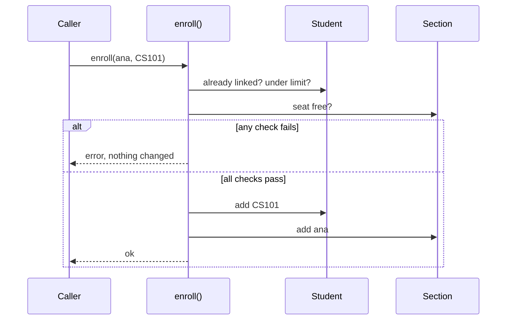

## In one minute
- An association says that objects of one class know about objects of another and can reach them at runtime. In code it is a reference: a field, a collection of references, or a stored id.
- Multiplicity (`1`, `0..1`, `0..*`, `1..5`) states how many objects sit at each end. It is a rule, and something in the code has to enforce it.
- Navigability says which side can find the other. One-way links are cheap and simple; two-way links are convenient to read and expensive to keep correct.
- A bidirectional association stores the same fact twice. Every write must update both copies together, or the model contradicts itself.
- In review, ask which query needs each reverse pointer and who keeps the two sides in sync.

## How it works

### The problem: a fact stored in two places
A registration service gives each `Student` a list of sections and each `Section` a list of students, because the transcript page walks one way and the roster the other. Months later a section shows 31 students on its roster and 32 on its seat counter: a `drop` handler updated the student, then returned early on a validation error before touching the section. Nothing crashed. The data just stopped agreeing with itself. That is the core of association: one relationship, possibly stored in several places, with rules about how many and in which direction.

### References are the implementation
An association becomes one of three things in code. A direct reference (`self.sections: set[Section]`) is fast to follow but ties both objects to one process. A stored id resolved through a repository crosses process and database boundaries but needs a lookup and can dangle. A link object (`Enrollment(student, section, enrolled_at)`) is right when the relationship carries its own data; if a `grades` dict keyed by section appears on the student, the association wants to be a class.

### Multiplicity is a constraint, not a label
A UML class diagram might show `Student 0..* --- 0..6 Section`: a student takes at most six sections, a section has any number of students. Add a capacity of 30 and the section end becomes `0..30`. A `list` accepts a seventh item without complaint, so multiplicity must be checked in the operation that creates the link, before either side changes, and in the database too (a unique index or a conditional counter update) if more than one process writes.

Lower bounds matter too: `1` forces the other object into the constructor, while `0..1` means every reader must handle an empty field.

### Navigability: pick the directions you query
A one-way association from `Section` to `Room` has one place to write and no consistency problem, but "which sections use room 204?" needs a scan or an index. Make it two-way only when a frequent query needs it. Databases phrase the same choice differently: a foreign key `section.room_id` gives you navigation from section to room for free and from room to sections only if you index `room_id`. A many-to-many link becomes a join table, and you index both columns if both directions are queried.

### Bidirectional consistency
If both sides hold references, make one pair of link and unlink methods the only way to change either side, and have them validate everything before mutating anything. In JPA only the owning side of a relationship is written on flush; changing just the inverse side is silently ignored. SQLAlchemy's `back_populates` takes the opposite approach and updates the in-memory inverse for you.

### When not to bother
If an object only uses another during a call, there is no lasting link; that is a dependency, not an association. Skip the reverse pointer when the reverse query is rare: compute it on demand and keep one source of truth.

### Reviewing agent-written code
Generated models often mirror every foreign key as two collections with public setters. Check that one method creates each link and one removes it, that multiplicity is checked before any mutation, and that each reverse direction serves a named query.

### The same shape elsewhere
A bidirectional association is a denormalised fact. The same problem appears with a search index beside a primary database or a follower count beside a followers table. Each copy needs a single writer path, or a job that detects and repairs drift.

## Down the stack

### Layer 1: The contract
A navigable end promises that you can reach the associated objects, and that their count satisfies the multiplicity whenever a caller can observe it. A bidirectional association adds a symmetry invariant: `b in a.items` if and only if `a in b.owners`. Outside the link methods, no caller may ever see one half of a link.

### Layer 2: The mechanism
In Python a reference is a pointer to a `PyObject`, and storing it increments the target's reference count. Two objects that point at each other form a cycle, so their counts never reach zero when the program drops them; CPython's cyclic collector finds such groups by subtracting internal references from counts, then frees them. `weakref.WeakSet` stores back-pointers that do not count. Go and the JVM use tracing collectors that mark what is reachable from roots, so cycles cost nothing special.

Collections hold the many end. A Go `map[*Section]struct{}` gives constant-time membership and removal; a slice gives order and cheap iteration but linear removal. In a relational database the many end is a foreign key column or a join table with a composite primary key, and navigation in a direction is only fast if an index exists for it.

### Layer 3: The machine
A reference is 8 bytes on a 64-bit machine, or 4 bytes with the JVM's compressed oops on heaps up to about 32 GB, and with pointer compression in Chrome's V8. Following one that misses cache costs roughly 80 to 120 ns from DRAM, so iterating 10,000 associated objects scattered across the heap can take about a millisecond even when the work per object is trivial. Each map entry costs tens of bytes beyond the pointer, and a two-way association pays it on both sides.

Concurrency is where bidirectional links hurt. Updating two objects atomically needs one lock covering both, or two locks taken in a fixed order such as ascending id. If `enroll` locks student then section and `drop` locks section then student, two threads can deadlock.

### Why it's built this way
1. Objects that cooperate need to find each other, so they store references or ids.
2. Following a reference is cheap and searching is not, so frequent queries get a stored link in their direction.
3. Two directions mean two copies of one fact, so writes must go through one place that updates both.
4. Copies across threads or processes can be observed halfway through, so the update needs a lock or a transaction around both halves.

## Diagram


## Worked example
A university has 40,000 students in 2,500 sections, about 200,000 links. A two-way model stores each twice; at roughly 40 bytes per map entry, about 16 MB. Memory is not the cost.

The cost is opening hour, when about 3,000 requests per second hit mostly the 50 most popular sections. The first implementation checked the seat count, then added each side under its own object lock. Two requests for the last seat both passed the check, and 38 sections ended over capacity. Reconciliation also found 112 transcripts listing a section that had no record of the student, from timeouts between the two adds.

The fix moved the whole operation into one place: a single database transaction that inserts into `enrollment(student_id, section_id)` with a unique key and decrements `section.seats_left` with `WHERE seats_left > 0`. The in-memory objects became read caches built from that table, and mismatches dropped to zero.

## Trade-offs
| Option | Strengths | Weaknesses | Choose when |
| --- | --- | --- | --- |
| One-way reference | One place to write, no sync bugs | Reverse query needs a scan or index | Reverse lookups are rare |
| Two-way references | Fast navigation both ways | Two writes per change, cycles, lock ordering | Both directions are hot paths in one process |
| Stored ids plus repository | Works across processes and databases | Lookup cost, ids can dangle | Objects live in different services or tables |
| Link object (join table) | Holds relationship data, one source of truth | Extra class and extra hop | The link has its own attributes or history |

## Pitfalls in production
- Public setters on both ends, so a caller updates one side only. Fix: private mutators and one pair of `link`/`unlink` methods.
- Capacity enforced only in memory while several instances write. Fix: enforce it in the database with a conditional update or constraint.
- Deadlock from inconsistent lock order across two objects. Fix: always lock in a global order, such as ascending id.
- ORM lazy loading an association in a loop, issuing one query per row. Fix: eager-load the association for that query or batch the lookups.

## Leadership lens
- Every bidirectional association is a consistency obligation. In design review, ask which query needs the reverse direction and what it would cost to compute instead.
- Make multiplicity rules part of the spec and the schema, not just the diagram. The diagram does not run in production.
- Name the owner of each relationship when two teams' objects are linked. Unowned links drift, and drift is found by customers.
- Budget a reconciliation check for any fact stored twice.

## Check yourself
1. Why does a two-way association need its multiplicity checks to run before either side is changed?
   **Answer:** If a check fails after one side was updated, the link exists in one direction only and the symmetry invariant is broken. Validating first means a failure leaves both sides untouched.
2. In CPython, a `Student` and a `Section` reference each other and the program drops both. When is their memory freed?
   **Answer:** Not by reference counting, because each keeps the other's count above zero. The cyclic garbage collector frees them on a later collection pass.
3. A `section.room_id` foreign key exists with no index. Which direction of the association is cheap?
   **Answer:** Section to room is a primary key lookup. Room to sections requires a scan of the section table until `room_id` is indexed.
4. When should an association become its own class?
   **Answer:** When the relationship has attributes of its own, such as a grade, a role or a timestamp, or needs history. Those facts belong to the link, not to either end.

## Practice
**Task:** Implement a bidirectional many-to-many association between students and courses that never lets the two sides disagree. A `Student` has a name and a maximum number of courses; a `Course` has a code and a seat capacity. `enroll(student, course)` checks, in this order, that the student is not already enrolled (`already enrolled: <name> in <code>`), that the course has a free seat (`course full: <code>`) and that the student is under their limit (`too many courses: <name>`), and only then links both sides. `drop(student, course)` fails with `not enrolled: <name> in <code>` and otherwise unlinks both sides. `withdraw_all(student)` drops every course and returns how many were dropped. `student.courses()` returns sorted course codes and `course.students()` returns sorted student names. Python raises `ValueError`, TypeScript throws `Error`, Go returns an `error`.

```python starter
class Student:
    def __init__(self, name, max_courses):
        self.name = name
        self.max_courses = max_courses

    def courses(self):
        # TODO
        raise NotImplementedError

class Course:
    def __init__(self, code, capacity):
        self.code = code
        self.capacity = capacity

    def students(self):
        # TODO
        raise NotImplementedError

def enroll(student, course):
    # TODO: check all rules first, then link both sides
    raise NotImplementedError

def drop(student, course):
    # TODO
    raise NotImplementedError

def withdraw_all(student):
    # TODO
    raise NotImplementedError
```

```python tests
def expect_error(fn, msg):
    try:
        fn()
    except ValueError as e:
        assert str(e) == msg, str(e)
        return
    assert False, "expected ValueError: " + msg

def test_enroll_links_both_sides():
    ana, bo = Student("ana", 3), Student("bo", 3)
    cs, ma = Course("CS101", 10), Course("MA201", 10)
    enroll(ana, cs)
    enroll(bo, cs)
    enroll(ana, ma)
    assert ana.courses() == ["CS101", "MA201"]
    assert cs.students() == ["ana", "bo"]
    assert ma.students() == ["ana"]

def test_duplicate_is_rejected_first():
    ana = Student("ana", 1)
    cs = Course("CS101", 1)
    enroll(ana, cs)
    expect_error(lambda: enroll(ana, cs), "already enrolled: ana in CS101")

def test_course_capacity():
    cs = Course("CS101", 1)
    enroll(Student("ana", 2), cs)
    bo = Student("bo", 2)
    expect_error(lambda: enroll(bo, cs), "course full: CS101")
    assert bo.courses() == [] and cs.students() == ["ana"]

def test_student_limit_leaves_both_sides_unchanged():
    ana = Student("ana", 1)
    cs, ma = Course("CS101", 5), Course("MA201", 5)
    enroll(ana, cs)
    expect_error(lambda: enroll(ana, ma), "too many courses: ana")
    assert ana.courses() == ["CS101"] and ma.students() == []

def test_drop_frees_a_seat():
    ana, bo = Student("ana", 2), Student("bo", 2)
    cs = Course("CS101", 1)
    enroll(ana, cs)
    drop(ana, cs)
    assert ana.courses() == [] and cs.students() == []
    enroll(bo, cs)
    assert cs.students() == ["bo"]

def test_drop_when_not_enrolled():
    expect_error(lambda: drop(Student("ana", 1), Course("CS101", 1)), "not enrolled: ana in CS101")

def test_withdraw_all_cleans_every_course():
    ana, bo = Student("ana", 3), Student("bo", 3)
    courses = [Course("C1", 5), Course("C2", 5), Course("C3", 5)]
    for c in courses:
        enroll(ana, c)
    enroll(bo, courses[1])
    assert withdraw_all(ana) == 3
    assert ana.courses() == []
    assert [c.students() for c in courses] == [[], ["bo"], []]
    assert withdraw_all(ana) == 0
```

```python solution
class Student:
    def __init__(self, name, max_courses):
        self.name = name
        self.max_courses = max_courses
        self._courses = set()

    def courses(self):
        return sorted(c.code for c in self._courses)

class Course:
    def __init__(self, code, capacity):
        self.code = code
        self.capacity = capacity
        self._students = set()

    def students(self):
        return sorted(s.name for s in self._students)

def enroll(student, course):
    if course in student._courses:
        raise ValueError("already enrolled: %s in %s" % (student.name, course.code))
    if len(course._students) >= course.capacity:
        raise ValueError("course full: " + course.code)
    if len(student._courses) >= student.max_courses:
        raise ValueError("too many courses: " + student.name)
    student._courses.add(course)
    course._students.add(student)

def drop(student, course):
    if course not in student._courses:
        raise ValueError("not enrolled: %s in %s" % (student.name, course.code))
    student._courses.discard(course)
    course._students.discard(student)

def withdraw_all(student):
    current = list(student._courses)
    for c in current:
        drop(student, c)
    return len(current)
```

```typescript starter
export class Student {
  constructor(public readonly name: string, public readonly maxCourses: number) {}
  courses(): string[] { throw new Error("TODO"); }
}

export class Course {
  constructor(public readonly code: string, public readonly capacity: number) {}
  students(): string[] { throw new Error("TODO"); }
}

export function enroll(student: Student, course: Course): void { throw new Error("TODO"); }
export function drop(student: Student, course: Course): void { throw new Error("TODO"); }
export function withdrawAll(student: Student): number { throw new Error("TODO"); }
```

```typescript tests
function errorOf(fn: () => void): string {
  try { fn(); } catch (e) { return (e as Error).message; }
  return "";
}

test("enroll links both sides", () => {
  const ana = new Student("ana", 3), bo = new Student("bo", 3);
  const cs = new Course("CS101", 10), ma = new Course("MA201", 10);
  enroll(ana, cs); enroll(bo, cs); enroll(ana, ma);
  assertEqual(ana.courses(), ["CS101", "MA201"]);
  assertEqual(cs.students(), ["ana", "bo"]);
  assertEqual(ma.students(), ["ana"]);
});

test("duplicate is rejected first", () => {
  const ana = new Student("ana", 1), cs = new Course("CS101", 1);
  enroll(ana, cs);
  assertEqual(errorOf(() => enroll(ana, cs)), "already enrolled: ana in CS101");
});

test("course capacity", () => {
  const cs = new Course("CS101", 1);
  enroll(new Student("ana", 2), cs);
  const bo = new Student("bo", 2);
  assertEqual(errorOf(() => enroll(bo, cs)), "course full: CS101");
  assertEqual(bo.courses(), []);
  assertEqual(cs.students(), ["ana"]);
});

test("student limit leaves both sides unchanged", () => {
  const ana = new Student("ana", 1);
  const cs = new Course("CS101", 5), ma = new Course("MA201", 5);
  enroll(ana, cs);
  assertEqual(errorOf(() => enroll(ana, ma)), "too many courses: ana");
  assertEqual(ana.courses(), ["CS101"]);
  assertEqual(ma.students(), []);
});

test("drop frees a seat", () => {
  const ana = new Student("ana", 2), bo = new Student("bo", 2);
  const cs = new Course("CS101", 1);
  enroll(ana, cs);
  drop(ana, cs);
  assertEqual(ana.courses(), []);
  assertEqual(cs.students(), []);
  enroll(bo, cs);
  assertEqual(cs.students(), ["bo"]);
});

test("drop when not enrolled", () => {
  assertEqual(errorOf(() => drop(new Student("ana", 1), new Course("CS101", 1))), "not enrolled: ana in CS101");
});

test("withdrawAll cleans every course", () => {
  const ana = new Student("ana", 3), bo = new Student("bo", 3);
  const courses = [new Course("C1", 5), new Course("C2", 5), new Course("C3", 5)];
  for (const c of courses) enroll(ana, c);
  enroll(bo, courses[1]);
  assertEqual(withdrawAll(ana), 3);
  assertEqual(ana.courses(), []);
  assertEqual(courses.map((c) => c.students()), [[], ["bo"], []]);
  assertEqual(withdrawAll(ana), 0);
});
```

```typescript solution
export class Student {
  readonly linked = new Set<Course>();
  constructor(public readonly name: string, public readonly maxCourses: number) {}
  courses(): string[] { return [...this.linked].map((c) => c.code).sort(); }
}

export class Course {
  readonly linked = new Set<Student>();
  constructor(public readonly code: string, public readonly capacity: number) {}
  students(): string[] { return [...this.linked].map((s) => s.name).sort(); }
}

export function enroll(student: Student, course: Course): void {
  if (student.linked.has(course)) throw new Error(`already enrolled: ${student.name} in ${course.code}`);
  if (course.linked.size >= course.capacity) throw new Error(`course full: ${course.code}`);
  if (student.linked.size >= student.maxCourses) throw new Error(`too many courses: ${student.name}`);
  student.linked.add(course);
  course.linked.add(student);
}

export function drop(student: Student, course: Course): void {
  if (!student.linked.has(course)) throw new Error(`not enrolled: ${student.name} in ${course.code}`);
  student.linked.delete(course);
  course.linked.delete(student);
}

export function withdrawAll(student: Student): number {
  const current = [...student.linked];
  for (const c of current) drop(student, c);
  return current.length;
}
```

```go starter
package practice

type Student struct {
	Name       string
	MaxCourses int
}

type Course struct {
	Code     string
	Capacity int
}

func NewStudent(name string, maxCourses int) *Student { panic("TODO") }
func NewCourse(code string, capacity int) *Course     { panic("TODO") }
func (s *Student) Courses() []string                  { panic("TODO") }
func (c *Course) Students() []string                  { panic("TODO") }
func Enroll(s *Student, c *Course) error              { panic("TODO") }
func Drop(s *Student, c *Course) error                { panic("TODO") }
func WithdrawAll(s *Student) int                      { panic("TODO") }
```

```go tests
package practice

import (
	"reflect"
	"testing"
)

func wantErr(t *testing.T, err error, msg string) {
	t.Helper()
	if err == nil || err.Error() != msg {
		t.Fatalf("want error %q, got %v", msg, err)
	}
}

func same(t *testing.T, got, want []string) {
	t.Helper()
	if len(got) == 0 && len(want) == 0 {
		return
	}
	if !reflect.DeepEqual(got, want) {
		t.Fatalf("got %v, want %v", got, want)
	}
}

func TestEnrollLinksBothSides(t *testing.T) {
	ana, bo := NewStudent("ana", 3), NewStudent("bo", 3)
	cs, ma := NewCourse("CS101", 10), NewCourse("MA201", 10)
	for _, p := range []struct {
		s *Student
		c *Course
	}{{ana, cs}, {bo, cs}, {ana, ma}} {
		if err := Enroll(p.s, p.c); err != nil {
			t.Fatal(err)
		}
	}
	same(t, ana.Courses(), []string{"CS101", "MA201"})
	same(t, cs.Students(), []string{"ana", "bo"})
	same(t, ma.Students(), []string{"ana"})
}

func TestDuplicateRejectedFirst(t *testing.T) {
	ana, cs := NewStudent("ana", 1), NewCourse("CS101", 1)
	if err := Enroll(ana, cs); err != nil {
		t.Fatal(err)
	}
	wantErr(t, Enroll(ana, cs), "already enrolled: ana in CS101")
}

func TestCourseCapacity(t *testing.T) {
	cs := NewCourse("CS101", 1)
	if err := Enroll(NewStudent("ana", 2), cs); err != nil {
		t.Fatal(err)
	}
	bo := NewStudent("bo", 2)
	wantErr(t, Enroll(bo, cs), "course full: CS101")
	same(t, bo.Courses(), nil)
	same(t, cs.Students(), []string{"ana"})
}

func TestStudentLimitLeavesBothSidesUnchanged(t *testing.T) {
	ana := NewStudent("ana", 1)
	cs, ma := NewCourse("CS101", 5), NewCourse("MA201", 5)
	if err := Enroll(ana, cs); err != nil {
		t.Fatal(err)
	}
	wantErr(t, Enroll(ana, ma), "too many courses: ana")
	same(t, ana.Courses(), []string{"CS101"})
	same(t, ma.Students(), nil)
}

func TestDropFreesSeat(t *testing.T) {
	ana, bo := NewStudent("ana", 2), NewStudent("bo", 2)
	cs := NewCourse("CS101", 1)
	if err := Enroll(ana, cs); err != nil {
		t.Fatal(err)
	}
	if err := Drop(ana, cs); err != nil {
		t.Fatal(err)
	}
	same(t, ana.Courses(), nil)
	same(t, cs.Students(), nil)
	if err := Enroll(bo, cs); err != nil {
		t.Fatal(err)
	}
	same(t, cs.Students(), []string{"bo"})
}

func TestDropWhenNotEnrolled(t *testing.T) {
	wantErr(t, Drop(NewStudent("ana", 1), NewCourse("CS101", 1)), "not enrolled: ana in CS101")
}

func TestWithdrawAll(t *testing.T) {
	ana, bo := NewStudent("ana", 3), NewStudent("bo", 3)
	courses := []*Course{NewCourse("C1", 5), NewCourse("C2", 5), NewCourse("C3", 5)}
	for _, c := range courses {
		if err := Enroll(ana, c); err != nil {
			t.Fatal(err)
		}
	}
	if err := Enroll(bo, courses[1]); err != nil {
		t.Fatal(err)
	}
	if n := WithdrawAll(ana); n != 3 {
		t.Fatalf("withdrew %d, want 3", n)
	}
	same(t, ana.Courses(), nil)
	same(t, courses[0].Students(), nil)
	same(t, courses[1].Students(), []string{"bo"})
	same(t, courses[2].Students(), nil)
	if n := WithdrawAll(ana); n != 0 {
		t.Fatalf("second withdraw %d, want 0", n)
	}
}
```

```go solution
package practice

import (
	"fmt"
	"sort"
)

type Student struct {
	Name       string
	MaxCourses int
	courses    map[*Course]struct{}
}

type Course struct {
	Code     string
	Capacity int
	students map[*Student]struct{}
}

func NewStudent(name string, maxCourses int) *Student {
	return &Student{Name: name, MaxCourses: maxCourses, courses: map[*Course]struct{}{}}
}

func NewCourse(code string, capacity int) *Course {
	return &Course{Code: code, Capacity: capacity, students: map[*Student]struct{}{}}
}

func (s *Student) Courses() []string {
	out := make([]string, 0, len(s.courses))
	for c := range s.courses {
		out = append(out, c.Code)
	}
	sort.Strings(out)
	return out
}

func (c *Course) Students() []string {
	out := make([]string, 0, len(c.students))
	for s := range c.students {
		out = append(out, s.Name)
	}
	sort.Strings(out)
	return out
}

func Enroll(s *Student, c *Course) error {
	if _, ok := s.courses[c]; ok {
		return fmt.Errorf("already enrolled: %s in %s", s.Name, c.Code)
	}
	if len(c.students) >= c.Capacity {
		return fmt.Errorf("course full: %s", c.Code)
	}
	if len(s.courses) >= s.MaxCourses {
		return fmt.Errorf("too many courses: %s", s.Name)
	}
	s.courses[c] = struct{}{}
	c.students[s] = struct{}{}
	return nil
}

func Drop(s *Student, c *Course) error {
	if _, ok := s.courses[c]; !ok {
		return fmt.Errorf("not enrolled: %s in %s", s.Name, c.Code)
	}
	delete(s.courses, c)
	delete(c.students, s)
	return nil
}

func WithdrawAll(s *Student) int {
	n := 0
	for c := range s.courses {
		delete(s.courses, c)
		delete(c.students, s)
		n++
	}
	return n
}
```

## Mock interview
**Prompt:** Model a conference app with 20,000 attendees and 600 sessions. Sessions have room capacity; the session page lists attendees and the attendee page shows a schedule.

- Follow-up: Which directions of the attendee to session association do you store, and how do you keep them consistent?
- Follow-up: Two attendees grab the last seat at the same moment on different servers. What happens?
- Follow-up: Organisers now want to record whether an attendee checked in to each session. Where does that field go?

**A strong answer covers:**
- Multiplicity stated explicitly (attendee `0..*`, session `0..capacity`) and enforced at link time, not only in a diagram.
- A single place that creates and removes links, validating before mutating, with no public setters on either collection.
- Stored directions chosen from real queries, preferring an index over a second writable copy.
- Capacity enforced in the database, since in-memory checks do not span servers.
- Promoting the link to an `Attendance` entity once it carries data such as check-in time.

## Watch
- [UML Class Diagram Tutorial (Lucid Software)](https://www.youtube.com/watch?v=UI6lqHOVHic): a walkthrough of class diagram notation, including associations and multiplicity.

## Free resources
- [Association (Wikipedia)](https://en.wikipedia.org/wiki/Association_%28object-oriented_programming%29): background on the UML definition, roles, multiplicity and navigability.
- [Foreign Key Mapping (Martin Fowler)](https://martinfowler.com/eaaCatalog/foreignKeyMapping.html): how a one-to-many association maps onto a foreign key column.
- [Association Table Mapping (Martin Fowler)](https://martinfowler.com/eaaCatalog/associationTableMapping.html): mapping many-to-many associations through a link table.
- [weakref (Python docs)](https://docs.python.org/3/library/weakref.html): references that do not keep their target alive, for back-pointers and caches.
- [gc (Python docs)](https://docs.python.org/3/library/gc.html): the cyclic collector that reclaims objects which reference each other.
