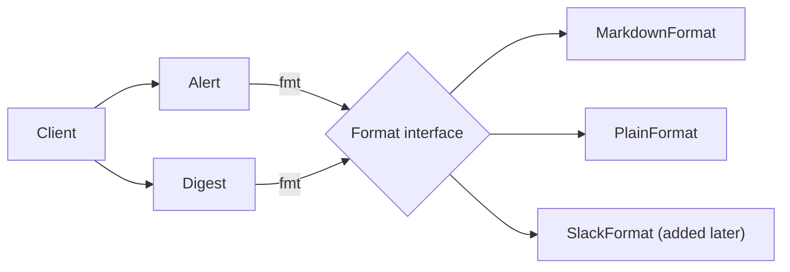

## In one minute
- Bridge splits one class hierarchy that varies in two directions into two hierarchies joined by a reference: an *abstraction* (what the caller works with) holds an *implementor* (how the low-level work is done), and each side grows on its own.
- The win is arithmetic. Four message kinds times three delivery formats is twelve subclasses by inheritance and seven classes with a bridge. Adding a fifth format costs one class instead of four.
- The design work is in the implementor interface: a small set of primitives that every backend can offer, coarse enough to be cheap across the boundary and complete enough that the abstraction never asks "which backend are you?".
- Unlike Adapter, a bridge is designed up front, before the second backend exists or as soon as the second axis appears. Go's `database/sql` (abstraction) over `database/sql/driver` (implementor) is the textbook production example ([package docs](https://pkg.go.dev/database/sql/driver)).
- Agents asked for "Slack support" will add `SlackAlert`, `SlackDigest` and `SlackReport` next to the email versions. Review asks which axis is varying and whether one new implementor class would do.

## How it works

### The problem
An operations team sends three kinds of notification: alerts, daily digests and incident summaries. They started with email, so the code has `Alert`, `Digest` and `IncidentSummary`, each building an HTML body. Then chat came along, and someone wrote `ChatAlert`, `ChatDigest` and `ChatIncidentSummary` as subclasses that override the body building. Then SMS. Nine classes now, and the rule "critical alerts are prefixed with the on-call name" lives in three of them. When a fourth kind (a change notice) arrives, it needs three new subclasses, one per channel, and the one for SMS is forgotten.

The hierarchy is varying along two independent axes, *what* is being said and *how* it is rendered, and inheritance can only express one axis at a time. Each new point on either axis multiplies the class count by the size of the other.

### Split the axes
Bridge pulls the rendering axis out into its own interface with a few primitive operations: `heading(text)`, `paragraph(text)`, `bullet(text)` and `join(lines)`. Each message kind becomes one class that holds a reference to a format and composes its output from those primitives. Each format becomes one class that knows nothing about alerts or digests.

```python
class Digest:
    def __init__(self, fmt, title, items):
        self.fmt, self.title, self.items = fmt, title, items

    def render(self):
        lines = [self.fmt.heading(f"{self.title} ({len(self.items)})")]
        lines += [self.fmt.bullet(i) for i in self.items]
        return self.fmt.join(lines)
```

The class count is now kinds plus formats. The "prefix critical alerts" rule exists once, in `Alert`. A new format is one class and works with every message kind on day one, including kinds written after it.

### The vocabulary
The **abstraction** is the high-level type the client uses (`Message`), extended by **refined abstractions** (`Alert`, `Digest`). The **implementor** is the low-level interface (`Format`), provided by **concrete implementors** (`MarkdownFormat`, `PlainFormat`). The reference between them is the bridge. In Go the abstraction side is often one struct, and the bridge is one interface-typed field.

### Designing the implementor interface
This is where bridges succeed or fail. The implementor interface should be:

- **Primitive.** It offers the operations every backend can do, not the high-level operations the client wants. A drawing implementor offers `line` and `fill_rect`, not `draw_bar_chart`. The abstraction builds the chart out of lines.
- **Complete for today's abstractions.** If one abstraction needs something only one backend has, it will reach around the bridge with a type check, and the split is broken.
- **Coarse where the boundary is expensive.** If the implementor is a network driver, `fetch_row()` per column is a disaster and `next(dest_row)` per row is fine.

Optional capabilities are the hard part. Go solves them with optional interfaces: the abstraction checks with a type assertion whether the implementor also implements a richer interface, uses it if so, and falls back to the primitives otherwise.

### Bridge, Adapter, Strategy
The Gang of Four state the intent as decoupling an abstraction from its implementation so the two can vary independently (*Design Patterns*, ch. 4). Adapter and Bridge both put an interface between a client and a concrete class. An adapter is written after the fact to make an existing class fit an interface it was not built for (see Adapter). A bridge is designed in advance so both sides can grow. In practice a bridge's concrete implementors are often adapters over vendor SDKs: the bridge sets the interface, adapters satisfy it.

Strategy (see Strategy) has the same object diagram as the core of a bridge: an object holding an interface-typed field. The difference is scope. A strategy is one interchangeable algorithm inside an otherwise fixed class. A bridge separates a whole layer, with its own hierarchy of abstractions on top that all share the implementor. If only one class on the abstraction side will ever exist, call it a strategy and stop there.

### Reviewing agent-written code
Agents extend whatever axis they find: given `EmailAlert` and asked for Slack, they write `SlackAlert`, then `SlackDigest`. The reverse failure is also common: asked to "use the Bridge pattern", an agent produces `AbstractMessage`, `MessageImplementor`, `MessageImplementorFactory` and one implementor. Ask two questions in review. Are there really two axes that change independently, with at least two points on each today or on the roadmap? And does any abstraction inspect the implementor's concrete type (`isinstance(fmt, SlackFormat)`)? If it does, a primitive is missing from the interface.

### The same shape elsewhere
Bridge is how operating systems survive hardware churn. The Linux virtual filesystem is an abstraction (path lookup, permissions, the page cache, `open`, `read`, `write`) over implementors that fill in `struct file_operations` and `struct inode_operations` tables: ext4, XFS, NFS, procfs. A new filesystem gets every syscall for free ([kernel VFS docs](https://docs.kernel.org/filesystems/vfs.html)). Python's `logging` has the same split: `Logger` decides whether and where a record goes (levels, propagation), and `Handler` subclasses decide how bytes leave the process (stream, file, syslog, HTTP) ([logging flow](https://docs.python.org/3/howto/logging.html)). The problem shape is *fan-out* of combinations: when two concerns multiply, keep them as separate types and let composition do the multiplying at runtime.

## Down the stack

### Layer 1: The contract
The abstraction promises its clients behaviour that does not depend on which implementor is plugged in, apart from documented differences (a plain-text format cannot show bold). The implementor promises its primitives' semantics: inputs, outputs, errors, and thread safety. Two things are part of that contract and are often left unstated. First, who owns concurrency: `sql.DB` is safe for concurrent use by many goroutines ([database/sql docs](https://pkg.go.dev/database/sql)), while the driver docs say a returned connection is used by one goroutine at a time ([driver docs](https://pkg.go.dev/database/sql/driver)), and `database/sql` guarantees that so driver authors do not have to lock. Second, what happens when a capability is missing: return a specific error the abstraction recognises (Go's `driver.ErrSkip`) rather than a generic failure.

### Layer 2: The mechanism
Go's `database/sql` is a bridge you can read in an afternoon. The abstraction side is `DB`, `Tx`, `Stmt`, `Rows` and `Row`: connection pooling, retries on bad connections, transaction lifecycle, and scanning into Go types. The implementor side is `driver.Driver`, `driver.Conn`, `driver.Stmt` and `driver.Rows`, deliberately small: `Prepare`, `Close`, `Begin`, and `Rows.Next(dest []driver.Value)` which fills one whole row per call. Optional interfaces carry the extras. If a connection implements `driver.QueryerContext`, `database/sql` calls it directly; if not, or if it returns `driver.ErrSkip`, it falls back to prepare, query and close. `driver.SessionResetter` and `driver.Validator` let the pool ask a connection whether it can be reused ([driver docs](https://pkg.go.dev/database/sql/driver)). The abstraction grew pooling limits, `context` support and `sql.Null[T]` over the years without breaking a single driver, because those features live on the abstraction side.

JDBC has the same structure in Java, with `java.sql.Connection` and friends as the implementor interface vendors ship.

### Layer 3: The machine
The bridge costs one pointer in the abstraction (8 bytes on 64-bit) and one indirect call per primitive. In Go, an interface value is two words, an itab pointer and a data pointer; a call loads the method's address from the itab and branches to it, around 1 to 2 ns when the branch predictor has seen the target. The compiler cannot inline through the interface, and a concrete implementor stored in an interface field usually escapes to the heap, so building a bridged object costs an allocation that a concrete field would not.

The cost that matters is the *number* of crossings. A renderer that calls `bullet()` once per item pays a few nanoseconds per item, nothing next to building the string. A driver whose implementor interface returned one column per call would cross the boundary rows times columns times; `Rows.Next` filling a slice keeps it to once per row, and network protocols batch further (Postgres sends many `DataRow` messages per TCP segment). In kernels, indirect calls got more expensive after Spectre, because retpoline mitigations turn each one into a sequence that defeats prediction, costing tens of cycles. Linux 5.10 added static calls, which use code patching so a hot function-pointer call becomes a direct call ([KernelNewbies](https://kernelnewbies.org/Linux_5.10)); that is the kernel devirtualising its own bridges.

In JavaScript, the call site `this.fmt.heading(...)` gets an inline cache keyed on the implementor's hidden class; V8 turns it megamorphic, with a slower lookup, once it has seen more than four shapes. In CPython, every `self.fmt.heading` is two attribute lookups and a bound method, roughly 50 to 100 ns.

### Why it's built this way
1. Real systems vary along more than one axis at once (message kind and channel, query API and database, filesystem semantics and on-disk format).
2. Inheritance can express one axis per hierarchy, so mixing two axes in one hierarchy multiplies classes and duplicates logic.
3. Composition multiplies at runtime instead: hold a reference to the second axis and pick it when the object is built.
4. The reference must cross a stable interface, so the implementor interface is kept primitive and small, which is also what lets third parties write implementors.
5. Each crossing costs an indirect call (and in drivers, sometimes a network round trip), so the primitives are made coarse enough that crossings stay rare.

## Diagram


## Worked example
A SaaS company had 5 notification kinds and 3 channels implemented as 15 classes, about 4,200 lines. An audit found the "include the runbook link in critical alerts" rule implemented in 3 of the 5 places it belonged, and the SMS digest silently dropped items past 160 characters while email showed all of them.

The refactor introduced a `Format` implementor with five primitives (`heading`, `paragraph`, `bullet`, `link`, `join`) and a length budget the format reports. Message kinds shrank to 5 classes that build output from primitives; formats became 3 classes. Total: 8 classes, about 1,500 lines, and the runbook rule exists once. Adding Microsoft Teams later was one class of 90 lines and a contract test suite run against it, instead of 5 classes.

Performance was a non-issue: a 200-item digest makes about 202 primitive calls, roughly 16 us in CPython, against 30 to 200 ms for the provider's HTTP call. The one design subtlety was SMS: the abstraction asks the format for its budget once per message and truncates with "and N more" itself, instead of calling a `fits()` primitive per item.

## In the wild
- **Go `database/sql`, since Go 1: one pool, many databases.** The standard library keeps pooling, transactions and scanning in `database/sql` and asks drivers for a small interface plus optional fast paths. A driver that lacks `QueryerContext`, or returns `ErrSkip`, still works through prepare, query and close ([driver docs](https://pkg.go.dev/database/sql/driver)). That is why the same `sql.DB` code runs on Postgres, MySQL and SQLite drivers written by different teams.
- **Linux VFS, documented design: filesystems fill in operation tables.** The VFS owns path lookup and the common file model, and each filesystem supplies `struct file_operations` and `struct inode_operations` ([kernel VFS docs](https://docs.kernel.org/filesystems/vfs.html)). One syscall layer serves ext4, NFS and procfs without knowing which is underneath.
- **Linux kernel, 2018 to 2020: Spectre makes bridge crossings expensive.** After the January 2018 Spectre disclosures, retpolines made every indirect call costlier, and developers began avoiding function pointers on hot paths ([LWN, 2020](https://lwn.net/Articles/815908/)). Static calls, merged in Linux 5.10, patch such calls into direct ones ([KernelNewbies](https://kernelnewbies.org/Linux_5.10)). The pattern stayed; the cost per crossing changed, which is why implementor interfaces should be coarse.

## Trade-offs
| Option | Strengths | Weaknesses | Choose when |
| --- | --- | --- | --- |
| One class per combination | Each combination fully explicit | M x N classes; shared rules duplicated | Only one axis really varies |
| Bridge (abstraction holds implementor) | M + N classes; both sides grow independently | Implementor interface must be designed well up front | Two independent axes, each with real variants |
| Strategy field on one class | Simple; no abstraction hierarchy | Does not scale to many abstractions sharing a backend | One high-level class, one pluggable algorithm |
| Adapter per vendor | Fits an existing interface without changing it | Does not organise the abstraction side | The interface already exists; a new vendor must fit |
| Type switch on backend | Fast; obvious for two cases | Every abstraction edits on every new backend | Prototypes, or a closed set of two |

## Pitfalls in production
- Abstractions that check the implementor's concrete type for one special case. Fix: add a primitive or an optional capability interface, with a fallback.
- An implementor interface designed around the first backend's API, so the second backend cannot implement half of it. Fix: write the second implementor (even a fake) before freezing the interface.
- Chatty primitives across an expensive boundary, such as a per-field call into a driver or a remote renderer. Fix: batch at the boundary and measure crossings per request.
- Unstated thread-safety rules, so one implementor locks and another does not. Fix: state in the contract who serialises access, as `database/sql` does for connections.
- A bridge built for one axis that never got a second point. Fix: collapse it back to a concrete class; the indirection is cost without benefit.

## Leadership lens
- Ask in design review which two things vary, who adds points on each axis, and how often. A bridge pays off when different teams or vendors own the two sides.
- Treat the implementor interface as a published API: version it, keep it small, and ship a contract test suite that every implementor must pass.
- Give a bridge's implementor side a clear owner. In platform teams, the abstraction is the product and the implementors are integrations that other teams may write.
- For agent-assisted work, state the rule in the task: "new channel = one new `Format` class plus contract tests; do not add message subclasses". It turns a cross-cutting change into an additive one.

## Check yourself
1. Four report types are exported to three file formats by inheritance. How many classes does adding a fourth format cost before and after introducing a bridge?
   **Answer:** Before, four (one per report type); after, one, because the new format implements the implementor interface and every report type uses it.
2. Why does `database/sql` fall back to prepare, execute and close when a driver lacks `QueryerContext`, instead of requiring every driver to implement it?
   **Answer:** Keeping the required implementor interface minimal lets more databases implement it; optional interfaces add fast paths without breaking drivers that lack them.
3. How do you tell a bridge from a strategy when both are an object holding an interface-typed field?
   **Answer:** A strategy swaps one algorithm inside one class; a bridge separates a layer, so several abstractions share the implementor and both sides have their own hierarchies.
4. An abstraction contains `if isinstance(self.fmt, SmsFormat): truncate()`. What is wrong and what is the fix?
   **Answer:** The abstraction depends on a concrete implementor, so every new format may need another branch. Expose the need as a primitive or capability (a length budget) that each format answers.

## Practice
**Task:** Build a notification bridge. The implementor is a format with four primitives: `heading(text)`, `paragraph(text)`, `bullet(text)` and `join(lines)`. `MarkdownFormat` renders a heading as `"# " + text`, a paragraph as the text itself, a bullet as `"- " + text`, and joins lines with `"\n"`. `PlainFormat` renders a heading as the uppercased text, a newline, then `"="` repeated to the heading's length; a bullet as `"* " + text`; paragraphs and joining as Markdown. The abstractions hold the format in a public, reassignable field (`fmt`, Go `Fmt`) and only use the primitives. `Alert(fmt, title, severity, details)` accepts severities `info`, `warning` and `critical` (anything else fails with `unknown severity: <severity>`) and renders a heading `"[SEVERITY] title"` (severity uppercased) followed by a paragraph of `details` if it is not empty. `Digest(fmt, title, items, limit)` fails with `limit must be positive` if `limit < 1`, and renders a heading `"title (N)"` with the item count, then `nothing new` as a paragraph if there are no items, otherwise one bullet per item up to `limit` and, if items were cut, a paragraph `and K more`. Python raises `ValueError`, TypeScript throws `Error`, Go returns an error from `NewAlert` and `NewDigest`.

```python starter
class MarkdownFormat:
    def heading(self, text):
        raise NotImplementedError

    def paragraph(self, text):
        raise NotImplementedError

    def bullet(self, text):
        raise NotImplementedError

    def join(self, lines):
        raise NotImplementedError


class PlainFormat:
    def heading(self, text):
        raise NotImplementedError

    def paragraph(self, text):
        raise NotImplementedError

    def bullet(self, text):
        raise NotImplementedError

    def join(self, lines):
        raise NotImplementedError


class Alert:
    def __init__(self, fmt, title, severity, details):
        # TODO: validate severity
        self.fmt = fmt

    def render(self):
        # TODO
        raise NotImplementedError


class Digest:
    def __init__(self, fmt, title, items, limit):
        # TODO: validate limit
        self.fmt = fmt

    def render(self):
        # TODO
        raise NotImplementedError
```

```python tests
def error_of(fn):
    try:
        fn()
    except ValueError as e:
        return str(e)
    return None

def test_alert_markdown():
    a = Alert(MarkdownFormat(), "Disk full", "critical", "db-1 at 97%")
    assert a.render() == "# [CRITICAL] Disk full\ndb-1 at 97%"

def test_alert_plain_without_details():
    a = Alert(PlainFormat(), "Deploy done", "info", "")
    assert a.render() == "[INFO] DEPLOY DONE\n" + "=" * 18

def test_digest_truncates_with_count():
    d = Digest(MarkdownFormat(), "Changes", ["a", "b", "c", "d"], 2)
    assert d.render() == "# Changes (4)\n- a\n- b\nand 2 more"

def test_digest_exact_limit_and_empty():
    assert Digest(MarkdownFormat(), "T", ["x", "y"], 2).render() == "# T (2)\n- x\n- y"
    assert Digest(PlainFormat(), "Inbox", [], 3).render() == "INBOX (0)\n=========\nnothing new"

def test_format_can_be_swapped_at_runtime():
    d = Digest(MarkdownFormat(), "Jobs", ["build"], 5)
    assert d.render() == "# Jobs (1)\n- build"
    d.fmt = PlainFormat()
    assert d.render() == "JOBS (1)\n========\n* build"

class ChatFormat:
    def heading(self, text):
        return "*" + text + "*"
    def paragraph(self, text):
        return "> " + text
    def bullet(self, text):
        return "+ " + text
    def join(self, lines):
        return " | ".join(lines)

def test_new_format_works_with_every_message_kind():
    f = ChatFormat()
    assert Alert(f, "CPU", "warning", "92%").render() == "*[WARNING] CPU* | > 92%"
    assert Digest(f, "PRs", ["#1", "#2", "#3"], 1).render() == "*PRs (3)* | + #1 | > and 2 more"

def test_validation():
    assert error_of(lambda: Alert(MarkdownFormat(), "x", "fatal", "")) == "unknown severity: fatal"
    assert error_of(lambda: Digest(MarkdownFormat(), "x", ["a"], 0)) == "limit must be positive"
```

```python solution
class MarkdownFormat:
    def heading(self, text):
        return "# " + text

    def paragraph(self, text):
        return text

    def bullet(self, text):
        return "- " + text

    def join(self, lines):
        return "\n".join(lines)


class PlainFormat:
    def heading(self, text):
        return text.upper() + "\n" + "=" * len(text)

    def paragraph(self, text):
        return text

    def bullet(self, text):
        return "* " + text

    def join(self, lines):
        return "\n".join(lines)


SEVERITIES = ("info", "warning", "critical")


class Alert:
    def __init__(self, fmt, title, severity, details):
        if severity not in SEVERITIES:
            raise ValueError("unknown severity: " + severity)
        self.fmt = fmt
        self.title = title
        self.severity = severity
        self.details = details

    def render(self):
        lines = [self.fmt.heading("[" + self.severity.upper() + "] " + self.title)]
        if self.details:
            lines.append(self.fmt.paragraph(self.details))
        return self.fmt.join(lines)


class Digest:
    def __init__(self, fmt, title, items, limit):
        if limit < 1:
            raise ValueError("limit must be positive")
        self.fmt = fmt
        self.title = title
        self.items = list(items)
        self.limit = limit

    def render(self):
        lines = [self.fmt.heading(self.title + " (" + str(len(self.items)) + ")")]
        if not self.items:
            lines.append(self.fmt.paragraph("nothing new"))
        for item in self.items[: self.limit]:
            lines.append(self.fmt.bullet(item))
        cut = len(self.items) - self.limit
        if cut > 0:
            lines.append(self.fmt.paragraph("and " + str(cut) + " more"))
        return self.fmt.join(lines)
```

```typescript starter
export interface Format {
  heading(text: string): string;
  paragraph(text: string): string;
  bullet(text: string): string;
  join(lines: string[]): string;
}

export class MarkdownFormat implements Format {
  heading(text: string): string { throw new Error("TODO"); }
  paragraph(text: string): string { throw new Error("TODO"); }
  bullet(text: string): string { throw new Error("TODO"); }
  join(lines: string[]): string { throw new Error("TODO"); }
}

export class PlainFormat implements Format {
  heading(text: string): string { throw new Error("TODO"); }
  paragraph(text: string): string { throw new Error("TODO"); }
  bullet(text: string): string { throw new Error("TODO"); }
  join(lines: string[]): string { throw new Error("TODO"); }
}

export class Alert {
  constructor(public fmt: Format, public title: string, public severity: string, public details: string) {}
  render(): string { throw new Error("TODO"); }
}

export class Digest {
  constructor(public fmt: Format, public title: string, public items: string[], public limit: number) {}
  render(): string { throw new Error("TODO"); }
}
```

```typescript tests
function errorOf(fn: () => unknown): string | undefined {
  try { fn(); } catch (e) { return (e as Error).message; }
  return undefined;
}

test("alert markdown", () => {
  const a = new Alert(new MarkdownFormat(), "Disk full", "critical", "db-1 at 97%");
  assertEqual(a.render(), "# [CRITICAL] Disk full\ndb-1 at 97%");
});

test("alert plain without details", () => {
  const a = new Alert(new PlainFormat(), "Deploy done", "info", "");
  assertEqual(a.render(), "[INFO] DEPLOY DONE\n" + "=".repeat(18));
});

test("digest truncates with count", () => {
  const d = new Digest(new MarkdownFormat(), "Changes", ["a", "b", "c", "d"], 2);
  assertEqual(d.render(), "# Changes (4)\n- a\n- b\nand 2 more");
});

test("digest exact limit and empty", () => {
  assertEqual(new Digest(new MarkdownFormat(), "T", ["x", "y"], 2).render(), "# T (2)\n- x\n- y");
  assertEqual(new Digest(new PlainFormat(), "Inbox", [], 3).render(), "INBOX (0)\n=========\nnothing new");
});

test("format can be swapped at runtime", () => {
  const d = new Digest(new MarkdownFormat(), "Jobs", ["build"], 5);
  assertEqual(d.render(), "# Jobs (1)\n- build");
  d.fmt = new PlainFormat();
  assertEqual(d.render(), "JOBS (1)\n========\n* build");
});

class ChatFormat implements Format {
  heading(text: string): string { return "*" + text + "*"; }
  paragraph(text: string): string { return "> " + text; }
  bullet(text: string): string { return "+ " + text; }
  join(lines: string[]): string { return lines.join(" | "); }
}

test("new format works with every message kind", () => {
  const f = new ChatFormat();
  assertEqual(new Alert(f, "CPU", "warning", "92%").render(), "*[WARNING] CPU* | > 92%");
  assertEqual(new Digest(f, "PRs", ["#1", "#2", "#3"], 1).render(), "*PRs (3)* | + #1 | > and 2 more");
});

test("validation", () => {
  assertEqual(errorOf(() => new Alert(new MarkdownFormat(), "x", "fatal", "")), "unknown severity: fatal");
  assertEqual(errorOf(() => new Digest(new MarkdownFormat(), "x", ["a"], 0)), "limit must be positive");
});
```

```typescript solution
export interface Format {
  heading(text: string): string;
  paragraph(text: string): string;
  bullet(text: string): string;
  join(lines: string[]): string;
}

export class MarkdownFormat implements Format {
  heading(text: string): string { return "# " + text; }
  paragraph(text: string): string { return text; }
  bullet(text: string): string { return "- " + text; }
  join(lines: string[]): string { return lines.join("\n"); }
}

export class PlainFormat implements Format {
  heading(text: string): string { return text.toUpperCase() + "\n" + "=".repeat(text.length); }
  paragraph(text: string): string { return text; }
  bullet(text: string): string { return "* " + text; }
  join(lines: string[]): string { return lines.join("\n"); }
}

const SEVERITIES = ["info", "warning", "critical"];

export class Alert {
  constructor(public fmt: Format, public title: string, public severity: string, public details: string) {
    if (!SEVERITIES.includes(severity)) throw new Error("unknown severity: " + severity);
  }

  render(): string {
    const lines = [this.fmt.heading("[" + this.severity.toUpperCase() + "] " + this.title)];
    if (this.details !== "") lines.push(this.fmt.paragraph(this.details));
    return this.fmt.join(lines);
  }
}

export class Digest {
  constructor(public fmt: Format, public title: string, public items: string[], public limit: number) {
    if (limit < 1) throw new Error("limit must be positive");
  }

  render(): string {
    const lines = [this.fmt.heading(this.title + " (" + this.items.length + ")")];
    if (this.items.length === 0) lines.push(this.fmt.paragraph("nothing new"));
    for (const item of this.items.slice(0, this.limit)) lines.push(this.fmt.bullet(item));
    const cut = this.items.length - this.limit;
    if (cut > 0) lines.push(this.fmt.paragraph("and " + cut + " more"));
    return this.fmt.join(lines);
  }
}
```

```go starter
package practice

type Format interface {
	Heading(text string) string
	Paragraph(text string) string
	Bullet(text string) string
	Join(lines []string) string
}

type MarkdownFormat struct{}

func (MarkdownFormat) Heading(text string) string   { panic("TODO") }
func (MarkdownFormat) Paragraph(text string) string { panic("TODO") }
func (MarkdownFormat) Bullet(text string) string    { panic("TODO") }
func (MarkdownFormat) Join(lines []string) string   { panic("TODO") }

type PlainFormat struct{}

func (PlainFormat) Heading(text string) string   { panic("TODO") }
func (PlainFormat) Paragraph(text string) string { panic("TODO") }
func (PlainFormat) Bullet(text string) string    { panic("TODO") }
func (PlainFormat) Join(lines []string) string   { panic("TODO") }

type Alert struct {
	Fmt                       Format
	Title, Severity, Details string
}

func NewAlert(f Format, title, severity, details string) (*Alert, error) { panic("TODO") }
func (a *Alert) Render() string                                          { panic("TODO") }

type Digest struct {
	Fmt   Format
	Title string
	Items []string
	Limit int
}

func NewDigest(f Format, title string, items []string, limit int) (*Digest, error) { panic("TODO") }
func (d *Digest) Render() string                                                   { panic("TODO") }
```

```go tests
package practice

import (
	"strings"
	"testing"
)

func mustAlert(t *testing.T, f Format, title, sev, details string) *Alert {
	t.Helper()
	a, err := NewAlert(f, title, sev, details)
	if err != nil {
		t.Fatal(err)
	}
	return a
}

func mustDigest(t *testing.T, f Format, title string, items []string, limit int) *Digest {
	t.Helper()
	d, err := NewDigest(f, title, items, limit)
	if err != nil {
		t.Fatal(err)
	}
	return d
}

func check(t *testing.T, got, want string) {
	t.Helper()
	if got != want {
		t.Fatalf("want %q, got %q", want, got)
	}
}

func TestAlertMarkdown(t *testing.T) {
	check(t, mustAlert(t, MarkdownFormat{}, "Disk full", "critical", "db-1 at 97%").Render(),
		"# [CRITICAL] Disk full\ndb-1 at 97%")
}

func TestAlertPlainWithoutDetails(t *testing.T) {
	check(t, mustAlert(t, PlainFormat{}, "Deploy done", "info", "").Render(),
		"[INFO] DEPLOY DONE\n"+strings.Repeat("=", 18))
}

func TestDigestTruncatesWithCount(t *testing.T) {
	check(t, mustDigest(t, MarkdownFormat{}, "Changes", []string{"a", "b", "c", "d"}, 2).Render(),
		"# Changes (4)\n- a\n- b\nand 2 more")
}

func TestDigestExactLimitAndEmpty(t *testing.T) {
	check(t, mustDigest(t, MarkdownFormat{}, "T", []string{"x", "y"}, 2).Render(), "# T (2)\n- x\n- y")
	check(t, mustDigest(t, PlainFormat{}, "Inbox", nil, 3).Render(), "INBOX (0)\n=========\nnothing new")
}

func TestFormatCanBeSwappedAtRuntime(t *testing.T) {
	d := mustDigest(t, MarkdownFormat{}, "Jobs", []string{"build"}, 5)
	check(t, d.Render(), "# Jobs (1)\n- build")
	d.Fmt = PlainFormat{}
	check(t, d.Render(), "JOBS (1)\n========\n* build")
}

type chatFormat struct{}

func (chatFormat) Heading(text string) string   { return "*" + text + "*" }
func (chatFormat) Paragraph(text string) string { return "> " + text }
func (chatFormat) Bullet(text string) string    { return "+ " + text }
func (chatFormat) Join(lines []string) string   { return strings.Join(lines, " | ") }

func TestNewFormatWorksWithEveryMessageKind(t *testing.T) {
	check(t, mustAlert(t, chatFormat{}, "CPU", "warning", "92%").Render(), "*[WARNING] CPU* | > 92%")
	check(t, mustDigest(t, chatFormat{}, "PRs", []string{"#1", "#2", "#3"}, 1).Render(),
		"*PRs (3)* | + #1 | > and 2 more")
}

func TestValidation(t *testing.T) {
	if _, err := NewAlert(MarkdownFormat{}, "x", "fatal", ""); err == nil || err.Error() != "unknown severity: fatal" {
		t.Fatalf("got %v", err)
	}
	if _, err := NewDigest(MarkdownFormat{}, "x", []string{"a"}, 0); err == nil || err.Error() != "limit must be positive" {
		t.Fatalf("got %v", err)
	}
}
```

```go solution
package practice

import (
	"errors"
	"strconv"
	"strings"
)

type Format interface {
	Heading(text string) string
	Paragraph(text string) string
	Bullet(text string) string
	Join(lines []string) string
}

type MarkdownFormat struct{}

func (MarkdownFormat) Heading(text string) string   { return "# " + text }
func (MarkdownFormat) Paragraph(text string) string { return text }
func (MarkdownFormat) Bullet(text string) string    { return "- " + text }
func (MarkdownFormat) Join(lines []string) string   { return strings.Join(lines, "\n") }

type PlainFormat struct{}

func (PlainFormat) Heading(text string) string {
	return strings.ToUpper(text) + "\n" + strings.Repeat("=", len(text))
}
func (PlainFormat) Paragraph(text string) string { return text }
func (PlainFormat) Bullet(text string) string    { return "* " + text }
func (PlainFormat) Join(lines []string) string   { return strings.Join(lines, "\n") }

type Alert struct {
	Fmt                       Format
	Title, Severity, Details string
}

func NewAlert(f Format, title, severity, details string) (*Alert, error) {
	switch severity {
	case "info", "warning", "critical":
	default:
		return nil, errors.New("unknown severity: " + severity)
	}
	return &Alert{Fmt: f, Title: title, Severity: severity, Details: details}, nil
}

func (a *Alert) Render() string {
	lines := []string{a.Fmt.Heading("[" + strings.ToUpper(a.Severity) + "] " + a.Title)}
	if a.Details != "" {
		lines = append(lines, a.Fmt.Paragraph(a.Details))
	}
	return a.Fmt.Join(lines)
}

type Digest struct {
	Fmt   Format
	Title string
	Items []string
	Limit int
}

func NewDigest(f Format, title string, items []string, limit int) (*Digest, error) {
	if limit < 1 {
		return nil, errors.New("limit must be positive")
	}
	return &Digest{Fmt: f, Title: title, Items: items, Limit: limit}, nil
}

func (d *Digest) Render() string {
	lines := []string{d.Fmt.Heading(d.Title + " (" + strconv.Itoa(len(d.Items)) + ")")}
	if len(d.Items) == 0 {
		lines = append(lines, d.Fmt.Paragraph("nothing new"))
	}
	for i, item := range d.Items {
		if i >= d.Limit {
			break
		}
		lines = append(lines, d.Fmt.Bullet(item))
	}
	if cut := len(d.Items) - d.Limit; cut > 0 {
		lines = append(lines, d.Fmt.Paragraph("and "+strconv.Itoa(cut)+" more"))
	}
	return d.Fmt.Join(lines)
}
```

## Mock interview
**Prompt:** You own the export service of an analytics product. Customers export 6 report types (funnels, cohorts, retention and so on) to CSV, Excel and PDF, and product wants Google Sheets and Parquet next quarter. Today each report type has its own exporter per format, 18 classes, and bugs differ by format. Redesign it.

- Follow-up: PDF supports charts and CSV cannot. How does a funnel report express "include a chart" without checking the format type?
- Follow-up: The Google Sheets API is rate limited to a few hundred writes per minute per user. What does that do to your implementor interface?
- Follow-up: Another team wants to add a format without touching your code. What do you give them?

**A strong answer covers:**
- Two axes named explicitly: report type (abstraction) and file format (implementor), giving 6 + 5 classes instead of 30.
- A primitive implementor interface such as `begin_sheet`, `write_rows(batch)`, `add_chart(spec)`, `finish`, with batching designed in so a rate-limited backend is not called per cell.
- Optional capabilities with fallbacks (a chart becomes a data table in CSV), declared by the format and handled in one place.
- A contract test suite every format must pass, and a registry or factory that selects the format by name at the edge.
- Awareness of the cost: one indirect call per primitive is negligible next to I/O, while chatty primitives against remote APIs are not.

## Sources and further study
**Primary**
- [database/sql/driver package](https://pkg.go.dev/database/sql/driver): the implementor interface, its optional interfaces and `ErrSkip`.
- [database/sql package](https://pkg.go.dev/database/sql): the abstraction side, including the concurrency promise on `DB` and the `Null[T]` type.
- [Linux kernel: Overview of the VFS](https://docs.kernel.org/filesystems/vfs.html): the operation tables each filesystem fills in.

**Systems docs**
- [Python logging HOWTO](https://docs.python.org/3/howto/logging.html): the flow chart that shows loggers deciding and handlers emitting.
- [LWN: Avoiding retpolines with static calls](https://lwn.net/Articles/815908/): why indirect calls became a performance problem and the proposed fix.
- [KernelNewbies: Linux 5.10](https://kernelnewbies.org/Linux_5.10): the release that included static calls.
- [Oracle: java.sql package](https://docs.oracle.com/en/java/javase/21/docs/api/java.sql/java/sql/package-summary.html): JDBC, the Java counterpart of the driver interface.

**Books**
- *Design Patterns: Elements of Reusable Object-Oriented Software*, Gamma, Helm, Johnson and Vlissides: chapter 4 (Structural Patterns), the Bridge entry and its comparison with Adapter.
- *Head First Design Patterns*, Freeman and Robson: the Bridge pattern appears in the appendix "Leftover Patterns"; chapter 7 covers Adapter, the pattern it is most often confused with.

**Other curricula**
- [SourceMaking: Bridge](https://sourcemaking.com/design_patterns/bridge): frames the problem as subclassing that locks interface to implementation, using a thread scheduler and platforms.
- [Java Design Patterns: Bridge](https://java-design-patterns.com/patterns/bridge/): a Java implementation with real-world uses listed.

## Watch
- [Bridge Design Pattern (Derek Banas)](https://www.youtube.com/watch?v=9jIgSsIfh_8): builds a bridge between remote controls and devices in Java step by step.
- [The Bridge Design Pattern (Design Patterns Lectures)](https://www.youtube.com/watch?v=rwgEhTrV5Aw): a lecture-style walk through the roles and the class explosion the pattern prevents.

## Free resources
- [Bridge (Refactoring.Guru)](https://refactoring.guru/design-patterns/bridge): the structure, its relation to Adapter and Strategy, and code in many languages.
- [Composition over inheritance (Brandon Rhodes, python-patterns.guide)](https://python-patterns.guide/gang-of-four/composition-over-inheritance/): the class-explosion problem in Python's own logging module and how a bridge solves it.
- [database/sql/driver (Go docs)](https://pkg.go.dev/database/sql/driver): a production implementor interface, with optional interfaces and `ErrSkip`.
- [database/sql source (Go)](https://go.dev/src/database/sql/sql.go): the abstraction side, including pooling and the fallbacks when a driver lacks a capability.
- [Bridge pattern (Wikipedia)](https://en.wikipedia.org/wiki/Bridge_pattern): background, the Gang of Four roles, and examples in several languages.
