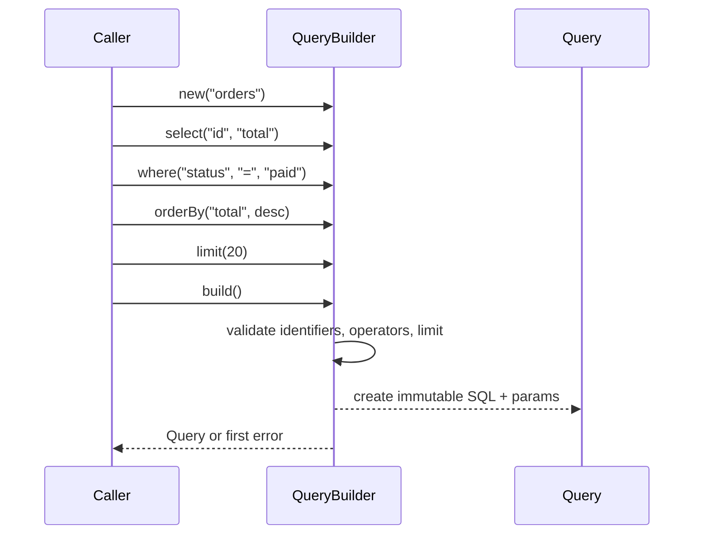

## In one minute
- A builder assembles a complex object step by step and hands it over only when it is complete and valid. The caller describes *what* it wants; `build()` checks the whole description and produces the result.
- It earns its keep when there are many optional parts, rules that span several fields ("retries need an idempotency key"), or several outputs from one description (a query builder producing SQL text plus bound parameters).
- In languages with keyword arguments and object literals, most builders are ceremony. Python's dataclasses with defaults, TypeScript options objects and Go config structs or functional options cover the common case with less code.
- A builder should be single-use or immutable. A mutable builder shared between two callers is an aliasing bug waiting to happen; in Go the same bug hides in slices that share a backing array.
- Agents write Java-style builders everywhere, including in Python and TypeScript. Review asks: what does `build()` validate that a constructor could not?

## How it works

### The problem it solves
An HTTP client has a base URL, a per-attempt timeout, an overall deadline, a retry count, a backoff policy, default headers, a proxy, TLS settings and a user agent. A constructor with nine positional parameters is unreadable at the call site (`Client("https://api", 2, 10, 3, None, {}, None, None, "svc/1.4")`), and the usual workaround, a ladder of overloaded constructors with three, five and seven parameters, multiplies code without making any of it safer.

The deeper problem is that some fields constrain each other. Retries on a non-idempotent request need an idempotency key. The overall deadline must be at least the per-attempt timeout; the AWS SDK for Java guide recommends setting both a per-attempt timeout and a whole-call timeout, and the pair only makes sense if the second is at least the first ([AWS docs](https://docs.aws.amazon.com/sdk-for-java/latest/developer-guide/best-practices.html)). A proxy and a Unix socket path cannot both be set. Setters cannot enforce these rules because each setter sees one field at a time; the rule can only be checked once the whole description is known.

### The shape
A builder collects choices and validates them once:

```python
client = (ClientBuilder("https://api.example.com")
          .timeout(seconds=2)
          .deadline(seconds=10)
          .retries(3, backoff="exponential")
          .header("User-Agent", "billing/1.4")
          .build())          # validates, then returns an immutable Client
```

Each call returns a builder, which gives the readable chain. `build()` is the single place where cross-field rules live, and it either returns a fully valid object or fails with a message that names the rule. The product is immutable, so nothing can make it invalid afterwards. The Gang of Four version adds a *director* that runs a fixed sequence of builder steps, so the same steps can drive different builders (one builds a document tree, another renders plain text). In practice the director is usually just a function.

### When the language already gives you this
- **Python**: a frozen dataclass with keyword-only fields and defaults ([dataclasses docs](https://docs.python.org/3/library/dataclasses.html)) reads as well as a builder at the call site, and `__post_init__` is where cross-field validation goes. `dataclasses.replace(cfg, timeout=5)` gives you "copy with one change".
- **TypeScript**: an options object (`new Client({ baseUrl, timeout: 2 })`) with an interface type and defaults applied in the constructor. The compiler checks field names and types; the constructor checks the rules.
- **Go**: a config struct with a `Validate()` method, or functional options (`NewClient(url, WithTimeout(2*time.Second), WithRetries(3))`), the style Rob Pike described and Dave Cheney popularised. Each option is a function that modifies the config; the constructor applies them in order and then validates.

Reach for a real builder class when construction is genuinely incremental (code adds parts in a loop or across functions), when one description produces several representations, or when the language lacks named arguments (Java, C++).

### When not to use it
- **Three fields, no cross-field rules.** A constructor is clearer. A builder adds a second class to keep in sync with the first.
- **A builder that only mirrors setters.** If `build()` does nothing but copy fields, it validates nothing and the pattern is pure cost.
- **Mutable products.** If the result has public setters anyway, the guarantee that `build()` established is gone the moment it returns.

### Reviewing agent-written code
Asked for a "configurable client", an agent trained on a lot of Java will often produce a builder class with one setter per field, a `build()` that copies them across, and a product class with the same fields again: three copies of the same list, no validation, in a language with keyword arguments. Ask for a dataclass or options object instead. The opposite mistake also appears: a fluent builder whose methods mutate `self` and return it, then a "base" builder reused in two places so the second caller sees the first caller's headers. Look for builders stored in module-level variables or fields, and ask either for a fresh builder per use or for methods that return a copy. A useful review question for any builder in a diff: "Which test fails if I delete `build()` and use the constructor directly?" If no test does, the builder has not earned its place.

### The same shape elsewhere
Builders are the *multi-step consistency* problem shape at object scale: accumulate changes, validate all of them together, then commit atomically or not at all. A database transaction does this for rows, `terraform plan` then `apply` does it for infrastructure, and a Kubernetes admission controller validates a whole object before it is persisted. In each case the point is that intermediate states are never visible to anyone else.

## Down the stack

### Layer 1: The contract
`build()` returns an object that satisfies every invariant, or returns or raises an error that names the first violated rule; it never returns a partially valid product. The product is immutable or at least does not share mutable state with the builder, so later builder calls cannot change an object already built. A builder is either single-use or persistent (each step returns a new builder), and that choice is part of its documented contract. Builders are not safe for concurrent use; they are local, short-lived objects.

### Layer 2: The mechanism
Protocol Buffers' generated Java code is the canonical example: `Message.newBuilder()` returns a mutable builder, setters return the builder, `build()` throws `UninitializedMessageException` when a proto2 required field is unset (the generated-code docs contrast it with `parseFrom`, which throws `InvalidProtocolBufferException` instead) ([protobuf docs](https://protobuf.dev/reference/java/java-generated/)). That check is shrinking: the proto2 guide now says not to use `required` and that it was removed from proto3 and editions ([proto2 guide](https://protobuf.dev/programming-guides/proto2/)), so in a modern schema `build()` validates little and cross-field rules need their own validator. `toBuilder()` copies an immutable message back into a builder for "copy with changes". Go's `strings.Builder` is a builder for bytes: it appends into a `[]byte` and `String()` returns a string that shares that memory without copying, which is only safe because the builder refuses to be copied (it stores a pointer to itself and panics in `copyCheck` if a copy is used, per the [source](https://go.dev/src/strings/builder.go)). Java's `StringBuilder` grows its array by roughly doubling, so appends are amortised constant time.

Functional options in Go are a slice of `func(*config)` values. The constructor starts from defaults, loops over the options, and validates once at the end. Persistent builders, where each step returns a new value, are what the Practice implements. In Go they hit a classic trap: a builder struct copied by value still shares the backing array of any slice field. If `base` has three conditions in a slice with capacity four, `base.Where(x)` and `base.Where(y)` both append into slot four of the same array, and the first result silently changes to contain `y`. The fix is to copy the slice before appending.

### Layer 3: The machine
A builder costs one extra allocation for the builder itself plus whatever intermediate storage it keeps. On the JVM and in Go, escape analysis often removes that: a builder that does not escape the function is allocated on the stack or scalar-replaced, so the only heap allocation is the product. A persistent builder copies its slices or lists at each step, so a chain of k steps over n parts is O(k x n) copying; for a query with ten conditions that is a few hundred bytes and sub-microsecond. Functional options that capture arguments allocate a closure each, around 16 to 32 bytes, plus the variadic slice; at construction time that is noise, inside a hot loop it is not. In V8, a builder that adds properties to the product in different orders on different paths creates objects with different hidden classes, so code that reads them becomes polymorphic; assigning every field in the constructor, in one order, keeps one shape and monomorphic property access. CPython keyword arguments build a dict per call, roughly 100 ns, which is again irrelevant for objects built once at startup.

### Why it's built this way
1. Some objects have many optional parts and rules that relate them, so they cannot be validated one field at a time.
2. Validation must happen once, after all parts are known, so construction is split into "collect" and "build".
3. An object that passed validation must stay valid, so the product is immutable and does not share state with the builder.
4. Sharing builders between callers causes aliasing, so builders are single-use or persistent.
5. Languages with named arguments and literals already cover simple cases, so the pattern is worth its extra class only where the rules or the incremental assembly are real.

## Diagram


## Worked example
A data team exposes a reporting API that turns filter requests into SQL. The first version concatenated strings: `"WHERE status = '" + status + "'"`. A penetration test found injection in two endpoints within an hour. The second version used a query builder with three rules in `build()`: identifiers must match `[A-Za-z_][A-Za-z0-9_]*`, operators must come from a fixed list of six, and every value becomes a `?` placeholder in a separate parameter list that the database driver binds. Values never touch the SQL text, so injection through values is impossible by construction.

The builder is persistent. The API builds `base = Query("orders").where("tenant_id", "=", t)` once per request and derives three queries from it (the page, the total count and a CSV export). In the first draft the builder mutated itself, and the CSV export inherited the page's `LIMIT 50`, so exports silently returned 50 rows. Making each step return a new builder fixed it. Cost check: a typical query has 4 conditions and 1 ordering. Building it copies about 10 small list entries across 6 steps, under 2 microseconds in Python against a 5 to 50 millisecond database round trip.

## In the wild
- **AWS SDK for Java 2.x, documented practice: two timeouts and one shared client.** The SDK's best-practices guide asks callers to set both a per-attempt timeout (`apiCallAttemptTimeout`) and a whole-call timeout (`apiCallTimeout`), and to share one client instance because each client owns a connection pool. Those are the cross-field rule and the aliasing rule from this lesson, written down for a production SDK ([AWS docs](https://docs.aws.amazon.com/sdk-for-java/latest/developer-guide/best-practices.html)).
- **Protocol Buffers, current docs: validation in `build()` was retired.** The proto2 guide says `required` should not be used because required fields were so problematic that proto3 and editions removed them, so the one check generated builders could do is gone from new schemas. Field rules now live in separate validators ([proto2 guide](https://protobuf.dev/programming-guides/proto2/)).
- **Go standard library: `strings.Builder` refuses to be copied.** It records its own address and panics if a copy is mutated, because a copied builder would share one backing array with the original, the same aliasing bug as a shared mutable builder ([source](https://go.dev/src/strings/builder.go)).

## Trade-offs
| Option | Strengths | Weaknesses | Choose when |
| --- | --- | --- | --- |
| Plain constructor | Simplest; one place | Unreadable past 4 to 5 parameters; no named arguments in some languages | Few fields, no cross-field rules |
| Keyword args, options object, config struct | Readable call sites; little code | Validation still needs a home (`__post_init__`, `Validate()`) | Most configuration objects in Python, TS and Go |
| Go functional options | Defaults hidden; easy to add options without breaking callers | Harder to inspect or serialise the config; one closure per option | Public Go library APIs with many optional settings |
| Mutable fluent builder | Familiar; cheap | Aliasing when reused; easy to build twice from shared state | Local, single-use construction in Java or C# |
| Persistent (immutable) builder | Safe to branch from a base; easy to reason about | Copies at each step | Query builders and templates derived from a shared base |

## Pitfalls in production
- Validation spread across setters, so cross-field rules are never checked. Fix: setters store, `build()` validates everything, with tests per rule.
- A shared mutable builder (in a field, a module variable or a test fixture) leaking state between uses. Fix: create one per use, or make each step return a copy.
- Go slice aliasing in value-type builders. Fix: copy slices before appending (`append(slices.Clip(s), x)` or an explicit copy), and test branching from a base with spare capacity.
- Products with setters, so callers bypass the checks after `build()`. Fix: immutable product; offer `toBuilder()` or `replace()` for "copy with changes".
- Builders that build strings for another language (SQL, shell, HTML) by concatenating values. Fix: keep values out of the text; use placeholders and let the driver bind them.
- Builder classes generated for every data type "for consistency". Fix: delete the ones that validate nothing.

## Leadership lens
- Ask what invariants `build()` enforces. If the answer is none, prefer the language's native construction and save the extra class.
- For public APIs, choose the construction style for evolvability: options objects and functional options let you add settings without breaking callers; positional constructors do not.
- Query and command builders are a security boundary. Require that values are always parameters and that identifiers are checked against an allowlist, and make that a review rule for human and agent code alike.
- Watch for the same configuration defined three times (builder, product, docs). Generate or derive what you can, or the copies drift.

## Check yourself
1. Why can't setters alone enforce "deadline must be at least the per-attempt timeout"?
   **Answer:** Each setter sees one field, and callers may set them in either order; the rule can only be checked once both are known, which is what `build()` is for.
2. A Python codebase has a `UserBuilder` with eight setters and a `build()` that copies them into `User`. What would you suggest?
   **Answer:** Replace it with a frozen dataclass with keyword fields and defaults, and move any real validation into `__post_init__`; the builder adds code without adding guarantees.
3. In Go, `a := base.Where(x)` and `b := base.Where(y)` sometimes make `a` contain `y`. Why only sometimes?
   **Answer:** Both appends share the backing array when it has spare capacity, so the second overwrites the first; when it is full, `append` allocates a new array and the bug disappears.
4. Why does a query builder keep values out of the SQL text?
   **Answer:** Bound parameters are sent separately and never parsed as SQL, so a value cannot change the query's structure, which rules out injection through values.

## Practice
**Task:** Write a persistent SQL `SELECT` builder. `QueryBuilder(table)` (Go: `NewQuery(table)`) supports `select(cols...)`, `where(col, op, value)`, `order_by(col, desc)` and `limit(n)`; each returns a new builder and never changes the one it was called on. `build()` returns the SQL and a parameter list, such as `SELECT id, name FROM users WHERE age >= ? AND active = ? ORDER BY name DESC LIMIT 10` with params `[18, true]`. With no `select`, use `*`; several `where` calls are joined with `AND`; several `order_by` calls are joined with `, `. Validation happens in `build()` and reports the first problem in call order: an identifier (table or column) not matching `[A-Za-z_][A-Za-z0-9_]*` gives `bad identifier: <name>`, an operator outside `=, !=, <, <=, >, >=` gives `bad operator: <op>`, and a limit below 1 gives `bad limit: <n>`. Python raises `ValueError`, TypeScript throws `Error`, Go returns an error.

```python starter
class QueryBuilder:
    def __init__(self, table):
        self.table = table

    def select(self, *cols):
        # TODO
        raise NotImplementedError

    def where(self, col, op, value):
        # TODO
        raise NotImplementedError

    def order_by(self, col, desc=False):
        # TODO
        raise NotImplementedError

    def limit(self, n):
        # TODO
        raise NotImplementedError

    def build(self):
        # TODO: return (sql, params)
        raise NotImplementedError
```

```python tests
def error_of(fn):
    try:
        fn()
    except ValueError as e:
        return str(e)
    return None

def test_select_all():
    assert QueryBuilder("users").build() == ("SELECT * FROM users", [])

def test_full_query():
    q = (QueryBuilder("users").select("id", "name").where("age", ">=", 18)
         .where("active", "=", True).order_by("name", desc=True).limit(10))
    assert q.build() == ("SELECT id, name FROM users WHERE age >= ? AND active = ? ORDER BY name DESC LIMIT 10", [18, True])

def test_multiple_order_by():
    sql, _ = QueryBuilder("t").order_by("a").order_by("b", desc=True).build()
    assert sql == "SELECT * FROM t ORDER BY a, b DESC"

def test_steps_do_not_mutate_base():
    base = QueryBuilder("orders").where("tenant", "=", 7)
    page = base.limit(50)
    count = base.select("id")
    assert base.build() == ("SELECT * FROM orders WHERE tenant = ?", [7])
    assert page.build()[0].endswith("LIMIT 50")
    assert count.build()[0] == "SELECT id FROM orders WHERE tenant = ?"

def test_branches_are_independent():
    base = QueryBuilder("t").where("a", "=", 1).where("b", "=", 2).where("c", "=", 3)
    x = base.where("d", "=", 4)
    y = base.where("e", "=", 5)
    assert x.build()[1] == [1, 2, 3, 4] and y.build()[1] == [1, 2, 3, 5]
    assert "d = ?" in x.build()[0] and "d = ?" not in y.build()[0]

def test_values_never_in_sql():
    sql, params = QueryBuilder("users").where("name", "=", "x' OR '1'='1").build()
    assert sql == "SELECT * FROM users WHERE name = ?" and params == ["x' OR '1'='1"]

def test_validation_errors():
    assert error_of(lambda: QueryBuilder("users; DROP").build()) == "bad identifier: users; DROP"
    assert error_of(lambda: QueryBuilder("u").where("age", "LIKE", 1).build()) == "bad operator: LIKE"
    assert error_of(lambda: QueryBuilder("u").limit(0).build()) == "bad limit: 0"
    assert error_of(lambda: QueryBuilder("u").select("ok", "1bad").build()) == "bad identifier: 1bad"

def test_first_error_in_call_order():
    q = QueryBuilder("u").where("x", "~", 1).order_by("bad col")
    assert error_of(q.build) == "bad operator: ~"
```

```python solution
import string

FIRST = set(string.ascii_letters + "_")
REST = FIRST | set(string.digits)
OPS = ("=", "!=", "<", "<=", ">", ">=")

def is_ident(name):
    return bool(name) and name[0] in FIRST and all(ch in REST for ch in name)

class QueryBuilder:
    def __init__(self, table, cols=(), wheres=(), orders=(), lim=None, checks=None):
        self.table = table
        self.cols = tuple(cols)
        self.wheres = tuple(wheres)
        self.orders = tuple(orders)
        self.lim = lim
        self.checks = tuple(checks) if checks is not None else (("ident", table),)

    def _with(self, checks=(), **changes):
        fields = dict(cols=self.cols, wheres=self.wheres, orders=self.orders, lim=self.lim)
        fields.update(changes)
        return QueryBuilder(self.table, checks=self.checks + tuple(checks), **fields)

    def select(self, *cols):
        return self._with(checks=[("ident", c) for c in cols], cols=self.cols + cols)

    def where(self, col, op, value):
        return self._with(checks=[("ident", col), ("op", op)], wheres=self.wheres + ((col, op, value),))

    def order_by(self, col, desc=False):
        return self._with(checks=[("ident", col)], orders=self.orders + ((col, desc),))

    def limit(self, n):
        return self._with(checks=[("limit", n)], lim=n)

    def build(self):
        for kind, v in self.checks:
            if kind == "ident" and not is_ident(v):
                raise ValueError("bad identifier: " + v)
            if kind == "op" and v not in OPS:
                raise ValueError("bad operator: " + v)
            if kind == "limit" and v < 1:
                raise ValueError("bad limit: " + str(v))
        sql = "SELECT " + (", ".join(self.cols) if self.cols else "*") + " FROM " + self.table
        if self.wheres:
            sql += " WHERE " + " AND ".join(c + " " + op + " ?" for c, op, _ in self.wheres)
        if self.orders:
            sql += " ORDER BY " + ", ".join(c + (" DESC" if d else "") for c, d in self.orders)
        if self.lim is not None:
            sql += " LIMIT " + str(self.lim)
        return sql, [v for _, _, v in self.wheres]
```

```typescript starter
export interface Query { sql: string; params: unknown[]; }

export class QueryBuilder {
  constructor(public readonly table: string) {}

  select(...cols: string[]): QueryBuilder { throw new Error("TODO"); }
  where(col: string, op: string, value: unknown): QueryBuilder { throw new Error("TODO"); }
  orderBy(col: string, desc: boolean = false): QueryBuilder { throw new Error("TODO"); }
  limit(n: number): QueryBuilder { throw new Error("TODO"); }
  build(): Query { throw new Error("TODO"); }
}
```

```typescript tests
function errorOf(fn: () => unknown): string | undefined {
  try { fn(); } catch (e) { return (e as Error).message; }
  return undefined;
}

test("select all", () => {
  assertEqual(new QueryBuilder("users").build(), { sql: "SELECT * FROM users", params: [] });
});

test("full query", () => {
  const q = new QueryBuilder("users").select("id", "name").where("age", ">=", 18)
    .where("active", "=", true).orderBy("name", true).limit(10);
  assertEqual(q.build(), { sql: "SELECT id, name FROM users WHERE age >= ? AND active = ? ORDER BY name DESC LIMIT 10", params: [18, true] });
});

test("multiple order by", () => {
  assertEqual(new QueryBuilder("t").orderBy("a").orderBy("b", true).build().sql, "SELECT * FROM t ORDER BY a, b DESC");
});

test("steps do not mutate base", () => {
  const base = new QueryBuilder("orders").where("tenant", "=", 7);
  const page = base.limit(50);
  const count = base.select("id");
  assertEqual(base.build(), { sql: "SELECT * FROM orders WHERE tenant = ?", params: [7] });
  assert(page.build().sql.endsWith("LIMIT 50"), "page has limit");
  assertEqual(count.build().sql, "SELECT id FROM orders WHERE tenant = ?");
});

test("branches are independent", () => {
  const base = new QueryBuilder("t").where("a", "=", 1).where("b", "=", 2).where("c", "=", 3);
  const x = base.where("d", "=", 4);
  const y = base.where("e", "=", 5);
  assertEqual(x.build().params, [1, 2, 3, 4]);
  assertEqual(y.build().params, [1, 2, 3, 5]);
  assert(!y.build().sql.includes("d = ?"), "y must not see x's condition");
});

test("values never in sql", () => {
  const q = new QueryBuilder("users").where("name", "=", "x' OR '1'='1").build();
  assertEqual(q, { sql: "SELECT * FROM users WHERE name = ?", params: ["x' OR '1'='1"] });
});

test("validation errors", () => {
  assertEqual(errorOf(() => new QueryBuilder("users; DROP").build()), "bad identifier: users; DROP");
  assertEqual(errorOf(() => new QueryBuilder("u").where("age", "LIKE", 1).build()), "bad operator: LIKE");
  assertEqual(errorOf(() => new QueryBuilder("u").limit(0).build()), "bad limit: 0");
  assertEqual(errorOf(() => new QueryBuilder("u").select("ok", "1bad").build()), "bad identifier: 1bad");
});

test("first error in call order", () => {
  const q = new QueryBuilder("u").where("x", "~", 1).orderBy("bad col");
  assertEqual(errorOf(() => q.build()), "bad operator: ~");
});
```

```typescript solution
export interface Query { sql: string; params: unknown[]; }

type Check = ["ident" | "op" | "limit", string | number];
type Where = [string, string, unknown];

const IDENT = /^[A-Za-z_][A-Za-z0-9_]*$/;
const OPS = ["=", "!=", "<", "<=", ">", ">="];

export class QueryBuilder {
  constructor(
    public readonly table: string,
    private readonly cols: readonly string[] = [],
    private readonly wheres: readonly Where[] = [],
    private readonly orders: readonly [string, boolean][] = [],
    private readonly lim: number | null = null,
    private readonly checks: readonly Check[] = [["ident", table]],
  ) {}

  private next(c: Partial<{ cols: readonly string[]; wheres: readonly Where[]; orders: readonly [string, boolean][]; lim: number | null }>, checks: Check[]): QueryBuilder {
    return new QueryBuilder(this.table, c.cols ?? this.cols, c.wheres ?? this.wheres,
      c.orders ?? this.orders, c.lim !== undefined ? c.lim : this.lim, [...this.checks, ...checks]);
  }

  select(...cols: string[]): QueryBuilder {
    return this.next({ cols: [...this.cols, ...cols] }, cols.map((c): Check => ["ident", c]));
  }
  where(col: string, op: string, value: unknown): QueryBuilder {
    return this.next({ wheres: [...this.wheres, [col, op, value]] }, [["ident", col], ["op", op]]);
  }
  orderBy(col: string, desc: boolean = false): QueryBuilder {
    return this.next({ orders: [...this.orders, [col, desc]] }, [["ident", col]]);
  }
  limit(n: number): QueryBuilder {
    return this.next({ lim: n }, [["limit", n]]);
  }

  build(): Query {
    for (const [kind, v] of this.checks) {
      if (kind === "ident" && !IDENT.test(String(v))) throw new Error("bad identifier: " + v);
      if (kind === "op" && !OPS.includes(String(v))) throw new Error("bad operator: " + v);
      if (kind === "limit" && Number(v) < 1) throw new Error("bad limit: " + v);
    }
    let sql = "SELECT " + (this.cols.length ? this.cols.join(", ") : "*") + " FROM " + this.table;
    if (this.wheres.length) sql += " WHERE " + this.wheres.map(([c, op]) => c + " " + op + " ?").join(" AND ");
    if (this.orders.length) sql += " ORDER BY " + this.orders.map(([c, d]) => c + (d ? " DESC" : "")).join(", ");
    if (this.lim !== null) sql += " LIMIT " + this.lim;
    return { sql, params: this.wheres.map(([, , v]) => v) };
  }
}
```

```go starter
package practice

type Query struct {
	SQL    string
	Params []any
}

type Builder struct {
	table string
}

func NewQuery(table string) Builder { return Builder{table: table} }

func (b Builder) Select(cols ...string) Builder                { panic("TODO") }
func (b Builder) Where(col, op string, value any) Builder      { panic("TODO") }
func (b Builder) OrderBy(col string, desc bool) Builder        { panic("TODO") }
func (b Builder) Limit(n int) Builder                          { panic("TODO") }
func (b Builder) Build() (Query, error)                        { panic("TODO") }
```

```go tests
package practice

import (
	"reflect"
	"strings"
	"testing"
)

func mustBuild(t *testing.T, b Builder) Query {
	t.Helper()
	q, err := b.Build()
	if err != nil {
		t.Fatalf("unexpected error: %v", err)
	}
	return q
}

func errOf(b Builder) string {
	_, err := b.Build()
	if err == nil {
		return ""
	}
	return err.Error()
}

func TestSelectAll(t *testing.T) {
	q := mustBuild(t, NewQuery("users"))
	if q.SQL != "SELECT * FROM users" || len(q.Params) != 0 {
		t.Fatalf("got %+v", q)
	}
}

func TestFullQuery(t *testing.T) {
	q := mustBuild(t, NewQuery("users").Select("id", "name").Where("age", ">=", 18).
		Where("active", "=", true).OrderBy("name", true).Limit(10))
	want := "SELECT id, name FROM users WHERE age >= ? AND active = ? ORDER BY name DESC LIMIT 10"
	if q.SQL != want || !reflect.DeepEqual(q.Params, []any{18, true}) {
		t.Fatalf("got %+v", q)
	}
}

func TestMultipleOrderBy(t *testing.T) {
	q := mustBuild(t, NewQuery("t").OrderBy("a", false).OrderBy("b", true))
	if q.SQL != "SELECT * FROM t ORDER BY a, b DESC" {
		t.Fatalf("got %q", q.SQL)
	}
}

func TestStepsDoNotMutateBase(t *testing.T) {
	base := NewQuery("orders").Where("tenant", "=", 7)
	page := base.Limit(50)
	count := base.Select("id")
	if q := mustBuild(t, base); q.SQL != "SELECT * FROM orders WHERE tenant = ?" {
		t.Fatalf("base changed: %q", q.SQL)
	}
	if q := mustBuild(t, page); !strings.HasSuffix(q.SQL, "LIMIT 50") {
		t.Fatalf("page: %q", q.SQL)
	}
	if q := mustBuild(t, count); q.SQL != "SELECT id FROM orders WHERE tenant = ?" {
		t.Fatalf("count: %q", q.SQL)
	}
}

func TestBranchesAreIndependent(t *testing.T) {
	base := NewQuery("t").Where("a", "=", 1).Where("b", "=", 2).Where("c", "=", 3)
	x := base.Where("d", "=", 4)
	y := base.Where("e", "=", 5)
	qx, qy := mustBuild(t, x), mustBuild(t, y)
	if !reflect.DeepEqual(qx.Params, []any{1, 2, 3, 4}) || !reflect.DeepEqual(qy.Params, []any{1, 2, 3, 5}) {
		t.Fatalf("x=%v y=%v", qx.Params, qy.Params)
	}
	if !strings.Contains(qx.SQL, "d = ?") || strings.Contains(qy.SQL, "d = ?") {
		t.Fatalf("x=%q y=%q", qx.SQL, qy.SQL)
	}
}

func TestValuesNeverInSQL(t *testing.T) {
	q := mustBuild(t, NewQuery("users").Where("name", "=", "x' OR '1'='1"))
	if q.SQL != "SELECT * FROM users WHERE name = ?" || q.Params[0] != "x' OR '1'='1" {
		t.Fatalf("got %+v", q)
	}
}

func TestValidationErrors(t *testing.T) {
	cases := map[string]Builder{
		"bad identifier: users; DROP": NewQuery("users; DROP"),
		"bad operator: LIKE":          NewQuery("u").Where("age", "LIKE", 1),
		"bad limit: 0":                NewQuery("u").Limit(0),
		"bad identifier: 1bad":        NewQuery("u").Select("ok", "1bad"),
	}
	for want, b := range cases {
		if got := errOf(b); got != want {
			t.Errorf("want %q, got %q", want, got)
		}
	}
}

func TestFirstErrorInCallOrder(t *testing.T) {
	if got := errOf(NewQuery("u").Where("x", "~", 1).OrderBy("bad col", false)); got != "bad operator: ~" {
		t.Fatalf("got %q", got)
	}
}
```

```go solution
package practice

import (
	"errors"
	"regexp"
	"strconv"
	"strings"
)

type Query struct {
	SQL    string
	Params []any
}

type where struct {
	col, op string
	value   any
}

type order struct {
	col  string
	desc bool
}

type Builder struct {
	table  string
	cols   []string
	wheres []where
	orders []order
	limit  int
	err    error
}

var ident = regexp.MustCompile(`^[A-Za-z_][A-Za-z0-9_]*$`)
var ops = map[string]bool{"=": true, "!=": true, "<": true, "<=": true, ">": true, ">=": true}

func NewQuery(table string) Builder {
	return Builder{table: table}.check(ident.MatchString(table), "bad identifier: "+table)
}

// check records only the first error, so Build reports problems in call order.
func (b Builder) check(ok bool, msg string) Builder {
	if !ok && b.err == nil {
		b.err = errors.New(msg)
	}
	return b
}

// grow copies before appending so two builders never share a backing array.
func grow[T any](s []T, v ...T) []T {
	out := make([]T, 0, len(s)+len(v))
	return append(append(out, s...), v...)
}

func (b Builder) Select(cols ...string) Builder {
	for _, c := range cols {
		b = b.check(ident.MatchString(c), "bad identifier: "+c)
	}
	b.cols = grow(b.cols, cols...)
	return b
}

func (b Builder) Where(col, op string, value any) Builder {
	b = b.check(ident.MatchString(col), "bad identifier: "+col).check(ops[op], "bad operator: "+op)
	b.wheres = grow(b.wheres, where{col, op, value})
	return b
}

func (b Builder) OrderBy(col string, desc bool) Builder {
	b = b.check(ident.MatchString(col), "bad identifier: "+col)
	b.orders = grow(b.orders, order{col, desc})
	return b
}

func (b Builder) Limit(n int) Builder {
	b = b.check(n >= 1, "bad limit: "+strconv.Itoa(n))
	b.limit = n
	return b
}

func (b Builder) Build() (Query, error) {
	if b.err != nil {
		return Query{}, b.err
	}
	var sb strings.Builder
	sb.WriteString("SELECT ")
	if len(b.cols) == 0 {
		sb.WriteString("*")
	} else {
		sb.WriteString(strings.Join(b.cols, ", "))
	}
	sb.WriteString(" FROM " + b.table)
	params := []any{}
	for i, w := range b.wheres {
		if i == 0 {
			sb.WriteString(" WHERE ")
		} else {
			sb.WriteString(" AND ")
		}
		sb.WriteString(w.col + " " + w.op + " ?")
		params = append(params, w.value)
	}
	for i, o := range b.orders {
		if i == 0 {
			sb.WriteString(" ORDER BY ")
		} else {
			sb.WriteString(", ")
		}
		sb.WriteString(o.col)
		if o.desc {
			sb.WriteString(" DESC")
		}
	}
	if b.limit != 0 {
		sb.WriteString(" LIMIT " + strconv.Itoa(b.limit))
	}
	return Query{SQL: sb.String(), Params: params}, nil
}
```

## Mock interview
**Prompt:** You own the internal HTTP client library used by 120 services. Its constructor takes 11 positional parameters, and last month two outages came from services passing the overall deadline where the per-attempt timeout was expected. Redesign construction so mistakes like that are hard to make and new settings can be added without breaking callers.

- Follow-up: Which cross-field rules would you enforce at construction, and how do callers find out what failed?
- Follow-up: Two teams share a "base" client configuration and customise it. How do you stop one team's change leaking into the other's?
- Follow-up: In Go, would you choose functional options or a config struct, and why?

**A strong answer covers:**
- Named construction (options object, config struct, functional options or a builder) so values cannot be swapped silently, with typed units such as `time.Duration` instead of bare integers.
- Validation in one place with specific errors: deadline at least per-attempt timeout times attempts, retries only for idempotent methods or with an idempotency key, mutually exclusive transport settings.
- An immutable product and "copy with changes" (`toBuilder`, `replace`, applying extra options to a base) so shared bases cannot be mutated.
- A migration path: a new constructor alongside the old one, a deprecation period, and an automated codemod that agents or scripts can apply across the 120 services.
- Trade-off awareness: functional options keep defaults private and evolve cleanly; config structs are easier to inspect, serialise and diff.

## Sources and further study
**Primary**
- [Python dataclasses](https://docs.python.org/3/library/dataclasses.html): `frozen`, `kw_only` and `__post_init__`, the native alternative to a builder.
- [Protocol Buffers proto2 guide](https://protobuf.dev/programming-guides/proto2/): why `required`, and with it build-time validation, was dropped.

**Systems docs**
- [AWS SDK for Java 2.x best practices](https://docs.aws.amazon.com/sdk-for-java/latest/developer-guide/best-practices.html): setting both timeouts and sharing clients.
- [Protocol Buffers Java generated code](https://protobuf.dev/reference/java/java-generated/): immutable messages, builders and `toBuilder`, from a production library.
- [Go strings.Builder source](https://go.dev/src/strings/builder.go): the copy check in a few lines.

**Books**
- *Effective Java* (3rd ed.), Bloch: chapter 2, Item 2, Consider a builder when faced with many constructor parameters.
- *Design Patterns*, Gamma, Helm, Johnson and Vlissides (1994): chapter 3, Creational Patterns, for the Builder and its director.
- *Refactoring* (2nd ed.), Fowler: chapter 6, A First Set of Refactorings, which includes Introduce Parameter Object.

**Other curricula**
- [Builder (refactoring.guru)](https://refactoring.guru/design-patterns/builder): frames it as step-by-step construction, with a warning about telescoping constructors.

## Watch
- [Functional options for friendly APIs (Dave Cheney, dotGo 2014)](https://www.youtube.com/watch?v=24lFtGHWxAQ): the Go answer to builders, and why it evolves better than config structs for public APIs.
- [10 Design Patterns Explained in 10 Minutes (Fireship)](https://www.youtube.com/watch?v=tv-_1er1mWI): a fast tour that places builder next to singleton and factory in a JavaScript setting.

## Free resources
- [The Builder Pattern (Brandon Rhodes, python-patterns.guide)](https://python-patterns.guide/gang-of-four/builder/): when Python needs a builder and when keyword arguments are enough.
- [Self-referential functions and the design of options (Rob Pike)](https://commandcenter.blogspot.com/2014/01/self-referential-functions-and-design.html): the original functional options post.
- [Functional options for friendly APIs (Dave Cheney)](https://dave.cheney.net/2014/10/17/functional-options-for-friendly-apis): the written version of the talk, comparing every alternative.
- [Fluent Interface (Martin Fowler)](https://martinfowler.com/bliki/FluentInterface.html): where method chaining helps readability and what it costs.
- [Java generated code: builders (Protocol Buffers docs)](https://protobuf.dev/reference/java/java-generated/): a production builder with `build()` and `toBuilder()`.
- [strings.Builder source (Go)](https://go.dev/src/strings/builder.go): a small builder that avoids a final copy and panics if copied.
