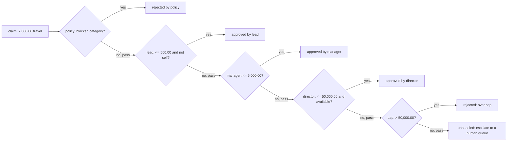

## In one minute
- Chain of Responsibility passes a request along an ordered list of handlers until one of them takes it. The sender knows only the head of the chain, not which handler will answer or whether any will.
- Each handler makes one local decision: "this is mine" (handle and stop) or "not mine" (pass it on). Adding a new rule is inserting a handler, not editing a growing `if/elif` ladder.
- The order of the chain is the policy. "Reject blocked categories before any approver looks" and "the cheapest approver who can sign gets it" are both expressed purely by position.
- The defining question is what happens at the end of the chain. A request that falls off the end must produce an explicit outcome (escalate, reject, default), never silence.
- It is not the same as middleware. A decorator stack runs every layer around one core call; a chain stops at the first handler that claims the request. Agents blur the two, and review should ask which one the code means.

## How it works

### The problem
An expense tool routes each claim to someone who can approve it. The first version is one function:

```python
def route(claim):
    if claim.category in ("gambling", "gifts"):
        return reject("blocked category")
    if claim.amount <= 500_00 and claim.requester != "lead":
        return approve("lead")
    if claim.amount <= 5_000_00:
        return approve("manager")
    ...
```

Every new rule (a regional limit, an out-of-office approver, a fraud check) edits this function, and rules interact through an order nobody wrote down. When finance asks "who would have approved this claim last Tuesday?", the answer is buried in control flow.

### One handler per rule
Chain of Responsibility splits the ladder into objects with one method:

```python
class Approver:
    def __init__(self, name, limit_cents):
        self.name, self.limit = name, limit_cents

    def decide(self, claim):
        if claim.requester == self.name or claim.amount_cents > self.limit:
            return None                      # not mine: pass it on
        return ("approved", "within limit")  # mine: stop here
```

A chain holds handlers in order and asks each in turn. The first non-empty answer wins. The rule set becomes data: `[policy, lead, manager, director, cap]`. Inserting a fraud check before the approvers is one line in the wiring; it does not touch any approver.

### Two shapes: linked and list
The Gang of Four version links handlers: each holds a `next` pointer and calls `next.handle(request)` when it declines. A handler can then work before and after its successor, but any handler can also forget `next` and silently swallow the request.

The list form keeps handlers ignorant of each other. A driver loop owns the walk, the stop condition and the end-of-chain outcome. For selection and escalation, it is almost always better: the walk lives in one place, records a trail of who was asked, and skips unavailable handlers without any handler knowing.

### Chain versus middleware
The Decorator lesson builds a middleware stack where every layer wraps the next and all of them run. That is a pipeline: retry, cache and metrics each add behaviour to one core call. A chain of responsibility is a selection: many candidates, at most one answer. Express's `next()` blurs the two, because a middleware can either respond (stop) or call `next` (pass). When reviewing, ask: "Is every handler supposed to run, or exactly one?" If the answer is "every", you want decorators or a pipeline; if it is "the first that can", you want a chain, and the chain needs a defined fallthrough.

### Where you already use it
- **Exception handling.** A thrown exception walks up the stack; the first frame with a matching `catch` handles it. Reaching the top is the end-of-chain case, and the default is to crash.
- **DOM event bubbling.** A click goes to the target, then its ancestors, until a listener calls `stopPropagation()`.
- **Python imports.** Each finder on `sys.meta_path` is asked for a module spec; the first answer wins, and none means `ModuleNotFoundError`.
- **Firewall rules.** An iptables chain is evaluated rule by rule; the first terminating match (`ACCEPT`, `DROP`) decides, and the chain policy is the default.

### When not to use it
- **The request names its handler.** If a type or key identifies the handler, a map lookup is faster and clearer.
- **Every handler must run.** That is a pipeline or Observer.
- **Hundreds of rules on a hot path.** The linear walk becomes the bottleneck; see the machine layer.

### Reviewing agent-written code
Asked to "let VPs approve up to 50,000", an agent typically inserts another `elif`, often in the wrong position, because the ordering contract is implicit. Asked to "use Chain of Responsibility", it produces the linked form with an abstract `BaseHandler`, `set_next` and `super().handle()` in every subclass. Steer toward the list form. In review, check that the end-of-chain outcome is explicit and tested, the order is built in one place and pinned by a test, handlers do not mutate the request while declining, and the driver validates what handlers return.

### The same shape elsewhere
A chain is the *finding things fast* shape solved the slow way: a linear scan for the first match. It recurs in drivers sharing an IRQ line (each is asked "is this interrupt yours?"), in support escalation from tier 1 to tier 3, and in an LLM gateway that tries a cheap model before an expensive one. The questions are always the same: what order, what happens on a miss, and how long can the walk get.

## Down the stack

### Layer 1: The contract
The chain promises: handlers are asked in their configured order; the first handler that claims the request decides, and no later handler sees it; a handler that declines leaves no side effects that change the outcome; and if no handler claims the request, the caller receives a distinct, explicit "unhandled" result, not a default approval and not `None` mistaken for success. A good chain also promises an audit trail (which handlers were consulted, which decided) because escalation systems are judged after the fact. Each handler's own contract is narrow: given a request, return claim or pass, quickly and deterministically for the same input.

### Layer 2: The mechanism
Real systems mostly use an array plus a loop. Python's import machinery is literally `for finder in sys.meta_path: spec = finder.find_spec(name, path, target)`, stopping at the first non-`None` spec. glibc's NSS keeps a parsed list of service entries per database with an action table per status (`SUCCESS`, `NOTFOUND`, `UNAVAIL`, `TRYAGAIN`), so the "pass or stop" decision is configurable per link without changing any service module. Netfilter stores each iptables chain as a contiguous blob of rule entries; the kernel walks entries, and a non-terminating jump target pushes a return position so evaluation resumes in the calling chain afterwards. C++ and Rust exceptions use table-driven unwinding: the compiler emits per-function tables (`.eh_frame` plus a language-specific data area), and the unwinder walks frames, asking each frame's personality routine whether it has a matching handler.

### Layer 3: The machine
A list-form chain of N handlers costs up to N indirect calls per request. In Go each is an interface call through an itab, roughly 1 to 2 ns when predicted, so a 6-handler chain costs well under 50 ns. In CPython each hop is a bound-method call of 50 to 100 ns. The linked form adds pointer chasing, since each `next` is a separate heap object, possibly on another cache line; an array of interface values (16 bytes each in Go: a type word and a data pointer) is walked sequentially.

The cost that matters is linear growth. kube-proxy's iptables mode programmed every Service as rules that packets walked in sequence; with tens of thousands of Services, evaluation and updates became slow, and IPVS mode replaced the walk with hash lookups. nftables sets do the same inside one rule. Application chains follow the same rule: fine at tens of handlers, and at hundreds the front of the chain should become an index (by category or amount band).

A chain built at startup is read-only and needs no locking. Mutable state such as an approver's availability should be read under a lock or swapped in as a new immutable chain, so a request never sees half a reconfiguration.

### Why it's built this way
1. Requests arrive without knowing who should handle them, so someone must search the candidates.
2. Rules overlap (a small gift claim matches both "blocked category" and "lead can approve"), so the search needs a precedence, and an ordered list expresses precedence directly.
3. Rules change independently and are owned by different people, so each lives in its own handler and the order lives in one wiring step.
4. Requests that match nothing are inevitable, so the end of the chain must have a defined outcome.
5. A linear walk costs time per handler, so chains stay short, and long rule sets graduate to indexed dispatch.

## Diagram


## Worked example
A 900-person company processes about 4,000 expense claims a month. The old router was a 180-line function with 23 branches. An audit found three problems: claims filed by a team lead for exactly the lead's limit were approved by the lead, because `<=` and the self-approval check were in the wrong order; claims over the director's limit while the director was on leave fell through to a final `return approve("finance")` that nobody remembered writing; and finance could not answer "who saw this claim?".

The rewrite used a list-form chain (`policy`, `lead`, `manager`, `director`, `cap`) with an explicit unhandled outcome that sends the claim to a human queue, and stored the trail with every decision. In the first month 71 percent of claims stopped at the lead, 24 percent at the manager, 4 percent at the director, 0.6 percent were rejected by policy, and 14 claims (0.35 percent) reached the unhandled queue, all during director absences. Before, those 14 had been silently approved by the forgotten fallback.

Adding a VP tier later was one handler inserted between manager and director plus one test pinning the full order. Routing cost about 3 microseconds per claim in Python against a 40 ms request.

## Trade-offs
| Option | Strengths | Weaknesses | Choose when |
| --- | --- | --- | --- |
| `if/elif` ladder | Everything visible in one place; fast | Order rules implicit; every change edits shared code | A few stable rules owned by one person |
| Linked handlers (`next` pointers) | A handler can act before and after its successor | Easy to drop the request by forgetting `next`; no central trail | Frameworks where handlers wrap the rest of the walk |
| List of handlers plus driver | One walk, one fallthrough rule, easy trail and skipping | Handlers cannot post-process | Selection and escalation (approvals, routing, fallbacks) |
| Lookup table by key | O(1); no ambiguity | Only works when the key identifies the handler | Requests carry their type or route |
| Rules engine | Non-engineers edit rules; conflict analysis | Heavy; debugging by trace | Hundreds of business rules that change weekly |

## Pitfalls in production
- No defined end-of-chain outcome, so an unclaimed request returns `None` and the caller treats it as success. Fix: return an explicit unhandled result and route it to a human or an error.
- A catch-all handler inserted early (for example "admins can approve anything" placed first) that shadows every later handler. Fix: test the full chain order, and add an assertion that catch-alls are last.
- Handlers that mutate the request while declining (normalising a field, adding a tag), so later handlers see a different request depending on which earlier handlers exist. Fix: treat the request as immutable inside the walk; enrich it in a separate step before the chain.
- Silent growth: a chain that started at 5 handlers has 300 and dominates latency. Fix: index the first stage by key and keep chains short within each bucket.
- A handler that calls external services while deciding (checking an HR system for leave), making routing slow and flaky. Fix: precompute availability and inject it, so `decide` stays pure and fast.

## Leadership lens
- Treat the chain order as a reviewed artefact. A one-line reorder can change who is allowed to approve money; it deserves a named test and an owner.
- Ask in design review: "What happens when nobody handles it?" If the answer is not an explicit, observable outcome, the design is incomplete.
- Require a decision trail for any chain that grants access, money or escalation. It turns audit questions from code archaeology into a query.
- Watch for teams adding links instead of rethinking. When the chain passes roughly 20 handlers or shows up in profiles, fund the move to indexed dispatch.
- For agents, a useful instruction is "add a handler and insert it at position N in the wiring; do not edit other handlers or the driver". It keeps the change additive and reviewable.

## Check yourself
1. How does a chain of responsibility differ from a stack of middleware decorators?
   **Answer:** Middleware runs every layer around one core call; a chain asks handlers in order and stops at the first that claims the request. One composes behaviour, the other selects a handler.
2. Why is the list-plus-driver form usually safer than linked handlers with `next` pointers?
   **Answer:** The walk, the stop condition and the end-of-chain outcome live in one place, so no handler can drop a request by forgetting to call `next`, and the driver can record a trail and skip unavailable handlers.
3. A chain has 400 handlers and shows up in CPU profiles. What do you change?
   **Answer:** Replace the linear walk at the front with an index (a map from category or a range table by amount) so each request reaches a short chain, as IPVS and nftables sets replaced long iptables walks.
4. A handler returns an outcome the system does not recognise. Whose job is it to catch that?
   **Answer:** The driver's. It should validate every handler's result and fail loudly naming the handler, rather than passing an unknown verdict to callers.

## Practice
**Task:** Build an expense approval chain. A request has `id`, `requester`, `amount_cents` and `category`. A handler has a `name` and `decide(request)`, which returns nothing to pass or an `(outcome, reason)` verdict to claim the request. Implement `BlockCategories(name, categories)` (rejects with reason `blocked category: <category>`), `Approver(name, limit_cents)` (approves with reason `within limit` when the amount is at most the limit and the requester is not the approver; otherwise passes) and `RejectAbove(name, max_cents)` (rejects with `over cap` when the amount exceeds the maximum). `Chain(handlers)` fails with `empty chain` for no handlers and `duplicate handler: <name>` for a repeated name. `set_available(name, available)` fails with `unknown handler: <name>`; unavailable handlers are skipped and not recorded. `route(request)` fails with `invalid amount: <n>` when the amount is not positive, then asks available handlers in order and returns a decision with `outcome`, `by`, `reason` and `trail` (names consulted, including the decider). A verdict whose outcome is not `approved` or `rejected` fails with `bad outcome from <name>: <outcome>`. If nobody claims the request, return outcome `unhandled`, `by` empty and reason `no handler`. Python raises `ValueError`, TypeScript throws `Error`, Go returns an error.

```python starter
from dataclasses import dataclass

@dataclass
class Request:
    id: str
    requester: str
    amount_cents: int
    category: str

class BlockCategories:
    def __init__(self, name, categories):
        self.name = name
        self.categories = set(categories)

    def decide(self, req):
        # TODO
        raise NotImplementedError

class Approver:
    def __init__(self, name, limit_cents):
        self.name = name
        self.limit_cents = limit_cents

    def decide(self, req):
        # TODO
        raise NotImplementedError

class RejectAbove:
    def __init__(self, name, max_cents):
        self.name = name
        self.max_cents = max_cents

    def decide(self, req):
        # TODO
        raise NotImplementedError

class Chain:
    def __init__(self, handlers):
        # TODO
        raise NotImplementedError

    def set_available(self, name, available):
        # TODO
        raise NotImplementedError

    def route(self, req):
        # TODO: return {"outcome", "by", "reason", "trail"}
        raise NotImplementedError
```

```python tests
def error_of(fn):
    try:
        fn()
    except ValueError as e:
        return str(e)
    return None

def make():
    return Chain([
        BlockCategories("policy", ["gambling", "gifts"]),
        Approver("lead", 50_000),
        Approver("manager", 500_000),
        Approver("director", 5_000_000),
        RejectAbove("cap", 5_000_000),
    ])

def req(amount, requester="ana", category="travel"):
    return Request("r1", requester, amount, category)

def test_small_claim_stops_at_first_capable():
    d = make().route(req(12_000))
    assert d == {"outcome": "approved", "by": "lead", "reason": "within limit",
                 "trail": ["policy", "lead"]}

def test_escalates_by_amount_with_inclusive_limits():
    c = make()
    d = c.route(req(200_000))
    assert d["by"] == "manager" and d["trail"] == ["policy", "lead", "manager"]
    assert c.route(req(50_000))["by"] == "lead"
    assert c.route(req(5_000_000))["by"] == "director"

def test_policy_rejects_before_any_approver():
    d = make().route(req(500, category="gifts"))
    assert d == {"outcome": "rejected", "by": "policy",
                 "reason": "blocked category: gifts", "trail": ["policy"]}

def test_cap_rejects_large_claims():
    d = make().route(req(6_000_000))
    assert d["outcome"] == "rejected" and d["by"] == "cap" and d["reason"] == "over cap"
    assert d["trail"] == ["policy", "lead", "manager", "director", "cap"]

def test_no_self_approval():
    assert make().route(req(100, requester="lead"))["by"] == "manager"

def test_unavailable_handlers_are_skipped():
    c = make()
    c.set_available("director", False)
    d = c.route(req(1_000_000))
    assert d == {"outcome": "unhandled", "by": "", "reason": "no handler",
                 "trail": ["policy", "lead", "manager", "cap"]}
    c.set_available("director", True)
    assert c.route(req(1_000_000))["by"] == "director"

def test_errors():
    assert error_of(lambda: Chain([])) == "empty chain"
    assert error_of(lambda: Chain([Approver("a", 1), Approver("a", 2)])) == "duplicate handler: a"
    assert error_of(lambda: make().set_available("cfo", False)) == "unknown handler: cfo"
    assert error_of(lambda: make().route(req(0))) == "invalid amount: 0"
    assert error_of(lambda: make().route(req(-5))) == "invalid amount: -5"

class Maybe:
    name = "flaky"
    def decide(self, req):
        return ("maybe", "unsure")

class Vip:
    name = "vip"
    def decide(self, req):
        return ("approved", "vip") if req.requester == "ceo" else None

def test_custom_handlers_plug_in_and_are_validated():
    c = Chain([Vip(), Approver("lead", 10)])
    assert c.route(req(999, requester="ceo"))["trail"] == ["vip"]
    assert c.route(req(999))["outcome"] == "unhandled"
    assert error_of(lambda: Chain([Maybe()]).route(req(1))) == "bad outcome from flaky: maybe"
```

```python solution
from dataclasses import dataclass

@dataclass
class Request:
    id: str
    requester: str
    amount_cents: int
    category: str

class BlockCategories:
    def __init__(self, name, categories):
        self.name = name
        self.categories = set(categories)

    def decide(self, req):
        if req.category in self.categories:
            return ("rejected", "blocked category: " + req.category)
        return None

class Approver:
    def __init__(self, name, limit_cents):
        self.name = name
        self.limit_cents = limit_cents

    def decide(self, req):
        if req.requester == self.name or req.amount_cents > self.limit_cents:
            return None
        return ("approved", "within limit")

class RejectAbove:
    def __init__(self, name, max_cents):
        self.name = name
        self.max_cents = max_cents

    def decide(self, req):
        if req.amount_cents > self.max_cents:
            return ("rejected", "over cap")
        return None

class Chain:
    def __init__(self, handlers):
        if not handlers:
            raise ValueError("empty chain")
        seen = set()
        for h in handlers:
            if h.name in seen:
                raise ValueError("duplicate handler: " + h.name)
            seen.add(h.name)
        self.handlers = list(handlers)
        self.unavailable = set()

    def set_available(self, name, available):
        if not any(h.name == name for h in self.handlers):
            raise ValueError("unknown handler: " + name)
        if available:
            self.unavailable.discard(name)
        else:
            self.unavailable.add(name)

    def route(self, req):
        if req.amount_cents <= 0:
            raise ValueError("invalid amount: " + str(req.amount_cents))
        trail = []
        for h in self.handlers:
            if h.name in self.unavailable:
                continue
            trail.append(h.name)
            verdict = h.decide(req)
            if verdict is None:
                continue
            outcome, reason = verdict
            if outcome not in ("approved", "rejected"):
                raise ValueError("bad outcome from " + h.name + ": " + outcome)
            return {"outcome": outcome, "by": h.name, "reason": reason, "trail": trail}
        return {"outcome": "unhandled", "by": "", "reason": "no handler", "trail": trail}
```

```typescript starter
export interface Request {
  id: string;
  requester: string;
  amountCents: number;
  category: string;
}

export interface Verdict { outcome: string; reason: string; }

export interface Handler {
  readonly name: string;
  decide(r: Request): Verdict | null;
}

export interface Decision { outcome: string; by: string; reason: string; trail: string[]; }

export class BlockCategories implements Handler {
  constructor(readonly name: string, readonly categories: string[]) {}
  decide(r: Request): Verdict | null { throw new Error("TODO"); }
}

export class Approver implements Handler {
  constructor(readonly name: string, readonly limitCents: number) {}
  decide(r: Request): Verdict | null { throw new Error("TODO"); }
}

export class RejectAbove implements Handler {
  constructor(readonly name: string, readonly maxCents: number) {}
  decide(r: Request): Verdict | null { throw new Error("TODO"); }
}

export class Chain {
  constructor(handlers: Handler[]) { throw new Error("TODO"); }
  setAvailable(name: string, available: boolean): void { throw new Error("TODO"); }
  route(r: Request): Decision { throw new Error("TODO"); }
}
```

```typescript tests
function errorOf(fn: () => unknown): string | undefined {
  try { fn(); } catch (e) { return (e as Error).message; }
  return undefined;
}

function makeChain(): Chain {
  return new Chain([
    new BlockCategories("policy", ["gambling", "gifts"]),
    new Approver("lead", 50_000),
    new Approver("manager", 500_000),
    new Approver("director", 5_000_000),
    new RejectAbove("cap", 5_000_000),
  ]);
}

function req(amount: number, requester = "ana", category = "travel"): Request {
  return { id: "r1", requester, amountCents: amount, category };
}

test("small claim stops at first capable", () => {
  assertEqual(makeChain().route(req(12_000)),
    { outcome: "approved", by: "lead", reason: "within limit", trail: ["policy", "lead"] });
});

test("escalates by amount with inclusive limits", () => {
  const c = makeChain();
  const d = c.route(req(200_000));
  assertEqual(d.by, "manager");
  assertEqual(d.trail, ["policy", "lead", "manager"]);
  assertEqual(c.route(req(50_000)).by, "lead");
  assertEqual(c.route(req(5_000_000)).by, "director");
});

test("policy rejects before any approver", () => {
  assertEqual(makeChain().route(req(500, "ana", "gifts")),
    { outcome: "rejected", by: "policy", reason: "blocked category: gifts", trail: ["policy"] });
});

test("cap rejects large claims", () => {
  const d = makeChain().route(req(6_000_000));
  assertEqual([d.outcome, d.by, d.reason], ["rejected", "cap", "over cap"]);
  assertEqual(d.trail, ["policy", "lead", "manager", "director", "cap"]);
});

test("no self approval", () => {
  assertEqual(makeChain().route(req(100, "lead")).by, "manager");
});

test("unavailable handlers are skipped", () => {
  const c = makeChain();
  c.setAvailable("director", false);
  assertEqual(c.route(req(1_000_000)),
    { outcome: "unhandled", by: "", reason: "no handler", trail: ["policy", "lead", "manager", "cap"] });
  c.setAvailable("director", true);
  assertEqual(c.route(req(1_000_000)).by, "director");
});

test("errors", () => {
  assertEqual(errorOf(() => new Chain([])), "empty chain");
  assertEqual(errorOf(() => new Chain([new Approver("a", 1), new Approver("a", 2)])), "duplicate handler: a");
  assertEqual(errorOf(() => makeChain().setAvailable("cfo", false)), "unknown handler: cfo");
  assertEqual(errorOf(() => makeChain().route(req(0))), "invalid amount: 0");
  assertEqual(errorOf(() => makeChain().route(req(-5))), "invalid amount: -5");
});

test("custom handlers plug in and are validated", () => {
  const vip: Handler = {
    name: "vip",
    decide: (r) => (r.requester === "ceo" ? { outcome: "approved", reason: "vip" } : null),
  };
  const maybe: Handler = { name: "flaky", decide: () => ({ outcome: "maybe", reason: "unsure" }) };
  const c = new Chain([vip, new Approver("lead", 10)]);
  assertEqual(c.route(req(999, "ceo")).trail, ["vip"]);
  assertEqual(c.route(req(999)).outcome, "unhandled");
  assertEqual(errorOf(() => new Chain([maybe]).route(req(1))), "bad outcome from flaky: maybe");
});
```

```typescript solution
export interface Request {
  id: string;
  requester: string;
  amountCents: number;
  category: string;
}

export interface Verdict { outcome: string; reason: string; }

export interface Handler {
  readonly name: string;
  decide(r: Request): Verdict | null;
}

export interface Decision { outcome: string; by: string; reason: string; trail: string[]; }

export class BlockCategories implements Handler {
  constructor(readonly name: string, readonly categories: string[]) {}
  decide(r: Request): Verdict | null {
    return this.categories.includes(r.category)
      ? { outcome: "rejected", reason: "blocked category: " + r.category }
      : null;
  }
}

export class Approver implements Handler {
  constructor(readonly name: string, readonly limitCents: number) {}
  decide(r: Request): Verdict | null {
    if (r.requester === this.name || r.amountCents > this.limitCents) return null;
    return { outcome: "approved", reason: "within limit" };
  }
}

export class RejectAbove implements Handler {
  constructor(readonly name: string, readonly maxCents: number) {}
  decide(r: Request): Verdict | null {
    return r.amountCents > this.maxCents ? { outcome: "rejected", reason: "over cap" } : null;
  }
}

export class Chain {
  private handlers: Handler[];
  private unavailable = new Set<string>();

  constructor(handlers: Handler[]) {
    if (handlers.length === 0) throw new Error("empty chain");
    const seen = new Set<string>();
    for (const h of handlers) {
      if (seen.has(h.name)) throw new Error("duplicate handler: " + h.name);
      seen.add(h.name);
    }
    this.handlers = [...handlers];
  }

  setAvailable(name: string, available: boolean): void {
    if (!this.handlers.some((h) => h.name === name)) throw new Error("unknown handler: " + name);
    if (available) this.unavailable.delete(name);
    else this.unavailable.add(name);
  }

  route(r: Request): Decision {
    if (r.amountCents <= 0) throw new Error("invalid amount: " + r.amountCents);
    const trail: string[] = [];
    for (const h of this.handlers) {
      if (this.unavailable.has(h.name)) continue;
      trail.push(h.name);
      const v = h.decide(r);
      if (v === null) continue;
      if (v.outcome !== "approved" && v.outcome !== "rejected") {
        throw new Error("bad outcome from " + h.name + ": " + v.outcome);
      }
      return { outcome: v.outcome, by: h.name, reason: v.reason, trail };
    }
    return { outcome: "unhandled", by: "", reason: "no handler", trail };
  }
}
```

```go starter
package practice

type Request struct {
	ID          string
	Requester   string
	AmountCents int
	Category    string
}

type Verdict struct {
	Outcome string
	Reason  string
}

// Handler returns ok=false to pass the request on.
type Handler interface {
	Name() string
	Decide(r Request) (v Verdict, ok bool)
}

type Decision struct {
	Outcome string
	By      string
	Reason  string
	Trail   []string
}

type BlockCategories struct {
	name       string
	categories map[string]bool
}

func NewBlockCategories(name string, categories ...string) *BlockCategories {
	m := map[string]bool{}
	for _, c := range categories {
		m[c] = true
	}
	return &BlockCategories{name: name, categories: m}
}

func (b *BlockCategories) Name() string                  { return b.name }
func (b *BlockCategories) Decide(r Request) (Verdict, bool) { panic("TODO") }

type Approver struct {
	name       string
	limitCents int
}

func NewApprover(name string, limitCents int) *Approver { return &Approver{name, limitCents} }
func (a *Approver) Name() string                         { return a.name }
func (a *Approver) Decide(r Request) (Verdict, bool)     { panic("TODO") }

type RejectAbove struct {
	name     string
	maxCents int
}

func NewRejectAbove(name string, maxCents int) *RejectAbove { return &RejectAbove{name, maxCents} }
func (x *RejectAbove) Name() string                         { return x.name }
func (x *RejectAbove) Decide(r Request) (Verdict, bool)     { panic("TODO") }

type Chain struct{}

func NewChain(handlers ...Handler) (*Chain, error)          { panic("TODO") }
func (c *Chain) SetAvailable(name string, available bool) error { panic("TODO") }
func (c *Chain) Route(r Request) (Decision, error)          { panic("TODO") }
```

```go tests
package practice

import (
	"reflect"
	"testing"
)

func makeChain(t *testing.T) *Chain {
	t.Helper()
	c, err := NewChain(
		NewBlockCategories("policy", "gambling", "gifts"),
		NewApprover("lead", 50_000),
		NewApprover("manager", 500_000),
		NewApprover("director", 5_000_000),
		NewRejectAbove("cap", 5_000_000),
	)
	if err != nil {
		t.Fatal(err)
	}
	return c
}

func req(amount int, requester, category string) Request {
	return Request{ID: "r1", Requester: requester, AmountCents: amount, Category: category}
}

func mustRoute(t *testing.T, c *Chain, r Request) Decision {
	t.Helper()
	d, err := c.Route(r)
	if err != nil {
		t.Fatalf("route: %v", err)
	}
	return d
}

func errText(err error) string {
	if err == nil {
		return ""
	}
	return err.Error()
}

func TestSmallClaimStopsAtFirstCapable(t *testing.T) {
	got := mustRoute(t, makeChain(t), req(12_000, "ana", "travel"))
	want := Decision{"approved", "lead", "within limit", []string{"policy", "lead"}}
	if !reflect.DeepEqual(got, want) {
		t.Fatalf("got %+v", got)
	}
}

func TestEscalatesByAmountWithInclusiveLimits(t *testing.T) {
	c := makeChain(t)
	d := mustRoute(t, c, req(200_000, "ana", "travel"))
	if d.By != "manager" || !reflect.DeepEqual(d.Trail, []string{"policy", "lead", "manager"}) {
		t.Fatalf("got %+v", d)
	}
	if by := mustRoute(t, c, req(50_000, "ana", "travel")).By; by != "lead" {
		t.Fatalf("50,000: got %q", by)
	}
	if by := mustRoute(t, c, req(5_000_000, "ana", "travel")).By; by != "director" {
		t.Fatalf("5,000,000: got %q", by)
	}
}

func TestPolicyRejectsBeforeAnyApprover(t *testing.T) {
	got := mustRoute(t, makeChain(t), req(500, "ana", "gifts"))
	want := Decision{"rejected", "policy", "blocked category: gifts", []string{"policy"}}
	if !reflect.DeepEqual(got, want) {
		t.Fatalf("got %+v", got)
	}
}

func TestCapRejectsLargeClaims(t *testing.T) {
	got := mustRoute(t, makeChain(t), req(6_000_000, "ana", "travel"))
	want := Decision{"rejected", "cap", "over cap", []string{"policy", "lead", "manager", "director", "cap"}}
	if !reflect.DeepEqual(got, want) {
		t.Fatalf("got %+v", got)
	}
}

func TestNoSelfApproval(t *testing.T) {
	if by := mustRoute(t, makeChain(t), req(100, "lead", "travel")).By; by != "manager" {
		t.Fatalf("got %q", by)
	}
}

func TestUnavailableHandlersAreSkipped(t *testing.T) {
	c := makeChain(t)
	if err := c.SetAvailable("director", false); err != nil {
		t.Fatal(err)
	}
	got := mustRoute(t, c, req(1_000_000, "ana", "travel"))
	want := Decision{"unhandled", "", "no handler", []string{"policy", "lead", "manager", "cap"}}
	if !reflect.DeepEqual(got, want) {
		t.Fatalf("got %+v", got)
	}
	c.SetAvailable("director", true)
	if by := mustRoute(t, c, req(1_000_000, "ana", "travel")).By; by != "director" {
		t.Fatalf("got %q", by)
	}
}

func TestErrors(t *testing.T) {
	if _, err := NewChain(); errText(err) != "empty chain" {
		t.Errorf("empty: %v", err)
	}
	if _, err := NewChain(NewApprover("a", 1), NewApprover("a", 2)); errText(err) != "duplicate handler: a" {
		t.Errorf("duplicate: %v", err)
	}
	if err := makeChain(t).SetAvailable("cfo", false); errText(err) != "unknown handler: cfo" {
		t.Errorf("unknown: %v", err)
	}
	for amount, want := range map[int]string{0: "invalid amount: 0", -5: "invalid amount: -5"} {
		if _, err := makeChain(t).Route(req(amount, "ana", "travel")); errText(err) != want {
			t.Errorf("amount %d: %v", amount, err)
		}
	}
}

type funcHandler struct {
	name string
	f    func(Request) (Verdict, bool)
}

func (h funcHandler) Name() string                       { return h.name }
func (h funcHandler) Decide(r Request) (Verdict, bool) { return h.f(r) }

func TestCustomHandlersPlugInAndAreValidated(t *testing.T) {
	vip := funcHandler{"vip", func(r Request) (Verdict, bool) {
		return Verdict{"approved", "vip"}, r.Requester == "ceo"
	}}
	c, err := NewChain(vip, NewApprover("lead", 10))
	if err != nil {
		t.Fatal(err)
	}
	if tr := mustRoute(t, c, req(999, "ceo", "travel")).Trail; !reflect.DeepEqual(tr, []string{"vip"}) {
		t.Fatalf("trail %v", tr)
	}
	if o := mustRoute(t, c, req(999, "ana", "travel")).Outcome; o != "unhandled" {
		t.Fatalf("got %q", o)
	}
	maybe := funcHandler{"flaky", func(Request) (Verdict, bool) { return Verdict{"maybe", "unsure"}, true }}
	c2, _ := NewChain(maybe)
	if _, err := c2.Route(req(1, "ana", "travel")); errText(err) != "bad outcome from flaky: maybe" {
		t.Fatalf("got %v", err)
	}
}
```

```go solution
package practice

import (
	"errors"
	"fmt"
	"sync"
)

type Request struct {
	ID          string
	Requester   string
	AmountCents int
	Category    string
}

type Verdict struct {
	Outcome string
	Reason  string
}

// Handler returns ok=false to pass the request on.
type Handler interface {
	Name() string
	Decide(r Request) (v Verdict, ok bool)
}

type Decision struct {
	Outcome string
	By      string
	Reason  string
	Trail   []string
}

type BlockCategories struct {
	name       string
	categories map[string]bool
}

func NewBlockCategories(name string, categories ...string) *BlockCategories {
	m := map[string]bool{}
	for _, c := range categories {
		m[c] = true
	}
	return &BlockCategories{name: name, categories: m}
}

func (b *BlockCategories) Name() string { return b.name }
func (b *BlockCategories) Decide(r Request) (Verdict, bool) {
	if b.categories[r.Category] {
		return Verdict{"rejected", "blocked category: " + r.Category}, true
	}
	return Verdict{}, false
}

type Approver struct {
	name       string
	limitCents int
}

func NewApprover(name string, limitCents int) *Approver { return &Approver{name, limitCents} }
func (a *Approver) Name() string                         { return a.name }
func (a *Approver) Decide(r Request) (Verdict, bool) {
	if r.Requester == a.name || r.AmountCents > a.limitCents {
		return Verdict{}, false
	}
	return Verdict{"approved", "within limit"}, true
}

type RejectAbove struct {
	name     string
	maxCents int
}

func NewRejectAbove(name string, maxCents int) *RejectAbove { return &RejectAbove{name, maxCents} }
func (x *RejectAbove) Name() string                         { return x.name }
func (x *RejectAbove) Decide(r Request) (Verdict, bool) {
	if r.AmountCents > x.maxCents {
		return Verdict{"rejected", "over cap"}, true
	}
	return Verdict{}, false
}

type Chain struct {
	mu          sync.RWMutex
	handlers    []Handler
	unavailable map[string]bool
}

func NewChain(handlers ...Handler) (*Chain, error) {
	if len(handlers) == 0 {
		return nil, errors.New("empty chain")
	}
	seen := map[string]bool{}
	for _, h := range handlers {
		if seen[h.Name()] {
			return nil, errors.New("duplicate handler: " + h.Name())
		}
		seen[h.Name()] = true
	}
	hs := append([]Handler(nil), handlers...)
	return &Chain{handlers: hs, unavailable: map[string]bool{}}, nil
}

func (c *Chain) SetAvailable(name string, available bool) error {
	c.mu.Lock()
	defer c.mu.Unlock()
	for _, h := range c.handlers {
		if h.Name() == name {
			if available {
				delete(c.unavailable, name)
			} else {
				c.unavailable[name] = true
			}
			return nil
		}
	}
	return errors.New("unknown handler: " + name)
}

func (c *Chain) Route(r Request) (Decision, error) {
	if r.AmountCents <= 0 {
		return Decision{}, fmt.Errorf("invalid amount: %d", r.AmountCents)
	}
	c.mu.RLock()
	defer c.mu.RUnlock()
	trail := []string{}
	for _, h := range c.handlers {
		if c.unavailable[h.Name()] {
			continue
		}
		trail = append(trail, h.Name())
		v, ok := h.Decide(r)
		if !ok {
			continue
		}
		if v.Outcome != "approved" && v.Outcome != "rejected" {
			return Decision{}, fmt.Errorf("bad outcome from %s: %s", h.Name(), v.Outcome)
		}
		return Decision{v.Outcome, h.Name(), v.Reason, trail}, nil
	}
	return Decision{"unhandled", "", "no handler", trail}, nil
}
```

## Mock interview
**Prompt:** Design the routing layer for a customer support platform that receives 300,000 tickets a day. Tickets should be answered by a self-service bot when possible, then by tier 1 agents, then by product specialists, then by engineering on call, with VIP customers and security reports handled differently. Explain how a ticket finds its handler.

- Follow-up: A specialist team is fully booked. Does the ticket skip them, wait, or escalate, and where does that decision live?
- Follow-up: Last week 2 percent of tickets were never picked up. How would your design have made that visible?
- Follow-up: The rule count grows from 8 to 400 as products add routing rules. What changes?

**A strong answer covers:**
- An ordered chain with a driver loop; each handler decides "mine or pass" from the ticket and injected state (capacity, hours), with security and VIP handlers first by policy.
- An explicit end-of-chain outcome (an escalation queue with an alert on its depth), so unclaimed tickets are counted, not lost.
- A per-ticket trail of handlers consulted, for audits and tuning.
- Availability read from a capacity snapshot, never blocking calls inside `decide`.
- Indexing first (by product and language) into short per-bucket chains instead of one 400-link walk, with tests pinning each bucket's order.

## Watch
- [The Chain of Responsibility Pattern Explained and Implemented (Geekific)](https://www.youtube.com/watch?v=FafNcoBvVQo): the classic linked-handler structure built in Java, useful to contrast with the list-plus-driver form.
- [Chain Of Responsibility, Design Patterns in 5 minutes (levonog)](https://www.youtube.com/watch?v=CeFxMlQZxyI): a short visual summary of passing a request along handlers.

## Free resources
- [Chain of Responsibility (Refactoring.Guru)](https://refactoring.guru/design-patterns/chain-of-responsibility): the canonical structure, with notes on how it relates to Decorator and Command.
- [The import system (Python docs)](https://docs.python.org/3/reference/import.html): `sys.meta_path` finders asked in order, a production chain inside every Python process.
- [nsswitch.conf (Linux man page)](https://man7.org/linux/man-pages/man5/nsswitch.conf.5.html): a configurable chain of name sources, with per-status actions that decide whether a miss passes on.
- [Event bubbling (MDN)](https://developer.mozilla.org/en-US/docs/Learn_web_development/Core/Scripting/Event_bubbling): how browser events walk up the tree and how handlers stop the walk.
- [IPVS-based in-cluster load balancing deep dive (Kubernetes blog)](https://kubernetes.io/blog/2018/07/09/ipvs-based-in-cluster-load-balancing-deep-dive/): why long sequential iptables chains did not scale and what replaced them.
- [Sets (nftables wiki)](https://wiki.nftables.org/wiki-nftables/index.php/Sets): turning many linear rules into one lookup.
