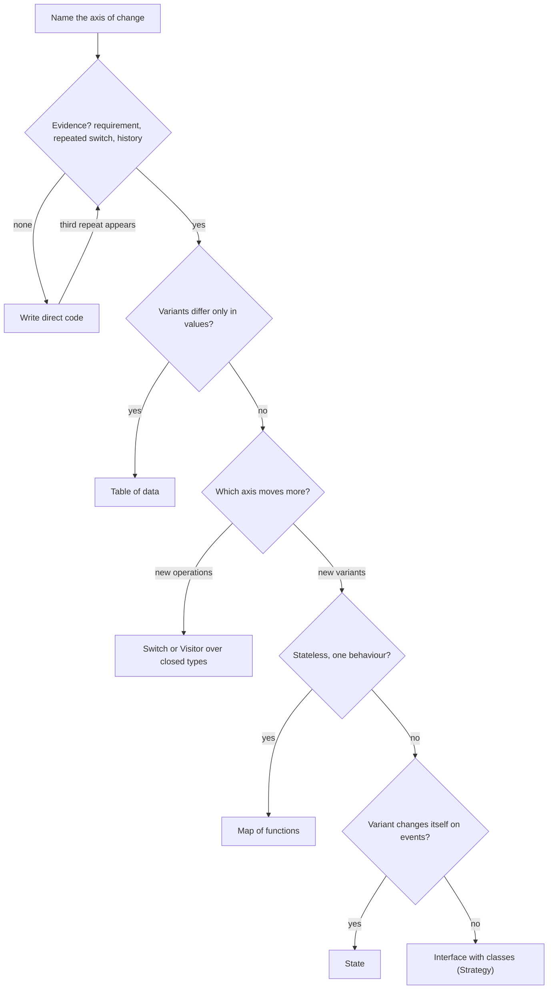

## In one minute
- A pattern is a bet that a specific thing will change. Choose one by naming the axis of change first ("new carriers", "new order states", "new export formats"), then pick the smallest structure that makes a change along that axis touch one place.
- Look for evidence before betting: a requirement or roadmap item, the same `switch` repeated in several files, a change history where one kind of feature keeps editing the same functions, or tests that are hard to write.
- Climb a ladder one rung at a time: inline code, then a function parameter, then a map of functions, then an interface with classes. Stop at the lowest rung that absorbs the known changes.
- Every structure makes one kind of change cheap and another expensive. Polymorphism makes new types cheap and new operations costly; a `switch` (or Visitor) does the opposite. Choose by which axis your system actually moves along.
- A wrong abstraction costs more than duplication. Add patterns when evidence arrives, and remove them when the variation they were built for never came.

## How it works

### Start from the change, not the catalogue
Design Patterns maps the fifteen common patterns to the problem shapes behind them. This lesson is about the decision itself: when a pattern is worth its cost, which of two similar patterns to use, and how to tell after the fact whether you chose well.

The core idea goes back to David Parnas in 1972: begin with a list of difficult design decisions or decisions likely to change, and design each module to hide one of them ([Parnas](https://www.win.tue.nl/~wstomv/edu/2ip30/references/criteria_for_modularization.pdf)). A design pattern is a reusable way of hiding one kind of decision. Strategy hides *which algorithm*. State hides *which stage*. Factory Method hides *which concrete type*. Adapter hides *whose interface*. Observer hides *who cares about this event*. So the first question is never "which pattern fits?" but "which decision here is likely to change, and how often?" If you cannot name the decision, no pattern is justified yet.

### Evidence, in order of strength
1. **A stated requirement.** "We are adding DHL next quarter" is direct evidence for a carrier seam.
2. **Repeated conditionals.** The same `switch carrier` in rate quoting, label printing and tracking URLs means every new carrier edits three files, and sooner or later one is missed. This is the strongest signal you can find in code.
3. **Change history.** If eleven of the last fifteen commits touching `billing.py` were "add plan X", the plan is an axis of change. Git log tells you what changed together; that is better evidence than anyone's guess.
4. **Test pain.** Code that cannot be tested without a real clock, network or database needs a seam for that dependency (usually plain dependency injection, not a named pattern).
5. **Speculation.** "We might support other databases" with no plan or date. This is not evidence. Write the direct code. Fowler counts four costs of building flexibility early: build, delayed value, carrying the complexity, and repair when the guess was wrong ([Yagni](https://martinfowler.com/bliki/Yagni.html)).

### The ladder
Each rung adds indirection, so climb only as far as the evidence requires.

1. **Inline code.** One variant. Write it directly.
2. **A conditional.** Two variants used in one place. An `if` or `switch` is the clearest code there is, and many compilers check that it is exhaustive.
3. **A function parameter or a map of functions.** Variants differ in one behaviour and carry no state: `PRICERS = {"standard": standard_price, "member": member_price}`. This is Strategy in its smallest honest form.
4. **An interface with classes.** Variants carry state, or have several related operations that must stay consistent (a carrier has `quote`, `label` and `tracking_url`). Grouping them in one class means adding a carrier is adding one file.
5. **A framework or plugin system.** Variants are written by other teams or loaded at runtime. Registries, plugin discovery and versioned interfaces. Expensive, and right only when the people adding variants cannot edit your code.

Joshua Kerievsky's *Refactoring to Patterns* describes this as moving towards a pattern (and sometimes away from one) through small, behaviour-preserving refactorings, instead of designing patterns in up front. The standard mechanical step from a repeated conditional to Strategy or State is Fowler's Replace Conditional with Polymorphism ([catalog](https://refactoring.com/catalog/replaceConditionalWithPolymorphism.html)).

### The rule of three
A common heuristic: the first time, write it; the second time, notice the duplication; the third time, extract. Two repeated `switch` statements may be a coincidence. Three, all switching on the same key with the same cases, are a design that is asking for one place to hold the variation. The practice task automates exactly this: it finds discriminators switched on in several places, reports sites that are missing a case, and suggests a table, a switch, State or Strategy.

### Which axis moves: the expression problem
Take shapes and operations on them (area, render, export). With operations as methods on shape classes, a new shape is one new class but a new operation edits every class. With operations as functions that `switch` on shape type (or a Visitor), a new operation is one function but a new shape edits every function. This is the *expression problem*, named by Philip Wadler in a 1998 note to the Java-genericity list ([Wadler](https://homepages.inf.ed.ac.uk/wadler/papers/expression/expression.txt)), and no ordinary object-oriented or functional structure makes both cheap.

That turns a vague choice into a concrete question. Carriers in a shipping system: new carriers arrive every quarter, operations are stable, so put operations on carrier classes (Strategy). A compiler's syntax tree: node types are stable, new passes (type check, optimise, print) arrive often, so use a Visitor or pattern matching over a closed set of types. TypeScript discriminated unions with an exhaustive `switch` are the second choice made explicit, because a `never` check fails to compile when a case is missing ([TypeScript handbook](https://www.typescriptlang.org/docs/handbook/2/narrowing.html)). Java 21 offers the same with sealed types and `switch` patterns ([JEP 441](https://openjdk.org/jeps/441)). In both, the compiler tells you every place a new variant needs handling.

### Telling near neighbours apart
- **Strategy or State.** Who changes the behaviour? If the caller chooses (pricing plan, compression level), it is Strategy. If the object moves itself between behaviours as events happen (an order going from paid to shipped), it is State. The tell in code: branches that assign the very field being switched on.
- **Decorator, Proxy or Adapter.** All three wrap. A Decorator always forwards and adds something (retries, metrics). A Proxy decides whether to forward (access control, lazy loading, caching). An Adapter changes the interface shape. If the wrapped and wrapping interfaces differ, it is an Adapter.
- **Observer or a direct call.** If the source must not know who reacts, or the set of reactors changes independently, use Observer. If there is exactly one reaction that is part of the same operation, call it directly; events make control flow harder to follow and harder to debug.
- **Factory or dependency injection.** If the concrete type depends on runtime data (a URL scheme, a file extension), use a factory. If it is fixed at startup by configuration, construct it once in the composition root and inject it (Dependency Injection Pattern).
- **Command or a function.** If actions must be stored, queued, retried, logged or undone, they need to be data: Command. If they only need to be passed around and called, a function value is a command already.
- **Table or polymorphism.** If variants differ only in values (rates, limits, labels), use a table of data. Classes for data that differs only in numbers are pure ceremony.

### Boundaries are the safest bet
One place where a seam almost always pays: the boundary with something you do not control. A payment provider, an email vendor, a cloud SDK. Their API will change on their schedule, you will want a fake in tests, and you may switch vendors. An Adapter (or a small interface you own) at that edge is cheap and is justified by the boundary alone.

### Removing patterns
Patterns should leave as readily as they arrive. A Strategy interface with one implementation after two years, a Factory that always builds the same class, an Observer with one subscriber: inline them. Sandi Metz's advice applies: duplication is far cheaper than the wrong abstraction ([Metz](https://sandimetz.com/blog/2016/1/20/the-wrong-abstraction)). A wrong abstraction attracts conditionals (`if strategy.name == "legacy"`) that defeat its purpose, and every caller has to learn it.

### Choosing with a coding agent
Agents pattern-match on vocabulary: "make it extensible" yields factories and abstract base classes, while "add DHL" next to a repeated `switch` yields another branch in each place, possibly missing one. Give agents the decision in concrete terms: "carriers vary; create a `Carrier` interface with `quote`, `label`, `tracking_url`, one class per carrier, and a map from code to carrier; replace the three switches". Then review that the axis named in the prompt is the one the structure isolates.

### The same shape elsewhere
Choosing a pattern is choosing where to pay for change, the same decision made in schema and API design. A database schema with a column per attribute makes new queries cheap and new attributes expensive (a migration); a key-value attribute table does the opposite. Kubernetes custom resources exist because the core API could not anticipate every type of object, so it opened that axis. Every case names the axis, puts a seam there, and accepts the cost on the other axes.

## Down the stack

### Layer 1: The contract
A well-chosen pattern makes a precise promise: a change along its named axis touches one module, and no existing tests change. "Adding a carrier means adding one class and one registry entry" is testable: count the files in the pull request. A Strategy or State promises substitutability (every implementation honours the interface's contract, Liskov's rule). A conditional promises exhaustiveness when the language checks it. If a change along the named axis still touches five files, the pattern is not delivering its contract, whatever it is called.

### Layer 2: The mechanism
There are three ways to dispatch on a variant, and every behavioural pattern uses one. **Conditional dispatch**: a `switch` compiled to a sequence of comparisons or, for dense integer cases, a jump table; TypeScript's `never` check and Rust's `match` make it exhaustive, and Go needs a linter such as [`exhaustive`](https://github.com/nishanths/exhaustive) to do the same. **Virtual dispatch**: an interface call through a vtable in Java and C++, an itab in Go (an interface value is two words: type and method table pointer, and data pointer), or a prototype lookup with an inline cache in V8. **Table dispatch**: a hash map from key to function or object, which is what factory registries and strategy maps are. The expression problem follows from these: conditional dispatch keeps an operation's variants together; virtual dispatch keeps a type's operations together; table dispatch lets you add variants at runtime but loses compile-time exhaustiveness.

### Layer 3: The machine
A `switch` on a small dense integer becomes a bounds check plus an indirect jump through a table, about a nanosecond when predicted. A virtual call loads the method pointer (often an L1 hit, about 1 ns) and makes an indirect call; a mispredicted indirect branch costs roughly 15 to 20 cycles. The bigger cost is lost inlining: a compiler cannot inline through a call it cannot resolve, although JITs and Go's profile-guided optimisation (since Go 1.21) devirtualise hot interface calls that almost always hit one type ([Go 1.21 notes](https://go.dev/doc/go1.21)). A map lookup hashes the key and probes a bucket, about 20 to 50 ns for a short string key. Allocation matters more than dispatch: a Strategy object created per request in Go escapes to the heap if stored in an interface, about 25 ns plus GC pressure, while a stateless strategy kept in a package-level map costs nothing per call. None of these numbers decides a design at 1,000 requests a second; they matter in inner loops running millions of times, where a switch or a table usually wins.

### Why it's built this way
1. Change is the dominant cost of software over its lifetime, and it arrives along a few axes, so designs isolate those axes.
2. Every seam has a cost in indirection, reading time and sometimes runtime, so seams go only where change is likely.
3. A seam that makes one axis cheap makes another expensive (the expression problem), so the choice must follow the axis that actually moves.
4. Predictions about change are often wrong, so evidence (requirements, repeated conditionals, change history) beats intuition, and the cheapest rung that works is preferred.
5. Wrong abstractions are expensive to remove because callers grow around them, so patterns are added late and removed readily.

## Diagram


## Worked example
A logistics service supports UPS and FedEx and is adding DHL. A search for `switch carrier` (or `if carrier ==`) finds four sites: `rates.quote`, `labels.render`, `tracking.url` and `customs.form_type`. Git history shows 9 of the last 20 commits in these files were carrier additions or carrier-specific fixes, and 2 incidents in the past year came from a carrier missing in one site (FedEx tracking links that went to UPS).

Apply the questions. The axis is carriers, with one addition a year and a fourth on the roadmap. Evidence: a stated requirement, four repeated conditionals and incidents caused by a missed case. Values only? No, each carrier has real logic for rates and labels, but `customs.form_type` only returns a constant per carrier, so that one becomes a table entry on the carrier. Which axis moves? Carriers; operations have been stable for two years. Does a carrier change itself on events? No. Result: a `Carrier` interface with `quote`, `render_label` and `tracking_url`, one class per carrier, a registry from code to carrier, and `customs_form` as a field.

Contrast `order.status` in the same codebase: five sites switch on it, and two of them assign `order.status = SHIPPED` inside branches. That is State, implemented as an enum plus a transition table since the status is already a database column.

Cost: the carrier call now goes through one interface call (about a nanosecond) before a carrier API round trip of 150 to 400 ms. The pull request that adds DHL touches one new file and one registry line, and a test iterates over the registry asserting every carrier implements every method, so a missed case becomes a failed build instead of an incident.

## In the wild
- **Parnas, 1972: two decompositions of one program.** Parnas compared a flowchart-style split of a small indexing program with a split in which each module hides one design decision likely to change (input format, line storage, sort order). He argued the second absorbs the listed changes without touching other modules ([paper](https://www.win.tue.nl/~wstomv/edu/2ip30/references/criteria_for_modularization.pdf)). Every "name the axis first" rule in this lesson descends from it.
- **Sandi Metz, 2016: the wrong abstraction.** Metz describes how a shared abstraction attracts parameters and conditionals as each new caller bends it, until it is worse than the duplication it replaced, and recommends inlining it back into callers before re-extracting ([write-up](https://sandimetz.com/blog/2016/1/20/the-wrong-abstraction)).
- **Java 21, 2023: the closed-set choice ships as syntax.** Sealed classes (Java 17) plus pattern matching for `switch` (Java 21) give compiler-checked exhaustiveness for a closed set of types, the "operations grow, types stay fixed" side of the expression problem ([JEP 409](https://openjdk.org/jeps/409), [JEP 441](https://openjdk.org/jeps/441)).

## Trade-offs
| Option | Strengths | Weaknesses | Choose when |
| --- | --- | --- | --- |
| Direct code or a single `switch` | Clearest; exhaustiveness checks; inlinable | Each new variant edits every switch | One or two variants, one or two sites |
| Table of data | One line per variant; no code | Only works when variants differ in values | Rates, limits, labels, form types |
| Map of functions | Add variants as data; small | No per-variant state; no compile-time exhaustiveness | Stateless variants of one behaviour |
| Interface with classes | Variant logic grouped; new variant is one file | New operations edit every class; more files | Variants grow, operations stable |
| Visitor or exhaustive match | New operations are one place; compiler lists missing cases | New types edit every operation | Closed set of types, growing set of operations |
| Plugin framework | Other teams add variants without your code | Versioning, discovery, debugging cost | Variants owned outside your team |

## Pitfalls in production
- **Pattern before evidence.** A `NotificationStrategyFactory` for a product that has only ever sent email. Fix: require the named axis and its evidence in the design document; inline seams with one implementation after a review period.
- **Wrong axis.** Shapes as classes in a system where new reports (operations) arrive weekly, so every report edits twenty classes. Fix: check which axis the change history shows, and restructure along it.
- **Missed case in a repeated switch.** A new enum value handled in three of four places, failing in production. Fix: exhaustive checks (`never` in TypeScript, the `exhaustive` linter in Go, `assert_never` in typed Python) or move behaviour onto the variant.
- **The abstraction that attracted conditionals.** `if isinstance(strategy, LegacyStrategy)` inside the caller. Fix: the abstraction is wrong; inline it back to the callers, then extract the right one.
- **Observer as hidden control flow.** Business-critical steps implemented as event subscribers, so nobody can see the order of operations and failures are silent. Fix: keep required steps as direct calls; use events for optional, independent reactions.
- **Copying another system's patterns.** Enterprise layering copied into a 2,000-line service. Fix: size the structure to the variation this system has.

## Leadership lens
- Ask for the axis of change and its evidence in every design review that introduces a pattern. "Which future pull request does this make smaller?" is a question anyone can answer or fail to answer.
- Use change history as data. A quarterly look at which files change together and which incidents came from missed cases points to where seams belong, and where they are dead weight.
- Budget for removing abstractions, not only adding them. Unused seams are a cost every new hire and every agent pays when reading the code.
- Standardise the small forms. A team that agrees "stateless variants are a map of functions; variants with state are an interface with classes" makes consistent choices without debate.
- When directing agents, specify the structure and the axis explicitly. Agents add patterns readily and remove them rarely.

## Check yourself
1. Three functions switch on `payment_method`, and none of the branches assigns it. A fourth method is coming. What do you recommend?
   **Answer:** Strategy: a payment-method interface (or a map of functions if the behaviour is stateless) so the new method is one new implementation, and the missing-case bug class goes away.
2. Five functions switch on `ticket.status`, and some branches set `ticket.status`. Why is that different?
   **Answer:** The variant changes itself in response to events, which is State: the transitions are part of the behaviour, so they belong with the states (or in a transition table), not scattered across callers.
3. Your node types are fixed but you add a new analysis pass every month. Classes per node with a method per pass, or a Visitor?
   **Answer:** A Visitor or exhaustive pattern match, because the moving axis is operations; methods on node classes would make every new pass edit every class.
4. Every tax region switch just returns a rate. Which structure?
   **Answer:** A table of data keyed by region; the variants differ only in values, so classes or strategies would be ceremony.

## Practice
**Task:** Build a switch-site analyser that turns repeated conditionals into a recommendation. Each site has a `location`, the `key` it switches on, its `cases` (strings), `assigns` (true if a branch assigns the switched key) and `constant` (true if every branch only returns a literal). `analyze(sites, min_sites)` first validates: `min_sites` below 1 fails with `min_sites must be >= 1`; then, for each site in order, empty cases fail with `no cases at <location>` and a repeated case with `duplicate case <value> at <location>` (Python `ValueError`, TypeScript `Error`, Go error). It returns one finding per key, sorted by key, with `key`, `sites` (count), `values` (sorted union of cases), `missing` (sorted strings `<location> lacks <value>` for each site lacking a value in the union) and `advice`: `table` if every site for the key is constant; otherwise `switch` if the count is below `min_sites`; otherwise `state` if any site assigns; otherwise `strategy`.

```python starter
def analyze(sites, min_sites):
    """sites: list of dicts with location, key, cases, assigns, constant."""
    # TODO
    raise NotImplementedError
```

```python tests
def site(location, key, cases, assigns=False, constant=False):
    return {"location": location, "key": key, "cases": cases,
            "assigns": assigns, "constant": constant}

CARRIERS = [
    site("rates.py:quote", "carrier", ["ups", "fedex", "dhl"]),
    site("labels.py:render", "carrier", ["fedex", "ups", "dhl"]),
    site("tracking.py:url", "carrier", ["ups", "fedex"]),
]

def raises(fn, msg):
    try:
        fn()
    except ValueError as e:
        assert str(e) == msg, str(e)
        return
    assert False, "expected ValueError: " + msg

def test_strategy_with_missing_case():
    assert analyze(CARRIERS, 3) == [{
        "key": "carrier", "sites": 3, "values": ["dhl", "fedex", "ups"],
        "missing": ["tracking.py:url lacks dhl"], "advice": "strategy"}]

def test_state_when_a_site_assigns():
    sites = [site("a.py:pay", "status", ["new", "paid"], assigns=True),
             site("b.py:show", "status", ["new", "paid"]),
             site("c.py:email", "status", ["paid", "new"])]
    assert analyze(sites, 3)[0]["advice"] == "state"

def test_min_sites_is_inclusive():
    assert analyze(CARRIERS, 4)[0]["advice"] == "switch"
    assert analyze(CARRIERS[:2], 2)[0]["advice"] == "strategy"

def test_table_needs_every_site_constant():
    sites = [site("tax.py:rate", "region", ["eu", "us"], constant=True),
             site("ui.py:label", "region", ["eu", "us"], constant=True)]
    assert analyze(sites, 1)[0]["advice"] == "table"
    sites.append(site("ship.py:route", "region", ["eu", "us"]))
    assert analyze(sites, 1)[0]["advice"] == "strategy"

def test_keys_sorted_and_missing_sorted():
    sites = [site("z.py:f", "plan", ["pro"]),
             site("a.py:g", "plan", ["free", "team"]),
             site("m.py:h", "carrier", ["ups"])]
    out = analyze(sites, 5)
    assert [f["key"] for f in out] == ["carrier", "plan"]
    assert out[0] == {"key": "carrier", "sites": 1, "values": ["ups"], "missing": [], "advice": "switch"}
    assert out[1]["values"] == ["free", "pro", "team"]
    assert out[1]["missing"] == ["a.py:g lacks pro", "z.py:f lacks free", "z.py:f lacks team"]

def test_empty_input():
    assert analyze([], 1) == []

def test_validation():
    raises(lambda: analyze(CARRIERS, 0), "min_sites must be >= 1")
    raises(lambda: analyze([site("x.py:a", "k", [])], 1), "no cases at x.py:a")
    raises(lambda: analyze([site("x.py:a", "k", ["a"]), site("y.py:b", "k", ["b", "c", "b"])], 1),
           "duplicate case b at y.py:b")
```

```python solution
def analyze(sites, min_sites):
    if min_sites < 1:
        raise ValueError("min_sites must be >= 1")
    groups = {}
    for s in sites:
        if not s["cases"]:
            raise ValueError("no cases at " + s["location"])
        seen = set()
        for value in s["cases"]:
            if value in seen:
                raise ValueError("duplicate case %s at %s" % (value, s["location"]))
            seen.add(value)
        groups.setdefault(s["key"], []).append(s)

    findings = []
    for key in sorted(groups):
        group = groups[key]
        values = sorted(set(v for s in group for v in s["cases"]))
        missing = []
        for s in group:
            for v in values:
                if v not in s["cases"]:
                    missing.append("%s lacks %s" % (s["location"], v))
        if all(s["constant"] for s in group):
            advice = "table"
        elif len(group) < min_sites:
            advice = "switch"
        elif any(s["assigns"] for s in group):
            advice = "state"
        else:
            advice = "strategy"
        findings.append({"key": key, "sites": len(group), "values": values,
                         "missing": sorted(missing), "advice": advice})
    return findings
```

```typescript starter
export interface Site {
  location: string;
  key: string;
  cases: string[];
  assigns: boolean;
  constant: boolean;
}

export interface Finding {
  key: string;
  sites: number;
  values: string[];
  missing: string[];
  advice: string;
}

export function analyze(sites: Site[], minSites: number): Finding[] {
  throw new Error("TODO");
}
```

```typescript tests
function mkSite(location: string, key: string, cases: string[], assigns = false, constant = false): Site {
  return { location, key, cases, assigns, constant };
}

const CARRIERS: Site[] = [
  mkSite("rates.py:quote", "carrier", ["ups", "fedex", "dhl"]),
  mkSite("labels.py:render", "carrier", ["fedex", "ups", "dhl"]),
  mkSite("tracking.py:url", "carrier", ["ups", "fedex"]),
];

function errorOf(fn: () => unknown): string {
  try {
    fn();
  } catch (e) {
    return (e as Error).message;
  }
  return "no error";
}

test("strategy with missing case", () => {
  assertEqual(analyze(CARRIERS, 3), [{
    key: "carrier", sites: 3, values: ["dhl", "fedex", "ups"],
    missing: ["tracking.py:url lacks dhl"], advice: "strategy",
  }]);
});

test("state when a site assigns", () => {
  const sites = [
    mkSite("a.py:pay", "status", ["new", "paid"], true),
    mkSite("b.py:show", "status", ["new", "paid"]),
    mkSite("c.py:email", "status", ["paid", "new"]),
  ];
  assertEqual(analyze(sites, 3)[0].advice, "state");
});

test("min sites is inclusive", () => {
  assertEqual(analyze(CARRIERS, 4)[0].advice, "switch");
  assertEqual(analyze(CARRIERS.slice(0, 2), 2)[0].advice, "strategy");
});

test("table needs every site constant", () => {
  const sites = [
    mkSite("tax.py:rate", "region", ["eu", "us"], false, true),
    mkSite("ui.py:label", "region", ["eu", "us"], false, true),
  ];
  assertEqual(analyze(sites, 1)[0].advice, "table");
  sites.push(mkSite("ship.py:route", "region", ["eu", "us"]));
  assertEqual(analyze(sites, 1)[0].advice, "strategy");
});

test("keys sorted and missing sorted", () => {
  const out = analyze([
    mkSite("z.py:f", "plan", ["pro"]),
    mkSite("a.py:g", "plan", ["free", "team"]),
    mkSite("m.py:h", "carrier", ["ups"]),
  ], 5);
  assertEqual(out.map((f) => f.key), ["carrier", "plan"]);
  assertEqual(out[0], { key: "carrier", sites: 1, values: ["ups"], missing: [], advice: "switch" });
  assertEqual(out[1].values, ["free", "pro", "team"]);
  assertEqual(out[1].missing, ["a.py:g lacks pro", "z.py:f lacks free", "z.py:f lacks team"]);
});

test("empty input", () => {
  assertEqual(analyze([], 1), []);
});

test("validation", () => {
  assertEqual(errorOf(() => analyze(CARRIERS, 0)), "min_sites must be >= 1");
  assertEqual(errorOf(() => analyze([mkSite("x.py:a", "k", [])], 1)), "no cases at x.py:a");
  assertEqual(errorOf(() => analyze([mkSite("x.py:a", "k", ["a"]), mkSite("y.py:b", "k", ["b", "c", "b"])], 1)),
    "duplicate case b at y.py:b");
});
```

```typescript solution
export interface Site {
  location: string;
  key: string;
  cases: string[];
  assigns: boolean;
  constant: boolean;
}

export interface Finding {
  key: string;
  sites: number;
  values: string[];
  missing: string[];
  advice: string;
}

export function analyze(sites: Site[], minSites: number): Finding[] {
  if (minSites < 1) throw new Error("min_sites must be >= 1");
  const groups = new Map<string, Site[]>();
  for (const s of sites) {
    if (s.cases.length === 0) throw new Error(`no cases at ${s.location}`);
    const seen = new Set<string>();
    for (const v of s.cases) {
      if (seen.has(v)) throw new Error(`duplicate case ${v} at ${s.location}`);
      seen.add(v);
    }
    const group = groups.get(s.key) ?? [];
    group.push(s);
    groups.set(s.key, group);
  }

  const findings: Finding[] = [];
  for (const key of [...groups.keys()].sort()) {
    const group = groups.get(key)!;
    const values = [...new Set(group.flatMap((s) => s.cases))].sort();
    const missing: string[] = [];
    for (const s of group) {
      for (const v of values) {
        if (!s.cases.includes(v)) missing.push(`${s.location} lacks ${v}`);
      }
    }
    let advice: string;
    if (group.every((s) => s.constant)) advice = "table";
    else if (group.length < minSites) advice = "switch";
    else if (group.some((s) => s.assigns)) advice = "state";
    else advice = "strategy";
    findings.push({ key, sites: group.length, values, missing: missing.sort(), advice });
  }
  return findings;
}
```

```go starter
package practice

type Site struct {
	Location string
	Key      string
	Cases    []string
	Assigns  bool
	Constant bool
}

type Finding struct {
	Key     string
	Sites   int
	Values  []string
	Missing []string
	Advice  string
}

func Analyze(sites []Site, minSites int) ([]Finding, error) {
	panic("TODO")
}
```

```go tests
package practice

import (
	"reflect"
	"testing"
)

func carriers() []Site {
	return []Site{
		{Location: "rates.py:quote", Key: "carrier", Cases: []string{"ups", "fedex", "dhl"}},
		{Location: "labels.py:render", Key: "carrier", Cases: []string{"fedex", "ups", "dhl"}},
		{Location: "tracking.py:url", Key: "carrier", Cases: []string{"ups", "fedex"}},
	}
}

func mustAnalyze(t *testing.T, sites []Site, min int) []Finding {
	t.Helper()
	out, err := Analyze(sites, min)
	if err != nil {
		t.Fatalf("unexpected error: %v", err)
	}
	return out
}

func TestStrategyWithMissingCase(t *testing.T) {
	got := mustAnalyze(t, carriers(), 3)
	want := []Finding{{Key: "carrier", Sites: 3, Values: []string{"dhl", "fedex", "ups"},
		Missing: []string{"tracking.py:url lacks dhl"}, Advice: "strategy"}}
	if !reflect.DeepEqual(got, want) {
		t.Fatalf("got %+v", got)
	}
}

func TestStateWhenASiteAssigns(t *testing.T) {
	sites := []Site{
		{Location: "a.py:pay", Key: "status", Cases: []string{"new", "paid"}, Assigns: true},
		{Location: "b.py:show", Key: "status", Cases: []string{"new", "paid"}},
		{Location: "c.py:email", Key: "status", Cases: []string{"paid", "new"}},
	}
	if got := mustAnalyze(t, sites, 3)[0].Advice; got != "state" {
		t.Fatalf("advice = %s", got)
	}
}

func TestMinSitesInclusive(t *testing.T) {
	if got := mustAnalyze(t, carriers(), 4)[0].Advice; got != "switch" {
		t.Fatalf("advice = %s", got)
	}
	if got := mustAnalyze(t, carriers()[:2], 2)[0].Advice; got != "strategy" {
		t.Fatalf("advice = %s", got)
	}
}

func TestTableNeedsEverySiteConstant(t *testing.T) {
	sites := []Site{
		{Location: "tax.py:rate", Key: "region", Cases: []string{"eu", "us"}, Constant: true},
		{Location: "ui.py:label", Key: "region", Cases: []string{"eu", "us"}, Constant: true},
	}
	if got := mustAnalyze(t, sites, 1)[0].Advice; got != "table" {
		t.Fatalf("advice = %s", got)
	}
	sites = append(sites, Site{Location: "ship.py:route", Key: "region", Cases: []string{"eu", "us"}})
	if got := mustAnalyze(t, sites, 1)[0].Advice; got != "strategy" {
		t.Fatalf("advice = %s", got)
	}
}

func TestKeysSortedAndMissingSorted(t *testing.T) {
	out := mustAnalyze(t, []Site{
		{Location: "z.py:f", Key: "plan", Cases: []string{"pro"}},
		{Location: "a.py:g", Key: "plan", Cases: []string{"free", "team"}},
		{Location: "m.py:h", Key: "carrier", Cases: []string{"ups"}},
	}, 5)
	if len(out) != 2 || out[0].Key != "carrier" || out[1].Key != "plan" {
		t.Fatalf("got %+v", out)
	}
	if out[0].Sites != 1 || out[0].Advice != "switch" || len(out[0].Missing) != 0 {
		t.Fatalf("carrier finding = %+v", out[0])
	}
	if !reflect.DeepEqual(out[1].Values, []string{"free", "pro", "team"}) {
		t.Fatalf("values = %v", out[1].Values)
	}
	want := []string{"a.py:g lacks pro", "z.py:f lacks free", "z.py:f lacks team"}
	if !reflect.DeepEqual(out[1].Missing, want) {
		t.Fatalf("missing = %v", out[1].Missing)
	}
}

func TestEmptyInput(t *testing.T) {
	if out := mustAnalyze(t, nil, 1); len(out) != 0 {
		t.Fatalf("got %+v", out)
	}
}

func TestValidation(t *testing.T) {
	cases := []struct {
		sites []Site
		min   int
		want  string
	}{
		{carriers(), 0, "min_sites must be >= 1"},
		{[]Site{{Location: "x.py:a", Key: "k"}}, 1, "no cases at x.py:a"},
		{[]Site{{Location: "x.py:a", Key: "k", Cases: []string{"a"}},
			{Location: "y.py:b", Key: "k", Cases: []string{"b", "c", "b"}}}, 1, "duplicate case b at y.py:b"},
	}
	for _, c := range cases {
		_, err := Analyze(c.sites, c.min)
		if err == nil || err.Error() != c.want {
			t.Fatalf("err = %v, want %q", err, c.want)
		}
	}
}
```

```go solution
package practice

import (
	"fmt"
	"sort"
)

type Site struct {
	Location string
	Key      string
	Cases    []string
	Assigns  bool
	Constant bool
}

type Finding struct {
	Key     string
	Sites   int
	Values  []string
	Missing []string
	Advice  string
}

func Analyze(sites []Site, minSites int) ([]Finding, error) {
	if minSites < 1 {
		return nil, fmt.Errorf("min_sites must be >= 1")
	}
	groups := map[string][]Site{}
	var keys []string
	for _, s := range sites {
		if len(s.Cases) == 0 {
			return nil, fmt.Errorf("no cases at %s", s.Location)
		}
		seen := map[string]bool{}
		for _, v := range s.Cases {
			if seen[v] {
				return nil, fmt.Errorf("duplicate case %s at %s", v, s.Location)
			}
			seen[v] = true
		}
		if _, ok := groups[s.Key]; !ok {
			keys = append(keys, s.Key)
		}
		groups[s.Key] = append(groups[s.Key], s)
	}
	sort.Strings(keys)

	findings := []Finding{}
	for _, key := range keys {
		group := groups[key]
		union := map[string]bool{}
		for _, s := range group {
			for _, v := range s.Cases {
				union[v] = true
			}
		}
		values := make([]string, 0, len(union))
		for v := range union {
			values = append(values, v)
		}
		sort.Strings(values)

		missing := []string{}
		allConstant, anyAssigns := true, false
		for _, s := range group {
			has := map[string]bool{}
			for _, v := range s.Cases {
				has[v] = true
			}
			for _, v := range values {
				if !has[v] {
					missing = append(missing, fmt.Sprintf("%s lacks %s", s.Location, v))
				}
			}
			allConstant = allConstant && s.Constant
			anyAssigns = anyAssigns || s.Assigns
		}
		sort.Strings(missing)

		advice := "strategy"
		switch {
		case allConstant:
			advice = "table"
		case len(group) < minSites:
			advice = "switch"
		case anyAssigns:
			advice = "state"
		}
		findings = append(findings, Finding{Key: key, Sites: len(group), Values: values, Missing: missing, Advice: advice})
	}
	return findings, nil
}
```

## Mock interview
**Prompt:** You are designing the rules engine for a subscription billing product: 4 plans today, about 2 new plans a quarter, discounts that marketing changes weekly, invoices in 3 tax regions, and plan upgrades and downgrades mid-cycle. Walk through which parts get a pattern, which stay plain code, and how you would know if you chose wrong.

- Follow-up: Marketing wants to launch a discount without a deploy. What changes?
- Follow-up: The plans' behaviour differs mainly in prices and limits. Does that change your answer for plans?
- Follow-up: A year later, nobody has added a tax region. What do you do with the tax seam?

**A strong answer covers:**
- Naming each axis of change with its rate: plans quarterly, discounts weekly, tax regions rarely, and placing seams only where change is frequent or stated.
- Plans as data (a table of prices and limits) unless their logic genuinely differs; Strategy only for plans with real behavioural differences.
- Discounts as data evaluated by a small rule interpreter or specifications, so marketing changes are configuration, with validation and an audit trail.
- Upgrades and downgrades as State or a transition table on the subscription, since the subscription changes its own stage.
- Measuring the choice afterwards: files touched per new plan, incidents from missed cases, and removing seams that never varied.

## Sources and further study
**Primary**
- [Parnas, On the Criteria To Be Used in Decomposing Systems into Modules (1972)](https://www.win.tue.nl/~wstomv/edu/2ip30/references/criteria_for_modularization.pdf): hide decisions likely to change.
- [Wadler, The Expression Problem (1998 note)](https://homepages.inf.ed.ac.uk/wadler/papers/expression/expression.txt): the statement of the two-axis trade-off.
- [Sandi Metz, The Wrong Abstraction](https://sandimetz.com/blog/2016/1/20/the-wrong-abstraction): when duplication is the cheaper choice.

**Systems docs**
- [JEP 441: Pattern Matching for switch](https://openjdk.org/jeps/441): exhaustive dispatch over sealed hierarchies, with the Visitor comparison.
- [TypeScript handbook: narrowing and exhaustiveness](https://www.typescriptlang.org/docs/handbook/2/narrowing.html): the `never` check.
- [Go 1.21 release notes](https://go.dev/doc/go1.21): profile-guided devirtualization of interface calls.
- [Replace Conditional with Polymorphism (refactoring.com)](https://refactoring.com/catalog/replaceConditionalWithPolymorphism.html): the mechanical refactoring and its direction.

**Books**
- *Design Patterns* (GoF, 1994), Ch 1 (Introduction), section on designing for change, and Ch 5 (Behavioral: Strategy, State, Visitor).
- *Refactoring*, 2nd ed., Ch 3 (Bad Smells in Code) and Ch 10 (Simplifying Conditional Logic).
- *Refactoring to Patterns*, Joshua Kerievsky (2004): moving to and from patterns in small steps. Chapter numbers not verified in the shared catalogue.

**Other curricula**
- [Refactoring.Guru: Replace Conditional with Polymorphism](https://refactoring.guru/replace-conditional-with-polymorphism): the same refactoring, in a plain-reference form.

## Watch
- [Nothing is Something (Sandi Metz, RailsConf 2015)](https://www.youtube.com/watch?v=OMPfEXIlTVE): conditionals versus polymorphism and composition, and how to tell which a problem needs.
- [Stop Writing Classes (Jack Diederich, PyCon 2012)](https://www.youtube.com/watch?v=o9pEzgHorH0): a funny, concrete case for removing abstractions that a function would replace.

## Free resources
- [On the Criteria To Be Used in Decomposing Systems into Modules (David Parnas, 1972)](https://www.win.tue.nl/~wstomv/edu/2ip30/references/criteria_for_modularization.pdf): the paper that says to hide decisions likely to change, the root of every pattern choice.
- [Replace Conditional with Polymorphism (Refactoring.Guru)](https://refactoring.guru/replace-conditional-with-polymorphism): the refactoring that turns a repeated switch into Strategy or State, with the conditions for using it.
- [Is Design Dead? (Martin Fowler)](https://martinfowler.com/articles/designDead.html): how evolutionary design and refactoring change when patterns should be introduced.
- [Yagni (Martin Fowler)](https://martinfowler.com/bliki/Yagni.html): the cost model for building flexibility before it is needed.
- [Rule of three (Wikipedia)](https://en.wikipedia.org/wiki/Rule_of_three_(computer_programming)): the duplication heuristic for when to extract an abstraction.
