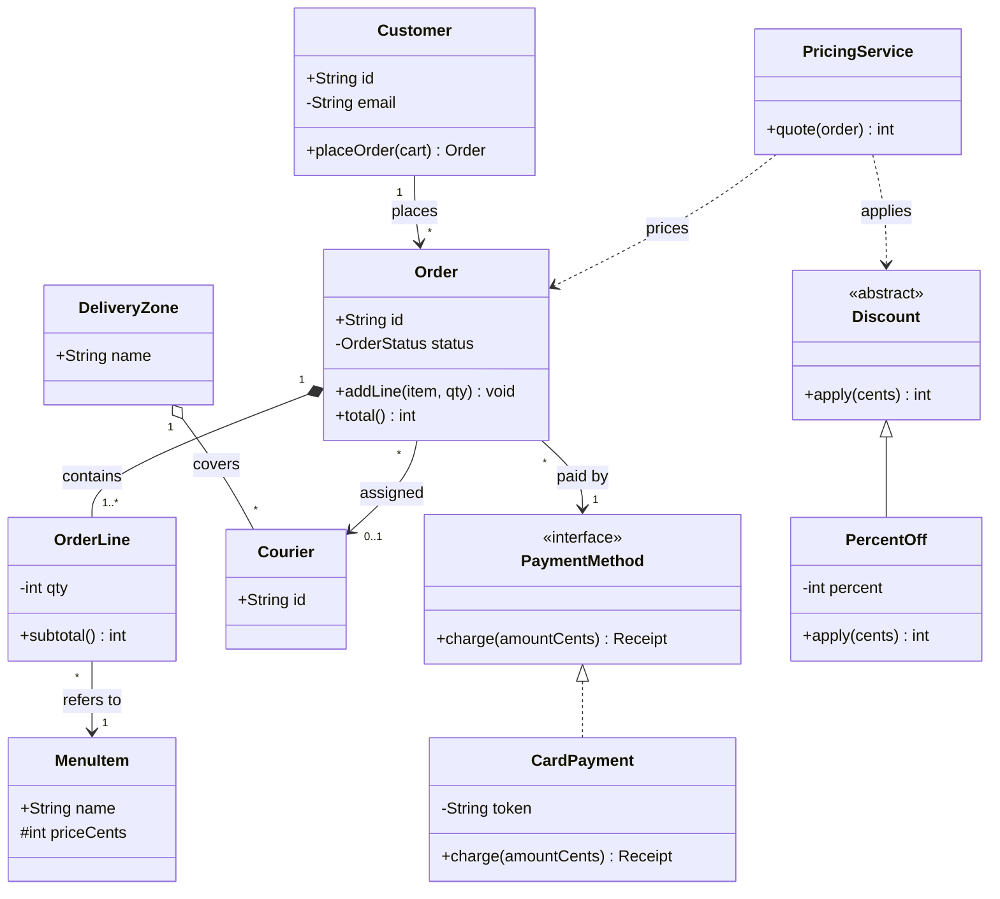

## In one minute
- A class diagram shows static structure: the types, what each holds and offers, and how they relate. Ordering and timing belong to sequence and state diagrams.
- Each class is a box with name, attributes and operations, with visibility marks (`+`, `-`, `#`, `~`) on members.
- Six arrows carry most of the meaning: association, dependency, aggregation, composition, inheritance and realization. Each maps to a different code construct, lifetime and coupling cost.
- Multiplicity (`1`, `0..1`, `*`, `1..*`, `2..5`) at each end of an association is a rule about the object graph, not decoration. Something in the code or the database has to enforce it.
- In an interview, draw the five to eight classes that carry the requirements, label arrows and multiplicities, and talk while you draw.

## How it works

### What the diagram is for
A class diagram drops method bodies, imports and error handling, and keeps what reviewers argue about: which classes exist, who owns whom, and which way dependencies point. Martin Fowler distinguishes UML as sketch, as blueprint and as programming language ([UmlMode](https://martinfowler.com/bliki/UmlMode.html)). Nearly all useful work today is sketching: draw to explore or explain, and stop once the picture has answered the question.

### The class box
The top compartment holds the name, plus an optional stereotype such as `<<interface>>`, `<<abstract>>` or `<<enumeration>>`. The middle holds attributes in the form `visibility name: Type [multiplicity] = default`, for example `- lines: OrderLine [1..*]`. The bottom holds operations as `visibility name(param: Type): ReturnType`, for example `+ addLine(item: MenuItem, qty: int): void`.

Static members are underlined and abstract ones italicised; Mermaid writes them with a trailing `$` and `*` ([Mermaid docs](https://mermaid.js.org/syntax/classDiagram.html)). Compartments may be left empty. A diagram that lists every getter is a diagram nobody reads.

### Visibility
`+` public, `-` private, `#` protected and `~` package map to Java's keywords directly. Python only has the `_name` convention, and Go's nearest fit is a capitalised (exported) versus lowercase name. The marks state the interface you intend, not what the language enforces, so the diagram is often the clearest record of that intent.

### Multiplicity
A multiplicity is a range `lower..upper`. `1` is shorthand for `1..1`, and `*` for `0..*`. It sits at the far end of an association from the object you are reading from: `Customer "1" --> "*" Order` reads "one customer has any number of orders; each order has exactly one customer".

Each bound means something in code. Lower bound 1: the constructor receives the other object. Lower bound 0: every reader handles absence. Upper bound 1: a single field. Upper bound `*`: a collection; a bound like `5` adds a check on every insert. The Association lesson enforces these when a link is made; this lesson's practice checks them over a whole object graph.

### The six relationships
These are the arrows from the earlier lessons in this course, collected in one place with their notation:

| Relationship | Line and head | Mermaid | Reads as | Typical code |
| --- | --- | --- | --- | --- |
| Association | solid line, open arrowhead for navigability | `A --> B` | A knows B over time | field holding a reference or id |
| Dependency | dashed line, open arrowhead | `A ..> B` | A uses B briefly | parameter, local variable, return type |
| Aggregation | solid line, hollow diamond at the whole | `A o-- B` | A groups Bs that live on their own | collection of references to shared objects |
| Composition | solid line, filled diamond at the whole | `A *-- B` | A owns Bs; they die with it | objects created and held only by A |
| Inheritance | solid line, hollow triangle at the parent | `A <\|-- B` | B is a kind of A | `extends`, subclassing, embedding as a crude substitute |
| Realization | dashed line, hollow triangle at the interface | `A <\|.. B` | B fulfils the contract A | `implements`, structural interface satisfaction |

Dependency and association differ in time: one call versus a stored reference. Aggregation and composition differ in lifetime: deleting a playlist keeps its tracks, deleting an order deletes its lines. Realization and inheritance differ in what is shared: a contract only, versus contract plus implementation and state. The UML specification says the precise semantics of shared aggregation vary by application area and modeler, while composite aggregation means the whole is responsible for the existence and storage of its parts ([UML 2.5.1, AggregationKind](https://www.omg.org/spec/UML/2.5.1/PDF)). Use the hollow diamond only when the team agrees what it means.

### Using it in an interview
In a low-level design round the interviewer reads your diagram before your code. A sequence that works:

1. Restate requirements as a few use cases and underline the nouns. Nouns with state or rules become classes; pure values (a price, a seat number) become attributes.
2. Draw named boxes, then relationships and multiplicities before attributes, because that is where the decisions are.
3. Ask per arrow: if this object is deleted, what else goes? That separates composition, aggregation and association.
4. Add interfaces only where you expect variation, each with a reason you can say out loud.
5. Walk one use case through the diagram. If you cannot trace it, a relationship is missing.

Five to eight classes is enough. Twenty-five boxes in 45 minutes signals you modelled the nouns, not the problem.

### Diagrams in the age of generated code
Code assistants over-produce class models: an interface per class, a manager per noun, links in both directions. Asking for a Mermaid class diagram of generated code is a cheap review step, since arrows in every direction reveal coupling faster than reading files. Diagram-as-code also lets the picture change in the same pull request as the code, and GitHub renders Mermaid blocks in Markdown files, issues and pull requests ([GitHub Docs](https://docs.github.com/en/get-started/writing-on-github/working-with-advanced-formatting/creating-diagrams)).

### The same shape elsewhere
A class diagram is a schema for an object graph. An entity-relationship diagram says the same about tables (`1` on the one side becomes a NOT NULL foreign key, `*` to `*` a join table), and JSON Schema says it about messages. The shape is "trust but verify": a declared structure plus a validator that checks real data against it.

## Down the stack

### Layer 1: The contract
A class diagram promises structural facts that hold whenever a caller can observe the system: an `Order` reaches its lines, every `OrderLine` belongs to exactly one `Order`, `CardPayment` satisfies `PaymentMethod`. Each is testable: multiplicities as invariants after every public operation, realization as "compiles where the interface is expected", composition as "after deleting the whole, no part is reachable". It promises nothing about ordering or timing; that belongs in sequence and state diagrams.

### Layer 2: The mechanism
In the UML 2.5 metamodel an `Association` element has two member ends, each a `Property` with `lower` and `upper` bounds, navigability, and an `aggregation` kind of `none`, `shared` or `composite` ([UML 2.5.1](https://www.omg.org/spec/UML/2.5.1/PDF)). Generalization and InterfaceRealization are separate elements. Tools exchange the model as XMI, an XML format.

Mermaid is lighter: it parses `classDiagram` text into classes, members and relations with optional cardinality labels, and a layout engine renders SVG. Since v12.0.0 that engine is ELK, not dagre, and the default theme changed too, so existing class diagrams re-lay out unless you set `layout: dagre` ([Mermaid layouts](https://mermaid.js.org/config/layouts.html), [12.0.0 release](https://github.com/mermaid-js/mermaid/releases/tag/mermaid%4012.0.0)). It checks neither multiplicities nor interface methods; the text is only a drawing. Enforcement lives in code: constructors for lower bounds of 1, guarded add methods for upper bounds, database constraints, and graph validators like the practice below.

### Layer 3: The machine
Each arrow has a memory shape. On a 64-bit machine an upper bound of 1 is one 8-byte pointer (4 with JVM compressed oops), and `0..1` adds a null check at every read. An upper bound of `*` in Go is a 24-byte slice header plus a backing array; an empty CPython list is 56 bytes plus 8 per slot.

Composition can be stored by value, which aggregation cannot. A Go struct holding `Address` rather than `*Address` puts the part inside the whole: one allocation, often the same cache line, and the part cannot outlive the whole. Aggregation must be a pointer, because the part is shared.

Inheritance and realization show up in dispatch. A C++ object with virtual methods carries an 8-byte vtable pointer, and a virtual call is two dependent loads plus an indirect branch. A Go interface value is two words: an itab pointer (cached per type and interface pair) and a data pointer. JavaScript walks the prototype chain, made cheap by V8's inline caches. A dependency costs nothing in object layout because it lives on the stack for one call, which is the physical reason it is the loosest relationship.

### Why it's built this way
1. Code is too detailed to discuss structure, so teams need a smaller picture that keeps types and links and drops the rest.
2. The links that matter differ in lifetime and coupling, so the notation needs distinct arrows for "uses briefly", "knows", "groups", "owns", "is a" and "fulfils".
3. Counts drive data structures and constraints (field or collection, nullable or required), so each end carries a multiplicity.
4. Pictures drift from code, so modern practice keeps diagrams small and stores them as text next to the code, where review catches drift.

## Diagram
A food-delivery order model that uses all six relationships, visibility marks and multiplicities.



## Worked example
An interviewer asks for the model behind a food-delivery checkout. The requirements are: customers place orders of one or more menu items; an order is paid by card or wallet; a courier from the order's zone is assigned after payment; discounts may apply.

Of the nouns, quantity and price are values and become attributes, and receipt is only returned, so it stays a return type. `OrderLine` appears because "one or more menu items, with quantities" is a many-to-many association that carries data.

The ownership questions settle the diamonds. Delete an order and its lines go: composition, `1` to `1..*`. Delete a zone and its couriers still work elsewhere: aggregation. Delete an order and the customer remains: plain association. `PricingService` only reads an order during `quote`, so it is a dependency, not a field.

The multiplicities turn into code directly:

```python
class Order:
    def __init__(self, order_id, customer, payment, first_line):
        self.id = order_id
        self.customer = customer        # "1": required in the constructor
        self.payment = payment          # "1": required
        self.courier = None             # "0..1": readers must handle None
        self._lines = [first_line]      # "1..*": cannot start empty

    def remove_line(self, line):
        if len(self._lines) == 1:
            raise ValueError("order needs at least one line")
        self._lines.remove(line)
```

Now the cost. With 200,000 open orders of 3 lines each in Go, `[]OrderLine` (32-byte lines by value) is one backing array per order. `[]*OrderLine` adds 600,000 separate heap objects for the garbage collector to trace. Both are under 10 MB, so choose by semantics; at 50 million lines in a pricing batch, value composition is one cache-friendly scan instead of 50 million pointer chases.

In the interview, spend about 5 minutes on requirements, 10 on the diagram, 20 coding `Order`, `OrderLine` and `PaymentMethod`, and the rest walking through "place order, pay, assign courier".

## In the wild
- **GitHub, 2022: Mermaid diagrams render in Markdown.** On 14 February 2022 GitHub announced that a fenced `mermaid` block in a Markdown file draws a diagram ([GitHub Blog](https://github.blog/developer-skills/github/include-diagrams-markdown-files-mermaid/)). The docs now list issues, discussions, pull requests, wikis and Markdown files as places it renders ([GitHub Docs](https://docs.github.com/en/get-started/writing-on-github/working-with-advanced-formatting/creating-diagrams)). A class diagram committed as text can be reviewed in the same pull request as the code it describes.
- **Mermaid, 2026: version 12.0.0 re-lays out every class diagram.** The release is marked breaking: it bundles ELK as the default layout engine and changes the default look, so existing flowcharts, state and class diagrams re-lay out and recolour. Teams that want the old picture add `layout: dagre`, `theme: default` and `look: classic` to their config ([release notes](https://github.com/mermaid-js/mermaid/releases/tag/mermaid%4012.0.0)). A diagram stored as text has a toolchain version, and that version belongs in the same upgrade checklist as a compiler.

## Trade-offs

| Option | Strengths | Weaknesses | Choose when |
| --- | --- | --- | --- |
| Whiteboard sketch | Fast; invites discussion; no tooling | Lost after the meeting; no review history | Interviews, early design sessions |
| Diagram-as-code (Mermaid, PlantUML) | Lives in the repo; diffable; reviewed with code | Layout control is limited; still drifts if nobody updates it | Design docs and READMEs for long-lived modules |
| Diagram generated from code | Always matches the code | Shows everything, so it hides the important parts | Onboarding to an unfamiliar codebase, auditing coupling |
| Full UML model with tools and XMI | Precise; supports code generation and model checks | Heavy; few teams keep it current | Regulated or safety-critical domains that require models |
| No diagram, code only | Nothing to maintain | Structure is invisible until someone reads every file | Small modules with two or three types |

## Pitfalls in production
- Diagrams drift from code and mislead new engineers. Keep them as small text files in the repository and delete the ones nobody updates.
- Every noun becomes a class and every class gets an interface. Require a named reason for each interface, such as two implementations or a test seam.
- Composition is drawn where the code shares the part, so deleting one whole corrupts another. Check who constructs the part and whether anything else holds it.
- Multiplicities are drawn and never enforced. `1..*` means nothing if `remove_line` can empty the list; check in the mutating method and in the database when there are several writers.
- Two-way arrows by default store one fact twice. Draw navigability only in the directions a query needs.

## Leadership lens
- Ask for diagrams of the part that is changing, at five to fifteen boxes, and read the arrows before the boxes: which way do dependencies point, and does any domain class depend on infrastructure?
- Treat multiplicities as requirements. "An order can have several couriers now" turns `0..1` into `*`: a migration, a change to every reader and a new concurrency rule, and the estimate should say so.
- For agent-generated designs, ask the agent for the class diagram first. It is cheaper to reject a design at ten boxes than at two thousand lines.

## Check yourself
1. A `Playlist` holds `Track` objects that appear in many playlists and survive playlist deletion. Should the diagram show composition?
   **Answer:** No. Shared parts that outlive the whole are aggregation (or a plain association). Composition requires that each part belongs to one whole at a time and dies with it.
2. What changes in code when an association end changes from `1` to `0..1`?
   **Answer:** The constructor no longer requires the object, the field becomes nullable or optional, and every reader must handle absence. In a database, the foreign key column drops its NOT NULL constraint.
3. Why is a dependency weaker than an association, in terms of what is in memory?
   **Answer:** A dependency exists only for the duration of a call, as a parameter or local on the stack. An association is a stored field, so the two objects stay linked and a change to the target's structure affects the holder for its whole lifetime.
4. Your Go code has `type Order struct { lines []OrderLine }`. Which diagram relationship does that most naturally express, and why?
   **Answer:** Composition. The lines are stored by value inside the order's backing array, so nothing else can hold the same line by reference and the lines become unreachable when the order does.

## Practice
**Task:** Write a multiplicity validator for an object graph. An association has a `name`, a `source` class, a `target` class, a `source_mult` (how many sources each target object may have) and a `target_mult` (how many targets each source object may have). `parse_multiplicity(s)` accepts `n`, `*`, `lo..hi` and `lo..*` with non-negative decimal integers, returns `(lo, hi)` with `hi = -1` for unbounded, and fails with `bad multiplicity: <s>` otherwise, including when `lo > hi`. `validate(associations, objects, links)` takes `objects` as a map from object id to class name and `links` as `(association, from, to)` triples. It first parses every multiplicity in association order (source then target), failing on the first bad one. It then returns a sorted list of distinct violations: `unknown association: <a>`, `<a>: unknown object <id>`, `<a>: <id> is not a <Class>` (check `from` then `to`; links with any of these problems are ignored for counting), `<a>: duplicate link <from> -> <to>` (duplicates count once), `<a>: <id> has <n> targets, want <target_mult>` for each object of the source class, and `<a>: <id> has <n> sources, want <source_mult>` for each object of the target class. Python raises `ValueError`, TypeScript throws `Error`, Go returns an error.

```python starter
def parse_multiplicity(s):
    # TODO: return (lo, hi) with hi == -1 for "*"
    raise NotImplementedError


def validate(associations, objects, links):
    # associations: list of dicts with name, source, target, source_mult, target_mult
    # objects: dict id -> class name; links: list of (assoc, from, to)
    # TODO: return a sorted list of distinct violation strings
    raise NotImplementedError
```

```python tests
def _model():
    assocs = [
        {"name": "places", "source": "Customer", "target": "Order", "source_mult": "1", "target_mult": "*"},
        {"name": "lines", "source": "Order", "target": "OrderLine", "source_mult": "1", "target_mult": "1..*"},
        {"name": "item", "source": "OrderLine", "target": "MenuItem", "source_mult": "*", "target_mult": "1"},
    ]
    objects = {"c1": "Customer", "o1": "Order", "l1": "OrderLine", "l2": "OrderLine",
               "m1": "MenuItem", "m2": "MenuItem"}
    links = [("places", "c1", "o1"), ("lines", "o1", "l1"), ("lines", "o1", "l2"),
             ("item", "l1", "m1"), ("item", "l2", "m2")]
    return assocs, objects, links


def test_parse_valid_forms():
    assert parse_multiplicity("1") == (1, 1)
    assert parse_multiplicity("*") == (0, -1)
    assert parse_multiplicity("0..1") == (0, 1)
    assert parse_multiplicity("1..*") == (1, -1)
    assert parse_multiplicity("2..5") == (2, 5)


def test_parse_rejects_malformed():
    for bad in ["", "5..2", "a", "1..", "..3", "-1", "1...2", "*..3"]:
        try:
            parse_multiplicity(bad)
            assert False, "expected error for " + repr(bad)
        except ValueError as e:
            assert str(e) == "bad multiplicity: " + bad


def test_valid_graph_has_no_violations():
    assocs, objects, links = _model()
    assert validate(assocs, objects, links) == []


def test_lower_and_upper_bounds():
    assocs, objects, links = _model()
    objects["o2"] = "Order"
    objects["l3"] = "OrderLine"
    links = links + [("item", "l3", "m1"), ("item", "l1", "m2"), ("places", "c1", "o2")]
    assert validate(assocs, objects, links) == [
        "item: l1 has 2 targets, want 1",
        "lines: l3 has 0 sources, want 1",
        "lines: o2 has 0 targets, want 1..*",
    ]


def test_bad_links_are_reported_and_not_counted():
    assocs, objects, links = _model()
    links = links + [("item", "o1", "m1"), ("lines", "o1", "zz"), ("ships", "c1", "o1"),
                     ("item", "l1", "c1")]
    assert validate(assocs, objects, links) == [
        "item: c1 is not a MenuItem",
        "item: o1 is not a OrderLine",
        "lines: unknown object zz",
        "unknown association: ships",
    ]


def test_duplicates_count_once():
    assocs, objects, links = _model()
    links = links + [("lines", "o1", "l1"), ("lines", "o1", "l1")]
    assert validate(assocs, objects, links) == ["lines: duplicate link o1 -> l1"]


def test_self_association():
    assocs = [{"name": "reports", "source": "Employee", "target": "Employee",
               "source_mult": "0..1", "target_mult": "0..3"}]
    objects = {"e1": "Employee", "e2": "Employee", "e3": "Employee"}
    links = [("reports", "e1", "e2"), ("reports", "e3", "e2")]
    assert validate(assocs, objects, links) == ["reports: e2 has 2 sources, want 0..1"]


def test_bad_multiplicity_in_model():
    assocs, objects, links = _model()
    assocs[1]["target_mult"] = "3..1"
    try:
        validate(assocs, objects, links)
        assert False, "expected error"
    except ValueError as e:
        assert str(e) == "bad multiplicity: 3..1"
```

```python solution
def parse_multiplicity(s):
    def num(t):
        if t == "" or any(c not in "0123456789" for c in t):
            raise ValueError("bad multiplicity: " + s)
        return int(t)

    if s == "*":
        return (0, -1)
    if ".." in s:
        lo_s, hi_s = s.split("..", 1)
        lo = num(lo_s)
        if hi_s == "*":
            return (lo, -1)
        hi = num(hi_s)
        if lo > hi:
            raise ValueError("bad multiplicity: " + s)
        return (lo, hi)
    n = num(s)
    return (n, n)


def _within(n, bounds):
    lo, hi = bounds
    return n >= lo and (hi == -1 or n <= hi)


def validate(associations, objects, links):
    by_name = {}
    for a in associations:
        src = parse_multiplicity(a["source_mult"])
        tgt = parse_multiplicity(a["target_mult"])
        by_name[a["name"]] = (a, src, tgt)

    out = set()
    seen = {}
    for name, frm, to in links:
        if name not in by_name:
            out.add("unknown association: " + name)
            continue
        a = by_name[name][0]
        ok = True
        for obj, cls in ((frm, a["source"]), (to, a["target"])):
            if obj not in objects:
                out.add(name + ": unknown object " + obj)
                ok = False
            elif objects[obj] != cls:
                out.add(name + ": " + obj + " is not a " + cls)
                ok = False
        if not ok:
            continue
        pairs = seen.setdefault(name, set())
        if (frm, to) in pairs:
            out.add(name + ": duplicate link " + frm + " -> " + to)
        pairs.add((frm, to))

    for name, (a, src, tgt) in by_name.items():
        pairs = seen.get(name, set())
        for obj in objects:
            if objects[obj] == a["source"]:
                n = sum(1 for p in pairs if p[0] == obj)
                if not _within(n, tgt):
                    out.add("%s: %s has %d targets, want %s" % (name, obj, n, a["target_mult"]))
            if objects[obj] == a["target"]:
                n = sum(1 for p in pairs if p[1] == obj)
                if not _within(n, src):
                    out.add("%s: %s has %d sources, want %s" % (name, obj, n, a["source_mult"]))
    return sorted(out)
```

```typescript starter
export interface Association {
  name: string;
  source: string;
  target: string;
  sourceMult: string;
  targetMult: string;
}

export function parseMultiplicity(s: string): [number, number] {
  throw new Error("TODO");
}

export function validate(
  associations: Association[],
  objects: Record<string, string>,
  links: [string, string, string][],
): string[] {
  throw new Error("TODO");
}
```

```typescript tests
function model(): { assocs: Association[]; objects: Record<string, string>; links: [string, string, string][] } {
  return {
    assocs: [
      { name: "places", source: "Customer", target: "Order", sourceMult: "1", targetMult: "*" },
      { name: "lines", source: "Order", target: "OrderLine", sourceMult: "1", targetMult: "1..*" },
      { name: "item", source: "OrderLine", target: "MenuItem", sourceMult: "*", targetMult: "1" },
    ],
    objects: { c1: "Customer", o1: "Order", l1: "OrderLine", l2: "OrderLine", m1: "MenuItem", m2: "MenuItem" },
    links: [["places", "c1", "o1"], ["lines", "o1", "l1"], ["lines", "o1", "l2"],
      ["item", "l1", "m1"], ["item", "l2", "m2"]],
  };
}

function errorOf(fn: () => unknown): string {
  try {
    fn();
  } catch (e) {
    return (e as Error).message;
  }
  return "no error";
}

test("parse valid forms", () => {
  assertEqual(parseMultiplicity("1"), [1, 1]);
  assertEqual(parseMultiplicity("*"), [0, -1]);
  assertEqual(parseMultiplicity("0..1"), [0, 1]);
  assertEqual(parseMultiplicity("1..*"), [1, -1]);
  assertEqual(parseMultiplicity("2..5"), [2, 5]);
});

test("parse rejects malformed", () => {
  for (const bad of ["", "5..2", "a", "1..", "..3", "-1", "1...2", "*..3"]) {
    assertEqual(errorOf(() => parseMultiplicity(bad)), "bad multiplicity: " + bad, bad);
  }
});

test("valid graph has no violations", () => {
  const m = model();
  assertEqual(validate(m.assocs, m.objects, m.links), []);
});

test("lower and upper bounds", () => {
  const m = model();
  m.objects["o2"] = "Order";
  m.objects["l3"] = "OrderLine";
  m.links.push(["item", "l3", "m1"], ["item", "l1", "m2"], ["places", "c1", "o2"]);
  assertEqual(validate(m.assocs, m.objects, m.links), [
    "item: l1 has 2 targets, want 1",
    "lines: l3 has 0 sources, want 1",
    "lines: o2 has 0 targets, want 1..*",
  ]);
});

test("bad links are reported and not counted", () => {
  const m = model();
  m.links.push(["item", "o1", "m1"], ["lines", "o1", "zz"], ["ships", "c1", "o1"], ["item", "l1", "c1"]);
  assertEqual(validate(m.assocs, m.objects, m.links), [
    "item: c1 is not a MenuItem",
    "item: o1 is not a OrderLine",
    "lines: unknown object zz",
    "unknown association: ships",
  ]);
});

test("duplicates count once", () => {
  const m = model();
  m.links.push(["lines", "o1", "l1"], ["lines", "o1", "l1"]);
  assertEqual(validate(m.assocs, m.objects, m.links), ["lines: duplicate link o1 -> l1"]);
});

test("self association", () => {
  const assocs: Association[] = [
    { name: "reports", source: "Employee", target: "Employee", sourceMult: "0..1", targetMult: "0..3" },
  ];
  const objects = { e1: "Employee", e2: "Employee", e3: "Employee" };
  const links: [string, string, string][] = [["reports", "e1", "e2"], ["reports", "e3", "e2"]];
  assertEqual(validate(assocs, objects, links), ["reports: e2 has 2 sources, want 0..1"]);
});

test("bad multiplicity in model", () => {
  const m = model();
  m.assocs[1].targetMult = "3..1";
  assertEqual(errorOf(() => validate(m.assocs, m.objects, m.links)), "bad multiplicity: 3..1");
});
```

```typescript solution
export interface Association {
  name: string;
  source: string;
  target: string;
  sourceMult: string;
  targetMult: string;
}

export function parseMultiplicity(s: string): [number, number] {
  const num = (t: string): number => {
    if (!/^[0-9]+$/.test(t)) throw new Error("bad multiplicity: " + s);
    return parseInt(t, 10);
  };
  if (s === "*") return [0, -1];
  const i = s.indexOf("..");
  if (i >= 0) {
    const lo = num(s.slice(0, i));
    const hiS = s.slice(i + 2);
    if (hiS === "*") return [lo, -1];
    const hi = num(hiS);
    if (lo > hi) throw new Error("bad multiplicity: " + s);
    return [lo, hi];
  }
  const n = num(s);
  return [n, n];
}

function within(n: number, b: [number, number]): boolean {
  return n >= b[0] && (b[1] === -1 || n <= b[1]);
}

export function validate(
  associations: Association[],
  objects: Record<string, string>,
  links: [string, string, string][],
): string[] {
  const byName = new Map<string, { a: Association; src: [number, number]; tgt: [number, number] }>();
  for (const a of associations) {
    const src = parseMultiplicity(a.sourceMult);
    const tgt = parseMultiplicity(a.targetMult);
    byName.set(a.name, { a, src, tgt });
  }
  const out = new Set<string>();
  const seen = new Map<string, Set<string>>();
  for (const [name, from, to] of links) {
    const entry = byName.get(name);
    if (!entry) {
      out.add("unknown association: " + name);
      continue;
    }
    let ok = true;
    for (const [obj, cls] of [[from, entry.a.source], [to, entry.a.target]]) {
      if (!(obj in objects)) {
        out.add(`${name}: unknown object ${obj}`);
        ok = false;
      } else if (objects[obj] !== cls) {
        out.add(`${name}: ${obj} is not a ${cls}`);
        ok = false;
      }
    }
    if (!ok) continue;
    if (!seen.has(name)) seen.set(name, new Set());
    const pairs = seen.get(name)!;
    const key = from + "\u0000" + to;
    if (pairs.has(key)) out.add(`${name}: duplicate link ${from} -> ${to}`);
    pairs.add(key);
  }
  for (const [name, { a, src, tgt }] of byName) {
    const pairs = [...(seen.get(name) ?? new Set<string>())].map((k) => k.split("\u0000"));
    for (const obj of Object.keys(objects)) {
      if (objects[obj] === a.source) {
        const n = pairs.filter((p) => p[0] === obj).length;
        if (!within(n, tgt)) out.add(`${name}: ${obj} has ${n} targets, want ${a.targetMult}`);
      }
      if (objects[obj] === a.target) {
        const n = pairs.filter((p) => p[1] === obj).length;
        if (!within(n, src)) out.add(`${name}: ${obj} has ${n} sources, want ${a.sourceMult}`);
      }
    }
  }
  return [...out].sort();
}
```

```go starter
package practice

type Association struct {
	Name, Source, Target, SourceMult, TargetMult string
}

type Link struct {
	Assoc, From, To string
}

// ParseMultiplicity returns (lo, hi) with hi == -1 for unbounded.
func ParseMultiplicity(s string) (int, int, error) {
	panic("TODO")
}

// Validate returns a sorted list of distinct violations.
func Validate(assocs []Association, objects map[string]string, links []Link) ([]string, error) {
	panic("TODO")
}
```

```go tests
package practice

import (
	"reflect"
	"testing"
)

func model() ([]Association, map[string]string, []Link) {
	assocs := []Association{
		{"places", "Customer", "Order", "1", "*"},
		{"lines", "Order", "OrderLine", "1", "1..*"},
		{"item", "OrderLine", "MenuItem", "*", "1"},
	}
	objects := map[string]string{"c1": "Customer", "o1": "Order", "l1": "OrderLine",
		"l2": "OrderLine", "m1": "MenuItem", "m2": "MenuItem"}
	links := []Link{{"places", "c1", "o1"}, {"lines", "o1", "l1"}, {"lines", "o1", "l2"},
		{"item", "l1", "m1"}, {"item", "l2", "m2"}}
	return assocs, objects, links
}

func expectViolations(t *testing.T, got []string, err error, want []string) {
	t.Helper()
	if err != nil {
		t.Fatalf("unexpected error: %v", err)
	}
	if len(got) == 0 && len(want) == 0 {
		return
	}
	if !reflect.DeepEqual(got, want) {
		t.Fatalf("want %q, got %q", want, got)
	}
}

func TestParseValidForms(t *testing.T) {
	cases := map[string][2]int{"1": {1, 1}, "*": {0, -1}, "0..1": {0, 1}, "1..*": {1, -1}, "2..5": {2, 5}}
	for in, want := range cases {
		lo, hi, err := ParseMultiplicity(in)
		if err != nil || lo != want[0] || hi != want[1] {
			t.Fatalf("%q: got %d,%d,%v want %v", in, lo, hi, err, want)
		}
	}
}

func TestParseRejectsMalformed(t *testing.T) {
	for _, bad := range []string{"", "5..2", "a", "1..", "..3", "-1", "1...2", "*..3"} {
		_, _, err := ParseMultiplicity(bad)
		if err == nil || err.Error() != "bad multiplicity: "+bad {
			t.Fatalf("%q: got %v", bad, err)
		}
	}
}

func TestValidGraph(t *testing.T) {
	a, o, l := model()
	got, err := Validate(a, o, l)
	expectViolations(t, got, err, nil)
}

func TestLowerAndUpperBounds(t *testing.T) {
	a, o, l := model()
	o["o2"] = "Order"
	o["l3"] = "OrderLine"
	l = append(l, Link{"item", "l3", "m1"}, Link{"item", "l1", "m2"}, Link{"places", "c1", "o2"})
	got, err := Validate(a, o, l)
	expectViolations(t, got, err, []string{
		"item: l1 has 2 targets, want 1",
		"lines: l3 has 0 sources, want 1",
		"lines: o2 has 0 targets, want 1..*",
	})
}

func TestBadLinks(t *testing.T) {
	a, o, l := model()
	l = append(l, Link{"item", "o1", "m1"}, Link{"lines", "o1", "zz"}, Link{"ships", "c1", "o1"},
		Link{"item", "l1", "c1"})
	got, err := Validate(a, o, l)
	expectViolations(t, got, err, []string{
		"item: c1 is not a MenuItem",
		"item: o1 is not a OrderLine",
		"lines: unknown object zz",
		"unknown association: ships",
	})
}

func TestDuplicatesCountOnce(t *testing.T) {
	a, o, l := model()
	l = append(l, Link{"lines", "o1", "l1"}, Link{"lines", "o1", "l1"})
	got, err := Validate(a, o, l)
	expectViolations(t, got, err, []string{"lines: duplicate link o1 -> l1"})
}

func TestSelfAssociation(t *testing.T) {
	a := []Association{{"reports", "Employee", "Employee", "0..1", "0..3"}}
	o := map[string]string{"e1": "Employee", "e2": "Employee", "e3": "Employee"}
	l := []Link{{"reports", "e1", "e2"}, {"reports", "e3", "e2"}}
	got, err := Validate(a, o, l)
	expectViolations(t, got, err, []string{"reports: e2 has 2 sources, want 0..1"})
}

func TestBadMultiplicityInModel(t *testing.T) {
	a, o, l := model()
	a[1].TargetMult = "3..1"
	_, err := Validate(a, o, l)
	if err == nil || err.Error() != "bad multiplicity: 3..1" {
		t.Fatalf("got %v", err)
	}
}
```

```go solution
package practice

import (
	"errors"
	"fmt"
	"sort"
	"strconv"
	"strings"
)

type Association struct {
	Name, Source, Target, SourceMult, TargetMult string
}

type Link struct {
	Assoc, From, To string
}

func num(t, s string) (int, error) {
	if t == "" {
		return 0, errors.New("bad multiplicity: " + s)
	}
	for _, c := range t {
		if c < '0' || c > '9' {
			return 0, errors.New("bad multiplicity: " + s)
		}
	}
	return strconv.Atoi(t)
}

// ParseMultiplicity returns (lo, hi) with hi == -1 for unbounded.
func ParseMultiplicity(s string) (int, int, error) {
	if s == "*" {
		return 0, -1, nil
	}
	if i := strings.Index(s, ".."); i >= 0 {
		lo, err := num(s[:i], s)
		if err != nil {
			return 0, 0, err
		}
		hiS := s[i+2:]
		if hiS == "*" {
			return lo, -1, nil
		}
		hi, err := num(hiS, s)
		if err != nil {
			return 0, 0, err
		}
		if lo > hi {
			return 0, 0, errors.New("bad multiplicity: " + s)
		}
		return lo, hi, nil
	}
	n, err := num(s, s)
	if err != nil {
		return 0, 0, err
	}
	return n, n, nil
}

type bounds struct{ lo, hi int }

func (b bounds) within(n int) bool { return n >= b.lo && (b.hi == -1 || n <= b.hi) }

type entry struct {
	a        Association
	src, tgt bounds
}

type pair struct{ from, to string }

// Validate returns a sorted list of distinct violations.
func Validate(assocs []Association, objects map[string]string, links []Link) ([]string, error) {
	byName := map[string]entry{}
	for _, a := range assocs {
		sl, sh, err := ParseMultiplicity(a.SourceMult)
		if err != nil {
			return nil, err
		}
		tl, th, err := ParseMultiplicity(a.TargetMult)
		if err != nil {
			return nil, err
		}
		byName[a.Name] = entry{a, bounds{sl, sh}, bounds{tl, th}}
	}
	out := map[string]bool{}
	seen := map[string]map[pair]bool{}
	for _, l := range links {
		e, found := byName[l.Assoc]
		if !found {
			out["unknown association: "+l.Assoc] = true
			continue
		}
		ok := true
		for _, end := range [][2]string{{l.From, e.a.Source}, {l.To, e.a.Target}} {
			cls, exists := objects[end[0]]
			if !exists {
				out[fmt.Sprintf("%s: unknown object %s", l.Assoc, end[0])] = true
				ok = false
			} else if cls != end[1] {
				out[fmt.Sprintf("%s: %s is not a %s", l.Assoc, end[0], end[1])] = true
				ok = false
			}
		}
		if !ok {
			continue
		}
		if seen[l.Assoc] == nil {
			seen[l.Assoc] = map[pair]bool{}
		}
		p := pair{l.From, l.To}
		if seen[l.Assoc][p] {
			out[fmt.Sprintf("%s: duplicate link %s -> %s", l.Assoc, l.From, l.To)] = true
		}
		seen[l.Assoc][p] = true
	}
	for name, e := range byName {
		for obj, cls := range objects {
			if cls == e.a.Source {
				n := 0
				for p := range seen[name] {
					if p.from == obj {
						n++
					}
				}
				if !e.tgt.within(n) {
					out[fmt.Sprintf("%s: %s has %d targets, want %s", name, obj, n, e.a.TargetMult)] = true
				}
			}
			if cls == e.a.Target {
				n := 0
				for p := range seen[name] {
					if p.to == obj {
						n++
					}
				}
				if !e.src.within(n) {
					out[fmt.Sprintf("%s: %s has %d sources, want %s", name, obj, n, e.a.SourceMult)] = true
				}
			}
		}
	}
	res := []string{}
	for v := range out {
		res = append(res, v)
	}
	sort.Strings(res)
	return res, nil
}
```

## Mock interview
**Prompt:** You have 45 minutes to design the object model for a library system: members borrow copies of books, each member may hold at most 5 copies, copies can be reserved, and late returns incur fines. Start with a class diagram and then code the borrowing operation.

- Follow-up: Why did you separate `Book` from `Copy`, and what multiplicity sits between them?
- Follow-up: Two branches share one catalogue and a member borrows at both concurrently. Where is the "at most 5" rule enforced so it cannot be broken?
- Follow-up: Fines will later support several policies (flat, per day, capped). How does the diagram change, and what do you not add yet?

**A strong answer covers:**
- A small diagram first (`Member`, `Book`, `Copy`, `Loan`, `Reservation`, `FinePolicy`) with arrows and multiplicities before attributes.
- `Book "1" *-- "1..*" Copy` or an aggregation, with the ownership question stated out loud, and `Loan` as a class because the borrowing relationship carries dates and state.
- Multiplicities treated as rules: `Member "1" --> "0..5" Loan` enforced in the borrow operation and in the database with a conditional update or a count under a lock, not just drawn.
- A `FinePolicy` interface with one implementation today, justified by a known second policy, rather than a speculative plugin system.
- Navigability chosen per query, avoiding two-way links that are not needed.
- A walk-through of "borrow, return late, pay fine" on the diagram.

## Sources and further study
**Primary**
- [UML 2.5.1 specification, PDF (OMG)](https://www.omg.org/spec/UML/2.5.1/PDF): the metamodel behind `Association`, `Property` multiplicities and `AggregationKind`.
- [Mermaid 12.0.0 release notes](https://github.com/mermaid-js/mermaid/releases/tag/mermaid%4012.0.0): the breaking change to default layout and theme for class diagrams.

**Systems docs**
- [Mermaid layouts](https://mermaid.js.org/config/layouts.html): which diagram types use ELK by default and how to select dagre instead.
- [GitHub Docs: creating diagrams](https://docs.github.com/en/get-started/writing-on-github/working-with-advanced-formatting/creating-diagrams): where Mermaid renders in Markdown on GitHub.
- [GitHub Blog: diagrams in Markdown with Mermaid](https://github.blog/developer-skills/github/include-diagrams-markdown-files-mermaid/): the 2022 announcement.

**Books**
- *Design Patterns*, Gamma, Helm, Johnson and Vlissides: Appendix B "Guide to Notation", the class and object diagram notation the book uses for every pattern.
- *Cracking the Coding Interview*, Gayle Laakmann McDowell, chapter 7 "Object-Oriented Design": how interviewers expect classes and relationships to be sketched.
- *Software Engineering at Google*, Winters, Manshreck and Wright, chapter 10 "Documentation": why design documents and diagrams need an owner and a review process.

**Other curricula**
- [donnemartin/system-design-primer: object-oriented design](https://github.com/donnemartin/system-design-primer): frames OOD as a set of worked interview exercises with class sketches, with no multiplicity or lifetime reasoning.
- [Refactoring.Guru: design patterns](https://refactoring.guru/design-patterns): shows each pattern as a structure diagram; useful for seeing realization and composition arrows in context.

## Watch
- [UML Class Diagram Tutorial (Lucid Software)](https://www.youtube.com/watch?v=UI6lqHOVHic): a clear walkthrough of boxes, visibility, multiplicity and the relationship types with one running example.
- [UML 2.0 Class Diagrams (Derek Banas)](https://www.youtube.com/watch?v=3cmzqZzwNDM): a fast tour of the notation, drawn step by step.

## Free resources
- [Class diagrams (Mermaid documentation)](https://mermaid.js.org/syntax/classDiagram.html): the syntax used on this site for members, visibility, cardinality and every relationship arrow.
- [UML Specification 2.5.1 (OMG)](https://www.omg.org/spec/UML/2.5.1/About-UML/): the official standard, including the Association, Property and AggregationKind definitions.
- [UmlAsSketch (Martin Fowler)](https://martinfowler.com/bliki/UmlAsSketch.html): why most valuable UML use is quick, selective sketching.
- [UmlMode (Martin Fowler)](https://martinfowler.com/bliki/UmlMode.html): the sketch, blueprint and programming-language modes, and what each costs.
- [Class diagram (PlantUML)](https://plantuml.com/class-diagram): the other popular diagram-as-code syntax, useful when Mermaid's layout is not enough.
- [Class diagram (Wikipedia)](https://en.wikipedia.org/wiki/Class_diagram): background on the notation and a summary of the relationship types.
