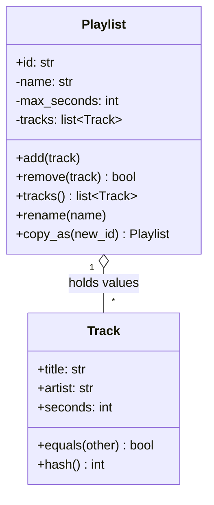

## In one minute
- A class is a type that bundles data with the operations allowed on it; an object is one instance of that type, living somewhere in memory with its own copy of the data. The point of bundling is to keep *invariants*: rules about the data that every operation preserves.
- A good class makes invalid states impossible to construct and impossible to reach. Validate in the constructor, change state only through methods that re-check the rules, and never hand out references to internal mutable collections.
- Decide early whether a class is a *value* (two instances with the same fields are the same thing, like an amount of money or a track) or an *entity* (it has an identity that persists while its fields change, like a playlist or an account). That decision drives equality, hashing and copying.
- Languages disagree on defaults. Python and JavaScript assign references; Go copies structs but shares the slices and maps inside them; Python compares objects by identity unless you define `__eq__`; Go's `==` compares fields.
- Agents generate classes with public mutable fields, no validation and `__eq__` without `__hash__`. Review asks: what are the invariants, which constructor or method could break them, and what happens when this object is a dictionary key or gets copied?

## How it works

### Data plus the rules that guard it
A music app stores playlists as dictionaries: `{"name": "Run", "tracks": [...], "limit": 3600}`. Three months later there are playlists with empty names, tracks with negative durations from a bad import, and a playlist 40 minutes over its limit because one code path appended to `tracks` directly.

A class moves the rules next to the data. The constructor refuses to build an invalid playlist, and the only way to change the track list is `add`, which checks the limit first. Every other function can then assume a playlist is valid. That is the real product of a class: the places a bug can create bad data shrink from "everywhere" to "these six methods".

### Constructors establish, methods preserve
An invariant has two halves. The constructor *establishes* it: trim the name, reject empty ones, reject a limit below one second. Each mutating method *preserves* it: check first, then mutate, so a failed call leaves the object unchanged. The order matters. A method that appends a track and then raises "over limit" has already broken the playlist; the exception just reports the damage.

Two leaks undo this work. Returning the internal list (`return self._tracks`) lets callers append behind the method's back, so return a copy or an immutable view. Accepting a list in the constructor and storing it directly lets the caller keep a reference and mutate it later, so copy on the way in as well.

### Values and entities
Two `Track("Intro", "Nils", 214)` objects are interchangeable: same title, artist and duration, same thing. A track is a *value*, and values should be immutable, compare by their fields and hash by the same fields, so they work as dictionary keys and set members. Changing a value means making a new one. Fowler's reason is aliasing: if two variables share a mutable date, changing one moves the other ([Fowler](https://martinfowler.com/bliki/ValueObject.html)).

A playlist is an *entity*. Rename it, add three songs, and it is still the same playlist, the one with ID 41 that a user shared last week. Two playlists with identical songs are still two playlists. Entities (in Evans's terms, objects defined by identity rather than attributes; *Domain-Driven Design*, Ch 5) compare by identity, usually an explicit ID rather than memory address, because the same entity may be loaded twice from a database into two objects that must compare equal.

Mixing these up causes real bugs. Refactoring's catalogue has the matching moves: wrap a primitive that has grown behaviour in a class ([refactoring.guru](https://refactoring.guru/replace-data-value-with-object)), and make a collection field safe with Encapsulate Collection (*Refactoring*, 2nd ed., Ch 7). Value equality on a mutable entity breaks hash tables: put a playlist in a set, add a song, and the set can no longer find it. Identity equality on a value lets duplicates slip through, because a freshly parsed track never matches a stored one.

### Equality and hashing per language
- **Python:** `==` falls back to identity unless the class defines `__eq__`. Defining `__eq__` sets `__hash__` to `None`, so instances become unhashable until you define `__hash__` from the same fields ([Python data model](https://docs.python.org/3/reference/datamodel.html)). `@dataclass(frozen=True)` generates all three consistently; a plain `@dataclass` leaves `__hash__` as `None`, and `frozen=True` makes assignment raise `FrozenInstanceError` ([dataclasses docs](https://docs.python.org/3/library/dataclasses.html)).
- **Go:** `==` on structs compares every field, and a struct whose fields are all comparable can be a map key with no code at all. A struct with a slice or map field cannot be compared and will not compile as a map key, because a map key type must have `==` fully defined and slices, maps and functions do not ([Go spec](https://go.dev/ref/spec)).
- **JavaScript and TypeScript:** `===` on objects is identity, and `Map` and `Set` use identity for object keys. Value semantics need an `equals` method and a string or tuple key, such as `` `${title}|${artist}|${seconds}` ``.

### Copy semantics
In Python and JavaScript, `b = a` copies a reference: there is still one object. In Go, `b := a` on a struct copies the fields, which looks like a full copy until a field is a slice or map, whose header is copied but whose backing storage is shared. Shallow copies (`copy.copy`, `{...obj}`, `slices.Clone` of pointers) copy one level. The Prototype lesson covers deep copies of graphs; for everyday classes the rule is simpler. Values are immutable, so sharing them is safe and copying them is pointless. Entities own their mutable parts, and a "copy" of an entity is usually a *new* entity with a new ID and its own collections, such as "duplicate playlist".

### Reviewing agent-written code
An agent asked for a `Playlist` class will produce public fields, a constructor that stores whatever it is given, and perhaps a plain `@dataclass`, which compares playlists by content and makes them unhashable. Ask for written invariants with a test per invariant, `frozen=True` on values, ID-based equality on entities, and a test that mutating a returned collection does not change the object.

### The same shape elsewhere
Value versus entity is the *duplicates* problem shape. Event deduplication, idempotency keys and cache keys all ask when two things are the same thing. A cache keyed on a mutable object and an idempotency key built from fields that change on retry are the same bug.

## Down the stack

### Layer 1: The contract
A class promises that every instance reachable by callers satisfies its invariants, both after construction and after every method call, including failed ones. Value types promise that equality is reflexive, symmetric and transitive, that equal instances have equal hashes, and that both are stable for the object's lifetime. Entities promise that equality follows identity and does not change when fields change. A class documents whether returned collections are copies or views, and whether copying an instance shares anything.

### Layer 2: The mechanism
CPython represents every object as a `PyObject` header (a reference count and a pointer to the type) followed by type-specific data. A normal class instance stores attributes in a dictionary; since PEP 412, instances of one class share a single keys table and store only values, and 3.11 and later can keep those values inline in the object until something forces a real dict. `__slots__` replaces the dictionary with fixed offsets, implemented as descriptors on the class, and `@dataclass(slots=True)` (Python 3.10 and later) generates it for you by building a new class ([dataclasses docs](https://docs.python.org/3/library/dataclasses.html)). Attribute lookup walks the type's method resolution order (MRO); a per-type cache tagged with a version number skips the walk, and the 3.11 specialising interpreter rewrites hot `LOAD_ATTR` instructions into variants such as `LOAD_ATTR_INSTANCE_VALUE` that read a fixed slot after one type check.

V8 gives each object a pointer to a hidden class (V8 calls it a *map*) that records property names and offsets. Objects built by the same constructor, assigning fields in the same order, share a map, and inline caches at each property access remember "this map means offset 16". Adding a property later, or in a different order, creates a new map and can turn a fast monomorphic call site into a slow megamorphic one.

Go has no object header. A struct is its fields, laid out in declaration order with alignment padding. Methods are ordinary functions with the receiver as the first argument, resolved at compile time; dynamic dispatch exists only through interface values, which are two words: an itab pointer (type plus method table) and a data pointer.

### Layer 3: The machine
Object size is mostly headers and pointers. On 64-bit CPython a plain instance with three attributes costs roughly 100 to 200 bytes including its dictionary or inline values, plus 16 bytes of garbage collector header; with `__slots__` it is about 56 to 72 bytes. Small objects come from pymalloc pools of fixed size classes in 8-byte steps up to 512 bytes, so a 57-byte request uses a 64-byte block. A JVM object has a 12-byte header with compressed class pointers, padded to a multiple of 8. A V8 object has a map pointer, a properties pointer and an elements pointer before its in-object fields, each 4 bytes with pointer compression.

Go's layout makes padding visible. `struct{ a bool; b int64; c bool }` is 24 bytes, because `b` must start at an 8-byte boundary and the struct size rounds up to 8; reordering to `struct{ b int64; a, c bool }` gives 16 bytes. Across ten million elements in a slice that is 80 MB saved, and fewer cache lines touched per scan. Allocation cost differs too: Go's escape analysis keeps non-escaping structs on the stack at zero allocation cost, V8 bump-allocates new objects in a young generation in a few nanoseconds, and CPython pays roughly 50 to 100 ns to create an instance through `__init__`.

### Why it's built this way
1. Data that any code can modify ends up invalid somewhere, so data is bundled with the only operations allowed to change it.
2. Checking rules everywhere is impossible to maintain, so the constructor establishes them once and methods preserve them, which lets the rest of the code assume validity.
3. Some things are defined by their contents and others by their history, so languages and libraries distinguish value equality from identity, and hash tables require the two to agree with hashing.
4. Dynamic languages cannot know an object's shape at compile time, so runtimes recover it at run time with shared key tables, hidden classes and inline caches.
5. Every header, pointer and padding byte is multiplied by the number of instances, so compact layouts (`__slots__`, field ordering, value types) matter only when instances run into millions.

## Diagram


## Worked example
A podcast platform keeps 12 million episode records in memory in a ranking service, each a Python object with eight attributes. With ordinary instances, `tracemalloc` showed about 230 bytes per object plus its strings: 2.8 GB of objects before any string data, and the service needed 6 GB hosts. Garbage collection passes took 900 ms because the collector walks every container object.

The team made the episode class a `@dataclass(frozen=True, slots=True)`, since ranking only reads episodes and updates arrive as whole new records. Objects dropped to about 104 bytes, saving 1.5 GB. Because the class was now a hashable value, they also deduplicated identical episodes syndicated under different feeds through a dictionary keyed by the episode itself, which removed another 9% of objects. Frozen instances made the deduplication safe, since nobody could mutate a shared episode.

## In the wild
- **CPython, 3.7 (2018): `gc.freeze()` for forking servers.** A pre-fork web server shares its loaded objects with child processes through copy-on-write pages, but collections over those objects can cause page copies in the children, which raises memory use. `gc.freeze()` moves all tracked objects into a permanent generation that later collections ignore, and the docs say this maximises memory sharing; they recommend `gc.disable()` early in the parent, `gc.freeze()` before `fork()`, and `gc.enable()` in the child ([Python gc docs](https://docs.python.org/3/library/gc.html)).
- **Fowler's write-up: the aliased date.** In his Value Object description, a retirement date assigned from a party date shares one mutable object, so moving the party date to a Saturday moves the retirement date too. The cure he gives is immutable values that are replaced, never edited ([Fowler](https://martinfowler.com/bliki/ValueObject.html)). This is a documented teaching case rather than a production outage.

## Trade-offs
| Option | Strengths | Weaknesses | Choose when |
| --- | --- | --- | --- |
| Plain dict or map | No ceremony; easy to serialise | No invariants; typos create new keys | Throwaway scripts, data in transit |
| Immutable value class | Safe to share and hash; trivially thread-safe | New object per change | Money, coordinates, tracks, IDs, config |
| Mutable entity with ID equality | Models things that change over time | Must guard invariants in every method | Accounts, orders, playlists, sessions |
| Class with `__slots__` or packed struct | Less memory, faster attribute access | No dynamic attributes; harder to extend | Millions of instances |
| Record or dataclass generator | Equality, hash and repr generated consistently | Defaults (mutable, eq by value) may be wrong for entities | Most value types |

## Pitfalls in production
- A mutable object used as a dictionary key or set member, then mutated, so lookups miss it. Fix: hash only immutable values; give entities ID-based hashing.
- `__eq__` defined without `__hash__`, which makes instances unhashable in Python, or a Java `equals` without `hashCode`, which silently breaks `HashMap`. Fix: generate both, or define both from the same fields and test them together.
- Getters that return internal lists, so callers bypass validation. Fix: return copies or read-only views, and copy collections passed into constructors.
- Methods that mutate before validating, leaving objects half-changed when they raise. Fix: compute and check first, mutate last.
- Go structs copied by value that still share a slice or map, so the "copy" changes the original. Fix: clone collection fields explicitly in a copy method.
- V8 objects with fields added conditionally after construction, giving many hidden classes and slow call sites. Fix: initialise every field in the constructor, in the same order.

## Leadership lens
- In design review, ask "is this a value or an entity?" for every new domain type. The answer decides equality, hashing, mutability and the database key, and changing it later touches every caller.
- Require invariants to be written down and tested through public methods. They are the cheapest documentation of business rules a team will ever have.
- Treat memory layout as a scaling decision, not a style one: it matters at millions of instances and is noise below. Ask for a measurement before anyone adds `__slots__` everywhere.
- Steer agents with a template: invariants in a docstring, validation in the constructor, check-then-mutate methods, defensive copies, and equality tests. Generated classes without these look complete and are not.

## Check yourself
1. Why does a method that appends first and validates second break the class contract even though it raises an error?
   **Answer:** The object has already been mutated into an invalid state, and the caller may catch the error and keep using it. Checks must happen before any mutation so a failed call leaves the object unchanged.
2. Why should a playlist compare by ID rather than by its tracks?
   **Answer:** A playlist is an entity whose contents change over time; comparing by contents would make its hash change on every edit and would treat two different playlists with the same songs as one.
3. A Go struct holds a `[]string` field. What happens to `b := a` and to using the struct as a map key?
   **Answer:** The assignment copies the slice header, so `a` and `b` share the backing array. A struct with a slice field is not comparable, so it cannot be a map key and will not compile as one.
4. When is `__slots__` worth adding?
   **Answer:** When a class has a fixed set of attributes and you hold enough instances (hundreds of thousands or more) that the per-instance dictionary shows up in memory profiles.

## Practice
**Task:** Build a value class and an entity class with invariants. `Track(title, artist, seconds)` is an immutable value: it trims `title` and `artist`, fails with `empty title` or `empty artist` if either is empty after trimming and with `bad seconds: <n>` if `seconds < 1`. Two tracks with the same title, artist and seconds are equal (Python: `==` and `hash`; TypeScript: `equals(other)` and `key()` returning `title|artist|seconds`; Go: `NewTrack` returns a comparable `Track` value usable with `==` and as a map key). `Playlist(id, name, max_seconds)` trims `name` (`empty name` if empty) and requires `max_seconds >= 1` (`bad limit: <n>`). `add(track)` fails with `duplicate track: <title>` if an equal track is present, or with `over limit: <new total> > <max>` if it would exceed the limit, leaving the playlist unchanged. `remove(track)` returns whether an equal track was removed. `tracks()` returns a copy in insertion order, `total_seconds()` the sum, `name()` the name, `rename(name)` applies the name rule. `copy_as(new_id)` returns a new playlist with the same name, limit and tracks but its own list. Playlists are equal when their IDs are equal (Python: `==` and `hash`; TypeScript and Go: `sameAs(other)` / `SameAs`). Python raises `ValueError`, TypeScript throws `Error`, Go returns an error.

```python starter
class Track:
    def __init__(self, title, artist, seconds):
        # TODO: validate, normalise, make immutable
        raise NotImplementedError

class Playlist:
    def __init__(self, id, name, max_seconds):
        # TODO
        raise NotImplementedError

    def name(self):
        raise NotImplementedError

    def rename(self, name):
        raise NotImplementedError

    def add(self, track):
        raise NotImplementedError

    def remove(self, track):
        raise NotImplementedError

    def tracks(self):
        raise NotImplementedError

    def total_seconds(self):
        raise NotImplementedError

    def copy_as(self, new_id):
        raise NotImplementedError
```

```python tests
def error_of(fn):
    try:
        fn()
    except ValueError as e:
        return str(e)
    return None

def test_track_is_a_value():
    a = Track("  Intro ", "Nils", 214)
    b = Track("Intro", " Nils", 214)
    assert a.title == "Intro" and a.artist == "Nils" and a.seconds == 214
    assert a == b and a is not b
    assert hash(a) == hash(b) and len({a, b}) == 1
    assert {a: "x"}[b] == "x"
    assert a != Track("Intro", "Nils", 215)

def test_track_is_immutable():
    t = Track("Intro", "Nils", 214)
    try:
        t.seconds = 1
        changed = True
    except AttributeError:
        changed = False
    assert not changed and t.seconds == 214

def test_track_validation():
    assert error_of(lambda: Track("  ", "Nils", 10)) == "empty title"
    assert error_of(lambda: Track("Intro", "", 10)) == "empty artist"
    assert error_of(lambda: Track("Intro", "Nils", 0)) == "bad seconds: 0"

def test_add_respects_limit_and_leaves_state_on_failure():
    p = Playlist("p1", " Run ", 600)
    assert p.name() == "Run"
    p.add(Track("A", "x", 300))
    p.add(Track("B", "x", 250))
    assert error_of(lambda: p.add(Track("C", "x", 51))) == "over limit: 601 > 600"
    assert p.total_seconds() == 550 and [t.title for t in p.tracks()] == ["A", "B"]
    p.add(Track("C", "x", 50))
    assert p.total_seconds() == 600

def test_duplicates_by_value_and_remove():
    p = Playlist("p1", "Run", 1000)
    p.add(Track("A", "x", 100))
    assert error_of(lambda: p.add(Track(" A", "x", 100))) == "duplicate track: A"
    p.add(Track("A", "x", 101))
    assert p.remove(Track("A", "x", 100)) is True
    assert p.remove(Track("A", "x", 100)) is False
    assert p.tracks() == [Track("A", "x", 101)] and p.total_seconds() == 101

def test_tracks_returns_a_copy():
    p = Playlist("p1", "Run", 1000)
    p.add(Track("A", "x", 100))
    p.tracks().append(Track("Z", "z", 900))
    assert len(p.tracks()) == 1 and p.total_seconds() == 100

def test_entity_identity_and_copy():
    p = Playlist("p1", "Run", 1000)
    p.add(Track("A", "x", 100))
    same_id = Playlist("p1", "Other", 50)
    assert p == same_id and hash(p) == hash(same_id)
    q = p.copy_as("p2")
    assert q != p and q.name() == "Run" and q.tracks() == p.tracks()
    q.add(Track("B", "x", 200))
    assert p.total_seconds() == 100 and q.total_seconds() == 300
    assert error_of(lambda: Playlist("p3", "x", 0)) == "bad limit: 0"

def test_rename_keeps_identity():
    p = Playlist("p1", "Run", 1000)
    before = hash(p)
    p.rename("  Long run ")
    assert p.name() == "Long run" and hash(p) == before
    assert error_of(lambda: p.rename(" ")) == "empty name"
    assert p.name() == "Long run"
```

```python solution
from dataclasses import dataclass

@dataclass(frozen=True)
class Track:
    title: str
    artist: str
    seconds: int

    def __post_init__(self):
        title = self.title.strip()
        artist = self.artist.strip()
        if not title:
            raise ValueError("empty title")
        if not artist:
            raise ValueError("empty artist")
        if self.seconds < 1:
            raise ValueError("bad seconds: %d" % self.seconds)
        object.__setattr__(self, "title", title)
        object.__setattr__(self, "artist", artist)

def _clean_name(name):
    name = name.strip()
    if not name:
        raise ValueError("empty name")
    return name

class Playlist:
    def __init__(self, id, name, max_seconds):
        if max_seconds < 1:
            raise ValueError("bad limit: %d" % max_seconds)
        self.id = id
        self._name = _clean_name(name)
        self._max = max_seconds
        self._tracks = []
        self._total = 0

    def __eq__(self, other):
        return isinstance(other, Playlist) and self.id == other.id

    def __hash__(self):
        return hash(self.id)

    def name(self):
        return self._name

    def rename(self, name):
        self._name = _clean_name(name)

    def add(self, track):
        if track in self._tracks:
            raise ValueError("duplicate track: " + track.title)
        total = self._total + track.seconds
        if total > self._max:
            raise ValueError("over limit: %d > %d" % (total, self._max))
        self._tracks.append(track)
        self._total = total

    def remove(self, track):
        if track not in self._tracks:
            return False
        self._tracks.remove(track)
        self._total -= track.seconds
        return True

    def tracks(self):
        return list(self._tracks)

    def total_seconds(self):
        return self._total

    def copy_as(self, new_id):
        q = Playlist(new_id, self._name, self._max)
        q._tracks = list(self._tracks)
        q._total = self._total
        return q
```

```typescript starter
export class Track {
  readonly title: string = "";
  readonly artist: string = "";
  readonly seconds: number = 0;
  constructor(title: string, artist: string, seconds: number) { throw new Error("TODO"); }
  equals(other: Track): boolean { throw new Error("TODO"); }
  key(): string { throw new Error("TODO"); }
}

export class Playlist {
  constructor(readonly id: string, name: string, maxSeconds: number) { throw new Error("TODO"); }
  name(): string { throw new Error("TODO"); }
  rename(name: string): void { throw new Error("TODO"); }
  add(track: Track): void { throw new Error("TODO"); }
  remove(track: Track): boolean { throw new Error("TODO"); }
  tracks(): Track[] { throw new Error("TODO"); }
  totalSeconds(): number { throw new Error("TODO"); }
  copyAs(newId: string): Playlist { throw new Error("TODO"); }
  sameAs(other: Playlist): boolean { throw new Error("TODO"); }
}
```

```typescript tests
function errorOf(fn: () => unknown): string | undefined {
  try { fn(); } catch (e) { return (e as Error).message; }
  return undefined;
}

function titles(p: Playlist): string[] { return p.tracks().map((t) => t.title); }

test("track is a value", () => {
  const a = new Track("  Intro ", "Nils", 214);
  const b = new Track("Intro", " Nils", 214);
  assert(a.title === "Intro" && a.artist === "Nils" && a.seconds === 214, "normalised");
  assert(a.equals(b) && a !== b, "equal values, distinct objects");
  assertEqual(a.key(), "Intro|Nils|214");
  const m = new Map<string, string>([[a.key(), "x"]]);
  assertEqual(m.get(b.key()), "x");
  assert(!a.equals(new Track("Intro", "Nils", 215)), "different seconds");
});

test("track is frozen", () => {
  assert(Object.isFrozen(new Track("Intro", "Nils", 214)), "instances are frozen");
});

test("track validation", () => {
  assertEqual(errorOf(() => new Track("  ", "Nils", 10)), "empty title");
  assertEqual(errorOf(() => new Track("Intro", "", 10)), "empty artist");
  assertEqual(errorOf(() => new Track("Intro", "Nils", 0)), "bad seconds: 0");
});

test("add respects limit and leaves state on failure", () => {
  const p = new Playlist("p1", " Run ", 600);
  assertEqual(p.name(), "Run");
  p.add(new Track("A", "x", 300));
  p.add(new Track("B", "x", 250));
  assertEqual(errorOf(() => p.add(new Track("C", "x", 51))), "over limit: 601 > 600");
  assertEqual(p.totalSeconds(), 550);
  assertEqual(titles(p), ["A", "B"]);
  p.add(new Track("C", "x", 50));
  assertEqual(p.totalSeconds(), 600);
});

test("duplicates by value and remove", () => {
  const p = new Playlist("p1", "Run", 1000);
  p.add(new Track("A", "x", 100));
  assertEqual(errorOf(() => p.add(new Track(" A", "x", 100))), "duplicate track: A");
  p.add(new Track("A", "x", 101));
  assertEqual(p.remove(new Track("A", "x", 100)), true);
  assertEqual(p.remove(new Track("A", "x", 100)), false);
  assertEqual(p.tracks().map((t) => t.key()), ["A|x|101"]);
  assertEqual(p.totalSeconds(), 101);
});

test("tracks returns a copy", () => {
  const p = new Playlist("p1", "Run", 1000);
  p.add(new Track("A", "x", 100));
  p.tracks().push(new Track("Z", "z", 900));
  assertEqual(p.tracks().length, 1);
  assertEqual(p.totalSeconds(), 100);
});

test("entity identity and copy", () => {
  const p = new Playlist("p1", "Run", 1000);
  p.add(new Track("A", "x", 100));
  assert(p.sameAs(new Playlist("p1", "Other", 50)), "same id is the same playlist");
  const q = p.copyAs("p2");
  assert(!q.sameAs(p) && q.name() === "Run", "copy has a new identity");
  assertEqual(titles(q), titles(p));
  q.add(new Track("B", "x", 200));
  assertEqual(p.totalSeconds(), 100);
  assertEqual(q.totalSeconds(), 300);
  assertEqual(errorOf(() => new Playlist("p3", "x", 0)), "bad limit: 0");
});

test("rename keeps identity", () => {
  const p = new Playlist("p1", "Run", 1000);
  p.rename("  Long run ");
  assertEqual(p.name(), "Long run");
  assert(p.sameAs(new Playlist("p1", "Run", 1000)), "identity unchanged");
  assertEqual(errorOf(() => p.rename(" ")), "empty name");
  assertEqual(p.name(), "Long run");
});
```

```typescript solution
export class Track {
  readonly title: string;
  readonly artist: string;
  readonly seconds: number;

  constructor(title: string, artist: string, seconds: number) {
    const t = title.trim();
    const a = artist.trim();
    if (!t) throw new Error("empty title");
    if (!a) throw new Error("empty artist");
    if (seconds < 1) throw new Error("bad seconds: " + seconds);
    this.title = t;
    this.artist = a;
    this.seconds = seconds;
    Object.freeze(this);
  }

  equals(other: Track): boolean {
    return this.title === other.title && this.artist === other.artist && this.seconds === other.seconds;
  }

  key(): string { return `${this.title}|${this.artist}|${this.seconds}`; }
}

function cleanName(name: string): string {
  const n = name.trim();
  if (!n) throw new Error("empty name");
  return n;
}

export class Playlist {
  #name: string;
  #tracks: Track[] = [];
  #total = 0;

  constructor(readonly id: string, name: string, private readonly maxSeconds: number) {
    if (maxSeconds < 1) throw new Error("bad limit: " + maxSeconds);
    this.#name = cleanName(name);
  }

  name(): string { return this.#name; }

  rename(name: string): void { this.#name = cleanName(name); }

  add(track: Track): void {
    if (this.#tracks.some((t) => t.equals(track))) throw new Error("duplicate track: " + track.title);
    const total = this.#total + track.seconds;
    if (total > this.maxSeconds) throw new Error(`over limit: ${total} > ${this.maxSeconds}`);
    this.#tracks.push(track);
    this.#total = total;
  }

  remove(track: Track): boolean {
    const i = this.#tracks.findIndex((t) => t.equals(track));
    if (i < 0) return false;
    this.#tracks.splice(i, 1);
    this.#total -= track.seconds;
    return true;
  }

  tracks(): Track[] { return this.#tracks.slice(); }

  totalSeconds(): number { return this.#total; }

  copyAs(newId: string): Playlist {
    const q = new Playlist(newId, this.#name, this.maxSeconds);
    for (const t of this.#tracks) q.add(t);
    return q;
  }

  sameAs(other: Playlist): boolean { return this.id === other.id; }
}
```

```go starter
package practice

type Track struct {
	title, artist string
	seconds       int
}

func NewTrack(title, artist string, seconds int) (Track, error) { panic("TODO") }
func (t Track) Title() string                                  { return t.title }
func (t Track) Artist() string                                 { return t.artist }
func (t Track) Seconds() int                                   { return t.seconds }

type Playlist struct {
	ID string
}

func NewPlaylist(id, name string, maxSeconds int) (*Playlist, error) { panic("TODO") }
func (p *Playlist) Name() string                                   { panic("TODO") }
func (p *Playlist) Rename(name string) error                       { panic("TODO") }
func (p *Playlist) Add(t Track) error                              { panic("TODO") }
func (p *Playlist) Remove(t Track) bool                            { panic("TODO") }
func (p *Playlist) Tracks() []Track                                { panic("TODO") }
func (p *Playlist) TotalSeconds() int                              { panic("TODO") }
func (p *Playlist) CopyAs(newID string) *Playlist                  { panic("TODO") }
func (p *Playlist) SameAs(o *Playlist) bool                        { panic("TODO") }
```

```go tests
package practice

import (
	"reflect"
	"testing"
)

func track(t *testing.T, title, artist string, s int) Track {
	t.Helper()
	tr, err := NewTrack(title, artist, s)
	if err != nil {
		t.Fatal(err)
	}
	return tr
}

func playlist(t *testing.T, id, name string, max int) *Playlist {
	t.Helper()
	p, err := NewPlaylist(id, name, max)
	if err != nil {
		t.Fatal(err)
	}
	return p
}

func errText(err error) string {
	if err == nil {
		return ""
	}
	return err.Error()
}

func titles(p *Playlist) []string {
	out := []string{}
	for _, tr := range p.Tracks() {
		out = append(out, tr.Title())
	}
	return out
}

func TestTrackIsAValue(t *testing.T) {
	a := track(t, "  Intro ", "Nils", 214)
	b := track(t, "Intro", " Nils", 214)
	if a.Title() != "Intro" || a.Artist() != "Nils" || a.Seconds() != 214 {
		t.Fatalf("got %+v", a)
	}
	if a != b {
		t.Fatal("equal fields must compare equal")
	}
	m := map[Track]string{a: "x"}
	if m[b] != "x" {
		t.Fatal("equal tracks must hit the same map key")
	}
	if a == track(t, "Intro", "Nils", 215) {
		t.Fatal("different seconds")
	}
}

func TestTrackValidation(t *testing.T) {
	cases := []struct {
		title, artist string
		s             int
		want          string
	}{
		{"  ", "Nils", 10, "empty title"},
		{"Intro", "", 10, "empty artist"},
		{"Intro", "Nils", 0, "bad seconds: 0"},
	}
	for _, c := range cases {
		if _, err := NewTrack(c.title, c.artist, c.s); errText(err) != c.want {
			t.Errorf("want %q got %v", c.want, err)
		}
	}
}

func TestAddRespectsLimit(t *testing.T) {
	p := playlist(t, "p1", " Run ", 600)
	if p.Name() != "Run" {
		t.Fatalf("name %q", p.Name())
	}
	p.Add(track(t, "A", "x", 300))
	p.Add(track(t, "B", "x", 250))
	if got := errText(p.Add(track(t, "C", "x", 51))); got != "over limit: 601 > 600" {
		t.Fatalf("got %q", got)
	}
	if p.TotalSeconds() != 550 || !reflect.DeepEqual(titles(p), []string{"A", "B"}) {
		t.Fatal("failed add must not change the playlist")
	}
	if err := p.Add(track(t, "C", "x", 50)); err != nil || p.TotalSeconds() != 600 {
		t.Fatalf("exact limit: %v", err)
	}
}

func TestDuplicatesAndRemove(t *testing.T) {
	p := playlist(t, "p1", "Run", 1000)
	p.Add(track(t, "A", "x", 100))
	if got := errText(p.Add(track(t, " A", "x", 100))); got != "duplicate track: A" {
		t.Fatalf("got %q", got)
	}
	p.Add(track(t, "A", "x", 101))
	if !p.Remove(track(t, "A", "x", 100)) || p.Remove(track(t, "A", "x", 100)) {
		t.Fatal("remove should succeed once")
	}
	if !reflect.DeepEqual(p.Tracks(), []Track{track(t, "A", "x", 101)}) || p.TotalSeconds() != 101 {
		t.Fatalf("got %v", p.Tracks())
	}
}

func TestTracksReturnsACopy(t *testing.T) {
	p := playlist(t, "p1", "Run", 1000)
	p.Add(track(t, "A", "x", 100))
	ts := p.Tracks()
	ts[0] = track(t, "Z", "z", 900)
	_ = append(ts, track(t, "Y", "y", 1))
	if !reflect.DeepEqual(titles(p), []string{"A"}) || p.TotalSeconds() != 100 {
		t.Fatal("caller changed internal state")
	}
}

func TestEntityIdentityAndCopy(t *testing.T) {
	p := playlist(t, "p1", "Run", 1000)
	p.Add(track(t, "A", "x", 100))
	if !p.SameAs(playlist(t, "p1", "Other", 50)) {
		t.Fatal("same id is the same playlist")
	}
	q := p.CopyAs("p2")
	if q.SameAs(p) || q.Name() != "Run" || !reflect.DeepEqual(q.Tracks(), p.Tracks()) {
		t.Fatal("bad copy")
	}
	q.Add(track(t, "B", "x", 200))
	if p.TotalSeconds() != 100 || q.TotalSeconds() != 300 {
		t.Fatal("copy shares state with original")
	}
	if _, err := NewPlaylist("p3", "x", 0); errText(err) != "bad limit: 0" {
		t.Fatalf("got %v", err)
	}
}

func TestRenameKeepsIdentity(t *testing.T) {
	p := playlist(t, "p1", "Run", 1000)
	if err := p.Rename("  Long run "); err != nil || p.Name() != "Long run" {
		t.Fatalf("rename: %v %q", err, p.Name())
	}
	if !p.SameAs(playlist(t, "p1", "Run", 1000)) {
		t.Fatal("identity changed")
	}
	if errText(p.Rename(" ")) != "empty name" || p.Name() != "Long run" {
		t.Fatal("invalid rename must fail and keep the old name")
	}
}
```

```go solution
package practice

import (
	"errors"
	"fmt"
	"strings"
)

type Track struct {
	title, artist string
	seconds       int
}

func NewTrack(title, artist string, seconds int) (Track, error) {
	title, artist = strings.TrimSpace(title), strings.TrimSpace(artist)
	switch {
	case title == "":
		return Track{}, errors.New("empty title")
	case artist == "":
		return Track{}, errors.New("empty artist")
	case seconds < 1:
		return Track{}, fmt.Errorf("bad seconds: %d", seconds)
	}
	return Track{title: title, artist: artist, seconds: seconds}, nil
}

func (t Track) Title() string  { return t.title }
func (t Track) Artist() string { return t.artist }
func (t Track) Seconds() int   { return t.seconds }

type Playlist struct {
	ID     string
	name   string
	max    int
	tracks []Track
	total  int
}

func cleanName(name string) (string, error) {
	name = strings.TrimSpace(name)
	if name == "" {
		return "", errors.New("empty name")
	}
	return name, nil
}

func NewPlaylist(id, name string, maxSeconds int) (*Playlist, error) {
	if maxSeconds < 1 {
		return nil, fmt.Errorf("bad limit: %d", maxSeconds)
	}
	n, err := cleanName(name)
	if err != nil {
		return nil, err
	}
	return &Playlist{ID: id, name: n, max: maxSeconds}, nil
}

func (p *Playlist) Name() string { return p.name }

func (p *Playlist) Rename(name string) error {
	n, err := cleanName(name)
	if err != nil {
		return err
	}
	p.name = n
	return nil
}

func (p *Playlist) indexOf(t Track) int {
	for i, x := range p.tracks {
		if x == t {
			return i
		}
	}
	return -1
}

func (p *Playlist) Add(t Track) error {
	if p.indexOf(t) >= 0 {
		return errors.New("duplicate track: " + t.title)
	}
	total := p.total + t.seconds
	if total > p.max {
		return fmt.Errorf("over limit: %d > %d", total, p.max)
	}
	p.tracks = append(p.tracks, t)
	p.total = total
	return nil
}

func (p *Playlist) Remove(t Track) bool {
	i := p.indexOf(t)
	if i < 0 {
		return false
	}
	p.tracks = append(p.tracks[:i:i], p.tracks[i+1:]...)
	p.total -= t.seconds
	return true
}

func (p *Playlist) Tracks() []Track {
	return append([]Track{}, p.tracks...)
}

func (p *Playlist) TotalSeconds() int { return p.total }

func (p *Playlist) CopyAs(newID string) *Playlist {
	return &Playlist{ID: newID, name: p.name, max: p.max, tracks: p.Tracks(), total: p.total}
}

func (p *Playlist) SameAs(o *Playlist) bool { return o != nil && p.ID == o.ID }
```

## Mock interview
**Prompt:** Design the core domain classes for a ride-hailing app's trip pricing: `Money`, `Location`, `Rider`, `Driver` and `Trip`. The pricing service handles 20,000 quotes a second and keeps about 2 million active trips in memory across a cluster.

- Follow-up: Which of these are values and which are entities? How does that change equality, hashing and how you store them?
- Follow-up: A `Trip` has a fare that must never be negative and must be in the rider's currency. Where do those checks live, and how do you stop other code from bypassing them?
- Follow-up: Memory per active trip is too high. What would you measure, and what would you change in Python and in Go?

**A strong answer covers:**
- `Money` and `Location` as immutable values with field equality and hashing; `Rider`, `Driver` and `Trip` as entities compared by ID.
- Invariants established in constructors or factory functions, preserved by check-then-mutate methods, with no setters and no exposed mutable collections.
- `Money` as integer minor units plus currency, with operations that refuse mixed currencies, rather than floats.
- Measuring per-object size with `tracemalloc` or Go heap profiles before optimising, then `__slots__` or frozen slotted dataclasses in Python and field reordering or interned IDs in Go.
- Awareness that copies of entities (for example a quote cloned into a trip) need new identities and their own collections.

## Sources and further study
**Primary**
- [dataclasses (Python docs)](https://docs.python.org/3/library/dataclasses.html): the exact table of when `__hash__` is generated, plus `frozen` and `slots` caveats.
- [The Go Programming Language Specification](https://go.dev/ref/spec): map key and comparison rules for struct types.

**Systems docs**
- [Python gc module](https://docs.python.org/3/library/gc.html): `freeze()` and `disable()` for pre-fork servers.
- [Python data model](https://docs.python.org/3/reference/datamodel.html): `__eq__`, `__hash__` and the rules that tie them.
- [Python tutorial, Classes](https://docs.python.org/3/tutorial/classes.html): instance and class variables, and name mangling.

**Books**
- *Domain-Driven Design* (Evans, 2003), Ch 5: A Model Expressed in Software, for entities, value objects and identity.
- *Refactoring*, 2nd ed., Ch 7: Encapsulation, for Encapsulate Collection and Encapsulate Record.
- *Refactoring*, 2nd ed., Ch 9: Organizing Data, for Change Reference to Value and Replace Primitive with Object.
- *Head First Design Patterns*, 2nd ed., Ch 1: Welcome to Design Patterns, for programming to behaviour rather than data.

**Other curricula**
- [refactoring.guru, Replace Data Value with Object](https://refactoring.guru/replace-data-value-with-object): when a primitive field earns its own class, and that it fits dates, money and ranges less well.

## Watch
- [Raymond Hettinger: Dataclasses, the code generator to end all code generators (PyCon 2018)](https://www.youtube.com/watch?v=T-TwcmT6Rcw): what `@dataclass` generates for equality, hashing, ordering and immutability, and when to use it.
- [JavaScript Engines: The Good Parts (Mathias Bynens and Benedikt Meurer, JSConf EU 2018)](https://www.youtube.com/watch?v=5nmpokoRaZI): how engines represent objects with shapes and inline caches.
- [Slots, slots, slots, everybody: an exploration of __slots__ (Douglas Anderson, PyCon Canada)](https://www.youtube.com/watch?v=AR3hD43HLNE): the memory cost of per-instance dictionaries and how slots remove it.

## Free resources
- [Data model (Python docs)](https://docs.python.org/3/reference/datamodel.html): `__eq__`, `__hash__`, `__slots__` and the rules that tie them together.
- [dataclasses (Python docs)](https://docs.python.org/3/library/dataclasses.html): `frozen`, `eq`, `slots` and how the generated hash depends on them.
- [Shapes and inline caches (Mathias Bynens)](https://mathiasbynens.be/notes/shapes-ics): how JavaScript engines share object layouts between instances.
- [Fast properties in V8 (V8 blog)](https://v8.dev/blog/fast-properties): in-object, fast and dictionary properties and when objects fall back to slow mode.
- [The Go Programming Language Specification](https://go.dev/ref/spec): the comparison rules that decide which structs can use `==` and be map keys.
- [Value Object (Martin Fowler)](https://martinfowler.com/bliki/ValueObject.html): the value versus reference object distinction and why value objects should be immutable.
