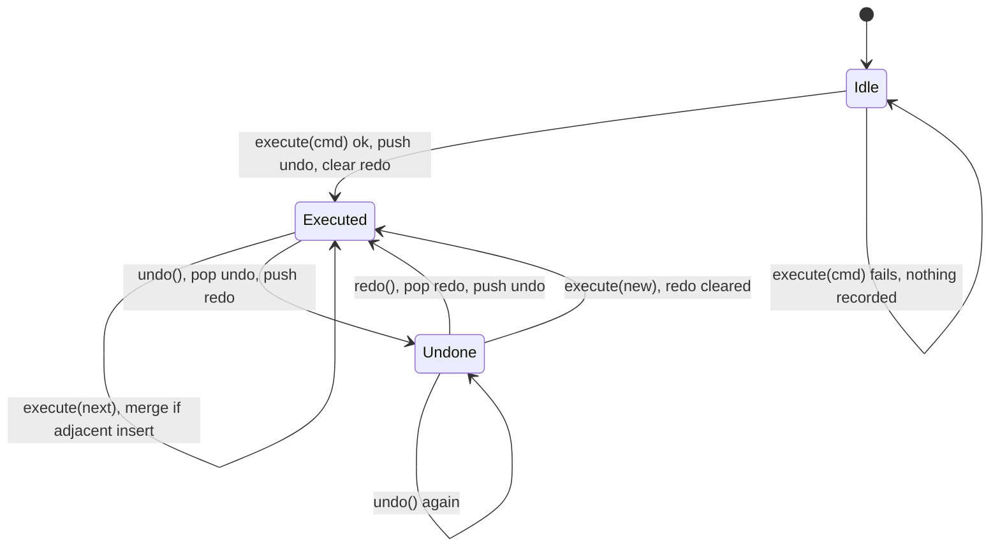

## In one minute
- A command turns a request ("insert `hi` at position 4", "refund order 81") into an object or value that can be stored, queued, logged, sent over a network, retried, undone and replayed. The code that triggers an action no longer has to be the code that performs it, or run at the same time.
- The classic interface is `execute()` plus, for undoable commands, `undo()`. An undo stack and a redo stack of commands give an editor its history; a queue of commands gives a job system its work.
- In most modern code a command is a plain function or closure (a Go `func()`, a JavaScript callback) or a serialisable record (`{"type": "refund", "order": 81}`) handled by a dispatcher. Choose the record form when commands must cross a process boundary or survive a restart.
- The costs are memory for history (every undoable command keeps what it needs to reverse itself) and correctness work: undo must be the exact inverse, and queued commands need idempotency because delivery is often at least once.
- Agents tend to implement undo by snapshotting the whole state on every action. That works in a demo and fails on a 20 MB document. Ask for inverse operations and a bounded history.

## How it works

### The problem
A browser-based text editor started with toolbar buttons and keyboard handlers that edit the document directly: the Bold button changes the selection, Backspace removes a character, Paste inserts a block. Then users ask for undo, a command palette, keyboard macros and collaborative editing. Each of these needs the same thing: to treat "what the user did" as data. Undo needs to know how to reverse the last action. The palette needs to list actions by name. Macros need to record a sequence and play it back. Collaboration needs to send actions to other clients.

The command pattern gives each action an object:

```python
class Insert:
    def __init__(self, pos, text):
        self.pos, self.text = pos, text

    def execute(self, doc):
        doc.text = doc.text[:self.pos] + self.text + doc.text[self.pos:]

    def undo(self, doc):
        doc.text = doc.text[:self.pos] + doc.text[self.pos + len(self.text):]
```

Buttons, keys and the palette now create commands and hand them to a `History` object, which executes them and keeps them on an undo stack. The invoker (button, shortcut, macro player) knows nothing about how editing works; the receiver (the document) knows nothing about buttons.

### The four roles
The Gang of Four name four participants. The *command* holds a request and its parameters. The *receiver* is the object that does the work (the document, the bank account). The *invoker* triggers commands and may store them (the toolbar, a scheduler, the history). The *client* creates commands and wires them to receivers. In practice the invoker is where the interesting behaviour lives: history, queueing, retrying, logging.

### Undo and redo
A linear history needs two stacks. Executing a command pushes it on the undo stack and clears the redo stack, because the redo entries were computed against a state that no longer exists. Undo pops a command, calls its `undo`, and pushes it on the redo stack. Redo does the reverse. Each command must store exactly the data it needs to reverse itself: `Insert` needs the position and text; `Delete` must save the text it removed when it executes, because the original command only knew a position and a length.

Two refinements matter in real editors. *Coalescing*: typing "hello" should be one undo step, not five, so consecutive adjacent inserts merge into one command. Emacs groups runs of typed characters this way, and ProseMirror's history starts a new group only when an edit is not adjacent to the previous one or arrives more than 500 ms later. *Bounding*: history is capped by count or bytes, dropping the oldest entries.

### Commands as values
When commands must outlive the process, they become records: a type name plus arguments, serialised as JSON or protobuf. Task queues store exactly that (a Celery task message carries the task name and its arguments), CQRS systems accept commands such as `PlaceOrder` that a handler validates and executes, VS Code registers every action under a string ID so menus, keybindings and extensions call `executeCommand("editor.action.formatDocument")`, and Redis's append-only file is a log of write commands replayed on restart. The task scheduler lesson stores actions this way, and the tic-tac-toe lesson uses moves as commands for undo; this lesson focuses on the inverse operations and history management those designs rely on.

### Command versus event
A command is a request that may be rejected ("reserve seat 14C"); an event is a fact that already happened ("seat 14C reserved"). Keeping the two apart makes logs honest: replaying events rebuilds state without rerunning validation, while replaying commands would rerun business rules that may have changed.

### Reviewing agent-written code
Asked to "add undo", an agent commonly deep-copies the whole document before each action and pushes the copy on a stack. Memory grows with document size times history length, and anything holding a reference to the old document breaks. Steer it to commands with inverses, a redo stack cleared on new commands, a bounded history, and tests that run `execute` then `undo` and compare with the original state. For queued commands, check that each carries an idempotency key and that handlers tolerate duplicates.

### The same shape elsewhere
Commands address the *ordering* and *multi-step consistency* shapes: once an action is a value, you can sequence it, log it before applying it, and compensate for it. A database's write-ahead log records changes before applying them, so it can redo them after a crash; a saga stores a compensating command for each step so it can undo a partly completed business transaction; Git commits are recorded changes that `git revert` inverts with a new commit.

## Down the stack

### Layer 1: The contract
An undoable command promises that `undo` applied immediately after `execute` restores the receiver to exactly the prior state, and that `execute` either fully applies or fails without changing anything (so a failed command is never recorded). A history promises linear semantics: undo reverses the most recent recorded command, redo is available only until a new command executes, and the history holds at most its configured limit. A queued command promises at-least-once or exactly-once delivery; at-least-once is far more common, so handlers must be idempotent, usually by deduplicating on a command ID.

### Layer 2: The mechanism
Emacs keeps undo information in `buffer-undo-list`, a list of entries such as `(BEG . END)` for inserted text and `(TEXT . POSITION)` for deleted text, separated by `nil` boundaries that mark where one command ends; undo walks back to the previous boundary and applies each inverse. ProseMirror represents edits as steps; each step can produce its inverse against the document it was applied to, and the history plugin stores inverted steps along with position maps so earlier entries can be rebased when collaborators change the document. Redis appends each write command to the AOF in the same RESP encoding clients send, and the `appendfsync` setting (`always`, `everysec` or `no`) decides how often the file is flushed with `fsync`. Go's `os/exec.Cmd` is a command in the literal sense: a struct describing a process to run, built first and started later with `Run` or `Start`.

### Layer 3: The machine
Each command is a heap allocation of a few dozen bytes plus its payload, and each `execute` is one indirect call: an itab lookup in Go, a vtable call in Java or C++, a prototype-chain lookup in JavaScript that V8's inline caches turn into a fixed offset when the call site sees few command classes. A Go closure used as a command allocates its captured variables once when it is created. None of that matters for user actions arriving at tens per second.

History memory does matter. A snapshot undo on a 20 MB document with a 500-step history needs up to 10 GB. Inverse commands store only what changed: an insert of 5 characters costs its position and those bytes, and a delete stores the removed text. Coalescing typed characters cuts entry counts by roughly an order of magnitude. String edits themselves can be the hidden cost: splicing a flat string is O(n) per edit, which is why editors store text as ropes or piece tables, where an insert touches O(log n) nodes and undo can reference unchanged pieces instead of copying them.

For concurrency, a single-consumer command queue is the simplest correct design: one goroutine or thread applies commands in order, so the receiver needs no locks, which is how Redis executes commands and how many actor systems work. Multiple producers enqueue through a channel or lock-free queue. When several users edit at once, commands must be transformed against each other (operational transformation) or replaced by CRDT operations, because an `Insert(pos=10)` means something different after another user's insert at position 3.

### Why it's built this way
1. Actions triggered in one place often need to run later, elsewhere, again or in reverse, so they must be data rather than direct calls.
2. Reversing an action needs information captured when it ran, so each command stores its own inverse data.
3. Snapshots cost memory proportional to the whole state, so storing inverses scales with the size of changes instead.
4. Redo entries depend on the state they were made against, so a new command must invalidate them.
5. Commands crossing processes can be delivered twice, so handlers deduplicate by ID rather than trusting the transport.

## Diagram


## Worked example
A web document editor holds documents up to 2 MB of text, and users make about 3 edit commands a second while typing. The first undo implementation snapshotted the whole document per keystroke with a 1,000-step history: up to 2 GB per open tab in the worst case and about 40 MB typically, and the browser killed tabs on low-memory phones.

The team replaced snapshots with `Insert` and `Delete` commands storing positions and changed text, and coalesced adjacent inserts. A typical 30-minute session of 5,400 keystrokes became about 600 history entries averaging 40 bytes of text plus around 60 bytes of object overhead, roughly 60 KB in total. A cap of 10,000 entries or 5 MB, whichever comes first, bounds the worst case.

The tests that caught the most bugs were property tests: generate a random document and a random sequence of valid commands, execute them all, undo them all, and compare with the original; then redo them all and compare with the final state. They found two bugs in the first week: `Delete` at the end of a document stored one character too few, and merging an insert after an undo corrupted the redo stack.

## Trade-offs
| Option | Strengths | Weaknesses | Choose when |
| --- | --- | --- | --- |
| Direct method calls | Simplest; no extra objects | No undo, queueing, logging or replay | Actions that never need any of those |
| Closures as commands | Concise; captures context | Not serialisable; inverse must be written by hand | In-process callbacks, retries, deferred work |
| Command objects with `undo` | Precise undo; small memory | Every command needs a correct inverse | Editors, design tools, admin consoles |
| Snapshot (memento) undo | Trivially correct | Memory scales with state size | Small state, or periodic checkpoints combined with commands |
| Serialisable command records | Queue, log, send and replay | Schema versioning; idempotency needed | Job queues, CQRS, replication, audit |

## Pitfalls in production
- Undo that is not an exact inverse, such as a delete that does not save what it removed. Fix: capture inverse data during `execute` and test execute then undo round trips with generated inputs.
- Redo stack left intact after a new command, so redo applies against the wrong state. Fix: clear redo on every new command.
- Unbounded history consuming memory in long sessions. Fix: cap by count and bytes, and coalesce small adjacent edits.
- Failed commands recorded in history, so undo reverses something that never happened. Fix: validate before mutating and record only after success.
- Queued commands executed twice after a redelivery, charging a card twice. Fix: give each command an ID and deduplicate in the handler.
- Serialised commands whose schema changes break replay of old logs. Fix: version command types and keep handlers for old versions until the log is compacted.

## Leadership lens
- Decide early whether actions need undo, audit or replay. Retrofitting commands into an app built on direct mutations touches every feature.
- Require an inverse and a round-trip test for every new undoable command; it is a cheap rule that prevents subtle data loss.
- For queued commands, make idempotency keys part of the API contract, not an implementation detail. Duplicate delivery is a normal operating condition.
- Keep commands and events distinct in logs and naming. Mixing them makes incident timelines and replays hard to trust.

## Check yourself
1. Why must executing a new command clear the redo stack?
   **Answer:** Redo entries were recorded against a state that the new command has changed, so reapplying them could corrupt the document or apply edits at wrong positions.
2. Why does a `Delete` command need to store data during `execute` that it was not constructed with?
   **Answer:** It is built with a position and length, but undo must reinsert the exact text removed, which is only known when it runs against the document.
3. When is snapshot undo better than inverse commands?
   **Answer:** When the state is small or inverses are hard to write correctly; many systems combine periodic snapshots with commands to bound replay time.
4. Why do queued command handlers need idempotency?
   **Answer:** Most queues deliver at least once, so a crash after executing but before acknowledging leads to redelivery; deduplicating by command ID makes the second execution harmless.

## Practice
**Task:** Implement undoable text editing. `Document` holds `text` (initially empty, or the given string). `Insert(pos, text)` inserts `text` at `pos`; it requires `0 <= pos <= len(doc)`. `Delete(pos, length)` removes `length` characters starting at `pos`; it requires `pos >= 0`, `length > 0` and `pos + length <= len(doc)`, and saves the removed text so it can restore it. Both fail with `out of range` without changing the document. `History(doc, limit)` has `execute(cmd)`, `undo()`, `redo()` and `seal()`. `execute` runs the command; if it fails, the error propagates and nothing is recorded. On success the redo stack is cleared, and the command is merged into the previous undo entry if both are inserts, the new insert starts exactly where the previous insert's text ends, and the previous history call was an `execute` (not an `undo`, `redo` or `seal`); otherwise it is pushed, and if the undo stack then holds more than `limit` entries the oldest is dropped. `undo` and `redo` return false when there is nothing to do. Python raises `ValueError`, TypeScript throws `Error`, Go returns an error.

```python starter
class Document:
    def __init__(self, text=""):
        self.text = text

class Insert:
    def __init__(self, pos, text):
        self.pos = pos
        self.text = text

    def execute(self, doc):
        # TODO
        raise NotImplementedError

    def undo(self, doc):
        # TODO
        raise NotImplementedError

class Delete:
    def __init__(self, pos, length):
        self.pos = pos
        self.length = length

    def execute(self, doc):
        # TODO
        raise NotImplementedError

    def undo(self, doc):
        # TODO
        raise NotImplementedError

class History:
    def __init__(self, doc, limit):
        self.doc = doc
        self.limit = limit

    def execute(self, cmd):
        # TODO
        raise NotImplementedError

    def undo(self):
        # TODO
        raise NotImplementedError

    def redo(self):
        # TODO
        raise NotImplementedError

    def seal(self):
        # TODO
        raise NotImplementedError
```

```python tests
def error_of(fn):
    try:
        fn()
    except ValueError as e:
        return str(e)
    return None

def test_undo_restores_each_step():
    d = Document("hello world")
    h = History(d, 100)
    h.execute(Delete(5, 6))
    h.execute(Insert(0, ">> "))
    assert d.text == ">> hello"
    assert h.undo() and d.text == "hello"
    assert h.undo() and d.text == "hello world"
    assert h.undo() is False

def test_redo_and_new_command_clears_redo():
    d = Document("abc")
    h = History(d, 100)
    h.execute(Delete(0, 1))
    h.undo()
    assert h.redo() and d.text == "bc"
    h.undo()
    h.execute(Insert(3, "!"))
    assert d.text == "abc!" and h.redo() is False

def test_invalid_commands_rejected_and_not_recorded():
    d = Document("abc")
    h = History(d, 100)
    assert error_of(lambda: h.execute(Insert(4, "x"))) == "out of range"
    assert error_of(lambda: h.execute(Delete(2, 2))) == "out of range"
    assert error_of(lambda: h.execute(Delete(0, 0))) == "out of range"
    assert error_of(lambda: h.execute(Insert(-1, "x"))) == "out of range"
    assert d.text == "abc" and h.undo() is False

def test_adjacent_inserts_merge_into_one_step():
    d = Document()
    h = History(d, 100)
    for i, ch in enumerate("hello"):
        h.execute(Insert(i, ch))
    assert d.text == "hello"
    assert h.undo() and d.text == ""
    assert h.redo() and d.text == "hello"

def test_merge_breaks_on_gap_seal_and_undo():
    d = Document()
    h = History(d, 100)
    h.execute(Insert(0, "ab"))
    h.execute(Insert(0, "X"))
    h.seal()
    h.execute(Insert(3, "c"))
    assert d.text == "Xabc"
    h.undo()
    assert d.text == "Xab"
    h.undo()
    h.execute(Insert(2, "z"))
    h.execute(Insert(3, "y"))
    assert d.text == "abzy"
    h.undo()
    assert d.text == "ab"

def test_merge_only_after_execute():
    d = Document()
    h = History(d, 100)
    h.execute(Insert(0, "a"))
    h.execute(Delete(0, 1))
    h.undo()
    h.execute(Insert(1, "b"))
    assert d.text == "ab"
    h.undo()
    assert d.text == "a"

def test_limit_drops_oldest():
    d = Document("0")
    h = History(d, 2)
    h.execute(Insert(0, "a"))
    h.execute(Insert(0, "b"))
    h.execute(Insert(0, "c"))
    assert d.text == "cba0"
    assert h.undo() and h.undo() and h.undo() is False
    assert d.text == "a0"
```

```python solution
class Document:
    def __init__(self, text=""):
        self.text = text

class Insert:
    def __init__(self, pos, text):
        self.pos = pos
        self.text = text

    def execute(self, doc):
        if self.pos < 0 or self.pos > len(doc.text):
            raise ValueError("out of range")
        doc.text = doc.text[:self.pos] + self.text + doc.text[self.pos:]

    def undo(self, doc):
        doc.text = doc.text[:self.pos] + doc.text[self.pos + len(self.text):]

class Delete:
    def __init__(self, pos, length):
        self.pos = pos
        self.length = length
        self.removed = ""

    def execute(self, doc):
        if self.pos < 0 or self.length <= 0 or self.pos + self.length > len(doc.text):
            raise ValueError("out of range")
        self.removed = doc.text[self.pos:self.pos + self.length]
        doc.text = doc.text[:self.pos] + doc.text[self.pos + self.length:]

    def undo(self, doc):
        doc.text = doc.text[:self.pos] + self.removed + doc.text[self.pos:]

class History:
    def __init__(self, doc, limit):
        self.doc = doc
        self.limit = limit
        self.undo_stack = []
        self.redo_stack = []
        self.can_merge = False

    def execute(self, cmd):
        cmd.execute(self.doc)
        self.redo_stack = []
        top = self.undo_stack[-1] if self.undo_stack else None
        if (self.can_merge and isinstance(cmd, Insert) and isinstance(top, Insert)
                and cmd.pos == top.pos + len(top.text)):
            top.text += cmd.text
        else:
            self.undo_stack.append(cmd)
            if len(self.undo_stack) > self.limit:
                self.undo_stack.pop(0)
        self.can_merge = True

    def undo(self):
        self.can_merge = False
        if not self.undo_stack:
            return False
        cmd = self.undo_stack.pop()
        cmd.undo(self.doc)
        self.redo_stack.append(cmd)
        return True

    def redo(self):
        self.can_merge = False
        if not self.redo_stack:
            return False
        cmd = self.redo_stack.pop()
        cmd.execute(self.doc)
        self.undo_stack.append(cmd)
        return True

    def seal(self):
        self.can_merge = False
```

```typescript starter
export class Document {
  constructor(public text: string = "") {}
}

export interface Command {
  execute(doc: Document): void;
  undo(doc: Document): void;
}

export class Insert implements Command {
  constructor(public pos: number, public text: string) {}
  execute(doc: Document): void { throw new Error("TODO"); }
  undo(doc: Document): void { throw new Error("TODO"); }
}

export class Delete implements Command {
  constructor(public pos: number, public length: number) {}
  execute(doc: Document): void { throw new Error("TODO"); }
  undo(doc: Document): void { throw new Error("TODO"); }
}

export class History {
  constructor(private doc: Document, private limit: number) {}
  execute(cmd: Command): void { throw new Error("TODO"); }
  undo(): boolean { throw new Error("TODO"); }
  redo(): boolean { throw new Error("TODO"); }
  seal(): void { throw new Error("TODO"); }
}
```

```typescript tests
function errorOf(fn: () => unknown): string | undefined {
  try { fn(); } catch (e) { return (e as Error).message; }
  return undefined;
}

test("undo restores each step", () => {
  const d = new Document("hello world");
  const h = new History(d, 100);
  h.execute(new Delete(5, 6));
  h.execute(new Insert(0, ">> "));
  assertEqual(d.text, ">> hello");
  assert(h.undo() && d.text === "hello", "first undo");
  assert(h.undo() && d.text === "hello world", "second undo");
  assertEqual(h.undo(), false);
});

test("redo and new command clears redo", () => {
  const d = new Document("abc");
  const h = new History(d, 100);
  h.execute(new Delete(0, 1));
  h.undo();
  assert(h.redo() && d.text === "bc", "redo");
  h.undo();
  h.execute(new Insert(3, "!"));
  assertEqual(d.text, "abc!");
  assertEqual(h.redo(), false);
});

test("invalid commands rejected and not recorded", () => {
  const d = new Document("abc");
  const h = new History(d, 100);
  assertEqual(errorOf(() => h.execute(new Insert(4, "x"))), "out of range");
  assertEqual(errorOf(() => h.execute(new Delete(2, 2))), "out of range");
  assertEqual(errorOf(() => h.execute(new Delete(0, 0))), "out of range");
  assertEqual(errorOf(() => h.execute(new Insert(-1, "x"))), "out of range");
  assertEqual(d.text, "abc");
  assertEqual(h.undo(), false);
});

test("adjacent inserts merge into one step", () => {
  const d = new Document();
  const h = new History(d, 100);
  "hello".split("").forEach((ch, i) => h.execute(new Insert(i, ch)));
  assertEqual(d.text, "hello");
  assert(h.undo() && d.text === "", "one undo clears the word");
  assert(h.redo() && d.text === "hello", "redo restores the word");
});

test("merge breaks on gap seal and undo", () => {
  const d = new Document();
  const h = new History(d, 100);
  h.execute(new Insert(0, "ab"));
  h.execute(new Insert(0, "X"));
  h.seal();
  h.execute(new Insert(3, "c"));
  assertEqual(d.text, "Xabc");
  h.undo();
  assertEqual(d.text, "Xab");
  h.undo();
  h.execute(new Insert(2, "z"));
  h.execute(new Insert(3, "y"));
  assertEqual(d.text, "abzy");
  h.undo();
  assertEqual(d.text, "ab");
});

test("merge only after execute", () => {
  const d = new Document();
  const h = new History(d, 100);
  h.execute(new Insert(0, "a"));
  h.execute(new Delete(0, 1));
  h.undo();
  h.execute(new Insert(1, "b"));
  assertEqual(d.text, "ab");
  h.undo();
  assertEqual(d.text, "a");
});

test("limit drops oldest", () => {
  const d = new Document("0");
  const h = new History(d, 2);
  h.execute(new Insert(0, "a"));
  h.execute(new Insert(0, "b"));
  h.execute(new Insert(0, "c"));
  assertEqual(d.text, "cba0");
  assert(h.undo() && h.undo(), "two undos");
  assertEqual(h.undo(), false);
  assertEqual(d.text, "a0");
});
```

```typescript solution
export class Document {
  constructor(public text: string = "") {}
}

export interface Command {
  execute(doc: Document): void;
  undo(doc: Document): void;
}

export class Insert implements Command {
  constructor(public pos: number, public text: string) {}
  execute(doc: Document): void {
    if (this.pos < 0 || this.pos > doc.text.length) throw new Error("out of range");
    doc.text = doc.text.slice(0, this.pos) + this.text + doc.text.slice(this.pos);
  }
  undo(doc: Document): void {
    doc.text = doc.text.slice(0, this.pos) + doc.text.slice(this.pos + this.text.length);
  }
}

export class Delete implements Command {
  private removed = "";
  constructor(public pos: number, public length: number) {}
  execute(doc: Document): void {
    if (this.pos < 0 || this.length <= 0 || this.pos + this.length > doc.text.length) {
      throw new Error("out of range");
    }
    this.removed = doc.text.slice(this.pos, this.pos + this.length);
    doc.text = doc.text.slice(0, this.pos) + doc.text.slice(this.pos + this.length);
  }
  undo(doc: Document): void {
    doc.text = doc.text.slice(0, this.pos) + this.removed + doc.text.slice(this.pos);
  }
}

export class History {
  private undoStack: Command[] = [];
  private redoStack: Command[] = [];
  private canMerge = false;

  constructor(private doc: Document, private limit: number) {}

  execute(cmd: Command): void {
    cmd.execute(this.doc);
    this.redoStack = [];
    const top = this.undoStack[this.undoStack.length - 1];
    if (this.canMerge && cmd instanceof Insert && top instanceof Insert && cmd.pos === top.pos + top.text.length) {
      top.text += cmd.text;
    } else {
      this.undoStack.push(cmd);
      if (this.undoStack.length > this.limit) this.undoStack.shift();
    }
    this.canMerge = true;
  }

  undo(): boolean {
    this.canMerge = false;
    const cmd = this.undoStack.pop();
    if (!cmd) return false;
    cmd.undo(this.doc);
    this.redoStack.push(cmd);
    return true;
  }

  redo(): boolean {
    this.canMerge = false;
    const cmd = this.redoStack.pop();
    if (!cmd) return false;
    cmd.execute(this.doc);
    this.undoStack.push(cmd);
    return true;
  }

  seal(): void {
    this.canMerge = false;
  }
}
```

```go starter
package practice

type Document struct {
	Text string
}

type Command interface {
	Execute(doc *Document) error
	Undo(doc *Document)
}

type Insert struct {
	Pos  int
	Text string
}

func (c *Insert) Execute(doc *Document) error { panic("TODO") }
func (c *Insert) Undo(doc *Document)          { panic("TODO") }

type Delete struct {
	Pos, Length int
}

func (c *Delete) Execute(doc *Document) error { panic("TODO") }
func (c *Delete) Undo(doc *Document)          { panic("TODO") }

type History struct {
	doc   *Document
	limit int
}

func NewHistory(doc *Document, limit int) *History { return &History{doc: doc, limit: limit} }

func (h *History) Execute(cmd Command) error { panic("TODO") }
func (h *History) Undo() bool                { panic("TODO") }
func (h *History) Redo() bool                { panic("TODO") }
func (h *History) Seal()                     { panic("TODO") }
```

```go tests
package practice

import "testing"

func errText(err error) string {
	if err == nil {
		return ""
	}
	return err.Error()
}

func TestUndoRestoresEachStep(t *testing.T) {
	d := &Document{Text: "hello world"}
	h := NewHistory(d, 100)
	h.Execute(&Delete{Pos: 5, Length: 6})
	h.Execute(&Insert{Pos: 0, Text: ">> "})
	if d.Text != ">> hello" {
		t.Fatalf("got %q", d.Text)
	}
	if !h.Undo() || d.Text != "hello" {
		t.Fatalf("first undo: %q", d.Text)
	}
	if !h.Undo() || d.Text != "hello world" {
		t.Fatalf("second undo: %q", d.Text)
	}
	if h.Undo() {
		t.Fatal("nothing left to undo")
	}
}

func TestRedoAndNewCommandClearsRedo(t *testing.T) {
	d := &Document{Text: "abc"}
	h := NewHistory(d, 100)
	h.Execute(&Delete{Pos: 0, Length: 1})
	h.Undo()
	if !h.Redo() || d.Text != "bc" {
		t.Fatalf("redo: %q", d.Text)
	}
	h.Undo()
	h.Execute(&Insert{Pos: 3, Text: "!"})
	if d.Text != "abc!" || h.Redo() {
		t.Fatalf("got %q, redo should be empty", d.Text)
	}
}

func TestInvalidCommandsRejectedAndNotRecorded(t *testing.T) {
	d := &Document{Text: "abc"}
	h := NewHistory(d, 100)
	cmds := []Command{
		&Insert{Pos: 4, Text: "x"},
		&Delete{Pos: 2, Length: 2},
		&Delete{Pos: 0, Length: 0},
		&Insert{Pos: -1, Text: "x"},
	}
	for _, c := range cmds {
		if got := errText(h.Execute(c)); got != "out of range" {
			t.Errorf("%#v: got %q", c, got)
		}
	}
	if d.Text != "abc" || h.Undo() {
		t.Fatalf("got %q", d.Text)
	}
}

func TestAdjacentInsertsMergeIntoOneStep(t *testing.T) {
	d := &Document{}
	h := NewHistory(d, 100)
	for i, ch := range "hello" {
		h.Execute(&Insert{Pos: i, Text: string(ch)})
	}
	if d.Text != "hello" {
		t.Fatalf("got %q", d.Text)
	}
	if !h.Undo() || d.Text != "" {
		t.Fatalf("undo: %q", d.Text)
	}
	if !h.Redo() || d.Text != "hello" {
		t.Fatalf("redo: %q", d.Text)
	}
}

func TestMergeBreaksOnGapSealAndUndo(t *testing.T) {
	d := &Document{}
	h := NewHistory(d, 100)
	h.Execute(&Insert{Pos: 0, Text: "ab"})
	h.Execute(&Insert{Pos: 0, Text: "X"})
	h.Seal()
	h.Execute(&Insert{Pos: 3, Text: "c"})
	if d.Text != "Xabc" {
		t.Fatalf("got %q", d.Text)
	}
	h.Undo()
	if d.Text != "Xab" {
		t.Fatalf("after seal undo: %q", d.Text)
	}
	h.Undo()
	h.Execute(&Insert{Pos: 2, Text: "z"})
	h.Execute(&Insert{Pos: 3, Text: "y"})
	if d.Text != "abzy" {
		t.Fatalf("got %q", d.Text)
	}
	h.Undo()
	if d.Text != "ab" {
		t.Fatalf("merged undo: %q", d.Text)
	}
}

func TestMergeOnlyAfterExecute(t *testing.T) {
	d := &Document{}
	h := NewHistory(d, 100)
	h.Execute(&Insert{Pos: 0, Text: "a"})
	h.Execute(&Delete{Pos: 0, Length: 1})
	h.Undo()
	h.Execute(&Insert{Pos: 1, Text: "b"})
	if d.Text != "ab" {
		t.Fatalf("got %q", d.Text)
	}
	h.Undo()
	if d.Text != "a" {
		t.Fatalf("undo: %q", d.Text)
	}
}

func TestLimitDropsOldest(t *testing.T) {
	d := &Document{Text: "0"}
	h := NewHistory(d, 2)
	h.Execute(&Insert{Pos: 0, Text: "a"})
	h.Execute(&Insert{Pos: 0, Text: "b"})
	h.Execute(&Insert{Pos: 0, Text: "c"})
	if d.Text != "cba0" {
		t.Fatalf("got %q", d.Text)
	}
	if !h.Undo() || !h.Undo() || h.Undo() {
		t.Fatal("expected exactly two undo steps")
	}
	if d.Text != "a0" {
		t.Fatalf("got %q", d.Text)
	}
}
```

```go solution
package practice

import "errors"

var errRange = errors.New("out of range")

type Document struct {
	Text string
}

type Command interface {
	Execute(doc *Document) error
	Undo(doc *Document)
}

type Insert struct {
	Pos  int
	Text string
}

func (c *Insert) Execute(doc *Document) error {
	if c.Pos < 0 || c.Pos > len(doc.Text) {
		return errRange
	}
	doc.Text = doc.Text[:c.Pos] + c.Text + doc.Text[c.Pos:]
	return nil
}

func (c *Insert) Undo(doc *Document) {
	doc.Text = doc.Text[:c.Pos] + doc.Text[c.Pos+len(c.Text):]
}

type Delete struct {
	Pos, Length int
	removed     string
}

func (c *Delete) Execute(doc *Document) error {
	if c.Pos < 0 || c.Length <= 0 || c.Pos+c.Length > len(doc.Text) {
		return errRange
	}
	c.removed = doc.Text[c.Pos : c.Pos+c.Length]
	doc.Text = doc.Text[:c.Pos] + doc.Text[c.Pos+c.Length:]
	return nil
}

func (c *Delete) Undo(doc *Document) {
	doc.Text = doc.Text[:c.Pos] + c.removed + doc.Text[c.Pos:]
}

type History struct {
	doc      *Document
	limit    int
	undo     []Command
	redo     []Command
	canMerge bool
}

func NewHistory(doc *Document, limit int) *History { return &History{doc: doc, limit: limit} }

func (h *History) Execute(cmd Command) error {
	if err := cmd.Execute(h.doc); err != nil {
		return err
	}
	h.redo = nil
	next, isInsert := cmd.(*Insert)
	var top *Insert
	if n := len(h.undo); n > 0 {
		top, _ = h.undo[n-1].(*Insert)
	}
	if h.canMerge && isInsert && top != nil && next.Pos == top.Pos+len(top.Text) {
		top.Text += next.Text
	} else {
		h.undo = append(h.undo, cmd)
		if len(h.undo) > h.limit {
			h.undo = h.undo[1:]
		}
	}
	h.canMerge = true
	return nil
}

func (h *History) Undo() bool {
	h.canMerge = false
	n := len(h.undo)
	if n == 0 {
		return false
	}
	cmd := h.undo[n-1]
	h.undo = h.undo[:n-1]
	cmd.Undo(h.doc)
	h.redo = append(h.redo, cmd)
	return true
}

func (h *History) Redo() bool {
	h.canMerge = false
	n := len(h.redo)
	if n == 0 {
		return false
	}
	cmd := h.redo[n-1]
	h.redo = h.redo[:n-1]
	cmd.Execute(h.doc)
	h.undo = append(h.undo, cmd)
	return true
}

func (h *History) Seal() { h.canMerge = false }
```

## Mock interview
**Prompt:** Design undo and redo for a collaborative whiteboard used by teams of up to 50 people, with boards holding around 20,000 shapes. Each user should be able to undo their own changes, and the board must survive a server restart without losing the last few seconds of edits.

- Follow-up: Alice moves a shape, then Bob deletes it. What does Alice's undo do?
- Follow-up: How do you bound memory for history on a board that is edited all day?
- Follow-up: Would you persist commands, events or snapshots, and how do you recover after a crash?

**A strong answer covers:**
- Edits as commands with inverses (create, delete, move, restyle), each carrying a shape ID, user ID and command ID, applied in order by a single writer per board.
- Per-user undo stacks of inverse operations that are checked against current state: if the target shape no longer exists or was changed by someone else, the undo is skipped or transformed, with a clear rule.
- Coalescing (a drag becomes one move), caps by count and bytes, and dropping old history when it scrolls out.
- Durability through an append-only log of accepted operations, with periodic snapshots so recovery replays only the tail, and idempotent application by command ID for replays and retries.
- Trade-offs: operational transformation versus CRDT shapes, snapshot frequency against recovery time, and why the log stores accepted events rather than raw requests.

## Watch
- [Command Pattern (Christopher Okhravi)](https://www.youtube.com/watch?v=9qA5kw8dcSU): invoker, receiver and command worked through, including undo.
- [10 Design Patterns Explained in 10 Minutes (Fireship)](https://www.youtube.com/watch?v=tv-_1er1mWI): command alongside the other behavioural patterns, in JavaScript.

## Free resources
- [Undo (GNU Emacs Lisp Reference Manual)](https://www.gnu.org/software/emacs/manual/html_node/elisp/Undo.html): the entry types and boundaries of a real undo list.
- [prosemirror-history (GitHub)](https://github.com/ProseMirror/prosemirror-history): an editor history built from inverted steps, with grouping by adjacency and time.
- [Implementing Undo History (Redux docs)](https://redux.js.org/usage/implementing-undo-history): past, present and future stacks in a state-container setting.
- [Redis persistence (Redis docs)](https://redis.io/docs/latest/operate/oss_and_stack/management/persistence/): the append-only file as a durable log of commands.
- [CQRS (Martin Fowler)](https://martinfowler.com/bliki/CQRS.html): commands as first-class messages in application architecture, and when that is overkill.
- [Command pattern (Refactoring Guru)](https://refactoring.guru/design-patterns/command): the four roles with diagrams and examples.
