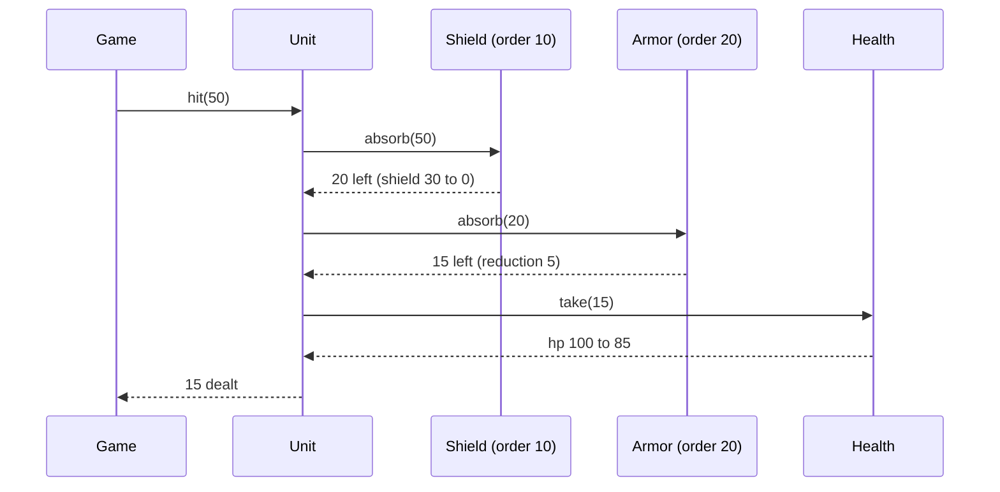

## In one minute
- The principle, from the Gang of Four book in 1994: favour object composition over class inheritance. Build behaviour by giving an object collaborators that it calls through their interfaces, rather than by extending a class and overriding parts of it.
- Inheritance is white-box reuse: the subclass sees, and comes to depend on, how the parent works inside. Composition is black-box reuse: the outer object depends only on the published contract of its parts, so either side can change its internals safely.
- Composition handles combinations. Three independent features done by inheritance need up to eight subclasses; done by composition they need three small parts that can be attached in any mix, and changed at runtime.
- The costs are forwarding code, an extra object and pointer per part, and the "self problem": a wrapped object hands out references to itself, not to its wrapper. Language features (Go embedding, Kotlin `by`) remove most of the boilerplate.
- Agents, asked for "a unit that also has armour", tend to add a subclass. In review, ask whether the new behaviour is a kind of thing (inheritance may be fine) or a feature some things have (compose it).

## How it works

### The problem
A strategy game has units. The first design is a hierarchy: `Unit`, then `ArmoredUnit(Unit)`, then `ShieldedUnit(Unit)`. Design asks for a unit with both, so someone adds `ArmoredShieldedUnit(ArmoredUnit)` and copies the shield logic into it. Then come units that are vulnerable to fire, units that gain a shield from a spell for ten turns, and a boss whose armour breaks at half health. Each independent feature doubles the number of possible classes, and a spell that grants a shield mid-game cannot change the class of an existing object at all.

The features are not kinds of unit. They are things a unit has. That is the clue to compose.

### The composed design
A unit owns its health and holds a list of damage modifiers. Each modifier implements one small interface:

```python
class Shield:
    kind, order = "shield", 10
    def __init__(self, points): self.points = points
    def absorb(self, amount):
        taken = min(self.points, amount)
        self.points -= taken
        return amount - taken

class Unit:
    def hit(self, amount):
        for m in sorted_by_order(self.modifiers):
            amount = m.absorb(amount)
        return self.health.take(amount)
```

A shield spell is `unit.attach(Shield(30))` and its expiry is `unit.detach("shield")`. A fire vulnerability is a new class with an `absorb` that doubles damage; `Unit` does not change. Every combination exists automatically because combinations are made at runtime, not declared as classes. This is the [Strategy](strategy.md) idea applied to several collaborators at once, and the same structure that [Decorator](decorator.md) uses when the parts wrap each other instead of sitting in a list.

### Why inheritance breaks under change
A subclass depends on more than its parent's public methods. It depends on which of the parent's methods call which others, in what order, and with what state. The [Inheritance](inheritance.md) lesson calls this the fragile base class problem and shows a store whose subclass silently stopped auditing bulk writes after the parent was optimised. Composition avoids it because the outer object only calls the part's public methods. When the part's author changes how `absorb` works inside, nothing outside notices, as long as the contract holds.

Inheritance also fixes the relationship at compile time. An object cannot become an `ArmoredUnit` after construction, but it can gain an `Armor` part.

### Delegation and forwarding
Composition usually needs some methods of the part to appear on the whole. There are three ways:

- **Explicit forwarding.** Write `def size(self): return self.inner.size()` for each method. Clear and greppable, but tedious for wide interfaces.
- **Language support.** Kotlin's `class Logged(inner: Store) : Store by inner` generates every forwarding method at compile time, and you override the ones you need. Go's struct embedding promotes the embedded type's methods to the outer type. Neither gives the inner object a way to call back into the outer one, which is exactly what stops the fragile base class problem.
- **Dynamic forwarding.** Python's `__getattr__` is called only when normal attribute lookup fails, so a wrapper can forward everything it does not define. It is short, but it hides the interface from type checkers and readers.

Strictly, "delegation" in the original object-oriented literature meant forwarding where `self` stays bound to the original receiver, as in prototype-based languages. In everyday use the two words mean the same thing, and the distinction matters only when you hit the self problem.

### The self problem
A wrapped object does not know about its wrapper. If a `Shield` registers itself with an event bus as `bus.subscribe(self)`, the bus holds the inner object, and any behaviour the wrapper adds is skipped for callbacks. The fix is to pass the outer object explicitly (`attach(owner)`) or to have the whole register callbacks on behalf of its parts.

### When inheritance is still right
- **True subtypes with a stable contract.** A `TcpConnection` really is a `Connection`, and the [Liskov substitution principle](lsp.md) holds.
- **Framework extension points.** A framework that owns an algorithm and asks you to fill in one step (the [Template Method](template-method.md) shape) is designed for subclassing; its authors promise which hooks exist.
- **Closed families of data.** A sealed set of variants such as `Circle | Square` in an algebraic data type, where the compiler checks exhaustiveness.

Implementing an interface is not the problem. Inheriting implementation from a concrete class you do not own is.

### Reviewing agent-written code
Agents mirror the codebase they see, and a codebase with a deep hierarchy gets another level. Look for subclasses whose names combine features (`CachedRetryingClient`, `AdminReadOnlyUser`), subclasses that override a method only to call `super()` and add one line, and `isinstance` checks against feature subclasses. Steer toward a part with an interface, attached at construction or at runtime, and a test that attaches the parts in more than one combination.

### The same shape elsewhere
Composing features from parts is the answer to combinatorial explosion wherever it shows up. Game engines such as Unity attach components (renderer, collider, script) to game objects instead of subclassing them. Linux builds a network path from netfilter hooks and qdiscs chained per interface. Kubernetes pods compose containers (an app plus a sidecar proxy) rather than baking the proxy into each image. Unix pipelines compose small programs. In each case independent features combine at deployment or runtime, not in a class declaration.

## Down the stack

### Layer 1: The contract
A composed object promises what its own interface says and nothing about its parts' internals. Each part promises its own interface contract, for example that `absorb(amount)` returns a value between 0 and some bound and never makes health negative. The whole promises a defined order for consulting its parts, because order changes results: a shield before flat armour absorbs differently from armour before a shield. Attaching, detaching and duplicate handling are part of the contract too, and should fail loudly, not silently replace a part.

### Layer 2: The mechanism
In Go, `type Logged struct { Store; count int }` embeds an interface value; the compiler generates wrapper methods on `Logged` that load the embedded interface and call through it. A method `Logged.Put` that you write takes precedence, and calls from inside the inner store go to the inner store's methods, never to `Logged`'s. Kotlin's `by` emits real forwarding methods into the class file, one per interface method. Python looks up `obj.size` through the type's MRO and the instance dictionary, and only on failure calls `__getattr__`, so dynamic forwarding pays for a failed lookup on every call. Rust has no implementation inheritance at all: a struct holds other structs and implements traits, and default trait methods are the only shared implementation.

Game engines take composition furthest. An entity-component-system stores each component type in its own dense array, and an entity is just an index. Systems iterate the arrays of the components they need. Bevy, for example, stores components in tables keyed by the set of component types an entity has.

### Layer 3: The machine
Composition by reference costs memory and a pointer chase. In Java every part is a separate heap object with a 12 to 16 byte header plus a 4 or 8 byte reference in the owner. If the part is not in cache, following the reference is a main memory access of about 80 to 100 ns, against about 1 ns for an L1 hit. Go can embed a struct by value, which lays its fields inline in the owner with no header and no pointer, so composition by value costs nothing in memory over inheritance.

Dispatch is cheap where it is predictable. A forwarding call through a Go interface is an indirect call through the itab, about 1 to 2 ns when predicted. HotSpot inlines a forwarding method at a monomorphic call site, so the wrapper often disappears after JIT. In CPython, each extra hop costs a method lookup and a frame, tens of nanoseconds, and a `__getattr__` forward costs more. At a few calls per request none of this matters. In an inner loop over a million objects it does, which is why game engines store components in contiguous arrays: iterating 64-byte cache lines of packed health values is many times faster than following a pointer from each unit object.

### Why it's built this way
1. Features vary independently, and declaring a class per combination grows exponentially.
2. Subclasses depend on their parent's internal self-calls, so parent changes break them; depending only on a public interface avoids that.
3. Some behaviour must change after construction (a spell, a feature flag), and only a held reference can be swapped at runtime.
4. Forwarding has a code cost, so languages added embedding and `by` delegation to generate it.
5. Separate part objects cost pointers and cache misses, so performance-critical systems compose by value or store parts in dense arrays.

## Diagram


## Worked example
A mobile strategy game had 46 unit classes, most of them combinations: `ArmoredHealer`, `ShieldedArcher`, `FlyingShieldedArcher`. A designer's request for "any unit can be frozen for two turns" was estimated at three weeks because freezing touched `take_damage` and `move` in 19 classes that overrode them differently.

The rewrite gave every unit a `Health`, a movement part and a list of modifiers ordered by an integer priority. The 46 classes became 9 base unit types plus 14 modifier classes. Freeze became one modifier with an `order` of 0 that zeroes movement and has a turn counter; it shipped in two days. Balance designers began tuning combinations in data files, since attaching parts needed no code.

Performance was checked on the worst case, a 400-unit battle. Each hit walks about three modifiers through an interface; at 2,000 hits per turn that is 6,000 indirect calls, roughly 10 microseconds per turn on a mid-range phone, against a 16 ms frame budget. The one regression was memory churn: each spell allocated a new shield object, and the garbage collector paused for 4 ms during large battles. Pooling shield objects per unit removed the pauses.

## Trade-offs
| Option | Strengths | Weaknesses | Choose when |
| --- | --- | --- | --- |
| Implementation inheritance | Little code; natural for true subtypes | Fragile to parent changes; fixed at compile time; combination explosion | Stable is-a hierarchies and framework hooks |
| Composition with explicit forwarding | Black-box reuse; parts swappable at runtime | Boilerplate; self problem | Most application code |
| Language-assisted delegation (Go embedding, Kotlin `by`) | Forwarding generated; no open recursion | Promoted methods can surprise readers | Wrappers over wide interfaces |
| Mixins or traits with implementation | Reuse across unrelated classes | Ordering and name clashes (MRO) | Small orthogonal helpers |
| Data-oriented components (ECS) | Cache-friendly; trivially combinable | Logic spread across systems; harder to follow | Simulations and games with many entities |

## Pitfalls in production
- Swapping inheritance for composition but leaving `isinstance` checks against concrete parts in callers. Fix: add the needed capability to the part's interface.
- Order of parts left implicit (insertion order of a dictionary), so a refactor changes results. Fix: give parts an explicit order and test combinations.
- Attaching the same kind of part twice by accident, doubling an effect. Fix: reject duplicates by kind, or make stacking an explicit rule.
- The self problem in callback-heavy code, so wrapper behaviour is skipped for events. Fix: register the outer object, or route callbacks through the whole.
- Dynamic forwarding (`__getattr__`, JavaScript `Proxy`) hiding the real interface from type checkers and IDEs. Fix: forward explicitly, or declare the interface the wrapper implements.
- Allocating new part objects in hot loops. Fix: reuse parts, embed by value, or store them in arrays.

## Leadership lens
- When a backlog item is estimated in weeks because it touches many subclasses, the hierarchy is the cost. Budget the move to composed parts as the enabler for that item, with the next three feature requests as the payoff.
- Ask in design review: "is this a kind of thing, or a feature some things have?" It settles most inheritance debates in one sentence.
- Composition moves combinations into data and configuration. That shifts work from engineers to designers or operators, which is usually the goal, but it needs validation and tests on the data.
- Agents extend whatever hierarchy they find. A short rule in the repo's agent instructions ("new behaviour is a part, not a subclass") prevents the next three levels.

## Check yourself
1. Why can a Go type that embeds another not suffer the fragile base class problem?
   **Answer:** The embedded value's own method calls always go to its own methods, never to the outer type's, so the outer type depends only on the inner type's public behaviour.
2. Three independent features are each optional. How many classes does inheritance need to cover every combination, and how many parts does composition need?
   **Answer:** Up to eight classes (two to the power of three) against three parts that can be attached in any mix.
3. A wrapper adds audit logging, but events delivered to the wrapped object are not audited. What happened?
   **Answer:** The self problem: the inner object registered itself, not the wrapper, so callbacks bypass the wrapper. Register the outer object or route events through it.
4. When is subclassing the better choice?
   **Answer:** For true subtypes that honour the parent's contract, and for framework hooks designed to be overridden, where the parent's authors promise which methods call which.

## Practice
**Task:** Build a game unit whose damage handling is composed from parts. `Unit(name, max_hp)` owns a health value starting at `max_hp`. A modifier has a `kind`, an integer `order` and `absorb(amount)`, which returns the damage left over. `Shield(points)` (kind `shield`, order 10) absorbs up to its remaining points and loses what it absorbs. `Armor(reduction)` (kind `armor`, order 20) passes on `max(0, amount - reduction)`. `attach(modifier)` fails with `duplicate component: <kind>`; `detach(kind)` fails with `no component: <kind>`. `hit(amount)` fails with `bad damage: <amount>` if negative; otherwise it passes the amount through attached modifiers in ascending `order` (ties in attach order), subtracts the rest from health (not below 0) and returns the damage actually taken from health. `heal(n)` raises health up to `max_hp`; `hp()` and `alive()` report state. Python raises `ValueError`, TypeScript throws `Error`, Go returns an error.

```python starter
class Shield:
    kind, order = "shield", 10
    def __init__(self, points):
        self.points = points
    def absorb(self, amount):
        # TODO
        raise NotImplementedError

class Armor:
    kind, order = "armor", 20
    def __init__(self, reduction):
        self.reduction = reduction
    def absorb(self, amount):
        # TODO
        raise NotImplementedError

class Unit:
    def __init__(self, name, max_hp):
        self.name = name
        self.max_hp = max_hp

    def attach(self, modifier):
        raise NotImplementedError

    def detach(self, kind):
        raise NotImplementedError

    def hit(self, amount):
        raise NotImplementedError

    def heal(self, n):
        raise NotImplementedError

    def hp(self):
        raise NotImplementedError

    def alive(self):
        raise NotImplementedError
```

```python tests
def error_of(fn):
    try:
        fn()
    except ValueError as e:
        return str(e)
    return None

class Vulnerable:
    kind, order = "vulnerable", 5
    def absorb(self, amount):
        return amount * 2

def test_plain_unit_takes_full_damage():
    u = Unit("scout", 100)
    assert u.hit(30) == 30 and u.hp() == 70 and u.alive()

def test_shield_then_armor_in_order():
    u = Unit("knight", 100)
    u.attach(Armor(5))
    s = Shield(30)
    u.attach(s)
    assert u.hit(50) == 15, "shield takes 30, armor removes 5"
    assert s.points == 0 and u.hp() == 85
    assert u.hit(4) == 0 and u.hp() == 85

def test_custom_part_plugs_in_without_changing_unit():
    u = Unit("ogre", 100)
    u.attach(Armor(10))
    u.attach(Vulnerable())
    assert u.hit(20) == 30, "doubled to 40 first, then armor"

def test_attach_and_detach_at_runtime():
    u = Unit("mage", 50)
    u.attach(Shield(10))
    assert error_of(lambda: u.attach(Shield(99))) == "duplicate component: shield"
    u.detach("shield")
    assert error_of(lambda: u.detach("shield")) == "no component: shield"
    assert u.hit(10) == 10 and u.hp() == 40

def test_health_clamps_and_heal_caps():
    u = Unit("pawn", 20)
    assert u.hit(50) == 20, "only the remaining health is taken"
    assert u.hp() == 0 and not u.alive()
    u.heal(100)
    assert u.hp() == 20 and u.alive()

def test_negative_damage_rejected_and_zero_ok():
    u = Unit("pawn", 20)
    assert error_of(lambda: u.hit(-1)) == "bad damage: -1"
    assert u.hit(0) == 0 and u.hp() == 20

def test_ties_keep_attach_order():
    class Plus:
        def __init__(self, kind, n): self.kind, self.order, self.n = kind, 1, n
        def absorb(self, amount): return amount + self.n
    class Half:
        kind, order = "half", 1
        def absorb(self, amount): return amount // 2
    u = Unit("t", 100)
    u.attach(Plus("plus", 10))
    u.attach(Half())
    assert u.hit(10) == 10, "(10 + 10) // 2"
```

```python solution
class Shield:
    kind, order = "shield", 10
    def __init__(self, points):
        self.points = points
    def absorb(self, amount):
        taken = min(self.points, amount)
        self.points -= taken
        return amount - taken

class Armor:
    kind, order = "armor", 20
    def __init__(self, reduction):
        self.reduction = reduction
    def absorb(self, amount):
        return max(0, amount - self.reduction)

class Unit:
    def __init__(self, name, max_hp):
        self.name = name
        self.max_hp = max_hp
        self._hp = max_hp
        self._mods = []

    def attach(self, modifier):
        if any(m.kind == modifier.kind for m in self._mods):
            raise ValueError("duplicate component: " + modifier.kind)
        self._mods.append(modifier)

    def detach(self, kind):
        for i, m in enumerate(self._mods):
            if m.kind == kind:
                del self._mods[i]
                return
        raise ValueError("no component: " + kind)

    def hit(self, amount):
        if amount < 0:
            raise ValueError("bad damage: %d" % amount)
        for m in sorted(self._mods, key=lambda m: m.order):
            amount = m.absorb(amount)
        taken = min(self._hp, amount)
        self._hp -= taken
        return taken

    def heal(self, n):
        self._hp = min(self.max_hp, self._hp + n)

    def hp(self):
        return self._hp

    def alive(self):
        return self._hp > 0
```

```typescript starter
export interface Modifier {
  readonly kind: string;
  readonly order: number;
  absorb(amount: number): number;
}

export class Shield implements Modifier {
  readonly kind = "shield";
  readonly order = 10;
  constructor(public points: number) {}
  absorb(amount: number): number { throw new Error("TODO"); }
}

export class Armor implements Modifier {
  readonly kind = "armor";
  readonly order = 20;
  constructor(public reduction: number) {}
  absorb(amount: number): number { throw new Error("TODO"); }
}

export class Unit {
  constructor(public name: string, public maxHp: number) {}
  attach(m: Modifier): void { throw new Error("TODO"); }
  detach(kind: string): void { throw new Error("TODO"); }
  hit(amount: number): number { throw new Error("TODO"); }
  heal(n: number): void { throw new Error("TODO"); }
  hp(): number { throw new Error("TODO"); }
  alive(): boolean { throw new Error("TODO"); }
}
```

```typescript tests
function errorOf(fn: () => unknown): string | undefined {
  try { fn(); } catch (e) { return (e as Error).message; }
  return undefined;
}

class Vulnerable implements Modifier {
  readonly kind = "vulnerable";
  readonly order = 5;
  absorb(amount: number): number { return amount * 2; }
}

test("plain unit takes full damage", () => {
  const u = new Unit("scout", 100);
  assertEqual(u.hit(30), 30);
  assert(u.hp() === 70 && u.alive(), "70 hp and alive");
});

test("shield then armor in order", () => {
  const u = new Unit("knight", 100);
  u.attach(new Armor(5));
  const s = new Shield(30);
  u.attach(s);
  assertEqual(u.hit(50), 15, "shield takes 30, armor removes 5");
  assert(s.points === 0 && u.hp() === 85, "shield drained, hp 85");
  assertEqual(u.hit(4), 0);
  assertEqual(u.hp(), 85);
});

test("custom part plugs in without changing unit", () => {
  const u = new Unit("ogre", 100);
  u.attach(new Armor(10));
  u.attach(new Vulnerable());
  assertEqual(u.hit(20), 30, "doubled to 40 first, then armor");
});

test("attach and detach at runtime", () => {
  const u = new Unit("mage", 50);
  u.attach(new Shield(10));
  assertEqual(errorOf(() => u.attach(new Shield(99))), "duplicate component: shield");
  u.detach("shield");
  assertEqual(errorOf(() => u.detach("shield")), "no component: shield");
  assertEqual(u.hit(10), 10);
  assertEqual(u.hp(), 40);
});

test("health clamps and heal caps", () => {
  const u = new Unit("pawn", 20);
  assertEqual(u.hit(50), 20, "only the remaining health is taken");
  assert(u.hp() === 0 && !u.alive(), "dead");
  u.heal(100);
  assert(u.hp() === 20 && u.alive(), "healed to max");
});

test("negative damage rejected and zero ok", () => {
  const u = new Unit("pawn", 20);
  assertEqual(errorOf(() => u.hit(-1)), "bad damage: -1");
  assertEqual(u.hit(0), 0);
  assertEqual(u.hp(), 20);
});

test("ties keep attach order", () => {
  const plus: Modifier = { kind: "plus", order: 1, absorb: (a) => a + 10 };
  const half: Modifier = { kind: "half", order: 1, absorb: (a) => Math.floor(a / 2) };
  const u = new Unit("t", 100);
  u.attach(plus);
  u.attach(half);
  assertEqual(u.hit(10), 10, "(10 + 10) / 2");
});
```

```typescript solution
export interface Modifier {
  readonly kind: string;
  readonly order: number;
  absorb(amount: number): number;
}

export class Shield implements Modifier {
  readonly kind = "shield";
  readonly order = 10;
  constructor(public points: number) {}
  absorb(amount: number): number {
    const taken = Math.min(this.points, amount);
    this.points -= taken;
    return amount - taken;
  }
}

export class Armor implements Modifier {
  readonly kind = "armor";
  readonly order = 20;
  constructor(public reduction: number) {}
  absorb(amount: number): number { return Math.max(0, amount - this.reduction); }
}

export class Unit {
  private current: number;
  private mods: Modifier[] = [];
  constructor(public name: string, public maxHp: number) { this.current = maxHp; }

  attach(m: Modifier): void {
    if (this.mods.some((x) => x.kind === m.kind)) throw new Error("duplicate component: " + m.kind);
    this.mods.push(m);
  }

  detach(kind: string): void {
    const i = this.mods.findIndex((x) => x.kind === kind);
    if (i < 0) throw new Error("no component: " + kind);
    this.mods.splice(i, 1);
  }

  hit(amount: number): number {
    if (amount < 0) throw new Error("bad damage: " + amount);
    const ordered = [...this.mods].sort((a, b) => a.order - b.order);
    for (const m of ordered) amount = m.absorb(amount);
    const taken = Math.min(this.current, amount);
    this.current -= taken;
    return taken;
  }

  heal(n: number): void { this.current = Math.min(this.maxHp, this.current + n); }
  hp(): number { return this.current; }
  alive(): boolean { return this.current > 0; }
}
```

```go starter
package practice

type Modifier interface {
	Kind() string
	Order() int
	Absorb(amount int) int
}

type Shield struct{ Points int }

func (s *Shield) Kind() string          { return "shield" }
func (s *Shield) Order() int            { return 10 }
func (s *Shield) Absorb(amount int) int { panic("TODO") }

type Armor struct{ Reduction int }

func (a *Armor) Kind() string          { return "armor" }
func (a *Armor) Order() int            { return 20 }
func (a *Armor) Absorb(amount int) int { panic("TODO") }

type Unit struct {
	Name  string
	MaxHP int
}

func NewUnit(name string, maxHP int) *Unit { return &Unit{Name: name, MaxHP: maxHP} }

func (u *Unit) Attach(m Modifier) error     { panic("TODO") }
func (u *Unit) Detach(kind string) error    { panic("TODO") }
func (u *Unit) Hit(amount int) (int, error) { panic("TODO") }
func (u *Unit) Heal(n int)                  { panic("TODO") }
func (u *Unit) HP() int                     { panic("TODO") }
func (u *Unit) Alive() bool                 { panic("TODO") }
```

```go tests
package practice

import "testing"

type vulnerable struct{}

func (vulnerable) Kind() string          { return "vulnerable" }
func (vulnerable) Order() int            { return 5 }
func (vulnerable) Absorb(amount int) int { return amount * 2 }

type fnMod struct {
	kind string
	f    func(int) int
}

func (m fnMod) Kind() string          { return m.kind }
func (m fnMod) Order() int            { return 1 }
func (m fnMod) Absorb(amount int) int { return m.f(amount) }

func mustHit(t *testing.T, u *Unit, n int) int {
	t.Helper()
	got, err := u.Hit(n)
	if err != nil {
		t.Fatalf("hit %d: %v", n, err)
	}
	return got
}

func errText(err error) string {
	if err == nil {
		return ""
	}
	return err.Error()
}

func TestPlainUnitTakesFullDamage(t *testing.T) {
	u := NewUnit("scout", 100)
	if got := mustHit(t, u, 30); got != 30 || u.HP() != 70 || !u.Alive() {
		t.Fatalf("got %d hp %d", got, u.HP())
	}
}

func TestShieldThenArmorInOrder(t *testing.T) {
	u := NewUnit("knight", 100)
	u.Attach(&Armor{Reduction: 5})
	s := &Shield{Points: 30}
	u.Attach(s)
	if got := mustHit(t, u, 50); got != 15 {
		t.Fatalf("shield takes 30, armor removes 5: got %d", got)
	}
	if s.Points != 0 || u.HP() != 85 {
		t.Fatalf("points %d hp %d", s.Points, u.HP())
	}
	if got := mustHit(t, u, 4); got != 0 || u.HP() != 85 {
		t.Fatalf("got %d hp %d", got, u.HP())
	}
}

func TestCustomPartPlugsInWithoutChangingUnit(t *testing.T) {
	u := NewUnit("ogre", 100)
	u.Attach(&Armor{Reduction: 10})
	u.Attach(vulnerable{})
	if got := mustHit(t, u, 20); got != 30 {
		t.Fatalf("doubled to 40 first, then armor: got %d", got)
	}
}

func TestAttachAndDetachAtRuntime(t *testing.T) {
	u := NewUnit("mage", 50)
	u.Attach(&Shield{Points: 10})
	if e := errText(u.Attach(&Shield{Points: 99})); e != "duplicate component: shield" {
		t.Fatalf("got %q", e)
	}
	if err := u.Detach("shield"); err != nil {
		t.Fatal(err)
	}
	if e := errText(u.Detach("shield")); e != "no component: shield" {
		t.Fatalf("got %q", e)
	}
	if got := mustHit(t, u, 10); got != 10 || u.HP() != 40 {
		t.Fatalf("got %d hp %d", got, u.HP())
	}
}

func TestHealthClampsAndHealCaps(t *testing.T) {
	u := NewUnit("pawn", 20)
	if got := mustHit(t, u, 50); got != 20 || u.HP() != 0 || u.Alive() {
		t.Fatalf("got %d hp %d", got, u.HP())
	}
	u.Heal(100)
	if u.HP() != 20 || !u.Alive() {
		t.Fatalf("hp %d", u.HP())
	}
}

func TestNegativeDamageRejectedAndZeroOK(t *testing.T) {
	u := NewUnit("pawn", 20)
	if _, err := u.Hit(-1); errText(err) != "bad damage: -1" {
		t.Fatalf("got %v", err)
	}
	if got := mustHit(t, u, 0); got != 0 || u.HP() != 20 {
		t.Fatalf("got %d hp %d", got, u.HP())
	}
}

func TestTiesKeepAttachOrder(t *testing.T) {
	u := NewUnit("t", 100)
	u.Attach(fnMod{"plus", func(a int) int { return a + 10 }})
	u.Attach(fnMod{"half", func(a int) int { return a / 2 }})
	if got := mustHit(t, u, 10); got != 10 {
		t.Fatalf("(10 + 10) / 2: got %d", got)
	}
}
```

```go solution
package practice

import (
	"errors"
	"fmt"
	"sort"
)

type Modifier interface {
	Kind() string
	Order() int
	Absorb(amount int) int
}

type Shield struct{ Points int }

func (s *Shield) Kind() string { return "shield" }
func (s *Shield) Order() int   { return 10 }
func (s *Shield) Absorb(amount int) int {
	taken := min(s.Points, amount)
	s.Points -= taken
	return amount - taken
}

type Armor struct{ Reduction int }

func (a *Armor) Kind() string          { return "armor" }
func (a *Armor) Order() int            { return 20 }
func (a *Armor) Absorb(amount int) int { return max(0, amount-a.Reduction) }

type Unit struct {
	Name  string
	MaxHP int
	hp    int
	mods  []Modifier
}

func NewUnit(name string, maxHP int) *Unit { return &Unit{Name: name, MaxHP: maxHP, hp: maxHP} }

func (u *Unit) Attach(m Modifier) error {
	for _, x := range u.mods {
		if x.Kind() == m.Kind() {
			return errors.New("duplicate component: " + m.Kind())
		}
	}
	u.mods = append(u.mods, m)
	return nil
}

func (u *Unit) Detach(kind string) error {
	for i, x := range u.mods {
		if x.Kind() == kind {
			u.mods = append(u.mods[:i], u.mods[i+1:]...)
			return nil
		}
	}
	return errors.New("no component: " + kind)
}

func (u *Unit) Hit(amount int) (int, error) {
	if amount < 0 {
		return 0, fmt.Errorf("bad damage: %d", amount)
	}
	ordered := append([]Modifier(nil), u.mods...)
	sort.SliceStable(ordered, func(i, j int) bool { return ordered[i].Order() < ordered[j].Order() })
	for _, m := range ordered {
		amount = m.Absorb(amount)
	}
	taken := min(u.hp, amount)
	u.hp -= taken
	return taken, nil
}

func (u *Unit) Heal(n int)  { u.hp = min(u.MaxHP, u.hp+n) }
func (u *Unit) HP() int     { return u.hp }
func (u *Unit) Alive() bool { return u.hp > 0 }
```

## Mock interview
**Prompt:** You are designing the notification client library used by 40 internal services. Some callers need retries, some need rate limiting per tenant, some need message templating, and a few need all three; new needs arrive every quarter. The current code is a class hierarchy with 11 subclasses such as `RateLimitedTemplatedNotifier`. Propose a design.

- Follow-up: Retries and rate limiting interact. In which order do you compose them, and why does it matter?
- Follow-up: A service wants to turn rate limiting off for one tenant at runtime without a redeploy. How does your design allow that?
- Follow-up: One team insists on subclassing your notifier to change one internal step. What do you offer them instead?

**A strong answer covers:**
- One small `Notifier` interface and independent parts (retry, rate limit, templating, transport), each implementing or wrapping it, combined at construction from configuration.
- A defined, tested composition order, with the reasoning: rate limiting outside retries so retried attempts count against the limit, or inside if the vendor limits each attempt.
- Runtime changes by swapping a held part (or a per-tenant policy lookup), which a subclass cannot do.
- An explicit extension point (an interface for the step they want to change) instead of an open hierarchy, so the library's internals stay free to change.
- Awareness of costs: forwarding code, the self problem with callbacks, and keeping the number of layers visible in one place.

## Watch
- [The Flaws of Inheritance (CodeAesthetic)](https://www.youtube.com/watch?v=hxGOiiR9ZKg): a short, concrete walk from an inheritance tree to composed interfaces.
- [Nothing is Something (Sandi Metz, RailsConf 2015)](https://www.youtube.com/watch?v=OMPfEXIlTVE): how injecting small role objects replaces subclass explosions.
- [Composition over Inheritance (Fun Fun Function)](https://www.youtube.com/watch?v=wfMtDGfHWpA): the "is a" versus "has a" framing with a playful JavaScript example.

## Free resources
- [The Composition Over Inheritance Principle (Brandon Rhodes)](https://python-patterns.guide/gang-of-four/composition-over-inheritance/): the subclass explosion problem and four ways out, in Python.
- [Component (Game Programming Patterns)](https://gameprogrammingpatterns.com/component.html): Robert Nystrom's chapter on building game entities from parts.
- [Embedding (Effective Go)](https://go.dev/doc/effective_go#embedding): how Go promotes methods without inheritance.
- [Delegation (Kotlin docs)](https://kotlinlang.org/docs/delegation.html): compiler-generated forwarding with `by`, and what overriding does and does not affect.
- [Characteristics of Object-Oriented Languages (The Rust Book)](https://doc.rust-lang.org/book/ch18-01-what-is-oo.html): why Rust offers traits and composition but no implementation inheritance.
- [Fragile base class (Wikipedia)](https://en.wikipedia.org/wiki/Fragile_base_class): background on the problem composition avoids.
