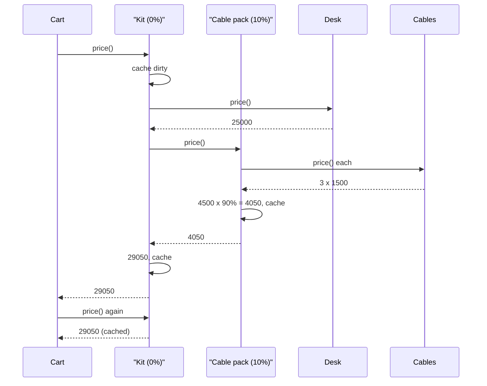

## In one minute
- A composite lets a group of objects be treated through the same interface as a single object. A folder answers `size()` like a file does; a bundle answers `price()` like a product does; a group of rate limiters answers `allow()` like one limiter does.
- The structure is a tree: leaves do real work, composites hold children and combine their answers (sum, max, all, any, first match). Callers stop writing `if isinstance(x, Folder)` branches because the recursion lives inside the composite.
- The hard parts are not the recursion: they are tree invariants (no cycles, one parent), aggregates that are expensive to recompute, and trees deep enough to blow the stack.
- At runtime a composite chases pointers: one allocation and one indirect call per node. Fine for thousands of nodes; at millions, real systems flatten the tree into arrays.
- Agents write composites readily but skip the invariants: no cycle check, no parent pointer, aggregates recomputed on every call. Review those first.

## How it works

### The problem
An online shop sells products and bundles. A "home office kit" is a desk, a chair and a "cable pack", and the cable pack is itself a bundle of three cables with its own 10% discount. The first version stores bundles as lists of product IDs, so the cart, the invoice and the tax code each grow a special case for one level of nesting. When marketing creates a bundle of bundles of bundles, three of them get the price wrong.

The composite answer: one `Sellable` interface with `price()`. `Product` implements it directly; `Bundle` asks each child and combines the answers. Callers never ask what kind of thing they hold.

```python
class Bundle:
    def __init__(self, name, discount_pct):
        self.name, self.discount_pct, self.children = name, discount_pct, []

    def add(self, child):
        self.children.append(child)

    def price(self):
        total = sum(c.price() for c in self.children)
        return total * (100 - self.discount_pct) // 100
```

### Uniform interface versus safe interface
Put `add` and `remove` on the shared interface and callers treat every node identically, but `add` on a leaf must fail at runtime. Put them only on the composite and the type system stops you adding a child to a leaf. Most modern code keeps reads (`price`, `size`, `render`) on the shared interface and building on the concrete composite. The DOM is the well-known exception: every `Node` has `appendChild`, and calling it on a text node throws `HierarchyRequestError` ([MDN](https://developer.mozilla.org/en-US/docs/Web/API/Node/appendChild)). The Gang of Four weigh the same trade: transparency (every node has the child operations) against safety (the type system rules out misuse), and note that a leaf can make the transparent version tolerable by treating `add` as an error (*Design Patterns*, ch. 4).

### Combining rules are the design
How a parent combines its children encodes business meaning. A folder's size is a sum. A health group is healthy if all children are, or if a quorum is. A composite rate limiter (see Design a Rate Limiter) allows a request only if every child does, and must decide about tokens already spent by children that said yes. Write the rule down, including the empty case: is an empty bundle free, is an empty health group healthy? Most bugs live in the empty and partially failed cases.

### Tree invariants
A composite that accepts any child can become a graph by accident. A bundle that contains itself recurses until the stack overflows; a cable pack added to two kits changes both when edited for one. A robust `add` enforces:

- No cycles: the child must not be this node or any of its ancestors.
- One parent: a node already attached elsewhere must be detached first. If you truly want one subtree in many places, you have a directed acyclic graph with parent lists, and must decide whether a shared leaf counts once or once per path.
- Unique names among siblings when children are addressed by name, as in file paths.

A parent pointer makes the first two checks cheap: walk up from `self` looking for `child`, costing the tree's depth rather than its size. The DOM refuses to insert an ancestor into its own descendant the same way: `appendChild` throws when the insertion would create a cycle ([MDN](https://developer.mozilla.org/en-US/docs/Web/API/Node/appendChild)).

### Cached aggregates
Recomputing `price()` across a 5,000-node tree on every page view is wasteful when the tree changes hourly. Cache each composite's aggregate and invalidate upward: when a child changes, mark the parent dirty, and its parent, up to the root. Reads recompute only dirty subtrees. Browser layout marks boxes "needs layout" up the ancestor chain the same way, and Merkle trees rehash only the changed path.

### Reviewing agent-written code
Asked to "support nested bundles", an agent usually adds a recursive `price()` and nothing else. Check that `add` rejects cycles and double attachment, that the empty case is defined, that depth is capped, and that hot aggregates are cached with upward invalidation. Leftover `isinstance` checks in callers mean the interface is missing an operation.

### The same shape elsewhere
Composite is the *fan-out* shape as an object: one request goes to every child and the answers fold back up. Linux cgroups v2 has the same shape: processes are organised hierarchically, and a cgroup's `memory.max` is a hard limit on its usage ([kernel docs](https://docs.kernel.org/admin-guide/cgroup-v2.html)). So do query planners, whose `AND` and `OR` nodes combine child predicates.

## Down the stack

### Layer 1: The contract
Every operation on the shared interface means the same for a group as for a leaf, with a documented combining rule and result for zero children. The structure is finite and acyclic, each node has one parent (or a declared sharing model), and a read after a mutation reflects it. A cache must be invisible: `price()` returns exactly what a fresh recursive computation would.

### Layer 2: The mechanism
The data structure is a node with a child list and usually a parent pointer. The DOM's `Node` exposes `parentNode`, `firstChild`, `lastChild`, `previousSibling` and `nextSibling`: children form a doubly linked list, so insertion and removal are O(1). React's Fiber nodes use `child`, `sibling` and `return` pointers, which let React walk the tree with a loop instead of recursion, so rendering can pause and resume between nodes ([React Fiber architecture notes](https://github.com/acdlite/react-fiber-architecture)).

Since Go 1.20 an error can implement `Unwrap() []error`, and `errors.Join(a, b)` returns one ([Go 1.20 notes](https://go.dev/doc/go1.20)). `errors.Is` and `errors.As` traverse the resulting tree in pre-order, depth first, calling `Unwrap` at each node ([errors package](https://pkg.go.dev/errors)): a composite in the standard library.

### Layer 3: The machine
Each node is a separate heap allocation. A Go node with a name string (16 bytes), a child slice (24), a parent pointer (8) and a cached int (8) is 56 bytes, rounded to the 64-byte size class, plus the slice's backing array. A CPython node with a `__dict__` is over 200 bytes; `__slots__` brings it to roughly 70. Nodes are allocated at different times, so siblings rarely share a cache line, and walking a million nodes pays roughly a DRAM miss per node, 80 to 100 ns: about 0.1 s per full walk, against a few milliseconds to scan the same data packed in an array.

Each child call is an indirect call: a Go itab lookup, a C++ or Java vtable call, or a V8 property access that stays fast while the call site sees few node shapes. Recursion costs a stack frame per level. CPython's default recursion limit is 1,000, so a 1,500-deep tree raises `RecursionError` (the limit guards the C stack and is adjustable with `sys.setrecursionlimit`, per the [sys docs](https://docs.python.org/3/library/sys.html)); goroutine stacks start at a few KB and grow by copying, so Go survives deep trees but pays for each growth.

Concurrency adds a cost. Upward invalidation touches every ancestor, so per-node locks force writers to lock a path in a fixed order to avoid deadlock. Many systems take one lock for the whole tree, or make it immutable and copy the changed path, so readers traverse an old version without locks.

### Why it's built this way
1. Business objects nest, so code that handles one level of nesting breaks on the next.
2. Recursion inside the node type removes nesting from every caller, at the cost of an indirect call per node.
3. Arbitrary children can form cycles, so `add` checks invariants via a parent pointer, at a cost proportional to depth.
4. Recomputing aggregates costs a cache miss per node, so composites cache and invalidate upward along the same pointers.
5. At millions of nodes pointer chasing dominates, so hot paths flatten trees into arrays.

## Diagram


## Worked example
A B2B catalogue holds 40,000 products and 6,000 bundles, nested up to 6 levels. The storefront renders bundle prices at 3,000 requests a second, about 20 bundles per page.

Without caching, pricing a bundle walks its subtree. The median subtree is 60 nodes and the largest 9,000; at roughly 100 ns per node in Go, that is 6 us and 0.9 ms. A page listing several large kits takes up to 18 ms in pricing alone, and those are the pages the sales team demos.

With cached aggregates, a read is one dirty-flag check, under 10 ns. Writes are rare (about 200 price changes an hour from the ERP feed), and each marks at most 6 ancestors dirty, or the 300 kits that share a popular cable pack. Each dirty kit recomputes on its next read by summing direct children, most still cached.

The rollout found one bug: the ERP feed set a product's price field directly, so nothing marked its parents dirty and kits showed old prices for an hour. The fix made `cents` private behind `set_price()`, which walks up the parents, plus a nightly job that recomputes every bundle from scratch and alerts on any mismatch.

## In the wild
- **jackson-databind, 2022: deeply nested JSON overflows the stack.** A parser that builds a tree by recursion also recurses on hostile input: CVE-2020-36518 let a small, deeply nested JSON document trigger a Java stack overflow and a denial of service in jackson-databind 2.12 and 2.13, fixed in 2.12.6.1 and 2.13.2.1 ([GitHub advisory](https://github.com/advisories/GHSA-57j2-w4cx-62h2)). Jackson 2.15 then made a limit the default: `StreamReadConstraints` caps nesting depth at 1,000 open objects or arrays unless you override it ([Jackson wiki](https://github.com/FasterXML/jackson-core/wiki/StreamReadConstraints)).
- **Protocol Buffers, documented limits: depth is a product decision.** Protobuf messages are composites (messages contain messages), and unmarshaling fails past a fixed nesting depth: 100 in Java and C++, 10,000 in Go, with a plan to reduce Go's to 100 ([protobuf limits](https://protobuf.dev/programming-guides/proto-limits/)). The same wire format therefore accepts different trees in different languages.
- **Go 1.20, 2023: errors become trees.** Before 1.20 an error wrapped at most one other error. Allowing `Unwrap() []error` turned the wrapping chain into a composite, and `errors.Is` and `errors.As` were changed to walk it depth first, so a caller asks the same question of one error or of a joined group ([Go 1.20 notes](https://go.dev/doc/go1.20), [errors package](https://pkg.go.dev/errors)).

## Trade-offs
| Option | Strengths | Weaknesses | Choose when |
| --- | --- | --- | --- |
| Type checks in callers | No new abstraction | Every caller handles nesting; breaks on deeper trees | One level of grouping, never nested |
| Composite, recomputed each call | Simple, always correct | Cost grows with subtree size on every read | Small trees or rarely read aggregates |
| Composite with cached aggregates | Reads O(1) after the first | Invalidation bugs; writes cost depth | Large trees read far more than written |
| Shared subtrees (DAG) | One definition reused in many places | Multiple parents, double counting decisions | Reusable components such as kits or templates |
| Flattened arrays (parent index, child ranges) | Cache friendly, fast bulk scans | Hard to mutate; loses the object interface | Millions of nodes, bulk analytics, game engines |

## Pitfalls in production
- A cycle introduced by an import, then a stack overflow on every request touching that tree. Fix: check ancestors in `add` and cap depth at the API.
- Mutating a leaf's field directly so cached ancestors go stale. Fix: make aggregated fields private behind methods that invalidate upward, and run a periodic full recompute that compares results.
- Undefined empty cases: an empty health group reported healthy, so a misconfigured check with no members passed for months. Fix: decide and test the result for zero children, and often reject empty composites.
- Deep recursion on user-supplied trees (nested comments, imported org charts). Fix: iterate with an explicit stack, or reject excess depth. Parsers learned this the hard way (see In the wild).
- One node attached to two parents by accident, so a change for one customer edits another's bundle. Fix: enforce one parent, and make sharing an explicit, separate operation.

## Leadership lens
- In design review, ask for the combining rule, the empty case and the failure case for each operation on the composite. Those three answers are the composite's real specification.
- Ask where tree invariants are enforced. If the answer is "the UI prevents it", the import job, the API and the agent writing a migration will not.
- Budget for depth and fan-out limits as product decisions. "Bundles may nest 5 deep and hold 500 items" is cheaper than discovering the limit during an outage.
- Cached aggregates need an owned invalidation path. Ship a reconciliation job and a mismatch metric with them, not in a follow-up.

## Check yourself
1. Why does a parent pointer make cycle detection in `add` cheap?
   **Answer:** Adding `child` under `node` creates a cycle only if `child` is `node` or one of its ancestors, so walking up from `node` checks it in time proportional to depth instead of searching the whole subtree.
2. A health-check composite has no children. What should it return, and why does the question matter?
   **Answer:** There is no universally right answer, so it must be decided; returning healthy hides misconfiguration, which is why many systems treat an empty group as an error or as unhealthy.
3. Why must invalidation go upward rather than downward?
   **Answer:** A change to a node changes the aggregates of the nodes that contain it, which are its ancestors; its descendants' values do not depend on it.
4. When would you flatten a composite into arrays?
   **Answer:** When the tree has millions of nodes and hot paths scan it in bulk, so pointer chasing and per-node calls dominate; you keep the object interface at the edges for building and editing.

## Practice
**Task:** Model priced bundles as a composite. `Item(name, cents)` is a leaf. `Bundle(name, discount_pct)` holds children in insertion order, and its price is the sum of its children's prices times `(100 - discount_pct)`, integer-divided by 100. Both expose `price()`, `count()` (number of leaf items underneath; 1 for an item) and `names()` (leaf names, depth first, in insertion order). `Bundle.add(child)` fails with `cycle: <child name>` if the child is this bundle or one of its ancestors, then with `already attached: <child name>` if the child already has a parent, then with `duplicate: <child name>` if a direct child has the same name; a failed add changes nothing. Each bundle caches its price and keeps a counter `computed` of how many times it actually recomputed; adding a child anywhere below a bundle must invalidate it so the next `price()` is correct. Python raises `ValueError`, TypeScript throws `Error`, Go returns an error.

```python starter
class Item:
    def __init__(self, name, cents):
        self.name = name
        self.cents = cents
        self.parent = None

    def price(self):
        # TODO
        raise NotImplementedError

    def count(self):
        # TODO
        raise NotImplementedError

    def names(self):
        # TODO
        raise NotImplementedError


class Bundle:
    def __init__(self, name, discount_pct):
        self.name = name
        self.discount_pct = discount_pct
        self.parent = None
        self.children = []
        self.computed = 0

    def add(self, child):
        # TODO
        raise NotImplementedError

    def price(self):
        # TODO
        raise NotImplementedError

    def count(self):
        # TODO
        raise NotImplementedError

    def names(self):
        # TODO
        raise NotImplementedError
```

```python tests
def error_of(fn):
    try:
        fn()
    except ValueError as e:
        return str(e)
    return None


def test_flat_bundle_discount():
    kit = Bundle("kit", 10)
    kit.add(Item("a", 1000))
    kit.add(Item("b", 999))
    assert kit.price() == 1799
    assert kit.count() == 2


def test_nested_bundles_and_names():
    outer = Bundle("outer", 0)
    inner = Bundle("inner", 50)
    inner.add(Item("a", 300))
    inner.add(Item("b", 101))
    outer.add(inner)
    outer.add(Item("c", 100))
    assert inner.price() == 200
    assert outer.price() == 300
    assert outer.count() == 3
    assert outer.names() == ["a", "b", "c"]


def test_empty_bundle():
    b = Bundle("empty", 25)
    assert b.price() == 0
    assert b.count() == 0
    assert b.names() == []


def test_price_cached_and_invalidated_upward():
    outer = Bundle("outer", 0)
    inner = Bundle("inner", 0)
    other = Bundle("other", 0)
    inner.add(Item("a", 100))
    other.add(Item("z", 5))
    outer.add(inner)
    outer.add(other)
    assert outer.price() == 105
    assert outer.price() == 105
    assert (outer.computed, inner.computed, other.computed) == (1, 1, 1)
    inner.add(Item("b", 50))
    assert outer.price() == 155
    assert (outer.computed, inner.computed, other.computed) == (2, 2, 1)


def test_cycle_rejected():
    outer = Bundle("outer", 0)
    inner = Bundle("inner", 0)
    outer.add(inner)
    assert error_of(lambda: outer.add(outer)) == "cycle: outer"
    assert error_of(lambda: inner.add(outer)) == "cycle: outer"
    assert outer.count() == 0


def test_already_attached_rejected_without_change():
    a = Bundle("a", 0)
    b = Bundle("b", 0)
    x = Item("x", 10)
    a.add(x)
    assert error_of(lambda: b.add(x)) == "already attached: x"
    assert b.count() == 0
    assert x.parent is a


def test_duplicate_sibling_name_rejected():
    b = Bundle("b", 0)
    b.add(Item("x", 10))
    assert error_of(lambda: b.add(Item("x", 20))) == "duplicate: x"
    assert b.price() == 10
```

```python solution
class Item:
    def __init__(self, name, cents):
        self.name = name
        self.cents = cents
        self.parent = None

    def price(self):
        return self.cents

    def count(self):
        return 1

    def names(self):
        return [self.name]


class Bundle:
    def __init__(self, name, discount_pct):
        self.name = name
        self.discount_pct = discount_pct
        self.parent = None
        self.children = []
        self.computed = 0
        self._cached = None

    def add(self, child):
        node = self
        while node is not None:
            if node is child:
                raise ValueError("cycle: " + child.name)
            node = node.parent
        if child.parent is not None:
            raise ValueError("already attached: " + child.name)
        for c in self.children:
            if c.name == child.name:
                raise ValueError("duplicate: " + child.name)
        self.children.append(child)
        child.parent = self
        node = self
        while node is not None:
            node._cached = None
            node = node.parent

    def price(self):
        if self._cached is None:
            total = sum(c.price() for c in self.children)
            self._cached = total * (100 - self.discount_pct) // 100
            self.computed += 1
        return self._cached

    def count(self):
        return sum(c.count() for c in self.children)

    def names(self):
        out = []
        for c in self.children:
            out.extend(c.names())
        return out
```

```typescript starter
export interface Node {
  readonly name: string;
  parent: Bundle | null;
  price(): number;
  count(): number;
  names(): string[];
}

export class Item implements Node {
  parent: Bundle | null = null;
  constructor(readonly name: string, readonly cents: number) {}
  price(): number { throw new Error("TODO"); }
  count(): number { throw new Error("TODO"); }
  names(): string[] { throw new Error("TODO"); }
}

export class Bundle implements Node {
  parent: Bundle | null = null;
  children: Node[] = [];
  computed = 0;
  constructor(readonly name: string, readonly discountPct: number) {}
  add(child: Node): void { throw new Error("TODO"); }
  price(): number { throw new Error("TODO"); }
  count(): number { throw new Error("TODO"); }
  names(): string[] { throw new Error("TODO"); }
}
```

```typescript tests
function errorOf(fn: () => void): string | undefined {
  try { fn(); } catch (e) { return (e as Error).message; }
  return undefined;
}

test("flat bundle discount", () => {
  const kit = new Bundle("kit", 10);
  kit.add(new Item("a", 1000));
  kit.add(new Item("b", 999));
  assertEqual(kit.price(), 1799);
  assertEqual(kit.count(), 2);
});

test("nested bundles and names", () => {
  const outer = new Bundle("outer", 0);
  const inner = new Bundle("inner", 50);
  inner.add(new Item("a", 300));
  inner.add(new Item("b", 101));
  outer.add(inner);
  outer.add(new Item("c", 100));
  assertEqual(inner.price(), 200);
  assertEqual(outer.price(), 300);
  assertEqual(outer.count(), 3);
  assertEqual(outer.names(), ["a", "b", "c"]);
});

test("empty bundle", () => {
  const b = new Bundle("empty", 25);
  assertEqual(b.price(), 0);
  assertEqual(b.count(), 0);
  assertEqual(b.names(), []);
});

test("price cached and invalidated upward", () => {
  const outer = new Bundle("outer", 0);
  const inner = new Bundle("inner", 0);
  const other = new Bundle("other", 0);
  inner.add(new Item("a", 100));
  other.add(new Item("z", 5));
  outer.add(inner);
  outer.add(other);
  assertEqual(outer.price(), 105);
  assertEqual(outer.price(), 105);
  assertEqual([outer.computed, inner.computed, other.computed], [1, 1, 1]);
  inner.add(new Item("b", 50));
  assertEqual(outer.price(), 155);
  assertEqual([outer.computed, inner.computed, other.computed], [2, 2, 1]);
});

test("cycle rejected", () => {
  const outer = new Bundle("outer", 0);
  const inner = new Bundle("inner", 0);
  outer.add(inner);
  assertEqual(errorOf(() => outer.add(outer)), "cycle: outer");
  assertEqual(errorOf(() => inner.add(outer)), "cycle: outer");
  assertEqual(outer.count(), 0);
});

test("already attached rejected without change", () => {
  const a = new Bundle("a", 0);
  const b = new Bundle("b", 0);
  const x = new Item("x", 10);
  a.add(x);
  assertEqual(errorOf(() => b.add(x)), "already attached: x");
  assertEqual(b.count(), 0);
  assert(x.parent === a, "parent unchanged");
});

test("duplicate sibling name rejected", () => {
  const b = new Bundle("b", 0);
  b.add(new Item("x", 10));
  assertEqual(errorOf(() => b.add(new Item("x", 20))), "duplicate: x");
  assertEqual(b.price(), 10);
});
```

```typescript solution
export interface Node {
  readonly name: string;
  parent: Bundle | null;
  price(): number;
  count(): number;
  names(): string[];
}

export class Item implements Node {
  parent: Bundle | null = null;
  constructor(readonly name: string, readonly cents: number) {}
  price(): number { return this.cents; }
  count(): number { return 1; }
  names(): string[] { return [this.name]; }
}

export class Bundle implements Node {
  parent: Bundle | null = null;
  children: Node[] = [];
  computed = 0;
  private cached: number | null = null;
  constructor(readonly name: string, readonly discountPct: number) {}

  add(child: Node): void {
    for (let n: Bundle | null = this; n !== null; n = n.parent) {
      if (n === child) throw new Error("cycle: " + child.name);
    }
    if (child.parent !== null) throw new Error("already attached: " + child.name);
    if (this.children.some((c) => c.name === child.name)) {
      throw new Error("duplicate: " + child.name);
    }
    this.children.push(child);
    child.parent = this;
    for (let n: Bundle | null = this; n !== null; n = n.parent) n.cached = null;
  }

  price(): number {
    if (this.cached === null) {
      const total = this.children.reduce((s, c) => s + c.price(), 0);
      this.cached = Math.floor((total * (100 - this.discountPct)) / 100);
      this.computed++;
    }
    return this.cached;
  }

  count(): number { return this.children.reduce((s, c) => s + c.count(), 0); }

  names(): string[] {
    const out: string[] = [];
    for (const c of this.children) out.push(...c.names());
    return out;
  }
}
```

```go starter
package practice

// Node is anything that can be priced: an Item or a Bundle.
type Node interface {
	Name() string
	Price() int
	Count() int
	Names() []string
	Parent() *Bundle
	setParent(b *Bundle)
}

type Item struct {
	name   string
	Cents  int
	parent *Bundle
}

func NewItem(name string, cents int) *Item { return &Item{name: name, Cents: cents} }

func (i *Item) Name() string        { return i.name }
func (i *Item) Parent() *Bundle     { return i.parent }
func (i *Item) setParent(b *Bundle) { i.parent = b }
func (i *Item) Price() int          { panic("TODO") }
func (i *Item) Count() int          { panic("TODO") }
func (i *Item) Names() []string     { panic("TODO") }

type Bundle struct {
	name        string
	DiscountPct int
	Children    []Node
	Computed    int
	parent      *Bundle
}

func NewBundle(name string, discountPct int) *Bundle {
	return &Bundle{name: name, DiscountPct: discountPct}
}

func (b *Bundle) Name() string        { return b.name }
func (b *Bundle) Parent() *Bundle     { return b.parent }
func (b *Bundle) setParent(p *Bundle) { b.parent = p }
func (b *Bundle) Add(child Node) error { panic("TODO") }
func (b *Bundle) Price() int          { panic("TODO") }
func (b *Bundle) Count() int          { panic("TODO") }
func (b *Bundle) Names() []string     { panic("TODO") }
```

```go tests
package practice

import (
	"reflect"
	"testing"
)

func errText(err error) string {
	if err == nil {
		return ""
	}
	return err.Error()
}

func must(t *testing.T, err error) {
	t.Helper()
	if err != nil {
		t.Fatalf("unexpected error: %v", err)
	}
}

func TestFlatBundleDiscount(t *testing.T) {
	kit := NewBundle("kit", 10)
	must(t, kit.Add(NewItem("a", 1000)))
	must(t, kit.Add(NewItem("b", 999)))
	if kit.Price() != 1799 || kit.Count() != 2 {
		t.Fatalf("got price %d count %d", kit.Price(), kit.Count())
	}
}

func TestNestedBundlesAndNames(t *testing.T) {
	outer := NewBundle("outer", 0)
	inner := NewBundle("inner", 50)
	must(t, inner.Add(NewItem("a", 300)))
	must(t, inner.Add(NewItem("b", 101)))
	must(t, outer.Add(inner))
	must(t, outer.Add(NewItem("c", 100)))
	if inner.Price() != 200 || outer.Price() != 300 || outer.Count() != 3 {
		t.Fatalf("got inner %d outer %d count %d", inner.Price(), outer.Price(), outer.Count())
	}
	if !reflect.DeepEqual(outer.Names(), []string{"a", "b", "c"}) {
		t.Fatalf("names %v", outer.Names())
	}
}

func TestEmptyBundle(t *testing.T) {
	b := NewBundle("empty", 25)
	if b.Price() != 0 || b.Count() != 0 || len(b.Names()) != 0 {
		t.Fatal("empty bundle should be zero")
	}
}

func TestPriceCachedAndInvalidatedUpward(t *testing.T) {
	outer := NewBundle("outer", 0)
	inner := NewBundle("inner", 0)
	other := NewBundle("other", 0)
	must(t, inner.Add(NewItem("a", 100)))
	must(t, other.Add(NewItem("z", 5)))
	must(t, outer.Add(inner))
	must(t, outer.Add(other))
	if outer.Price() != 105 || outer.Price() != 105 {
		t.Fatal("want 105")
	}
	if outer.Computed != 1 || inner.Computed != 1 || other.Computed != 1 {
		t.Fatalf("computed %d %d %d", outer.Computed, inner.Computed, other.Computed)
	}
	must(t, inner.Add(NewItem("b", 50)))
	if outer.Price() != 155 {
		t.Fatalf("want 155, got %d", outer.Price())
	}
	if outer.Computed != 2 || inner.Computed != 2 || other.Computed != 1 {
		t.Fatalf("computed %d %d %d", outer.Computed, inner.Computed, other.Computed)
	}
}

func TestCycleRejected(t *testing.T) {
	outer := NewBundle("outer", 0)
	inner := NewBundle("inner", 0)
	must(t, outer.Add(inner))
	if got := errText(outer.Add(outer)); got != "cycle: outer" {
		t.Fatalf("got %q", got)
	}
	if got := errText(inner.Add(outer)); got != "cycle: outer" {
		t.Fatalf("got %q", got)
	}
	if outer.Count() != 0 {
		t.Fatal("tree changed")
	}
}

func TestAlreadyAttachedRejectedWithoutChange(t *testing.T) {
	a := NewBundle("a", 0)
	b := NewBundle("b", 0)
	x := NewItem("x", 10)
	must(t, a.Add(x))
	if got := errText(b.Add(x)); got != "already attached: x" {
		t.Fatalf("got %q", got)
	}
	if b.Count() != 0 || x.Parent() != a {
		t.Fatal("tree changed")
	}
}

func TestDuplicateSiblingNameRejected(t *testing.T) {
	b := NewBundle("b", 0)
	must(t, b.Add(NewItem("x", 10)))
	if got := errText(b.Add(NewItem("x", 20))); got != "duplicate: x" {
		t.Fatalf("got %q", got)
	}
	if b.Price() != 10 {
		t.Fatal("tree changed")
	}
}
```

```go solution
package practice

import "errors"

// Node is anything that can be priced: an Item or a Bundle.
type Node interface {
	Name() string
	Price() int
	Count() int
	Names() []string
	Parent() *Bundle
	setParent(b *Bundle)
}

type Item struct {
	name   string
	Cents  int
	parent *Bundle
}

func NewItem(name string, cents int) *Item { return &Item{name: name, Cents: cents} }

func (i *Item) Name() string        { return i.name }
func (i *Item) Parent() *Bundle     { return i.parent }
func (i *Item) setParent(b *Bundle) { i.parent = b }
func (i *Item) Price() int          { return i.Cents }
func (i *Item) Count() int          { return 1 }
func (i *Item) Names() []string     { return []string{i.name} }

type Bundle struct {
	name        string
	DiscountPct int
	Children    []Node
	Computed    int
	parent      *Bundle
	cached      int
	valid       bool
}

func NewBundle(name string, discountPct int) *Bundle {
	return &Bundle{name: name, DiscountPct: discountPct}
}

func (b *Bundle) Name() string        { return b.name }
func (b *Bundle) Parent() *Bundle     { return b.parent }
func (b *Bundle) setParent(p *Bundle) { b.parent = p }

func (b *Bundle) Add(child Node) error {
	for n := b; n != nil; n = n.parent {
		if Node(n) == child {
			return errors.New("cycle: " + child.Name())
		}
	}
	if child.Parent() != nil {
		return errors.New("already attached: " + child.Name())
	}
	for _, c := range b.Children {
		if c.Name() == child.Name() {
			return errors.New("duplicate: " + child.Name())
		}
	}
	b.Children = append(b.Children, child)
	child.setParent(b)
	for n := b; n != nil; n = n.parent {
		n.valid = false
	}
	return nil
}

func (b *Bundle) Price() int {
	if !b.valid {
		total := 0
		for _, c := range b.Children {
			total += c.Price()
		}
		b.cached = total * (100 - b.DiscountPct) / 100
		b.valid = true
		b.Computed++
	}
	return b.cached
}

func (b *Bundle) Count() int {
	n := 0
	for _, c := range b.Children {
		n += c.Count()
	}
	return n
}

func (b *Bundle) Names() []string {
	out := []string{}
	for _, c := range b.Children {
		out = append(out, c.Names()...)
	}
	return out
}
```

## Mock interview
**Prompt:** Design the permissions model for a document platform with 2 million folders nested up to 30 levels and 50 million documents. A folder's sharing applies to everything inside it, and the UI must show "who can see this" in under 50 ms.

- Follow-up: A folder near the root of a 400,000-document subtree changes its sharing. What gets recomputed, when, and how long until every document reflects it?
- Follow-up: An import job creates a folder that contains its own ancestor. Where is that caught, and what happens if it is not?
- Follow-up: Would you keep the tree as objects in memory, as rows with a parent ID, or as a closure table or materialized path? Why?

**A strong answer covers:**
- A shared interface for effective access, where a folder combines its own grants with its parent's, with a stated rule for the root.
- Cached effective permissions with invalidation pushed down, since here children depend on parents: propagation follows the direction of dependency.
- Invariants enforced in the write API (no cycles, one parent, depth cap), not only in the UI.
- Storage trade-offs: adjacency list for cheap moves, materialized path or closure table for fast ancestor queries.

## Sources and further study
**Primary**
- [MDN: Node.appendChild](https://developer.mozilla.org/en-US/docs/Web/API/Node/appendChild): the DOM's composite rules, including the exceptions for cycles and for parents that cannot hold children.
- [Go 1.20 release notes](https://go.dev/doc/go1.20): the change that made error wrapping a tree.
- [Go errors package](https://pkg.go.dev/errors): the pre-order, depth-first traversal contract of `Is` and `As`.
- [Linux kernel: Control Group v2](https://docs.kernel.org/admin-guide/cgroup-v2.html): hierarchical organisation of processes and the `memory.max` hard limit.

**Systems docs**
- [Jackson StreamReadConstraints](https://github.com/FasterXML/jackson-core/wiki/StreamReadConstraints): the default nesting-depth limit added in 2.15.
- [GitHub advisory for CVE-2020-36518](https://github.com/advisories/GHSA-57j2-w4cx-62h2): the stack overflow from deeply nested JSON and the patched versions.
- [Protocol Buffers: proto limits](https://protobuf.dev/programming-guides/proto-limits/): per-language nesting depth limits.
- [Python sys module](https://docs.python.org/3/library/sys.html): what the recursion limit protects.

**Books**
- *Design Patterns: Elements of Reusable Object-Oriented Software*, Gamma, Helm, Johnson and Vlissides: chapter 4 (Structural Patterns), the Composite entry, including transparency versus safety and caching of aggregates.
- *Head First Design Patterns*, Freeman and Robson: chapter 9 (the Iterator and Composite Patterns), traversing a menu tree with leaves and sub-menus.

**Other curricula**
- [SourceMaking: Composite](https://sourcemaking.com/design_patterns/composite): frames the pattern through its problem (querying each object's type before processing it) and ends with a checklist.
- [Java Design Patterns: Composite](https://java-design-patterns.com/patterns/composite/): a worked Java implementation with real-world uses listed.

## Watch
- [Composite Pattern, Design Patterns ep 14 (Christopher Okhravi)](https://www.youtube.com/watch?v=EWDmWbJ4wRA): the Gang of Four structure and the uniform versus safe interface debate.
- [The Composite Pattern Explained and Implemented in Java (Geekific)](https://www.youtube.com/watch?v=oo9AsGqnisk): a short build of leaf and composite classes in code.

## Free resources
- [The Composite Pattern (Brandon Rhodes, python-patterns.guide)](https://python-patterns.guide/gang-of-four/composite/): how the pattern looks in Python, and how duck typing changes the uniform interface question.
- [Composite (Refactoring Guru)](https://refactoring.guru/design-patterns/composite): the structure, applicability and relations to other patterns.
- [Node (MDN)](https://developer.mozilla.org/en-US/docs/Web/API/Node): the DOM's composite node, with its parent and sibling pointers and insertion rules.
- [React Fiber Architecture (Andrew Clark)](https://github.com/acdlite/react-fiber-architecture): why a UI tree uses child, sibling and return pointers to traverse without recursion.
- [errors (Go docs)](https://pkg.go.dev/errors): `errors.Join` and the depth-first traversal of error trees.
- [Control Group v2 (Linux kernel docs)](https://docs.kernel.org/admin-guide/cgroup-v2.html): a composite in the kernel, with hierarchical limits and accounting.
