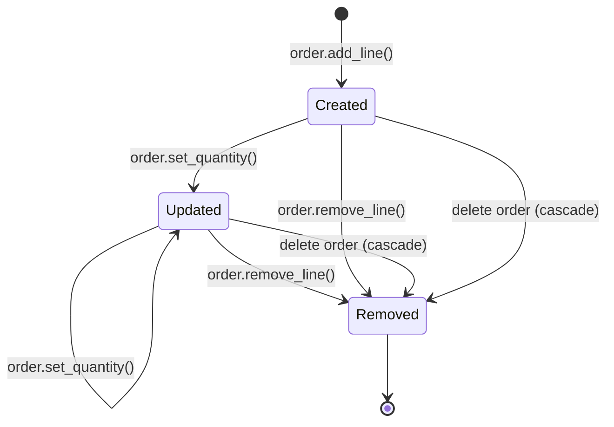

## In one minute
- Composition is the strong whole-part relationship: the whole owns its parts, creates them, and destroys them. An order owns its order lines; delete the order and the lines go with it.
- A part belongs to exactly one whole at a time and is never handed out for others to keep. Copying the whole copies the parts.
- Ownership gives you one place for lifecycle (create, validate, close, delete) and one lock for concurrency, because nothing outside the whole can reach the parts.
- "Composition over inheritance" is the same idea applied to behaviour: build a class from owned collaborators instead of inheriting from a base class you cannot see into.
- Go and C++ can embed parts by value and Rust enforces single ownership; in Java, Python and JavaScript composition is a discipline.

## How it works

### The problem: parts that escape
A refund feature needs "the invoice's lines with negative amounts", so a developer passes `invoice.lines` to a new credit note and flips the signs. The original invoice now shows negative amounts too, because both hold the same list. The lines were meant to belong to one invoice, but the code let them be shared. Composition is the decision, stated and enforced, that they cannot be.

### What ownership means in code
A composite whole does four things that an aggregate does not:

- **Creates its parts.** `order.add_line(sku, qty, price)` builds the line inside, so no outside reference exists.
- **Guards its parts.** Readers get ids or copies; mutation goes through the whole, which keeps invariants such as the total.
- **Copies its parts.** Cloning an order deep-copies its lines with new identities.
- **Destroys its parts.** Deleting the whole deletes every part. There is no orphan state.

Removing a part from the whole ends its life too; JPA's `orphanRemoval = true` deletes a line dropped from the collection.

### Lifecycle and cascading delete
Lifecycle is the main payoff. A `Connection` that owns a `Socket` and a `Buffer` closes both in `close()`, so no caller can forget a step. In a database the rule is a foreign key with `ON DELETE CASCADE` from `order_line.order_id` to `order.id`. Cascades are only safe along ownership edges; following one into a shared table destroys data other wholes still use.

### Composition over inheritance
Inheritance couples a subclass to its parent's internals: which methods call which, in what order. A `class CountingList(list)` that overrides `append` to count items misses everything added through `extend`, because CPython's `extend` does not call `append`. Java's classic version is a `HashSet` subclass that double-counts, because the base `addAll` does call `add`. That is the fragile base class problem. The Gang of Four put it as "favour object composition over class inheritance".

The composed alternative owns a list and exposes only the operations it supports. It costs a few forwarding methods, depends only on the list's public contract, and can vary behaviour at runtime by swapping an owned collaborator.

Go has no inheritance. Embedding promotes methods, but the receiver stays the inner value, so the outer type cannot override what the inner one calls on itself.

### When not to compose
If the part has an identity outside the whole (a customer on an order), it is not owned. If it is a large immutable value, sharing it is cheaper and safe.

### Reviewing agent-written code
Agents tend to return the live list from getters, accept pre-built parts in constructors, and write shallow `clone` methods. Check that parts are built inside the whole, getters return copies, clone is deep along owned fields, and every cascade follows an ownership edge.

### The same shape elsewhere
A Kubernetes Deployment owns its ReplicaSets, which own their Pods, through `ownerReferences`, and deleting it garbage-collects the tree. A process owns its file descriptors, which the kernel closes at exit. Ownership is a tree, and cleanup walks it.

## Down the stack

### Layer 1: The contract
Every part has exactly one owner for its whole life. No reference to a part is reachable except through its owner. Deleting, closing or cloning the owner applies the same operation to all of its parts, and after the owner is gone no part is observable.

### Layer 2: The mechanism
**C++ and Rust** encode composition in the type system. A member object is constructed with the whole and destroyed with it: C++ runs member destructors in reverse order of declaration, Rust drops fields in declaration order. `std::unique_ptr<T>` and Rust's `Box<T>` own heap parts and free them with the owner; Rust's borrow checker rejects code that keeps a reference to a part past its owner's life.

**Go** stores a struct-typed field inline, and a `[]Line` slice holds lines contiguously. Assigning the whole copies inline fields, but a slice field copies only its 24-byte header (pointer, length, capacity), so the copy shares the backing array. A correct clone must allocate a new slice and copy into it.

**Java, Python, JavaScript** hold every object field as a reference, so ownership lives in your API: private fields, copies at the boundary, and `close()` with `try`-with-resources or `with` for non-memory resources.

**Databases.** Postgres implements `ON DELETE CASCADE` with internal referential-integrity triggers: deleting an order row fires a trigger that deletes matching `order_line` rows, which may fire further cascades. Each deleted row is a separate WAL record and row lock, all in the caller's transaction.

### Layer 3: The machine
Embedding by value changes memory layout. A Go `[]Line` of 100 32-byte lines is one 3.2 KB block, 50 cache lines the prefetcher streams; summing them takes well under a microsecond. The same lines as `[]*Line` are 100 separate heap objects, each a potential cache miss of about 100 ns, plus 100 objects for the garbage collector to trace. Composition is what makes the value layout safe, because nobody else holds a pointer into the slice.

Ownership also simplifies locking: if parts are reachable only through their owner, one mutex on the owner guards the tree, as long as no part reference escapes.

The cost appears at delete time: cascading one order with 10,000 lines writes 10,000 WAL records and holds 10,000 row locks until commit.

### Why it's built this way
1. Parts reachable from several places can be changed or freed from several places, so each gets one owner.
2. With one owner, lifecycle becomes a tree walk: create, copy and destroy follow the ownership edges.
3. A tree with no escaping references needs only one lock at the root and can be laid out contiguously.
4. Runtimes that cannot see ownership leave it to the API, so private fields and defensive copies carry the rule.

## Diagram


## Worked example
A warehouse system stores 4 million orders with an average of 6 lines each, 24 million line rows. Orders older than seven years must be purged, about 300,000 orders a month.

The first job ran one monthly `DELETE FROM orders WHERE created_at < $1`. The cascade removed about 1.8 million lines in a single transaction, generated gigabytes of WAL, and lagged the replicas for 40 minutes.

Composition made the fix straightforward. Because lines belong to exactly one order and nothing else references them, the job deletes in batches of 1,000 orders per transaction. Each batch removes about 6,000 lines, commits in around 200 ms, and replica lag stays under a second. No orphan check is needed, because no line is shared; a shared table such as products would need a reference check before every delete.

## Trade-offs
| Option | Strengths | Weaknesses | Choose when |
| --- | --- | --- | --- |
| Composition (owned parts) | One lifecycle, one lock, safe value layout | Parts cannot be shared; deep copies cost | Parts mean nothing outside the whole |
| Aggregation (shared parts) | No duplication, parts outlive wholes | Removal policy, shared mutation | Parts have their own identity and users |
| Inheritance | Little code for true is-a hierarchies | Fragile base class, fixed at compile time | Stable framework base classes designed for extension |
| Composition with delegation | Behaviour swappable at runtime, small contracts | Forwarding boilerplate | Varying behaviour by combination or configuration |

## Pitfalls in production
- Getters return the live list of parts, and callers mutate or keep them. Fix: return copies, immutable views or ids.
- Shallow `clone` of a composite, so the copy shares parts with the original. Fix: deep-copy owned fields, and test that mutating the copy leaves the original unchanged.
- Cascade delete configured on an edge that is not ownership. Fix: cascade only from owner to owned; use restrict elsewhere.
- One giant cascading delete holding locks and flooding replication. Fix: delete in batches or soft-delete and reclaim later.
- Inheriting from a collection type to add behaviour. Fix: own the collection and expose only the operations you support.

## Leadership lens
- Ownership decides what a delete removes. Require it to be explicit in design review for every "has" relationship.
- Ask how large the biggest composite can grow. Unbounded trees make deletes, copies and locks unbounded too.
- Prefer composition in shared libraries. A base class invites every team to subclass it, and then its internals can never change.
- Data retention and GDPR deletion depend on accurate ownership trees.

## Check yourself
1. Why can a composite whole protect all of its parts with a single lock?
   **Answer:** Because no reference to a part exists outside the whole, every access goes through the whole. Holding the whole's lock therefore serialises all access to the parts.
2. A Go `Order` struct has a `Lines []Line` field. Why does `copy := *order` not produce an independent order?
   **Answer:** The struct copy duplicates the slice header, not the backing array, so both orders share the same lines. A clone must allocate a new slice and copy the elements.
3. Why is it safe to batch a cascading delete for orders but risky for products?
   **Answer:** Order lines belong to one order and are referenced nowhere else, so deleting them cannot affect other data. Products are shared by many orders, so each delete needs a reference check.
4. A subclass of a list overrides `append` to count items. Why might the count be wrong after `extend`?
   **Answer:** Whether the base class's `extend` calls `append` is an internal detail. In CPython it does not, so the count misses items; a base that did would double-count if the subclass also counted in `extend`.

## Practice
**Task:** Implement a store where orders own their lines. `create_order()` returns ids 1, 2, 3 and so on. `add_line(order_id, sku, qty, unit_cents)` returns a line id from one global counter starting at 1; it fails with `no such order: <id>`, then `bad quantity: <qty>` if `qty < 1`. `set_quantity(line_id, qty)` and `remove_line(line_id)` fail with `no such line: <id>` (and `set_quantity` with `bad quantity: <qty>`). `lines(order_id)` returns the order's line ids in insertion order, and `total(order_id)` the sum of `qty * unit_cents`. `clone_order(order_id)` creates a new order whose lines are deep copies with fresh ids in the same order. `delete_order(order_id)` deletes the order and all its lines and returns how many lines it deleted. `live_lines()` counts lines across all orders. Python raises `ValueError`, TypeScript throws `Error`, Go returns an `error`.

```python starter
class Store:
    def __init__(self):
        pass

    def create_order(self):
        raise NotImplementedError

    def add_line(self, order_id, sku, qty, unit_cents):
        raise NotImplementedError

    def set_quantity(self, line_id, qty):
        raise NotImplementedError

    def remove_line(self, line_id):
        raise NotImplementedError

    def lines(self, order_id):
        raise NotImplementedError

    def total(self, order_id):
        raise NotImplementedError

    def clone_order(self, order_id):
        raise NotImplementedError

    def delete_order(self, order_id):
        raise NotImplementedError

    def live_lines(self):
        raise NotImplementedError
```

```python tests
def expect_error(fn, msg):
    try:
        fn()
    except ValueError as e:
        assert str(e) == msg, str(e)
        return
    assert False, "expected ValueError: " + msg

def test_lines_belong_to_their_order():
    s = Store()
    a, b = s.create_order(), s.create_order()
    assert (a, b) == (1, 2)
    assert s.add_line(a, "pen", 2, 150) == 1
    assert s.add_line(b, "ink", 1, 900) == 2
    assert s.add_line(a, "pad", 3, 400) == 3
    assert s.lines(a) == [1, 3] and s.lines(b) == [2]
    assert s.total(a) == 1500 and s.total(b) == 900

def test_validation():
    s = Store()
    o = s.create_order()
    expect_error(lambda: s.add_line(9, "pen", 1, 100), "no such order: 9")
    expect_error(lambda: s.add_line(o, "pen", 0, 100), "bad quantity: 0")
    expect_error(lambda: s.set_quantity(5, 1), "no such line: 5")
    line = s.add_line(o, "pen", 1, 100)
    expect_error(lambda: s.set_quantity(line, -2), "bad quantity: -2")
    expect_error(lambda: s.remove_line(42), "no such line: 42")

def test_update_and_remove_line():
    s = Store()
    o = s.create_order()
    l1 = s.add_line(o, "pen", 1, 100)
    l2 = s.add_line(o, "pad", 1, 300)
    s.set_quantity(l1, 4)
    assert s.total(o) == 700
    s.remove_line(l2)
    assert s.lines(o) == [l1] and s.total(o) == 400 and s.live_lines() == 1
    expect_error(lambda: s.set_quantity(l2, 1), "no such line: " + str(l2))

def test_clone_is_deep():
    s = Store()
    o = s.create_order()
    l1 = s.add_line(o, "pen", 2, 150)
    s.add_line(o, "pad", 1, 400)
    c = s.clone_order(o)
    assert c == 2
    assert s.lines(c) == [3, 4] and s.total(c) == 700
    s.set_quantity(s.lines(c)[0], 10)
    assert s.total(o) == 700 and s.total(c) == 1900
    s.remove_line(l1)
    assert s.lines(c) == [3, 4]

def test_delete_cascades_to_lines_only():
    s = Store()
    a, b = s.create_order(), s.create_order()
    la = s.add_line(a, "pen", 1, 100)
    s.add_line(a, "pad", 1, 200)
    s.add_line(b, "ink", 1, 900)
    assert s.live_lines() == 3
    assert s.delete_order(a) == 2
    assert s.live_lines() == 1 and s.total(b) == 900
    expect_error(lambda: s.lines(a), "no such order: " + str(a))
    expect_error(lambda: s.remove_line(la), "no such line: " + str(la))
    expect_error(lambda: s.delete_order(a), "no such order: " + str(a))

def test_ids_are_not_reused():
    s = Store()
    o = s.create_order()
    s.add_line(o, "pen", 1, 100)
    s.delete_order(o)
    o2 = s.create_order()
    assert o2 == 2
    assert s.add_line(o2, "pen", 1, 100) == 2
    assert s.total(o2) == 100
```

```python solution
class _Line:
    def __init__(self, line_id, sku, qty, unit_cents):
        self.id = line_id
        self.sku = sku
        self.qty = qty
        self.unit_cents = unit_cents

class Store:
    def __init__(self):
        self._orders = {}
        self._owner = {}
        self._next_order = 1
        self._next_line = 1

    def create_order(self):
        oid = self._next_order
        self._next_order += 1
        self._orders[oid] = []
        return oid

    def _order(self, order_id):
        if order_id not in self._orders:
            raise ValueError("no such order: " + str(order_id))
        return self._orders[order_id]

    def _line(self, line_id):
        if line_id not in self._owner:
            raise ValueError("no such line: " + str(line_id))
        for line in self._orders[self._owner[line_id]]:
            if line.id == line_id:
                return line

    def add_line(self, order_id, sku, qty, unit_cents):
        lines = self._order(order_id)
        if qty < 1:
            raise ValueError("bad quantity: " + str(qty))
        lid = self._next_line
        self._next_line += 1
        lines.append(_Line(lid, sku, qty, unit_cents))
        self._owner[lid] = order_id
        return lid

    def set_quantity(self, line_id, qty):
        line = self._line(line_id)
        if qty < 1:
            raise ValueError("bad quantity: " + str(qty))
        line.qty = qty

    def remove_line(self, line_id):
        line = self._line(line_id)
        self._orders[self._owner.pop(line_id)].remove(line)

    def lines(self, order_id):
        return [l.id for l in self._order(order_id)]

    def total(self, order_id):
        return sum(l.qty * l.unit_cents for l in self._order(order_id))

    def clone_order(self, order_id):
        source = list(self._order(order_id))
        new_id = self.create_order()
        for l in source:
            self.add_line(new_id, l.sku, l.qty, l.unit_cents)
        return new_id

    def delete_order(self, order_id):
        lines = self._order(order_id)
        for l in lines:
            del self._owner[l.id]
        del self._orders[order_id]
        return len(lines)

    def live_lines(self):
        return len(self._owner)
```

```typescript starter
export class Store {
  createOrder(): number { throw new Error("TODO"); }
  addLine(orderId: number, sku: string, qty: number, unitCents: number): number { throw new Error("TODO"); }
  setQuantity(lineId: number, qty: number): void { throw new Error("TODO"); }
  removeLine(lineId: number): void { throw new Error("TODO"); }
  lines(orderId: number): number[] { throw new Error("TODO"); }
  total(orderId: number): number { throw new Error("TODO"); }
  cloneOrder(orderId: number): number { throw new Error("TODO"); }
  deleteOrder(orderId: number): number { throw new Error("TODO"); }
  liveLines(): number { throw new Error("TODO"); }
}
```

```typescript tests
function errorOf(fn: () => void): string {
  try { fn(); } catch (e) { return (e as Error).message; }
  return "";
}

test("lines belong to their order", () => {
  const s = new Store();
  const a = s.createOrder(), b = s.createOrder();
  assertEqual([a, b], [1, 2]);
  assertEqual(s.addLine(a, "pen", 2, 150), 1);
  assertEqual(s.addLine(b, "ink", 1, 900), 2);
  assertEqual(s.addLine(a, "pad", 3, 400), 3);
  assertEqual(s.lines(a), [1, 3]);
  assertEqual(s.lines(b), [2]);
  assertEqual(s.total(a), 1500);
  assertEqual(s.total(b), 900);
});

test("validation", () => {
  const s = new Store();
  const o = s.createOrder();
  assertEqual(errorOf(() => s.addLine(9, "pen", 1, 100)), "no such order: 9");
  assertEqual(errorOf(() => s.addLine(o, "pen", 0, 100)), "bad quantity: 0");
  assertEqual(errorOf(() => s.setQuantity(5, 1)), "no such line: 5");
  const line = s.addLine(o, "pen", 1, 100);
  assertEqual(errorOf(() => s.setQuantity(line, -2)), "bad quantity: -2");
  assertEqual(errorOf(() => s.removeLine(42)), "no such line: 42");
});

test("update and remove line", () => {
  const s = new Store();
  const o = s.createOrder();
  const l1 = s.addLine(o, "pen", 1, 100);
  const l2 = s.addLine(o, "pad", 1, 300);
  s.setQuantity(l1, 4);
  assertEqual(s.total(o), 700);
  s.removeLine(l2);
  assertEqual(s.lines(o), [l1]);
  assertEqual(s.total(o), 400);
  assertEqual(s.liveLines(), 1);
  assertEqual(errorOf(() => s.setQuantity(l2, 1)), `no such line: ${l2}`);
});

test("clone is deep", () => {
  const s = new Store();
  const o = s.createOrder();
  const l1 = s.addLine(o, "pen", 2, 150);
  s.addLine(o, "pad", 1, 400);
  const c = s.cloneOrder(o);
  assertEqual(c, 2);
  assertEqual(s.lines(c), [3, 4]);
  assertEqual(s.total(c), 700);
  s.setQuantity(s.lines(c)[0], 10);
  assertEqual(s.total(o), 700);
  assertEqual(s.total(c), 1900);
  s.removeLine(l1);
  assertEqual(s.lines(c), [3, 4]);
});

test("delete cascades to lines only", () => {
  const s = new Store();
  const a = s.createOrder(), b = s.createOrder();
  const la = s.addLine(a, "pen", 1, 100);
  s.addLine(a, "pad", 1, 200);
  s.addLine(b, "ink", 1, 900);
  assertEqual(s.liveLines(), 3);
  assertEqual(s.deleteOrder(a), 2);
  assertEqual(s.liveLines(), 1);
  assertEqual(s.total(b), 900);
  assertEqual(errorOf(() => s.lines(a)), `no such order: ${a}`);
  assertEqual(errorOf(() => s.removeLine(la)), `no such line: ${la}`);
  assertEqual(errorOf(() => s.deleteOrder(a)), `no such order: ${a}`);
});

test("ids are not reused", () => {
  const s = new Store();
  const o = s.createOrder();
  s.addLine(o, "pen", 1, 100);
  s.deleteOrder(o);
  const o2 = s.createOrder();
  assertEqual(o2, 2);
  assertEqual(s.addLine(o2, "pen", 1, 100), 2);
  assertEqual(s.total(o2), 100);
});
```

```typescript solution
interface Line { id: number; sku: string; qty: number; unitCents: number; }

export class Store {
  private orders = new Map<number, Line[]>();
  private owner = new Map<number, number>();
  private nextOrder = 1;
  private nextLine = 1;

  createOrder(): number {
    const id = this.nextOrder++;
    this.orders.set(id, []);
    return id;
  }

  private order(orderId: number): Line[] {
    const o = this.orders.get(orderId);
    if (!o) throw new Error(`no such order: ${orderId}`);
    return o;
  }

  private line(lineId: number): Line {
    const oid = this.owner.get(lineId);
    if (oid === undefined) throw new Error(`no such line: ${lineId}`);
    return this.order(oid).find((l) => l.id === lineId) as Line;
  }

  addLine(orderId: number, sku: string, qty: number, unitCents: number): number {
    const lines = this.order(orderId);
    if (qty < 1) throw new Error(`bad quantity: ${qty}`);
    const id = this.nextLine++;
    lines.push({ id, sku, qty, unitCents });
    this.owner.set(id, orderId);
    return id;
  }

  setQuantity(lineId: number, qty: number): void {
    const l = this.line(lineId);
    if (qty < 1) throw new Error(`bad quantity: ${qty}`);
    l.qty = qty;
  }

  removeLine(lineId: number): void {
    const l = this.line(lineId);
    const lines = this.order(this.owner.get(lineId) as number);
    lines.splice(lines.indexOf(l), 1);
    this.owner.delete(lineId);
  }

  lines(orderId: number): number[] { return this.order(orderId).map((l) => l.id); }

  total(orderId: number): number {
    return this.order(orderId).reduce((sum, l) => sum + l.qty * l.unitCents, 0);
  }

  cloneOrder(orderId: number): number {
    const source = [...this.order(orderId)];
    const id = this.createOrder();
    for (const l of source) this.addLine(id, l.sku, l.qty, l.unitCents);
    return id;
  }

  deleteOrder(orderId: number): number {
    const lines = this.order(orderId);
    for (const l of lines) this.owner.delete(l.id);
    this.orders.delete(orderId);
    return lines.length;
  }

  liveLines(): number { return this.owner.size; }
}
```

```go starter
package practice

type Store struct{}

func NewStore() *Store                                                   { panic("TODO") }
func (s *Store) CreateOrder() int                                        { panic("TODO") }
func (s *Store) AddLine(orderID int, sku string, qty, unitCents int) (int, error) { panic("TODO") }
func (s *Store) SetQuantity(lineID, qty int) error                       { panic("TODO") }
func (s *Store) RemoveLine(lineID int) error                             { panic("TODO") }
func (s *Store) Lines(orderID int) ([]int, error)                        { panic("TODO") }
func (s *Store) Total(orderID int) (int, error)                          { panic("TODO") }
func (s *Store) CloneOrder(orderID int) (int, error)                     { panic("TODO") }
func (s *Store) DeleteOrder(orderID int) (int, error)                    { panic("TODO") }
func (s *Store) LiveLines() int                                          { panic("TODO") }
```

```go tests
package practice

import (
	"fmt"
	"reflect"
	"testing"
)

func must(t *testing.T, err error) {
	t.Helper()
	if err != nil {
		t.Fatal(err)
	}
}

func wantErr(t *testing.T, err error, msg string) {
	t.Helper()
	if err == nil || err.Error() != msg {
		t.Fatalf("want error %q, got %v", msg, err)
	}
}

func addLine(t *testing.T, s *Store, o int, sku string, qty, cents int) int {
	t.Helper()
	id, err := s.AddLine(o, sku, qty, cents)
	must(t, err)
	return id
}

func lines(t *testing.T, s *Store, o int) []int {
	t.Helper()
	ids, err := s.Lines(o)
	must(t, err)
	return ids
}

func total(t *testing.T, s *Store, o int) int {
	t.Helper()
	n, err := s.Total(o)
	must(t, err)
	return n
}

func eq(t *testing.T, got, want interface{}) {
	t.Helper()
	if !reflect.DeepEqual(got, want) {
		t.Fatalf("got %v, want %v", got, want)
	}
}

func TestLinesBelongToTheirOrder(t *testing.T) {
	s := NewStore()
	a, b := s.CreateOrder(), s.CreateOrder()
	eq(t, []int{a, b}, []int{1, 2})
	eq(t, addLine(t, s, a, "pen", 2, 150), 1)
	eq(t, addLine(t, s, b, "ink", 1, 900), 2)
	eq(t, addLine(t, s, a, "pad", 3, 400), 3)
	eq(t, lines(t, s, a), []int{1, 3})
	eq(t, lines(t, s, b), []int{2})
	eq(t, total(t, s, a), 1500)
	eq(t, total(t, s, b), 900)
}

func TestValidation(t *testing.T) {
	s := NewStore()
	o := s.CreateOrder()
	_, err := s.AddLine(9, "pen", 1, 100)
	wantErr(t, err, "no such order: 9")
	_, err = s.AddLine(o, "pen", 0, 100)
	wantErr(t, err, "bad quantity: 0")
	wantErr(t, s.SetQuantity(5, 1), "no such line: 5")
	line := addLine(t, s, o, "pen", 1, 100)
	wantErr(t, s.SetQuantity(line, -2), "bad quantity: -2")
	wantErr(t, s.RemoveLine(42), "no such line: 42")
}

func TestUpdateAndRemoveLine(t *testing.T) {
	s := NewStore()
	o := s.CreateOrder()
	l1 := addLine(t, s, o, "pen", 1, 100)
	l2 := addLine(t, s, o, "pad", 1, 300)
	must(t, s.SetQuantity(l1, 4))
	eq(t, total(t, s, o), 700)
	must(t, s.RemoveLine(l2))
	eq(t, lines(t, s, o), []int{l1})
	eq(t, total(t, s, o), 400)
	eq(t, s.LiveLines(), 1)
	wantErr(t, s.SetQuantity(l2, 1), fmt.Sprintf("no such line: %d", l2))
}

func TestCloneIsDeep(t *testing.T) {
	s := NewStore()
	o := s.CreateOrder()
	l1 := addLine(t, s, o, "pen", 2, 150)
	addLine(t, s, o, "pad", 1, 400)
	c, err := s.CloneOrder(o)
	must(t, err)
	eq(t, c, 2)
	eq(t, lines(t, s, c), []int{3, 4})
	eq(t, total(t, s, c), 700)
	must(t, s.SetQuantity(lines(t, s, c)[0], 10))
	eq(t, total(t, s, o), 700)
	eq(t, total(t, s, c), 1900)
	must(t, s.RemoveLine(l1))
	eq(t, lines(t, s, c), []int{3, 4})
}

func TestDeleteCascadesToLinesOnly(t *testing.T) {
	s := NewStore()
	a, b := s.CreateOrder(), s.CreateOrder()
	la := addLine(t, s, a, "pen", 1, 100)
	addLine(t, s, a, "pad", 1, 200)
	addLine(t, s, b, "ink", 1, 900)
	eq(t, s.LiveLines(), 3)
	n, err := s.DeleteOrder(a)
	must(t, err)
	eq(t, n, 2)
	eq(t, s.LiveLines(), 1)
	eq(t, total(t, s, b), 900)
	_, err = s.Lines(a)
	wantErr(t, err, fmt.Sprintf("no such order: %d", a))
	wantErr(t, s.RemoveLine(la), fmt.Sprintf("no such line: %d", la))
	_, err = s.DeleteOrder(a)
	wantErr(t, err, fmt.Sprintf("no such order: %d", a))
}

func TestIDsAreNotReused(t *testing.T) {
	s := NewStore()
	o := s.CreateOrder()
	addLine(t, s, o, "pen", 1, 100)
	_, err := s.DeleteOrder(o)
	must(t, err)
	o2 := s.CreateOrder()
	eq(t, o2, 2)
	eq(t, addLine(t, s, o2, "pen", 1, 100), 2)
	eq(t, total(t, s, o2), 100)
}
```

```go solution
package practice

import "fmt"

type line struct {
	id        int
	sku       string
	qty       int
	unitCents int
}

type Store struct {
	orders    map[int][]line
	owner     map[int]int
	nextOrder int
	nextLine  int
}

func NewStore() *Store {
	return &Store{orders: map[int][]line{}, owner: map[int]int{}, nextOrder: 1, nextLine: 1}
}

func (s *Store) CreateOrder() int {
	id := s.nextOrder
	s.nextOrder++
	s.orders[id] = []line{}
	return id
}

func (s *Store) find(lineID int) (int, int, error) {
	oid, ok := s.owner[lineID]
	if !ok {
		return 0, 0, fmt.Errorf("no such line: %d", lineID)
	}
	for i, l := range s.orders[oid] {
		if l.id == lineID {
			return oid, i, nil
		}
	}
	return 0, 0, fmt.Errorf("no such line: %d", lineID)
}

func (s *Store) AddLine(orderID int, sku string, qty, unitCents int) (int, error) {
	if _, ok := s.orders[orderID]; !ok {
		return 0, fmt.Errorf("no such order: %d", orderID)
	}
	if qty < 1 {
		return 0, fmt.Errorf("bad quantity: %d", qty)
	}
	id := s.nextLine
	s.nextLine++
	s.orders[orderID] = append(s.orders[orderID], line{id, sku, qty, unitCents})
	s.owner[id] = orderID
	return id, nil
}

func (s *Store) SetQuantity(lineID, qty int) error {
	oid, i, err := s.find(lineID)
	if err != nil {
		return err
	}
	if qty < 1 {
		return fmt.Errorf("bad quantity: %d", qty)
	}
	s.orders[oid][i].qty = qty
	return nil
}

func (s *Store) RemoveLine(lineID int) error {
	oid, i, err := s.find(lineID)
	if err != nil {
		return err
	}
	ls := s.orders[oid]
	s.orders[oid] = append(ls[:i:i], ls[i+1:]...)
	delete(s.owner, lineID)
	return nil
}

func (s *Store) Lines(orderID int) ([]int, error) {
	ls, ok := s.orders[orderID]
	if !ok {
		return nil, fmt.Errorf("no such order: %d", orderID)
	}
	ids := make([]int, len(ls))
	for i, l := range ls {
		ids[i] = l.id
	}
	return ids, nil
}

func (s *Store) Total(orderID int) (int, error) {
	ls, ok := s.orders[orderID]
	if !ok {
		return 0, fmt.Errorf("no such order: %d", orderID)
	}
	sum := 0
	for _, l := range ls {
		sum += l.qty * l.unitCents
	}
	return sum, nil
}

func (s *Store) CloneOrder(orderID int) (int, error) {
	src, ok := s.orders[orderID]
	if !ok {
		return 0, fmt.Errorf("no such order: %d", orderID)
	}
	id := s.CreateOrder()
	for _, l := range src {
		if _, err := s.AddLine(id, l.sku, l.qty, l.unitCents); err != nil {
			return 0, err
		}
	}
	return id, nil
}

func (s *Store) DeleteOrder(orderID int) (int, error) {
	ls, ok := s.orders[orderID]
	if !ok {
		return 0, fmt.Errorf("no such order: %d", orderID)
	}
	for _, l := range ls {
		delete(s.owner, l.id)
	}
	delete(s.orders, orderID)
	return len(ls), nil
}

func (s *Store) LiveLines() int { return len(s.owner) }
```

## Mock interview
**Prompt:** Design the object model for a document editor where documents contain pages, pages contain blocks, and blocks may embed images from a shared media library. There are 5 million documents and the largest has 2,000 pages.

- Follow-up: A user duplicates a 300-page document. What is copied and what is shared?
- Follow-up: Deleting that large document times out. What do you change?
- Follow-up: A teammate proposes `class ImageBlock(TextBlock)` to reuse the layout code. What do you suggest instead?

**A strong answer covers:**
- Document owns pages and pages own blocks (composition), while blocks reference library images (aggregation).
- Duplicate deep-copies pages and blocks with new ids and keeps image references shared.
- Deletes cascade along ownership edges only, in batches or as a soft delete with background reclamation.
- Parts created only through the owner and exposed as ids or read-only views, with one lock or transaction per document.
- Shared layout behaviour extracted into an owned layout component instead of an inheritance chain between block types.

## Watch
- [Composition over Inheritance (Fun Fun Function)](https://www.youtube.com/watch?v=wfMtDGfHWpA): a short, concrete case for building objects from parts instead of class hierarchies.
- [The Flaws of Inheritance (CodeAesthetic)](https://www.youtube.com/watch?v=hxGOiiR9ZKg): how inheritance couples code and how composition with interfaces avoids it.

## Free resources
- [Composition over inheritance (Wikipedia)](https://en.wikipedia.org/wiki/Composition_over_inheritance): the principle, its origin in the Gang of Four book, and its costs.
- [Object composition (Wikipedia)](https://en.wikipedia.org/wiki/Object_composition): composition versus aggregation in UML and across languages.
- [DDD Aggregate (Martin Fowler)](https://martinfowler.com/bliki/DDD_Aggregate.html): consistency boundaries built from owned objects, a close cousin of composition.
- [Drop trait (Rust std docs)](https://doc.rust-lang.org/std/ops/trait.Drop.html): how owned fields are destroyed, including drop order.
- [Go Slices: usage and internals (Go blog)](https://go.dev/blog/slices-intro): why copying a struct with a slice field shares the backing array.
- [Constraints, foreign keys section (PostgreSQL docs)](https://www.postgresql.org/docs/current/ddl-constraints.html): `ON DELETE CASCADE` and the other referential actions.
