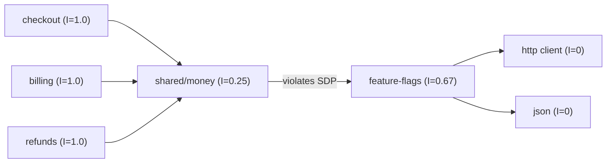

## In one minute
- Coupling is how much one module must know about, or change with, another. Cohesion is how strongly the parts inside one module belong together. Good design aims for low coupling between modules and high cohesion within them.
- The practical definition: two pieces of code are coupled if a change to one is likely to force a change to the other ([Fowler, Reducing Coupling](https://martinfowler.com/ieeeSoftware/coupling.pdf)). Cohesive code is code that changes for the same reasons at the same time.
- Both can be measured roughly: afferent coupling (who depends on me), efferent coupling (who I depend on), instability `Ce / (Ca + Ce)`, and lack of cohesion (LCOM) inside a class.
- The useful rule is direction, not zero: depend toward stable things. A module everyone imports should itself import little.
- Agents optimise locally. Agent-written changes often add one more import across a boundary or one more unrelated function to a "utils" file. Each looks harmless; together they erode structure. Review the dependency graph, not just the diff.

## How it works

### Coupling: the cost of change crossing boundaries
Coupling comes in degrees. From loosest to tightest, roughly: modules that exchange simple data through a narrow call; modules that pass a shared data structure and each read parts of it; modules that pass flags telling the other what to do; modules that share global state; and modules that reach into each other's internals. A useful test for any pair of modules is "if I change this one, how often must I touch that one?".

There is also coupling that no import statement shows. Two services that both parse the same JSON event format are coupled even though neither imports the other. Two modules that both assume a table's `status` column holds one of four strings are coupled through the database. Temporal coupling means one call must happen before another (`init` before `send`). These hidden forms are often worse because tools cannot see them.

### Cohesion: things that change together, live together
A cohesive module has one reason to change. A `pricing` package containing discount rules, tax rules and currency rounding is cohesive if pricing changes usually touch two or three of them together. A `utils` package containing date parsing, retry helpers, an S3 wrapper and a slug generator has low cohesion: its parts share a folder and nothing else. Low cohesion causes coupling, because everything that needs one helper imports the whole grab bag, and the grab bag imports everything its helpers need.

### A realistic "before"
An order service in a Node backend has this layout: `orders/` holds the HTTP handlers, the order state machine, the SQL queries, the payment calls, the email templates and a `helpers.ts` with 1,400 lines. `inventory/` imports `orders/helpers.ts` for a date function. `orders/` imports `inventory/db.ts` to read stock directly from inventory's tables. A product change to "allow partial shipments" touches 23 files across both folders; it takes three weeks and causes an incident when an inventory query breaks because an orders engineer renamed a column helper.

### The "after"
The team splits by reason to change. `orders/domain` holds the state machine and rules and imports nothing outside the language. `orders/http` and `orders/storage` are adapters depending on the domain. Inventory exposes a small `StockReader` API instead of its tables. The date function moves into a tiny `shared/time` package with no dependencies of its own. The next similar change touches 7 files, all in `orders`.

### Measuring it
Robert Martin's package metrics make the discussion concrete. For a module, afferent coupling `Ca` is the number of other modules that depend on it; efferent coupling `Ce` is the number it depends on. Instability is `I = Ce / (Ca + Ce)`, from 0 (everyone depends on me and I depend on nothing: hard to change, so it had better be stable) to 1 (nobody depends on me: free to change) ([definitions](https://en.wikipedia.org/wiki/Software_package_metrics)). The Stable Dependencies Principle says each dependency should point toward lower instability. An edge from a module with `I = 0.2` to one with `I = 0.8` is a warning: a widely used module now leans on a volatile one, so volatile changes ripple outward.

For cohesion inside a class, LCOM4 counts groups of methods connected by shared fields. A score of 1 means the class is one idea. A score of 3 means three classes are hiding in one.

### Names for the symptoms
Two smells from the refactoring catalogue describe bad cohesion and bad coupling as developers feel them. [Divergent change](https://refactoring.guru/smells/divergent-change) is one module you edit for many unrelated reasons, which is low cohesion. [Shotgun surgery](https://refactoring.guru/smells/shotgun-surgery) is one change that forces small edits in many modules, which is scattered cohesion and high coupling. Counting both from version control gives the history-based metric used in Layer 1.

The structural version shows up at scale too. When Shopify graphed the dependencies between the 37 components of its Rails monolith, every component depended on over half of the others, with many circular chains. The team did not reach for services first. They built a checker that reads static constant references and flags new bad edges in pull requests ([Shopify Engineering](https://shopify.engineering/shopify-monolith)).

### Too much of a good thing
Chasing low coupling has its own failure mode. Splitting a cohesive module into five packages to reduce `Ce` per package adds indirection and interface churn without reducing the real cost of change. Event buses introduced "for decoupling" often make coupling worse: the dependency still exists, but now it is invisible, untyped and asynchronous. Duplicating code to avoid an import trades one kind of coupling for a quieter one, where two copies must be changed in step; Fowler's point is that duplication always implies coupling ([Fowler](https://martinfowler.com/ieeeSoftware/coupling.pdf)). Some coupling is necessary; a module with zero dependencies does nothing. The goal is coupling that is explicit, narrow and pointed in the right direction.

### The same shape elsewhere
This is the fan-out shape: one change, many receivers. In microservices it appears as the "distributed monolith", where services must be deployed together. In data platforms it appears as hundreds of dashboards reading one raw table, so a column rename breaks them all. In organisations it is [Conway's law](http://www.melconway.com/Home/Committees_Paper.html): module boundaries follow team boundaries, and a highly coupled codebase forces teams into constant coordination.

## Down the stack

### Layer 1: The contract
There is no runtime contract for coupling; the promise is economic. Low coupling promises that the expected number of modules touched per change stays small and predictable. That is testable from history: from version control, compute for each commit how many modules it touched, and how often pairs of modules change in the same commit (change coupling). High cohesion promises that most commits touching a module touch several of its parts together.

### Layer 2: The mechanism
Static coupling metrics start from the import graph. Go exposes it directly with `go list -deps -json`; Python tools walk the `ast` for `import` nodes; JavaScript tools such as dependency-cruiser and madge resolve `import` and `require`; Java has `jdeps` and ArchUnit. From the graph, `Ca` and `Ce` are in-degree and out-degree after collapsing duplicate edges. Cycles are found with [Tarjan's strongly connected components algorithm](https://en.wikipedia.org/wiki/Tarjan%27s_strongly_connected_components_algorithm) in `O(V + E)`; any component with more than one module is a set that can only be understood, tested and released together. LCOM4 is a union-find over methods, joining two methods when they read or write a common field. Change coupling comes from mining `git log`: count co-changes for each pair of files and divide by the changes of each.

Languages enforce some of this. Go rejects import cycles at compile time, and its `internal/` directories stop packages outside the parent tree from importing them ([Go 1.4 release notes](https://go.dev/doc/go1.4#internalpackages)). Java modules (`module-info.java`) export only named packages. Python and TypeScript enforce nothing by default, which is why lint rules such as import-linter contracts or dependency-cruiser's `forbidden` rules exist.

### Layer 3: The machine
Coupling has physical costs in the build. Go compiles one package at a time in dependency order and caches the result keyed by the hashes of its inputs, including the export data of everything it imports. Editing a package with high afferent coupling invalidates the cache entry of every transitive dependent; in a large monorepo one edit to a core package can turn a 20-second incremental build into a 10-minute one. Bazel and similar systems have the same property at the action-graph level. Low `Ca` on volatile code keeps rebuilds small.

Cohesion has a hardware analogue in memory layout. Fields used together should sit together: a CPU loads 64-byte cache lines, so a struct whose hot fields share one line costs one memory access instead of several. The opposite failure is [false sharing](https://en.wikipedia.org/wiki/False_sharing): two unrelated counters, updated by different cores, that happen to share one cache line. Each write forces the line to move between cores, costing roughly 40 to 100 ns instead of about 1 ns for a local hit. Padding or splitting the struct (separating things that change independently) fixes it, which is cohesion and decoupling applied to bytes.

Across a network, runtime coupling multiplies failure. A request that synchronously calls five services, each 99.9% available, succeeds about 99.5% of the time, and its latency is the sum of theirs. Asynchronous messaging cuts that runtime coupling but keeps the schema coupling.

### Why it's built this way
1. Most engineering time goes into changing existing code, not writing new code.
2. The cost of a change grows with the number of places it must reach and the number of people who own them.
3. Coupling sets how far a change spreads; cohesion sets whether the places it reaches are near each other.
4. Machines charge for spread too: rebuild graphs, cache lines and network hops all get slower when unrelated things are tangled.
5. So designs that group by reason to change and point dependencies toward stable code are cheaper to evolve, to build and to run.

## Diagram


## Worked example
A Python monolith has 140 modules. The team extracts the import graph and finds `common.utils` with `Ca = 96` and `Ce = 31`, so `I = 31 / 127 ≈ 0.24`: very depended upon, yet depending on a quarter of the codebase. It imports `billing.models` for one constant, which in turn imports the ORM and Stripe's SDK, so loading any module pulls in Stripe. Cold start for a CLI command is 1.8 seconds, and a change to `billing.models` reruns tests for 96 modules.

An LCOM4 pass on `common.utils` gives 11 components: eleven unrelated ideas in one file. Git history agrees: in the past year, 212 commits touched it and no two of those commits touched the same function more than twice.

They split it into `common.time`, `common.retry` and `common.text` (each `Ce = 0`), move the billing-specific helpers into `billing`, and add an import-linter contract forbidding `common.*` from importing any domain package. Average modules affected per change, measured over the next two months of commits, dropped from 6.1 to 2.4. CLI cold start fell to 0.4 seconds because Stripe's SDK is no longer imported by default. CI time per pull request fell by about a third, mostly from smaller test selection.

## In the wild
- **NASA, 1999: Mars Climate Orbiter.** Ground software delivered thruster impulse data in pound-force seconds where the interface specification required newton-seconds. Trajectory effects were underestimated by a factor of 4.45 and the spacecraft was lost at Mars orbit insertion. No import or type linked the two sides; the coupling lived in an unchecked assumption about units ([NASA review board report](https://llis.nasa.gov/llis_lib/pdf/1009464main1_0641-mr.pdf)).
- **npm, 2016: left-pad.** A maintainer unpublished his package kik and 272 others, including the tiny left-pad. Within minutes of 2:30 PM Pacific on 22 March there were hundreds of failures per minute as projects, and their dependents, failed to fetch it. Within ten minutes a functionally identical version was republished ([npm](https://blog.npmjs.org/post/141577284765/kik-left-pad-and-npm)). A few lines of code had become a transitive dependency of thousands of builds.
- **Shopify, 2020: a monolith where everything depended on everything.** With over 2.8 million lines of Ruby and 500,000 commits, its core monolith had a dependency graph so dense that each component depended on over half the others. Shopify added tooling that checks static references between components instead of splitting the system ([Shopify Engineering](https://shopify.engineering/shopify-monolith)).

## Trade-offs
| Option | Strengths | Weaknesses | Choose when |
| --- | --- | --- | --- |
| Group by technical layer (controllers, models, services) | Familiar, easy to start | A feature change touches every layer; low cohesion per folder | Small apps, one team |
| Group by feature or domain | High cohesion, local changes | Shared concepts need a deliberate home | Most growing codebases |
| Shared utility package | Avoids duplication | Becomes a high-`Ca`, low-cohesion magnet | Only for small, dependency-free helpers |
| Duplicate small code instead of sharing | No import coupling | Copies drift; hidden change coupling | Tiny, stable snippets across team boundaries |
| Event-based decoupling | Runtime independence | Invisible, untyped dependencies | Truly independent consumers, with a schema registry |

## Pitfalls in production
- A "common" or "utils" package that everything imports and that imports domain code. Fix: forbid outward imports from shared packages with a linter rule and split by topic.
- Import cycles hidden behind lazy imports inside functions. Fix: run a cycle check in CI on the real import graph, including function-level imports.
- "Decoupling" through a message bus that every service subscribes to with ad hoc payloads. Fix: versioned schemas, owned topics and consumer contract tests.
- Two services sharing a database table. Fix: one owner; others go through its API or a published read model.
- Metrics treated as targets, so teams split modules to lower numbers without reducing change spread. Fix: judge by change coupling from history, not static counts alone.
- Struct fields updated by different goroutines or threads sitting in one cache line. Fix: pad hot counters to 64 bytes or shard them.

## Leadership lens
- Put the dependency rules in code: layering contracts, forbidden imports and cycle checks in CI. Rules kept only in people's heads do not survive team changes or agents.
- Review agent-written pull requests for new edges in the import graph, not only for correct behaviour. A good default is a CI comment listing added cross-module imports, so a human decides on each one.
- Use change coupling from git history to prioritise refactors; the modules that keep changing together across team boundaries are where coordination cost lives.
- Align module boundaries with team ownership. If two teams must coordinate on most changes, either merge the modules or redraw the teams.

## Check yourself
1. A module has `Ca = 0` and `Ce = 6`. What is its instability, and is that bad?
   **Answer:** `I = 6 / 6 = 1`. Not necessarily bad: nothing depends on it, so it is free to change; leaf modules such as HTTP handlers are expected to be unstable.
2. Why is an edge from a module with `I = 0.1` to one with `I = 0.9` a warning?
   **Answer:** A module many others depend on now depends on a volatile one, so frequent changes in the volatile module can ripple through to all dependents of the stable one, violating the Stable Dependencies Principle.
3. A class has LCOM4 of 3. What does that suggest, and what would you do?
   **Answer:** Its methods form three groups that share no fields, so it holds three separate ideas; consider splitting it into three classes along those groups.
4. How can two services be tightly coupled without any code dependency between them?
   **Answer:** Through shared data or assumptions: the same database table, the same untyped event format, or a required call order. A change on one side breaks the other with no compiler or import tool noticing.

## Practice
**Task:** Write a small dependency-graph analyser. The input `graph` maps a module name to the list of modules it imports; modules that appear only as import targets are modules too. Ignore self-imports and count duplicate edges once. `coupling_metrics(graph)` returns, for every module, its afferent coupling `ca`, efferent coupling `ce` and instability `ce / (ca + ce)` rounded to 2 decimal places (0 when both are 0). `sdp_violations(graph)` returns every distinct edge `[from, to]` where the rounded instability of `from` is strictly less than that of `to`, sorted. `lcom4(methods)` takes a map from method name to the fields it uses and returns the number of groups of methods connected through shared fields (a method with no fields is its own group; an empty map gives 0).

```python starter
def coupling_metrics(graph):
    # TODO: {module: (ca, ce, instability)}
    raise NotImplementedError


def sdp_violations(graph):
    # TODO: sorted [[from, to], ...]
    raise NotImplementedError


def lcom4(methods):
    # TODO: number of connected method groups
    raise NotImplementedError
```

```python tests
LAYERED = {
    "api": ["service", "log"],
    "service": ["repo", "log"],
    "repo": ["db", "log"],
}

FLAGS = {
    "checkout": ["money"],
    "billing": ["money"],
    "refunds": ["money"],
    "money": ["flags"],
    "flags": ["http", "json"],
}


def test_metrics_layered():
    m = coupling_metrics(LAYERED)
    assert sorted(m) == ["api", "db", "log", "repo", "service"]
    assert m["api"] == (0, 2, 1.0)
    assert m["service"] == (1, 2, 0.67)
    assert m["log"] == (3, 0, 0.0)
    assert m["db"] == (1, 0, 0.0)


def test_self_and_duplicate_edges():
    m = coupling_metrics({"x": ["x", "y", "y"]})
    assert m == {"x": (0, 1, 1.0), "y": (1, 0, 0.0)}


def test_isolated_module():
    assert coupling_metrics({"solo": []}) == {"solo": (0, 0, 0.0)}


def test_no_violations_in_layered():
    assert sdp_violations(LAYERED) == []


def test_stable_module_depending_on_volatile():
    m = coupling_metrics(FLAGS)
    assert m["money"] == (3, 1, 0.25)
    assert m["flags"] == (1, 2, 0.67)
    assert sdp_violations(FLAGS) == [["money", "flags"]]


def test_lcom4_groups():
    account = {
        "deposit": ["balance", "ledger"],
        "withdraw": ["balance"],
        "statement": ["ledger"],
        "send_email": ["smtp"],
        "render": ["template", "smtp"],
        "ping": [],
    }
    assert lcom4(account) == 3


def test_lcom4_edges():
    assert lcom4({}) == 0
    assert lcom4({"a": ["f"], "b": ["f"], "c": ["f", "g"]}) == 1
```

```python solution
def _edges(graph):
    edges = set()
    nodes = set(graph)
    for src, targets in graph.items():
        for dst in targets:
            nodes.add(dst)
            if dst != src:
                edges.add((src, dst))
    return nodes, edges


def coupling_metrics(graph):
    nodes, edges = _edges(graph)
    ca = {n: 0 for n in nodes}
    ce = {n: 0 for n in nodes}
    for src, dst in edges:
        ce[src] += 1
        ca[dst] += 1
    out = {}
    for n in nodes:
        total = ca[n] + ce[n]
        inst = round(ce[n] / total, 2) if total else 0.0
        out[n] = (ca[n], ce[n], inst)
    return out


def sdp_violations(graph):
    m = coupling_metrics(graph)
    _, edges = _edges(graph)
    return sorted([a, b] for a, b in edges if m[a][2] < m[b][2])


def lcom4(methods):
    parent = {name: name for name in methods}

    def find(x):
        while parent[x] != x:
            parent[x] = parent[parent[x]]
            x = parent[x]
        return x

    owner = {}
    for name, fields in methods.items():
        for f in fields:
            if f in owner:
                parent[find(name)] = find(owner[f])
            else:
                owner[f] = name
    return len({find(n) for n in methods})
```

```typescript starter
export interface Metrics { ca: number; ce: number; instability: number; }

export function couplingMetrics(graph: Record<string, string[]>): Record<string, Metrics> {
  throw new Error("TODO");
}

export function sdpViolations(graph: Record<string, string[]>): [string, string][] {
  throw new Error("TODO");
}

export function lcom4(methods: Record<string, string[]>): number {
  throw new Error("TODO");
}
```

```typescript tests
const LAYERED: Record<string, string[]> = {
  api: ["service", "log"],
  service: ["repo", "log"],
  repo: ["db", "log"],
};

const FLAGS: Record<string, string[]> = {
  checkout: ["money"],
  billing: ["money"],
  refunds: ["money"],
  money: ["flags"],
  flags: ["http", "json"],
};

test("metrics layered", () => {
  const m = couplingMetrics(LAYERED);
  assertEqual(Object.keys(m).sort(), ["api", "db", "log", "repo", "service"]);
  assertEqual(m["api"], { ca: 0, ce: 2, instability: 1 });
  assertEqual(m["service"], { ca: 1, ce: 2, instability: 0.67 });
  assertEqual(m["log"], { ca: 3, ce: 0, instability: 0 });
  assertEqual(m["db"], { ca: 1, ce: 0, instability: 0 });
});

test("self and duplicate edges", () => {
  const m = couplingMetrics({ x: ["x", "y", "y"] });
  assertEqual(m["x"], { ca: 0, ce: 1, instability: 1 });
  assertEqual(m["y"], { ca: 1, ce: 0, instability: 0 });
});

test("isolated module", () => {
  assertEqual(couplingMetrics({ solo: [] }), { solo: { ca: 0, ce: 0, instability: 0 } });
});

test("no violations in layered", () => {
  assertEqual(sdpViolations(LAYERED), []);
});

test("stable module depending on volatile", () => {
  const m = couplingMetrics(FLAGS);
  assertEqual(m["money"], { ca: 3, ce: 1, instability: 0.25 });
  assertEqual(m["flags"], { ca: 1, ce: 2, instability: 0.67 });
  assertEqual(sdpViolations(FLAGS), [["money", "flags"]]);
});

test("lcom4 groups", () => {
  const account: Record<string, string[]> = {
    deposit: ["balance", "ledger"],
    withdraw: ["balance"],
    statement: ["ledger"],
    send_email: ["smtp"],
    render: ["template", "smtp"],
    ping: [],
  };
  assertEqual(lcom4(account), 3);
});

test("lcom4 edges", () => {
  assertEqual(lcom4({}), 0);
  assertEqual(lcom4({ a: ["f"], b: ["f"], c: ["f", "g"] }), 1);
});
```

```typescript solution
export interface Metrics { ca: number; ce: number; instability: number; }

function edgesOf(graph: Record<string, string[]>): { nodes: Set<string>; edges: [string, string][] } {
  const nodes = new Set<string>(Object.keys(graph));
  const seen = new Set<string>();
  const edges: [string, string][] = [];
  for (const src of Object.keys(graph)) {
    for (const dst of graph[src]) {
      nodes.add(dst);
      const key = src + "\u0000" + dst;
      if (dst !== src && !seen.has(key)) { seen.add(key); edges.push([src, dst]); }
    }
  }
  return { nodes, edges };
}

export function couplingMetrics(graph: Record<string, string[]>): Record<string, Metrics> {
  const { nodes, edges } = edgesOf(graph);
  const ca = new Map<string, number>();
  const ce = new Map<string, number>();
  for (const n of nodes) { ca.set(n, 0); ce.set(n, 0); }
  for (const [s, d] of edges) { ce.set(s, ce.get(s)! + 1); ca.set(d, ca.get(d)! + 1); }
  const out: Record<string, Metrics> = {};
  for (const n of nodes) {
    const a = ca.get(n)!, e = ce.get(n)!;
    const inst = a + e === 0 ? 0 : Math.round((e / (a + e)) * 100) / 100;
    out[n] = { ca: a, ce: e, instability: inst };
  }
  return out;
}

export function sdpViolations(graph: Record<string, string[]>): [string, string][] {
  const m = couplingMetrics(graph);
  const { edges } = edgesOf(graph);
  return edges
    .filter(([a, b]) => m[a].instability < m[b].instability)
    .sort((x, y) => (x[0] + "\u0000" + x[1] < y[0] + "\u0000" + y[1] ? -1 : 1));
}

export function lcom4(methods: Record<string, string[]>): number {
  const parent = new Map<string, string>();
  for (const n of Object.keys(methods)) parent.set(n, n);
  const find = (x: string): string => {
    while (parent.get(x) !== x) { parent.set(x, parent.get(parent.get(x)!)!); x = parent.get(x)!; }
    return x;
  };
  const owner = new Map<string, string>();
  for (const n of Object.keys(methods)) {
    for (const f of methods[n]) {
      const o = owner.get(f);
      if (o !== undefined) parent.set(find(n), find(o));
      else owner.set(f, n);
    }
  }
  return new Set(Object.keys(methods).map(find)).size;
}
```

```go starter
package practice

type Metrics struct {
	Ca, Ce      int
	Instability float64
}

func CouplingMetrics(graph map[string][]string) map[string]Metrics {
	panic("TODO")
}

// SDPViolations returns sorted [from, to] pairs.
func SDPViolations(graph map[string][]string) [][2]string {
	panic("TODO")
}

func LCOM4(methods map[string][]string) int {
	panic("TODO")
}
```

```go tests
package practice

import (
	"reflect"
	"testing"
)

var layered = map[string][]string{
	"api":     {"service", "log"},
	"service": {"repo", "log"},
	"repo":    {"db", "log"},
}

var flags = map[string][]string{
	"checkout": {"money"},
	"billing":  {"money"},
	"refunds":  {"money"},
	"money":    {"flags"},
	"flags":    {"http", "json"},
}

func TestMetricsLayered(t *testing.T) {
	m := CouplingMetrics(layered)
	if len(m) != 5 {
		t.Fatalf("modules %v", m)
	}
	want := map[string]Metrics{
		"api":     {0, 2, 1},
		"service": {1, 2, 0.67},
		"log":     {3, 0, 0},
		"db":      {1, 0, 0},
	}
	for k, w := range want {
		if m[k] != w {
			t.Fatalf("%s: got %v want %v", k, m[k], w)
		}
	}
}

func TestSelfAndDuplicateEdges(t *testing.T) {
	m := CouplingMetrics(map[string][]string{"x": {"x", "y", "y"}})
	want := map[string]Metrics{"x": {0, 1, 1}, "y": {1, 0, 0}}
	if !reflect.DeepEqual(m, want) {
		t.Fatalf("got %v", m)
	}
}

func TestIsolatedModule(t *testing.T) {
	m := CouplingMetrics(map[string][]string{"solo": {}})
	if !reflect.DeepEqual(m, map[string]Metrics{"solo": {0, 0, 0}}) {
		t.Fatalf("got %v", m)
	}
}

func TestNoViolationsLayered(t *testing.T) {
	if v := SDPViolations(layered); len(v) != 0 {
		t.Fatalf("got %v", v)
	}
}

func TestStableDependsOnVolatile(t *testing.T) {
	m := CouplingMetrics(flags)
	if m["money"] != (Metrics{3, 1, 0.25}) || m["flags"] != (Metrics{1, 2, 0.67}) {
		t.Fatalf("got money %v flags %v", m["money"], m["flags"])
	}
	if v := SDPViolations(flags); !reflect.DeepEqual(v, [][2]string{{"money", "flags"}}) {
		t.Fatalf("got %v", v)
	}
}

func TestLCOM4Groups(t *testing.T) {
	account := map[string][]string{
		"deposit":    {"balance", "ledger"},
		"withdraw":   {"balance"},
		"statement":  {"ledger"},
		"send_email": {"smtp"},
		"render":     {"template", "smtp"},
		"ping":       {},
	}
	if n := LCOM4(account); n != 3 {
		t.Fatalf("got %d", n)
	}
}

func TestLCOM4Edges(t *testing.T) {
	if n := LCOM4(map[string][]string{}); n != 0 {
		t.Fatalf("empty %d", n)
	}
	if n := LCOM4(map[string][]string{"a": {"f"}, "b": {"f"}, "c": {"f", "g"}}); n != 1 {
		t.Fatalf("connected %d", n)
	}
}
```

```go solution
package practice

import (
	"math"
	"sort"
)

type Metrics struct {
	Ca, Ce      int
	Instability float64
}

func edgesOf(graph map[string][]string) (map[string]bool, map[[2]string]bool) {
	nodes := map[string]bool{}
	edges := map[[2]string]bool{}
	for src, targets := range graph {
		nodes[src] = true
		for _, dst := range targets {
			nodes[dst] = true
			if dst != src {
				edges[[2]string{src, dst}] = true
			}
		}
	}
	return nodes, edges
}

func CouplingMetrics(graph map[string][]string) map[string]Metrics {
	nodes, edges := edgesOf(graph)
	out := map[string]Metrics{}
	for n := range nodes {
		out[n] = Metrics{}
	}
	for e := range edges {
		s, d := out[e[0]], out[e[1]]
		s.Ce++
		out[e[0]] = s
		d = out[e[1]]
		d.Ca++
		out[e[1]] = d
	}
	for n, m := range out {
		if total := m.Ca + m.Ce; total > 0 {
			m.Instability = math.Round(float64(m.Ce)/float64(total)*100) / 100
		}
		out[n] = m
	}
	return out
}

func SDPViolations(graph map[string][]string) [][2]string {
	m := CouplingMetrics(graph)
	_, edges := edgesOf(graph)
	out := [][2]string{}
	for e := range edges {
		if m[e[0]].Instability < m[e[1]].Instability {
			out = append(out, e)
		}
	}
	sort.Slice(out, func(i, j int) bool {
		if out[i][0] != out[j][0] {
			return out[i][0] < out[j][0]
		}
		return out[i][1] < out[j][1]
	})
	return out
}

func LCOM4(methods map[string][]string) int {
	parent := map[string]string{}
	for n := range methods {
		parent[n] = n
	}
	var find func(string) string
	find = func(x string) string {
		for parent[x] != x {
			parent[x] = parent[parent[x]]
			x = parent[x]
		}
		return x
	}
	names := make([]string, 0, len(methods))
	for n := range methods {
		names = append(names, n)
	}
	sort.Strings(names)
	owner := map[string]string{}
	for _, n := range names {
		for _, f := range methods[n] {
			if o, ok := owner[f]; ok {
				parent[find(n)] = find(o)
			} else {
				owner[f] = n
			}
		}
	}
	roots := map[string]bool{}
	for n := range methods {
		roots[find(n)] = true
	}
	return len(roots)
}
```

## Mock interview
**Prompt:** You join a team with a 600,000-line TypeScript monorepo. Every feature touches eight to ten packages, CI takes 45 minutes because almost every change invalidates almost every package, and two teams block each other weekly. How would you find the worst coupling and reduce it over two quarters?

- Follow-up: Which data would you collect first, static imports or git history, and why?
- Follow-up: You find a 200-package dependency cycle. How do you break it without freezing feature work?
- Follow-up: A teammate proposes moving to an event bus "to decouple everything". How do you respond?

**A strong answer covers:**
- Measuring both static coupling (import graph, `Ca`, `Ce`, instability, cycles) and change coupling from version control, and comparing them.
- Targeting high-`Ca` packages that import volatile code, and shared "utils" magnets, first.
- Breaking cycles by extracting the shared concept into a lower-level package or inverting one dependency behind an interface, one edge at a time.
- Enforcing the new structure with CI rules so it does not regress, including for agent-generated changes.
- Recognising that an event bus hides coupling rather than removing it, and that schema contracts still bind producers and consumers.
- Linking package boundaries to team ownership to reduce cross-team blocking.

## Sources and further study
**Primary**
- [Conway, How Do Committees Invent? (1968)](http://www.melconway.com/Home/Committees_Paper.html): the original statement that a system's structure copies its builders' communication structure.
- [Parnas, On the criteria to be used in decomposing systems into modules](https://www.win.tue.nl/~wstomv/edu/2ip30/references/criteria_for_modularization.pdf): modules should hide decisions likely to change, which is cohesion by reason to change.
- [Go 1.4 release notes: internal packages](https://go.dev/doc/go1.4#internalpackages): the language-level rule that limits who may depend on a package.

**Systems docs**
- [Shopify: under deconstruction, the state of Shopify's monolith](https://shopify.engineering/shopify-monolith): measured component dependencies and a boundary checker in a very large codebase.
- [npm: kik, left-pad and npm](https://blog.npmjs.org/post/141577284765/kik-left-pad-and-npm): the registry's own account of a transitive dependency failing at scale.
- [NASA Mars Climate Orbiter mishap report](https://llis.nasa.gov/llis_lib/pdf/1009464main1_0641-mr.pdf): hidden interface coupling with a physical cost.

**Books**
- *Clean Architecture*, Robert C. Martin, chapter 13 "Component Cohesion" and chapter 14 "Component Coupling": the stable dependencies principle and the instability metric.
- *Refactoring* (2nd ed.), Martin Fowler, chapter 3 "Bad Smells in Code": divergent change and shotgun surgery as the two symptoms.

**Other curricula**
- [Refactoring.Guru: Shotgun Surgery](https://refactoring.guru/smells/shotgun-surgery): frames coupling as the cost of a change that fans out across classes.
- [Azure Architecture Center: Anti-corruption layer](https://learn.microsoft.com/en-us/azure/architecture/patterns/anti-corruption-layer): a translation layer that keeps one subsystem's model from leaking into another.

## Watch
- [Continued Learning: The Beauty of Maintenance (Kent Beck, DDD Europe 2020)](https://www.youtube.com/watch?v=3gib0hKYjB0): Kent Beck on why the cost of software is the cost of changing it.
- [Abstraction Can Make Your Code Worse (CodeAesthetic)](https://www.youtube.com/watch?v=rQlMtztiAoA): how premature abstraction creates coupling instead of removing it.

## Free resources
- [Coupling (Martin Fowler, IEEE Software)](https://martinfowler.com/ieeeSoftware/coupling.pdf): a short column on when coupling matters and how to reduce it.
- [Software package metrics (Wikipedia)](https://en.wikipedia.org/wiki/Software_package_metrics): definitions of afferent and efferent coupling, instability, abstractness and distance from the main sequence.
- [Coupling (Wikipedia)](https://en.wikipedia.org/wiki/Coupling_(computer_programming)): the classic coupling types, from data coupling to content coupling.
- [Cohesion (Wikipedia)](https://en.wikipedia.org/wiki/Cohesion_(computer_science)): the cohesion types and why functional cohesion is the goal.
- [Organizing a Go module (go.dev)](https://go.dev/doc/modules/layout): how Go's package and `internal/` layout enforce boundaries.
