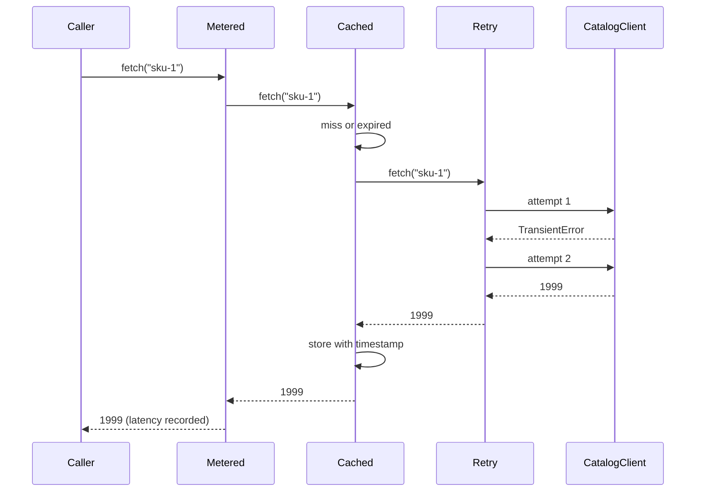

## In one minute
- A decorator wraps an object in another object with the same interface, adding behaviour before or after delegating: caching, retries, metrics, authorisation, compression, buffering. Callers cannot tell the difference, which is the point.
- Decorators compose. `Cached(Retry(Client))` and `Retry(Cached(Client))` are both valid and behave differently, so the order of wrapping is a design decision, not a detail.
- The pattern replaces subclass explosions (`CachedRetryingMeteredClient`) with small pieces that combine at wiring time. HTTP middleware, gRPC interceptors, `bufio.Reader` and Python's `@functools.cache` are all decorators.
- The costs: one indirect call per layer, lost identity (type checks and optional interfaces stop working through the wrapper), and stateful wrappers that need their own concurrency control.
- Agents tend to inline cross-cutting concerns (a retry loop pasted into every client method). In review, ask for one decorator per concern, a single place where they are stacked, and a test that pins the order.

## How it works

### The problem
A pricing service calls an upstream catalogue API to get a product's price. Over a year the client grows: a retry loop for timeouts, an in-memory cache, a latency histogram, a circuit breaker. Each lands inside `CatalogClient.get_price`, which is now 140 lines, and the next team that calls the same upstream from a batch job copies half of it. Turning off the cache in tests needs a flag. Nobody is sure whether a cache hit is counted in the latency metric.

The decorator answer: keep `CatalogClient` doing one thing (an HTTP call), and add each concern as a wrapper that implements the same `PriceSource` interface:

```python
class Retry:
    def __init__(self, inner, attempts):
        self.inner, self.attempts = inner, attempts

    def fetch(self, key):
        for i in range(self.attempts):
            try:
                return self.inner.fetch(key)
            except TransientError:
                if i == self.attempts - 1:
                    raise

source = Metered(Cached(Retry(CatalogClient(url), 3), clock, ttl=30))
```

Every wrapper is tested alone with a fake inner source. The batch job builds a different stack (no cache, more retries) from the same parts.

### Order is behaviour
Read a decorator stack from the outside in: the outermost wrapper sees every call first. In `Metered(Cached(Retry(client)))` the histogram includes cache hits, so its p50 collapses toward zero when the hit ratio is high; in `Cached(Metered(Retry(client)))` it measures only upstream calls. Retry outside a cache means a miss is retried; retry inside means the cache never stores a failure, which is what you usually want. Authorisation must sit outside caching, or one user's cached response can be served to another. Libraries that ship stacks document their order for this reason: Resilience4j's Spring aspects nest as Retry, CircuitBreaker, RateLimiter, TimeLimiter, Bulkhead, outermost first ([Resilience4j docs](https://resilience4j.readme.io/docs/getting-started-3)), and Django lists which middleware must sit above which, such as the cache and gzip middleware ([Django docs](https://docs.djangoproject.com/en/stable/ref/middleware/)). Write the order down in one wiring function and add a test for the property that depends on it.

### Function decorators
Python's `@decorator` syntax applies the same idea to functions: `@cache` above `def f` is shorthand for `f = cache(f)`. HTTP middleware in Go has the type `func(http.Handler) http.Handler`, Express middleware calls `next()`, Django middleware wraps `get_response`, and gRPC interceptors receive the next handler as an argument. These are decorators whose interface is "a function that handles a request". The same ordering rules apply.

### Decorator versus inheritance
Subclassing adds behaviour too, but statically and one combination at a time. Three optional concerns give eight subclasses; with decorators they are three classes chosen at runtime. Decorators also work on objects you did not create, such as a client handed to you by a library. Inheritance remains fine when one variant is fixed and the base class was designed to be extended.

### Decorator, proxy, adapter
A proxy has the same structure (a wrapper with the same interface) but controls access to the object rather than adding features: lazy loading, remote access, permission checks. Many real wrappers are both. An adapter changes the interface; a decorator must not. If your "decorator" adds a public method callers depend on, it has become something else and stacking breaks.

### Reviewing agent-written code
Asked to "add retries to the catalogue client", an agent usually writes a `for` loop inside `get_price`, and does the same in `get_stock` and `get_description` on the next request. Steer it to one `Retry` wrapper over the interface. Then check what the wrapper retries (only errors marked transient, never a 400 or a validation error), whether the operation is idempotent, how many layers already retry, and that `functools.wraps` or an equivalent keeps names and docstrings for function decorators.

### The same shape elsewhere
Decorators handle the *overload* and *partial failure* shapes as composable layers. The same layering appears in network stacks (TLS wraps TCP; HTTP/2 framing wraps TLS), in Linux's block layer (dm-crypt and dm-cache are device-mapper targets stacked over a disk, each presenting a block device) and in service meshes, where Envoy filter chains apply rate limiting, authentication and retries to every request in a configured order.

## Down the stack

### Layer 1: The contract
A decorator promises to implement the wrapped interface's full contract and to change behaviour only in the documented way. A caching decorator promises results at most `ttl` old and that failures are not cached unless documented; a retrying decorator promises a maximum number of attempts and that it retries only idempotent operations on transient errors. What a decorator does *not* preserve must be stated: object identity changes, so `isinstance`, `==`, Go type assertions and reflection see the wrapper, not the original.

### Layer 2: The mechanism
PEP 318 defines `@d` above a function as `f = d(f)` evaluated at definition time, and stacked decorators apply bottom-up, so the one nearest `def` is innermost ([PEP 318](https://peps.python.org/pep-0318/)). `functools.wraps` copies `__module__`, `__name__`, `__qualname__`, `__annotations__`, `__type_params__` (added in Python 3.12) and `__doc__`, updates `__dict__`, and sets `__wrapped__` ([functools docs](https://docs.python.org/3/library/functools.html)), which `inspect.signature` follows to report the original signature. `functools.lru_cache` keeps a dict from argument key to a node in a circular doubly linked list for recency.

In Go, `bufio.NewReader(r)` returns a struct holding the inner `io.Reader`, a 4096-byte default buffer ([bufio source](https://go.dev/src/bufio/bufio.go)) and read and write offsets; `gzip.NewReader`, `io.LimitReader` and `io.TeeReader` stack the same way. HTTP middleware that wraps `http.ResponseWriter` to record the status code hits a known trap: the wrapper hides optional interfaces such as `http.Flusher` and `http.Hijacker`, so streaming and websockets break silently. Go 1.20 added `http.ResponseController`, which looks for an `Unwrap() http.ResponseWriter` method to reach the original writer through the decorators ([net/http docs](https://pkg.go.dev/net/http#NewResponseController), [Go 1.20 notes](https://go.dev/doc/go1.20)).

### Layer 3: The machine
Each layer costs a call frame and, in Go, an indirect call through an itab, about 1 to 2 ns when predicted. Ten middleware layers add perhaps 20 ns and ten stack frames, invisible next to a 1 ms request. In CPython a generic `def wrapper(*args, **kwargs)` builds a tuple and a dict on every call and costs roughly 100 ns per layer, which shows up in tight loops of millions of calls. Go closures that capture variables escape to the heap once, when the middleware is built, not per request. In V8, a call site that always sees the same wrapper class stays monomorphic and can be inlined.

Some decorators save far more than they cost. Reading a file one byte at a time through an unbuffered reader makes one `read` syscall per byte, roughly 200 to 500 ns each; `bufio.Reader` turns 4096 of those into one syscall and 4095 memory copies from the buffer. A cache decorator turns an 80 ms network call into a hash lookup of under 100 ns.

Stateful decorators carry concurrency costs. A cache needs a lock or a concurrent map, and without request coalescing a popular key that expires sends every concurrent caller upstream at once (a stampede). Go's `singleflight` package and similar tools let one caller fetch while others wait ([singleflight docs](https://pkg.go.dev/golang.org/x/sync/singleflight)). Python's `lru_cache` keeps its internal structure consistent under threads but documents that the wrapped function may be called more than once for the same key when calls overlap ([functools docs](https://docs.python.org/3/library/functools.html)).

### Why it's built this way
1. Cross-cutting concerns (caching, retries, metrics) apply to many components, so writing them inside each one duplicates code.
2. Subclassing for every combination of concerns grows exponentially, so concerns become separate objects.
3. Keeping the same interface lets any component be wrapped without its callers changing.
4. Each wrapper is one indirect call, cheap next to the I/O most wrappers guard.
5. Because order changes behaviour, the stack is built in one place and tested as a whole.

## Diagram


## Worked example
A pricing service handles 12,000 requests a second at peak, and each request needs prices for about 8 products. The catalogue upstream has a p99 of 80 ms and fails about 0.5% of calls with timeouts. The original client called upstream 96,000 times a second and retried inside every method.

The team split it into `CatalogClient`, `Retry(attempts=3, transient only)`, `Cached(ttl=30s)` and `Metered`, wired as `Metered(Cached(Retry(client)))` with a separate upstream histogram inside the retry layer. The cache hit ratio settled at 93%, cutting upstream traffic to about 6,700 calls a second and request p99 from 95 ms to 22 ms.

Then an incident: the upstream degraded and error rates hit 40%. The pricing service retried 3 times, but so did the API gateway in front of it and the mobile client, so each user action could produce up to 27 upstream calls (three layers, three tries each; AWS describes the same multiplication, 243 times across five layers, in its [Builders' Library](https://aws.amazon.com/builders-library/timeouts-retries-and-backoff-with-jitter/)). The fix was a decorator, not a rewrite: a `RetryBudget` wrapper that allows retries only while they stay under 10% of recent requests (the ratio Google's SRE book uses for per-client budgets, [SRE book](https://sre.google/sre-book/handling-overload/)), placed inside the cache, plus removing retries from the gateway. The order of layers was then pinned by a test that counts upstream calls for a scripted failure sequence.

## In the wild
- **AWS, Builders' Library: retries that multiply across layers.** AWS describes a stack five layers deep with three retries at each layer: if the database fails queries under load, independent retrying raises its load 243 times, which makes recovery unlikely. Their guidance is to retry at a single point in the stack, and the AWS SDK limits local retries with a token bucket, added in 2016 ([AWS Builders' Library](https://aws.amazon.com/builders-library/timeouts-retries-and-backoff-with-jitter/)).
- **Google, SRE book: retry budgets as a layer.** To stop retries amplifying an overload, Google limits each request to three attempts and each client to retries that are under 10% of its requests. A retry budget is exactly a decorator that counts and refuses, wrapped around the call ([SRE book](https://sre.google/sre-book/handling-overload/)).
- **Go, 2023: wrappers that hid `http.Flusher`.** Middleware that wrapped `http.ResponseWriter` hid optional interfaces such as `Flusher` and `Hijacker`. Go 1.20 added `ResponseController`, which follows an `Unwrap` method through the wrappers, because the optional-interface approach was described as not discoverable and clumsy ([Go 1.20 notes](https://go.dev/doc/go1.20)).

## Trade-offs
| Option | Strengths | Weaknesses | Choose when |
| --- | --- | --- | --- |
| Logic inside the class | Simple to read for one concern | Duplicated across classes; hard to turn off in tests | One component, one concern |
| Subclass per combination | Static and explicit | Combinatorial growth; fixed at compile time | One fixed variant of a class designed for extension |
| Object decorators | Compose at runtime; test each alone | Order bugs; identity lost; more objects | Several concerns over the same interface |
| Function decorators and middleware | Concise; framework support | Hidden control flow; signature loss without `wraps` | Request pipelines and pure functions |
| Sidecar or service mesh filters | Language-agnostic; ops-controlled | Network hop; config drift from code | Policy shared by many services |

## Pitfalls in production
- Retries stacked at several layers multiplying load during an outage. Fix: retry in one layer, add a retry budget, and retry only idempotent operations.
- Caching above authorisation, serving one user's data to another. Fix: authorise outside the cache or include the principal in the cache key, and test it.
- Wrappers that hide optional interfaces (`http.Flusher`, `io.WriterTo`), disabling streaming or zero-copy paths. Fix: implement `Unwrap`, or forward the optional interfaces explicitly.
- Caching failures, so a 2-second blip becomes a 30-second outage. Fix: cache only successes, or cache errors for a much shorter time.
- Cache stampedes when a hot key expires. Fix: coalesce concurrent misses and add jitter to TTLs.
- Function decorators that drop names and signatures, breaking logs, docs and frameworks that inspect parameters. Fix: `functools.wraps`.

## Leadership lens
- Ask for one wiring function per client that shows the whole stack in order. It is the page an on-call engineer reads during an incident.
- Decide where retries live across the whole request path (client, gateway, service, library) and write it down. Retry amplification is an organisational problem before it is a code problem.
- Prefer shared, well-tested decorators for caching, retries and metrics over per-team versions. Reviewing one retry implementation is cheaper than reviewing twelve.
- Treat a decorator order change like a behaviour change: it needs a test and a release note.

## Check yourself
1. Why does `Metered(Cached(x))` report a lower median latency than `Cached(Metered(x))`?
   **Answer:** In the first, the meter is outside the cache and records cache hits, which are nearly instant; in the second it records only calls that reached `x`.
2. Why should retry usually sit inside a cache rather than outside it?
   **Answer:** Inside, the cache stores only the final successful result and a hit skips retrying entirely; outside, a cached error or a miss can trigger retries of a layer that already handles freshness.
3. What does wrapping a Go `http.ResponseWriter` break, and how is it fixed?
   **Answer:** Type assertions for optional interfaces such as `http.Flusher` fail on the wrapper. Implement `Unwrap()` so `http.ResponseController` can reach the original, or forward the interfaces explicitly.
4. When is a subclass better than a decorator?
   **Answer:** When there is one fixed variant, the base class was designed for extension, and the behaviour needs access to protected internals that a wrapper cannot reach.

## Practice
**Task:** Build composable decorators over a `fetch(key)` interface that returns a value or fails. Define `TransientError` (Go: the sentinel `ErrTransient`, matched with `errors.Is`). `Retry(inner, attempts)` calls the inner fetch up to `attempts` times while it fails with a transient error, and returns the last error when attempts run out; any other error is returned immediately. `Cached(inner, clock, ttl)` stores successful results with the time from `clock()`; a stored value is served while `now - stored_at < ttl`, otherwise the inner fetch is called again; errors are never cached. `Counting(inner)` increments a `calls` counter and delegates. `chain(base, decorators)` applies a list of functions that each take an inner fetcher and return a wrapped one, so that the first function in the list becomes the outermost layer. Python raises, TypeScript throws, Go returns errors.

```python starter
class TransientError(Exception):
    pass

class Retry:
    def __init__(self, inner, attempts):
        self.inner = inner
        self.attempts = attempts

    def fetch(self, key):
        # TODO
        raise NotImplementedError

class Cached:
    def __init__(self, inner, clock, ttl):
        self.inner = inner
        self.clock = clock
        self.ttl = ttl

    def fetch(self, key):
        # TODO
        raise NotImplementedError

class Counting:
    def __init__(self, inner):
        self.inner = inner
        self.calls = 0

    def fetch(self, key):
        # TODO
        raise NotImplementedError

def chain(base, decorators):
    # TODO
    raise NotImplementedError
```

```python tests
class Script:
    """Fails with the given errors in order, then returns key + '!'."""
    def __init__(self, errors=()):
        self.errors = list(errors)
        self.calls = 0
    def fetch(self, key):
        self.calls += 1
        if self.errors:
            raise self.errors.pop(0)
        return key + "!"

class Clock:
    def __init__(self):
        self.now = 0
    def __call__(self):
        return self.now

def error_of(fn):
    try:
        fn()
    except Exception as e:
        return type(e).__name__ + ": " + str(e)
    return None

def test_retry_recovers_from_transient_errors():
    s = Script([TransientError("t1"), TransientError("t2")])
    assert Retry(s, 3).fetch("a") == "a!" and s.calls == 3

def test_retry_gives_up_with_last_error():
    s = Script([TransientError("t1"), TransientError("t2"), TransientError("t3")])
    assert error_of(lambda: Retry(s, 3).fetch("a")) == "TransientError: t3"
    assert s.calls == 3

def test_permanent_error_not_retried():
    s = Script([ValueError("bad sku")])
    assert error_of(lambda: Retry(s, 5).fetch("a")) == "ValueError: bad sku"
    assert s.calls == 1

def test_cache_hits_until_ttl():
    s, clock = Script(), Clock()
    c = Cached(s, clock, 10)
    assert c.fetch("a") == "a!" and c.fetch("a") == "a!" and s.calls == 1
    clock.now = 9
    c.fetch("a")
    assert s.calls == 1
    clock.now = 10
    c.fetch("a")
    assert s.calls == 2
    c.fetch("b")
    assert s.calls == 3

def test_errors_are_not_cached():
    s = Script([TransientError("down")])
    c = Cached(s, Clock(), 10)
    assert error_of(lambda: c.fetch("a")) == "TransientError: down"
    assert c.fetch("a") == "a!" and s.calls == 2

def test_chain_first_is_outermost():
    s, clock, seen = Script(), Clock(), {}
    def outer(inner):
        seen["outer"] = Counting(inner)
        return seen["outer"]
    def inner_count(inner):
        seen["inner"] = Counting(inner)
        return seen["inner"]
    f = chain(s, [outer, lambda i: Cached(i, clock, 5), inner_count])
    f.fetch("a")
    f.fetch("a")
    assert seen["outer"].calls == 2 and seen["inner"].calls == 1

def test_cache_over_retry_stack():
    s, clock = Script([TransientError("t1")]), Clock()
    f = chain(s, [lambda i: Cached(i, clock, 5), lambda i: Retry(i, 2)])
    assert f.fetch("a") == "a!" and f.fetch("a") == "a!"
    assert s.calls == 2
```

```python solution
class TransientError(Exception):
    pass

class Retry:
    def __init__(self, inner, attempts):
        self.inner = inner
        self.attempts = attempts

    def fetch(self, key):
        last = None
        for _ in range(self.attempts):
            try:
                return self.inner.fetch(key)
            except TransientError as e:
                last = e
        raise last

class Cached:
    def __init__(self, inner, clock, ttl):
        self.inner = inner
        self.clock = clock
        self.ttl = ttl
        self.entries = {}

    def fetch(self, key):
        now = self.clock()
        hit = self.entries.get(key)
        if hit is not None and now - hit[1] < self.ttl:
            return hit[0]
        value = self.inner.fetch(key)
        self.entries[key] = (value, now)
        return value

class Counting:
    def __init__(self, inner):
        self.inner = inner
        self.calls = 0

    def fetch(self, key):
        self.calls += 1
        return self.inner.fetch(key)

def chain(base, decorators):
    f = base
    for d in reversed(decorators):
        f = d(f)
    return f
```

```typescript starter
export interface Fetcher { fetch(key: string): string; }

export class TransientError extends Error {}

export class Retry implements Fetcher {
  constructor(private inner: Fetcher, private attempts: number) {}
  fetch(key: string): string { throw new Error("TODO"); }
}

export class Cached implements Fetcher {
  constructor(private inner: Fetcher, private clock: () => number, private ttl: number) {}
  fetch(key: string): string { throw new Error("TODO"); }
}

export class Counting implements Fetcher {
  calls = 0;
  constructor(private inner: Fetcher) {}
  fetch(key: string): string { throw new Error("TODO"); }
}

export function chain(base: Fetcher, decorators: ((inner: Fetcher) => Fetcher)[]): Fetcher {
  throw new Error("TODO");
}
```

```typescript tests
class Script implements Fetcher {
  calls = 0;
  constructor(private errors: Error[] = []) {}
  fetch(key: string): string {
    this.calls++;
    const e = this.errors.shift();
    if (e) throw e;
    return key + "!";
  }
}

function errorOf(fn: () => unknown): string | undefined {
  try { fn(); } catch (e) { return (e instanceof TransientError ? "TransientError: " : "Error: ") + (e as Error).message; }
  return undefined;
}

test("retry recovers from transient errors", () => {
  const s = new Script([new TransientError("t1"), new TransientError("t2")]);
  assertEqual(new Retry(s, 3).fetch("a"), "a!");
  assertEqual(s.calls, 3);
});

test("retry gives up with last error", () => {
  const s = new Script([new TransientError("t1"), new TransientError("t2"), new TransientError("t3")]);
  assertEqual(errorOf(() => new Retry(s, 3).fetch("a")), "TransientError: t3");
  assertEqual(s.calls, 3);
});

test("permanent error not retried", () => {
  const s = new Script([new Error("bad sku")]);
  assertEqual(errorOf(() => new Retry(s, 5).fetch("a")), "Error: bad sku");
  assertEqual(s.calls, 1);
});

test("cache hits until ttl", () => {
  const s = new Script();
  let now = 0;
  const c = new Cached(s, () => now, 10);
  assertEqual(c.fetch("a"), "a!");
  assertEqual(c.fetch("a"), "a!");
  assertEqual(s.calls, 1);
  now = 9; c.fetch("a");
  assertEqual(s.calls, 1);
  now = 10; c.fetch("a");
  assertEqual(s.calls, 2);
  c.fetch("b");
  assertEqual(s.calls, 3);
});

test("errors are not cached", () => {
  const s = new Script([new TransientError("down")]);
  const c = new Cached(s, () => 0, 10);
  assertEqual(errorOf(() => c.fetch("a")), "TransientError: down");
  assertEqual(c.fetch("a"), "a!");
  assertEqual(s.calls, 2);
});

test("chain first is outermost", () => {
  const s = new Script();
  const outer = { c: undefined as Counting | undefined };
  const inner = { c: undefined as Counting | undefined };
  const f = chain(s, [
    (i) => (outer.c = new Counting(i)),
    (i) => new Cached(i, () => 0, 5),
    (i) => (inner.c = new Counting(i)),
  ]);
  f.fetch("a");
  f.fetch("a");
  assertEqual(outer.c!.calls, 2);
  assertEqual(inner.c!.calls, 1);
});

test("cache over retry stack", () => {
  const s = new Script([new TransientError("t1")]);
  const f = chain(s, [(i) => new Cached(i, () => 0, 5), (i) => new Retry(i, 2)]);
  assertEqual(f.fetch("a"), "a!");
  assertEqual(f.fetch("a"), "a!");
  assertEqual(s.calls, 2);
});
```

```typescript solution
export interface Fetcher { fetch(key: string): string; }

export class TransientError extends Error {}

export class Retry implements Fetcher {
  constructor(private inner: Fetcher, private attempts: number) {}
  fetch(key: string): string {
    let last: unknown;
    for (let i = 0; i < this.attempts; i++) {
      try {
        return this.inner.fetch(key);
      } catch (e) {
        if (!(e instanceof TransientError)) throw e;
        last = e;
      }
    }
    throw last;
  }
}

export class Cached implements Fetcher {
  private entries = new Map<string, { value: string; at: number }>();
  constructor(private inner: Fetcher, private clock: () => number, private ttl: number) {}
  fetch(key: string): string {
    const now = this.clock();
    const hit = this.entries.get(key);
    if (hit && now - hit.at < this.ttl) return hit.value;
    const value = this.inner.fetch(key);
    this.entries.set(key, { value, at: now });
    return value;
  }
}

export class Counting implements Fetcher {
  calls = 0;
  constructor(private inner: Fetcher) {}
  fetch(key: string): string {
    this.calls++;
    return this.inner.fetch(key);
  }
}

export function chain(base: Fetcher, decorators: ((inner: Fetcher) => Fetcher)[]): Fetcher {
  let f = base;
  for (let i = decorators.length - 1; i >= 0; i--) f = decorators[i](f);
  return f;
}
```

```go starter
package practice

import "errors"

type Fetcher interface {
	Fetch(key string) (string, error)
}

var ErrTransient = errors.New("transient")

type Retry struct {
	Inner    Fetcher
	Attempts int
}

func (r *Retry) Fetch(key string) (string, error) { panic("TODO") }

type Cached struct {
	inner Fetcher
	clock func() int64
	ttl   int64
}

func NewCached(inner Fetcher, clock func() int64, ttl int64) *Cached {
	return &Cached{inner: inner, clock: clock, ttl: ttl}
}

func (c *Cached) Fetch(key string) (string, error) { panic("TODO") }

type Counting struct {
	Inner Fetcher
	Calls int
}

func (c *Counting) Fetch(key string) (string, error) { panic("TODO") }

func Chain(base Fetcher, decorators ...func(Fetcher) Fetcher) Fetcher { panic("TODO") }
```

```go tests
package practice

import (
	"errors"
	"fmt"
	"testing"
)

type script struct {
	errs  []error
	calls int
}

func (s *script) Fetch(key string) (string, error) {
	s.calls++
	if len(s.errs) > 0 {
		e := s.errs[0]
		s.errs = s.errs[1:]
		return "", e
	}
	return key + "!", nil
}

func transient(msg string) error { return fmt.Errorf("%s: %w", msg, ErrTransient) }

func TestRetryRecoversFromTransientErrors(t *testing.T) {
	s := &script{errs: []error{transient("t1"), transient("t2")}}
	v, err := (&Retry{Inner: s, Attempts: 3}).Fetch("a")
	if err != nil || v != "a!" || s.calls != 3 {
		t.Fatalf("got %q %v calls=%d", v, err, s.calls)
	}
}

func TestRetryGivesUpWithLastError(t *testing.T) {
	s := &script{errs: []error{transient("t1"), transient("t2"), transient("t3")}}
	_, err := (&Retry{Inner: s, Attempts: 3}).Fetch("a")
	if err == nil || err.Error() != "t3: transient" || s.calls != 3 {
		t.Fatalf("got %v calls=%d", err, s.calls)
	}
}

func TestPermanentErrorNotRetried(t *testing.T) {
	s := &script{errs: []error{errors.New("bad sku")}}
	_, err := (&Retry{Inner: s, Attempts: 5}).Fetch("a")
	if err == nil || err.Error() != "bad sku" || s.calls != 1 {
		t.Fatalf("got %v calls=%d", err, s.calls)
	}
}

func TestCacheHitsUntilTTL(t *testing.T) {
	s := &script{}
	var now int64
	c := NewCached(s, func() int64 { return now }, 10)
	c.Fetch("a")
	if v, _ := c.Fetch("a"); v != "a!" || s.calls != 1 {
		t.Fatalf("got %q calls=%d", v, s.calls)
	}
	now = 9
	c.Fetch("a")
	if s.calls != 1 {
		t.Fatalf("expected hit at 9, calls=%d", s.calls)
	}
	now = 10
	c.Fetch("a")
	if s.calls != 2 {
		t.Fatalf("expected miss at 10, calls=%d", s.calls)
	}
	c.Fetch("b")
	if s.calls != 3 {
		t.Fatalf("expected miss for b, calls=%d", s.calls)
	}
}

func TestErrorsAreNotCached(t *testing.T) {
	s := &script{errs: []error{transient("down")}}
	c := NewCached(s, func() int64 { return 0 }, 10)
	if _, err := c.Fetch("a"); !errors.Is(err, ErrTransient) {
		t.Fatalf("got %v", err)
	}
	if v, err := c.Fetch("a"); err != nil || v != "a!" || s.calls != 2 {
		t.Fatalf("got %q %v calls=%d", v, err, s.calls)
	}
}

func TestChainFirstIsOutermost(t *testing.T) {
	s := &script{}
	var outer, inner *Counting
	f := Chain(s,
		func(i Fetcher) Fetcher { outer = &Counting{Inner: i}; return outer },
		func(i Fetcher) Fetcher { return NewCached(i, func() int64 { return 0 }, 5) },
		func(i Fetcher) Fetcher { inner = &Counting{Inner: i}; return inner },
	)
	f.Fetch("a")
	f.Fetch("a")
	if outer.Calls != 2 || inner.Calls != 1 {
		t.Fatalf("outer=%d inner=%d", outer.Calls, inner.Calls)
	}
}

func TestCacheOverRetryStack(t *testing.T) {
	s := &script{errs: []error{transient("t1")}}
	f := Chain(s,
		func(i Fetcher) Fetcher { return NewCached(i, func() int64 { return 0 }, 5) },
		func(i Fetcher) Fetcher { return &Retry{Inner: i, Attempts: 2} },
	)
	v1, err1 := f.Fetch("a")
	v2, err2 := f.Fetch("a")
	if err1 != nil || err2 != nil || v1 != "a!" || v2 != "a!" || s.calls != 2 {
		t.Fatalf("got %q %v %q %v calls=%d", v1, err1, v2, err2, s.calls)
	}
}
```

```go solution
package practice

import "errors"

type Fetcher interface {
	Fetch(key string) (string, error)
}

var ErrTransient = errors.New("transient")

type Retry struct {
	Inner    Fetcher
	Attempts int
}

func (r *Retry) Fetch(key string) (string, error) {
	var last error
	for i := 0; i < r.Attempts; i++ {
		v, err := r.Inner.Fetch(key)
		if err == nil {
			return v, nil
		}
		if !errors.Is(err, ErrTransient) {
			return "", err
		}
		last = err
	}
	return "", last
}

type entry struct {
	value string
	at    int64
}

type Cached struct {
	inner   Fetcher
	clock   func() int64
	ttl     int64
	entries map[string]entry
}

func NewCached(inner Fetcher, clock func() int64, ttl int64) *Cached {
	return &Cached{inner: inner, clock: clock, ttl: ttl}
}

func (c *Cached) Fetch(key string) (string, error) {
	now := c.clock()
	if e, ok := c.entries[key]; ok && now-e.at < c.ttl {
		return e.value, nil
	}
	v, err := c.inner.Fetch(key)
	if err != nil {
		return "", err
	}
	if c.entries == nil {
		c.entries = map[string]entry{}
	}
	c.entries[key] = entry{v, now}
	return v, nil
}

type Counting struct {
	Inner Fetcher
	Calls int
}

func (c *Counting) Fetch(key string) (string, error) {
	c.Calls++
	return c.Inner.Fetch(key)
}

func Chain(base Fetcher, decorators ...func(Fetcher) Fetcher) Fetcher {
	f := base
	for i := len(decorators) - 1; i >= 0; i-- {
		f = decorators[i](f)
	}
	return f
}
```

## Mock interview
**Prompt:** A recommendations API serves 30,000 requests a second and calls three internal services per request. Product wants per-endpoint caching, retries, timeouts, metrics and per-tenant rate limits, and the three services are owned by different teams. Design how these concerns are added to the clients without turning each client into a monolith.

- Follow-up: In what order do you stack rate limiting, caching, retries and metrics, and why?
- Follow-up: One of the services degrades to 50% errors. Walk through what each layer does and how much extra load it generates.
- Follow-up: Would you put some of these concerns in a service mesh instead? Which ones?

**A strong answer covers:**
- A narrow client interface per service, with each concern as a decorator, and one wiring function per client that fixes the order.
- An explicit order with reasons: tenant rate limit and authorisation outermost, metrics where they measure what the dashboard claims, cache outside retry, timeout per attempt inside retry with an overall deadline outside.
- Retry only idempotent calls on transient errors, with a retry budget or circuit breaker, and no retries at other layers on the same path.
- Concurrency in stateful layers: a concurrent cache with request coalescing and TTL jitter, and a rate limiter safe under parallel calls.
- Mesh trade-off: retries, timeouts and mTLS can move to the mesh for uniformity, while caching and tenant logic stay in code that understands the data.

## Sources and further study
**Primary**
- [PEP 318, Decorators for Functions and Methods](https://peps.python.org/pep-0318/): the equivalence `f = d(f)` and the bottom-to-top application order.
- [functools, `wraps` and `lru_cache` (Python docs)](https://docs.python.org/3/library/functools.html): the exact attributes copied, and the note that overlapping calls may run the function twice.
- [Go 1.20 release notes](https://go.dev/doc/go1.20): the `ResponseController` rationale for unwrapping.

**Systems docs**
- [Resilience4j getting started](https://resilience4j.readme.io/docs/getting-started-3): a library that documents the nesting order of its retry, breaker, limiter and bulkhead decorators.
- [Django middleware reference](https://docs.djangoproject.com/en/stable/ref/middleware/): hints on which middleware must come before which.
- [singleflight (Go docs)](https://pkg.go.dev/golang.org/x/sync/singleflight): duplicate-call suppression for stateful cache layers.
- [Timeouts, retries and backoff with jitter (AWS Builders' Library)](https://aws.amazon.com/builders-library/timeouts-retries-and-backoff-with-jitter/): why retries belong in one layer.
- [Handling overload (Google SRE book)](https://sre.google/sre-book/handling-overload/): per-request and per-client retry budgets.

**Books**
- *Design Patterns* (Gamma, Helm, Johnson, Vlissides, 1st ed.), Ch 4: Structural Patterns, the Decorator entry.
- *Head First Design Patterns* (Freeman and Robson, 2nd ed.), Ch 3: Decorating Objects, which teaches the pattern with java.io-style stacks.

**Other curricula**
- [Decorator (refactoring.guru)](https://refactoring.guru/design-patterns/decorator): frames the pattern as an alternative to subclassing, with a wrapper diagram.

## Watch
- [Decorator Pattern (Christopher Okhravi)](https://www.youtube.com/watch?v=GCraGHx6gso): the Gang of Four structure built up from a subclass explosion.
- [10 Design Patterns Explained in 10 Minutes (Fireship)](https://www.youtube.com/watch?v=tv-_1er1mWI): decorator alongside the other common patterns, with JavaScript examples.

## Free resources
- [The Decorator Pattern (Brandon Rhodes, python-patterns.guide)](https://python-patterns.guide/gang-of-four/decorator-pattern/): the object pattern contrasted with Python's `@decorator` syntax, and when each fits.
- [PEP 318: Decorators for Functions and Methods](https://peps.python.org/pep-0318/): the definition of Python's decorator syntax and its evaluation order.
- [functools (Python docs)](https://docs.python.org/3/library/functools.html): `wraps`, `cache` and `lru_cache`, including the thread-safety note.
- [bufio (Go docs)](https://pkg.go.dev/bufio): the buffering decorator over `io.Reader` and `io.Writer`.
- [gRPC interceptors (gRPC docs)](https://grpc.io/docs/guides/interceptors/): decorators for RPC clients and servers and how they are chained.
- [Writing middleware (Express docs)](https://expressjs.com/en/guide/using-middleware.html): the `next()` style of request decorators and why order matters.
