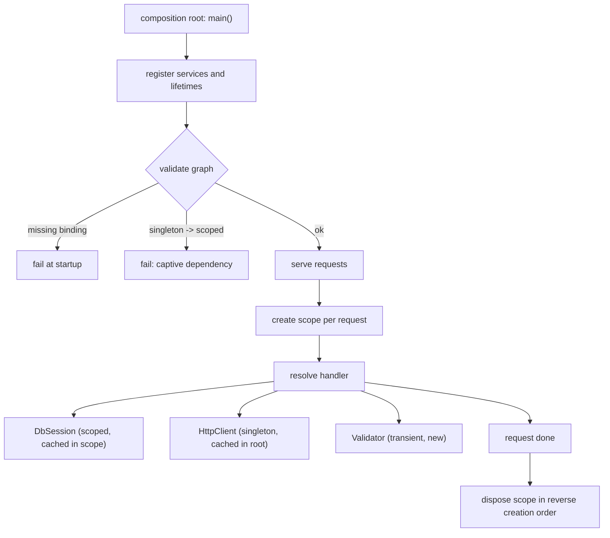

## In one minute
- Dependency injection means an object receives the things it needs (a repository, a clock, an HTTP client) from outside instead of creating or looking them up itself. The caller decides which implementation; the object only declares what it needs.
- Three forms: constructor injection (the default), setter or property injection (for optional or late-bound dependencies), and parameter injection (pass it to the one method that needs it). One place, the **composition root** at the program's entry point, builds the object graph.
- A DI container automates that wiring and adds **lifetimes**: singleton (one per container), scoped (one per request or unit of work) and transient (new every time). Lifetimes are where most container bugs live.
- The classic container bug is the **captive dependency**: a singleton holding a scoped object, such as a database session, which then outlives its request, leaks memory and mixes data between users. Validate the graph at startup.
- Pure DI (wiring by hand in `main`) is often enough. Reach for a container when the graph has hundreds of nodes, per-request scopes, or framework integration; prefer containers that fail at build or startup time over ones that fail on the first request.

## How it works

### The problem
An invoice service sends reminder emails. The first version builds what it needs:

```python
class InvoiceReminder:
    def __init__(self):
        self.db = PostgresInvoices(os.environ["DATABASE_URL"])
        self.mail = SmtpMailer("smtp.internal", 587)

    def run(self):
        for inv in self.db.overdue(datetime.now()):
            self.mail.send(inv.email, "Your invoice is overdue")
```

Every test needs a real database and SMTP server, or a `mock.patch` on module paths that breaks when files move. The class reads the environment and the system clock, so nothing in its signature tells a reader what it depends on. Swapping SMTP for an email API means editing this class and every other class that builds its own mailer.

### Hand the dependencies in
With constructor injection the class states its needs and builds nothing:

```python
class InvoiceReminder:
    def __init__(self, invoices, mailer, clock):
        self.invoices, self.mailer, self.clock = invoices, mailer, clock
```

Tests pass an in-memory repository, a recording mailer and a fixed clock. Production code builds the real ones once, in `main`. This is the mechanism behind the [Dependency Inversion Principle](dip.md): the policy owns the interfaces, and the composition root decides which adapters plug in. It is also how you get a [Singleton](singleton.md) without a global, by creating one instance in `main` and passing it down.

### The three forms
- **Constructor injection** makes dependencies mandatory and visible, and lets the object be immutable after construction. Use it by default; the Spring reference makes the same recommendation because it allows immutable components and guarantees required dependencies ([Spring docs](https://docs.spring.io/spring-framework/reference/core/beans/dependencies/factory-collaborators.html)).
- **Setter or property injection** suits optional collaborators with a sensible default (a logger that defaults to a no-op) and frameworks that must construct objects before wiring them. The cost is a window in which the object exists half-configured.
- **Parameter injection** passes the dependency to the method that uses it: `handle(request, clock)`. Good when only one method needs it or when the value changes per call, like a request-scoped transaction.

### The composition root
Mark Seemann named the single place where the graph is assembled the [composition root](https://blog.ploeh.dk/2011/07/28/CompositionRoot/), to be placed as close as possible to the application's entry point. It is `main`, the web framework's startup hook, or a Lambda handler's module scope. Only the composition root knows concrete types, reads configuration and decides lifetimes. Everything below it receives finished objects. When code deep in the domain calls `Container.get(Mailer)`, the container has become a **service locator**: dependencies are hidden again, just behind a nicer API, and tests must configure a global container.

### Containers and lifetimes
A container is a registry from a service key (a type, an interface or a name) to a recipe: a factory or constructor, its dependencies, and a lifetime. Resolving a key walks the dependency graph depth-first, building leaves first. Three lifetimes cover almost every case:

- **Singleton**: built once per container and shared. Connection pools, HTTP clients, configuration, caches.
- **Scoped**: built once per scope, usually one HTTP request or one message being processed. Database sessions or units of work, the current user, a per-request cache.
- **Transient**: built fresh on every resolution. Small stateless helpers.

Lifetimes impose a rule: a longer-lived object must not hold a shorter-lived one. A singleton constructed with a scoped `DbSession` keeps that first request's session forever; every later request uses a session whose transaction, identity map and user context belong to someone else. The same happens indirectly through a transient: singleton to transient to scoped is still captive. .NET's container checks this when `ValidateScopes` is on, which the default host builder enables only in the Development environment ([ASP.NET Core docs](https://learn.microsoft.com/en-us/aspnet/core/fundamentals/host/web-host)). It then throws `InvalidOperationException` ("Cannot consume scoped service 'Bar' from singleton 'Foo'") when a scoped service is resolved from the root provider or captured by a singleton ([Microsoft Learn](https://learn.microsoft.com/en-us/dotnet/core/extensions/dependency-injection-guidelines)).

### How containers find dependencies
- **Reflection at runtime**: Spring reads constructor signatures and annotations, .NET reads constructor parameter types, NestJS and Angular read TypeScript decorator metadata. Flexible, but missing bindings surface at startup or on first use.
- **Code generation at build time**: Dagger (Java and Android) generates factory classes with an annotation processor, and Google Wire generates plain Go constructors from provider functions ([Wire guide](https://github.com/google/wire/blob/main/docs/guide.md)). A missing binding is reported when the code is generated, before the program runs, and the generated code is ordinary calls you can read and step through.
- **Signature inspection per request**: FastAPI's `Depends` reads a handler's parameters, resolves each dependency once per request by default (`use_cache=False` opts out, per the [FastAPI docs](https://fastapi.tiangolo.com/tutorial/dependencies/sub-dependencies/)), and runs the teardown half of `yield` dependencies after the response.

### Reviewing agent-written code
Agents reproduce the code around them. In a codebase with a container they will often inject the container itself and call `get` inside methods, or register a new service as a singleton because the neighbour was a singleton, regardless of what it holds. In a codebase without one they write `self.client = httpx.Client()` inside a constructor. In review, check that new classes declare dependencies in their constructor, that only the composition root touches the container, that the lifetime of each new registration matches its state (anything holding a session, transaction or user is scoped), and that the change came with a test that injects fakes rather than patching modules.

### The same shape elsewhere
DI is an instance of **ownership and lifetime** decided by whoever creates the context, not by the code that uses it. A Unix process does not open its own stdin and stdout: the shell opens files or pipes and passes the descriptors in, which is why `grep` works on a file, a pipe or a socket unchanged. systemd socket activation passes already-bound listening sockets to a service through `LISTEN_FDS`. Kubernetes injects configuration and credentials through mounted volumes and environment variables rather than having pods fetch their own. The bugs match too: a descriptor or credential that outlives the context it was meant for.

## Down the stack

### Layer 1: The contract
For a valid graph, resolving a service returns a fully constructed object whose dependencies are all present; a container never returns a half-built object. A singleton factory runs at most once per container, even under concurrent first resolution. A scoped factory runs at most once per scope. Objects created within a scope are disposed when the scope ends, in reverse order of creation, so nothing is closed while something that depends on it is still open. A container that offers validation promises to report missing bindings and lifetime violations before serving traffic, naming the chain of services involved.

### Layer 2: The mechanism
Spring keeps `BeanDefinition`s in a `DefaultListableBeanFactory`, and its singleton registry has three maps: `singletonObjects` for finished beans, `earlySingletonObjects` for partially built ones exposed to break setter-injection cycles, and `singletonFactories` that produce those early references ([Spring source](https://github.com/spring-projects/spring-framework/blob/main/spring-beans/src/main/java/org/springframework/beans/factory/support/DefaultSingletonBeanRegistry.java)). Spring Boot has rejected circular references by default since 2.6 ([release notes](https://github.com/spring-projects/spring-boot/wiki/Spring-Boot-2.6-Release-Notes)), because the early-reference trick hands out objects before their initialisation completes. Request-scoped beans injected into singletons are handled with a scoped proxy: the singleton holds a CGLIB or JDK proxy, and every call looks up the current request's real object.

.NET describes each registration as a `ServiceDescriptor` (service type, implementation or factory, lifetime). The root `ServiceProvider` caches singletons; each `IServiceScope` caches its scoped instances and tracks every disposable it created, disposing them in reverse order when the scope ends. Dagger's annotation processor emits a `Factory` class per binding and a component that calls them in dependency order, so at runtime there is no reflection at all. Wire's generated `wire_gen.go` is the same idea in Go: a function that calls your providers in order and returns cleanup functions.

### Layer 3: The machine
Reflection-based containers pay at startup: scanning the classpath or assemblies, reading annotations, generating proxy classes. A large Spring Boot service commonly spends several seconds there, which matters for autoscaling and serverless cold starts. That cost is why Dagger and Wire exist, why Spring added ahead-of-time processing for GraalVM native images, and why Android apps avoid reflective DI. Generated wiring costs what hand-written `new` calls cost.

Per request, a scoped graph is a handful of allocations: ten objects of 100 bytes at 5,000 requests per second is 5 MB/s of short-lived garbage, which a generational collector reclaims cheaply. The expensive runtime failure is a captive dependency. An ORM session holds an identity map of every row it has loaded, so a session captured by a singleton grows without bound: at 2 KB per tracked row and 50 rows per request, it reaches 1 GB after about 10,000 requests. Injecting interfaces also means indirect calls (an itab lookup in Go, a virtual call in the JVM), about 1 to 2 ns each and a barrier to inlining unless the JIT or Go's profile-guided optimisation sees one dominant concrete type.

### Why it's built this way
1. Objects that build their own collaborators cannot be tested or reconfigured without editing them, so construction moves out to the caller.
2. Moving construction out everywhere would scatter it, so it is collected in one composition root.
3. Large graphs make hand-wiring tedious and objects need different lifetimes, so containers add registries and scopes.
4. Lifetimes can be combined wrongly, and the damage (leaks, cross-user data) appears only under load, so containers validate graphs at startup or compile time.
5. Reflection costs startup time and moves errors to runtime, so generated wiring wins where cold starts or compile-time safety matter.

## Diagram


## Worked example
A payments API on .NET registered `FraudRules` as a singleton because it loaded a rules file at startup. A later change gave it a constructor parameter `IAccountRepository`, which was scoped and wrapped a database context. Production did not validate scopes, so nothing failed. The first request's context was captured by the singleton for the life of the process.

Symptoms appeared in three ways. Memory grew by about 80 MB per hour, because the context's change tracker kept every account it ever loaded; pods were recycled by the out-of-memory killer every 9 hours. Concurrent requests used the same context from different threads, producing intermittent "a second operation was started on this context" exceptions at around 0.3% of requests. Worst, fraud checks read account balances cached since the pod started, so limits raised during the day were ignored until the next restart.

The fix took three lines: inject an `IServiceScopeFactory` into `FraudRules` and create a short scope per check, or make `FraudRules` scoped and move the rules file into a separate singleton `RulesSnapshot`. The team chose the second, turned on `ValidateOnBuild` and `ValidateScopes` in every environment, and added a test that builds the provider with validation on. Startup grew by 40 ms; the next captive dependency failed the build instead of production.

## In the wild
- **Spring Boot 2.6, 2021: circular references become an error by default.** Spring used to hide cycles between beans by handing out early, half-initialised references. From 2.6 an application with a cycle fails at start-up with `BeanCurrentlyInCreationException`, and the release notes tell teams to break the cycle, with `spring.main.allow-circular-references` as a temporary escape ([release notes](https://github.com/spring-projects/spring-boot/wiki/Spring-Boot-2.6-Release-Notes)).
- **.NET, documented misconfiguration: the captive dependency.** Microsoft's DI guidelines define it as a longer-lived service holding a shorter-lived one, give a singleton `Foo` that takes a scoped `Bar`, and say scope validation turns the mistake into an `InvalidOperationException` instead of silent misbehaviour. The guidance names the term's author, Mark Seemann ([Microsoft Learn](https://learn.microsoft.com/en-us/dotnet/core/extensions/dependency-injection-guidelines)).
- **FastAPI, documented behaviour: per-request resolution with caching.** A dependency shared by several parameters is called once per request and its value reused, so a database session is one object per request, not one per parameter ([FastAPI docs](https://fastapi.tiangolo.com/tutorial/dependencies/sub-dependencies/)).

## Trade-offs
| Option | Strengths | Weaknesses | Choose when |
| --- | --- | --- | --- |
| Build dependencies inside the class | Simplest to write | Untestable without patching; hidden dependencies | Throwaway scripts |
| Pure DI (hand wiring in `main`) | Explicit; compile-time checked; no framework | Wiring code grows with the graph; lifetimes by hand | Small and medium services, libraries, Go |
| Reflection container (Spring, .NET, NestJS) | Little wiring code; scopes and framework integration | Startup cost; errors at startup or first use; magic | Large apps on frameworks built around one |
| Generated wiring (Dagger, Wire) | Compile-time errors; no reflection; readable output | Build step; less dynamic | Mobile, serverless, cold-start sensitive services |
| Service locator | Easy to retrofit into legacy code | Hides dependencies; global state in tests | Transitional only, while migrating to injection |

## Pitfalls in production
- Captive dependencies: a singleton holding a session, transaction or user context. Fix: validate scopes in every environment and inject a scope factory where a long-lived object truly needs short-lived work.
- Injecting the container: classes call `container.get` in their methods, turning DI back into a service locator. Fix: only the composition root touches the container.
- Constructor bloat: a class with nine injected dependencies. The container makes it painless to keep adding them, which hides a class doing too much. Fix: treat more than four or five as a design smell and split responsibilities.
- Late failures: a missing binding found on the first request to a rarely used endpoint at 3 a.m. Fix: resolve or validate the whole graph at startup, or use compile-time DI.
- Disposal in the wrong order: a connection pool closed before the repository that flushes through it. Fix: let the scope or container dispose in reverse creation order, and never dispose injected objects you did not create.

## Leadership lens
- Decide per codebase whether you want a container at all. A team of five on a Go service is usually better off with pure DI; a 300-module Spring monolith is not. Write the decision down.
- Make lifetime a reviewed property of every registration. "Why is this a singleton?" is one of the highest-value questions in a DI-heavy code review.
- Require startup validation in CI. It converts an entire class of production incidents into failed builds for the cost of milliseconds.
- Give agents a pattern to copy: constructor injection, registration in one module, a test with fakes. They follow the nearest example, so make the nearest example correct.

## Check yourself
1. What is the difference between dependency injection and the Dependency Inversion Principle?
   **Answer:** Inversion is about the direction of source dependencies (policy owns the interface, details implement it). Injection is a mechanism for supplying the implementation at runtime; you can inject concrete classes without any inversion.
2. A singleton depends on a transient, which depends on a scoped service. Is that safe?
   **Answer:** No. The transient is built once, when the singleton is built, so it and the scoped service it holds live as long as the singleton. The scoped service is captive through the chain.
3. Why is calling `container.get(X)` inside a business method worse than constructor injection, if both use the same container?
   **Answer:** The dependency no longer appears in the signature, tests must configure a shared container, and missing bindings are found only when that line runs.
4. Why do Android and serverless teams favour Dagger or Wire over reflective containers?
   **Answer:** Generated wiring has no reflection or classpath scanning at startup, which shortens cold starts, and missing bindings become compile errors.

## Practice
**Task:** Build a DI container with three lifetimes, scopes, startup validation and ordered disposal. `register(name, lifetime, deps, factory)` takes a lifetime of `singleton`, `scoped` or `transient` (else fail with `bad lifetime: <x>`), a list of dependency names and a factory that receives the resolved dependencies as a list in the same order; a repeated name fails with `duplicate: <name>`. `validate()` first checks every registration in registration order and fails with `missing: <name> needs <dep>` for the first unregistered dependency; then, for each singleton in registration order, it searches its dependencies depth-first in declared order and fails with `captive: a -> b -> c` for the first path that reaches a scoped service. Graphs are acyclic. `resolve(name)` on the container resolves from the root: singletons are built once and cached in the container (their dependencies are always resolved from the root, even when the singleton is first requested inside a scope), transients are built every time, and a scoped service fails with `no scope for: <name>`. `create_scope()` returns a scope whose `resolve` caches scoped services per scope and fails with `scope disposed` after disposal. Unknown names fail with `unknown: <name>`. Every instance created by a factory is owned by the scope it was created in (singletons, and anything built for them, belong to the container); `dispose()` on a scope or container returns the names of the instances it owns in reverse creation order, and a second call returns an empty list. Python raises `ValueError`, TypeScript throws `Error`, Go returns errors.

```python starter
class Scope:
    def __init__(self, container):
        self.container = container

    def resolve(self, name):
        raise NotImplementedError

    def dispose(self):
        raise NotImplementedError


class Container:
    def __init__(self):
        self.regs = {}

    def register(self, name, lifetime, deps, factory):
        raise NotImplementedError

    def validate(self):
        raise NotImplementedError

    def resolve(self, name):
        raise NotImplementedError

    def create_scope(self):
        raise NotImplementedError

    def dispose(self):
        raise NotImplementedError
```

```python tests
def error_of(fn):
    try:
        fn()
    except ValueError as e:
        return str(e)
    return None

def make(name, calls):
    def factory(deps):
        calls.append(name)
        return {"name": name, "deps": deps}
    return factory

def app():
    calls = []
    c = Container()
    c.register("config", "singleton", [], make("config", calls))
    c.register("pool", "singleton", ["config"], make("pool", calls))
    c.register("session", "scoped", ["pool"], make("session", calls))
    c.register("clock", "transient", [], make("clock", calls))
    c.register("handler", "transient", ["session", "clock"], make("handler", calls))
    return c, calls

def test_lifetimes():
    c, calls = app()
    c.validate()
    s1, s2 = c.create_scope(), c.create_scope()
    assert s1.resolve("pool") is s2.resolve("pool") is c.resolve("pool")
    assert s1.resolve("session") is s1.resolve("session")
    assert s1.resolve("session") is not s2.resolve("session")
    assert s1.resolve("clock") is not s1.resolve("clock")
    assert calls.count("pool") == 1 and calls.count("config") == 1

def test_factory_gets_deps_in_order():
    c, _ = app()
    s = c.create_scope()
    h = s.resolve("handler")
    assert h["deps"][0] is s.resolve("session")
    assert h["deps"][1]["name"] == "clock"
    assert h["deps"][0]["deps"][0] is c.resolve("pool")

def test_register_errors():
    c, _ = app()
    assert error_of(lambda: c.register("x", "per-request", [], make("x", []))) == "bad lifetime: per-request"
    assert error_of(lambda: c.register("pool", "singleton", [], make("p", []))) == "duplicate: pool"

def test_validate_missing():
    c, _ = app()
    c.register("mailer", "singleton", ["smtp"], make("mailer", []))
    c.register("report", "transient", ["mailer", "ftp"], make("report", []))
    assert error_of(c.validate) == "missing: mailer needs smtp"

def test_validate_captive_direct_and_transitive():
    c, calls = app()
    c.register("helper", "transient", ["clock", "session"], make("helper", calls))
    c.register("fraud", "singleton", ["config", "helper"], make("fraud", calls))
    c.register("audit", "singleton", ["session"], make("audit", calls))
    assert error_of(c.validate) == "captive: fraud -> helper -> session"
    ok, _ = app()
    assert ok.validate() is None
    assert calls == [], "validate builds nothing"

def test_root_and_unknown_errors():
    c, _ = app()
    assert error_of(lambda: c.resolve("session")) == "no scope for: session"
    assert error_of(lambda: c.resolve("handler")) == "no scope for: session"
    assert error_of(lambda: c.create_scope().resolve("nope")) == "unknown: nope"

def test_scope_disposal_order():
    c, _ = app()
    s = c.create_scope()
    s.resolve("handler")
    s.resolve("clock")
    assert s.dispose() == ["clock", "handler", "clock", "session"]
    assert s.dispose() == []
    assert error_of(lambda: s.resolve("clock")) == "scope disposed"
    assert c.dispose() == ["pool", "config"]
    assert c.dispose() == []

def test_singleton_built_in_scope_belongs_to_container():
    calls = []
    c = Container()
    c.register("clock", "transient", [], make("clock", calls))
    c.register("cache", "singleton", ["clock"], make("cache", calls))
    s = c.create_scope()
    s.resolve("cache")
    s.resolve("clock")
    assert s.dispose() == ["clock"]
    assert c.dispose() == ["cache", "clock"]
```

```python solution
LIFETIMES = ("singleton", "scoped", "transient")


class Scope:
    def __init__(self, container):
        self.container = container
        self.cache = {}
        self.created = []
        self.disposed = False

    def resolve(self, name):
        if self.disposed:
            raise ValueError("scope disposed")
        return self.container._resolve(name, self)

    def dispose(self):
        out = list(reversed(self.created))
        self.created = []
        self.cache = {}
        self.disposed = True
        return out


class Container:
    def __init__(self):
        self.regs = {}
        self.order = []
        self.singletons = {}
        self.created = []

    def register(self, name, lifetime, deps, factory):
        if lifetime not in LIFETIMES:
            raise ValueError("bad lifetime: " + lifetime)
        if name in self.regs:
            raise ValueError("duplicate: " + name)
        self.regs[name] = (lifetime, list(deps), factory)
        self.order.append(name)

    def validate(self):
        for name in self.order:
            for dep in self.regs[name][1]:
                if dep not in self.regs:
                    raise ValueError("missing: " + name + " needs " + dep)
        for name in self.order:
            if self.regs[name][0] == "singleton":
                path = self._scoped_path(name, [name])
                if path:
                    raise ValueError("captive: " + " -> ".join(path))

    def _scoped_path(self, name, path):
        for dep in self.regs[name][1]:
            p = path + [dep]
            if self.regs[dep][0] == "scoped":
                return p
            found = self._scoped_path(dep, p)
            if found:
                return found
        return None

    def resolve(self, name):
        return self._resolve(name, None)

    def create_scope(self):
        return Scope(self)

    def _resolve(self, name, scope):
        if name not in self.regs:
            raise ValueError("unknown: " + name)
        lifetime, deps, factory = self.regs[name]
        if lifetime == "singleton":
            if name not in self.singletons:
                inst = factory([self._resolve(d, None) for d in deps])
                self.singletons[name] = inst
                self.created.append(name)
            return self.singletons[name]
        if lifetime == "scoped":
            if scope is None:
                raise ValueError("no scope for: " + name)
            if name not in scope.cache:
                inst = factory([self._resolve(d, scope) for d in deps])
                scope.cache[name] = inst
                scope.created.append(name)
            return scope.cache[name]
        inst = factory([self._resolve(d, scope) for d in deps])
        (scope.created if scope is not None else self.created).append(name)
        return inst

    def dispose(self):
        out = list(reversed(self.created))
        self.created = []
        return out
```

```typescript starter
export type Factory = (deps: unknown[]) => unknown;

export class Scope {
  constructor(private container: Container) {}
  resolve(name: string): unknown { throw new Error("TODO"); }
  dispose(): string[] { throw new Error("TODO"); }
}

export class Container {
  register(name: string, lifetime: string, deps: string[], factory: Factory): void { throw new Error("TODO"); }
  validate(): void { throw new Error("TODO"); }
  resolve(name: string): unknown { throw new Error("TODO"); }
  createScope(): Scope { throw new Error("TODO"); }
  dispose(): string[] { throw new Error("TODO"); }
}
```

```typescript tests
interface Inst { name: string; deps: unknown[] }

function errorOf(fn: () => unknown): string | undefined {
  try { fn(); } catch (e) { return (e as Error).message; }
  return undefined;
}

function make(name: string, calls: string[]): Factory {
  return (deps) => { calls.push(name); return { name, deps }; };
}

function app(): [Container, string[]] {
  const calls: string[] = [];
  const c = new Container();
  c.register("config", "singleton", [], make("config", calls));
  c.register("pool", "singleton", ["config"], make("pool", calls));
  c.register("session", "scoped", ["pool"], make("session", calls));
  c.register("clock", "transient", [], make("clock", calls));
  c.register("handler", "transient", ["session", "clock"], make("handler", calls));
  return [c, calls];
}

test("lifetimes", () => {
  const [c, calls] = app();
  c.validate();
  const s1 = c.createScope(), s2 = c.createScope();
  assert(s1.resolve("pool") === s2.resolve("pool") && s2.resolve("pool") === c.resolve("pool"), "one pool");
  assert(s1.resolve("session") === s1.resolve("session"), "scoped cached in scope");
  assert(s1.resolve("session") !== s2.resolve("session"), "scopes differ");
  assert(s1.resolve("clock") !== s1.resolve("clock"), "transient is fresh");
  assertEqual(calls.filter((n) => n === "pool").length, 1);
  assertEqual(calls.filter((n) => n === "config").length, 1);
});

test("factory gets deps in order", () => {
  const [c] = app();
  const s = c.createScope();
  const h = s.resolve("handler") as Inst;
  assert(h.deps[0] === s.resolve("session"), "session first");
  assertEqual((h.deps[1] as Inst).name, "clock");
  assert((h.deps[0] as Inst).deps[0] === c.resolve("pool"), "session got the pool");
});

test("register errors", () => {
  const [c] = app();
  assertEqual(errorOf(() => c.register("x", "per-request", [], make("x", []))), "bad lifetime: per-request");
  assertEqual(errorOf(() => c.register("pool", "singleton", [], make("p", []))), "duplicate: pool");
});

test("validate missing", () => {
  const [c] = app();
  c.register("mailer", "singleton", ["smtp"], make("mailer", []));
  c.register("report", "transient", ["mailer", "ftp"], make("report", []));
  assertEqual(errorOf(() => c.validate()), "missing: mailer needs smtp");
});

test("validate captive direct and transitive", () => {
  const [c, calls] = app();
  c.register("helper", "transient", ["clock", "session"], make("helper", calls));
  c.register("fraud", "singleton", ["config", "helper"], make("fraud", calls));
  c.register("audit", "singleton", ["session"], make("audit", calls));
  assertEqual(errorOf(() => c.validate()), "captive: fraud -> helper -> session");
  const [ok] = app();
  assertEqual(errorOf(() => ok.validate()), undefined);
  assertEqual(calls, [], "validate builds nothing");
});

test("root and unknown errors", () => {
  const [c] = app();
  assertEqual(errorOf(() => c.resolve("session")), "no scope for: session");
  assertEqual(errorOf(() => c.resolve("handler")), "no scope for: session");
  assertEqual(errorOf(() => c.createScope().resolve("nope")), "unknown: nope");
});

test("scope disposal order", () => {
  const [c] = app();
  const s = c.createScope();
  s.resolve("handler");
  s.resolve("clock");
  assertEqual(s.dispose(), ["clock", "handler", "clock", "session"]);
  assertEqual(s.dispose(), []);
  assertEqual(errorOf(() => s.resolve("clock")), "scope disposed");
  assertEqual(c.dispose(), ["pool", "config"]);
  assertEqual(c.dispose(), []);
});

test("singleton built in scope belongs to container", () => {
  const calls: string[] = [];
  const c = new Container();
  c.register("clock", "transient", [], make("clock", calls));
  c.register("cache", "singleton", ["clock"], make("cache", calls));
  const s = c.createScope();
  s.resolve("cache");
  s.resolve("clock");
  assertEqual(s.dispose(), ["clock"]);
  assertEqual(c.dispose(), ["cache", "clock"]);
});
```

```typescript solution
export type Factory = (deps: unknown[]) => unknown;

interface Reg { lifetime: string; deps: string[]; factory: Factory }

const LIFETIMES = ["singleton", "scoped", "transient"];

export class Scope {
  cache = new Map<string, unknown>();
  created: string[] = [];
  disposed = false;
  constructor(private container: Container) {}

  resolve(name: string): unknown {
    if (this.disposed) throw new Error("scope disposed");
    return this.container.resolveIn(name, this);
  }

  dispose(): string[] {
    const out = [...this.created].reverse();
    this.created = [];
    this.cache.clear();
    this.disposed = true;
    return out;
  }
}

export class Container {
  private regs = new Map<string, Reg>();
  private singletons = new Map<string, unknown>();
  private created: string[] = [];

  register(name: string, lifetime: string, deps: string[], factory: Factory): void {
    if (!LIFETIMES.includes(lifetime)) throw new Error("bad lifetime: " + lifetime);
    if (this.regs.has(name)) throw new Error("duplicate: " + name);
    this.regs.set(name, { lifetime, deps: [...deps], factory });
  }

  validate(): void {
    for (const [name, reg] of this.regs) {
      for (const dep of reg.deps) {
        if (!this.regs.has(dep)) throw new Error("missing: " + name + " needs " + dep);
      }
    }
    for (const [name, reg] of this.regs) {
      if (reg.lifetime !== "singleton") continue;
      const path = this.scopedPath(name, [name]);
      if (path) throw new Error("captive: " + path.join(" -> "));
    }
  }

  private scopedPath(name: string, path: string[]): string[] | null {
    for (const dep of this.regs.get(name)!.deps) {
      const p = [...path, dep];
      if (this.regs.get(dep)!.lifetime === "scoped") return p;
      const found = this.scopedPath(dep, p);
      if (found) return found;
    }
    return null;
  }

  resolve(name: string): unknown { return this.resolveIn(name, null); }

  createScope(): Scope { return new Scope(this); }

  resolveIn(name: string, scope: Scope | null): unknown {
    const reg = this.regs.get(name);
    if (!reg) throw new Error("unknown: " + name);
    if (reg.lifetime === "singleton") {
      if (!this.singletons.has(name)) {
        const inst = reg.factory(reg.deps.map((d) => this.resolveIn(d, null)));
        this.singletons.set(name, inst);
        this.created.push(name);
      }
      return this.singletons.get(name);
    }
    if (reg.lifetime === "scoped") {
      if (!scope) throw new Error("no scope for: " + name);
      if (!scope.cache.has(name)) {
        const inst = reg.factory(reg.deps.map((d) => this.resolveIn(d, scope)));
        scope.cache.set(name, inst);
        scope.created.push(name);
      }
      return scope.cache.get(name);
    }
    const inst = reg.factory(reg.deps.map((d) => this.resolveIn(d, scope)));
    (scope ? scope.created : this.created).push(name);
    return inst;
  }

  dispose(): string[] {
    const out = [...this.created].reverse();
    this.created = [];
    return out;
  }
}
```

```go starter
package practice

type Factory func(deps []any) any

type Container struct{}

func NewContainer() *Container { return &Container{} }

func (c *Container) Register(name, lifetime string, deps []string, f Factory) error {
	panic("TODO")
}
func (c *Container) Validate() error               { panic("TODO") }
func (c *Container) Resolve(name string) (any, error) { panic("TODO") }
func (c *Container) CreateScope() *Scope            { panic("TODO") }
func (c *Container) Dispose() []string              { panic("TODO") }

type Scope struct{}

func (s *Scope) Resolve(name string) (any, error) { panic("TODO") }
func (s *Scope) Dispose() []string                { panic("TODO") }
```

```go tests
package practice

import (
	"reflect"
	"testing"
)

type inst struct {
	name string
	deps []any
}

func errText(err error) string {
	if err == nil {
		return ""
	}
	return err.Error()
}

func mk(name string, calls *[]string) Factory {
	return func(deps []any) any {
		*calls = append(*calls, name)
		return &inst{name, deps}
	}
}

func app(t *testing.T) (*Container, *[]string) {
	calls := &[]string{}
	c := NewContainer()
	regs := []struct {
		name, life string
		deps       []string
	}{
		{"config", "singleton", nil},
		{"pool", "singleton", []string{"config"}},
		{"session", "scoped", []string{"pool"}},
		{"clock", "transient", nil},
		{"handler", "transient", []string{"session", "clock"}},
	}
	for _, r := range regs {
		if err := c.Register(r.name, r.life, r.deps, mk(r.name, calls)); err != nil {
			t.Fatal(err)
		}
	}
	return c, calls
}

type resolver interface {
	Resolve(name string) (any, error)
}

func res(t *testing.T, r resolver, name string) any {
	t.Helper()
	v, err := r.Resolve(name)
	if err != nil {
		t.Fatal(err)
	}
	return v
}

func count(xs []string, x string) int {
	n := 0
	for _, s := range xs {
		if s == x {
			n++
		}
	}
	return n
}

func TestLifetimes(t *testing.T) {
	c, calls := app(t)
	if err := c.Validate(); err != nil {
		t.Fatal(err)
	}
	s1, s2 := c.CreateScope(), c.CreateScope()
	p1 := res(t, s1, "pool")
	if p1 != res(t, s2, "pool") || p1 != res(t, c, "pool") {
		t.Fatal("one pool expected")
	}
	if res(t, s1, "session") != res(t, s1, "session") {
		t.Fatal("scoped cached in scope")
	}
	if res(t, s1, "session") == res(t, s2, "session") {
		t.Fatal("scopes differ")
	}
	if res(t, s1, "clock") == res(t, s1, "clock") {
		t.Fatal("transient is fresh")
	}
	if count(*calls, "pool") != 1 || count(*calls, "config") != 1 {
		t.Fatalf("calls %v", *calls)
	}
}

func TestFactoryGetsDepsInOrder(t *testing.T) {
	c, _ := app(t)
	s := c.CreateScope()
	h := res(t, s, "handler").(*inst)
	if h.deps[0] != res(t, s, "session") || h.deps[1].(*inst).name != "clock" {
		t.Fatalf("deps %v", h.deps)
	}
	if h.deps[0].(*inst).deps[0] != res(t, c, "pool") {
		t.Fatal("session got the pool")
	}
}

func TestRegisterErrors(t *testing.T) {
	c, _ := app(t)
	calls := &[]string{}
	if got := errText(c.Register("x", "per-request", nil, mk("x", calls))); got != "bad lifetime: per-request" {
		t.Fatalf("got %q", got)
	}
	if got := errText(c.Register("pool", "singleton", nil, mk("p", calls))); got != "duplicate: pool" {
		t.Fatalf("got %q", got)
	}
}

func TestValidateMissing(t *testing.T) {
	c, calls := app(t)
	c.Register("mailer", "singleton", []string{"smtp"}, mk("mailer", calls))
	c.Register("report", "transient", []string{"mailer", "ftp"}, mk("report", calls))
	if got := errText(c.Validate()); got != "missing: mailer needs smtp" {
		t.Fatalf("got %q", got)
	}
}

func TestValidateCaptiveDirectAndTransitive(t *testing.T) {
	c, calls := app(t)
	c.Register("helper", "transient", []string{"clock", "session"}, mk("helper", calls))
	c.Register("fraud", "singleton", []string{"config", "helper"}, mk("fraud", calls))
	c.Register("audit", "singleton", []string{"session"}, mk("audit", calls))
	if got := errText(c.Validate()); got != "captive: fraud -> helper -> session" {
		t.Fatalf("got %q", got)
	}
	ok, _ := app(t)
	if err := ok.Validate(); err != nil {
		t.Fatal(err)
	}
	if len(*calls) != 0 {
		t.Fatalf("validate built %v", *calls)
	}
}

func TestRootAndUnknownErrors(t *testing.T) {
	c, _ := app(t)
	_, err := c.Resolve("session")
	if errText(err) != "no scope for: session" {
		t.Fatalf("got %v", err)
	}
	_, err = c.Resolve("handler")
	if errText(err) != "no scope for: session" {
		t.Fatalf("got %v", err)
	}
	_, err = c.CreateScope().Resolve("nope")
	if errText(err) != "unknown: nope" {
		t.Fatalf("got %v", err)
	}
}

func TestScopeDisposalOrder(t *testing.T) {
	c, _ := app(t)
	s := c.CreateScope()
	res(t, s, "handler")
	res(t, s, "clock")
	if got := s.Dispose(); !reflect.DeepEqual(got, []string{"clock", "handler", "clock", "session"}) {
		t.Fatalf("got %v", got)
	}
	if got := s.Dispose(); len(got) != 0 {
		t.Fatalf("second dispose %v", got)
	}
	if _, err := s.Resolve("clock"); errText(err) != "scope disposed" {
		t.Fatalf("got %v", err)
	}
	if got := c.Dispose(); !reflect.DeepEqual(got, []string{"pool", "config"}) {
		t.Fatalf("got %v", got)
	}
	if got := c.Dispose(); len(got) != 0 {
		t.Fatalf("second dispose %v", got)
	}
}

func TestSingletonBuiltInScopeBelongsToContainer(t *testing.T) {
	calls := &[]string{}
	c := NewContainer()
	c.Register("clock", "transient", nil, mk("clock", calls))
	c.Register("cache", "singleton", []string{"clock"}, mk("cache", calls))
	s := c.CreateScope()
	res(t, s, "cache")
	res(t, s, "clock")
	if got := s.Dispose(); !reflect.DeepEqual(got, []string{"clock"}) {
		t.Fatalf("got %v", got)
	}
	if got := c.Dispose(); !reflect.DeepEqual(got, []string{"cache", "clock"}) {
		t.Fatalf("got %v", got)
	}
}
```

```go solution
package practice

import (
	"errors"
	"strings"
)

type Factory func(deps []any) any

type reg struct {
	lifetime string
	deps     []string
	factory  Factory
}

type Container struct {
	regs       map[string]reg
	order      []string
	singletons map[string]any
	created    []string
}

func NewContainer() *Container {
	return &Container{regs: map[string]reg{}, singletons: map[string]any{}}
}

func (c *Container) Register(name, lifetime string, deps []string, f Factory) error {
	if lifetime != "singleton" && lifetime != "scoped" && lifetime != "transient" {
		return errors.New("bad lifetime: " + lifetime)
	}
	if _, dup := c.regs[name]; dup {
		return errors.New("duplicate: " + name)
	}
	c.regs[name] = reg{lifetime, append([]string{}, deps...), f}
	c.order = append(c.order, name)
	return nil
}

func (c *Container) Validate() error {
	for _, name := range c.order {
		for _, dep := range c.regs[name].deps {
			if _, ok := c.regs[dep]; !ok {
				return errors.New("missing: " + name + " needs " + dep)
			}
		}
	}
	for _, name := range c.order {
		if c.regs[name].lifetime != "singleton" {
			continue
		}
		if path := c.scopedPath(name, []string{name}); path != nil {
			return errors.New("captive: " + strings.Join(path, " -> "))
		}
	}
	return nil
}

func (c *Container) scopedPath(name string, path []string) []string {
	for _, dep := range c.regs[name].deps {
		p := append(append([]string{}, path...), dep)
		if c.regs[dep].lifetime == "scoped" {
			return p
		}
		if found := c.scopedPath(dep, p); found != nil {
			return found
		}
	}
	return nil
}

func (c *Container) Resolve(name string) (any, error) { return c.resolve(name, nil) }

func (c *Container) CreateScope() *Scope {
	return &Scope{container: c, cache: map[string]any{}}
}

func (c *Container) resolveAll(deps []string, s *Scope) ([]any, error) {
	out := make([]any, 0, len(deps))
	for _, d := range deps {
		v, err := c.resolve(d, s)
		if err != nil {
			return nil, err
		}
		out = append(out, v)
	}
	return out, nil
}

func (c *Container) resolve(name string, s *Scope) (any, error) {
	r, ok := c.regs[name]
	if !ok {
		return nil, errors.New("unknown: " + name)
	}
	switch r.lifetime {
	case "singleton":
		if v, ok := c.singletons[name]; ok {
			return v, nil
		}
		deps, err := c.resolveAll(r.deps, nil)
		if err != nil {
			return nil, err
		}
		v := r.factory(deps)
		c.singletons[name] = v
		c.created = append(c.created, name)
		return v, nil
	case "scoped":
		if s == nil {
			return nil, errors.New("no scope for: " + name)
		}
		if v, ok := s.cache[name]; ok {
			return v, nil
		}
		deps, err := c.resolveAll(r.deps, s)
		if err != nil {
			return nil, err
		}
		v := r.factory(deps)
		s.cache[name] = v
		s.created = append(s.created, name)
		return v, nil
	}
	deps, err := c.resolveAll(r.deps, s)
	if err != nil {
		return nil, err
	}
	v := r.factory(deps)
	if s != nil {
		s.created = append(s.created, name)
	} else {
		c.created = append(c.created, name)
	}
	return v, nil
}

func reversed(xs []string) []string {
	out := make([]string, 0, len(xs))
	for i := len(xs) - 1; i >= 0; i-- {
		out = append(out, xs[i])
	}
	return out
}

func (c *Container) Dispose() []string {
	out := reversed(c.created)
	c.created = nil
	return out
}

type Scope struct {
	container *Container
	cache     map[string]any
	created   []string
	disposed  bool
}

func (s *Scope) Resolve(name string) (any, error) {
	if s.disposed {
		return nil, errors.New("scope disposed")
	}
	return s.container.resolve(name, s)
}

func (s *Scope) Dispose() []string {
	out := reversed(s.created)
	s.created = nil
	s.cache = map[string]any{}
	s.disposed = true
	return out
}
```

## Mock interview
**Prompt:** You are the tech lead for a Python order service handling 3,000 requests per second across 40 pods. Each request needs a database session, the current tenant, a pricing client that holds an HTTP connection pool, and a feature-flag client. Today, modules import global clients and tests rely on more than 600 `mock.patch` calls. Design how the service should construct and wire its dependencies, and how you would migrate.

- Follow-up: Which of these dependencies are singletons, which are per request, and what goes wrong if the tenant is accidentally a singleton?
- Follow-up: A background job and an HTTP handler share the same service classes. How do scopes work for the job, which has no request?
- Follow-up: Would you adopt a container library or wire by hand, and what would change your mind?

**A strong answer covers:**
- Constructor injection for every service, with one composition root per entry point (web app startup, job runner, CLI) and no container access below it.
- Lifetimes justified by state: pool and flag clients as singletons, session and tenant scoped per request or per job message, stateless helpers transient.
- Captive-dependency risk explained concretely (tenant or session leaking across users), with startup validation or tests that build the graph.
- A migration path: introduce constructor parameters with defaults that fall back to the old globals, move wiring into the composition root module by module, then delete the defaults and the patches.
- Trade-offs between pure DI and a container, including startup cost, debuggability and how agents and new joiners discover where objects come from.

## Sources and further study
**Primary**
- [Spring Boot 2.6 release notes](https://github.com/spring-projects/spring-boot/wiki/Spring-Boot-2.6-Release-Notes): the change that made circular references an error.
- [DefaultSingletonBeanRegistry (Spring source)](https://github.com/spring-projects/spring-framework/blob/main/spring-beans/src/main/java/org/springframework/beans/factory/support/DefaultSingletonBeanRegistry.java): the three singleton caches.

**Systems docs**
- [Spring: dependency injection](https://docs.spring.io/spring-framework/reference/core/beans/dependencies/factory-collaborators.html): constructor versus setter injection, and circular dependencies.
- [ASP.NET Core web host](https://learn.microsoft.com/en-us/aspnet/core/fundamentals/host/web-host): when scope validation is switched on by default.
- [FastAPI: sub-dependencies](https://fastapi.tiangolo.com/tutorial/dependencies/sub-dependencies/): per-request caching of dependencies.

**Books**
- *Effective Java* (3rd ed.), Bloch: chapter 2, Item 5, Prefer dependency injection to hardwiring resources.
- *Clean Architecture*, Martin: chapter 11, DIP: The Dependency Inversion Principle, and chapter 26, The Main Component.
- *Software Engineering at Google*, Winters, Manshreck and Wright: chapter 13, Test Doubles, on why injectable seams make tests fast and honest.

## Watch
- [Dependency Injection, The Best Pattern (CodeAesthetic)](https://www.youtube.com/watch?v=J1f5b4vcxCQ): a clear visual walk from hard-coded dependencies to injected ones, with the testing payoff.
- [Dependency INVERSION vs Dependency INJECTION in Python (ArjanCodes)](https://www.youtube.com/watch?v=2ejbLVkCndI): separates the principle from the mechanism with a refactoring in Python.

## Free resources
- [Inversion of Control Containers and the Dependency Injection pattern (Martin Fowler)](https://martinfowler.com/articles/injection.html): the article that named the pattern and compared it with service locators.
- [Composition Root (Mark Seemann)](https://blog.ploeh.dk/2011/07/28/CompositionRoot/): where wiring belongs and why only one place should touch the container.
- [Dependency injection guidelines (Microsoft Learn)](https://learn.microsoft.com/en-us/dotnet/core/extensions/dependency-injection-guidelines): lifetimes, scope validation and the captive dependency problem in a production container.
- [Wire user guide (Google)](https://github.com/google/wire/blob/main/docs/guide.md): compile-time DI for Go, with providers, injectors and cleanup functions.
- [Dependencies with yield (FastAPI docs)](https://fastapi.tiangolo.com/tutorial/dependencies/dependencies-with-yield/): per-request dependencies with setup and teardown in Python.
- [Service Locator is an Anti-Pattern (Mark Seemann)](https://blog.ploeh.dk/2010/02/03/ServiceLocatorisanAnti-Pattern/): the argument against calling the container from business code.
