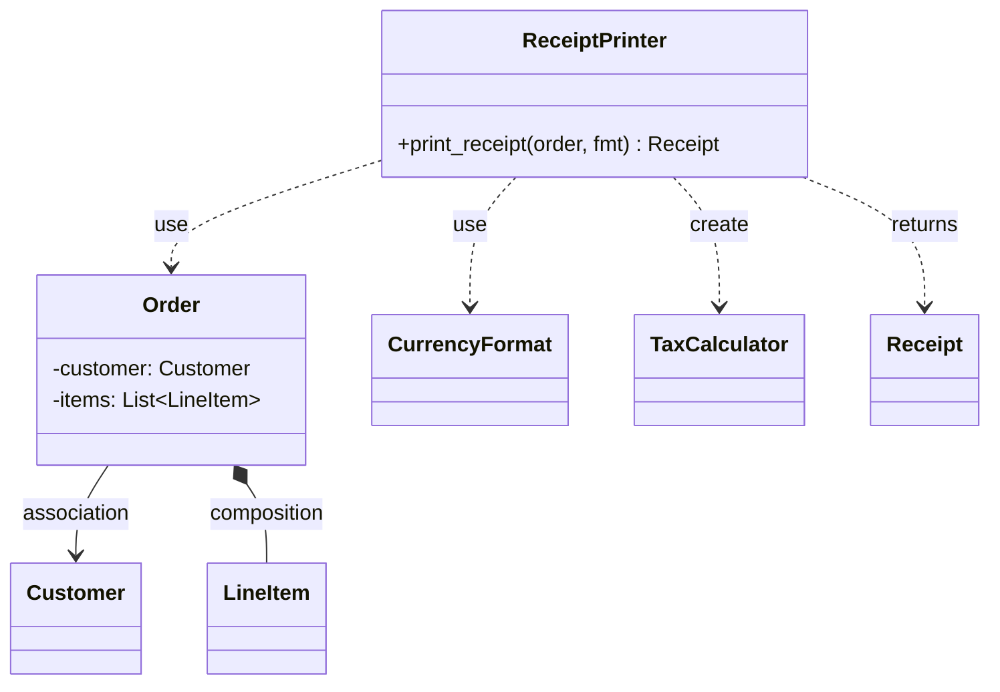

## In one minute
- A dependency is the weakest relationship between two classes: one class uses another for the length of a call, as a parameter, a local variable or a return value, and keeps no reference afterwards.
- In UML it is a dashed arrow with an open head, pointing from the client (the user) to the supplier (the thing used). It says "if the supplier changes, the client may have to change", and nothing more.
- The test that separates it from association is a single question: does the client store the other object in a field? If yes, it is association (or aggregation or composition). If no, it is a dependency.
- Prefer a dependency over a stored reference when the collaborator is only needed by one operation. Shorter lifetimes mean fewer shared-state bugs, simpler tests and, on the machine, objects that can live on the stack.
- Agents tend to promote everything to a field "for convenience": a request context, a tenant id, a clock reading. Review new fields on long-lived objects and ask whether they should be parameters instead.

## How it works

### Four ways one class can know another
Class relationships sit on a scale of how tightly two objects are bound:

1. **Dependency.** `Checkout.pay(gateway)` uses `gateway` during the call and forgets it.
2. **Association.** `Order` holds a `customer` field; the order knows its customer for as long as the order exists.
3. **Aggregation.** `Team` holds a list of `Player`s, but players exist independently and can move teams.
4. **Composition.** `Invoice` owns its `LineItem`s; they are created with it and die with it.

Inheritance and interface realisation are a different axis (is-a rather than uses-a). This lesson is about the first rung: the relationship that lasts only for a method call.

### What a dependency looks like in code
```python
class ReceiptPrinter:
    def print_receipt(self, order: Order, fmt: CurrencyFormat) -> Receipt:
        lines = [fmt.render(item.price_cents) for item in order.items]
        total = TaxCalculator(order.region).apply(order.subtotal())
        return Receipt(lines, fmt.render(total))
```

`ReceiptPrinter` depends on four classes and holds none of them. `Order` and `CurrencyFormat` arrive as parameters, `TaxCalculator` is created as a local, and `Receipt` is returned. When `print_receipt` returns, the printer is exactly as it was before. Call it a thousand times with a thousand orders and nothing leaks between calls.

UML can label the arrow with a stereotype to say how the supplier is used: `«use»` is the general case, `«create»` or `«instantiate»` for a local constructed inside, `«call»` for a static or module function. In practice most diagrams skip the dependency arrows entirely, because there are so many of them; drawing them is worth it only when the dependency crosses a package or layer boundary that matters.

### Why "weakest" matters
Every relationship is a reason to change. A dependency is the narrowest one: the client relies on the supplier's signature only during one call. An association adds lifetime (who creates the stored object, who releases it), state (the field can be stale) and concurrency (two threads may use the shared reference at once). When a collaborator is used by one method, storing it as a field buys nothing and adds all three.

The reverse mistake also exists. If five methods of a class all take the same `repo` parameter, the class is really associated with a repository, and making that explicit with a constructor-injected field reads better. The Dependency Inversion lesson covers how such a stored collaborator should be typed (an interface the client owns) and where it should be wired. The question here is only whether it should be stored at all.

### Field or parameter: the decision rule
- **Needed by one method, varies per call** (the current user, a request deadline, today's exchange rate): parameter.
- **Needed by most methods, fixed for the object's life** (a database pool, a logger): field.
- **Created and discarded inside one method** (a parser, a buffer, a calculator built from the input): local.
- **Varies per call but the object is shared across threads**: definitely a parameter. Storing it is a data race.

### Reviewing agent-written code
A model asked to "pass the tenant id through to the report" often sets `self.tenant_id = tenant_id` in a handler and reads it three methods later. It works in a single-threaded test. In a server where one `ReportService` instance handles concurrent requests, two tenants overwrite each other's field. Look for request-scoped values (user, tenant, deadline, trace id, `now`) being stored on objects created once at startup, and ask for them to be passed down instead.

### The same shape elsewhere
Dependency versus association is the difference between a stateless request and a session. An HTTP call that carries everything it needs in its headers is a dependency between client and server; a sticky session that stores state on one server is an association, with its lifetime, failover and staleness problems. The same choice appears in a function that takes a database transaction as an argument versus one that reads a transaction stored in a global.

## Down the stack

### Layer 1: The contract
A dependency promises two testable things. First, the client compiles against the supplier's interface, so a change to the supplier's signature may break the client's build. Second, the client holds no reference after the call returns: calling the method with object A and then with object B leaves no trace of A in the client. The second property is what makes the method safe to call concurrently on a shared instance, provided the method touches no other shared state.

### Layer 2: The mechanism
Even the weakest relationship is visible to the toolchain. In Go, using a type as a parameter means importing its package, and the compiler forbids import cycles, so a dependency between packages is a hard edge in the build graph. In Java, the client's class file holds a symbolic reference to the supplier in its constant pool; the JVM resolves it lazily, typically the first time the call actually touches the supplier class, so an unused dependency rarely costs loading time. Python executes `import` statements when the module loads, which is why a dependency used only in type hints is often moved under `if TYPE_CHECKING:` to avoid circular import errors at runtime. TypeScript's `import type` is erased entirely by the compiler and emits no `require`.

So a parameter dependency costs a build-graph edge but no runtime state, while a field costs both the edge and a slot in every instance.

### Layer 3: The machine
On amd64, Go's register-based calling convention (since Go 1.17) passes the first several integer and pointer arguments in registers, so a dependency passed as a pointer parameter costs roughly a register move. The bigger difference is escape analysis. A value created as a local and not stored anywhere that outlives the call can stay on the goroutine's stack and is freed when the frame pops, at no GC cost. The moment you assign it to a field of a heap object, it escapes: the compiler allocates it on the heap (tens of nanoseconds), and the garbage collector must trace that pointer on every cycle until the field is cleared. `go build -gcflags=-m` prints which values escape. HotSpot's C2 compiler does a similar analysis and can replace a non-escaping local object with plain registers (scalar replacement). In CPython every object is heap-allocated anyway, but a stored reference still keeps the object alive, which is how a cache of "last request" on a singleton turns into a memory leak.

### Why it's built this way
1. Code that uses another type must know its shape, so every use is at least a compile-time edge.
2. Remembering an object is more than using it: it adds lifetime, state and sharing, so modelling languages separate "uses" from "has".
3. Lifetime is what the runtime pays for: stack frames are free to discard, heap objects need a collector.
4. So the cheapest, safest relationship is the one that ends when the call ends, and designs should default to it and promote to a field only when several operations need the same collaborator.

## Diagram


## Worked example
A reporting service runs one `ReportService` instance per process with 16 worker threads, handling about 300 requests per second across 2,000 tenants. A change adds tenant-specific currency formatting. The generated code stores `self.tenant = request.tenant` at the start of `generate()` and reads it in `format_totals()` two calls later.

Each report takes about 40 ms, but the field is read only 20 microseconds after it is written, before the slow query runs. At 300 requests per second, the expected number of other requests that start inside a 20 microsecond window is 300 times 0.00002, or 0.006. So roughly one report in 170 picked up another tenant's value: about 1.8 wrong reports per second, around 150,000 a day. Nothing failed in tests, which ran one request at a time, and the bug was found when a customer saw a competitor's name on a PDF.

The fix turned the association back into a dependency: `format_totals(tenant, totals)` takes the tenant as a parameter, and `generate()` passes it down. The field disappeared, the race disappeared, and a unit test now calls `format_totals` with two tenants on two threads to pin the behaviour. A follow-up lint rule flags assignments to `self.*` inside request handlers on singleton services.

## Trade-offs
| Option | Strengths | Weaknesses | Choose when |
| --- | --- | --- | --- |
| Parameter dependency | No stored state, thread-safe by default, visible at the call site | Long parameter lists if overused | Collaborator varies per call or is used by one method |
| Local dependency (created inside) | Caller needs to know nothing | Hard to substitute in tests; hides construction cost | Cheap, deterministic helpers built from the input |
| Association (field) | Short call sites; collaborator configured once | Lifetime and sharing questions; staleness | Most methods use it and it is fixed for the object's life |
| Context object passed down | Bundles several per-request values | Becomes a grab bag that every function depends on | Request-scoped data such as deadline, user, trace id |

## Pitfalls in production
- Request-scoped values stored on singleton objects, causing cross-request leaks. Fix: pass them as parameters or in a per-request context object; never assign them to fields of shared instances.
- Locals that construct expensive collaborators per call (a new HTTP client, a regex compiled in a loop). Fix: hoist genuinely reusable, immutable resources into fields; the rule is about state, not about constructing everything inline.
- Hidden dependencies through globals or static calls (`Config.get()`, `time.now()`), which no signature shows. Fix: make them parameters so the dependency appears where it is used.
- Circular imports triggered by type-only dependencies in Python. Fix: `if TYPE_CHECKING:` imports or moving the shared type into a lower module.
- Dependency diagrams with every arrow drawn, which nobody can read. Fix: draw dependencies only across package or layer boundaries.

## Leadership lens
- In design review, ask of every new field on a long-lived object: who sets it, when, and can two callers see different values? If the answer involves "per request", it should be a parameter.
- Track package-level dependencies, not class-level ones. A tool that fails the build on a forbidden import edge is worth more than a class diagram that goes stale.
- Treat "the singleton remembered the last request" as a class of incident and add the lint rule that prevents it; the bug is invisible to single-threaded tests, so review alone will miss it.
- Encourage parameters over ambient state in AI-assisted code. Explicit inputs make generated code easier to review, test and reason about.

## Check yourself
1. A `Mailer` class has a method `send(message, smtp_client)` and no fields. What is the relationship between `Mailer` and `SmtpClient`, and how would it change if the client moved to the constructor?
   **Answer:** It is a dependency, because the client is used only during the call. Moving it to a constructor-stored field makes it an association, which adds lifetime and sharing concerns.
2. Why can a Go value created as a local inside a method often avoid heap allocation, while the same value stored in a struct field cannot?
   **Answer:** Escape analysis keeps a value on the stack when no reference outlives the call. Storing it in a heap object's field makes it reachable after the frame is gone, so it must be heap-allocated and traced by the GC.
3. Five methods of a service each take the same `repo` parameter. Is that a good use of dependency?
   **Answer:** Probably not. The service is effectively associated with the repository for its whole life, so a constructor-injected field states that more honestly and shortens every call site.
4. Why does a request-scoped value stored on a shared object pass unit tests but fail in production?
   **Answer:** Tests usually run one request at a time, so the field is never overwritten mid-request. Under concurrency, another request writes the field between set and read.

## Practice
**Task:** Classify class relationships and compute a build order from a list of class specs. Each spec has a `name` and four lists of type names: `fields`, `params`, `locals` and `returns`. `relationships(classes)` returns every edge from a class to another declared class, as `[from, to, kind]` sorted by `from` then `to`, with one edge per pair: `kind` is `"association"` if the type appears in `fields`, otherwise `"dependency"`. Self-references are ignored. A duplicate class name fails with `duplicate class: <name>`; a type that is not declared fails with `unknown type: <type> in <class>` (check classes in input order, and lists in the order fields, params, locals, returns). `build_order(classes)` returns class names so that every class comes after everything it uses (any kind), choosing the alphabetically smallest ready class at each step; if some classes can never be ordered, it fails with `cannot order: ` followed by those names, sorted and joined by `, `. Python raises `ValueError`, TypeScript throws `Error`, Go returns an error.

```python starter
def relationships(classes):
    # TODO: validate, then classify each (from, to) pair as association or dependency
    raise NotImplementedError

def build_order(classes):
    # TODO: suppliers first, alphabetical tie-break, report classes stuck in cycles
    raise NotImplementedError
```

```python tests
def spec(name, fields=(), params=(), locals_=(), returns=()):
    return {"name": name, "fields": list(fields), "params": list(params),
            "locals": list(locals_), "returns": list(returns)}

SHOP = [
    spec("ReceiptPrinter", params=["Order", "CurrencyFormat"], locals_=["TaxCalculator"], returns=["Receipt"]),
    spec("Order", fields=["Customer", "LineItem"], params=["LineItem"]),
    spec("Customer"),
    spec("LineItem"),
    spec("CurrencyFormat"),
    spec("TaxCalculator"),
    spec("Receipt"),
]

def test_classifies_edges():
    assert relationships(SHOP) == [
        ["Order", "Customer", "association"],
        ["Order", "LineItem", "association"],
        ["ReceiptPrinter", "CurrencyFormat", "dependency"],
        ["ReceiptPrinter", "Order", "dependency"],
        ["ReceiptPrinter", "Receipt", "dependency"],
        ["ReceiptPrinter", "TaxCalculator", "dependency"],
    ]

def test_field_wins_over_param_and_self_is_ignored():
    cs = [spec("A", fields=["B"], params=["B", "A"], returns=["A"]), spec("B")]
    assert relationships(cs) == [["A", "B", "association"]]

def test_unknown_type():
    try:
        relationships([spec("A", params=["B"], locals_=["C"])])
        assert False, "expected ValueError"
    except ValueError as e:
        assert str(e) == "unknown type: B in A"

def test_duplicate_class():
    try:
        relationships([spec("A"), spec("B"), spec("A")])
        assert False, "expected ValueError"
    except ValueError as e:
        assert str(e) == "duplicate class: A"

def test_build_order_suppliers_first_alphabetical():
    assert build_order(SHOP) == [
        "CurrencyFormat", "Customer", "LineItem", "Order", "Receipt", "TaxCalculator", "ReceiptPrinter",
    ]

def test_build_order_empty():
    assert build_order([]) == []

def test_cycle_reports_unorderable():
    cs = [spec("A", params=["B"]), spec("B", fields=["C"]), spec("C", returns=["A"]),
          spec("D", params=["A"]), spec("E")]
    try:
        build_order(cs)
        assert False, "expected ValueError"
    except ValueError as e:
        assert str(e) == "cannot order: A, B, C, D"
```

```python solution
import heapq

KINDS = ("fields", "params", "locals", "returns")

def relationships(classes):
    names = set()
    for c in classes:
        if c["name"] in names:
            raise ValueError("duplicate class: " + c["name"])
        names.add(c["name"])
    edges = {}
    for c in classes:
        src = c["name"]
        for kind in KINDS:
            for t in c[kind]:
                if t not in names:
                    raise ValueError("unknown type: " + t + " in " + src)
                if t == src:
                    continue
                if kind == "fields":
                    edges[(src, t)] = "association"
                elif (src, t) not in edges:
                    edges[(src, t)] = "dependency"
    return [[a, b, edges[(a, b)]] for (a, b) in sorted(edges)]

def build_order(classes):
    edges = relationships(classes)
    pending = {c["name"]: 0 for c in classes}
    clients = {c["name"]: [] for c in classes}
    for src, dst, _ in edges:
        pending[src] += 1
        clients[dst].append(src)
    ready = [n for n, k in pending.items() if k == 0]
    heapq.heapify(ready)
    order = []
    while ready:
        n = heapq.heappop(ready)
        order.append(n)
        for client in clients[n]:
            pending[client] -= 1
            if pending[client] == 0:
                heapq.heappush(ready, client)
    if len(order) < len(pending):
        stuck = sorted(n for n in pending if n not in set(order))
        raise ValueError("cannot order: " + ", ".join(stuck))
    return order
```

```typescript starter
export interface ClassSpec {
  name: string;
  fields: string[];
  params: string[];
  locals: string[];
  returns: string[];
}

export type Edge = [string, string, string];

export function relationships(classes: ClassSpec[]): Edge[] {
  throw new Error("TODO");
}

export function buildOrder(classes: ClassSpec[]): string[] {
  throw new Error("TODO");
}
```

```typescript tests
function spec(name: string, o: Partial<ClassSpec> = {}): ClassSpec {
  return { name, fields: o.fields ?? [], params: o.params ?? [], locals: o.locals ?? [], returns: o.returns ?? [] };
}

const SHOP: ClassSpec[] = [
  spec("ReceiptPrinter", { params: ["Order", "CurrencyFormat"], locals: ["TaxCalculator"], returns: ["Receipt"] }),
  spec("Order", { fields: ["Customer", "LineItem"], params: ["LineItem"] }),
  spec("Customer"),
  spec("LineItem"),
  spec("CurrencyFormat"),
  spec("TaxCalculator"),
  spec("Receipt"),
];

function errorOf(fn: () => unknown): string {
  try { fn(); } catch (e) { return (e as Error).message; }
  return "no error";
}

test("classifies edges", () => {
  assertEqual(relationships(SHOP), [
    ["Order", "Customer", "association"],
    ["Order", "LineItem", "association"],
    ["ReceiptPrinter", "CurrencyFormat", "dependency"],
    ["ReceiptPrinter", "Order", "dependency"],
    ["ReceiptPrinter", "Receipt", "dependency"],
    ["ReceiptPrinter", "TaxCalculator", "dependency"],
  ]);
});

test("field wins over param and self is ignored", () => {
  const cs = [spec("A", { fields: ["B"], params: ["B", "A"], returns: ["A"] }), spec("B")];
  assertEqual(relationships(cs), [["A", "B", "association"]]);
});

test("unknown type", () => {
  assertEqual(errorOf(() => relationships([spec("A", { params: ["B"], locals: ["C"] })])), "unknown type: B in A");
});

test("duplicate class", () => {
  assertEqual(errorOf(() => relationships([spec("A"), spec("B"), spec("A")])), "duplicate class: A");
});

test("build order suppliers first alphabetical", () => {
  assertEqual(buildOrder(SHOP), [
    "CurrencyFormat", "Customer", "LineItem", "Order", "Receipt", "TaxCalculator", "ReceiptPrinter",
  ]);
});

test("build order empty", () => {
  assertEqual(buildOrder([]), []);
});

test("cycle reports unorderable", () => {
  const cs = [spec("A", { params: ["B"] }), spec("B", { fields: ["C"] }), spec("C", { returns: ["A"] }),
    spec("D", { params: ["A"] }), spec("E")];
  assertEqual(errorOf(() => buildOrder(cs)), "cannot order: A, B, C, D");
});
```

```typescript solution
export interface ClassSpec {
  name: string;
  fields: string[];
  params: string[];
  locals: string[];
  returns: string[];
}

export type Edge = [string, string, string];

const KINDS: Array<"fields" | "params" | "locals" | "returns"> = ["fields", "params", "locals", "returns"];

export function relationships(classes: ClassSpec[]): Edge[] {
  const names = new Set<string>();
  for (const c of classes) {
    if (names.has(c.name)) throw new Error("duplicate class: " + c.name);
    names.add(c.name);
  }
  const edges = new Map<string, Edge>();
  for (const c of classes) {
    for (const kind of KINDS) {
      for (const t of c[kind]) {
        if (!names.has(t)) throw new Error("unknown type: " + t + " in " + c.name);
        if (t === c.name) continue;
        const key = c.name + "\u0000" + t;
        if (kind === "fields") edges.set(key, [c.name, t, "association"]);
        else if (!edges.has(key)) edges.set(key, [c.name, t, "dependency"]);
      }
    }
  }
  return [...edges.values()].sort((x, y) =>
    x[0] !== y[0] ? (x[0] < y[0] ? -1 : 1) : x[1] < y[1] ? -1 : x[1] > y[1] ? 1 : 0);
}

export function buildOrder(classes: ClassSpec[]): string[] {
  const edges = relationships(classes);
  const pending = new Map<string, number>();
  const clients = new Map<string, string[]>();
  for (const c of classes) { pending.set(c.name, 0); clients.set(c.name, []); }
  for (const [src, dst] of edges) {
    pending.set(src, pending.get(src)! + 1);
    clients.get(dst)!.push(src);
  }
  const ready = [...pending.keys()].filter((n) => pending.get(n) === 0);
  const order: string[] = [];
  while (ready.length > 0) {
    ready.sort();
    const n = ready.shift()!;
    order.push(n);
    for (const client of clients.get(n)!) {
      const left = pending.get(client)! - 1;
      pending.set(client, left);
      if (left === 0) ready.push(client);
    }
  }
  if (order.length < pending.size) {
    const done = new Set(order);
    const stuck = [...pending.keys()].filter((n) => !done.has(n)).sort();
    throw new Error("cannot order: " + stuck.join(", "));
  }
  return order;
}
```

```go starter
package practice

type ClassSpec struct {
	Name    string
	Fields  []string
	Params  []string
	Locals  []string
	Returns []string
}

type Edge struct {
	From, To, Kind string
}

func Relationships(classes []ClassSpec) ([]Edge, error) {
	panic("TODO")
}

func BuildOrder(classes []ClassSpec) ([]string, error) {
	panic("TODO")
}
```

```go tests
package practice

import (
	"reflect"
	"testing"
)

var shop = []ClassSpec{
	{Name: "ReceiptPrinter", Params: []string{"Order", "CurrencyFormat"}, Locals: []string{"TaxCalculator"}, Returns: []string{"Receipt"}},
	{Name: "Order", Fields: []string{"Customer", "LineItem"}, Params: []string{"LineItem"}},
	{Name: "Customer"},
	{Name: "LineItem"},
	{Name: "CurrencyFormat"},
	{Name: "TaxCalculator"},
	{Name: "Receipt"},
}

func TestClassifiesEdges(t *testing.T) {
	got, err := Relationships(shop)
	want := []Edge{
		{"Order", "Customer", "association"},
		{"Order", "LineItem", "association"},
		{"ReceiptPrinter", "CurrencyFormat", "dependency"},
		{"ReceiptPrinter", "Order", "dependency"},
		{"ReceiptPrinter", "Receipt", "dependency"},
		{"ReceiptPrinter", "TaxCalculator", "dependency"},
	}
	if err != nil || !reflect.DeepEqual(got, want) {
		t.Fatalf("got %v %v", got, err)
	}
}

func TestFieldWinsOverParamAndSelfIsIgnored(t *testing.T) {
	cs := []ClassSpec{{Name: "A", Fields: []string{"B"}, Params: []string{"B", "A"}, Returns: []string{"A"}}, {Name: "B"}}
	got, err := Relationships(cs)
	if err != nil || !reflect.DeepEqual(got, []Edge{{"A", "B", "association"}}) {
		t.Fatalf("got %v %v", got, err)
	}
}

func TestUnknownType(t *testing.T) {
	_, err := Relationships([]ClassSpec{{Name: "A", Params: []string{"B"}, Locals: []string{"C"}}})
	if err == nil || err.Error() != "unknown type: B in A" {
		t.Fatalf("got %v", err)
	}
}

func TestDuplicateClass(t *testing.T) {
	_, err := Relationships([]ClassSpec{{Name: "A"}, {Name: "B"}, {Name: "A"}})
	if err == nil || err.Error() != "duplicate class: A" {
		t.Fatalf("got %v", err)
	}
}

func TestBuildOrderSuppliersFirstAlphabetical(t *testing.T) {
	got, err := BuildOrder(shop)
	want := []string{"CurrencyFormat", "Customer", "LineItem", "Order", "Receipt", "TaxCalculator", "ReceiptPrinter"}
	if err != nil || !reflect.DeepEqual(got, want) {
		t.Fatalf("got %v %v", got, err)
	}
}

func TestBuildOrderEmpty(t *testing.T) {
	got, err := BuildOrder(nil)
	if err != nil || len(got) != 0 {
		t.Fatalf("got %v %v", got, err)
	}
}

func TestCycleReportsUnorderable(t *testing.T) {
	cs := []ClassSpec{
		{Name: "A", Params: []string{"B"}},
		{Name: "B", Fields: []string{"C"}},
		{Name: "C", Returns: []string{"A"}},
		{Name: "D", Params: []string{"A"}},
		{Name: "E"},
	}
	_, err := BuildOrder(cs)
	if err == nil || err.Error() != "cannot order: A, B, C, D" {
		t.Fatalf("got %v", err)
	}
}
```

```go solution
package practice

import (
	"fmt"
	"sort"
	"strings"
)

type ClassSpec struct {
	Name    string
	Fields  []string
	Params  []string
	Locals  []string
	Returns []string
}

type Edge struct {
	From, To, Kind string
}

func Relationships(classes []ClassSpec) ([]Edge, error) {
	names := map[string]bool{}
	for _, c := range classes {
		if names[c.Name] {
			return nil, fmt.Errorf("duplicate class: %s", c.Name)
		}
		names[c.Name] = true
	}
	kinds := map[[2]string]string{}
	for _, c := range classes {
		for i, list := range [][]string{c.Fields, c.Params, c.Locals, c.Returns} {
			for _, t := range list {
				if !names[t] {
					return nil, fmt.Errorf("unknown type: %s in %s", t, c.Name)
				}
				if t == c.Name {
					continue
				}
				key := [2]string{c.Name, t}
				if i == 0 {
					kinds[key] = "association"
				} else if _, ok := kinds[key]; !ok {
					kinds[key] = "dependency"
				}
			}
		}
	}
	edges := make([]Edge, 0, len(kinds))
	for k, kind := range kinds {
		edges = append(edges, Edge{k[0], k[1], kind})
	}
	sort.Slice(edges, func(i, j int) bool {
		if edges[i].From != edges[j].From {
			return edges[i].From < edges[j].From
		}
		return edges[i].To < edges[j].To
	})
	return edges, nil
}

func BuildOrder(classes []ClassSpec) ([]string, error) {
	edges, err := Relationships(classes)
	if err != nil {
		return nil, err
	}
	pending := map[string]int{}
	clients := map[string][]string{}
	for _, c := range classes {
		pending[c.Name] = 0
	}
	for _, e := range edges {
		pending[e.From]++
		clients[e.To] = append(clients[e.To], e.From)
	}
	var ready []string
	for n, k := range pending {
		if k == 0 {
			ready = append(ready, n)
		}
	}
	order := []string{}
	for len(ready) > 0 {
		sort.Strings(ready)
		n := ready[0]
		ready = ready[1:]
		order = append(order, n)
		for _, client := range clients[n] {
			pending[client]--
			if pending[client] == 0 {
				ready = append(ready, client)
			}
		}
	}
	if len(order) < len(pending) {
		done := map[string]bool{}
		for _, n := range order {
			done[n] = true
		}
		var stuck []string
		for n := range pending {
			if !done[n] {
				stuck = append(stuck, n)
			}
		}
		sort.Strings(stuck)
		return nil, fmt.Errorf("cannot order: %s", strings.Join(stuck, ", "))
	}
	return order, nil
}
```

## Mock interview
**Prompt:** You are reviewing the class design for a ride-hailing pricing module. `PriceCalculator` is a singleton shared by 32 request threads, and the proposal stores `currentRide`, `surgeMultiplier` and `Clock` as fields, set at the start of each `quote()` call. Walk through what you would change and why.

- Follow-up: Which of those three should stay as fields, and how do you decide?
- Follow-up: Quotes occasionally show another rider's surge price. Explain the failure and how you would prove it in a test.
- Follow-up: The parameter list of `quote()` grows to nine arguments. What do you do?

**A strong answer covers:**
- Classifying each collaborator by lifetime: the ride and surge multiplier vary per call, so they are parameters (dependencies); the clock is fixed for the object's life, so it can be a constructor-injected field (association).
- The race: per-call values written to fields of a shared instance are overwritten by concurrent calls between write and read.
- A deterministic concurrency test that interleaves two quotes, or simply a design where the method has no shared mutable state, so the race cannot exist.
- Grouping per-request values into a small immutable `QuoteRequest` value instead of nine parameters, without turning it into a grab-bag context.
- Noting the runtime side: non-escaping per-call values can avoid heap allocation, and fewer stored references mean less GC tracing.

## Watch
- [UML Class Diagram Tutorial (Lucid Software)](https://www.youtube.com/watch?v=UI6lqHOVHic): the notation for association, aggregation, composition and dependency arrows, with examples.
- [Dependency Injection, The Best Pattern (CodeAesthetic)](https://www.youtube.com/watch?v=J1f5b4vcxCQ): what happens when a used-by-one-call collaborator is promoted to an injected one, and why.

## Free resources
- [Dependency (UML) (Wikipedia)](https://en.wikipedia.org/wiki/Dependency_(UML)): the formal definition and the standard stereotypes such as use, create and call.
- [Class diagram (Wikipedia)](https://en.wikipedia.org/wiki/Class_diagram): where dependency sits among association, aggregation, composition and generalisation.
- [Coupling (Wikipedia)](https://en.wikipedia.org/wiki/Coupling_(computer_programming)): the classic coupling levels, from data coupling to content coupling.
- [Law of Demeter (Wikipedia)](https://en.wikipedia.org/wiki/Law_of_Demeter): a rule that limits which objects a method should depend on.
- [Inversion of Control Containers and the Dependency Injection pattern (Martin Fowler)](https://martinfowler.com/articles/injection.html): for when a dependency does become a stored collaborator.
