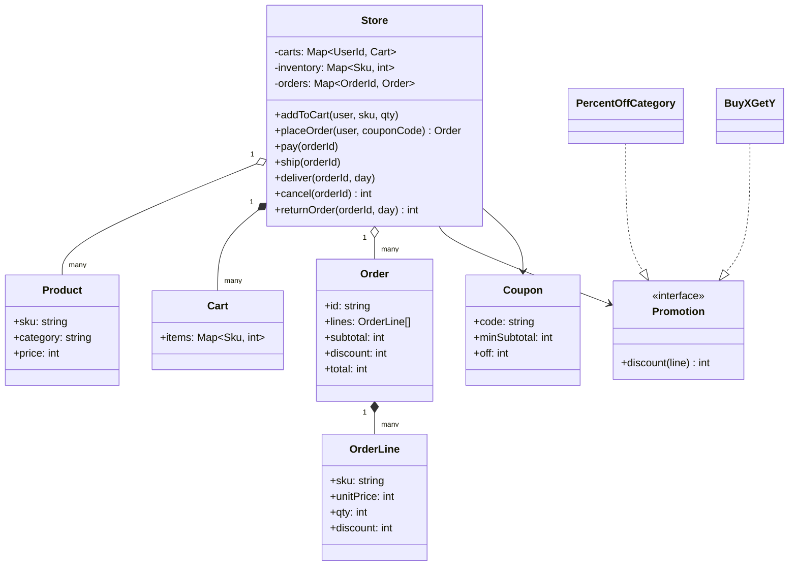
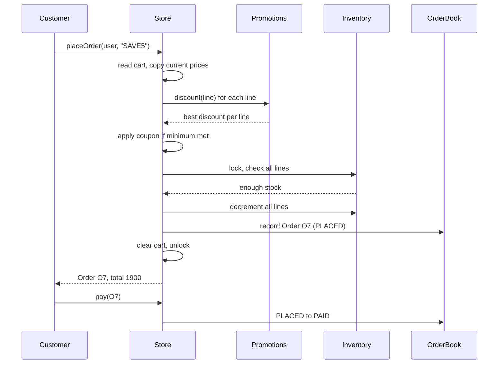

## In one minute
- In a low-level interview, "Design Amazon" is not about data centres. It is about the object model behind one checkout: catalog, cart, pricing, order and its lifecycle. The distributed version (fan-out product pages, a cart that never refuses a write, the order saga across services) is covered in the system design lesson [Design Amazon](../sdi/design-amazon.md).
- The cart is a wish list, not a reservation. It holds SKUs and quantities, never prices. The price and the stock are checked at the moment of checkout, and that moment is where all the correctness lives.
- An order is an immutable snapshot of what the customer agreed to pay: unit prices, discounts and totals copied at placement time. Later price changes, promotion edits or catalog deletes must never change a placed order.
- Promotions churn weekly, so they sit behind a `Promotion` interface (Strategy) and are combined by an explicit, written rule: best single promotion per line, then one coupon on the order. The combination rule is a product decision you surface, not a detail you improvise.
- The order lifecycle is a state machine with guarded transitions (placed, paid, shipped, delivered, cancelled, returned). The problem shapes are **multi-step consistency** (stock, payment and order must agree) and **duplicates** (a double-clicked "Place order" must not buy twice). The same shapes appear in a hospital pharmacy: the prescription is the cart, dispensing is the checkout, and a dispensed dose is an immutable record.

## Requirements

Functional:
- Customers browse products (SKU, title, category, price, stock) and add them to a cart with quantities. Adding more of the same SKU increases the quantity.
- Checkout turns the whole cart into an order: it prices every line at the current catalog price, applies automatic promotions and at most one coupon, and reserves stock for every line or for none.
- An order moves through placed, paid, shipped and delivered. A customer can cancel before shipping (stock goes back; a paid order is refunded) and can return a delivered order within 30 days.
- Customers can view orders and their status.

Non-functional:
- No overselling: two customers racing for the last unit cannot both get an order for it.
- Order totals are reproducible from the order record alone, in integer cents.
- Placing an order is idempotent from the customer's point of view.

Out of scope: search ranking, recommendations, reviews, multiple sellers per SKU, shipping address validation, tax and the payment gateway itself. Name them, mention where they would plug in, and move on.

## Entities and relationships

- **Product** is catalog data: SKU, title, category and current price in cents. It changes when merchandising changes it, not when customers act.
- **Inventory** holds units on hand per SKU. It is the contended resource, and the only thing checkout mutates besides the order book. Keep it apart from `Product`: they have different writers.
- **Cart** belongs to one customer and maps SKU to quantity. It holds no prices, because a price copied into a cart is stale the moment merchandising changes it.
- **Promotion** is an interface with one method, `discount(line)`, returning cents for one priced line. Implementations include percent off a category and buy X get Y free.
- **Coupon** is a value: code, minimum spend and a flat amount off. It applies to the order, not to lines.
- **Order** is the snapshot: id, customer, a list of **OrderLine** values (SKU, category, unit price, quantity, line discount) and the totals. Everything on it is immutable except its status.
- **Store** (or `CheckoutService`) is the façade that owns the cart map, the inventory and the order book and runs checkout atomically.

Relationships: a customer owns one cart. A cart references products by SKU only. An order is composed of its lines, and a line copies product facts instead of pointing at the live product.

## Class diagram



## Key flows

Checkout is one critical section: price the cart, check every line's stock, decrement all of it, record the order, clear the cart. Pricing is pure and could run before the lock; the stock check and decrement cannot.



## Design patterns used and why

- **Strategy** for promotions. "10% off books", "buy two get one free on socks", "20% off for Prime members on Prime Day" are each a class with `discount(line)`. Checkout iterates the list and never learns the kinds. New promotions are new classes, which is the Open/Closed principle earning its keep.
- **Policy object for combination.** How promotions combine (best one per line, never stacked, then one coupon) is itself a policy. Put it in one function with a name, because the business will ask to change it ("let the coupon stack with the category sale") and you want that to be a one-place change. A pipeline of **Decorators** over a price also works, but it hides the stacking order in wiring order.
- **State** for the order lifecycle, implemented as an enum plus a transition table rather than a class per state. A table (`from`, `event`, `to`) is easy to print, review and test exhaustively; six classes for six states is ceremony.
- **Façade**: `Store` is the only entry point for the API layer. Callers never touch the inventory map, so you can later swap it for a database or an inventory service.
- **Value objects** for `OrderLine`, `Coupon` and money. Copying values into the order is what makes it a snapshot.
- **Repository** at the edges, so checkout logic is tested in memory, as the practice does.

## Concurrency and edge cases

- **Last unit, two buyers.** Two checkouts both read "stock 1" and both decrement. Check and decrement must be one atomic step: a mutex in memory, or a conditional update in SQL: `UPDATE inventory SET on_hand = on_hand - $2 WHERE sku = $1 AND on_hand >= $2`, checking the affected row count ([PostgreSQL UPDATE](https://www.postgresql.org/docs/current/sql-update.html)).
- **Multi-line atomicity.** A cart of three SKUs where the third is short must decrement nothing. In memory, check all lines first, then decrement. In a database, do it in one transaction and lock rows in a fixed order (sorted by SKU) so two carts with overlapping SKUs cannot deadlock ([PostgreSQL explicit locking](https://www.postgresql.org/docs/current/explicit-locking.html)).
- **Double submit.** A customer double-clicks, or the client retries after a timeout. Give checkout an idempotency key (the cart version or a client-generated id) and return the first result on a repeat ([Stripe idempotent requests](https://docs.stripe.com/api/idempotent_requests)).
- **Price changes mid-session.** The cart showed 10 dollars, the price is now 12. Price at checkout and show the change before confirming; never charge a price the customer did not see. After placement, the order line carries its own unit price, so a later catalog change cannot move it.
- **Promotion rounding.** Percent discounts produce fractions of a cent. Pick a rule (floor per line in the practice), apply it per line, and never compute money in floating point ([Stripe currencies](https://docs.stripe.com/currencies)).
- **Cancel versus ship race.** The warehouse marks an order shipped at the same moment the customer cancels. Both are transitions on one order, so they serialise on that order's lock or row version; whichever commits first wins and the other gets "invalid transition".
- **Returns.** Measure the return window from the delivery timestamp on the order, using an injected clock, and restock only after the item is received (the practice simplifies this to restock on return).

## In the wild
- **Alibaba, 2012: Double Eleven inventory row oversells.** Every buyer of a popular item updated the same inventory row, so row-lock contention collapsed throughput, the inventory database ran out of capacity at midnight, and a large number of orders were oversold. The database team later added update queuing and a concurrency-control change to AliSQL, and a 2016 rework made deduction about ten times faster ([Alibaba Cloud](https://www.alibabacloud.com/blog/a-decade-of-evolution-of-alibabas-databases---part-1_594444)).
- **Stripe, 2017: idempotency keys for safe retries.** When a network failure leaves it unclear whether a charge happened, clients send a unique `Idempotency-Key` with each POST; the server replays the stored result instead of charging again, and clients retry with backoff plus jitter ([Stripe](https://stripe.com/blog/idempotency)).
- **Shopify, 2022: ULID idempotency keys.** Switching keys from random UUIDv4 to time-ordered ULIDs cut INSERT duration by 50 percent, because random keys scatter writes across B-tree pages ([Shopify Engineering](https://shopify.engineering/building-resilient-payment-systems)).

## Down the stack

### Layer 1: The contract
`placeOrder` either creates exactly one order whose lines match the cart at current prices and decrements stock for every line, or changes nothing (out of stock, empty cart, unknown coupon). `total = subtotal - discount` holds on every order, with all values in integer cents, and is recomputable from the lines. Status transitions outside the table fail and change nothing. Cancel and return each restock and refund at most once.

### Layer 2: The mechanism
In memory, the store is a few hash maps (SKU to product, SKU to on-hand count, user to cart, order id to order) behind one mutex. Checkout is O(L × P) for L lines and P promotions, which for real carts (L under 50, P under 20 applicable) is a few hundred function calls. In a relational database the same model becomes `products`, `inventory(sku PK, on_hand CHECK (on_hand >= 0))`, `carts(user_id, sku, qty)`, `orders(id, user_id, status, subtotal, discount, total, version)` and `order_lines(order_id, sku, unit_price, qty, discount)`. The `CHECK` constraint is a second line of defence against overselling. Status transitions use optimistic concurrency: `UPDATE orders SET status = 'SHIPPED', version = version + 1 WHERE id = $1 AND status = 'PAID' AND version = $2`. Amazon's own cart, as described in the Dynamo paper, goes further and accepts writes on any replica, merging divergent carts later; that is the distributed answer, and the [Design Amazon](../sdi/design-amazon.md) system design lesson walks through it.

### Layer 3: The machine
An uncontended mutex costs tens of nanoseconds; pricing a 10-line cart against 10 promotions is around 100 virtual calls (a few nanoseconds each through a vtable or Go itab) plus small allocations for the order lines, well under 10 microseconds in total. The expensive step is durability: a Postgres commit waits for the WAL `fsync`, roughly 0.1 to 1 ms on NVMe, and a payment authorisation call takes 200 ms to 2 s over the network. That ratio is why payment authorisation never happens inside the inventory lock: holding a row lock for two seconds on a hot SKU during Prime Day would serialise every buyer of that item behind a remote call. The critical section stays local; payment follows as a separate transition.

### Why it's built this way
1. Prices and stock change while customers browse, so the cart stores intent (SKU, quantity), not facts.
2. Customers dispute charges, so the order copies every fact that set its price, which makes it an immutable snapshot.
3. Stock is scarce and contended, so the check and decrement of all lines happen in one atomic step.
4. Remote calls are a thousand times slower than local work, so payment runs outside the lock as its own state transition.
5. Merchandising invents new deals every week, so promotions are strategies combined by one named policy, and checkout does not change.

## Extensibility

- **Marketplace sellers.** Split `Product` (what it is) from `Offer` (who sells it, at what price, with what stock). The cart then holds offer ids, and one order may produce several shipments, one per seller or warehouse.
- **Stacking rules change.** Replace the combination policy, not the promotions. A `PromotionPolicy` interface with `BestPerLine` and `StackAll` implementations keeps the decision explicit and testable.
- **Prime pricing or member-only deals.** Pass a pricing context (customer tier, date, channel) to `discount`. Adding it later is a breaking interface change, so consider a context object from the start if the interviewer hints at it.
- **Partial cancellation and partial returns.** The order gets per-line status, and refunds are computed per line with the line's share of the order-level coupon prorated.

### Variant: shopping cart with price snapshots and merge

The main design treats the cart as pure intent, so it is a plain map from SKU to quantity and all the hard work waits for checkout. A cart-centred variant keeps that rule for what the customer pays but makes the cart itself a richer object, because carts live for days and are edited from several places.

- **Price snapshot per line.** Each `CartLine` stores the unit price in cents the customer saw when they last touched it. The snapshot is for display and for detecting change; it is never what gets charged. At checkout, reprice every line from the live catalog and compare. If anything moved, stop, show the old and new numbers, and ask for confirmation. Honouring old prices silently lets someone park items before a price rise; charging new ones silently is a surprise.
- **Versioned aggregate.** Two devices edit one cart. Give the cart a version number and have each write carry the version it read, rejecting a mismatch (optimistic concurrency, or `ETag` with `If-Match` over HTTP, [RFC 9110](https://www.rfc-editor.org/rfc/rfc9110#name-if-match)). A retried "add" then fails on the stale version instead of adding twice. Without this, the last write wins and one edit disappears.
- **Guest-to-account merge.** A guest cart is keyed by a token; on explicit login it merges into the account cart. Pick the rule deliberately: sum quantities, take the larger, or keep the newer line. Afterwards re-apply the per-line maximum and current stock, drop delisted SKUs and tell the user. Never merge on a cookie alone, since the browser may be shared.
- **No reservation on add.** Carts are abandoned far more often than checked out, so holding stock would starve real buyers. Reserve at checkout, ideally with a short expiry.
- **Cheap reads.** The cart badge renders on every page, so reads must stay fast: keep totals computed on demand from lines, and cache only the item count.

Compared with the main design, the order, stock and state machine code are unchanged. What grows is the cart: snapshot field, version column, merge function and a checkout step that returns "prices changed" as a normal outcome rather than an error. Test the merge with the limit and stock cases, and the version check with two interleaved writers.

## Leadership lens

- Build first: atomic checkout with multi-line all-or-nothing stock and the order snapshot, with a test that runs many concurrent checkouts for the last units. Promotion bugs cost money; overselling costs trust and operations time.
- Make the promotion combination rule a written product decision with an owner in merchandising. Engineers improvising stacking rules is how a site ends up giving away items.
- Ask in review: where is the idempotency key for checkout; what happens to a cart whose SKU was delisted; can any path change a placed order's totals; how are refunds tied to the original order lines.
- Ownership splits naturally: catalog, pricing and promotions, inventory, and orders. The interfaces between them (`price(cart)`, `reserve(lines)`, `transition(order, event)`) are what each team commits to.

## Check yourself
1. Why does the cart store SKUs and quantities but no prices?
   **Answer:** Prices change while items sit in carts, so any price stored there is stale. Pricing at checkout and copying the result into the order gives one moment where price is decided and recorded.
2. A cart has three lines and the third is out of stock. What must happen to the first two, and how do you guarantee it in a database?
   **Answer:** Nothing must be decremented. Run all conditional decrements in one transaction, locking rows in sorted SKU order, and roll back if any update affects zero rows.
3. Why keep payment authorisation outside the inventory critical section?
   **Answer:** A remote payment call takes hundreds of milliseconds, so holding stock locks across it would serialise every buyer of a hot SKU. Reserve stock quickly, then authorise as a separate transition with cancel as the compensation.
4. A merchandiser wants a coupon to stack with a 50% category sale. Where does the code change?
   **Answer:** Only in the combination policy. The promotions and coupon classes stay as they are, which is the payoff of keeping the rule in one named place.

## Practice
**Task:** Implement a `Store` with checkout and the order lifecycle. The constructor takes products as `(sku, price, category, stock)`, a list of promotions (each with `discount(line)` returning cents for a priced line) and a list of coupons `(code, min_subtotal, off)`. Provide `PercentOffCategory(category, pct)` (floor of `pct` percent of the line's gross value) and `BuyXGetY(sku, buy, free)` (every full group of `buy + free` units gives `free` units at no charge). `add_to_cart(user, sku, qty)` accumulates quantities and fails for an unknown SKU or `qty < 1`. `place_order(user, coupon)` prices the cart at current prices, lines sorted by SKU; each line gets the single best promotion; then the coupon (empty string for none, unknown code fails) takes `min(off, amount)` if the amount after line discounts is at least `min_subtotal`. If any line lacks stock it returns nothing and changes nothing; otherwise it decrements stock, clears the cart and returns an order with ids `O1`, `O2`, and so on. `pay`, `ship`, `deliver(id, day)`, `cancel(id)` and `return_order(id, day)` follow the transition table; cancel works from placed (refund 0) or paid (refund the total) and restocks; return works from delivered within 30 days of delivery, restocks and refunds the total; invalid transitions and unknown ids fail.

```python starter
from dataclasses import dataclass

RETURN_WINDOW_DAYS = 30


@dataclass(frozen=True)
class Line:
    sku: str
    category: str
    unit_price: int
    qty: int


@dataclass(frozen=True)
class Coupon:
    code: str
    min_subtotal: int
    off: int


@dataclass(frozen=True)
class Order:
    order_id: str
    user: str
    lines: tuple
    subtotal: int
    discount: int
    total: int


class PercentOffCategory:
    def __init__(self, category, pct):
        self.category = category
        self.pct = pct

    def discount(self, line):
        raise NotImplementedError


class BuyXGetY:
    def __init__(self, sku, buy, free):
        self.sku = sku
        self.buy = buy
        self.free = free

    def discount(self, line):
        raise NotImplementedError


class Store:
    def __init__(self, products, promotions, coupons):
        pass

    def add_to_cart(self, user, sku, qty):
        raise NotImplementedError

    def stock(self, sku):
        raise NotImplementedError

    def cart(self, user):
        raise NotImplementedError

    def set_price(self, sku, price):
        raise NotImplementedError

    def place_order(self, user, coupon=""):
        raise NotImplementedError

    def status(self, order_id):
        raise NotImplementedError

    def pay(self, order_id):
        raise NotImplementedError

    def ship(self, order_id):
        raise NotImplementedError

    def deliver(self, order_id, day):
        raise NotImplementedError

    def cancel(self, order_id):
        raise NotImplementedError

    def return_order(self, order_id, day):
        raise NotImplementedError
```

```python tests
PRODUCTS = [("A", 1000, "book", 5), ("B", 2500, "toy", 2), ("C", 300, "toy", 10)]


def make_store(promotions=None):
    if promotions is None:
        promotions = [PercentOffCategory("book", 10), BuyXGetY("C", 2, 1)]
    return Store(PRODUCTS, promotions, [Coupon("SAVE5", 2000, 500)])


def raises(fn):
    try:
        fn()
    except ValueError:
        return True
    return False


def test_place_order_prices_and_decrements():
    s = make_store()
    s.add_to_cart("u1", "C", 2)
    s.add_to_cart("u1", "A", 2)
    s.add_to_cart("u1", "C", 1)
    o = s.place_order("u1")
    assert o.order_id == "O1"
    assert [(l.sku, l.unit_price, l.qty) for l in o.lines] == [("A", 1000, 2), ("C", 300, 3)]
    assert (o.subtotal, o.discount, o.total) == (2900, 500, 2400)
    assert s.stock("A") == 3 and s.stock("C") == 7
    assert s.cart("u1") == {}
    assert s.status("O1") == "PLACED"


def test_best_promotion_per_line_not_stacked():
    s = make_store([PercentOffCategory("toy", 50), BuyXGetY("C", 2, 1)])
    s.add_to_cart("u1", "C", 3)
    o = s.place_order("u1")
    assert o.discount == 450, "50% of 900 beats one free unit, and they do not stack"


def test_coupon_minimum_and_unknown_code():
    s = make_store()
    s.add_to_cart("u1", "A", 2)
    s.add_to_cart("u1", "C", 3)
    assert s.place_order("u1", "SAVE5").total == 1900
    s.add_to_cart("u2", "C", 1)
    assert s.place_order("u2", "SAVE5").total == 300, "below minimum, coupon ignored"
    s.add_to_cart("u3", "C", 1)
    assert raises(lambda: s.place_order("u3", "BOGUS"))
    assert s.cart("u3") == {"C": 1}


def test_price_snapshot():
    s = make_store([])
    s.add_to_cart("u1", "B", 1)
    s.set_price("B", 3000)
    o = s.place_order("u1")
    assert o.total == 3000, "priced at checkout, not at add-to-cart"
    s.set_price("B", 100)
    assert o.lines[0].unit_price == 3000 and o.total == 3000


def test_all_or_nothing_stock():
    s = make_store()
    s.add_to_cart("u1", "A", 1)
    s.add_to_cart("u1", "B", 3)
    assert s.place_order("u1") is None
    assert s.stock("A") == 5 and s.stock("B") == 2
    assert s.cart("u1") == {"A": 1, "B": 3}


def test_cancel_refunds_and_restocks():
    s = make_store([])
    s.add_to_cart("u1", "B", 1)
    o1 = s.place_order("u1")
    assert s.cancel(o1.order_id) == 0, "unpaid order refunds nothing"
    assert s.stock("B") == 2
    s.add_to_cart("u1", "B", 2)
    o2 = s.place_order("u1")
    s.pay(o2.order_id)
    assert s.cancel(o2.order_id) == 5000
    assert s.status(o2.order_id) == "CANCELLED"
    assert raises(lambda: s.ship(o2.order_id))
    assert raises(lambda: s.cancel(o2.order_id)), "no double refund"


def test_return_window():
    s = make_store([])
    s.add_to_cart("u1", "A", 1)
    o = s.place_order("u1")
    s.pay(o.order_id)
    assert raises(lambda: s.return_order(o.order_id, 5)), "not delivered yet"
    s.ship(o.order_id)
    assert raises(lambda: s.cancel(o.order_id)), "too late to cancel"
    s.deliver(o.order_id, 10)
    assert raises(lambda: s.return_order(o.order_id, 41))
    assert s.return_order(o.order_id, 40) == 1000
    assert s.status(o.order_id) == "RETURNED" and s.stock("A") == 5


def test_errors():
    s = make_store()
    assert raises(lambda: s.add_to_cart("u1", "Z", 1))
    assert raises(lambda: s.add_to_cart("u1", "A", 0))
    assert raises(lambda: s.place_order("u1")), "empty cart"
    assert raises(lambda: s.pay("O99"))
```

```python solution
from dataclasses import dataclass

RETURN_WINDOW_DAYS = 30


@dataclass(frozen=True)
class Line:
    sku: str
    category: str
    unit_price: int
    qty: int


@dataclass(frozen=True)
class Coupon:
    code: str
    min_subtotal: int
    off: int


@dataclass(frozen=True)
class OrderLine:
    sku: str
    category: str
    unit_price: int
    qty: int
    discount: int


@dataclass(frozen=True)
class Order:
    order_id: str
    user: str
    lines: tuple
    subtotal: int
    discount: int
    total: int


class PercentOffCategory:
    def __init__(self, category, pct):
        self.category = category
        self.pct = pct

    def discount(self, line):
        if line.category != self.category:
            return 0
        return line.unit_price * line.qty * self.pct // 100


class BuyXGetY:
    def __init__(self, sku, buy, free):
        self.sku = sku
        self.buy = buy
        self.free = free

    def discount(self, line):
        if line.sku != self.sku:
            return 0
        groups = line.qty // (self.buy + self.free)
        return groups * self.free * line.unit_price


# (from_status, event) -> to_status
TRANSITIONS = {
    ("PLACED", "pay"): "PAID",
    ("PAID", "ship"): "SHIPPED",
    ("SHIPPED", "deliver"): "DELIVERED",
    ("PLACED", "cancel"): "CANCELLED",
    ("PAID", "cancel"): "CANCELLED",
    ("DELIVERED", "return"): "RETURNED",
}


class Store:
    def __init__(self, products, promotions, coupons):
        self._price = {}
        self._category = {}
        self._stock = {}
        for sku, price, category, stock in products:
            self._price[sku] = price
            self._category[sku] = category
            self._stock[sku] = stock
        self._promotions = list(promotions)
        self._coupons = {c.code: c for c in coupons}
        self._carts = {}
        self._orders = {}
        self._status = {}
        self._delivered = {}
        self._next_id = 1

    def add_to_cart(self, user, sku, qty):
        if sku not in self._price:
            raise ValueError("unknown sku: " + sku)
        if qty < 1:
            raise ValueError("quantity must be at least 1")
        cart = self._carts.setdefault(user, {})
        cart[sku] = cart.get(sku, 0) + qty

    def stock(self, sku):
        return self._stock[sku]

    def cart(self, user):
        return dict(self._carts.get(user, {}))

    def set_price(self, sku, price):
        self._price[sku] = price

    def _price_lines(self, cart):
        lines = []
        for sku in sorted(cart):
            line = Line(sku, self._category[sku], self._price[sku], cart[sku])
            gross = line.unit_price * line.qty
            best = 0
            for promo in self._promotions:
                best = max(best, min(gross, promo.discount(line)))
            lines.append(OrderLine(sku, line.category, line.unit_price, line.qty, best))
        return lines

    def place_order(self, user, coupon=""):
        cart = self._carts.get(user, {})
        if not cart:
            raise ValueError("cart is empty")
        if coupon and coupon not in self._coupons:
            raise ValueError("unknown coupon: " + coupon)
        lines = self._price_lines(cart)
        subtotal = sum(l.unit_price * l.qty for l in lines)
        discount = sum(l.discount for l in lines)
        if coupon:
            c = self._coupons[coupon]
            remaining = subtotal - discount
            if remaining >= c.min_subtotal:
                discount += min(c.off, remaining)
        for l in lines:
            if self._stock[l.sku] < l.qty:
                return None
        for l in lines:
            self._stock[l.sku] -= l.qty
        order = Order("O" + str(self._next_id), user, tuple(lines), subtotal, discount,
                      subtotal - discount)
        self._next_id += 1
        self._orders[order.order_id] = order
        self._status[order.order_id] = "PLACED"
        self._carts[user] = {}
        return order

    def status(self, order_id):
        if order_id not in self._status:
            raise ValueError("unknown order: " + order_id)
        return self._status[order_id]

    def _move(self, order_id, event):
        current = self.status(order_id)
        nxt = TRANSITIONS.get((current, event))
        if nxt is None:
            raise ValueError("cannot " + event + " an order that is " + current)
        self._status[order_id] = nxt
        return current

    def _restock(self, order_id):
        for l in self._orders[order_id].lines:
            self._stock[l.sku] += l.qty

    def pay(self, order_id):
        self._move(order_id, "pay")

    def ship(self, order_id):
        self._move(order_id, "ship")

    def deliver(self, order_id, day):
        self._move(order_id, "deliver")
        self._delivered[order_id] = day

    def cancel(self, order_id):
        previous = self._move(order_id, "cancel")
        self._restock(order_id)
        return self._orders[order_id].total if previous == "PAID" else 0

    def return_order(self, order_id, day):
        if self.status(order_id) == "DELIVERED" and \
                day - self._delivered[order_id] > RETURN_WINDOW_DAYS:
            raise ValueError("return window closed")
        self._move(order_id, "return")
        self._restock(order_id)
        return self._orders[order_id].total
```

```typescript starter
export const RETURN_WINDOW_DAYS = 30;

export type Status = "PLACED" | "PAID" | "SHIPPED" | "DELIVERED" | "CANCELLED" | "RETURNED";

export interface Line { sku: string; category: string; unitPrice: number; qty: number }
export interface OrderLine extends Line { discount: number }
export interface Product { sku: string; price: number; category: string; stock: number }
export interface Coupon { code: string; minSubtotal: number; off: number }
export interface Promotion { discount(line: Line): number }

export interface Order {
  orderId: string;
  user: string;
  lines: OrderLine[];
  subtotal: number;
  discount: number;
  total: number;
}

export class PercentOffCategory implements Promotion {
  constructor(private category: string, private pct: number) {}
  discount(line: Line): number { throw new Error("TODO"); }
}

export class BuyXGetY implements Promotion {
  constructor(private sku: string, private buy: number, private free: number) {}
  discount(line: Line): number { throw new Error("TODO"); }
}

export class Store {
  constructor(products: Product[], promotions: Promotion[], coupons: Coupon[]) {}
  addToCart(user: string, sku: string, qty: number): void { throw new Error("TODO"); }
  stock(sku: string): number { throw new Error("TODO"); }
  cart(user: string): Record<string, number> { throw new Error("TODO"); }
  setPrice(sku: string, price: number): void { throw new Error("TODO"); }
  placeOrder(user: string, coupon: string = ""): Order | null { throw new Error("TODO"); }
  status(orderId: string): Status { throw new Error("TODO"); }
  pay(orderId: string): void { throw new Error("TODO"); }
  ship(orderId: string): void { throw new Error("TODO"); }
  deliver(orderId: string, day: number): void { throw new Error("TODO"); }
  cancel(orderId: string): number { throw new Error("TODO"); }
  returnOrder(orderId: string, day: number): number { throw new Error("TODO"); }
}
```

```typescript tests
const PRODUCTS: Product[] = [
  { sku: "A", price: 1000, category: "book", stock: 5 },
  { sku: "B", price: 2500, category: "toy", stock: 2 },
  { sku: "C", price: 300, category: "toy", stock: 10 },
];

function makeStore(promotions?: Promotion[]): Store {
  const promos = promotions ?? [new PercentOffCategory("book", 10), new BuyXGetY("C", 2, 1)];
  return new Store(PRODUCTS.map(p => ({ ...p })), promos, [{ code: "SAVE5", minSubtotal: 2000, off: 500 }]);
}

function raises(fn: () => unknown): boolean {
  try { fn(); return false; } catch (e) { return true; }
}

test("place order prices and decrements", () => {
  const s = makeStore();
  s.addToCart("u1", "C", 2);
  s.addToCart("u1", "A", 2);
  s.addToCart("u1", "C", 1);
  const o = s.placeOrder("u1")!;
  assertEqual(o.orderId, "O1");
  assertEqual(o.lines.map(l => [l.sku, l.unitPrice, l.qty]), [["A", 1000, 2], ["C", 300, 3]]);
  assertEqual([o.subtotal, o.discount, o.total], [2900, 500, 2400]);
  assertEqual([s.stock("A"), s.stock("C")], [3, 7]);
  assertEqual(s.cart("u1"), {});
  assertEqual(s.status("O1"), "PLACED");
});

test("best promotion per line not stacked", () => {
  const s = makeStore([new PercentOffCategory("toy", 50), new BuyXGetY("C", 2, 1)]);
  s.addToCart("u1", "C", 3);
  assertEqual(s.placeOrder("u1")!.discount, 450, "50% beats one free unit");
});

test("coupon minimum and unknown code", () => {
  const s = makeStore();
  s.addToCart("u1", "A", 2);
  s.addToCart("u1", "C", 3);
  assertEqual(s.placeOrder("u1", "SAVE5")!.total, 1900);
  s.addToCart("u2", "C", 1);
  assertEqual(s.placeOrder("u2", "SAVE5")!.total, 300, "below minimum, coupon ignored");
  s.addToCart("u3", "C", 1);
  assert(raises(() => s.placeOrder("u3", "BOGUS")), "unknown coupon");
  assertEqual(s.cart("u3"), { C: 1 });
});

test("price snapshot", () => {
  const s = makeStore([]);
  s.addToCart("u1", "B", 1);
  s.setPrice("B", 3000);
  const o = s.placeOrder("u1")!;
  assertEqual(o.total, 3000, "priced at checkout");
  s.setPrice("B", 100);
  assertEqual([o.lines[0].unitPrice, o.total], [3000, 3000]);
});

test("all or nothing stock", () => {
  const s = makeStore();
  s.addToCart("u1", "A", 1);
  s.addToCart("u1", "B", 3);
  assertEqual(s.placeOrder("u1"), null);
  assertEqual([s.stock("A"), s.stock("B")], [5, 2]);
  assertEqual(s.cart("u1"), { A: 1, B: 3 });
});

test("cancel refunds and restocks", () => {
  const s = makeStore([]);
  s.addToCart("u1", "B", 1);
  const o1 = s.placeOrder("u1")!;
  assertEqual(s.cancel(o1.orderId), 0, "unpaid refunds nothing");
  assertEqual(s.stock("B"), 2);
  s.addToCart("u1", "B", 2);
  const o2 = s.placeOrder("u1")!;
  s.pay(o2.orderId);
  assertEqual(s.cancel(o2.orderId), 5000);
  assertEqual(s.status(o2.orderId), "CANCELLED");
  assert(raises(() => s.ship(o2.orderId)), "ship after cancel");
  assert(raises(() => s.cancel(o2.orderId)), "no double refund");
});

test("return window", () => {
  const s = makeStore([]);
  s.addToCart("u1", "A", 1);
  const o = s.placeOrder("u1")!;
  s.pay(o.orderId);
  assert(raises(() => s.returnOrder(o.orderId, 5)), "not delivered yet");
  s.ship(o.orderId);
  assert(raises(() => s.cancel(o.orderId)), "too late to cancel");
  s.deliver(o.orderId, 10);
  assert(raises(() => s.returnOrder(o.orderId, 41)), "window closed");
  assertEqual(s.returnOrder(o.orderId, 40), 1000);
  assertEqual([s.status(o.orderId), s.stock("A")], ["RETURNED", 5]);
});

test("errors", () => {
  const s = makeStore();
  assert(raises(() => s.addToCart("u1", "Z", 1)), "unknown sku");
  assert(raises(() => s.addToCart("u1", "A", 0)), "zero qty");
  assert(raises(() => s.placeOrder("u1")), "empty cart");
  assert(raises(() => s.pay("O99")), "unknown order");
});
```

```typescript solution
export const RETURN_WINDOW_DAYS = 30;

export type Status = "PLACED" | "PAID" | "SHIPPED" | "DELIVERED" | "CANCELLED" | "RETURNED";

export interface Line { sku: string; category: string; unitPrice: number; qty: number }
export interface OrderLine extends Line { discount: number }
export interface Product { sku: string; price: number; category: string; stock: number }
export interface Coupon { code: string; minSubtotal: number; off: number }
export interface Promotion { discount(line: Line): number }

export interface Order {
  orderId: string;
  user: string;
  lines: OrderLine[];
  subtotal: number;
  discount: number;
  total: number;
}

export class PercentOffCategory implements Promotion {
  constructor(private category: string, private pct: number) {}
  discount(line: Line): number {
    if (line.category !== this.category) return 0;
    return Math.floor((line.unitPrice * line.qty * this.pct) / 100);
  }
}

export class BuyXGetY implements Promotion {
  constructor(private sku: string, private buy: number, private free: number) {}
  discount(line: Line): number {
    if (line.sku !== this.sku) return 0;
    return Math.floor(line.qty / (this.buy + this.free)) * this.free * line.unitPrice;
  }
}

const TRANSITIONS: Record<string, Status> = {
  "PLACED:pay": "PAID",
  "PAID:ship": "SHIPPED",
  "SHIPPED:deliver": "DELIVERED",
  "PLACED:cancel": "CANCELLED",
  "PAID:cancel": "CANCELLED",
  "DELIVERED:return": "RETURNED",
};

export class Store {
  private products = new Map<string, Product>();
  private coupons = new Map<string, Coupon>();
  private carts = new Map<string, Map<string, number>>();
  private orders = new Map<string, Order>();
  private statuses = new Map<string, Status>();
  private delivered = new Map<string, number>();
  private nextId = 1;

  constructor(products: Product[], private promotions: Promotion[], coupons: Coupon[]) {
    for (const p of products) this.products.set(p.sku, { ...p });
    for (const c of coupons) this.coupons.set(c.code, c);
  }

  addToCart(user: string, sku: string, qty: number): void {
    if (!this.products.has(sku)) throw new Error("unknown sku: " + sku);
    if (qty < 1) throw new Error("quantity must be at least 1");
    if (!this.carts.has(user)) this.carts.set(user, new Map());
    const cart = this.carts.get(user)!;
    cart.set(sku, (cart.get(sku) ?? 0) + qty);
  }

  stock(sku: string): number { return this.products.get(sku)!.stock; }

  cart(user: string): Record<string, number> {
    const out: Record<string, number> = {};
    for (const [sku, qty] of this.carts.get(user) ?? new Map<string, number>()) out[sku] = qty;
    return out;
  }

  setPrice(sku: string, price: number): void { this.products.get(sku)!.price = price; }

  placeOrder(user: string, coupon: string = ""): Order | null {
    const cart = this.carts.get(user);
    if (!cart || cart.size === 0) throw new Error("cart is empty");
    if (coupon && !this.coupons.has(coupon)) throw new Error("unknown coupon: " + coupon);
    const lines: OrderLine[] = [...cart.keys()].sort().map(sku => {
      const p = this.products.get(sku)!;
      const line: Line = { sku, category: p.category, unitPrice: p.price, qty: cart.get(sku)! };
      const gross = line.unitPrice * line.qty;
      let best = 0;
      for (const promo of this.promotions) best = Math.max(best, Math.min(gross, promo.discount(line)));
      return { ...line, discount: best };
    });
    const subtotal = lines.reduce((a, l) => a + l.unitPrice * l.qty, 0);
    let discount = lines.reduce((a, l) => a + l.discount, 0);
    if (coupon) {
      const c = this.coupons.get(coupon)!;
      const remaining = subtotal - discount;
      if (remaining >= c.minSubtotal) discount += Math.min(c.off, remaining);
    }
    for (const l of lines) if (this.products.get(l.sku)!.stock < l.qty) return null;
    for (const l of lines) this.products.get(l.sku)!.stock -= l.qty;
    const order: Order = { orderId: "O" + this.nextId++, user, lines, subtotal, discount, total: subtotal - discount };
    this.orders.set(order.orderId, order);
    this.statuses.set(order.orderId, "PLACED");
    this.carts.set(user, new Map());
    return order;
  }

  status(orderId: string): Status {
    const s = this.statuses.get(orderId);
    if (!s) throw new Error("unknown order: " + orderId);
    return s;
  }

  private move(orderId: string, event: string): Status {
    const current = this.status(orderId);
    const next = TRANSITIONS[current + ":" + event];
    if (!next) throw new Error("cannot " + event + " an order that is " + current);
    this.statuses.set(orderId, next);
    return current;
  }

  private restock(orderId: string): void {
    for (const l of this.orders.get(orderId)!.lines) this.products.get(l.sku)!.stock += l.qty;
  }

  pay(orderId: string): void { this.move(orderId, "pay"); }
  ship(orderId: string): void { this.move(orderId, "ship"); }

  deliver(orderId: string, day: number): void {
    this.move(orderId, "deliver");
    this.delivered.set(orderId, day);
  }

  cancel(orderId: string): number {
    const previous = this.move(orderId, "cancel");
    this.restock(orderId);
    return previous === "PAID" ? this.orders.get(orderId)!.total : 0;
  }

  returnOrder(orderId: string, day: number): number {
    if (this.status(orderId) === "DELIVERED" && day - this.delivered.get(orderId)! > RETURN_WINDOW_DAYS) {
      throw new Error("return window closed");
    }
    this.move(orderId, "return");
    this.restock(orderId);
    return this.orders.get(orderId)!.total;
  }
}
```

```go starter
package practice

import "errors"

const ReturnWindowDays = 30

type Status string

const (
	Placed    Status = "PLACED"
	Paid      Status = "PAID"
	Shipped   Status = "SHIPPED"
	Delivered Status = "DELIVERED"
	Cancelled Status = "CANCELLED"
	Returned  Status = "RETURNED"
)

var (
	ErrUnknownSKU    = errors.New("unknown sku")
	ErrBadQuantity   = errors.New("quantity must be at least 1")
	ErrEmptyCart     = errors.New("cart is empty")
	ErrUnknownCoupon = errors.New("unknown coupon")
	ErrOutOfStock    = errors.New("out of stock")
	ErrUnknownOrder  = errors.New("unknown order")
	ErrTransition    = errors.New("invalid transition")
	ErrReturnWindow  = errors.New("return window closed")
)

type Line struct {
	SKU       string
	Category  string
	UnitPrice int64
	Qty       int64
}

type OrderLine struct {
	Line
	Discount int64
}

type Product struct {
	SKU      string
	Price    int64
	Category string
	Stock    int64
}

type Coupon struct {
	Code        string
	MinSubtotal int64
	Off         int64
}

type Promotion interface{ Discount(l Line) int64 }

type Order struct {
	ID       string
	User     string
	Lines    []OrderLine
	Subtotal int64
	Discount int64
	Total    int64
}

type PercentOffCategory struct {
	Category string
	Pct      int64
}

func (p PercentOffCategory) Discount(l Line) int64 { panic("TODO") }

type BuyXGetY struct {
	SKU       string
	Buy, Free int64
}

func (b BuyXGetY) Discount(l Line) int64 { panic("TODO") }

type Store struct{}

func NewStore(products []Product, promotions []Promotion, coupons []Coupon) *Store {
	return &Store{}
}

func (s *Store) AddToCart(user, sku string, qty int64) error       { panic("TODO") }
func (s *Store) Stock(sku string) int64                             { panic("TODO") }
func (s *Store) Cart(user string) map[string]int64                  { panic("TODO") }
func (s *Store) SetPrice(sku string, price int64)                   { panic("TODO") }
func (s *Store) PlaceOrder(user, coupon string) (Order, error)      { panic("TODO") }
func (s *Store) Status(orderID string) (Status, error)              { panic("TODO") }
func (s *Store) Pay(orderID string) error                           { panic("TODO") }
func (s *Store) Ship(orderID string) error                          { panic("TODO") }
func (s *Store) Deliver(orderID string, day int64) error            { panic("TODO") }
func (s *Store) Cancel(orderID string) (int64, error)               { panic("TODO") }
func (s *Store) ReturnOrder(orderID string, day int64) (int64, error) { panic("TODO") }
```

```go tests
package practice

import (
	"errors"
	"reflect"
	"testing"
)

func makeStore(promos []Promotion) *Store {
	if promos == nil {
		promos = []Promotion{PercentOffCategory{"book", 10}, BuyXGetY{"C", 2, 1}}
	}
	products := []Product{{"A", 1000, "book", 5}, {"B", 2500, "toy", 2}, {"C", 300, "toy", 10}}
	return NewStore(products, promos, []Coupon{{"SAVE5", 2000, 500}})
}

func mustOrder(t *testing.T, s *Store, user, coupon string) Order {
	t.Helper()
	o, err := s.PlaceOrder(user, coupon)
	if err != nil {
		t.Fatalf("place %s: %v", user, err)
	}
	return o
}

func status(t *testing.T, s *Store, id string) Status {
	t.Helper()
	st, err := s.Status(id)
	if err != nil {
		t.Fatal(err)
	}
	return st
}

func TestPlaceOrderPricesAndDecrements(t *testing.T) {
	s := makeStore(nil)
	s.AddToCart("u1", "C", 2)
	s.AddToCart("u1", "A", 2)
	s.AddToCart("u1", "C", 1)
	o := mustOrder(t, s, "u1", "")
	if o.ID != "O1" || len(o.Lines) != 2 || o.Lines[0].SKU != "A" || o.Lines[1].Qty != 3 {
		t.Fatalf("got %+v", o)
	}
	if o.Subtotal != 2900 || o.Discount != 500 || o.Total != 2400 {
		t.Fatalf("totals %d %d %d", o.Subtotal, o.Discount, o.Total)
	}
	if s.Stock("A") != 3 || s.Stock("C") != 7 || len(s.Cart("u1")) != 0 || status(t, s, "O1") != Placed {
		t.Fatal("stock, cart or status wrong")
	}
}

func TestBestPromotionPerLineNotStacked(t *testing.T) {
	s := makeStore([]Promotion{PercentOffCategory{"toy", 50}, BuyXGetY{"C", 2, 1}})
	s.AddToCart("u1", "C", 3)
	if o := mustOrder(t, s, "u1", ""); o.Discount != 450 {
		t.Fatalf("discount %d want 450", o.Discount)
	}
}

func TestCouponMinimumAndUnknownCode(t *testing.T) {
	s := makeStore(nil)
	s.AddToCart("u1", "A", 2)
	s.AddToCart("u1", "C", 3)
	if o := mustOrder(t, s, "u1", "SAVE5"); o.Total != 1900 {
		t.Fatalf("total %d want 1900", o.Total)
	}
	s.AddToCart("u2", "C", 1)
	if o := mustOrder(t, s, "u2", "SAVE5"); o.Total != 300 {
		t.Fatalf("total %d want 300", o.Total)
	}
	s.AddToCart("u3", "C", 1)
	if _, err := s.PlaceOrder("u3", "BOGUS"); !errors.Is(err, ErrUnknownCoupon) {
		t.Fatalf("want ErrUnknownCoupon, got %v", err)
	}
	if !reflect.DeepEqual(s.Cart("u3"), map[string]int64{"C": 1}) {
		t.Fatalf("cart %v", s.Cart("u3"))
	}
}

func TestPriceSnapshot(t *testing.T) {
	s := makeStore([]Promotion{})
	s.AddToCart("u1", "B", 1)
	s.SetPrice("B", 3000)
	o := mustOrder(t, s, "u1", "")
	s.SetPrice("B", 100)
	if o.Total != 3000 || o.Lines[0].UnitPrice != 3000 {
		t.Fatalf("got %+v", o)
	}
}

func TestAllOrNothingStock(t *testing.T) {
	s := makeStore(nil)
	s.AddToCart("u1", "A", 1)
	s.AddToCart("u1", "B", 3)
	if _, err := s.PlaceOrder("u1", ""); !errors.Is(err, ErrOutOfStock) {
		t.Fatalf("want ErrOutOfStock, got %v", err)
	}
	if s.Stock("A") != 5 || s.Stock("B") != 2 {
		t.Fatal("stock changed")
	}
	if !reflect.DeepEqual(s.Cart("u1"), map[string]int64{"A": 1, "B": 3}) {
		t.Fatalf("cart %v", s.Cart("u1"))
	}
}

func TestCancelRefundsAndRestocks(t *testing.T) {
	s := makeStore([]Promotion{})
	s.AddToCart("u1", "B", 1)
	o1 := mustOrder(t, s, "u1", "")
	if r, err := s.Cancel(o1.ID); err != nil || r != 0 || s.Stock("B") != 2 {
		t.Fatalf("refund %d err %v stock %d", r, err, s.Stock("B"))
	}
	s.AddToCart("u1", "B", 2)
	o2 := mustOrder(t, s, "u1", "")
	s.Pay(o2.ID)
	if r, err := s.Cancel(o2.ID); err != nil || r != 5000 {
		t.Fatalf("refund %d err %v", r, err)
	}
	if status(t, s, o2.ID) != Cancelled {
		t.Fatal("not cancelled")
	}
	if err := s.Ship(o2.ID); !errors.Is(err, ErrTransition) {
		t.Fatalf("ship after cancel: %v", err)
	}
	if _, err := s.Cancel(o2.ID); !errors.Is(err, ErrTransition) {
		t.Fatalf("double cancel: %v", err)
	}
}

func TestReturnWindow(t *testing.T) {
	s := makeStore([]Promotion{})
	s.AddToCart("u1", "A", 1)
	o := mustOrder(t, s, "u1", "")
	s.Pay(o.ID)
	if _, err := s.ReturnOrder(o.ID, 5); !errors.Is(err, ErrTransition) {
		t.Fatalf("return before delivery: %v", err)
	}
	s.Ship(o.ID)
	if _, err := s.Cancel(o.ID); !errors.Is(err, ErrTransition) {
		t.Fatalf("cancel after ship: %v", err)
	}
	s.Deliver(o.ID, 10)
	if _, err := s.ReturnOrder(o.ID, 41); !errors.Is(err, ErrReturnWindow) {
		t.Fatalf("late return: %v", err)
	}
	if r, err := s.ReturnOrder(o.ID, 40); err != nil || r != 1000 {
		t.Fatalf("refund %d err %v", r, err)
	}
	if status(t, s, o.ID) != Returned || s.Stock("A") != 5 {
		t.Fatal("not returned or not restocked")
	}
}

func TestErrors(t *testing.T) {
	s := makeStore(nil)
	if err := s.AddToCart("u1", "Z", 1); !errors.Is(err, ErrUnknownSKU) {
		t.Fatalf("got %v", err)
	}
	if err := s.AddToCart("u1", "A", 0); !errors.Is(err, ErrBadQuantity) {
		t.Fatalf("got %v", err)
	}
	if _, err := s.PlaceOrder("u1", ""); !errors.Is(err, ErrEmptyCart) {
		t.Fatalf("got %v", err)
	}
	if err := s.Pay("O99"); !errors.Is(err, ErrUnknownOrder) {
		t.Fatalf("got %v", err)
	}
}
```

```go solution
package practice

import (
	"errors"
	"fmt"
	"sort"
	"sync"
)

const ReturnWindowDays = 30

type Status string

const (
	Placed    Status = "PLACED"
	Paid      Status = "PAID"
	Shipped   Status = "SHIPPED"
	Delivered Status = "DELIVERED"
	Cancelled Status = "CANCELLED"
	Returned  Status = "RETURNED"
)

var (
	ErrUnknownSKU    = errors.New("unknown sku")
	ErrBadQuantity   = errors.New("quantity must be at least 1")
	ErrEmptyCart     = errors.New("cart is empty")
	ErrUnknownCoupon = errors.New("unknown coupon")
	ErrOutOfStock    = errors.New("out of stock")
	ErrUnknownOrder  = errors.New("unknown order")
	ErrTransition    = errors.New("invalid transition")
	ErrReturnWindow  = errors.New("return window closed")
)

type Line struct {
	SKU       string
	Category  string
	UnitPrice int64
	Qty       int64
}

type OrderLine struct {
	Line
	Discount int64
}

type Product struct {
	SKU      string
	Price    int64
	Category string
	Stock    int64
}

type Coupon struct {
	Code        string
	MinSubtotal int64
	Off         int64
}

type Promotion interface{ Discount(l Line) int64 }

type Order struct {
	ID       string
	User     string
	Lines    []OrderLine
	Subtotal int64
	Discount int64
	Total    int64
}

type PercentOffCategory struct {
	Category string
	Pct      int64
}

func (p PercentOffCategory) Discount(l Line) int64 {
	if l.Category != p.Category {
		return 0
	}
	return l.UnitPrice * l.Qty * p.Pct / 100
}

type BuyXGetY struct {
	SKU       string
	Buy, Free int64
}

func (b BuyXGetY) Discount(l Line) int64 {
	if l.SKU != b.SKU {
		return 0
	}
	return l.Qty / (b.Buy + b.Free) * b.Free * l.UnitPrice
}

type transition struct {
	from  Status
	event string
}

var transitions = map[transition]Status{
	{Placed, "pay"}:        Paid,
	{Paid, "ship"}:         Shipped,
	{Shipped, "deliver"}:   Delivered,
	{Placed, "cancel"}:     Cancelled,
	{Paid, "cancel"}:       Cancelled,
	{Delivered, "return"}:  Returned,
}

type Store struct {
	mu         sync.Mutex
	products   map[string]*Product
	promotions []Promotion
	coupons    map[string]Coupon
	carts      map[string]map[string]int64
	orders     map[string]Order
	statuses   map[string]Status
	delivered  map[string]int64
	nextID     int
}

func NewStore(products []Product, promotions []Promotion, coupons []Coupon) *Store {
	s := &Store{
		products:   map[string]*Product{},
		promotions: promotions,
		coupons:    map[string]Coupon{},
		carts:      map[string]map[string]int64{},
		orders:     map[string]Order{},
		statuses:   map[string]Status{},
		delivered:  map[string]int64{},
		nextID:     1,
	}
	for _, p := range products {
		p := p
		s.products[p.SKU] = &p
	}
	for _, c := range coupons {
		s.coupons[c.Code] = c
	}
	return s
}

func (s *Store) AddToCart(user, sku string, qty int64) error {
	s.mu.Lock()
	defer s.mu.Unlock()
	if _, ok := s.products[sku]; !ok {
		return fmt.Errorf("%w: %s", ErrUnknownSKU, sku)
	}
	if qty < 1 {
		return ErrBadQuantity
	}
	if s.carts[user] == nil {
		s.carts[user] = map[string]int64{}
	}
	s.carts[user][sku] += qty
	return nil
}

func (s *Store) Stock(sku string) int64 {
	s.mu.Lock()
	defer s.mu.Unlock()
	return s.products[sku].Stock
}

func (s *Store) Cart(user string) map[string]int64 {
	s.mu.Lock()
	defer s.mu.Unlock()
	out := map[string]int64{}
	for k, v := range s.carts[user] {
		out[k] = v
	}
	return out
}

func (s *Store) SetPrice(sku string, price int64) {
	s.mu.Lock()
	defer s.mu.Unlock()
	s.products[sku].Price = price
}

// PlaceOrder prices, checks and decrements under one lock, so stock is all or nothing.
func (s *Store) PlaceOrder(user, coupon string) (Order, error) {
	s.mu.Lock()
	defer s.mu.Unlock()
	cart := s.carts[user]
	if len(cart) == 0 {
		return Order{}, ErrEmptyCart
	}
	c, hasCoupon := s.coupons[coupon]
	if coupon != "" && !hasCoupon {
		return Order{}, fmt.Errorf("%w: %s", ErrUnknownCoupon, coupon)
	}
	skus := make([]string, 0, len(cart))
	for sku := range cart {
		skus = append(skus, sku)
	}
	sort.Strings(skus)
	var lines []OrderLine
	var subtotal, discount int64
	for _, sku := range skus {
		p := s.products[sku]
		l := Line{SKU: sku, Category: p.Category, UnitPrice: p.Price, Qty: cart[sku]}
		gross := l.UnitPrice * l.Qty
		var best int64
		for _, promo := range s.promotions {
			d := promo.Discount(l)
			if d > gross {
				d = gross
			}
			if d > best {
				best = d
			}
		}
		lines = append(lines, OrderLine{Line: l, Discount: best})
		subtotal += gross
		discount += best
	}
	if hasCoupon {
		remaining := subtotal - discount
		if remaining >= c.MinSubtotal {
			off := c.Off
			if off > remaining {
				off = remaining
			}
			discount += off
		}
	}
	for _, l := range lines {
		if s.products[l.SKU].Stock < l.Qty {
			return Order{}, fmt.Errorf("%w: %s", ErrOutOfStock, l.SKU)
		}
	}
	for _, l := range lines {
		s.products[l.SKU].Stock -= l.Qty
	}
	o := Order{ID: fmt.Sprintf("O%d", s.nextID), User: user, Lines: lines,
		Subtotal: subtotal, Discount: discount, Total: subtotal - discount}
	s.nextID++
	s.orders[o.ID] = o
	s.statuses[o.ID] = Placed
	s.carts[user] = map[string]int64{}
	return o, nil
}

func (s *Store) Status(orderID string) (Status, error) {
	s.mu.Lock()
	defer s.mu.Unlock()
	return s.status(orderID)
}

func (s *Store) status(orderID string) (Status, error) {
	st, ok := s.statuses[orderID]
	if !ok {
		return "", fmt.Errorf("%w: %s", ErrUnknownOrder, orderID)
	}
	return st, nil
}

// move applies one transition from the table; callers hold the lock.
func (s *Store) move(orderID, event string) (Status, error) {
	cur, err := s.status(orderID)
	if err != nil {
		return "", err
	}
	next, ok := transitions[transition{cur, event}]
	if !ok {
		return "", fmt.Errorf("%w: %s from %s", ErrTransition, event, cur)
	}
	s.statuses[orderID] = next
	return cur, nil
}

func (s *Store) restock(orderID string) {
	for _, l := range s.orders[orderID].Lines {
		s.products[l.SKU].Stock += l.Qty
	}
}

func (s *Store) Pay(orderID string) error {
	s.mu.Lock()
	defer s.mu.Unlock()
	_, err := s.move(orderID, "pay")
	return err
}

func (s *Store) Ship(orderID string) error {
	s.mu.Lock()
	defer s.mu.Unlock()
	_, err := s.move(orderID, "ship")
	return err
}

func (s *Store) Deliver(orderID string, day int64) error {
	s.mu.Lock()
	defer s.mu.Unlock()
	if _, err := s.move(orderID, "deliver"); err != nil {
		return err
	}
	s.delivered[orderID] = day
	return nil
}

func (s *Store) Cancel(orderID string) (int64, error) {
	s.mu.Lock()
	defer s.mu.Unlock()
	prev, err := s.move(orderID, "cancel")
	if err != nil {
		return 0, err
	}
	s.restock(orderID)
	if prev == Paid {
		return s.orders[orderID].Total, nil
	}
	return 0, nil
}

func (s *Store) ReturnOrder(orderID string, day int64) (int64, error) {
	s.mu.Lock()
	defer s.mu.Unlock()
	if st, _ := s.status(orderID); st == Delivered && day-s.delivered[orderID] > ReturnWindowDays {
		return 0, ErrReturnWindow
	}
	if _, err := s.move(orderID, "return"); err != nil {
		return 0, err
	}
	s.restock(orderID)
	return s.orders[orderID].Total, nil
}
```

## Mock interview
**Prompt:** Design the classes behind Amazon's cart and checkout for a single region: products, cart, promotions, coupons and orders through delivery and returns. Code `placeOrder` and the order state transitions, and explain how you avoid selling the last unit twice.

- Follow-up: Marketing wants "buy two books, get the cheapest third free" across different SKUs. Your `Promotion` interface takes one line. What changes?
- Follow-up: The client times out on "Place order" and retries. Walk through what happens with and without an idempotency key.
- Follow-up: Would you model order states as an enum with a table or as one class per state? When would you switch?

**A strong answer covers:**
- Cart as SKU and quantity only; pricing at checkout; the order as an immutable snapshot with integer cents.
- An all-or-nothing stock check and decrement across lines, in one lock or one transaction with sorted row locks and a conditional update.
- Promotions as strategies with an explicit combination policy, and the observation that a cross-line promotion needs the interface to see the whole cart, not one line.
- A transition table for order status, with cancel and return as guarded transitions that restock and refund exactly once.
- Payment outside the inventory critical section, with cancel as the compensation, and a pointer to the distributed version (order saga, Dynamo-style cart) in the system design answer.
- Idempotent checkout keyed by a client token or cart version.

## Sources and further study
**Primary**
- [RFC 9110: HTTP semantics, If-Match](https://www.rfc-editor.org/rfc/rfc9110#name-if-match): the conditional-write header behind the versioned cart.

**Systems docs**
- [PostgreSQL: UPDATE](https://www.postgresql.org/docs/current/sql-update.html): the conditional decrement and affected row count.
- [PostgreSQL: explicit locking](https://www.postgresql.org/docs/current/explicit-locking.html): row locks and why lock order matters.
- [Stripe: idempotent requests](https://docs.stripe.com/api/idempotent_requests): safe retry of a timed-out charge.
- [Stripe: currencies and minor units](https://docs.stripe.com/currencies): integer minor units plus a currency code.

**Books**
- *Design Patterns*, Gamma, Helm, Johnson and Vlissides: chapter 5 (Behavioral, including Strategy and State).
- *Designing Data-Intensive Applications*, Martin Kleppmann: chapter 7 "Transactions".
- *Release It!*, Michael Nygard, 2nd edition: the stability patterns chapters on timeouts and retries.

**Other curricula**
- [donnemartin/system-design-primer: object-oriented design](https://github.com/donnemartin/system-design-primer/tree/master/solutions/object_oriented_design): models entities and classes, with no concurrency or idempotency.

## Watch
- [Amazon Shopping System LLD (Reactify Labs)](https://www.youtube.com/watch?v=xOa2v2VyhEI): a class-level walkthrough of a shopping system including checkout.
- [State Pattern, Design Patterns ep 17 (Christopher Okhravi)](https://www.youtube.com/watch?v=N12L5D78MAA): the pattern behind order lifecycles, with a clear discussion of when it is worth the classes.
- [Strategy Pattern, Design Patterns ep 1 (Christopher Okhravi)](https://www.youtube.com/watch?v=v9ejT8FO-7I): the pattern behind pluggable promotions.

## Free resources
- [Dynamo: Amazon's Highly Available Key-value Store (DeCandia et al., SOSP 2007)](https://www.allthingsdistributed.com/files/amazon-dynamo-sosp2007.pdf): the paper built around a shopping cart that must always accept writes.
- [Money (Martin Fowler, P of EAA)](https://martinfowler.com/eaaCatalog/money.html): why money is a value type with integer amounts and explicit rounding.
- [DDD Aggregate (Martin Fowler)](https://martinfowler.com/bliki/DDD_Aggregate.html): why an order and its lines change together and are loaded as one unit.
- [Strategy pattern (Refactoring.Guru)](https://refactoring.guru/design-patterns/strategy): promotions as interchangeable algorithms.
- [Saga pattern (microservices.io)](https://microservices.io/patterns/data/saga.html): how the same checkout becomes a sequence of local transactions with compensations once services split.
