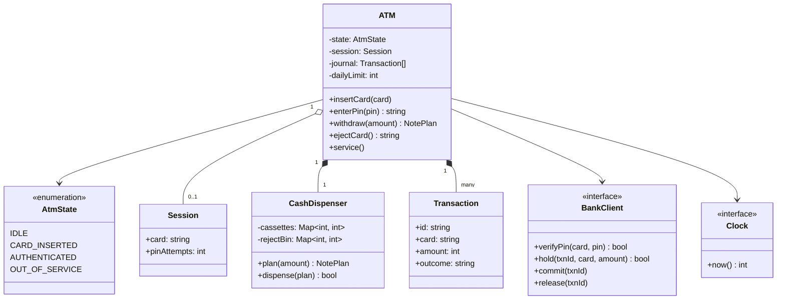
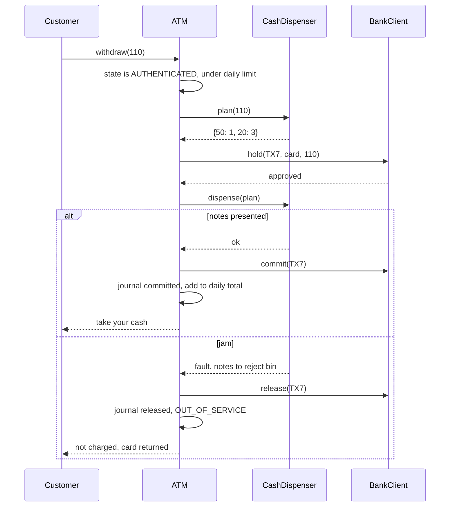

## In one minute
- An ATM is a state machine wrapped around a two-party transaction. The machine owns the cash; the bank owns the money. Every withdrawal is "the bank promises the funds, the machine moves paper, then both agree on what happened", and the design is judged on what it does when those steps disagree.
- Use a **hold, dispense, then commit or release** protocol. Ask the bank to reserve the amount, try to dispense, and only then make the debit final. If the dispenser jams after the hold, release the hold and record why; the customer is never charged for cash they did not get.
- Model the session as explicit states (idle, card inserted, authenticated, out of service) so "withdraw before the PIN" or "insert a card while one is inside" has exactly one place that refuses it.
- Plan the notes before you ask the bank. Whether the cassettes can make the amount is a local, free question; asking the bank first creates a hold you then have to undo.
- Everything that touches hardware or the network is an injected interface: bank, dispenser, card reader, clock. That is what makes jams, timeouts and midnight limit resets testable on a laptop.

## Requirements

Functional:
- A customer inserts a card and enters a PIN. Three wrong PINs in one session retain the card.
- An authenticated customer can withdraw cash, check the balance and eject the card. Several withdrawals per session are allowed.
- Withdrawals are paid from cassettes of fixed denominations (for example 50s and 20s) with limited counts, using the fewest notes. An amount the cassettes cannot make exactly is refused before the bank is contacted.
- A per-card daily withdrawal limit applies, resetting at midnight by the bank's clock.
- If the dispenser fails, the customer is not charged, the event is journaled, and the machine takes itself out of service until a technician resets it.
- Every attempted withdrawal is written to an electronic journal with its outcome.

Non-functional:
- No money is created or lost: cash out of the cassettes plus cash in the reject bin always reconciles with committed transactions.
- A single physical customer at a time; the software must still be safe against the bank replying late or twice.
- A transaction completes in a few seconds; the network round trip to the bank dominates.

Out of scope: deposits with note validation, card-less withdrawals, fee calculation and multi-currency dispensing. Mention them and park them in Extensibility.

## Entities and relationships

- **ATM** is the façade that the screen and keypad drive. It holds the current state, the cassettes, the session and the journal.
- **Session** lives from card insertion to ejection: the card number, the PIN attempt count and whether the customer is authenticated. It is discarded at the end, which is how attempt counts reset.
- **Cassette** holds notes of one denomination and a count. The **CashDispenser** owns the cassettes and a reject bin, and turns a note plan into physical movement.
- **NotePlan** is a value: denomination to count. It is computed by a **DispensePlanner** and passed to the dispenser.
- **BankClient** is the gateway to the bank's authorisation host: verify PIN, place a hold, commit, release, and read the balance. In production it speaks ISO 8583; here it is an interface.
- **Transaction** records one attempt: an id, the card, the amount, the plan and the outcome (committed, released, refused). The **Journal** is an append-only list of them.
- **Clock** supplies time for daily limits and journal timestamps.

Relationships: the ATM is composed of the dispenser and cassettes (they are physically inside it). It depends on the bank client and clock through interfaces. A transaction references a session's card but outlives the session in the journal.

## Class diagram



## Key flows

The withdrawal is the flow that matters. Note the order: local checks, then the bank hold, then the hardware, then the final message to the bank.



## Design patterns used and why

- **State** for the session. Each operation checks one thing first: is it legal in the current state. With four states and five operations, an enum plus a guard at the top of each method is clear enough; promote to State objects (one class per state, as in [Design Vending Machine](design-vending-machine.md)) when states start carrying their own data or timers, such as a "waiting for cash to be taken" state with a 30-second retract.
- **Command** for transactions. Withdraw, balance inquiry and later deposit are objects with `execute` and an outcome, so they can be journaled and recovered after a power cut.
- **Template Method** for the transaction skeleton: validate locally, authorise with the bank, perform the physical action, complete or reverse. Withdrawal and deposit fill in the steps differently but share the order and the reversal rule.
- **Façade and Adapter** around hardware and the bank. The ATM talks to `CashDispenser` and `BankClient`, not to vendor drivers or ISO 8583 bitmaps. The CEN/XFS standard applies the same idea industry-wide.
- **Chain of Responsibility for notes is a trap.** Many textbook answers pass the amount down a chain of 50, 20 and 10 handlers, each taking as many notes as it can. That is greedy, and greedy fails: with only 50s and 20s, 110 becomes 50 + 50 with 10 left over, though 50 + 20 + 20 + 20 works. Use a small search over counts instead (the vending machine lesson covers the dynamic program).

## Concurrency and edge cases

- **Bank reply lost after the hold.** The ATM sent the hold, the network dropped the reply, and it times out. It does not know whether funds are reserved. Send a release for that transaction id anyway; the bank must treat a release for an unknown or already-released id as a no-op. This is why every message carries the ATM's transaction id: it is the idempotency key.
- **Dispense fault after the hold.** Some notes may have been picked before the jam. They go to the reject bin, not to the customer, so the customer is not charged and the cassette counts drop. Reconciliation at the next cash replenishment counts the reject bin to prove it.
- **Customer does not take the cash.** Many ATMs retract presented notes after a timeout and reverse the withdrawal: one more state between dispense and commit.
- **Power cut mid-transaction.** On restart, read the journal. Any transaction with a hold but no final outcome gets a release (or a commit if the dispenser's sensors confirm notes were presented). The journal must be written before the hold is sent, not after.
- **Daily limit at midnight.** Compute the day from the injected clock, in the bank's time zone. A limit tracked in the ATM is only a first line of defence; the bank enforces the real one across all machines.
- **Wrong PIN count.** The count here is per session; the bank also keeps a per-card count across machines.

## Down the stack

### Layer 1: The contract
`withdraw(amount)` either returns a note plan whose total equals `amount`, with the customer debited exactly `amount` once, or fails with a reason and leaves the customer's balance and the daily total unchanged. Cassette counts drop only when notes physically leave a cassette (dispensed or rejected). For every transaction id the bank receives at most one final message, commit or release, and repeated releases are harmless. Card retention happens on the third wrong PIN in a session and ends the session.

### Layer 2: The mechanism
On the network, a withdrawal is an ISO 8583 financial request (message type 0200) carrying the card number, amount, a terminal id, a system trace audit number and an encrypted PIN block; the host answers with 0210 and a response code, where `00` means approved and `51` means insufficient funds. If the ATM cannot complete, it sends a reversal (0420 reversal advice) with the original trace number, and keeps resending it from a store-and-forward queue until acknowledged. The PIN never leaves the encrypting PIN pad in clear: the pad builds an ISO 9564 PIN block, encrypts it with a key loaded under dual control, and the bank's hardware security module translates and verifies it. In the cabinet, the dispenser picks notes one at a time from each cassette, measures thickness to detect two notes stuck together, and diverts anything suspicious to the reject bin before stacking the rest for presentation.

### Layer 3: The machine
The bank round trip is the slow part: the ATM's network link, the acquirer switch, the card scheme and the issuer host add up to roughly 200 ms to 2 s, and hosts commonly time out a request after around 30 seconds. The dispenser picks several notes per second, so a 10-note withdrawal takes a few seconds of mechanical time. The fewest-notes search over three or four denominations takes microseconds. Durability matters more than speed: the electronic journal is written to local flash or disk and flushed before the hold is sent, because after a power cut it is the only record of what was in flight. An `fsync` on flash costs on the order of milliseconds, which disappears against a network round trip.

### Why it's built this way
1. Cash is physical and cannot be recalled, so the bank must not finalise a debit until the machine knows the notes left.
2. The network can fail between any two steps, so the protocol is hold, act, then commit or release, with the transaction id as an idempotency key.
3. Reversals can also be lost, so they are queued durably and resent until acknowledged, and the bank must accept duplicates.
4. A stolen card is worth nothing without the PIN, so the PIN is encrypted in tamper-resistant hardware and guessing is limited by retaining the card.
5. Hardware fails in ways software cannot see directly, so the reject bin and journal give a physical audit trail that reconciliation can check.

## Extensibility

- **Deposits.** A new command: accept notes into escrow, validate them, ask the bank to credit, then move escrow into a deposit cassette or return it. The same template method applies, with the physical step first and the bank step second.
- **Card-less withdrawal.** A new authentication path: the customer scans a one-time code from a phone app, and the session becomes authenticated without PIN entry. The State machine gains one transition, not a new class hierarchy.
- **Fees and foreign cards.** A fee policy strategy that takes the card's issuer and returns a surcharge, shown on screen for consent before the hold. The hold amount becomes amount plus fee.

## Leadership lens

- Build first: the transaction protocol with a fake bank and a fake dispenser that can jam, time out and reply twice. Screens and receipts are easy; the support cost of "I was charged but got no cash" is not.
- Ask in review: when exactly is the journal written relative to the hold; what happens if the release is lost; how is the reject bin reconciled; who resets an out-of-service machine and how is that audited.
- ATM software sits in a regulated, certified environment. Changes to PIN handling or the bank interface need scheme and security certification, so keep those parts small, stable and separate from the screens marketing wants to change.
- The cost drivers are cash logistics and downtime, not compute. A planner that keeps a usable mix of notes (do not drain the 20s first) can delay a replenishment visit, which is real money.

## Check yourself
1. Why does the ATM plan the notes before it asks the bank for a hold?
   **Answer:** Whether the cassettes can make the amount is a free local check. Asking the bank first creates a hold that must then be released, adding traffic and a window where the customer's funds are tied up for nothing.
2. The hold request times out with no reply. What should the ATM do?
   **Answer:** Treat the outcome as unknown, refuse the withdrawal, and send a release for that transaction id. The bank makes release idempotent, so it is safe whether the hold existed or not.
3. Why does greedy dispensing fail with 50s and 20s, and what replaces it?
   **Answer:** Taking the largest notes first can leave a remainder no smaller note can pay (110 becomes 100 plus an unpayable 10). A bounded search or dynamic program over note counts finds 50 + 20 + 20 + 20.
4. After a jam, why do the cassette counts go down even though the customer received nothing?
   **Answer:** The notes physically left the cassettes and went to the reject bin. Counting them as still in the cassette would make the next reconciliation show a shortage that looks like theft.

## Practice
**Task:** Implement the ATM core. `ATM(bank, dispenser, clock, cassettes, daily_limit)` takes a bank client (`verify_pin(card, pin)`, `hold(txn_id, card, amount)` returning whether it was approved, `commit(txn_id)`, `release(txn_id)`), a dispenser with `dispense(plan)` returning `False` on a jam, a clock with `now()` in seconds, a map of denomination to note count, and a per-card daily limit (day is `now() // 86400`). States are `idle`, `card_inserted`, `authenticated` and `out_of_service`. `insert_card`, `enter_pin` (returns `ok`, `retry`, or `retained` on the third wrong PIN, which ends the session), `withdraw(amount)` and `eject_card` fail with `invalid state` when called in the wrong state, and `insert_card` fails with `out of service` in that state. `withdraw` checks in order: `invalid amount` (not positive), `limit exceeded`, `cannot dispense` (no exact plan from current cassettes; the plan uses the fewest notes and, among equals, more large notes), `insufficient funds` (hold refused); then it assigns ids `TX1`, `TX2` and so on, removes the planned notes from the cassettes, and on success commits and returns the plan, or on a jam releases, enters `out_of_service` and fails with `dispense failed`. Each held transaction is journaled as `(txn_id, card, amount, outcome)` with outcome `committed` or `released`; `service()` returns an out-of-service machine to `idle`.

```python starter
class AtmError(Exception):
    pass


class ATM:
    def __init__(self, bank, dispenser, clock, cassettes, daily_limit):
        self.state = "idle"
        self.journal = []
        self.retained = []

    def cash(self):
        raise NotImplementedError

    def insert_card(self, card):
        raise NotImplementedError

    def enter_pin(self, pin):
        raise NotImplementedError

    def withdraw(self, amount):
        raise NotImplementedError

    def eject_card(self):
        raise NotImplementedError

    def service(self):
        raise NotImplementedError
```

```python tests
class FakeBank:
    def __init__(self):
        self.pins = {"C1": "1234", "C2": "0000"}
        self.balance = {"C1": 1000, "C2": 40}
        self.holds = {}

    def verify_pin(self, card, pin):
        return self.pins.get(card) == pin

    def hold(self, txn_id, card, amount):
        if self.balance[card] < amount:
            return False
        self.balance[card] -= amount
        self.holds[txn_id] = (card, amount)
        return True

    def commit(self, txn_id):
        del self.holds[txn_id]

    def release(self, txn_id):
        card, amount = self.holds.pop(txn_id)
        self.balance[card] += amount


class FakeDispenser:
    def __init__(self):
        self.jam = False

    def dispense(self, plan):
        return not self.jam


class FakeClock:
    def __init__(self):
        self.t = 1000

    def now(self):
        return self.t


def make():
    bank, disp, clock = FakeBank(), FakeDispenser(), FakeClock()
    atm = ATM(bank, disp, clock, {50: 4, 20: 10}, 500)
    return atm, bank, disp, clock


def fails(fn, msg):
    try:
        fn()
    except AtmError as e:
        return str(e) == msg
    return False


def login(atm, card="C1", pin="1234"):
    atm.insert_card(card)
    assert atm.enter_pin(pin) == "ok"


def test_pin_retries_then_retention():
    atm, _, _, _ = make()
    atm.insert_card("C1")
    assert atm.enter_pin("1") == "retry"
    assert atm.enter_pin("2") == "retry"
    assert atm.enter_pin("1234") == "ok"
    assert atm.eject_card() == "C1"
    atm.insert_card("C1")
    assert atm.enter_pin("9") == "retry", "attempts reset per session"
    assert atm.enter_pin("9") == "retry"
    assert atm.enter_pin("9") == "retained"
    assert atm.state == "idle"
    assert atm.retained == ["C1"]
    assert fails(atm.eject_card, "invalid state")


def test_withdraw_uses_fewest_notes_not_greedy():
    atm, bank, _, _ = make()
    login(atm)
    assert atm.withdraw(110) == {50: 1, 20: 3}
    assert atm.withdraw(100) == {50: 2}
    assert atm.cash() == {50: 1, 20: 7}
    assert bank.balance["C1"] == 790
    assert atm.journal == [("TX1", "C1", 110, "committed"), ("TX2", "C1", 100, "committed")]


def test_cannot_dispense_is_checked_before_the_bank():
    atm, bank, _, _ = make()
    login(atm)
    assert fails(lambda: atm.withdraw(30), "cannot dispense")
    assert fails(lambda: atm.withdraw(0), "invalid amount")
    assert bank.holds == {} and atm.journal == []
    small = ATM(bank, FakeDispenser(), FakeClock(), {50: 1, 20: 1}, 500)
    login(small)
    assert fails(lambda: small.withdraw(40), "cannot dispense"), "only one 20 left"
    assert small.withdraw(70) == {50: 1, 20: 1}


def test_daily_limit_resets_next_day():
    atm, _, _, clock = make()
    login(atm)
    assert atm.withdraw(300) == {50: 4, 20: 5}
    assert fails(lambda: atm.withdraw(300), "limit exceeded")
    assert atm.withdraw(100) == {20: 5}
    assert fails(lambda: atm.withdraw(120), "limit exceeded")
    clock.t += 86400
    assert fails(lambda: atm.withdraw(120), "cannot dispense"), "limit reset; the machine is empty"


def test_insufficient_funds_changes_nothing():
    atm, bank, _, _ = make()
    login(atm, "C2", "0000")
    assert fails(lambda: atm.withdraw(50), "insufficient funds")
    assert atm.cash() == {50: 4, 20: 10}
    assert atm.journal == []
    assert atm.withdraw(40) == {20: 2}
    assert bank.balance["C2"] == 0


def test_jam_releases_hold_and_goes_out_of_service():
    atm, bank, disp, _ = make()
    login(atm)
    disp.jam = True
    assert fails(lambda: atm.withdraw(70), "dispense failed")
    assert bank.balance["C1"] == 1000 and bank.holds == {}
    assert atm.journal == [("TX1", "C1", 70, "released")]
    assert atm.cash() == {50: 3, 20: 9}, "picked notes went to the reject bin"
    assert atm.state == "out_of_service"
    assert fails(lambda: atm.insert_card("C2"), "out of service")
    atm.service()
    disp.jam = False
    login(atm, "C2", "0000")
    assert atm.withdraw(20) == {20: 1}


def test_state_guards():
    atm, _, _, _ = make()
    assert fails(lambda: atm.withdraw(20), "invalid state")
    assert fails(lambda: atm.enter_pin("1234"), "invalid state")
    atm.insert_card("C1")
    assert fails(lambda: atm.insert_card("C2"), "invalid state")
    assert fails(lambda: atm.withdraw(20), "invalid state")
    assert atm.eject_card() == "C1"
    assert atm.state == "idle"
```

```python solution
class AtmError(Exception):
    pass


class ATM:
    def __init__(self, bank, dispenser, clock, cassettes, daily_limit):
        self._bank = bank
        self._dispenser = dispenser
        self._clock = clock
        self._cassettes = dict(cassettes)
        self._limit = daily_limit
        self._withdrawn = {}  # (card, day) -> amount
        self._card = None
        self._attempts = 0
        self._next_txn = 1
        self.state = "idle"
        self.journal = []
        self.retained = []

    def cash(self):
        return {d: c for d, c in self._cassettes.items() if c > 0}

    def _require(self, state):
        if self.state != state:
            raise AtmError("invalid state")

    def insert_card(self, card):
        if self.state == "out_of_service":
            raise AtmError("out of service")
        self._require("idle")
        self._card, self._attempts = card, 0
        self.state = "card_inserted"

    def enter_pin(self, pin):
        self._require("card_inserted")
        if self._bank.verify_pin(self._card, pin):
            self.state = "authenticated"
            return "ok"
        self._attempts += 1
        if self._attempts < 3:
            return "retry"
        self.retained.append(self._card)
        self._card, self.state = None, "idle"
        return "retained"

    def _plan(self, amount):
        denoms = sorted(self._cassettes, reverse=True)
        best = [None]

        def search(i, left, used, plan):
            if left == 0:
                if best[0] is None or used < best[0][0]:
                    best[0] = (used, dict(plan))
                return
            if i == len(denoms):
                return
            d = denoms[i]
            for n in range(min(self._cassettes[d], left // d), -1, -1):
                if n:
                    plan[d] = n
                search(i + 1, left - n * d, used + n, plan)
                plan.pop(d, None)

        search(0, amount, 0, {})
        return None if best[0] is None else best[0][1]

    def withdraw(self, amount):
        self._require("authenticated")
        if amount <= 0:
            raise AtmError("invalid amount")
        key = (self._card, self._clock.now() // 86400)
        if self._withdrawn.get(key, 0) + amount > self._limit:
            raise AtmError("limit exceeded")
        plan = self._plan(amount)
        if plan is None:
            raise AtmError("cannot dispense")
        txn = "TX" + str(self._next_txn)
        if not self._bank.hold(txn, self._card, amount):
            raise AtmError("insufficient funds")
        self._next_txn += 1
        for d, n in plan.items():
            self._cassettes[d] -= n
        if not self._dispenser.dispense(plan):
            self._bank.release(txn)
            self.journal.append((txn, self._card, amount, "released"))
            self._card, self.state = None, "out_of_service"
            raise AtmError("dispense failed")
        self._bank.commit(txn)
        self.journal.append((txn, self._card, amount, "committed"))
        self._withdrawn[key] = self._withdrawn.get(key, 0) + amount
        return plan

    def eject_card(self):
        if self.state not in ("card_inserted", "authenticated"):
            raise AtmError("invalid state")
        card, self._card, self.state = self._card, None, "idle"
        return card

    def service(self):
        self._require("out_of_service")
        self.state = "idle"
```

```typescript starter
export interface Bank {
  verifyPin(card: string, pin: string): boolean;
  hold(txnId: string, card: string, amount: number): boolean;
  commit(txnId: string): void;
  release(txnId: string): void;
}

export interface Dispenser { dispense(plan: Record<number, number>): boolean }
export interface Clock { now(): number }
export type JournalEntry = [string, string, number, string];

export class ATM {
  state = "idle";
  journal: JournalEntry[] = [];
  retained: string[] = [];

  constructor(bank: Bank, dispenser: Dispenser, clock: Clock,
              cassettes: Record<number, number>, dailyLimit: number) {}

  cash(): Record<number, number> { throw new Error("TODO"); }
  insertCard(card: string): void { throw new Error("TODO"); }
  enterPin(pin: string): string { throw new Error("TODO"); }
  withdraw(amount: number): Record<number, number> { throw new Error("TODO"); }
  ejectCard(): string { throw new Error("TODO"); }
  service(): void { throw new Error("TODO"); }
}
```

```typescript tests
class FakeBank implements Bank {
  pins: Record<string, string> = { C1: "1234", C2: "0000" };
  balance: Record<string, number> = { C1: 1000, C2: 40 };
  holds: Record<string, [string, number]> = {};
  verifyPin(card: string, pin: string): boolean { return this.pins[card] === pin; }
  hold(txnId: string, card: string, amount: number): boolean {
    if (this.balance[card] < amount) return false;
    this.balance[card] -= amount;
    this.holds[txnId] = [card, amount];
    return true;
  }
  commit(txnId: string): void { delete this.holds[txnId]; }
  release(txnId: string): void {
    const [card, amount] = this.holds[txnId];
    delete this.holds[txnId];
    this.balance[card] += amount;
  }
}

class FakeDispenser implements Dispenser {
  jam = false;
  dispense(plan: Record<number, number>): boolean { return !this.jam; }
}

class FakeClock implements Clock {
  t = 1000;
  now(): number { return this.t; }
}

function makeAtm(): [ATM, FakeBank, FakeDispenser, FakeClock] {
  const bank = new FakeBank(), disp = new FakeDispenser(), clock = new FakeClock();
  return [new ATM(bank, disp, clock, { 50: 4, 20: 10 }, 500), bank, disp, clock];
}

function failsWith(fn: () => unknown, msg: string): boolean {
  try { fn(); return false; } catch (e) { return (e as Error).message === msg; }
}

function login(atm: ATM, card = "C1", pin = "1234"): void {
  atm.insertCard(card);
  assertEqual(atm.enterPin(pin), "ok");
}

test("pin retries then retention", () => {
  const [atm] = makeAtm();
  atm.insertCard("C1");
  assertEqual(atm.enterPin("1"), "retry");
  assertEqual(atm.enterPin("2"), "retry");
  assertEqual(atm.enterPin("1234"), "ok");
  assertEqual(atm.ejectCard(), "C1");
  atm.insertCard("C1");
  assertEqual(atm.enterPin("9"), "retry", "attempts reset per session");
  assertEqual(atm.enterPin("9"), "retry");
  assertEqual(atm.enterPin("9"), "retained");
  assertEqual(atm.state, "idle");
  assertEqual(atm.retained, ["C1"]);
  assert(failsWith(() => atm.ejectCard(), "invalid state"));
});

test("withdraw uses fewest notes not greedy", () => {
  const [atm, bank] = makeAtm();
  login(atm);
  assertEqual(atm.withdraw(110), { 20: 3, 50: 1 });
  assertEqual(atm.withdraw(100), { 50: 2 });
  assertEqual(atm.cash(), { 20: 7, 50: 1 });
  assertEqual(bank.balance["C1"], 790);
  assertEqual(atm.journal, [["TX1", "C1", 110, "committed"], ["TX2", "C1", 100, "committed"]]);
});

test("cannot dispense is checked before the bank", () => {
  const [atm, bank] = makeAtm();
  login(atm);
  assert(failsWith(() => atm.withdraw(30), "cannot dispense"));
  assert(failsWith(() => atm.withdraw(0), "invalid amount"));
  assertEqual(bank.holds, {});
  assertEqual(atm.journal, []);
  const small = new ATM(bank, new FakeDispenser(), new FakeClock(), { 50: 1, 20: 1 }, 500);
  login(small);
  assert(failsWith(() => small.withdraw(40), "cannot dispense"), "only one 20 left");
  assertEqual(small.withdraw(70), { 20: 1, 50: 1 });
});

test("daily limit resets next day", () => {
  const [atm, , , clock] = makeAtm();
  login(atm);
  assertEqual(atm.withdraw(300), { 20: 5, 50: 4 });
  assert(failsWith(() => atm.withdraw(300), "limit exceeded"));
  assertEqual(atm.withdraw(100), { 20: 5 });
  assert(failsWith(() => atm.withdraw(120), "limit exceeded"));
  clock.t += 86400;
  assert(failsWith(() => atm.withdraw(120), "cannot dispense"), "limit reset; the machine is empty");
});

test("insufficient funds changes nothing", () => {
  const [atm, bank] = makeAtm();
  login(atm, "C2", "0000");
  assert(failsWith(() => atm.withdraw(50), "insufficient funds"));
  assertEqual(atm.cash(), { 20: 10, 50: 4 });
  assertEqual(atm.journal, []);
  assertEqual(atm.withdraw(40), { 20: 2 });
  assertEqual(bank.balance["C2"], 0);
});

test("jam releases hold and goes out of service", () => {
  const [atm, bank, disp] = makeAtm();
  login(atm);
  disp.jam = true;
  assert(failsWith(() => atm.withdraw(70), "dispense failed"));
  assertEqual(bank.balance["C1"], 1000);
  assertEqual(bank.holds, {});
  assertEqual(atm.journal, [["TX1", "C1", 70, "released"]]);
  assertEqual(atm.cash(), { 20: 9, 50: 3 }, "picked notes went to the reject bin");
  assertEqual(atm.state, "out_of_service");
  assert(failsWith(() => atm.insertCard("C2"), "out of service"));
  atm.service();
  disp.jam = false;
  login(atm, "C2", "0000");
  assertEqual(atm.withdraw(20), { 20: 1 });
});

test("state guards", () => {
  const [atm] = makeAtm();
  assert(failsWith(() => atm.withdraw(20), "invalid state"));
  assert(failsWith(() => atm.enterPin("1234"), "invalid state"));
  atm.insertCard("C1");
  assert(failsWith(() => atm.insertCard("C2"), "invalid state"));
  assert(failsWith(() => atm.withdraw(20), "invalid state"));
  assertEqual(atm.ejectCard(), "C1");
  assertEqual(atm.state, "idle");
});
```

```typescript solution
export interface Bank {
  verifyPin(card: string, pin: string): boolean;
  hold(txnId: string, card: string, amount: number): boolean;
  commit(txnId: string): void;
  release(txnId: string): void;
}

export interface Dispenser { dispense(plan: Record<number, number>): boolean }
export interface Clock { now(): number }
export type JournalEntry = [string, string, number, string];

export class ATM {
  state = "idle";
  journal: JournalEntry[] = [];
  retained: string[] = [];
  private cassettes = new Map<number, number>();
  private withdrawn = new Map<string, number>();
  private card: string | null = null;
  private attempts = 0;
  private nextTxn = 1;

  constructor(private bank: Bank, private dispenser: Dispenser, private clock: Clock,
              cassettes: Record<number, number>, private dailyLimit: number) {
    for (const [d, n] of Object.entries(cassettes)) this.cassettes.set(Number(d), n);
  }

  cash(): Record<number, number> {
    const out: Record<number, number> = {};
    for (const d of [...this.cassettes.keys()].sort((a, b) => a - b)) {
      const n = this.cassettes.get(d)!;
      if (n > 0) out[d] = n;
    }
    return out;
  }

  private require(state: string): void {
    if (this.state !== state) throw new Error("invalid state");
  }

  insertCard(card: string): void {
    if (this.state === "out_of_service") throw new Error("out of service");
    this.require("idle");
    this.card = card;
    this.attempts = 0;
    this.state = "card_inserted";
  }

  enterPin(pin: string): string {
    this.require("card_inserted");
    if (this.bank.verifyPin(this.card!, pin)) {
      this.state = "authenticated";
      return "ok";
    }
    this.attempts++;
    if (this.attempts < 3) return "retry";
    this.retained.push(this.card!);
    this.card = null;
    this.state = "idle";
    return "retained";
  }

  private plan(amount: number): Record<number, number> | null {
    const denoms = [...this.cassettes.keys()].sort((a, b) => b - a);
    let best: [number, Record<number, number>] | null = null;
    const plan: Record<number, number> = {};
    const search = (i: number, left: number, used: number): void => {
      if (left === 0) {
        if (best === null || used < best[0]) best = [used, { ...plan }];
        return;
      }
      if (i === denoms.length) return;
      const d = denoms[i];
      for (let n = Math.min(this.cassettes.get(d)!, Math.floor(left / d)); n >= 0; n--) {
        if (n > 0) plan[d] = n;
        search(i + 1, left - n * d, used + n);
        delete plan[d];
      }
    };
    search(0, amount, 0);
    return best === null ? null : (best as [number, Record<number, number>])[1];
  }

  withdraw(amount: number): Record<number, number> {
    this.require("authenticated");
    if (amount <= 0) throw new Error("invalid amount");
    const key = this.card + "|" + Math.floor(this.clock.now() / 86400);
    if ((this.withdrawn.get(key) ?? 0) + amount > this.dailyLimit) throw new Error("limit exceeded");
    const plan = this.plan(amount);
    if (plan === null) throw new Error("cannot dispense");
    const txn = "TX" + this.nextTxn;
    if (!this.bank.hold(txn, this.card!, amount)) throw new Error("insufficient funds");
    this.nextTxn++;
    for (const [d, n] of Object.entries(plan)) {
      this.cassettes.set(Number(d), this.cassettes.get(Number(d))! - n);
    }
    if (!this.dispenser.dispense(plan)) {
      this.bank.release(txn);
      this.journal.push([txn, this.card!, amount, "released"]);
      this.card = null;
      this.state = "out_of_service";
      throw new Error("dispense failed");
    }
    this.bank.commit(txn);
    this.journal.push([txn, this.card!, amount, "committed"]);
    this.withdrawn.set(key, (this.withdrawn.get(key) ?? 0) + amount);
    return plan;
  }

  ejectCard(): string {
    if (this.state !== "card_inserted" && this.state !== "authenticated") {
      throw new Error("invalid state");
    }
    const card = this.card!;
    this.card = null;
    this.state = "idle";
    return card;
  }

  service(): void {
    this.require("out_of_service");
    this.state = "idle";
  }
}
```

```go starter
package practice

type Bank interface {
	VerifyPIN(card, pin string) bool
	Hold(txnID, card string, amount int) bool
	Commit(txnID string)
	Release(txnID string)
}

type Dispenser interface {
	Dispense(plan map[int]int) bool
}

type Clock interface {
	Now() int64
}

type JournalEntry struct {
	TxnID   string
	Card    string
	Amount  int
	Outcome string
}

type ATM struct {
	State    string
	Journal  []JournalEntry
	Retained []string
}

func NewATM(bank Bank, d Dispenser, clock Clock, cassettes map[int]int, dailyLimit int) *ATM {
	return &ATM{State: "idle"}
}

func (a *ATM) Cash() map[int]int                     { panic("TODO") }
func (a *ATM) InsertCard(card string) error          { panic("TODO") }
func (a *ATM) EnterPIN(pin string) (string, error)   { panic("TODO") }
func (a *ATM) Withdraw(amount int) (map[int]int, error) { panic("TODO") }
func (a *ATM) EjectCard() (string, error)            { panic("TODO") }
func (a *ATM) Service() error                        { panic("TODO") }
```

```go tests
package practice

import (
	"reflect"
	"testing"
)

type fakeBank struct {
	pins    map[string]string
	balance map[string]int
	holds   map[string][2]interface{}
}

func newFakeBank() *fakeBank {
	return &fakeBank{
		pins:    map[string]string{"C1": "1234", "C2": "0000"},
		balance: map[string]int{"C1": 1000, "C2": 40},
		holds:   map[string][2]interface{}{},
	}
}

func (b *fakeBank) VerifyPIN(card, pin string) bool { return b.pins[card] == pin }
func (b *fakeBank) Hold(txn, card string, amount int) bool {
	if b.balance[card] < amount {
		return false
	}
	b.balance[card] -= amount
	b.holds[txn] = [2]interface{}{card, amount}
	return true
}
func (b *fakeBank) Commit(txn string) { delete(b.holds, txn) }
func (b *fakeBank) Release(txn string) {
	h := b.holds[txn]
	delete(b.holds, txn)
	b.balance[h[0].(string)] += h[1].(int)
}

type fakeDispenser struct{ jam bool }

func (d *fakeDispenser) Dispense(plan map[int]int) bool { return !d.jam }

type fakeClock struct{ t int64 }

func (c *fakeClock) Now() int64 { return c.t }

func makeAtm() (*ATM, *fakeBank, *fakeDispenser, *fakeClock) {
	b, d, c := newFakeBank(), &fakeDispenser{}, &fakeClock{t: 1000}
	return NewATM(b, d, c, map[int]int{50: 4, 20: 10}, 500), b, d, c
}

func login(t *testing.T, a *ATM, card, pin string) {
	t.Helper()
	if err := a.InsertCard(card); err != nil {
		t.Fatal(err)
	}
	if r, err := a.EnterPIN(pin); err != nil || r != "ok" {
		t.Fatalf("login: %v %v", r, err)
	}
}

func wantErr(t *testing.T, err error, msg string) {
	t.Helper()
	if err == nil || err.Error() != msg {
		t.Fatalf("want error %q, got %v", msg, err)
	}
}

func wantPlan(t *testing.T, a *ATM, amount int, want map[int]int) {
	t.Helper()
	got, err := a.Withdraw(amount)
	if err != nil || !reflect.DeepEqual(got, want) {
		t.Fatalf("withdraw %d: got %v %v, want %v", amount, got, err, want)
	}
}

func TestPinRetriesThenRetention(t *testing.T) {
	a, _, _, _ := makeAtm()
	a.InsertCard("C1")
	for _, p := range []string{"1", "2"} {
		if r, _ := a.EnterPIN(p); r != "retry" {
			t.Fatalf("got %s", r)
		}
	}
	if r, _ := a.EnterPIN("1234"); r != "ok" {
		t.Fatal("third try correct")
	}
	if c, _ := a.EjectCard(); c != "C1" {
		t.Fatal("eject")
	}
	a.InsertCard("C1")
	a.EnterPIN("9")
	if r, _ := a.EnterPIN("9"); r != "retry" {
		t.Fatal("attempts reset per session")
	}
	if r, _ := a.EnterPIN("9"); r != "retained" {
		t.Fatal("third wrong pin retains")
	}
	if a.State != "idle" || !reflect.DeepEqual(a.Retained, []string{"C1"}) {
		t.Fatalf("state %s retained %v", a.State, a.Retained)
	}
	_, err := a.EjectCard()
	wantErr(t, err, "invalid state")
}

func TestFewestNotesNotGreedy(t *testing.T) {
	a, b, _, _ := makeAtm()
	login(t, a, "C1", "1234")
	wantPlan(t, a, 110, map[int]int{50: 1, 20: 3})
	wantPlan(t, a, 100, map[int]int{50: 2})
	if !reflect.DeepEqual(a.Cash(), map[int]int{50: 1, 20: 7}) || b.balance["C1"] != 790 {
		t.Fatalf("cash %v balance %d", a.Cash(), b.balance["C1"])
	}
	want := []JournalEntry{{"TX1", "C1", 110, "committed"}, {"TX2", "C1", 100, "committed"}}
	if !reflect.DeepEqual(a.Journal, want) {
		t.Fatalf("journal %v", a.Journal)
	}
}

func TestCannotDispenseBeforeBank(t *testing.T) {
	a, b, _, _ := makeAtm()
	login(t, a, "C1", "1234")
	_, err := a.Withdraw(30)
	wantErr(t, err, "cannot dispense")
	_, err = a.Withdraw(0)
	wantErr(t, err, "invalid amount")
	if len(b.holds) != 0 || len(a.Journal) != 0 {
		t.Fatal("bank must not be contacted")
	}
	small := NewATM(b, &fakeDispenser{}, &fakeClock{t: 1000}, map[int]int{50: 1, 20: 1}, 500)
	login(t, small, "C1", "1234")
	_, err = small.Withdraw(40)
	wantErr(t, err, "cannot dispense")
	wantPlan(t, small, 70, map[int]int{50: 1, 20: 1})
}

func TestDailyLimit(t *testing.T) {
	a, _, _, c := makeAtm()
	login(t, a, "C1", "1234")
	wantPlan(t, a, 300, map[int]int{50: 4, 20: 5})
	_, err := a.Withdraw(300)
	wantErr(t, err, "limit exceeded")
	wantPlan(t, a, 100, map[int]int{20: 5})
	_, err = a.Withdraw(120)
	wantErr(t, err, "limit exceeded")
	c.t += 86400
	_, err = a.Withdraw(120)
	wantErr(t, err, "cannot dispense")
}

func TestInsufficientFunds(t *testing.T) {
	a, b, _, _ := makeAtm()
	login(t, a, "C2", "0000")
	_, err := a.Withdraw(50)
	wantErr(t, err, "insufficient funds")
	if !reflect.DeepEqual(a.Cash(), map[int]int{50: 4, 20: 10}) || len(a.Journal) != 0 {
		t.Fatal("nothing should change")
	}
	wantPlan(t, a, 40, map[int]int{20: 2})
	if b.balance["C2"] != 0 {
		t.Fatal("balance")
	}
}

func TestJamReleasesHold(t *testing.T) {
	a, b, d, _ := makeAtm()
	login(t, a, "C1", "1234")
	d.jam = true
	_, err := a.Withdraw(70)
	wantErr(t, err, "dispense failed")
	if b.balance["C1"] != 1000 || len(b.holds) != 0 {
		t.Fatal("customer must not be charged")
	}
	if !reflect.DeepEqual(a.Journal, []JournalEntry{{"TX1", "C1", 70, "released"}}) {
		t.Fatalf("journal %v", a.Journal)
	}
	if !reflect.DeepEqual(a.Cash(), map[int]int{50: 3, 20: 9}) || a.State != "out_of_service" {
		t.Fatalf("cash %v state %s", a.Cash(), a.State)
	}
	wantErr(t, a.InsertCard("C2"), "out of service")
	if err := a.Service(); err != nil {
		t.Fatal(err)
	}
	d.jam = false
	login(t, a, "C2", "0000")
	wantPlan(t, a, 20, map[int]int{20: 1})
}

func TestStateGuards(t *testing.T) {
	a, _, _, _ := makeAtm()
	_, err := a.Withdraw(20)
	wantErr(t, err, "invalid state")
	_, err = a.EnterPIN("1234")
	wantErr(t, err, "invalid state")
	a.InsertCard("C1")
	wantErr(t, a.InsertCard("C2"), "invalid state")
	_, err = a.Withdraw(20)
	wantErr(t, err, "invalid state")
	if c, err := a.EjectCard(); err != nil || c != "C1" || a.State != "idle" {
		t.Fatal("eject")
	}
}
```

```go solution
package practice

import (
	"errors"
	"fmt"
	"sort"
	"sync"
)

type Bank interface {
	VerifyPIN(card, pin string) bool
	Hold(txnID, card string, amount int) bool
	Commit(txnID string)
	Release(txnID string)
}

type Dispenser interface {
	Dispense(plan map[int]int) bool
}

type Clock interface {
	Now() int64
}

type JournalEntry struct {
	TxnID   string
	Card    string
	Amount  int
	Outcome string
}

var (
	ErrInvalidState      = errors.New("invalid state")
	ErrOutOfService      = errors.New("out of service")
	ErrInvalidAmount     = errors.New("invalid amount")
	ErrLimitExceeded     = errors.New("limit exceeded")
	ErrCannotDispense    = errors.New("cannot dispense")
	ErrInsufficientFunds = errors.New("insufficient funds")
	ErrDispenseFailed    = errors.New("dispense failed")
)

type dayKey struct {
	card string
	day  int64
}

type ATM struct {
	State    string
	Journal  []JournalEntry
	Retained []string

	mu        sync.Mutex
	bank      Bank
	dispenser Dispenser
	clock     Clock
	cassettes map[int]int
	limit     int
	withdrawn map[dayKey]int
	card      string
	attempts  int
	nextTxn   int
}

func NewATM(bank Bank, d Dispenser, clock Clock, cassettes map[int]int, dailyLimit int) *ATM {
	c := map[int]int{}
	for k, v := range cassettes {
		c[k] = v
	}
	return &ATM{State: "idle", bank: bank, dispenser: d, clock: clock, cassettes: c,
		limit: dailyLimit, withdrawn: map[dayKey]int{}, nextTxn: 1}
}

func (a *ATM) Cash() map[int]int {
	a.mu.Lock()
	defer a.mu.Unlock()
	out := map[int]int{}
	for d, n := range a.cassettes {
		if n > 0 {
			out[d] = n
		}
	}
	return out
}

func (a *ATM) InsertCard(card string) error {
	a.mu.Lock()
	defer a.mu.Unlock()
	if a.State == "out_of_service" {
		return ErrOutOfService
	}
	if a.State != "idle" {
		return ErrInvalidState
	}
	a.card, a.attempts, a.State = card, 0, "card_inserted"
	return nil
}

func (a *ATM) EnterPIN(pin string) (string, error) {
	a.mu.Lock()
	defer a.mu.Unlock()
	if a.State != "card_inserted" {
		return "", ErrInvalidState
	}
	if a.bank.VerifyPIN(a.card, pin) {
		a.State = "authenticated"
		return "ok", nil
	}
	a.attempts++
	if a.attempts < 3 {
		return "retry", nil
	}
	a.Retained = append(a.Retained, a.card)
	a.card, a.State = "", "idle"
	return "retained", nil
}

func (a *ATM) plan(amount int) map[int]int {
	denoms := make([]int, 0, len(a.cassettes))
	for d := range a.cassettes {
		denoms = append(denoms, d)
	}
	sort.Sort(sort.Reverse(sort.IntSlice(denoms)))
	var best map[int]int
	bestUsed := -1
	cur := map[int]int{}
	var search func(i, left, used int)
	search = func(i, left, used int) {
		if left == 0 {
			if bestUsed == -1 || used < bestUsed {
				bestUsed = used
				best = map[int]int{}
				for k, v := range cur {
					best[k] = v
				}
			}
			return
		}
		if i == len(denoms) {
			return
		}
		d := denoms[i]
		max := left / d
		if a.cassettes[d] < max {
			max = a.cassettes[d]
		}
		for n := max; n >= 0; n-- {
			if n > 0 {
				cur[d] = n
			}
			search(i+1, left-n*d, used+n)
			delete(cur, d)
		}
	}
	search(0, amount, 0)
	return best
}

func (a *ATM) Withdraw(amount int) (map[int]int, error) {
	a.mu.Lock()
	defer a.mu.Unlock()
	if a.State != "authenticated" {
		return nil, ErrInvalidState
	}
	if amount <= 0 {
		return nil, ErrInvalidAmount
	}
	key := dayKey{a.card, a.clock.Now() / 86400}
	if a.withdrawn[key]+amount > a.limit {
		return nil, ErrLimitExceeded
	}
	p := a.plan(amount)
	if p == nil {
		return nil, ErrCannotDispense
	}
	txn := fmt.Sprintf("TX%d", a.nextTxn)
	if !a.bank.Hold(txn, a.card, amount) {
		return nil, ErrInsufficientFunds
	}
	a.nextTxn++
	for d, n := range p {
		a.cassettes[d] -= n
	}
	if !a.dispenser.Dispense(p) {
		a.bank.Release(txn)
		a.Journal = append(a.Journal, JournalEntry{txn, a.card, amount, "released"})
		a.card, a.State = "", "out_of_service"
		return nil, ErrDispenseFailed
	}
	a.bank.Commit(txn)
	a.Journal = append(a.Journal, JournalEntry{txn, a.card, amount, "committed"})
	a.withdrawn[key] += amount
	return p, nil
}

func (a *ATM) EjectCard() (string, error) {
	a.mu.Lock()
	defer a.mu.Unlock()
	if a.State != "card_inserted" && a.State != "authenticated" {
		return "", ErrInvalidState
	}
	card := a.card
	a.card, a.State = "", "idle"
	return card, nil
}

func (a *ATM) Service() error {
	a.mu.Lock()
	defer a.mu.Unlock()
	if a.State != "out_of_service" {
		return ErrInvalidState
	}
	a.State = "idle"
	return nil
}
```

## Mock interview
**Prompt:** Design the software for a bank's ATM fleet: one machine has four cassettes, talks to the bank's host over a network, and serves one customer at a time. Code the classes and the withdrawal flow, and show what happens when the cash dispenser jams after the bank approves.

- Follow-up: The bank's reply to your hold request never arrives. The customer is waiting. What do you do, and what does the bank need to guarantee?
- Follow-up: The machine loses power with notes in the transport path. How do you recover on restart?
- Follow-up: An interviewer suggests a chain of denomination handlers for dispensing. Do you agree?

**A strong answer covers:**
- Explicit session states with every operation guarded, and card retention after repeated wrong PINs.
- Hold, dispense, then commit or release, with the ATM's transaction id as the idempotency key for every bank message.
- Local checks (amount, limit, note plan) before contacting the bank, and a fewest-notes plan that is not greedy.
- A durable journal written before the hold, used for recovery and reconciliation, and a reject bin that explains missing notes.
- Hardware and bank behind interfaces, with fakes that can jam and time out, so failure paths are tested.
- Awareness of the real stack: ISO 8583 requests and reversals, PIN blocks in an encrypting PIN pad, and device control through XFS.

## Watch
- [State Pattern, Design Patterns ep 17 (Christopher Okhravi)](https://www.youtube.com/watch?v=N12L5D78MAA): the pattern behind the session states, with a careful explanation of when it pays off.
- [Command Pattern (Christopher Okhravi)](https://www.youtube.com/watch?v=9qA5kw8dcSU): why transactions as objects make journaling and undo natural.

## Free resources
- [ISO 8583 (Wikipedia)](https://en.wikipedia.org/wiki/ISO_8583): message types, bitmaps and response codes used between ATMs and banks.
- [Automated teller machine (Wikipedia)](https://en.wikipedia.org/wiki/Automated_teller_machine): hardware components, security and history.
- [CEN/XFS (Wikipedia)](https://en.wikipedia.org/wiki/CEN/XFS): the device-control standard that lets ATM software drive many vendors' hardware.
- [Making retries safe with idempotent APIs (AWS Builders' Library)](https://aws.amazon.com/builders-library/making-retries-safe-with-idempotent-APIs/): the reasoning behind idempotent release and reversal messages.
- [State pattern (Refactoring.Guru)](https://refactoring.guru/design-patterns/state): when to move from an enum to state objects.
