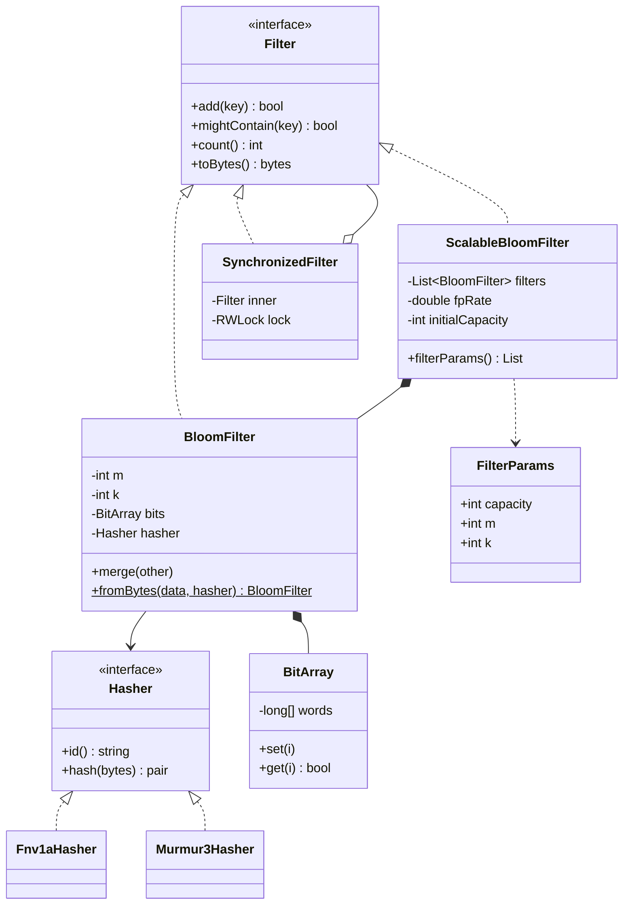
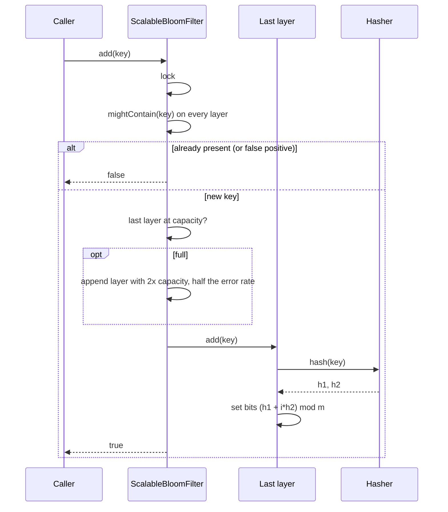

## In one minute
- This is a library design question, not an algorithm question. The [Bloom Filters](../sd/bloom-filters.md) lesson covers the math. Here the job is an API that other teams can use for years without reading that math: create from "expected items and target error rate", add, query, save, load, merge, and grow.
- Make hashing a pluggable strategy with a stable identity. A filter is only meaningful with the exact hash function that built it, so the hasher's ID goes into the serialised header and loading with a different one fails loudly.
- Version the binary format from day one: magic bytes, version, `m`, `k`, count, hasher ID, then the bit array in a defined byte and bit order. Filters outlive the processes that build them, and they cross languages.
- Offer a scalable filter for callers who cannot predict `n`. It stacks plain filters, each larger and with a tighter error rate than the last, so the overall false-positive rate stays below the target however many keys arrive.
- Bits only ever go from 0 to 1, which makes concurrent adds cheap: an atomic OR per word, no lock. Growing a scalable filter is the one step that needs real coordination.

## Requirements
Functional:
- Create a filter from expected insertions `n` and false-positive rate `p`, or from explicit `m` bits and `k` probes.
- `add(key)` and `mightContain(key)` for byte strings, with an adapter (a "funnel") for application types.
- Plug in the hash function; ship a fast, stable default.
- Serialise to bytes and load from bytes, rejecting corrupt, truncated or incompatible data.
- Merge two compatible filters by OR-ing their bits.
- A scalable variant that keeps its error bound as it grows past the initial capacity.
- Safe for concurrent use, or clearly documented when it is not.

Non-functional:
- No false negatives, ever, including across save and load.
- About `1.44 × log2(1/p)` bits per key, so 1% costs under 10 bits per key.
- Add and query in well under a microsecond for in-memory filters.
- A byte format that a Go service can write and a Python job can read.

Out of scope: deletion (counting filters, covered in the sd lesson), a networked filter service, and exact set semantics.

## Entities and relationships
- **Filter**: the interface callers depend on: `add`, `mightContain`, `count`, `serialise`. Plain, scalable and synchronised filters all implement it.
- **BloomFilter**: the core. It holds `m`, `k`, a bit array and a hasher, and turns each key into `k` probe positions.
- **BitArray**: 64-bit words, swappable for an atomic or memory-mapped array without touching probe logic.
- **Hasher**: the strategy that turns a key into two 32-bit hashes `(h1, h2)`. Probes are derived as `h1 + i × h2`. It has an `id` that is persisted.
- **Funnel**: an adapter from an application object to canonical bytes, because "hash this object" is ambiguous until field order and encoding are fixed.
- **FilterParams**: a value object `(capacity, m, k)` computed from `(n, p)`, so sizing logic lives in one tested place.
- **ScalableBloomFilter**: an ordered list of BloomFilters with geometrically growing capacity and shrinking error rate.
- **Codec**: reads and writes the versioned binary format.

## Class diagram


## Key flows
The interesting flow is an add to a scalable filter, because it may allocate a new layer.



Checking before inserting stops duplicates from consuming the newest layer's capacity, so `count` approximates distinct keys, and it gives callers a free "was this new?" answer, which is what deduplication pipelines want. The price is that a false positive makes a genuinely new key look like a duplicate. For a crawler that is the documented trade-off; where skipping a new key is costly, a Bloom filter is the wrong tool.

## Design patterns used and why
- **Strategy for hashing.** FNV-1a is simple and portable, Murmur3 and xxHash are faster on long keys, and a filter facing attacker-chosen keys needs a keyed hash such as SipHash so nobody can craft colliding keys. The filter code does not change.
- **Adapter (Funnel) for keys.** Guava's `Funnel` interface writes an object's fields into a byte sink. Without it, every caller invents a different encoding of the same object, and two services building "the same" filter disagree.
- **Composite for the scalable filter.** A scalable filter is a filter made of filters and implements the same interface, so callers do not know or care whether their filter grows.
- **Decorator for thread safety.** `SynchronizedFilter` wraps any `Filter` with a read-write lock. Single-threaded users pay nothing; concurrent users opt in. A lock-free bit array is the faster alternative for the plain filter.
- **Factory methods for sizing.** `BloomFilter.create(expected, fpp)` hides the formulas, as Guava does; the explicit `(m, k)` constructor remains for loading and experts.
- **Value objects.** `FilterParams` and the serialised header describe a filter immutably, so compatibility checks for merge or load are an equality test.

## Concurrency and edge cases
Add is monotonic: it only sets bits. Two threads can OR bits into the same word, and as long as each OR is atomic neither loses the other's bit. Guava's `LockFreeBitArray` does exactly this with a compare-and-swap loop over an `AtomicLongArray`, and Go 1.23 added `atomic.OrUint64`. A reader racing with a writer may see some of a key's bits and not others, so `mightContain` can return false for a key whose `add` has not returned yet. That is fine: the guarantee is "no false negatives for completed adds". The count is a separate atomic and is approximate under races.

The scalable filter is harder. "Check every layer, maybe append a layer, add to the last" must be atomic, or two threads both append a layer, or both add the same key and count it twice. The simple answer is a read-write lock. A faster design publishes an immutable list of layers through an atomic pointer and locks only to grow: the classic **contention** fix of a lock-free common path and a serialised rare structural change.

Edge cases to cover:
- Loading bytes written with a different hasher, different version, or truncated in transit. Fail with a specific error rather than returning a filter that silently gives wrong answers.
- Merging filters with different `m`, `k` or hasher. OR-ing them is meaningless; reject it.
- Built-in hashes. Python's string `hash()` is randomised per process, so a persisted filter built with it is garbage after a restart.
- Overfilling a plain filter. The rate climbs steeply; expose `count` and an `expectedFpp()` estimate so callers can alarm on it.
- Empty keys, long keys and non-ASCII text, which must be encoded to bytes one defined way (UTF-8).

## Down the stack

### Layer 1: The contract
After `add(x)` returns, `mightContain(x)` is true forever, in this process and after any number of save and load cycles with the same hasher. For a key never added, a plain filter returns true with probability about `(1 - e^(-kn/m))^k`. A scalable filter with initial error `p0` and tightening ratio `r` keeps the compound rate below `p0 / (1 - r)`, so choosing `p0 = P(1 - r)` keeps it under the target `P`. `fromBytes(toBytes(f))` produces a filter with identical answers, or an error.

### Layer 2: The mechanism
Each layer derives its probes from two hashes, `(h1 + i × h2) mod m`, the Kirsch and Mitzenmacher construction, so one hash call serves all `k` probes. The derived probes are only as good as their spread: if `h2 mod m` shares a factor with `m`, the `k` probes cycle through a few positions and the false-positive rate rises. Rounding each layer's `m` up to a power of two and forcing `h2` odd makes them coprime, at a cost of up to 2x memory; the alternatives are a prime `m` or enhanced double hashing, which adds a cubic term to each probe. The Practice measures this: with arbitrary `m` the same keys gave about twice the target rate.

The scalable design follows Almeida, Baquero, Preguiça and Hutchison (2007). Layer `i` has capacity `c0 × s^i` (growth `s`, usually 2 or 4) and error `p0 × r^i` (tightening `r`, 0.5 to 0.9), with `k_i = ceil(log2(1 / p_i))` probes and about `c_i × k_i / ln 2` bits, half set at capacity. Layers grow geometrically, so growing from 1,000 to 1,000,000 keys adds only about 10 layers for queries to check. RedisBloom implements this behind `BF.RESERVE key error_rate capacity EXPANSION 2`.

The serialised form is a header plus the raw bits. Guava writes a strategy ordinal byte, the number of hash functions, the word count and then the 64-bit words. The format in Practice uses a magic string, big-endian `m`, `k` and count, a length-prefixed hasher ID, and bit `j` at bit `j mod 8` of byte `j / 8`. Whatever you pick, write it down: endianness and bit order are the details that make a filter written by a Go service unreadable by a Python job.

### Layer 3: The machine
A filter for 10 million keys at 1% is about 12 MB: larger than most L2 caches, so each probe that misses costs a DRAM access of roughly 80 to 100 ns, and a positive query pays all `k` of them. Blocked layouts that keep a key's probes in one 64-byte line cut that to one miss. An uncontended atomic OR on x86 is a `lock or` instruction costing on the order of 10 to 20 ns; under heavy contention on the same cache line it becomes a cache-line ping-pong between cores, which is why hot filters shard by key hash across several bit arrays.

Serialised, those 12 MB can be loaded with `mmap` and shared between processes through the page cache, but only if the file layout equals the in-memory layout: another reason to fix byte order. Hashing a 32-byte key with FNV-1a is one multiply and XOR per byte, around 30 to 50 ns; Murmur3 and xxHash process 4 or 8 bytes per step and are several times faster on long keys.

### Why it's built this way
- Filters are useful only when they are shared and long-lived, so they must be serialised, and a serialised filter is useless without the exact hasher, so the hasher's identity is part of the format.
- Callers rarely know `n` in advance, so the library grows by stacking layers instead of rehashing, which a Bloom filter cannot do because it no longer has the keys.
- Stacking layers adds up their error rates, so each new layer must be stricter, and a geometric series keeps the sum bounded.
- Bits only go up, so plain adds can be lock-free atomic ORs, while the rare structural change of adding a layer takes a lock.
- Different callers need different speed, portability and attack resistance from hashing, so hashing is a strategy rather than a constant.

## Extensibility
- **Deletion.** Swap the bit array for counters (the sd lesson's Practice) or move to a cuckoo filter behind the same `Filter` interface.
- **Faster lookups.** A blocked bit array that confines a key's probes to one cache line is a new `BitArray` plus a probe strategy; the API does not change.
- **New hashers.** Register `Murmur3Hasher` under a new ID. Old filters still load with the old hasher, and the mismatch error names the one needed.
- **Format evolution.** Bump the version, keep a reader for every version shipped, and write only the newest.
- **Distributed use.** Ship filters as files to readers (an LSM tree's SSTable filters), or put a scalable filter in Redis with `BF.ADD` when many writers share one set.

## Leadership lens
- Decide the format and hasher before the first filter is persisted. Changing either later means rebuilding every stored filter, which for a crawler or a storage engine can mean days of reprocessing.
- In review, look for `hash()`, `hashCode()` or `Math.random()` near a filter. These produce filters that work in tests and fail after a restart or in another service.
- Ask what a false positive costs the business, and put that number next to `p`. A 1% rate is cheap for "skip a disk read" and unacceptable for "skip charging a new customer".
- Prefer a tested library (Guava, bits-and-blooms, RedisBloom). Build your own only for a cross-language format or unusual growth policy, and then own the compatibility tests.

## Check yourself
1. Why must the hasher's ID be stored in the serialised filter?
   **Answer:** Probe positions depend entirely on the hash. Loading the bits with a different hasher probes different positions, so keys that were added may test absent, which breaks the no-false-negative guarantee without any visible error.
2. A scalable filter targets 1% overall with tightening ratio 0.5. What error rate should the first layer use, and why?
   **Answer:** 0.5%. Layer rates form the series `p0 + p0/2 + p0/4 + ...`, which sums to `2 × p0`, so `p0 = 1% × (1 - 0.5)` keeps the total under 1%.
3. Why can concurrent adds to a plain filter avoid a lock, while adds to a scalable filter usually cannot?
   **Answer:** Plain adds only OR bits into words, which atomic operations make safe and order-independent. The scalable add is a check, a possible structural change (a new layer) and an insert, which must happen as one step or layers and counts go wrong.
4. Why not just rehash into a bigger filter when a plain filter fills up?
   **Answer:** A Bloom filter does not store its keys, so there is nothing to rehash. You either rebuild from the source data or grow by adding layers.

## Practice
**Task:** Build a small Bloom filter library for ASCII string keys. `Fnv1aHasher` has `id` `"fnv1a"` and `hash(key)` returning `(h1, h2)`, where `h1` is 32-bit FNV-1a of the key's bytes (offset basis `0x811C9DC5`, prime `0x01000193`) and `h2` is the same function with offset basis `0x050C5D1F`, OR 1. `BloomFilter(m, k, hasher)` fails with `invalid parameters` unless `m > 0` and `k > 0`; probe `i` is `(h1 + i * h2) mod m` for `i` in `0..k-1`, computed without 32-bit overflow. It has `add`, `might_contain`, `count` (number of adds) and `to_bytes`, which writes `"BLM1"`, then `m`, `k` and count as big-endian uint32, then one byte of hasher-ID length and the ID, then `ceil(m / 8)` bytes of bits with bit `j` at bit `j % 8` of byte `j / 8`. `BloomFilter.from_bytes(data, hasher)` fails with `bad length` if the data is shorter than the header or the sizes do not match, `bad magic` if it does not start with `BLM1`, and `hasher mismatch: <stored id>` if the ID differs. `ScalableBloom(capacity, fp_rate, hasher)` fails with `invalid parameters` unless `capacity > 0` and `0 < fp_rate < 1`. Layer `i` has capacity `capacity * 2^i`, error `p = fp_rate * 0.5 * 0.5^i`, `k = ceil(log2(1 / p))` and `m = ceil(capacity_i * k / ln 2)` rounded up to the next power of two. `add` returns false without inserting if any layer might contain the key; otherwise it appends a new layer when the last layer's count has reached its capacity, adds to the last layer and returns true. It also has `might_contain`, `count` (successful adds), `filter_count` and `filter_params` (a list of `[capacity, m, k]`). In Go, `ScalableBloom` must be safe for concurrent use.

```python starter
class Fnv1aHasher:
    id = "fnv1a"

    def hash(self, key):
        # TODO: (h1, h2) from 32-bit FNV-1a
        raise NotImplementedError


class BloomFilter:
    def __init__(self, m, k, hasher):
        raise NotImplementedError

    def add(self, key):
        raise NotImplementedError

    def might_contain(self, key):
        raise NotImplementedError

    def count(self):
        raise NotImplementedError

    def to_bytes(self):
        raise NotImplementedError

    @staticmethod
    def from_bytes(data, hasher):
        raise NotImplementedError


class ScalableBloom:
    def __init__(self, capacity, fp_rate, hasher):
        raise NotImplementedError

    def add(self, key):
        raise NotImplementedError

    def might_contain(self, key):
        raise NotImplementedError

    def count(self):
        raise NotImplementedError

    def filter_count(self):
        raise NotImplementedError

    def filter_params(self):
        raise NotImplementedError
```

```python tests
class FakeHasher:
    id = "fake"

    def __init__(self, table):
        self.table = table

    def hash(self, key):
        return self.table[key]

def expect_error(fn, msg):
    try:
        fn()
    except ValueError as e:
        assert str(e) == msg, "expected " + msg + ", got " + str(e)
        return
    assert False, "expected ValueError " + msg

def test_default_hasher():
    h1, h2 = Fnv1aHasher().hash("a")
    assert h1 == 0xE40C292C
    assert h2 % 2 == 1 and h2 != h1
    assert Fnv1aHasher().hash("")[0] == 0x811C9DC5

def test_probes_and_bit_layout_with_injected_hasher():
    f = BloomFilter(16, 3, FakeHasher({"x": (1, 5), "y": (6, 5), "z": (1, 5)}))
    f.add("x")
    data = f.to_bytes()
    assert data[:4] == b"BLM1"
    assert list(data[4:16]) == [0, 0, 0, 16, 0, 0, 0, 3, 0, 0, 0, 1]
    assert data[16:21] == b"\x04fake"
    assert list(data[21:]) == [0x42, 0x08]
    assert f.might_contain("x") and f.might_contain("z"), "z collides with x"
    assert not f.might_contain("y"), "bit 0 is unset"

def test_no_false_negatives_and_invalid_params():
    f = BloomFilter(2000, 5, Fnv1aHasher())
    keys = ["user-%d" % i for i in range(200)]
    for k in keys:
        f.add(k)
    assert all(f.might_contain(k) for k in keys)
    assert f.count() == 200
    expect_error(lambda: BloomFilter(0, 3, Fnv1aHasher()), "invalid parameters")

def test_round_trip():
    f = BloomFilter(300, 4, Fnv1aHasher())
    for i in range(40):
        f.add("k%d" % i)
    g = BloomFilter.from_bytes(f.to_bytes(), Fnv1aHasher())
    assert g.count() == 40
    assert all(g.might_contain("k%d" % i) for i in range(40))
    assert g.to_bytes() == f.to_bytes()

def test_load_errors():
    data = BloomFilter(16, 2, Fnv1aHasher()).to_bytes()
    h = Fnv1aHasher()
    expect_error(lambda: BloomFilter.from_bytes(b"BLX1" + data[4:], h), "bad magic")
    expect_error(lambda: BloomFilter.from_bytes(data[:-1], h), "bad length")
    expect_error(lambda: BloomFilter.from_bytes(data[:10], h), "bad length")
    fake = BloomFilter(16, 2, FakeHasher({})).to_bytes()
    expect_error(lambda: BloomFilter.from_bytes(fake, h), "hasher mismatch: fake")

def test_scalable_layer_sizing():
    s = ScalableBloom(4, 0.01, Fnv1aHasher())
    assert s.filter_params() == [[4, 64, 8]]
    for i in range(4):
        assert s.add("a%d" % i)
    assert s.filter_count() == 1
    assert s.add("a4")
    assert s.filter_params() == [[4, 64, 8], [8, 128, 9]]
    expect_error(lambda: ScalableBloom(0, 0.01, Fnv1aHasher()), "invalid parameters")
    expect_error(lambda: ScalableBloom(4, 1.0, Fnv1aHasher()), "invalid parameters")

def test_scalable_duplicates_and_growth():
    s = ScalableBloom(4, 0.01, Fnv1aHasher())
    assert s.add("dup") is True
    assert s.add("dup") is False
    assert s.count() == 1
    added = sum(1 for i in range(100) if s.add("key-%d" % i))
    assert s.count() == added + 1
    assert all(s.might_contain("key-%d" % i) for i in range(100))
    assert s.filter_count() == 5
    assert s.filter_params()[4][:1] == [64]

def test_scalable_error_rate_stays_bounded():
    s = ScalableBloom(10, 0.01, Fnv1aHasher())
    for i in range(1000):
        s.add("in-%d" % i)
    fp = sum(1 for i in range(5000) if s.might_contain("out-%d" % i))
    assert fp < 75, "observed %d false positives in 5000" % fp
```

```python solution
import math
import struct

def _fnv1a(data, basis):
    h = basis
    for b in data:
        h ^= b
        h = (h * 0x01000193) & 0xFFFFFFFF
    return h


class Fnv1aHasher:
    id = "fnv1a"

    def hash(self, key):
        data = key.encode("ascii")
        return _fnv1a(data, 0x811C9DC5), _fnv1a(data, 0x050C5D1F) | 1


class BloomFilter:
    def __init__(self, m, k, hasher):
        if m <= 0 or k <= 0:
            raise ValueError("invalid parameters")
        self.m = m
        self.k = k
        self.hasher = hasher
        self._count = 0
        self._bits = bytearray((m + 7) // 8)

    def _probes(self, key):
        h1, h2 = self.hasher.hash(key)
        return [(h1 + i * h2) % self.m for i in range(self.k)]

    def add(self, key):
        for p in self._probes(key):
            self._bits[p >> 3] |= 1 << (p & 7)
        self._count += 1

    def might_contain(self, key):
        for p in self._probes(key):
            if not (self._bits[p >> 3] >> (p & 7)) & 1:
                return False
        return True

    def count(self):
        return self._count

    def to_bytes(self):
        hid = self.hasher.id.encode("ascii")
        header = struct.pack(">4sIIIB", b"BLM1", self.m, self.k, self._count, len(hid))
        return header + hid + bytes(self._bits)

    @staticmethod
    def from_bytes(data, hasher):
        if len(data) < 17:
            raise ValueError("bad length")
        magic, m, k, count, n = struct.unpack(">4sIIIB", bytes(data[:17]))
        if magic != b"BLM1":
            raise ValueError("bad magic")
        if len(data) != 17 + n + (m + 7) // 8:
            raise ValueError("bad length")
        hid = bytes(data[17:17 + n]).decode("ascii")
        if hid != hasher.id:
            raise ValueError("hasher mismatch: " + hid)
        f = BloomFilter(m, k, hasher)
        f._count = count
        f._bits = bytearray(data[17 + n:])
        return f


class ScalableBloom:
    def __init__(self, capacity, fp_rate, hasher):
        if capacity <= 0 or not (0 < fp_rate < 1):
            raise ValueError("invalid parameters")
        self._capacity = capacity
        self._fp = fp_rate
        self._hasher = hasher
        self._layers = []
        self._params = []
        self._count = 0
        self._grow()

    def _grow(self):
        i = len(self._layers)
        cap = self._capacity * 2 ** i
        p = self._fp * 0.5 * 0.5 ** i
        k = int(math.ceil(math.log2(1 / p)))
        m = int(math.ceil(cap * k / math.log(2)))
        m = 1 << (m - 1).bit_length()
        self._layers.append(BloomFilter(m, k, self._hasher))
        self._params.append([cap, m, k])

    def add(self, key):
        if self.might_contain(key):
            return False
        if self._layers[-1].count() >= self._params[-1][0]:
            self._grow()
        self._layers[-1].add(key)
        self._count += 1
        return True

    def might_contain(self, key):
        for layer in self._layers:
            if layer.might_contain(key):
                return True
        return False

    def count(self):
        return self._count

    def filter_count(self):
        return len(self._layers)

    def filter_params(self):
        return [list(p) for p in self._params]
```

```typescript starter
export interface Hasher {
  id: string;
  hash(key: string): [number, number];
}

export class Fnv1aHasher implements Hasher {
  id = "fnv1a";
  hash(key: string): [number, number] {
    throw new Error("TODO");
  }
}

export class BloomFilter {
  constructor(m: number, k: number, hasher: Hasher) {
    throw new Error("TODO");
  }
  add(key: string): void {
    throw new Error("TODO");
  }
  mightContain(key: string): boolean {
    throw new Error("TODO");
  }
  count(): number {
    throw new Error("TODO");
  }
  toBytes(): Uint8Array {
    throw new Error("TODO");
  }
  static fromBytes(data: Uint8Array, hasher: Hasher): BloomFilter {
    throw new Error("TODO");
  }
}

export class ScalableBloom {
  constructor(capacity: number, fpRate: number, hasher: Hasher) {
    throw new Error("TODO");
  }
  add(key: string): boolean {
    throw new Error("TODO");
  }
  mightContain(key: string): boolean {
    throw new Error("TODO");
  }
  count(): number {
    throw new Error("TODO");
  }
  filterCount(): number {
    throw new Error("TODO");
  }
  filterParams(): number[][] {
    throw new Error("TODO");
  }
}
```

```typescript tests
class FakeHasher implements Hasher {
  id = "fake";
  constructor(private table: Record<string, [number, number]>) {}
  hash(key: string): [number, number] {
    return this.table[key];
  }
}

function expectThrow(fn: () => void, msg: string): void {
  try {
    fn();
  } catch (e) {
    assertEqual((e as Error).message, msg);
    return;
  }
  assert(false, "expected error " + msg);
}

function ascii(s: string): number[] {
  return s.split("").map((c) => c.charCodeAt(0));
}

test("default hasher", () => {
  const [h1, h2] = new Fnv1aHasher().hash("a");
  assertEqual(h1, 0xe40c292c);
  assert(h2 % 2 === 1 && h2 !== h1, "h2 odd and different");
  assertEqual(new Fnv1aHasher().hash("")[0], 0x811c9dc5);
});

test("probes and bit layout with injected hasher", () => {
  const f = new BloomFilter(16, 3, new FakeHasher({ x: [1, 5], y: [6, 5], z: [1, 5] }));
  f.add("x");
  const data = Array.from(f.toBytes());
  assertEqual(data.slice(0, 4), ascii("BLM1"));
  assertEqual(data.slice(4, 16), [0, 0, 0, 16, 0, 0, 0, 3, 0, 0, 0, 1]);
  assertEqual(data.slice(16, 21), [4, ...ascii("fake")]);
  assertEqual(data.slice(21), [0x42, 0x08]);
  assert(f.mightContain("x") && f.mightContain("z"), "z collides with x");
  assert(!f.mightContain("y"), "bit 0 is unset");
});

test("no false negatives and invalid params", () => {
  const f = new BloomFilter(2000, 5, new Fnv1aHasher());
  for (let i = 0; i < 200; i++) f.add("user-" + i);
  for (let i = 0; i < 200; i++) assert(f.mightContain("user-" + i), "user-" + i);
  assertEqual(f.count(), 200);
  expectThrow(() => new BloomFilter(0, 3, new Fnv1aHasher()), "invalid parameters");
});

test("round trip", () => {
  const f = new BloomFilter(300, 4, new Fnv1aHasher());
  for (let i = 0; i < 40; i++) f.add("k" + i);
  const g = BloomFilter.fromBytes(f.toBytes(), new Fnv1aHasher());
  assertEqual(g.count(), 40);
  for (let i = 0; i < 40; i++) assert(g.mightContain("k" + i), "k" + i);
  assertEqual(Array.from(g.toBytes()), Array.from(f.toBytes()));
});

test("load errors", () => {
  const data = new BloomFilter(16, 2, new Fnv1aHasher()).toBytes();
  const h = new Fnv1aHasher();
  const badMagic = Uint8Array.from(data);
  badMagic[2] = "X".charCodeAt(0);
  expectThrow(() => BloomFilter.fromBytes(badMagic, h), "bad magic");
  expectThrow(() => BloomFilter.fromBytes(data.slice(0, data.length - 1), h), "bad length");
  expectThrow(() => BloomFilter.fromBytes(data.slice(0, 10), h), "bad length");
  const fake = new BloomFilter(16, 2, new FakeHasher({})).toBytes();
  expectThrow(() => BloomFilter.fromBytes(fake, h), "hasher mismatch: fake");
});

test("scalable layer sizing", () => {
  const s = new ScalableBloom(4, 0.01, new Fnv1aHasher());
  assertEqual(s.filterParams(), [[4, 64, 8]]);
  for (let i = 0; i < 4; i++) assert(s.add("a" + i), "a" + i);
  assertEqual(s.filterCount(), 1);
  assert(s.add("a4"), "a4");
  assertEqual(s.filterParams(), [[4, 64, 8], [8, 128, 9]]);
  expectThrow(() => new ScalableBloom(0, 0.01, new Fnv1aHasher()), "invalid parameters");
  expectThrow(() => new ScalableBloom(4, 1.0, new Fnv1aHasher()), "invalid parameters");
});

test("scalable duplicates and growth", () => {
  const s = new ScalableBloom(4, 0.01, new Fnv1aHasher());
  assertEqual(s.add("dup"), true);
  assertEqual(s.add("dup"), false);
  assertEqual(s.count(), 1);
  let added = 0;
  for (let i = 0; i < 100; i++) if (s.add("key-" + i)) added++;
  assertEqual(s.count(), added + 1);
  for (let i = 0; i < 100; i++) assert(s.mightContain("key-" + i), "key-" + i);
  assertEqual(s.filterCount(), 5);
  assertEqual(s.filterParams()[4][0], 64);
});

test("scalable error rate stays bounded", () => {
  const s = new ScalableBloom(10, 0.01, new Fnv1aHasher());
  for (let i = 0; i < 1000; i++) s.add("in-" + i);
  let fp = 0;
  for (let i = 0; i < 5000; i++) if (s.mightContain("out-" + i)) fp++;
  assert(fp < 75, "observed " + fp + " false positives in 5000");
});
```

```typescript solution
export interface Hasher {
  id: string;
  hash(key: string): [number, number];
}

function fnv1a(key: string, basis: number): number {
  let h = basis >>> 0;
  for (let i = 0; i < key.length; i++) {
    h ^= key.charCodeAt(i) & 0xff;
    h = Math.imul(h, 0x01000193) >>> 0;
  }
  return h >>> 0;
}

export class Fnv1aHasher implements Hasher {
  id = "fnv1a";
  hash(key: string): [number, number] {
    return [fnv1a(key, 0x811c9dc5), (fnv1a(key, 0x050c5d1f) | 1) >>> 0];
  }
}

const MAGIC = [0x42, 0x4c, 0x4d, 0x31]; // "BLM1"

function putU32(out: number[], v: number): void {
  out.push((v >>> 24) & 0xff, (v >>> 16) & 0xff, (v >>> 8) & 0xff, v & 0xff);
}

function getU32(d: Uint8Array, at: number): number {
  return ((d[at] << 24) | (d[at + 1] << 16) | (d[at + 2] << 8) | d[at + 3]) >>> 0;
}

export class BloomFilter {
  private bits: Uint8Array;
  private n = 0;

  constructor(readonly m: number, readonly k: number, readonly hasher: Hasher) {
    if (!(m > 0 && k > 0)) throw new Error("invalid parameters");
    this.bits = new Uint8Array(Math.ceil(m / 8));
  }

  private probes(key: string): number[] {
    const [h1, h2] = this.hasher.hash(key);
    const out: number[] = [];
    for (let i = 0; i < this.k; i++) out.push((h1 + i * h2) % this.m);
    return out;
  }

  add(key: string): void {
    for (const p of this.probes(key)) this.bits[p >> 3] |= 1 << (p & 7);
    this.n++;
  }

  mightContain(key: string): boolean {
    return this.probes(key).every((p) => ((this.bits[p >> 3] >> (p & 7)) & 1) === 1);
  }

  count(): number {
    return this.n;
  }

  toBytes(): Uint8Array {
    const out: number[] = [...MAGIC];
    putU32(out, this.m);
    putU32(out, this.k);
    putU32(out, this.n);
    const id = this.hasher.id;
    out.push(id.length);
    for (let i = 0; i < id.length; i++) out.push(id.charCodeAt(i) & 0xff);
    for (const b of this.bits) out.push(b);
    return Uint8Array.from(out);
  }

  static fromBytes(data: Uint8Array, hasher: Hasher): BloomFilter {
    if (data.length < 17) throw new Error("bad length");
    for (let i = 0; i < 4; i++) if (data[i] !== MAGIC[i]) throw new Error("bad magic");
    const m = getU32(data, 4);
    const k = getU32(data, 8);
    const count = getU32(data, 12);
    const idLen = data[16];
    if (data.length !== 17 + idLen + Math.ceil(m / 8)) throw new Error("bad length");
    const id = String.fromCharCode(...Array.from(data.slice(17, 17 + idLen)));
    if (id !== hasher.id) throw new Error("hasher mismatch: " + id);
    const f = new BloomFilter(m, k, hasher);
    f.bits = data.slice(17 + idLen);
    f.n = count;
    return f;
  }
}

export class ScalableBloom {
  private layers: BloomFilter[] = [];
  private params: number[][] = [];
  private n = 0;

  constructor(private capacity: number, private fpRate: number, private hasher: Hasher) {
    if (!(capacity > 0 && fpRate > 0 && fpRate < 1)) throw new Error("invalid parameters");
    this.grow();
  }

  private grow(): void {
    const i = this.layers.length;
    const cap = this.capacity * 2 ** i;
    const p = this.fpRate * 0.5 * 0.5 ** i;
    const k = Math.ceil(Math.log2(1 / p));
    let m = 1;
    while (m < Math.ceil((cap * k) / Math.LN2)) m *= 2;
    this.layers.push(new BloomFilter(m, k, this.hasher));
    this.params.push([cap, m, k]);
  }

  add(key: string): boolean {
    if (this.mightContain(key)) return false;
    const last = this.layers.length - 1;
    if (this.layers[last].count() >= this.params[last][0]) this.grow();
    this.layers[this.layers.length - 1].add(key);
    this.n++;
    return true;
  }

  mightContain(key: string): boolean {
    return this.layers.some((l) => l.mightContain(key));
  }

  count(): number {
    return this.n;
  }

  filterCount(): number {
    return this.layers.length;
  }

  filterParams(): number[][] {
    return this.params.map((p) => p.slice());
  }
}
```

```go starter
package practice

// Hasher turns a key into two 32-bit hashes; ID is persisted with the filter.
type Hasher interface {
	ID() string
	Hash(key string) (uint32, uint32)
}

type Fnv1aHasher struct{}

func (Fnv1aHasher) ID() string                       { return "fnv1a" }
func (Fnv1aHasher) Hash(key string) (uint32, uint32) { panic("TODO") }

type BloomFilter struct{}

func NewBloomFilter(m, k int, h Hasher) (*BloomFilter, error) { return &BloomFilter{}, nil }
func (f *BloomFilter) Add(key string)                         { panic("TODO") }
func (f *BloomFilter) MightContain(key string) bool           { panic("TODO") }
func (f *BloomFilter) Count() int                             { panic("TODO") }
func (f *BloomFilter) ToBytes() []byte                        { panic("TODO") }
func FromBytes(data []byte, h Hasher) (*BloomFilter, error)   { panic("TODO") }

type ScalableBloom struct{}

func NewScalableBloom(capacity int, fpRate float64, h Hasher) (*ScalableBloom, error) {
	return &ScalableBloom{}, nil
}
func (s *ScalableBloom) Add(key string) bool          { panic("TODO") }
func (s *ScalableBloom) MightContain(key string) bool { panic("TODO") }
func (s *ScalableBloom) Count() int                   { panic("TODO") }
func (s *ScalableBloom) FilterCount() int             { panic("TODO") }
func (s *ScalableBloom) FilterParams() [][3]int       { panic("TODO") }
```

```go tests
package practice

import (
	"bytes"
	"fmt"
	"reflect"
	"sync"
	"testing"
)

type fakeHasher map[string][2]uint32

func (fakeHasher) ID() string { return "fake" }
func (f fakeHasher) Hash(key string) (uint32, uint32) {
	v := f[key]
	return v[0], v[1]
}

func wantErr(t *testing.T, err error, msg string) {
	t.Helper()
	if err == nil || err.Error() != msg {
		t.Fatalf("got %v, want %s", err, msg)
	}
}

func TestDefaultHasher(t *testing.T) {
	h1, h2 := Fnv1aHasher{}.Hash("a")
	if h1 != 0xE40C292C || h2%2 != 1 || h2 == h1 {
		t.Fatalf("got %x %x", h1, h2)
	}
	if e, _ := (Fnv1aHasher{}).Hash(""); e != 0x811C9DC5 {
		t.Fatalf("empty key: got %x", e)
	}
}

func TestProbesAndBitLayout(t *testing.T) {
	f, _ := NewBloomFilter(16, 3, fakeHasher{"x": {1, 5}, "y": {6, 5}, "z": {1, 5}})
	f.Add("x")
	want := append([]byte("BLM1"), 0, 0, 0, 16, 0, 0, 0, 3, 0, 0, 0, 1, 4)
	want = append(want, []byte("fake")...)
	want = append(want, 0x42, 0x08)
	if got := f.ToBytes(); !bytes.Equal(got, want) {
		t.Fatalf("got %v, want %v", got, want)
	}
	if !f.MightContain("x") || !f.MightContain("z") || f.MightContain("y") {
		t.Fatal("membership wrong")
	}
}

func TestNoFalseNegativesAndInvalidParams(t *testing.T) {
	f, _ := NewBloomFilter(2000, 5, Fnv1aHasher{})
	for i := 0; i < 200; i++ {
		f.Add(fmt.Sprintf("user-%d", i))
	}
	for i := 0; i < 200; i++ {
		if !f.MightContain(fmt.Sprintf("user-%d", i)) {
			t.Fatalf("false negative for user-%d", i)
		}
	}
	if f.Count() != 200 {
		t.Fatalf("count %d", f.Count())
	}
	_, err := NewBloomFilter(0, 3, Fnv1aHasher{})
	wantErr(t, err, "invalid parameters")
}

func TestRoundTrip(t *testing.T) {
	f, _ := NewBloomFilter(300, 4, Fnv1aHasher{})
	for i := 0; i < 40; i++ {
		f.Add(fmt.Sprintf("k%d", i))
	}
	g, err := FromBytes(f.ToBytes(), Fnv1aHasher{})
	if err != nil {
		t.Fatal(err)
	}
	for i := 0; i < 40; i++ {
		if !g.MightContain(fmt.Sprintf("k%d", i)) {
			t.Fatalf("lost k%d", i)
		}
	}
	if g.Count() != 40 || !bytes.Equal(g.ToBytes(), f.ToBytes()) {
		t.Fatal("round trip changed the filter")
	}
}

func TestLoadErrors(t *testing.T) {
	f, _ := NewBloomFilter(16, 2, Fnv1aHasher{})
	data := f.ToBytes()
	bad := append([]byte(nil), data...)
	bad[2] = 'X'
	_, err := FromBytes(bad, Fnv1aHasher{})
	wantErr(t, err, "bad magic")
	_, err = FromBytes(data[:len(data)-1], Fnv1aHasher{})
	wantErr(t, err, "bad length")
	_, err = FromBytes(data[:10], Fnv1aHasher{})
	wantErr(t, err, "bad length")
	ff, _ := NewBloomFilter(16, 2, fakeHasher{})
	_, err = FromBytes(ff.ToBytes(), Fnv1aHasher{})
	wantErr(t, err, "hasher mismatch: fake")
}

func TestScalableLayerSizing(t *testing.T) {
	s, _ := NewScalableBloom(4, 0.01, Fnv1aHasher{})
	if got := s.FilterParams(); !reflect.DeepEqual(got, [][3]int{{4, 64, 8}}) {
		t.Fatalf("got %v", got)
	}
	for i := 0; i < 4; i++ {
		if !s.Add(fmt.Sprintf("a%d", i)) {
			t.Fatalf("a%d not added", i)
		}
	}
	if s.FilterCount() != 1 || !s.Add("a4") {
		t.Fatal("growth too early or a4 rejected")
	}
	if got := s.FilterParams(); !reflect.DeepEqual(got, [][3]int{{4, 64, 8}, {8, 128, 9}}) {
		t.Fatalf("got %v", got)
	}
	_, err := NewScalableBloom(0, 0.01, Fnv1aHasher{})
	wantErr(t, err, "invalid parameters")
	_, err = NewScalableBloom(4, 1.0, Fnv1aHasher{})
	wantErr(t, err, "invalid parameters")
}

func TestScalableDuplicatesAndGrowth(t *testing.T) {
	s, _ := NewScalableBloom(4, 0.01, Fnv1aHasher{})
	if !s.Add("dup") || s.Add("dup") || s.Count() != 1 {
		t.Fatal("duplicate handling wrong")
	}
	added := 0
	for i := 0; i < 100; i++ {
		if s.Add(fmt.Sprintf("key-%d", i)) {
			added++
		}
	}
	if s.Count() != added+1 {
		t.Fatalf("count %d, added %d", s.Count(), added)
	}
	for i := 0; i < 100; i++ {
		if !s.MightContain(fmt.Sprintf("key-%d", i)) {
			t.Fatalf("false negative key-%d", i)
		}
	}
	if s.FilterCount() != 5 || s.FilterParams()[4][0] != 64 {
		t.Fatalf("layers %v", s.FilterParams())
	}
}

func TestScalableErrorRateAndConcurrency(t *testing.T) {
	s, _ := NewScalableBloom(10, 0.01, Fnv1aHasher{})
	var wg sync.WaitGroup
	for w := 0; w < 4; w++ {
		wg.Add(1)
		go func(w int) {
			defer wg.Done()
			for i := w; i < 1000; i += 4 {
				s.Add(fmt.Sprintf("in-%d", i))
			}
		}(w)
	}
	wg.Wait()
	for i := 0; i < 1000; i++ {
		if !s.MightContain(fmt.Sprintf("in-%d", i)) {
			t.Fatalf("false negative in-%d", i)
		}
	}
	// The false-positive rate is checked on a filter filled in a fixed order,
	// so the result does not depend on goroutine scheduling.
	seq, _ := NewScalableBloom(10, 0.01, Fnv1aHasher{})
	for i := 0; i < 1000; i++ {
		seq.Add(fmt.Sprintf("in-%d", i))
	}
	fp := 0
	for i := 0; i < 5000; i++ {
		if seq.MightContain(fmt.Sprintf("out-%d", i)) {
			fp++
		}
	}
	if fp >= 75 {
		t.Fatalf("observed %d false positives in 5000", fp)
	}
}
```

```go solution
package practice

import (
	"bytes"
	"encoding/binary"
	"errors"
	"math"
	"sync"
)

// Hasher turns a key into two 32-bit hashes; ID is persisted with the filter.
type Hasher interface {
	ID() string
	Hash(key string) (uint32, uint32)
}

func fnv1a(key string, basis uint32) uint32 {
	h := basis
	for i := 0; i < len(key); i++ {
		h ^= uint32(key[i])
		h *= 0x01000193
	}
	return h
}

type Fnv1aHasher struct{}

func (Fnv1aHasher) ID() string { return "fnv1a" }
func (Fnv1aHasher) Hash(key string) (uint32, uint32) {
	return fnv1a(key, 0x811C9DC5), fnv1a(key, 0x050C5D1F) | 1
}

// BloomFilter is not safe for concurrent use; ScalableBloom adds the locking.
type BloomFilter struct {
	m, k  int
	count int
	bits  []byte
	h     Hasher
}

func NewBloomFilter(m, k int, h Hasher) (*BloomFilter, error) {
	if m <= 0 || k <= 0 {
		return nil, errors.New("invalid parameters")
	}
	return &BloomFilter{m: m, k: k, h: h, bits: make([]byte, (m+7)/8)}, nil
}

func (f *BloomFilter) probe(h1, h2 uint32, i int) int {
	return int((uint64(h1) + uint64(i)*uint64(h2)) % uint64(f.m))
}

func (f *BloomFilter) Add(key string) {
	h1, h2 := f.h.Hash(key)
	for i := 0; i < f.k; i++ {
		p := f.probe(h1, h2, i)
		f.bits[p>>3] |= 1 << (p & 7)
	}
	f.count++
}

func (f *BloomFilter) MightContain(key string) bool {
	h1, h2 := f.h.Hash(key)
	for i := 0; i < f.k; i++ {
		p := f.probe(h1, h2, i)
		if f.bits[p>>3]>>(p&7)&1 == 0 {
			return false
		}
	}
	return true
}

func (f *BloomFilter) Count() int { return f.count }

func (f *BloomFilter) ToBytes() []byte {
	var b bytes.Buffer
	b.WriteString("BLM1")
	var u [4]byte
	for _, v := range []int{f.m, f.k, f.count} {
		binary.BigEndian.PutUint32(u[:], uint32(v))
		b.Write(u[:])
	}
	id := f.h.ID()
	b.WriteByte(byte(len(id)))
	b.WriteString(id)
	b.Write(f.bits)
	return b.Bytes()
}

func FromBytes(data []byte, h Hasher) (*BloomFilter, error) {
	if len(data) < 17 {
		return nil, errors.New("bad length")
	}
	if string(data[:4]) != "BLM1" {
		return nil, errors.New("bad magic")
	}
	m := int(binary.BigEndian.Uint32(data[4:]))
	k := int(binary.BigEndian.Uint32(data[8:]))
	count := int(binary.BigEndian.Uint32(data[12:]))
	n := int(data[16])
	if len(data) != 17+n+(m+7)/8 {
		return nil, errors.New("bad length")
	}
	if id := string(data[17 : 17+n]); id != h.ID() {
		return nil, errors.New("hasher mismatch: " + id)
	}
	f, err := NewBloomFilter(m, k, h)
	if err != nil {
		return nil, err
	}
	copy(f.bits, data[17+n:])
	f.count = count
	return f, nil
}

// ScalableBloom is safe for concurrent use.
type ScalableBloom struct {
	mu       sync.RWMutex
	capacity int
	fpRate   float64
	h        Hasher
	layers   []*BloomFilter
	params   [][3]int
	count    int
}

func NewScalableBloom(capacity int, fpRate float64, h Hasher) (*ScalableBloom, error) {
	if capacity <= 0 || !(fpRate > 0 && fpRate < 1) {
		return nil, errors.New("invalid parameters")
	}
	s := &ScalableBloom{capacity: capacity, fpRate: fpRate, h: h}
	s.grow()
	return s, nil
}

func (s *ScalableBloom) grow() {
	i := len(s.layers)
	c := s.capacity << i
	p := s.fpRate * 0.5 * math.Pow(0.5, float64(i))
	k := int(math.Ceil(math.Log2(1 / p)))
	need := int(math.Ceil(float64(c) * float64(k) / math.Ln2))
	m := 1
	for m < need {
		m <<= 1
	}
	f, _ := NewBloomFilter(m, k, s.h)
	s.layers = append(s.layers, f)
	s.params = append(s.params, [3]int{c, m, k})
}

func (s *ScalableBloom) contains(key string) bool {
	for _, l := range s.layers {
		if l.MightContain(key) {
			return true
		}
	}
	return false
}

func (s *ScalableBloom) Add(key string) bool {
	s.mu.Lock()
	defer s.mu.Unlock()
	if s.contains(key) {
		return false
	}
	last := len(s.layers) - 1
	if s.layers[last].Count() >= s.params[last][0] {
		s.grow()
	}
	s.layers[len(s.layers)-1].Add(key)
	s.count++
	return true
}

func (s *ScalableBloom) MightContain(key string) bool {
	s.mu.RLock()
	defer s.mu.RUnlock()
	return s.contains(key)
}

func (s *ScalableBloom) Count() int {
	s.mu.RLock()
	defer s.mu.RUnlock()
	return s.count
}

func (s *ScalableBloom) FilterCount() int {
	s.mu.RLock()
	defer s.mu.RUnlock()
	return len(s.layers)
}

func (s *ScalableBloom) FilterParams() [][3]int {
	s.mu.RLock()
	defer s.mu.RUnlock()
	return append([][3]int(nil), s.params...)
}
```

## Mock interview
**Prompt:** Design a Bloom filter library for your company. A web crawler will use it to skip URLs it has seen (billions over time, with no reliable estimate up front), a storage team will persist filters next to data files and read them from Go and Python, and several crawler threads will add URLs concurrently. Walk me through the API and the classes, then code the core.

- Follow-up: A filter written last month now reports URLs as unseen that were definitely added. What are the likely causes, and how would your design have prevented them?
- Follow-up: How does your scalable filter keep a 1% target after growing a thousandfold, and what does a lookup cost at that point?
- Follow-up: Ten crawler threads hammer `add`. Where is the contention, and how do you remove it?

**A strong answer covers:**
- A small `Filter` interface with factory sizing from `(n, p)`, a funnel for keys, and a pluggable hasher with a persisted ID.
- A versioned binary format with explicit byte and bit order, and load-time checks for magic, length and hasher.
- Stacked layers with geometric growth and tightening, `p0 = P(1 - r)`, and the observation that layer count grows only logarithmically.
- Lock-free atomic OR for plain adds, a lock or copy-on-write for growing layers, and sharding when one cache line becomes hot.
- An honest statement of semantics: false positives skip new keys, no deletes, and the cost of a false positive decides `p`.

## Watch
- [Bloom Filters, Algorithms You Should Know #2 (ByteByteGo)](https://www.youtube.com/watch?v=V3pzxngeLqw): the structure and where production systems use it.
- [What Are Bloom Filters? (Spanning Tree)](https://www.youtube.com/watch?v=kfFacplFY4Y): an animated explanation of why false positives happen and how sizing controls them.

## Free resources
- [Scalable Bloom Filters (Almeida, Baquero, Preguiça and Hutchison)](https://gsd.di.uminho.pt/members/cbm/ps/dbloom.pdf): the paper behind stacked layers, growth factors and tightening ratios.
- [Guava BloomFilter source](https://github.com/google/guava/blob/master/guava/src/com/google/common/hash/BloomFilter.java): a mature API with funnels, `create(expected, fpp)`, merge, a serialised form and a lock-free bit array.
- [bits-and-blooms/bloom (Go)](https://pkg.go.dev/github.com/bits-and-blooms/bloom/v3): a widely used Go library with estimation helpers and binary marshalling.
- [BF.RESERVE (Redis docs)](https://redis.io/docs/latest/commands/bf.reserve/): a production scalable filter with error rate, capacity and expansion settings.
- [Less Hashing, Same Performance (Kirsch and Mitzenmacher)](https://www.eecs.harvard.edu/~michaelm/postscripts/rsa2008.pdf): why two hashes are enough to derive every probe.
- [RocksDB Bloom Filter (RocksDB wiki)](https://github.com/facebook/rocksdb/wiki/RocksDB-Bloom-Filter): cache-local filter layouts and the format choices of a storage engine.
