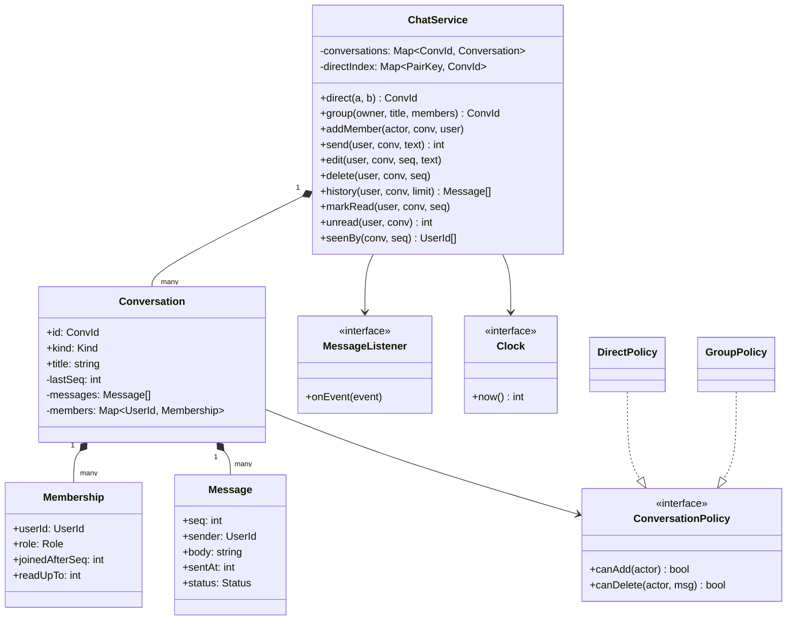
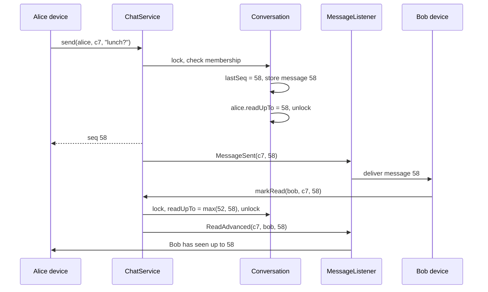

## In one minute
- The object model of a chat app is small: users, conversations, memberships and messages. Most of the design lives in **Membership**, the join between a user and a conversation, which carries the role, the point where the user joined and how far they have read.
- Give every message a per-conversation sequence number assigned under one lock. Ordering, history paging, unread counts and "seen by" all become integer comparisons against that sequence.
- Read state is a cursor, not a flag per message. "Alice has read up to 57" is one integer per membership, it only moves forward, and it answers both "how many unread" and "who has seen message 50".
- Edits and deletes are state changes on a message, with rules (author only, within a time window, admins may delete). Keep a tombstone instead of removing the row, or sequence gaps and reply references break.
- The shape is **ordering** plus **fan-out**. This lesson is the in-process object model; [Design WhatsApp](../sdi/design-whatsapp.md) and [Design Slack](../sdi/design-slack.md) cover the distributed architecture, connection gateways and storage. The same membership-with-cursor model reappears in email threads, issue comment streams and collaborative document comments.

## Requirements

Functional:
- One-to-one (direct) conversations: creating one between two users who already have one returns the existing conversation.
- Group conversations with a title, an owner and admins. Admins add members; a new member sees messages sent after they joined, not the earlier history.
- Members send text messages, read history newest first in pages, edit their own messages within 15 minutes and delete their own messages. Group admins may delete anyone's message.
- Each member has a read position. The app shows unread counts per conversation and, in groups, who has seen a given message.

Non-functional:
- Every member sees a conversation's messages in the same order.
- Unread counts and read receipts never go backwards, even if read events arrive out of order from two devices.
- Rules (who can edit, delete, add) are enforced in the domain model, not in the UI.
- Time comes from an injected clock, so the edit window is testable.

Out of scope: network transport, offline sync, push notifications, media, end-to-end encryption and search. Name them and point at the system design lessons; the interviewer wants to see the model and the rules.

## Entities and relationships

- **User** is an id and a display name. It holds no chat state; everything about a user in a conversation lives on the membership.
- **Conversation** has an id, a kind (direct or group), a title for groups, the last assigned sequence number and its members. It is the consistency boundary: one lock per conversation serialises sequence assignment.
- **Membership** links a user to a conversation with a role (owner, admin, member), `joinedAfterSeq` (the last sequence at the moment they joined) and `readUpTo` (their read cursor). Visibility and unread counts are computed from these two numbers.
- **Message** has the conversation id, sequence, sender, body, sent time and a status (sent, edited, deleted). The sequence and sender never change; the body changes only through `edit` and is blanked by `delete`.
- **ConversationPolicy** answers permission questions such as "may this user add members" or "may this user delete that message". Direct and group conversations have different policies.
- **ChatService** is the façade that clients call. It looks up the conversation, checks the policy, mutates state under the conversation lock and emits events.
- **MessageListener** receives `MessageSent`, `MessageEdited`, `MessageDeleted` and `ReadAdvanced` events for delivery to devices. **Clock** supplies time.

Relationships: a conversation is composed of its messages and memberships (they do not exist without it). A membership references a user but does not own it; a user can have thousands of memberships. Direct conversations are found through an index keyed by the sorted pair of user ids, which is how "open chat with Bob" returns the existing thread instead of creating a second one.

Resist a `DirectConversation` and `GroupConversation` hierarchy: sending is identical, and a policy object carries the rules that differ.

## Class diagram



## Key flows

Sending assigns the sequence and stores the message under the conversation lock, then notifies listeners outside it. Reading advances a cursor and emits a receipt only when the cursor actually moved.



## Design patterns used and why

- **Façade**: `ChatService` is the only entry point. Clients never touch a `Conversation` directly, so every mutation passes the same membership and policy checks and the same lock.
- **Strategy** for permissions. `DirectPolicy` refuses `addMember` and lets only the author delete; `GroupPolicy` lets admins add and delete. A future "announcement channel" where only admins post is a third policy, with no change to `send`.
- **State** for the message lifecycle, kept as an enum with guarded transitions: sent to edited, sent or edited to deleted, and nothing out of deleted. A full class per state is more machinery than three states need; see the [State](state.md) lesson for when it pays off.
- **Observer** for delivery. The service emits events; a gateway adapter pushes them to devices, a notification adapter sends pushes to offline users, and a search indexer consumes the same stream. Listeners run after the lock is released, so a slow push provider cannot block senders. Discord found the same at scale: one Erlang process per guild sending to every session took 30 to 70 microseconds per recipient, so it batched sends per remote node ([Discord](https://discord.com/blog/how-discord-scaled-elixir-to-5-000-000-concurrent-users)). See [Design Pub Sub System](design-pub-sub.md) for keeping that fan-out non-blocking.
- **Factory method** for conversations: `direct(a, b)` normalises the pair, consults the index and returns the existing conversation or builds a new one with `DirectPolicy`. Callers never construct conversations themselves, which is what makes the "one direct thread per pair" rule enforceable.

## Concurrency and edge cases

- **Two sends at once.** Sequence assignment and append must be one step under the conversation's lock. Without it, two senders read `lastSeq = 57` and both write 58. A per-conversation lock (not a global one) lets busy conversations proceed in parallel.
- **Out-of-order read events.** A phone reports "read up to 60" and a laptop then reports "read up to 55". Taking `max(current, new)` makes the cursor monotonic, so the second event is a no-op. Matrix's spec works the same way: when a public and a private receipt differ, the one that is more "ahead" sets the highest read-up-to mark ([Matrix spec](https://spec.matrix.org/latest/client-server-api/#receipts)). It also adds a `thread_id` to receipts, which is the second cursor per thread mentioned under Extensibility, and says servers should batch receipts into one event per room and thread. Clamp to `lastSeq` so a buggy client cannot mark future messages read.
- **Joining mid-conversation.** The new member's `joinedAfterSeq` is the conversation's `lastSeq` at join time. History and unread counts ignore anything at or below it. Their read cursor starts there too, which also keeps them out of "seen by" for old messages.
- **Edit racing delete.** The author edits while an admin deletes. Under the lock, whichever runs second sees the other's result; an edit on a deleted message fails. The outcome is consistent, and the error tells the client to refresh.
- **Edit window.** Compare `clock.now() - sentAt` against the window. Store `sentAt` from the server clock at send time; never trust a client timestamp for a permission check.
- **Duplicate direct conversations.** Two users tap "message" on each other at the same moment. The pair index is checked and written under one lock (or a unique constraint on `(min(a,b), max(a,b))` in the database), so both calls return the same conversation.

## In the wild
- **Discord, 2017: one process per guild stalls at about 30,000 users.** Each guild is an Erlang process that sends every event to every connected session. Busy guilds reached about 30,000 concurrent users, each send cost 30 to 70 microseconds, so one publish took 900 ms to 2.1 s and the guild fell behind at peak. The Manifold library groups recipients by remote node and sends one batch per node, with partitioned workers delivering locally while keeping order ([Discord](https://discord.com/blog/how-discord-scaled-elixir-to-5-000-000-concurrent-users)).
- **Discord, 2023: one server with more than a million people online.** Fan-out in a single guild is quadratic in the number of active members. About 90% of user-guild connections in large servers became passive sessions that receive far fewer updates, and relays between the guild and up to 15,000 sessions each split the fan-out and the permission checks ([Discord](https://discord.com/blog/maxjourney-pushing-discords-limits-with-a-million-plus-online-users-in-a-single-server)).

## Down the stack

### Layer 1: The contract
`send` returns a sequence number one greater than the previous message in that conversation, and every member's history shows messages in that order. `history` returns only messages with `seq > joinedAfterSeq` for the caller. `readUpTo` never decreases and never exceeds `lastSeq`. `unread` is the number of visible, non-deleted messages from other senders after the cursor. A failed operation (not a member, not allowed, outside the window) changes nothing.

### Layer 2: The mechanism
Each conversation keeps messages in an array indexed by `seq - 1`, so lookup by sequence is O(1) and "last 50" is a slice. In a database this is a table keyed by `(conversation_id, seq)`, clustered on that key so a history page is one range scan (Discord partitions messages by channel id plus a time bucket and uses time-sortable Snowflake ids for order, per its [storage write-up](https://discord.com/blog/how-discord-stores-trillions-of-messages)); `INSERT ... SELECT last_seq + 1` inside a transaction that locks the conversation row (`SELECT ... FOR UPDATE`, see [Postgres explicit locking](https://www.postgresql.org/docs/current/explicit-locking.html)) assigns the sequence. Memberships are a table keyed by `(conversation_id, user_id)` with `role`, `joined_after_seq` and `read_up_to`, plus a secondary index on `user_id` for the inbox list. The read path for an inbox computes a cheap unread approximation, `last_seq - read_up_to`, from those two integers without touching messages; an exact count that excludes your own and deleted messages is either computed on open or kept as a per-membership counter maintained on send and delete. The practice computes it exactly by scanning, which is fine in memory and too slow for a 10,000-conversation inbox.

### Layer 3: The machine
A text message row is small: two 8-byte ids, an 8-byte sequence, an 8-byte timestamp, a status byte and a body that averages under 100 bytes, so roughly 140 bytes, and a 16 KB InnoDB page holds about 100 of them. A history page of 50 messages is then one or two page reads, served from the buffer pool for an active conversation. The conversation lock is the contended resource: an uncontended mutex costs tens of nanoseconds and a database row lock held for a sub-millisecond transaction allows a few thousand sends per second in one conversation, far more than any human group produces. Delivery is where bytes multiply: one message to a 500-member group is 500 WebSocket frames of a few hundred bytes each, which is why events leave the lock first and fan out on other threads. Fan-out cost grows with group size squared if everyone talks: Discord's example is 1,000 online members each sending one message producing 1 million deliveries, and 100,000 producing 10 billion ([Discord](https://discord.com/blog/maxjourney-pushing-discords-limits-with-a-million-plus-online-users-in-a-single-server)). Read receipts are the hidden load: every member reading every message generates as many events as messages times members, so clients batch them (send "read up to N" once per second, not per message), and the cursor model makes batching lossless.

### Why it's built this way
1. People need the same order on every device, so the conversation assigns sequence numbers at one point instead of trusting client clocks.
2. One point of assignment means a lock, so the lock is per conversation to keep unrelated chats independent.
3. Read events are frequent and arrive out of order from several devices, so read state is a monotonic cursor, which makes duplicates and reordering harmless and batching free.
4. Members join at different times and messages get edited or deleted, so visibility is computed from the membership's numbers and messages become tombstones rather than disappearing.
5. Delivery is slow and fans out, so it runs after the state change through listeners, never inside the lock.

## Extensibility

- **Threads and replies.** Add `parentSeq` to a message. A thread is a filtered view; the per-conversation sequence stays the single order. Thread-level read cursors are a second cursor on the membership keyed by parent.
- **Reactions.** A map from emoji to a set of user ids on the message, changed under the conversation lock and emitted as an event. It does not take a new sequence number, so it does not disturb ordering or unread counts.
- **Announcement channels.** A new policy where only admins may send. `send` asks the policy, as delete and add already do.
- **Multi-device.** Read cursors are per user, not per device, so reading on the laptop clears the phone's badge. Delivery state per device is a transport concern, covered in [Design WhatsApp](../sdi/design-whatsapp.md).

## Leadership lens

- Build first: sequence assignment under a per-conversation lock, the membership with its two cursors, and a test where two devices send and read out of order. Every visible bug in chat (messages out of order, badges that come back) traces to one of these.
- Ask in review: where is the sequence assigned; what happens when read events arrive out of order; what does a member who joined yesterday see; does a delete leave a tombstone.
- Keep permission rules in the domain policy and give the client team a read-only `capabilities(conversation)` call, so the UI shows the right buttons without duplicating the rules.
- Cost driver: read receipts and typing indicators produce more events than messages. Budget for them, batch them, and drop typing indicators first under load.

## Check yourself
1. Why store a read cursor per membership instead of a read flag per message per user?
   **Answer:** A cursor is one integer per member that only moves forward, so out-of-order or duplicate read events are harmless and unread counts are a subtraction. Flags need a row per message per member and break under reordering.
2. A member joins a group at sequence 120. What do they see, and what is their unread count right after joining?
   **Answer:** They see messages after 120 only, and their unread count is zero, because their cursor starts at the join point.
3. Why keep a deleted message as a tombstone instead of removing it?
   **Answer:** Removing it would leave a gap in sequences and orphan replies and receipts that reference it. A tombstone keeps the order and the references intact while hiding the content.
4. Why notify listeners after releasing the conversation lock?
   **Answer:** Delivery can be slow (network, push providers). Running it inside the lock would serialise every sender in that conversation behind the slowest device.

## Practice
**Task:** Implement `ChatService(clock, edit_window)`, where `clock.now()` returns integer seconds. `direct(a, b)` returns the conversation id for the pair (ids are `c1`, `c2`, and so on), reusing the existing one regardless of argument order and failing when `a == b`. `group(owner, title, members)` creates a group whose owner is its only admin. `add_member(actor, conv, user)` works only for admins of groups; the new member joins after the current last sequence and starts with their cursor there. `send(user, conv, text)` returns the next per-conversation sequence starting at 1 and moves the sender's own cursor to it. `edit(user, conv, seq, text)` is allowed only for the author, on a message that is not deleted, and only while `now - sent_at <= edit_window`; `delete(user, conv, seq)` is allowed for the author or a group admin. `history(user, conv, limit)` returns up to `limit` most recent visible messages, oldest first, as `(seq, sender, text, status)` with status `sent`, `edited` or `deleted` (deleted text is empty). `mark_read(user, conv, seq)` moves the cursor forward only, clamped to the last sequence; `unread(user, conv)` counts visible, non-deleted messages from others after the cursor; `seen_by(conv, seq)` returns the sorted members other than the sender whose cursor is at least `seq`. Any operation by a non-member fails, and permission or rule violations fail without changing state.

```python starter
class ChatService:
    def __init__(self, clock, edit_window):
        self._clock = clock
        self._edit_window = edit_window

    def direct(self, a, b):
        raise NotImplementedError

    def group(self, owner, title, members):
        raise NotImplementedError

    def add_member(self, actor, conv, user):
        raise NotImplementedError

    def send(self, user, conv, text):
        # TODO: next seq under the conversation, sender's cursor moves to it
        raise NotImplementedError

    def edit(self, user, conv, seq, text):
        raise NotImplementedError

    def delete(self, user, conv, seq):
        raise NotImplementedError

    def history(self, user, conv, limit):
        raise NotImplementedError

    def mark_read(self, user, conv, seq):
        raise NotImplementedError

    def unread(self, user, conv):
        raise NotImplementedError

    def seen_by(self, conv, seq):
        raise NotImplementedError
```

```python tests
class FakeClock:
    def __init__(self):
        self.t = 1000

    def now(self):
        return self.t


def fails(fn):
    try:
        fn()
    except ValueError:
        return True
    return False


def test_direct_is_reused_and_self_chat_rejected():
    s = ChatService(FakeClock(), 900)
    c = s.direct("alice", "bob")
    assert c == "c1"
    assert s.direct("bob", "alice") == c
    assert s.direct("alice", "carol") == "c2"
    assert fails(lambda: s.direct("alice", "alice"))


def test_send_history_and_membership():
    s = ChatService(FakeClock(), 900)
    c = s.direct("alice", "bob")
    assert s.send("alice", c, "hi") == 1
    assert s.send("bob", c, "hey") == 2
    assert s.send("alice", c, "lunch?") == 3
    assert s.history("bob", c, 2) == [(2, "bob", "hey", "sent"), (3, "alice", "lunch?", "sent")]
    assert fails(lambda: s.send("mallory", c, "spam")), "non-member cannot send"
    assert fails(lambda: s.history("mallory", c, 10)), "non-member cannot read"


def test_late_joiner_sees_only_new_messages():
    s = ChatService(FakeClock(), 900)
    g = s.group("alice", "team", ["alice", "bob"])
    s.send("alice", g, "old 1")
    s.send("bob", g, "old 2")
    assert fails(lambda: s.add_member("bob", g, "carol")), "only admins add"
    s.add_member("alice", g, "carol")
    assert s.unread("carol", g) == 0
    assert s.history("carol", g, 10) == []
    s.send("bob", g, "welcome")
    assert s.history("carol", g, 10) == [(3, "bob", "welcome", "sent")]
    assert s.unread("carol", g) == 1
    assert fails(lambda: s.add_member("alice", s.direct("alice", "bob"), "dave")), "direct is closed"


def test_edit_rules_and_window():
    clock = FakeClock()
    s = ChatService(clock, 900)
    c = s.direct("alice", "bob")
    s.send("alice", c, "teh plan")
    clock.t += 900
    s.edit("alice", c, 1, "the plan")
    assert s.history("bob", c, 1) == [(1, "alice", "the plan", "edited")]
    assert fails(lambda: s.edit("bob", c, 1, "hacked")), "only the author edits"
    clock.t += 1
    assert fails(lambda: s.edit("alice", c, 1, "too late")), "window closed"
    assert fails(lambda: s.edit("alice", c, 9, "x")), "unknown message"


def test_delete_permissions_and_tombstones():
    s = ChatService(FakeClock(), 900)
    g = s.group("alice", "team", ["alice", "bob", "carol"])
    s.send("bob", g, "oops")
    s.send("carol", g, "hello")
    assert fails(lambda: s.delete("carol", g, 1)), "member cannot delete others"
    s.delete("alice", g, 1)
    assert s.history("carol", g, 10) == [(1, "bob", "", "deleted"), (2, "carol", "hello", "sent")]
    assert fails(lambda: s.edit("bob", g, 1, "fix")), "deleted is final"
    s.delete("carol", g, 2)
    assert s.unread("bob", g) == 0, "deleted messages are not unread"


def test_read_cursor_unread_and_seen_by():
    s = ChatService(FakeClock(), 900)
    g = s.group("alice", "team", ["alice", "bob", "carol"])
    for i in range(4):
        s.send("alice", g, "m" + str(i))
    s.send("bob", g, "mine")
    assert s.unread("bob", g) == 0, "sending reads everything before"
    assert s.unread("carol", g) == 5
    s.mark_read("carol", g, 3)
    assert s.unread("carol", g) == 2
    s.mark_read("carol", g, 1)
    assert s.unread("carol", g) == 2, "cursor never moves back"
    s.mark_read("carol", g, 99)
    assert s.unread("carol", g) == 0
    assert s.seen_by(g, 3) == ["bob", "carol"]
    assert s.seen_by(g, 5) == ["carol"], "alice read up to her own message 4"
```

```python solution
class _Message:
    def __init__(self, seq, sender, text, sent_at):
        self.seq = seq
        self.sender = sender
        self.text = text
        self.sent_at = sent_at
        self.status = "sent"


class _Member:
    def __init__(self, role, joined_after):
        self.role = role
        self.joined_after = joined_after
        self.read_up_to = joined_after


class _Conversation:
    def __init__(self, conv_id, kind):
        self.id = conv_id
        self.kind = kind
        self.messages = []
        self.members = {}

    def last_seq(self):
        return len(self.messages)


class ChatService:
    def __init__(self, clock, edit_window):
        self._clock = clock
        self._edit_window = edit_window
        self._convs = {}
        self._pairs = {}
        self._next = 1

    def _new_conv(self, kind):
        conv = _Conversation("c" + str(self._next), kind)
        self._next += 1
        self._convs[conv.id] = conv
        return conv

    def direct(self, a, b):
        if a == b:
            raise ValueError("cannot chat with yourself")
        key = (min(a, b), max(a, b))
        if key in self._pairs:
            return self._pairs[key]
        conv = self._new_conv("direct")
        conv.members[a] = _Member("member", 0)
        conv.members[b] = _Member("member", 0)
        self._pairs[key] = conv.id
        return conv.id

    def group(self, owner, title, members):
        conv = self._new_conv("group")
        conv.title = title
        for m in members:
            conv.members[m] = _Member("member", 0)
        conv.members[owner] = _Member("admin", 0)
        return conv.id

    def _member(self, user, conv_id):
        conv = self._convs.get(conv_id)
        if conv is None or user not in conv.members:
            raise ValueError("not a member")
        return conv, conv.members[user]

    def _message(self, conv, seq):
        if seq < 1 or seq > conv.last_seq():
            raise ValueError("unknown message")
        return conv.messages[seq - 1]

    def add_member(self, actor, conv_id, user):
        conv, m = self._member(actor, conv_id)
        if conv.kind != "group" or m.role != "admin":
            raise ValueError("not allowed to add members")
        if user in conv.members:
            raise ValueError("already a member")
        conv.members[user] = _Member("member", conv.last_seq())

    def send(self, user, conv_id, text):
        conv, m = self._member(user, conv_id)
        seq = conv.last_seq() + 1
        conv.messages.append(_Message(seq, user, text, self._clock.now()))
        m.read_up_to = seq
        return seq

    def edit(self, user, conv_id, seq, text):
        conv, _ = self._member(user, conv_id)
        msg = self._message(conv, seq)
        if msg.sender != user:
            raise ValueError("only the author can edit")
        if msg.status == "deleted":
            raise ValueError("message deleted")
        if self._clock.now() - msg.sent_at > self._edit_window:
            raise ValueError("edit window closed")
        msg.text = text
        msg.status = "edited"

    def delete(self, user, conv_id, seq):
        conv, m = self._member(user, conv_id)
        msg = self._message(conv, seq)
        is_admin = conv.kind == "group" and m.role == "admin"
        if msg.sender != user and not is_admin:
            raise ValueError("not allowed to delete")
        msg.text = ""
        msg.status = "deleted"

    def history(self, user, conv_id, limit):
        conv, m = self._member(user, conv_id)
        visible = conv.messages[m.joined_after:]
        if limit < len(visible):
            visible = visible[len(visible) - limit:]
        return [(x.seq, x.sender, x.text, x.status) for x in visible]

    def mark_read(self, user, conv_id, seq):
        conv, m = self._member(user, conv_id)
        m.read_up_to = max(m.read_up_to, min(seq, conv.last_seq()))

    def unread(self, user, conv_id):
        conv, m = self._member(user, conv_id)
        start = max(m.read_up_to, m.joined_after)
        return sum(1 for x in conv.messages[start:]
                   if x.sender != user and x.status != "deleted")

    def seen_by(self, conv_id, seq):
        conv = self._convs.get(conv_id)
        if conv is None:
            raise ValueError("unknown conversation")
        sender = self._message(conv, seq).sender
        return sorted(u for u, m in conv.members.items()
                      if u != sender and m.read_up_to >= seq)
```

```typescript starter
export interface Clock { now(): number }
export type Status = "sent" | "edited" | "deleted";
export type HistoryItem = [number, string, string, Status];

export class ChatService {
  constructor(private clock: Clock, private editWindow: number) {}

  direct(a: string, b: string): string { throw new Error("TODO"); }
  group(owner: string, title: string, members: string[]): string { throw new Error("TODO"); }
  addMember(actor: string, conv: string, user: string): void { throw new Error("TODO"); }
  send(user: string, conv: string, text: string): number { throw new Error("TODO"); }
  edit(user: string, conv: string, seq: number, text: string): void { throw new Error("TODO"); }
  delete(user: string, conv: string, seq: number): void { throw new Error("TODO"); }
  history(user: string, conv: string, limit: number): HistoryItem[] { throw new Error("TODO"); }
  markRead(user: string, conv: string, seq: number): void { throw new Error("TODO"); }
  unread(user: string, conv: string): number { throw new Error("TODO"); }
  seenBy(conv: string, seq: number): string[] { throw new Error("TODO"); }
}
```

```typescript tests
class FakeClock implements Clock {
  t = 1000;
  now(): number { return this.t; }
}

function fails(fn: () => void): boolean {
  try { fn(); return false; } catch (e) { return true; }
}

test("direct is reused and self chat rejected", () => {
  const s = new ChatService(new FakeClock(), 900);
  const c = s.direct("alice", "bob");
  assertEqual(c, "c1");
  assertEqual(s.direct("bob", "alice"), c);
  assertEqual(s.direct("alice", "carol"), "c2");
  assert(fails(() => s.direct("alice", "alice")), "self chat");
});

test("send history and membership", () => {
  const s = new ChatService(new FakeClock(), 900);
  const c = s.direct("alice", "bob");
  assertEqual(s.send("alice", c, "hi"), 1);
  assertEqual(s.send("bob", c, "hey"), 2);
  assertEqual(s.send("alice", c, "lunch?"), 3);
  assertEqual(s.history("bob", c, 2), [[2, "bob", "hey", "sent"], [3, "alice", "lunch?", "sent"]]);
  assert(fails(() => s.send("mallory", c, "spam")), "non-member cannot send");
  assert(fails(() => s.history("mallory", c, 10)), "non-member cannot read");
});

test("late joiner sees only new messages", () => {
  const s = new ChatService(new FakeClock(), 900);
  const g = s.group("alice", "team", ["alice", "bob"]);
  s.send("alice", g, "old 1");
  s.send("bob", g, "old 2");
  assert(fails(() => s.addMember("bob", g, "carol")), "only admins add");
  s.addMember("alice", g, "carol");
  assertEqual(s.unread("carol", g), 0);
  assertEqual(s.history("carol", g, 10), []);
  s.send("bob", g, "welcome");
  assertEqual(s.history("carol", g, 10), [[3, "bob", "welcome", "sent"]]);
  assertEqual(s.unread("carol", g), 1);
  assert(fails(() => s.addMember("alice", s.direct("alice", "bob"), "dave")), "direct is closed");
});

test("edit rules and window", () => {
  const clock = new FakeClock();
  const s = new ChatService(clock, 900);
  const c = s.direct("alice", "bob");
  s.send("alice", c, "teh plan");
  clock.t += 900;
  s.edit("alice", c, 1, "the plan");
  assertEqual(s.history("bob", c, 1), [[1, "alice", "the plan", "edited"]]);
  assert(fails(() => s.edit("bob", c, 1, "hacked")), "only the author edits");
  clock.t += 1;
  assert(fails(() => s.edit("alice", c, 1, "too late")), "window closed");
  assert(fails(() => s.edit("alice", c, 9, "x")), "unknown message");
});

test("delete permissions and tombstones", () => {
  const s = new ChatService(new FakeClock(), 900);
  const g = s.group("alice", "team", ["alice", "bob", "carol"]);
  s.send("bob", g, "oops");
  s.send("carol", g, "hello");
  assert(fails(() => s.delete("carol", g, 1)), "member cannot delete others");
  s.delete("alice", g, 1);
  assertEqual(s.history("carol", g, 10), [[1, "bob", "", "deleted"], [2, "carol", "hello", "sent"]]);
  assert(fails(() => s.edit("bob", g, 1, "fix")), "deleted is final");
  s.delete("carol", g, 2);
  assertEqual(s.unread("bob", g), 0, "deleted messages are not unread");
});

test("read cursor unread and seen by", () => {
  const s = new ChatService(new FakeClock(), 900);
  const g = s.group("alice", "team", ["alice", "bob", "carol"]);
  for (let i = 0; i < 4; i++) s.send("alice", g, "m" + i);
  s.send("bob", g, "mine");
  assertEqual(s.unread("bob", g), 0, "sending reads everything before");
  assertEqual(s.unread("carol", g), 5);
  s.markRead("carol", g, 3);
  assertEqual(s.unread("carol", g), 2);
  s.markRead("carol", g, 1);
  assertEqual(s.unread("carol", g), 2, "cursor never moves back");
  s.markRead("carol", g, 99);
  assertEqual(s.unread("carol", g), 0);
  assertEqual(s.seenBy(g, 3), ["bob", "carol"]);
  assertEqual(s.seenBy(g, 5), ["carol"]);
});
```

```typescript solution
export interface Clock { now(): number }
export type Status = "sent" | "edited" | "deleted";
export type HistoryItem = [number, string, string, Status];

interface Message { seq: number; sender: string; text: string; sentAt: number; status: Status }
interface Member { role: "admin" | "member"; joinedAfter: number; readUpTo: number }
interface Conversation { id: string; kind: "direct" | "group"; messages: Message[]; members: Map<string, Member> }

function member(role: "admin" | "member", joinedAfter: number): Member {
  return { role, joinedAfter, readUpTo: joinedAfter };
}

export class ChatService {
  private convs = new Map<string, Conversation>();
  private pairs = new Map<string, string>();
  private nextId = 1;

  constructor(private clock: Clock, private editWindow: number) {}

  private newConv(kind: "direct" | "group"): Conversation {
    const conv: Conversation = { id: "c" + this.nextId++, kind, messages: [], members: new Map() };
    this.convs.set(conv.id, conv);
    return conv;
  }

  direct(a: string, b: string): string {
    if (a === b) throw new Error("cannot chat with yourself");
    const key = a < b ? a + "\u0000" + b : b + "\u0000" + a;
    const existing = this.pairs.get(key);
    if (existing) return existing;
    const conv = this.newConv("direct");
    conv.members.set(a, member("member", 0));
    conv.members.set(b, member("member", 0));
    this.pairs.set(key, conv.id);
    return conv.id;
  }

  group(owner: string, title: string, members: string[]): string {
    const conv = this.newConv("group");
    for (const m of members) conv.members.set(m, member("member", 0));
    conv.members.set(owner, member("admin", 0));
    return conv.id;
  }

  private lookup(user: string, convId: string): [Conversation, Member] {
    const conv = this.convs.get(convId);
    const m = conv?.members.get(user);
    if (!conv || !m) throw new Error("not a member");
    return [conv, m];
  }

  private message(conv: Conversation, seq: number): Message {
    if (seq < 1 || seq > conv.messages.length) throw new Error("unknown message");
    return conv.messages[seq - 1];
  }

  addMember(actor: string, convId: string, user: string): void {
    const [conv, m] = this.lookup(actor, convId);
    if (conv.kind !== "group" || m.role !== "admin") throw new Error("not allowed to add members");
    if (conv.members.has(user)) throw new Error("already a member");
    conv.members.set(user, member("member", conv.messages.length));
  }

  send(user: string, convId: string, text: string): number {
    const [conv, m] = this.lookup(user, convId);
    const seq = conv.messages.length + 1;
    conv.messages.push({ seq, sender: user, text, sentAt: this.clock.now(), status: "sent" });
    m.readUpTo = seq;
    return seq;
  }

  edit(user: string, convId: string, seq: number, text: string): void {
    const [conv] = this.lookup(user, convId);
    const msg = this.message(conv, seq);
    if (msg.sender !== user) throw new Error("only the author can edit");
    if (msg.status === "deleted") throw new Error("message deleted");
    if (this.clock.now() - msg.sentAt > this.editWindow) throw new Error("edit window closed");
    msg.text = text;
    msg.status = "edited";
  }

  delete(user: string, convId: string, seq: number): void {
    const [conv, m] = this.lookup(user, convId);
    const msg = this.message(conv, seq);
    const isAdmin = conv.kind === "group" && m.role === "admin";
    if (msg.sender !== user && !isAdmin) throw new Error("not allowed to delete");
    msg.text = "";
    msg.status = "deleted";
  }

  history(user: string, convId: string, limit: number): HistoryItem[] {
    const [conv, m] = this.lookup(user, convId);
    const visible = conv.messages.slice(m.joinedAfter);
    const page = limit < visible.length ? visible.slice(visible.length - limit) : visible;
    return page.map((x): HistoryItem => [x.seq, x.sender, x.text, x.status]);
  }

  markRead(user: string, convId: string, seq: number): void {
    const [conv, m] = this.lookup(user, convId);
    m.readUpTo = Math.max(m.readUpTo, Math.min(seq, conv.messages.length));
  }

  unread(user: string, convId: string): number {
    const [conv, m] = this.lookup(user, convId);
    const start = Math.max(m.readUpTo, m.joinedAfter);
    return conv.messages.slice(start).filter((x) => x.sender !== user && x.status !== "deleted").length;
  }

  seenBy(convId: string, seq: number): string[] {
    const conv = this.convs.get(convId);
    if (!conv) throw new Error("unknown conversation");
    const sender = this.message(conv, seq).sender;
    const out: string[] = [];
    conv.members.forEach((m, u) => { if (u !== sender && m.readUpTo >= seq) out.push(u); });
    return out.sort();
  }
}
```

```go starter
package practice

import "errors"

var (
	ErrNotMember     = errors.New("not a member")
	ErrForbidden     = errors.New("not allowed")
	ErrNotFound      = errors.New("not found")
	ErrWindowClosed  = errors.New("edit window closed")
	ErrInvalid       = errors.New("invalid request")
)

type Clock interface{ Now() int64 }

type Status string

const (
	Sent    Status = "sent"
	Edited  Status = "edited"
	Deleted Status = "deleted"
)

type HistoryItem struct {
	Seq    int
	Sender string
	Text   string
	Status Status
}

type ChatService struct{}

func NewChatService(clock Clock, editWindow int64) *ChatService { return &ChatService{} }

func (s *ChatService) Direct(a, b string) (string, error)                     { panic("TODO") }
func (s *ChatService) Group(owner, title string, members []string) string      { panic("TODO") }
func (s *ChatService) AddMember(actor, conv, user string) error                { panic("TODO") }
func (s *ChatService) Send(user, conv, text string) (int, error)               { panic("TODO") }
func (s *ChatService) Edit(user, conv string, seq int, text string) error      { panic("TODO") }
func (s *ChatService) Delete(user, conv string, seq int) error                 { panic("TODO") }
func (s *ChatService) History(user, conv string, limit int) ([]HistoryItem, error) { panic("TODO") }
func (s *ChatService) MarkRead(user, conv string, seq int) error               { panic("TODO") }
func (s *ChatService) Unread(user, conv string) (int, error)                   { panic("TODO") }
func (s *ChatService) SeenBy(conv string, seq int) ([]string, error)           { panic("TODO") }
```

```go tests
package practice

import (
	"errors"
	"reflect"
	"testing"
)

type fakeClock struct{ t int64 }

func (c *fakeClock) Now() int64 { return c.t }

func mustSend(t *testing.T, s *ChatService, user, conv, text string) int {
	t.Helper()
	seq, err := s.Send(user, conv, text)
	if err != nil {
		t.Fatalf("send %q: %v", text, err)
	}
	return seq
}

func expectHistory(t *testing.T, s *ChatService, user, conv string, limit int, want []HistoryItem) {
	t.Helper()
	got, err := s.History(user, conv, limit)
	if err != nil {
		t.Fatal(err)
	}
	if len(got) == 0 && len(want) == 0 {
		return
	}
	if !reflect.DeepEqual(got, want) {
		t.Fatalf("history: got %+v want %+v", got, want)
	}
}

func expectUnread(t *testing.T, s *ChatService, user, conv string, want int) {
	t.Helper()
	if n, err := s.Unread(user, conv); err != nil || n != want {
		t.Fatalf("unread(%s): got %d, %v want %d", user, n, err, want)
	}
}

func TestDirectIsReusedAndSelfChatRejected(t *testing.T) {
	s := NewChatService(&fakeClock{1000}, 900)
	c, _ := s.Direct("alice", "bob")
	again, _ := s.Direct("bob", "alice")
	other, _ := s.Direct("alice", "carol")
	if c != "c1" || again != c || other != "c2" {
		t.Fatalf("got %s %s %s", c, again, other)
	}
	if _, err := s.Direct("alice", "alice"); !errors.Is(err, ErrInvalid) {
		t.Fatalf("want ErrInvalid, got %v", err)
	}
}

func TestSendHistoryAndMembership(t *testing.T) {
	s := NewChatService(&fakeClock{1000}, 900)
	c, _ := s.Direct("alice", "bob")
	for i, text := range []string{"hi", "hey", "lunch?"} {
		sender := []string{"alice", "bob", "alice"}[i]
		if seq := mustSend(t, s, sender, c, text); seq != i+1 {
			t.Fatalf("seq=%d", seq)
		}
	}
	expectHistory(t, s, "bob", c, 2, []HistoryItem{{2, "bob", "hey", Sent}, {3, "alice", "lunch?", Sent}})
	if _, err := s.Send("mallory", c, "spam"); !errors.Is(err, ErrNotMember) {
		t.Fatalf("want ErrNotMember, got %v", err)
	}
	if _, err := s.History("mallory", c, 10); !errors.Is(err, ErrNotMember) {
		t.Fatalf("want ErrNotMember, got %v", err)
	}
}

func TestLateJoinerSeesOnlyNewMessages(t *testing.T) {
	s := NewChatService(&fakeClock{1000}, 900)
	g := s.Group("alice", "team", []string{"alice", "bob"})
	mustSend(t, s, "alice", g, "old 1")
	mustSend(t, s, "bob", g, "old 2")
	if err := s.AddMember("bob", g, "carol"); !errors.Is(err, ErrForbidden) {
		t.Fatalf("want ErrForbidden, got %v", err)
	}
	if err := s.AddMember("alice", g, "carol"); err != nil {
		t.Fatal(err)
	}
	expectUnread(t, s, "carol", g, 0)
	expectHistory(t, s, "carol", g, 10, nil)
	mustSend(t, s, "bob", g, "welcome")
	expectHistory(t, s, "carol", g, 10, []HistoryItem{{3, "bob", "welcome", Sent}})
	expectUnread(t, s, "carol", g, 1)
	d, _ := s.Direct("alice", "bob")
	if err := s.AddMember("alice", d, "dave"); !errors.Is(err, ErrForbidden) {
		t.Fatalf("direct is closed, got %v", err)
	}
}

func TestEditRulesAndWindow(t *testing.T) {
	clock := &fakeClock{1000}
	s := NewChatService(clock, 900)
	c, _ := s.Direct("alice", "bob")
	mustSend(t, s, "alice", c, "teh plan")
	clock.t += 900
	if err := s.Edit("alice", c, 1, "the plan"); err != nil {
		t.Fatal(err)
	}
	expectHistory(t, s, "bob", c, 1, []HistoryItem{{1, "alice", "the plan", Edited}})
	if err := s.Edit("bob", c, 1, "hacked"); !errors.Is(err, ErrForbidden) {
		t.Fatalf("want ErrForbidden, got %v", err)
	}
	clock.t++
	if err := s.Edit("alice", c, 1, "too late"); !errors.Is(err, ErrWindowClosed) {
		t.Fatalf("want ErrWindowClosed, got %v", err)
	}
	if err := s.Edit("alice", c, 9, "x"); !errors.Is(err, ErrNotFound) {
		t.Fatalf("want ErrNotFound, got %v", err)
	}
}

func TestDeletePermissionsAndTombstones(t *testing.T) {
	s := NewChatService(&fakeClock{1000}, 900)
	g := s.Group("alice", "team", []string{"alice", "bob", "carol"})
	mustSend(t, s, "bob", g, "oops")
	mustSend(t, s, "carol", g, "hello")
	if err := s.Delete("carol", g, 1); !errors.Is(err, ErrForbidden) {
		t.Fatalf("want ErrForbidden, got %v", err)
	}
	if err := s.Delete("alice", g, 1); err != nil {
		t.Fatal(err)
	}
	expectHistory(t, s, "carol", g, 10, []HistoryItem{{1, "bob", "", Deleted}, {2, "carol", "hello", Sent}})
	if err := s.Edit("bob", g, 1, "fix"); err == nil {
		t.Fatal("deleted is final")
	}
	if err := s.Delete("carol", g, 2); err != nil {
		t.Fatal(err)
	}
	expectUnread(t, s, "bob", g, 0)
}

func TestReadCursorUnreadAndSeenBy(t *testing.T) {
	s := NewChatService(&fakeClock{1000}, 900)
	g := s.Group("alice", "team", []string{"alice", "bob", "carol"})
	for i := 0; i < 4; i++ {
		mustSend(t, s, "alice", g, "m")
	}
	mustSend(t, s, "bob", g, "mine")
	expectUnread(t, s, "bob", g, 0)
	expectUnread(t, s, "carol", g, 5)
	s.MarkRead("carol", g, 3)
	expectUnread(t, s, "carol", g, 2)
	s.MarkRead("carol", g, 1)
	expectUnread(t, s, "carol", g, 2)
	s.MarkRead("carol", g, 99)
	expectUnread(t, s, "carol", g, 0)
	if got, _ := s.SeenBy(g, 3); !reflect.DeepEqual(got, []string{"bob", "carol"}) {
		t.Fatalf("seenBy 3: %v", got)
	}
	if got, _ := s.SeenBy(g, 5); !reflect.DeepEqual(got, []string{"carol"}) {
		t.Fatalf("seenBy 5: %v", got)
	}
}
```

```go solution
package practice

import (
	"errors"
	"fmt"
	"sort"
	"sync"
)

var (
	ErrNotMember     = errors.New("not a member")
	ErrForbidden     = errors.New("not allowed")
	ErrNotFound      = errors.New("not found")
	ErrWindowClosed  = errors.New("edit window closed")
	ErrInvalid       = errors.New("invalid request")
)

type Clock interface{ Now() int64 }

type Status string

const (
	Sent    Status = "sent"
	Edited  Status = "edited"
	Deleted Status = "deleted"
)

type HistoryItem struct {
	Seq    int
	Sender string
	Text   string
	Status Status
}

type message struct {
	HistoryItem
	sentAt int64
}

type member struct {
	admin       bool
	joinedAfter int
	readUpTo    int
}

type conversation struct {
	mu       sync.Mutex // serialises sequence assignment and state changes
	group    bool
	messages []*message
	members  map[string]*member
}

type ChatService struct {
	mu         sync.Mutex // guards the maps, not conversation contents
	clock      Clock
	editWindow int64
	convs      map[string]*conversation
	pairs      map[[2]string]string
	nextID     int
}

func NewChatService(clock Clock, editWindow int64) *ChatService {
	return &ChatService{clock: clock, editWindow: editWindow,
		convs: map[string]*conversation{}, pairs: map[[2]string]string{}, nextID: 1}
}

func (s *ChatService) newConv(group bool) (string, *conversation) {
	id := fmt.Sprintf("c%d", s.nextID)
	s.nextID++
	c := &conversation{group: group, members: map[string]*member{}}
	s.convs[id] = c
	return id, c
}

func (s *ChatService) Direct(a, b string) (string, error) {
	if a == b {
		return "", fmt.Errorf("%w: cannot chat with yourself", ErrInvalid)
	}
	key := [2]string{a, b}
	if b < a {
		key = [2]string{b, a}
	}
	s.mu.Lock()
	defer s.mu.Unlock()
	if id, ok := s.pairs[key]; ok {
		return id, nil
	}
	id, c := s.newConv(false)
	c.members[a] = &member{}
	c.members[b] = &member{}
	s.pairs[key] = id
	return id, nil
}

func (s *ChatService) Group(owner, title string, members []string) string {
	s.mu.Lock()
	defer s.mu.Unlock()
	id, c := s.newConv(true)
	for _, m := range members {
		c.members[m] = &member{}
	}
	c.members[owner] = &member{admin: true}
	return id
}

// lock returns the conversation locked, after checking membership.
func (s *ChatService) lock(user, convID string) (*conversation, *member, error) {
	s.mu.Lock()
	c, ok := s.convs[convID]
	s.mu.Unlock()
	if !ok {
		return nil, nil, ErrNotMember
	}
	c.mu.Lock()
	m, ok := c.members[user]
	if !ok {
		c.mu.Unlock()
		return nil, nil, ErrNotMember
	}
	return c, m, nil
}

func (c *conversation) message(seq int) (*message, error) {
	if seq < 1 || seq > len(c.messages) {
		return nil, fmt.Errorf("%w: message %d", ErrNotFound, seq)
	}
	return c.messages[seq-1], nil
}

func (s *ChatService) AddMember(actor, convID, user string) error {
	c, m, err := s.lock(actor, convID)
	if err != nil {
		return err
	}
	defer c.mu.Unlock()
	if !c.group || !m.admin {
		return fmt.Errorf("%w: add member", ErrForbidden)
	}
	if _, ok := c.members[user]; ok {
		return fmt.Errorf("%w: already a member", ErrInvalid)
	}
	n := len(c.messages)
	c.members[user] = &member{joinedAfter: n, readUpTo: n}
	return nil
}

func (s *ChatService) Send(user, convID, text string) (int, error) {
	c, m, err := s.lock(user, convID)
	if err != nil {
		return 0, err
	}
	defer c.mu.Unlock()
	seq := len(c.messages) + 1
	c.messages = append(c.messages, &message{HistoryItem{seq, user, text, Sent}, s.clock.Now()})
	m.readUpTo = seq
	return seq, nil
}

func (s *ChatService) Edit(user, convID string, seq int, text string) error {
	c, _, err := s.lock(user, convID)
	if err != nil {
		return err
	}
	defer c.mu.Unlock()
	msg, err := c.message(seq)
	if err != nil {
		return err
	}
	switch {
	case msg.Sender != user:
		return fmt.Errorf("%w: only the author can edit", ErrForbidden)
	case msg.Status == Deleted:
		return fmt.Errorf("%w: message deleted", ErrInvalid)
	case s.clock.Now()-msg.sentAt > s.editWindow:
		return ErrWindowClosed
	}
	msg.Text, msg.Status = text, Edited
	return nil
}

func (s *ChatService) Delete(user, convID string, seq int) error {
	c, m, err := s.lock(user, convID)
	if err != nil {
		return err
	}
	defer c.mu.Unlock()
	msg, err := c.message(seq)
	if err != nil {
		return err
	}
	if msg.Sender != user && !(c.group && m.admin) {
		return fmt.Errorf("%w: delete", ErrForbidden)
	}
	msg.Text, msg.Status = "", Deleted
	return nil
}

func (s *ChatService) History(user, convID string, limit int) ([]HistoryItem, error) {
	c, m, err := s.lock(user, convID)
	if err != nil {
		return nil, err
	}
	defer c.mu.Unlock()
	visible := c.messages[m.joinedAfter:]
	if limit < len(visible) {
		visible = visible[len(visible)-limit:]
	}
	out := make([]HistoryItem, 0, len(visible))
	for _, x := range visible {
		out = append(out, x.HistoryItem)
	}
	return out, nil
}

func (s *ChatService) MarkRead(user, convID string, seq int) error {
	c, m, err := s.lock(user, convID)
	if err != nil {
		return err
	}
	defer c.mu.Unlock()
	if seq > len(c.messages) {
		seq = len(c.messages)
	}
	if seq > m.readUpTo {
		m.readUpTo = seq
	}
	return nil
}

func (s *ChatService) Unread(user, convID string) (int, error) {
	c, m, err := s.lock(user, convID)
	if err != nil {
		return 0, err
	}
	defer c.mu.Unlock()
	start := m.readUpTo
	if m.joinedAfter > start {
		start = m.joinedAfter
	}
	n := 0
	for _, x := range c.messages[start:] {
		if x.Sender != user && x.Status != Deleted {
			n++
		}
	}
	return n, nil
}

func (s *ChatService) SeenBy(convID string, seq int) ([]string, error) {
	s.mu.Lock()
	c, ok := s.convs[convID]
	s.mu.Unlock()
	if !ok {
		return nil, fmt.Errorf("%w: conversation %s", ErrNotFound, convID)
	}
	c.mu.Lock()
	defer c.mu.Unlock()
	msg, err := c.message(seq)
	if err != nil {
		return nil, err
	}
	var out []string
	for u, m := range c.members {
		if u != msg.Sender && m.readUpTo >= seq {
			out = append(out, u)
		}
	}
	sort.Strings(out)
	return out, nil
}
```

## Mock interview
**Prompt:** Design the classes for a team chat app with direct messages and groups of up to 1,000 members. Code sending, editing, deleting, history and unread counts, and explain how every member sees the same order and how read receipts work.

- Follow-up: A user reads on their phone and laptop, and the read events reach the server in the opposite order. What does your model do?
- Follow-up: An admin deletes a message at the same instant the author edits it. What does each client see?
- Follow-up: Product wants threads and emoji reactions next quarter. What changes in your model, and what stays?

**A strong answer covers:**
- Membership as the central entity with role, join point and a monotonic read cursor, rather than per-message read flags.
- Per-conversation sequence numbers assigned under a per-conversation lock, with history and unread computed from integers.
- Permission rules in a policy object per conversation kind, enforced in the domain, not the UI.
- Edits and deletes as guarded state transitions with an injected clock for the edit window, and tombstones that keep sequences intact.
- Delivery through listeners after the lock is released, with receipts batched because the cursor makes batching lossless.
- A clear split between this object model and the transport and storage covered in the system design lessons.

## Sources and further study

**Primary**
- [Matrix Client-Server API: receipts](https://spec.matrix.org/latest/client-server-api/#receipts): public and private read receipts, threaded receipts and the highest-read-up-to rule.
- [PostgreSQL: explicit locking](https://www.postgresql.org/docs/current/explicit-locking.html): the row lock behind per-conversation sequence assignment.

**Systems docs**
- [Discord: how Discord stores trillions of messages](https://discord.com/blog/how-discord-stores-trillions-of-messages): channel-and-bucket partitioning, Snowflake ids, hot partitions.
- [Slack Engineering: real-time messaging](https://slack.engineering/real-time-messaging/): channel servers, consistent hashing and gateway fan-out.
- [Discord: scaling Elixir to 5,000,000 concurrent users](https://discord.com/blog/how-discord-scaled-elixir-to-5-000-000-concurrent-users): guild fan-out costs and the Manifold batching fix.
- [Discord: Maxjourney](https://discord.com/blog/maxjourney-pushing-discords-limits-with-a-million-plus-online-users-in-a-single-server): quadratic fan-out and passive sessions.

**Books**
- *Design Patterns*, Gamma, Helm, Johnson and Vlissides: chapter 3 (Creational: Factory Method), chapter 4 (Structural: Facade) and chapter 5 (Behavioral: Strategy, Observer, State).
- *Head First Design Patterns*, Freeman and Robson: chapter 2 (Observer) and chapter 4 (Factory).
- *Designing Data-Intensive Applications*, Martin Kleppmann (1st edition): chapter 9 (Consistency and Consensus), on ordering and why a single point of sequence assignment gives a total order.

**Other curricula**
- [donnemartin/system-design-primer](https://github.com/donnemartin/system-design-primer): its social-network and messaging material is about feeds and fan-out at scale, not the in-process model here.

## Watch
- [WhatsApp System Design (Gaurav Sen)](https://www.youtube.com/watch?v=vvhC64hQZMk): connections, receipts and group messaging, the distributed side of this model.
- [Keith Adams on the Architecture of Slack (InfoQ)](https://www.youtube.com/watch?v=5WZ5F8KtW7k): how a production chat system stores channels and messages and delivers them.

## Free resources
- [Real-time Messaging (Slack Engineering)](https://slack.engineering/real-time-messaging/): how Slack maps channels to in-memory channel servers by consistent hashing and fans messages out to gateways.
- [How Discord Stores Trillions of Messages (Discord)](https://discord.com/blog/how-discord-stores-trillions-of-messages): message ids, partitioning by channel and time buckets, and the read path.
- [Matrix specification: receipts](https://spec.matrix.org/latest/client-server-api/#receipts): an open chat protocol's definition of read receipts as "read up to" markers.
- [State (Game Programming Patterns, Robert Nystrom)](https://gameprogrammingpatterns.com/state.html): when an enum with guarded transitions is enough and when a state machine needs more.
- [Explicit Locking (PostgreSQL docs)](https://www.postgresql.org/docs/current/explicit-locking.html): the row lock behind per-conversation sequence assignment.
