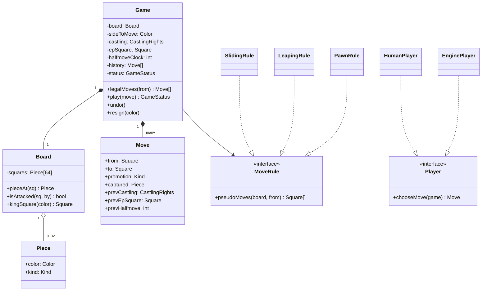
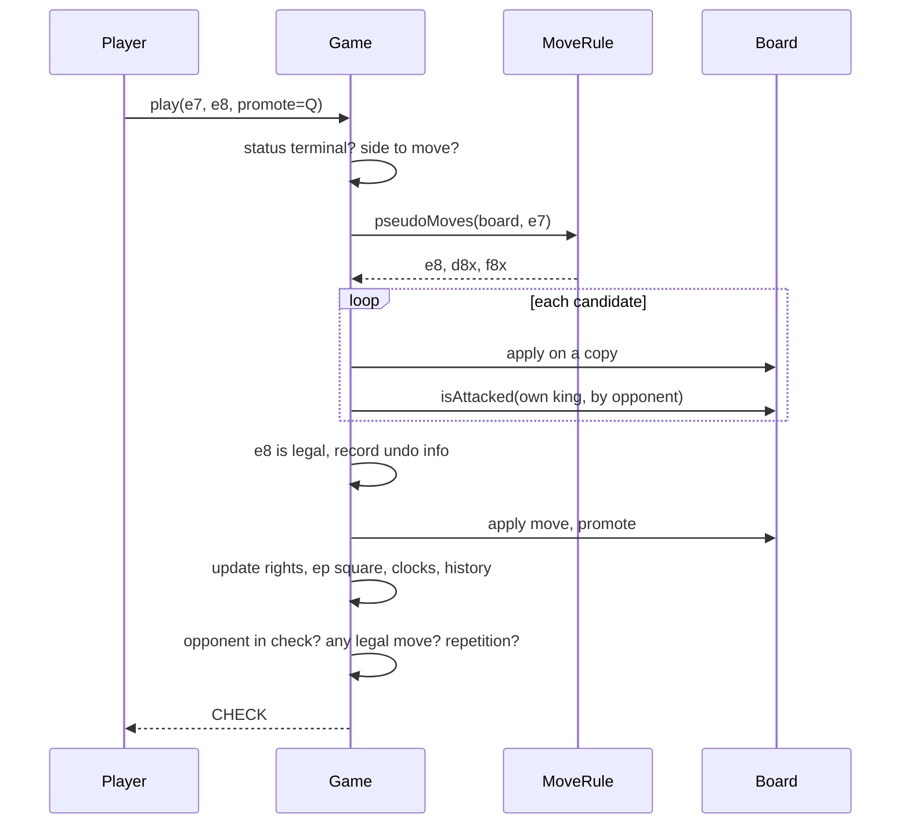

## In one minute
- Split the model three ways: the **Board** knows where pieces are, each **piece type** knows how it moves on an empty board, and the **Game** knows the rules that depend on history and on the whole position (turns, check, castling rights, en passant, draws). Most weak answers put everything in `Piece`.
- Legal moves are pseudo-legal moves minus the ones that leave your own king attacked. Generate, try, test. Pins, discovered checks, double checks and "you must get out of check" all fall out of that one filter without special cases.
- A move is a value with enough information to undo it: from, to, piece, captured piece, promotion, and the castling rights, en passant square and halfmove clock it replaced. That one record gives you undo, history, notation, repetition detection and replay.
- The game can end in more ways than checkmate: stalemate, threefold repetition, the fifty-move rule, insufficient material, resignation, time and agreement. Model the status as an explicit state and reject moves once it is terminal.
- Test with perft, not with a few hand-written positions. Counting the leaf nodes of the move tree from known positions (20, 400, 8,902, 197,281 from the start) catches move-generation bugs that no example game will.

This lesson is about the object model and in-process rules for one game. The distributed side (one owner per game, clocks and lag, matchmaking) is covered in [Design Online Chess](../sdi/design-chess.md).

## Requirements

Functional:
- Two players, white and black, alternate moves on an 8 by 8 board from the standard starting position. White moves first.
- The system accepts a move from the side to move only if it is legal under the laws of chess, including castling, en passant and promotion (the player chooses the piece).
- After each move, the system reports the status for the side to move: active, check, checkmate or stalemate, plus draws by threefold repetition, the fifty-move rule and insufficient material.
- Players can resign or agree a draw. The game keeps a full move history and can export it in standard notation.
- Undo is available in analysis mode (not in rated play).

Non-functional:
- Move validation is exact. A single illegal move accepted in a rated game is a correctness incident.
- Validation is fast: well under a millisecond per move, so the same code can serve a UI, a server and a simple engine.
- Positions can be imported and exported as text so that bug reports and tests are reproducible.

Out of scope: chess clocks and networking (see [Design Online Chess](../sdi/design-chess.md)), engine strength, and variants such as Chess960 (mentioned under Extensibility).

## Entities and relationships

- **Game** is the façade and the rule keeper. It owns the board, the side to move, the status, the move history and the position state that the board alone cannot express: castling rights, the en passant target square and the halfmove clock.
- **Board** holds 64 squares and answers "what is on this square" and "is this square attacked by this colour". It does not know whose turn it is.
- **Piece** is a value: colour and kind. A piece does not store its own square; the board does. Keeping position out of the piece avoids two sources of truth that drift apart after a capture or an undo.
- **MoveRule** per kind describes movement on the board: knights and kings jump by fixed offsets, rooks, bishops and queens slide along directions until blocked, pawns are special (direction depends on colour, captures differ from pushes, double step from the start rank, promotion, en passant).
- **Move** is an immutable record: from, to, promotion piece, plus the undo information captured when it is played.
- **Player** has a colour and an identity; human, engine and remote players all implement the same interface that returns a move.
- **GameStatus** is an enum: `ACTIVE`, `CHECK`, `CHECKMATE`, `STALEMATE`, `DRAW_REPETITION`, `DRAW_FIFTY`, `DRAW_MATERIAL`, `DRAW_AGREED`, `RESIGNED`, `TIMEOUT`.

Relationships: a game composes a board and a history of moves; a board aggregates pieces by square. Move rules are shared, stateless objects, one per kind.

## Class diagram



## Key flows

Every move takes the same path: parse, check it belongs to the side to move, check it is among the legal moves, apply it, then evaluate the new position for the opponent.



## Design patterns used and why

- **Polymorphism or a table for movement.** Six kinds with different movement is a natural fit for a `MoveRule` interface. A table is equally good and often better: rook, bishop and queen differ only in their direction lists, knight and king only in their offset lists, so two rule classes (sliding and leaping) plus a pawn rule cover everything. Say this in the interview; it shows you see the data behind the classes.
- **Command** for moves. A move object carries what it needs to apply and to undo itself. History is a list of commands, undo pops and reverses, and notation export walks the list.
- **Memento** for position state that is cheap to save whole: castling rights, en passant square and halfmove clock fit in a few bytes, so each move stores the previous values instead of recomputing them on undo.
- **State** for the game status, as an enum with guarded transitions. Only `ACTIVE` and `CHECK` accept moves; every other status is terminal.
- **Factory** for setup. `Game.standard()` and `Game.fromFEN(text)` build positions; tests use FEN strings so a bug report is one line of text.
- **Strategy** for players. A human UI, an engine and a network peer all implement `chooseMove`. The game loop does not care which one it is talking to.
- **Observer** for the UI, a sound player and a clock. The game publishes "move played" and "status changed" events after the state is consistent.

Resist making `Board` or `Game` a singleton. A server runs thousands of games, and an engine searches millions of positions; both need many instances.

## Concurrency and edge cases

- **Pins and discovered checks.** A piece that shields its king cannot leave the line. Generate-then-filter handles this; trying to special-case pins is where hand-written validators break.
- **Double check.** Only a king move can answer two checkers at once. Again the filter handles it, because no block or capture removes both attacks.
- **Castling.** Legal only if neither the king nor that rook has moved, the squares between them are empty, the king is not in check, and the king does not pass through or land on an attacked square. Store castling rights as four flags and clear them when a king or rook moves or a rook is captured on its home square.
- **En passant.** Available for exactly one move after a two-square pawn push, and the capture can expose the capturer's king along the rank (both pawns leave the rank at once). The legality filter catches that case only if it applies the move fully, including removing the captured pawn from its real square.
- **Promotion.** The player chooses queen, rook, bishop or knight; underpromotion to a knight sometimes gives mate. A move to the last rank without a choice is incomplete, not "default to queen", in a rated game.
- **Draws.** Threefold repetition compares full positions (pieces, side to move, castling rights and en passant possibilities), not just piece placement. Under FIDE rules a player may claim a draw at threefold repetition or after 50 moves by each side without a capture or pawn move, and the arbiter ends the game automatically at fivefold repetition or 75 moves.
- **Concurrency.** One game is a single-owner object: two players must never mutate it at once. In process, put it behind one lock or one actor; across a network, route every move for a game to one owner and number moves so retries are idempotent. That is the design in [Design Online Chess](../sdi/design-chess.md), and the reasoning is in [How to handle Concurrency Scenarios](handling-concurrency.md).

## Down the stack

### Layer 1: The contract
`legalMoves(square)` returns exactly the moves the laws of chess allow for the piece on that square, for the side to move, and an empty list otherwise. `play` either applies a legal move and returns the new status, or rejects it and changes nothing. Undoing a move restores every part of the position, including castling rights, en passant square and clocks, so that `play` followed by `undo` is the identity. The status after a move is a pure function of the position and the history.

### Layer 2: The mechanism
Board representations trade simplicity for speed. An 8 by 8 array is the clearest and fine for an application. A 10 by 12 **mailbox** pads the board with sentinel squares so that a knight jump off the edge lands on "off board" instead of needing bounds checks. **0x88** uses a 128-entry array where `square & 0x88` is non-zero exactly when a move left the board, a one-instruction bounds test. **Bitboards** use one 64-bit integer per piece kind and colour; move generation becomes shifts, masks and table lookups, and sliding attacks use precomputed "magic" multiplication tables.

Legality is the generate-then-test loop. Engines avoid copying the board by **make/unmake**: apply the move in place, test, then reverse it using the saved undo record. Repetition detection uses **Zobrist hashing**: a random 64-bit key per (piece, square) plus keys for side, castling and en passant, XORed together, updated incrementally on each move with a couple of XORs. Comparing the current hash against earlier positions since the last capture or pawn move finds repetitions quickly. **Perft** counts leaf nodes of the legal-move tree to a fixed depth from known positions; published counts exist for tricky positions with castling, en passant and promotions, and a mismatch pinpoints a bug by splitting the count per first move.

### Layer 3: The machine
An 8 by 8 board of one-byte codes is 64 bytes, exactly one cache line, so copying the whole board per candidate move (as the practice does) costs a few nanoseconds and is simpler than make/unmake. The practice code checks each candidate by scanning every enemy piece's moves, roughly 30 candidates times 16 attackers per position, tens of thousands of simple operations: well under a millisecond, fine for validating human moves. Engines need millions of positions per second, so they move to bitboards, where "is this square attacked by a knight" is one AND of a precomputed 64-bit mask with the knight bitboard, and counting pieces is the `POPCNT` instruction. Zobrist keys need a table of 12 x 64 keys (6 KB) that stays hot in L1 cache.

### Why it's built this way
1. The laws of chess define legality in terms of the king's safety after the move, so the cheapest correct implementation applies the move and checks for attack.
2. Some rules depend on history that the board cannot show (castling rights, en passant, repetition), so the game, not the board, owns that state.
3. Undo, replay and repetition all need the past, so moves are recorded as commands that carry their own undo information.
4. Hand-written test positions miss rare interactions (en passant discovering check), so correctness is measured by perft against published counts.
5. Speed matters only for engines, so applications keep the simple array and engines pay the complexity of bitboards behind the same interface.

## Extensibility

- **Chess960:** only the starting position factory and the castling rule change (the king and rook land on the usual squares from varied starting squares). If castling is its own rule object, nothing else moves.
- **Clocks:** a clock observer that starts on "move played" and a `TIMEOUT` status. In online play the clock lives on the server, as covered in Design Online Chess.
- **Engine opponent:** an `EnginePlayer` that searches with make/unmake on a private copy of the game. It calls the same `legalMoves`, which is why that method must be fast and exact.
- **Notation:** export to PGN by walking the history; each move needs disambiguation (which knight moved) computed from the legal moves at that point, so notation is produced during play or by replay.
- **Variants with new pieces:** a new leaping or sliding rule with its own offsets or directions. Variants with new win conditions (three-check, king of the hill) add a status rule, not a new board.
- **Analysis mode:** undo and branching become a tree of moves rather than a list; the Move command stays the same.

## Leadership lens

- Build first: move generation and the legality filter with a perft test suite. UI, notation and clocks are straightforward once moves are exact, and an illegal move accepted in production destroys trust in the product.
- Ask in review: where does castling and en passant state live; does undo restore all of it; how are repetitions compared; is the same rules module used by the client preview and the server authority.
- Share one rules implementation between client and server (compiled to WebAssembly or shared TypeScript), with the server authoritative. Two independent implementations will disagree on an edge case, and players will find it.
- Ownership: the rules engine is a small, high-trust library with exhaustive tests and few owners. Game service, UI and engine teams consume it through a narrow interface.
- In the interview, spend the first ten minutes on entities and the legality filter, then go deep on two edge cases (castling through check, en passant discovering check). That shows you can find the hard parts, not just draw classes.

## Check yourself
1. Why does generate-then-filter handle pins without any pin-specific code?
   **Answer:** A pinned piece's illegal moves are exactly those that leave the king attacked after the move, which the filter tests directly by applying each candidate and checking the king's square.
2. Why should a `Piece` not store its own square?
   **Answer:** The board already stores positions; a second copy in the piece can drift after captures, promotions or undo. One source of truth keeps moves and undo simple.
3. Two positions have identical piece placement but in one of them white can still castle. Are they the same position for threefold repetition?
   **Answer:** No. Repetition compares placement, side to move, castling rights and en passant possibilities, so differing castling rights make them different positions.
4. Your move generator plays thousands of test games without an illegal move, but perft at depth 4 from a tricky position is off by 2. What do you do next?
   **Answer:** Split perft by first move (divide), compare each count with a reference, recurse into the move whose count differs, and repeat until one position shows the missing or extra move.

## Practice
**Task:** Build the move-legality core of a chess game, without castling or en passant. `Game(pieces, turn)` takes a map from squares (`"e4"`) to piece codes (`"wK"`, `"bN"`, colour then kind from `KQRBNP`) and `"w"` or `"b"` to move; passing no pieces uses the standard starting position. Reject unknown codes, bad squares and positions without exactly one king per side. `legal_moves(square)` returns the sorted destination squares for the piece there if it belongs to the side to move (otherwise an empty list), excluding any move that leaves the mover's king attacked. `move(frm, to)` plays a legal move (a pawn reaching the last rank becomes a queen), switches sides and returns the status of the side now to move: `"ACTIVE"`, `"CHECK"`, `"CHECKMATE"` or `"STALEMATE"`. Illegal moves, and any move after checkmate or stalemate, fail and change nothing. `piece_at(square)`, `turn()` and `status()` expose the state.

```python starter
def standard():
    # TODO: the 32 pieces of the starting position as {square: code}
    raise NotImplementedError


class Game:
    def __init__(self, pieces=None, turn="w"):
        self._turn = turn

    def turn(self):
        return self._turn

    def status(self):
        raise NotImplementedError

    def piece_at(self, square):
        raise NotImplementedError

    def legal_moves(self, square):
        # TODO: pseudo-legal moves filtered by "own king not attacked afterwards"
        raise NotImplementedError

    def move(self, frm, to):
        raise NotImplementedError
```

```python tests
def all_moves(g):
    return sum(len(g.legal_moves(f + r)) for f in "abcdefgh" for r in "12345678")


def raises(fn):
    try:
        fn()
    except ValueError:
        return True
    return False


def test_opening_position():
    g = Game()
    assert g.legal_moves("e2") == ["e3", "e4"]
    assert g.legal_moves("g1") == ["f3", "h3"]
    assert g.legal_moves("e7") == [], "not black's turn"
    assert all_moves(g) == 20, "perft depth 1"
    assert g.status() == "ACTIVE"


def test_fools_mate():
    g = Game()
    assert g.move("f2", "f3") == "ACTIVE"
    assert g.move("e7", "e5") == "ACTIVE"
    assert g.move("g2", "g4") == "ACTIVE"
    assert g.move("d8", "h4") == "CHECKMATE"
    assert raises(lambda: g.move("a2", "a3")), "no moves after mate"


def test_illegal_moves_change_nothing():
    g = Game()
    assert raises(lambda: g.move("e2", "e5"))
    assert raises(lambda: g.move("e7", "e5")), "wrong side"
    assert raises(lambda: g.move("z9", "e4")), "bad square"
    assert g.turn() == "w"
    assert g.piece_at("e2") == "wP"
    g.move("e2", "e4")
    assert g.turn() == "b"
    assert g.legal_moves("e7") == ["e5", "e6"]


def test_pinned_rook_stays_on_file():
    g = Game({"e1": "wK", "e2": "wR", "e8": "bR", "a8": "bK"})
    assert g.legal_moves("e2") == ["e3", "e4", "e5", "e6", "e7", "e8"]


def test_must_answer_check():
    g = Game({"e1": "wK", "a4": "wR", "e8": "bR", "h8": "bK"})
    assert g.status() == "CHECK"
    assert g.legal_moves("a4") == ["e4"], "only the block"
    assert g.legal_moves("e1") == ["d1", "d2", "f1", "f2"]


def test_stalemate():
    g = Game({"h8": "bK", "g5": "wQ", "f7": "wK"})
    assert g.move("g5", "g6") == "STALEMATE"


def test_promotion_and_pawn_rules():
    g = Game({"a7": "wP", "e1": "wK", "h1": "bK"})
    assert g.move("a7", "a8") == "CHECK"
    assert g.piece_at("a8") == "wQ"
    assert g.piece_at("a7") is None
    g = Game({"e4": "wP", "d5": "bP", "e5": "bP", "a1": "wK", "h8": "bK"})
    assert g.legal_moves("e4") == ["d5"], "blocked ahead, capture diagonally"
    g = Game({"e1": "wK", "h8": "bK", "c1": "wB", "d2": "wP"})
    assert g.legal_moves("c1") == ["a3", "b2"], "bishop blocked by own pawn"


def test_bad_setup():
    assert raises(lambda: Game({"e1": "wK", "e2": "wK", "e8": "bK"}))
    assert raises(lambda: Game({"e1": "wK"}))
    assert raises(lambda: Game({"e1": "wK", "e8": "bK", "e4": "wX"}))
```

```python solution
FILES = "abcdefgh"
KNIGHT = [(1, 2), (2, 1), (2, -1), (1, -2), (-1, -2), (-2, -1), (-2, 1), (-1, 2)]
KING = [(1, 0), (1, 1), (0, 1), (-1, 1), (-1, 0), (-1, -1), (0, -1), (1, -1)]
ROOK_DIRS = [(1, 0), (-1, 0), (0, 1), (0, -1)]
BISHOP_DIRS = [(1, 1), (1, -1), (-1, 1), (-1, -1)]
BACK_RANK = "RNBQKBNR"


def parse(square):
    if len(square) != 2 or square[0] not in FILES or square[1] not in "12345678":
        raise ValueError("bad square " + str(square))
    return FILES.index(square[0]), int(square[1]) - 1


def name(f, r):
    return FILES[f] + str(r + 1)


def standard():
    pieces = {}
    for f in range(8):
        pieces[name(f, 0)] = "w" + BACK_RANK[f]
        pieces[name(f, 1)] = "wP"
        pieces[name(f, 6)] = "bP"
        pieces[name(f, 7)] = "b" + BACK_RANK[f]
    return pieces


class Game:
    def __init__(self, pieces=None, turn="w"):
        if pieces is None:
            pieces = standard()
        if turn not in ("w", "b"):
            raise ValueError("turn must be w or b")
        self._board = {}
        for sq, code in pieces.items():
            if len(code) != 2 or code[0] not in "wb" or code[1] not in "KQRBNP":
                raise ValueError("bad piece " + str(code))
            self._board[parse(sq)] = code
        for color in "wb":
            if sum(1 for c in self._board.values() if c == color + "K") != 1:
                raise ValueError("each side needs exactly one king")
        self._turn = turn
        self._status = self._evaluate()

    def turn(self):
        return self._turn

    def status(self):
        return self._status

    def piece_at(self, square):
        return self._board.get(parse(square))

    def _pseudo(self, board, f, r):
        code = board[(f, r)]
        color, kind = code[0], code[1]
        out = []

        def target(tf, tr):
            if not (0 <= tf < 8 and 0 <= tr < 8):
                return None
            return board.get((tf, tr), "")

        if kind == "P":
            step = 1 if color == "w" else -1
            start = 1 if color == "w" else 6
            if target(f, r + step) == "":
                out.append((f, r + step))
                if r == start and target(f, r + 2 * step) == "":
                    out.append((f, r + 2 * step))
            for df in (-1, 1):
                t = target(f + df, r + step)
                if t and t[0] != color:
                    out.append((f + df, r + step))
        elif kind in "NK":
            for df, dr in (KNIGHT if kind == "N" else KING):
                t = target(f + df, r + dr)
                if t is not None and (t == "" or t[0] != color):
                    out.append((f + df, r + dr))
        else:
            dirs = {"R": ROOK_DIRS, "B": BISHOP_DIRS, "Q": ROOK_DIRS + BISHOP_DIRS}[kind]
            for df, dr in dirs:
                tf, tr = f + df, r + dr
                while True:
                    t = target(tf, tr)
                    if t is None:
                        break
                    if t == "":
                        out.append((tf, tr))
                    else:
                        if t[0] != color:
                            out.append((tf, tr))
                        break
                    tf, tr = tf + df, tr + dr
        return out

    def _attacked(self, board, sq, by):
        for (f, r), code in board.items():
            if code[0] != by:
                continue
            if code[1] == "P":
                step = 1 if by == "w" else -1
                if sq[1] == r + step and abs(sq[0] - f) == 1:
                    return True
            elif sq in self._pseudo(board, f, r):
                return True
        return False

    def _in_check(self, board, color):
        king = [sq for sq, c in board.items() if c == color + "K"][0]
        return self._attacked(board, king, "b" if color == "w" else "w")

    def _apply(self, board, frm, to):
        nb = dict(board)
        code = nb.pop(frm)
        if code[1] == "P" and to[1] in (0, 7):
            code = code[0] + "Q"
        nb[to] = code
        return nb

    def _legal(self, frm):
        code = self._board.get(frm)
        if code is None or code[0] != self._turn:
            return []
        return [to for to in self._pseudo(self._board, frm[0], frm[1])
                if not self._in_check(self._apply(self._board, frm, to), self._turn)]

    def legal_moves(self, square):
        return sorted(name(f, r) for f, r in self._legal(parse(square)))

    def _evaluate(self):
        has_move = any(self._legal(sq) for sq in list(self._board))
        check = self._in_check(self._board, self._turn)
        if not has_move:
            return "CHECKMATE" if check else "STALEMATE"
        return "CHECK" if check else "ACTIVE"

    def move(self, frm, to):
        if self._status in ("CHECKMATE", "STALEMATE"):
            raise ValueError("game is over")
        a, b = parse(frm), parse(to)
        if b not in self._legal(a):
            raise ValueError("illegal move " + frm + to)
        self._board = self._apply(self._board, a, b)
        self._turn = "b" if self._turn == "w" else "w"
        self._status = self._evaluate()
        return self._status
```

```typescript starter
export type Status = "ACTIVE" | "CHECK" | "CHECKMATE" | "STALEMATE";

export function standard(): Record<string, string> {
  throw new Error("TODO");
}

export class Game {
  constructor(pieces: Record<string, string> | null = null, turn = "w") {}

  turn(): string { throw new Error("TODO"); }

  status(): Status { throw new Error("TODO"); }

  pieceAt(square: string): string | null { throw new Error("TODO"); }

  legalMoves(square: string): string[] {
    throw new Error("TODO");
  }

  move(from: string, to: string): Status {
    throw new Error("TODO");
  }
}
```

```typescript tests
function allMoves(g: Game): number {
  let n = 0;
  for (const f of "abcdefgh") for (const r of "12345678") n += g.legalMoves(f + r).length;
  return n;
}

function fails(fn: () => void): boolean {
  try { fn(); return false; } catch (e) { return true; }
}

test("opening position", () => {
  const g = new Game();
  assertEqual(g.legalMoves("e2"), ["e3", "e4"]);
  assertEqual(g.legalMoves("g1"), ["f3", "h3"]);
  assertEqual(g.legalMoves("e7"), [], "not black's turn");
  assertEqual(allMoves(g), 20, "perft depth 1");
  assertEqual(g.status(), "ACTIVE");
});

test("fool's mate", () => {
  const g = new Game();
  assertEqual(g.move("f2", "f3"), "ACTIVE");
  assertEqual(g.move("e7", "e5"), "ACTIVE");
  assertEqual(g.move("g2", "g4"), "ACTIVE");
  assertEqual(g.move("d8", "h4"), "CHECKMATE");
  assert(fails(() => g.move("a2", "a3")), "no moves after mate");
});

test("illegal moves change nothing", () => {
  const g = new Game();
  assert(fails(() => g.move("e2", "e5")), "too far");
  assert(fails(() => g.move("e7", "e5")), "wrong side");
  assert(fails(() => g.move("z9", "e4")), "bad square");
  assertEqual(g.turn(), "w");
  assertEqual(g.pieceAt("e2"), "wP");
  g.move("e2", "e4");
  assertEqual(g.turn(), "b");
  assertEqual(g.legalMoves("e7"), ["e5", "e6"]);
});

test("pinned rook stays on file", () => {
  const g = new Game({ e1: "wK", e2: "wR", e8: "bR", a8: "bK" });
  assertEqual(g.legalMoves("e2"), ["e3", "e4", "e5", "e6", "e7", "e8"]);
});

test("must answer check", () => {
  const g = new Game({ e1: "wK", a4: "wR", e8: "bR", h8: "bK" });
  assertEqual(g.status(), "CHECK");
  assertEqual(g.legalMoves("a4"), ["e4"], "only the block");
  assertEqual(g.legalMoves("e1"), ["d1", "d2", "f1", "f2"]);
});

test("stalemate", () => {
  const g = new Game({ h8: "bK", g5: "wQ", f7: "wK" });
  assertEqual(g.move("g5", "g6"), "STALEMATE");
});

test("promotion and pawn rules", () => {
  let g = new Game({ a7: "wP", e1: "wK", h1: "bK" });
  assertEqual(g.move("a7", "a8"), "CHECK");
  assertEqual(g.pieceAt("a8"), "wQ");
  assertEqual(g.pieceAt("a7"), null);
  g = new Game({ e4: "wP", d5: "bP", e5: "bP", a1: "wK", h8: "bK" });
  assertEqual(g.legalMoves("e4"), ["d5"], "blocked ahead, capture diagonally");
  g = new Game({ e1: "wK", h8: "bK", c1: "wB", d2: "wP" });
  assertEqual(g.legalMoves("c1"), ["a3", "b2"], "bishop blocked by own pawn");
});

test("bad setup", () => {
  assert(fails(() => new Game({ e1: "wK", e2: "wK", e8: "bK" })), "two white kings");
  assert(fails(() => new Game({ e1: "wK" })), "no black king");
  assert(fails(() => new Game({ e1: "wK", e8: "bK", e4: "wX" })), "unknown piece");
});
```

```typescript solution
export type Status = "ACTIVE" | "CHECK" | "CHECKMATE" | "STALEMATE";

const FILES = "abcdefgh";
const KNIGHT: Array<[number, number]> = [[1, 2], [2, 1], [2, -1], [1, -2], [-1, -2], [-2, -1], [-2, 1], [-1, 2]];
const KING: Array<[number, number]> = [[1, 0], [1, 1], [0, 1], [-1, 1], [-1, 0], [-1, -1], [0, -1], [1, -1]];
const ROOK_DIRS: Array<[number, number]> = [[1, 0], [-1, 0], [0, 1], [0, -1]];
const BISHOP_DIRS: Array<[number, number]> = [[1, 1], [1, -1], [-1, 1], [-1, -1]];
const BACK_RANK = "RNBQKBNR";

// A board is 64 strings indexed by rank * 8 + file; "" is an empty square.
type Board = string[];

function parse(square: string): number {
  if (square.length !== 2 || FILES.indexOf(square[0]) < 0 || "12345678".indexOf(square[1]) < 0) {
    throw new Error("bad square " + square);
  }
  return (Number(square[1]) - 1) * 8 + FILES.indexOf(square[0]);
}

function squareName(i: number): string {
  return FILES[i % 8] + String(Math.floor(i / 8) + 1);
}

export function standard(): Record<string, string> {
  const pieces: Record<string, string> = {};
  for (let f = 0; f < 8; f++) {
    pieces[FILES[f] + "1"] = "w" + BACK_RANK[f];
    pieces[FILES[f] + "2"] = "wP";
    pieces[FILES[f] + "7"] = "bP";
    pieces[FILES[f] + "8"] = "b" + BACK_RANK[f];
  }
  return pieces;
}

function at(board: Board, f: number, r: number): string | null {
  if (f < 0 || f > 7 || r < 0 || r > 7) return null;
  return board[r * 8 + f];
}

function pseudo(board: Board, i: number): number[] {
  const color = board[i][0], kind = board[i][1];
  const f = i % 8, r = Math.floor(i / 8);
  const out: number[] = [];
  if (kind === "P") {
    const step = color === "w" ? 1 : -1, start = color === "w" ? 1 : 6;
    if (at(board, f, r + step) === "") {
      out.push((r + step) * 8 + f);
      if (r === start && at(board, f, r + 2 * step) === "") out.push((r + 2 * step) * 8 + f);
    }
    for (const df of [-1, 1]) {
      const t = at(board, f + df, r + step);
      if (t && t[0] !== color) out.push((r + step) * 8 + f + df);
    }
  } else if (kind === "N" || kind === "K") {
    for (const [df, dr] of kind === "N" ? KNIGHT : KING) {
      const t = at(board, f + df, r + dr);
      if (t !== null && (t === "" || t[0] !== color)) out.push((r + dr) * 8 + f + df);
    }
  } else {
    const dirs = kind === "R" ? ROOK_DIRS : kind === "B" ? BISHOP_DIRS : ROOK_DIRS.concat(BISHOP_DIRS);
    for (const [df, dr] of dirs) {
      let tf = f + df, tr = r + dr;
      for (;;) {
        const t = at(board, tf, tr);
        if (t === null) break;
        if (t === "") out.push(tr * 8 + tf);
        else { if (t[0] !== color) out.push(tr * 8 + tf); break; }
        tf += df; tr += dr;
      }
    }
  }
  return out;
}

function attacked(board: Board, sq: number, by: string): boolean {
  for (let i = 0; i < 64; i++) {
    const code = board[i];
    if (code === "" || code[0] !== by) continue;
    if (code[1] === "P") {
      const step = by === "w" ? 1 : -1;
      if (Math.floor(sq / 8) === Math.floor(i / 8) + step && Math.abs((sq % 8) - (i % 8)) === 1) return true;
    } else if (pseudo(board, i).indexOf(sq) >= 0) return true;
  }
  return false;
}

function inCheck(board: Board, color: string): boolean {
  return attacked(board, board.indexOf(color + "K"), color === "w" ? "b" : "w");
}

function apply(board: Board, from: number, to: number): Board {
  const next = board.slice();
  let code = next[from];
  next[from] = "";
  const rank = Math.floor(to / 8);
  if (code[1] === "P" && (rank === 0 || rank === 7)) code = code[0] + "Q";
  next[to] = code;
  return next;
}

export class Game {
  private board: Board = new Array(64).fill("");
  private side: string;
  private current: Status;

  constructor(pieces: Record<string, string> | null = null, turn = "w") {
    const placed = pieces === null ? standard() : pieces;
    if (turn !== "w" && turn !== "b") throw new Error("turn must be w or b");
    for (const sq of Object.keys(placed)) {
      const code = placed[sq];
      if (code.length !== 2 || "wb".indexOf(code[0]) < 0 || "KQRBNP".indexOf(code[1]) < 0) {
        throw new Error("bad piece " + code);
      }
      this.board[parse(sq)] = code;
    }
    for (const color of ["w", "b"]) {
      if (this.board.filter((c) => c === color + "K").length !== 1) throw new Error("each side needs exactly one king");
    }
    this.side = turn;
    this.current = this.evaluate();
  }

  turn(): string { return this.side; }

  status(): Status { return this.current; }

  pieceAt(square: string): string | null {
    const code = this.board[parse(square)];
    return code === "" ? null : code;
  }

  private legal(from: number): number[] {
    const code = this.board[from];
    if (code === "" || code[0] !== this.side) return [];
    return pseudo(this.board, from).filter((to) => !inCheck(apply(this.board, from, to), this.side));
  }

  legalMoves(square: string): string[] {
    return this.legal(parse(square)).map(squareName).sort();
  }

  private evaluate(): Status {
    let hasMove = false;
    for (let i = 0; i < 64 && !hasMove; i++) hasMove = this.legal(i).length > 0;
    const check = inCheck(this.board, this.side);
    if (!hasMove) return check ? "CHECKMATE" : "STALEMATE";
    return check ? "CHECK" : "ACTIVE";
  }

  move(from: string, to: string): Status {
    if (this.current === "CHECKMATE" || this.current === "STALEMATE") throw new Error("game is over");
    const a = parse(from), b = parse(to);
    if (this.legal(a).indexOf(b) < 0) throw new Error("illegal move " + from + to);
    this.board = apply(this.board, a, b);
    this.side = this.side === "w" ? "b" : "w";
    this.current = this.evaluate();
    return this.current;
  }
}
```

```go starter
package practice

import "errors"

type Status string

const (
	Active    Status = "ACTIVE"
	Check     Status = "CHECK"
	Checkmate Status = "CHECKMATE"
	Stalemate Status = "STALEMATE"
)

var (
	ErrBadSetup   = errors.New("invalid setup")
	ErrBadSquare  = errors.New("bad square")
	ErrIllegal    = errors.New("illegal move")
	ErrGameIsOver = errors.New("game is over")
)

func Standard() map[string]string { panic("TODO") }

type Game struct{}

// NewGame uses the standard position when pieces is nil.
func NewGame(pieces map[string]string, turn string) (*Game, error) {
	return &Game{}, nil
}

func (g *Game) Turn() string { panic("TODO") }

func (g *Game) Status() Status { panic("TODO") }

func (g *Game) PieceAt(sq string) (string, error) { panic("TODO") }

func (g *Game) LegalMoves(sq string) ([]string, error) { panic("TODO") }

func (g *Game) Move(from, to string) (Status, error) { panic("TODO") }
```

```go tests
package practice

import (
	"errors"
	"reflect"
	"testing"
)

func mustGame(t *testing.T, pieces map[string]string, turn string) *Game {
	t.Helper()
	g, err := NewGame(pieces, turn)
	if err != nil {
		t.Fatal(err)
	}
	return g
}

func wantMoves(t *testing.T, g *Game, sq string, want ...string) {
	t.Helper()
	got, err := g.LegalMoves(sq)
	if err != nil {
		t.Fatal(err)
	}
	if want == nil {
		want = []string{}
	}
	if !reflect.DeepEqual(got, want) {
		t.Fatalf("%s: got %v, want %v", sq, got, want)
	}
}

func play(t *testing.T, g *Game, from, to string, want Status) {
	t.Helper()
	s, err := g.Move(from, to)
	if err != nil || s != want {
		t.Fatalf("%s%s: got %s, %v; want %s", from, to, s, err, want)
	}
}

func TestOpeningPosition(t *testing.T) {
	g := mustGame(t, nil, "w")
	wantMoves(t, g, "e2", "e3", "e4")
	wantMoves(t, g, "g1", "f3", "h3")
	wantMoves(t, g, "e7")
	total := 0
	for _, f := range "abcdefgh" {
		for _, r := range "12345678" {
			ms, _ := g.LegalMoves(string(f) + string(r))
			total += len(ms)
		}
	}
	if total != 20 || g.Status() != Active {
		t.Fatalf("perft(1)=%d status=%s", total, g.Status())
	}
}

func TestFoolsMate(t *testing.T) {
	g := mustGame(t, nil, "w")
	play(t, g, "f2", "f3", Active)
	play(t, g, "e7", "e5", Active)
	play(t, g, "g2", "g4", Active)
	play(t, g, "d8", "h4", Checkmate)
	if _, err := g.Move("a2", "a3"); !errors.Is(err, ErrGameIsOver) {
		t.Fatalf("want ErrGameIsOver, got %v", err)
	}
}

func TestIllegalMovesChangeNothing(t *testing.T) {
	g := mustGame(t, nil, "w")
	if _, err := g.Move("e2", "e5"); !errors.Is(err, ErrIllegal) {
		t.Fatalf("too far: %v", err)
	}
	if _, err := g.Move("e7", "e5"); !errors.Is(err, ErrIllegal) {
		t.Fatalf("wrong side: %v", err)
	}
	if _, err := g.Move("z9", "e4"); !errors.Is(err, ErrBadSquare) {
		t.Fatalf("bad square: %v", err)
	}
	if p, _ := g.PieceAt("e2"); g.Turn() != "w" || p != "wP" {
		t.Fatalf("state changed: turn=%s e2=%s", g.Turn(), p)
	}
	play(t, g, "e2", "e4", Active)
	if g.Turn() != "b" {
		t.Fatal("turn should pass to black")
	}
	wantMoves(t, g, "e7", "e5", "e6")
}

func TestPinnedRookStaysOnFile(t *testing.T) {
	g := mustGame(t, map[string]string{"e1": "wK", "e2": "wR", "e8": "bR", "a8": "bK"}, "w")
	wantMoves(t, g, "e2", "e3", "e4", "e5", "e6", "e7", "e8")
}

func TestMustAnswerCheck(t *testing.T) {
	g := mustGame(t, map[string]string{"e1": "wK", "a4": "wR", "e8": "bR", "h8": "bK"}, "w")
	if g.Status() != Check {
		t.Fatalf("status=%s", g.Status())
	}
	wantMoves(t, g, "a4", "e4")
	wantMoves(t, g, "e1", "d1", "d2", "f1", "f2")
}

func TestStalemate(t *testing.T) {
	g := mustGame(t, map[string]string{"h8": "bK", "g5": "wQ", "f7": "wK"}, "w")
	play(t, g, "g5", "g6", Stalemate)
}

func TestPromotionAndPawnRules(t *testing.T) {
	g := mustGame(t, map[string]string{"a7": "wP", "e1": "wK", "h1": "bK"}, "w")
	play(t, g, "a7", "a8", Check)
	if p, _ := g.PieceAt("a8"); p != "wQ" {
		t.Fatalf("a8=%q", p)
	}
	if p, _ := g.PieceAt("a7"); p != "" {
		t.Fatalf("a7=%q", p)
	}
	g = mustGame(t, map[string]string{"e4": "wP", "d5": "bP", "e5": "bP", "a1": "wK", "h8": "bK"}, "w")
	wantMoves(t, g, "e4", "d5")
	g = mustGame(t, map[string]string{"e1": "wK", "h8": "bK", "c1": "wB", "d2": "wP"}, "w")
	wantMoves(t, g, "c1", "a3", "b2")
}

func TestBadSetup(t *testing.T) {
	bad := []map[string]string{
		{"e1": "wK", "e2": "wK", "e8": "bK"},
		{"e1": "wK"},
		{"e1": "wK", "e8": "bK", "e4": "wX"},
	}
	for _, p := range bad {
		if _, err := NewGame(p, "w"); !errors.Is(err, ErrBadSetup) {
			t.Fatalf("%v: want ErrBadSetup, got %v", p, err)
		}
	}
}
```

```go solution
package practice

import (
	"errors"
	"fmt"
	"sort"
	"strings"
)

type Status string

const (
	Active    Status = "ACTIVE"
	Check     Status = "CHECK"
	Checkmate Status = "CHECKMATE"
	Stalemate Status = "STALEMATE"
)

var (
	ErrBadSetup   = errors.New("invalid setup")
	ErrBadSquare  = errors.New("bad square")
	ErrIllegal    = errors.New("illegal move")
	ErrGameIsOver = errors.New("game is over")
)

const files = "abcdefgh"

// Board is 64 piece codes indexed by rank*8 + file; "" is an empty square.
// It is an array, so assigning it copies it.
type Board [64]string

var (
	knight     = [][2]int{{1, 2}, {2, 1}, {2, -1}, {1, -2}, {-1, -2}, {-2, -1}, {-2, 1}, {-1, 2}}
	king       = [][2]int{{1, 0}, {1, 1}, {0, 1}, {-1, 1}, {-1, 0}, {-1, -1}, {0, -1}, {1, -1}}
	rookDirs   = [][2]int{{1, 0}, {-1, 0}, {0, 1}, {0, -1}}
	bishopDirs = [][2]int{{1, 1}, {1, -1}, {-1, 1}, {-1, -1}}
)

func parse(sq string) (int, error) {
	if len(sq) != 2 || !strings.ContainsRune(files, rune(sq[0])) || sq[1] < '1' || sq[1] > '8' {
		return 0, fmt.Errorf("%w: %q", ErrBadSquare, sq)
	}
	return int(sq[1]-'1')*8 + strings.IndexByte(files, sq[0]), nil
}

func squareName(i int) string { return fmt.Sprintf("%c%d", files[i%8], i/8+1) }

func Standard() map[string]string {
	back := "RNBQKBNR"
	p := map[string]string{}
	for f := 0; f < 8; f++ {
		p[squareName(f)] = "w" + string(back[f])
		p[squareName(8+f)] = "wP"
		p[squareName(48+f)] = "bP"
		p[squareName(56+f)] = "b" + string(back[f])
	}
	return p
}

// at returns the code on (f, r), "" for empty, and ok=false off the board.
func (b *Board) at(f, r int) (string, bool) {
	if f < 0 || f > 7 || r < 0 || r > 7 {
		return "", false
	}
	return b[r*8+f], true
}

func (b *Board) pseudo(i int) []int {
	color, kind := b[i][0], b[i][1]
	f, r := i%8, i/8
	var out []int
	switch kind {
	case 'P':
		step, start := 1, 1
		if color == 'b' {
			step, start = -1, 6
		}
		if t, ok := b.at(f, r+step); ok && t == "" {
			out = append(out, (r+step)*8+f)
			if t2, ok2 := b.at(f, r+2*step); r == start && ok2 && t2 == "" {
				out = append(out, (r+2*step)*8+f)
			}
		}
		for _, df := range []int{-1, 1} {
			if t, ok := b.at(f+df, r+step); ok && t != "" && t[0] != color {
				out = append(out, (r+step)*8+f+df)
			}
		}
	case 'N', 'K':
		offs := king
		if kind == 'N' {
			offs = knight
		}
		for _, d := range offs {
			if t, ok := b.at(f+d[0], r+d[1]); ok && (t == "" || t[0] != color) {
				out = append(out, (r+d[1])*8+f+d[0])
			}
		}
	default:
		dirs := append(append([][2]int{}, rookDirs...), bishopDirs...)
		if kind == 'R' {
			dirs = rookDirs
		} else if kind == 'B' {
			dirs = bishopDirs
		}
		for _, d := range dirs {
			for tf, tr := f+d[0], r+d[1]; ; tf, tr = tf+d[0], tr+d[1] {
				t, ok := b.at(tf, tr)
				if !ok {
					break
				}
				if t == "" {
					out = append(out, tr*8+tf)
					continue
				}
				if t[0] != color {
					out = append(out, tr*8+tf)
				}
				break
			}
		}
	}
	return out
}

func (b *Board) attacked(sq int, by byte) bool {
	for i, code := range b {
		if code == "" || code[0] != by {
			continue
		}
		if code[1] == 'P' {
			step := 1
			if by == 'b' {
				step = -1
			}
			df := sq%8 - i%8
			if sq/8 == i/8+step && (df == 1 || df == -1) {
				return true
			}
			continue
		}
		for _, t := range b.pseudo(i) {
			if t == sq {
				return true
			}
		}
	}
	return false
}

func (b *Board) inCheck(color byte) bool {
	opp := byte('w')
	if color == 'w' {
		opp = 'b'
	}
	for i, code := range b {
		if code == string(color)+"K" {
			return b.attacked(i, opp)
		}
	}
	return false
}

func (b Board) apply(from, to int) Board {
	code := b[from]
	b[from] = ""
	if code[1] == 'P' && (to/8 == 0 || to/8 == 7) {
		code = code[:1] + "Q"
	}
	b[to] = code
	return b
}

type Game struct {
	board Board
	side  byte
	state Status
}

func NewGame(pieces map[string]string, turn string) (*Game, error) {
	if pieces == nil {
		pieces = Standard()
	}
	if turn != "w" && turn != "b" {
		return nil, fmt.Errorf("%w: turn %q", ErrBadSetup, turn)
	}
	g := &Game{side: turn[0]}
	kings := map[string]int{}
	for sq, code := range pieces {
		i, err := parse(sq)
		if err != nil {
			return nil, err
		}
		if len(code) != 2 || !strings.ContainsRune("wb", rune(code[0])) || !strings.ContainsRune("KQRBNP", rune(code[1])) {
			return nil, fmt.Errorf("%w: piece %q", ErrBadSetup, code)
		}
		g.board[i] = code
		if code[1] == 'K' {
			kings[code]++
		}
	}
	if kings["wK"] != 1 || kings["bK"] != 1 {
		return nil, fmt.Errorf("%w: each side needs exactly one king", ErrBadSetup)
	}
	g.state = g.evaluate()
	return g, nil
}

func (g *Game) Turn() string { return string(g.side) }

func (g *Game) Status() Status { return g.state }

func (g *Game) PieceAt(sq string) (string, error) {
	i, err := parse(sq)
	if err != nil {
		return "", err
	}
	return g.board[i], nil
}

func (g *Game) legal(from int) []int {
	code := g.board[from]
	if code == "" || code[0] != g.side {
		return nil
	}
	var out []int
	for _, to := range g.board.pseudo(from) {
		next := g.board.apply(from, to)
		if !next.inCheck(g.side) {
			out = append(out, to)
		}
	}
	return out
}

func (g *Game) LegalMoves(sq string) ([]string, error) {
	i, err := parse(sq)
	if err != nil {
		return nil, err
	}
	out := []string{}
	for _, to := range g.legal(i) {
		out = append(out, squareName(to))
	}
	sort.Strings(out)
	return out, nil
}

func (g *Game) evaluate() Status {
	hasMove := false
	for i := 0; i < 64 && !hasMove; i++ {
		hasMove = len(g.legal(i)) > 0
	}
	check := g.board.inCheck(g.side)
	switch {
	case !hasMove && check:
		return Checkmate
	case !hasMove:
		return Stalemate
	case check:
		return Check
	}
	return Active
}

func (g *Game) Move(from, to string) (Status, error) {
	if g.state == Checkmate || g.state == Stalemate {
		return g.state, ErrGameIsOver
	}
	a, err := parse(from)
	if err != nil {
		return g.state, err
	}
	b, err := parse(to)
	if err != nil {
		return g.state, err
	}
	ok := false
	for _, t := range g.legal(a) {
		ok = ok || t == b
	}
	if !ok {
		return g.state, fmt.Errorf("%w: %s%s", ErrIllegal, from, to)
	}
	g.board = g.board.apply(a, b)
	if g.side == 'w' {
		g.side = 'b'
	} else {
		g.side = 'w'
	}
	g.state = g.evaluate()
	return g.state, nil
}
```

## Mock interview
**Prompt:** Design the classes for a two-player chess game that validates every move, detects check, checkmate and the main draw rules, and supports undo in analysis mode. Then code move validation for the pieces and explain how you would convince yourself it is correct.

- Follow-up: Show exactly where castling rights live and how undo restores them after a move that captured a rook on its home square.
- Follow-up: A player reports that the game let them capture en passant while their king was pinned along the rank. Why did your validator miss it, and how would a test have caught it?
- Follow-up: The same rules code must run in the browser for instant feedback and on the server as the authority. What do you do so the two never disagree?

**A strong answer covers:**
- Board, piece value, move rules per kind (sliding, leaping, pawn), and a `Game` that owns history-dependent state: side to move, castling rights, en passant square, clocks, history and status.
- Legality as pseudo-legal generation filtered by "own king not attacked after the move", with pins, double check and en passant discovered checks handled by the filter applying the full move.
- Moves as commands with undo records, and the status as an enum where only active and check accept moves.
- Draw rules with the correct position identity for repetition (placement, side, castling, en passant), using Zobrist hashes.
- Perft against published counts, plus divide to localise bugs, as the correctness strategy.
- One shared rules implementation with the server authoritative, and the network concerns handed to the online chess design.

## Watch
- [Coding Adventure: Chess (Sebastian Lague)](https://www.youtube.com/watch?v=U4ogK0MIzqk): board representation, legal move generation, and testing with perft, built step by step.
- [Command Pattern (Christopher Okhravi)](https://www.youtube.com/watch?v=9qA5kw8dcSU): the pattern behind moves with undo.

## Free resources
- [Rules of chess (Wikipedia)](https://en.wikipedia.org/wiki/Rules_of_chess): castling, en passant, promotion and the draw rules in one place.
- [Board Representation (Chess Programming Wiki)](https://www.chessprogramming.org/Board_Representation): 8 by 8 arrays, mailbox, 0x88 and bitboards compared.
- [Perft (Chess Programming Wiki)](https://www.chessprogramming.org/Perft): how perft and divide work, with reference counts.
- [Forsyth-Edwards Notation (Chess Programming Wiki)](https://www.chessprogramming.org/Forsyth-Edwards_Notation): the one-line position format for tests and bug reports.
- [Threefold repetition (Wikipedia)](https://en.wikipedia.org/wiki/Threefold_repetition): what counts as the same position, with examples.
- [Command pattern (Refactoring.Guru)](https://refactoring.guru/design-patterns/command): commands with undo, in several languages.
