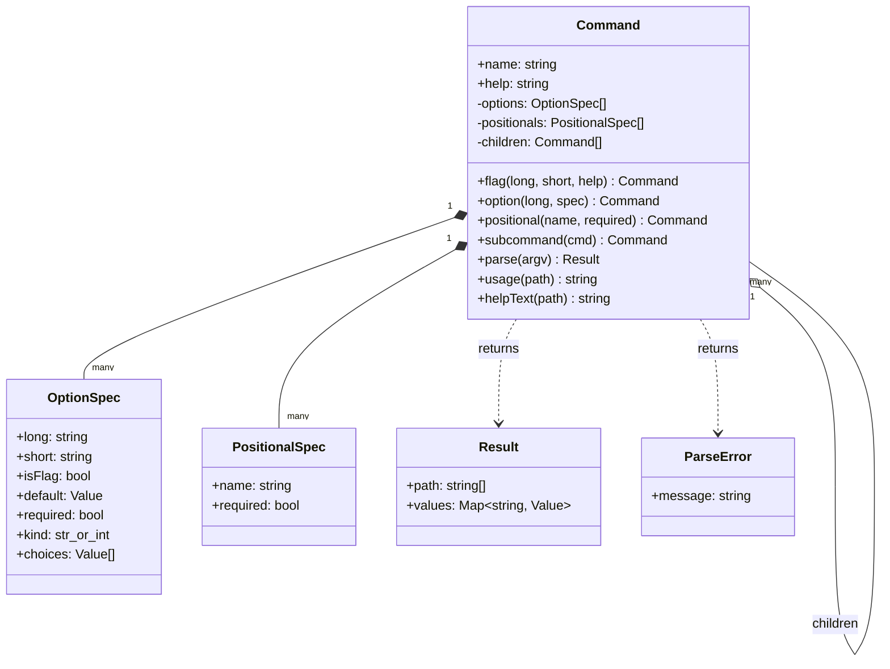
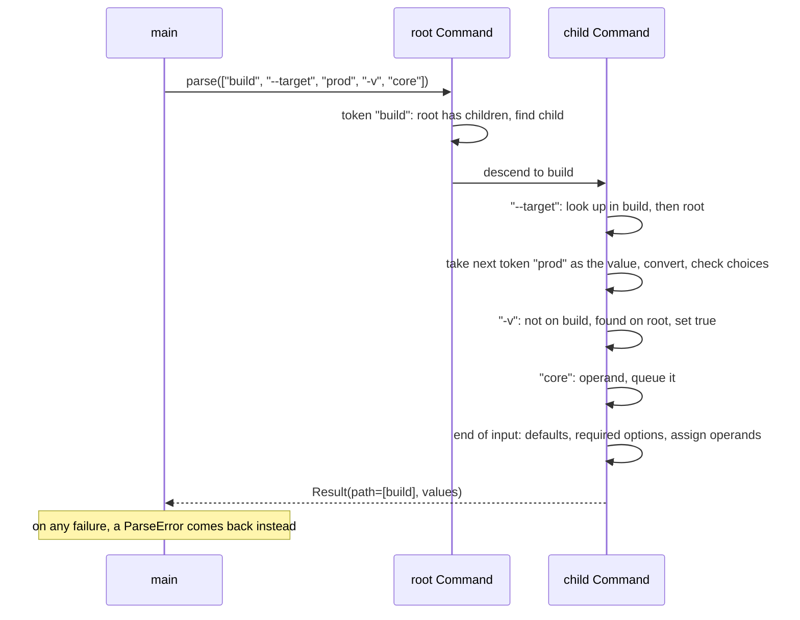

## In one minute
- A parser turns a flat list of strings into a validated, typed result, or into one clear error. The hard part is not splitting on `=`; it is deciding what each token *is* (flag, option, value, operand, subcommand) when the rules overlap.
- Model the program as a **tree of commands** (Composite). Every node has the same shape: options, positionals and children. The root and a leaf differ only in what they contain, so parsing, usage text and help text recurse over one type.
- Declare the interface with a **fluent builder**, then freeze it. One declaration drives parsing, defaults, validation and generated help, so the help can never disagree with the parser.
- Errors are a product feature. Say which token failed, why, and what would have worked ("did you mean"). Return the error as data, and let only the outermost `main` print it and choose the exit status.
- The shape is **trust but verify**: argv is untrusted input from a shell, a script or a program that built the command line from user data. The same parse-then-validate pipeline reappears in HTTP query-string handling and config loading.

## Requirements

Functional:
- **Flags** are boolean switches (`--verbose`, `-v`) that default to false. Short flags can be clustered (`-vq`).
- **Options** carry a value: `--out file`, `--out=file`, `-o file`, `-ofile`. They have an optional default, a required marker, an optional type (string or integer) and an optional set of allowed choices.
- **Positional arguments** are matched by position and may be required or optional.
- **Subcommands** form a tree (`app build`, `app remote add`). Options declared on a parent apply to its descendants.
- `--` ends option parsing; everything after it is an operand, even if it starts with a dash.
- Errors name the offending token and suggest the closest valid name when one is near.
- The same declaration generates a usage line and a help page.

Non-functional:
- Deterministic and side-effect free: `parse` takes a list of strings and returns a value or an error. It never reads the environment, exits the process or prints.
- Declaration is separate from parsing, so one declared command can be parsed many times and tested without a process.
- Error messages are stable text, since scripts and tests match on them.

Out of scope: shell completion, config files and environment-variable fallbacks, repeatable options that collect lists, and mutually exclusive groups. Name them, park them in Extensibility, and move on.

## Entities and relationships

Start with the nouns that hold declared facts, then the one noun that holds the outcome.

- **Command** is a node in the tree. It has a name, a help string, a list of option specs, an ordered list of positional specs and a list of child commands. This is the Composite: a child is a `Command` too.
- **OptionSpec** has a long name, an optional single-letter short name, whether it is a flag, a default, a required marker, a kind (string or integer) and optional choices. A flag is an option with no value and an implicit default of false.
- **PositionalSpec** has a name and a required marker. Order matters.
- **Result** is the outcome: the path of subcommand names taken, and a map from name to value. It is a plain value, not an object with behaviour.
- **ParseError** carries the message. Parsing returns it; it does not print it.

Relationships: a command *composes* its option specs and positional specs (they exist only for that command) and *aggregates* child commands. Lookup of an option walks from the current command up through its ancestors, so a child sees its parents' options but not the reverse. A command with children has no positionals of its own, because the first operand would be ambiguous between a subcommand name and a value.

## Class diagram



## Key flows

`parse` is one left-to-right pass that classifies each token using only the current command and its ancestors, then a validation pass over the finished tree path. Two phases keep the logic simple: the scan decides what each token is, and the finish step applies defaults, required checks and positional assignment.



The classification rules, in the order the code applies them:

1. After `--`, every token is an operand.
2. `--name` or `--name=value` is a long option. `=` splits at the first sign only, so a value may itself contain `=`.
3. `-abc` is a short cluster. Walk the letters: a flag sets itself and the walk continues; an option takes the rest of the cluster as its value, or the next token if nothing remains, and the walk stops. This is the grouping rule POSIX describes: any number of flags, then at most one option that takes a value ([POSIX Utility Syntax Guidelines](https://pubs.opengroup.org/onlinepubs/9799919799/basedefs/V1_chap12.html)).
4. A lone `-` is an operand (by convention it means standard input).
5. Anything else is an operand, or the next subcommand name if the current command has children.

An option consumes the next token as its value even when that token looks like a flag. That is what makes `--offset -5` work. The cost is that `--out --verbose` silently stores the string `--verbose`. Real parsers choose differently; the next sections come back to it.

## Design patterns used and why

- **Builder** for the declaration. A command takes many optional pieces (short names, defaults, choices, help), and a constructor with ten parameters is unreadable. Chained calls (`.flag(...).option(...)`) read like the help page they produce. The trade-off is real: the builder here mutates and returns itself, so a half-built command is a valid object. Where that matters, split into a mutable builder and an immutable `build()` that returns a frozen tree and validates the declaration (no duplicate names, no short name used twice, no positional after a variadic one). The practice code stays with the simple form; the interview answer should mention the split.
- **Composite** for the command tree. `parse`, `usage` and `helpText` treat the root and a leaf the same way because both are `Command`. Adding a third nesting level (`app remote add`) needs no new class. The GoF book places Composite among the structural patterns and Builder among the creational ones (*Design Patterns*, Gamma et al., chapters 3 and 4). Mature libraries use the same shape: Cobra's command tree lets a flag marked persistent apply to the command and every subcommand under it ([Cobra user guide](https://github.com/spf13/cobra/blob/main/site/content/user_guide.md)).
- **Result as a value, errors as data.** Python raises, TypeScript throws, Go returns `error`. In every case the parser itself never calls `exit`. Python's argparse prints a message and exits by default; its `exit_on_error` switch, added in 3.9, exists because libraries that embed a parser need the opposite ([argparse docs](https://docs.python.org/3/library/argparse.html)).
## Concurrency and edge cases

Parsing is a pure function of the declaration and the input, so concurrency is easy: once a command tree is built and not mutated, any number of goroutines or threads can call `parse` on it. Never store parse state (the cursor, the partial result) on the `Command`. That is the one real mistake, and it turns a read-only tree into shared mutable state.

- **Option values that look like flags.** `--n -5` should give -5, and the rule "an option always takes the next token" delivers it. The alternative is to reject any value that starts with a dash, which breaks negative numbers and file names. Argparse takes a middle path: it treats a token like `-1` as a value only if no option in the parser looks like a negative number ([argparse docs](https://docs.python.org/3/library/argparse.html)).
- **Operands that look like flags.** The user cannot be expected to know your option set, so `--` is the escape hatch. POSIX asks utilities to accept it as the end of options ([POSIX](https://pubs.opengroup.org/onlinepubs/9799919799/basedefs/V1_chap12.html)). Go's `flag` package is blunter: parsing stops at the first non-flag argument, so `app file -v` leaves `-v` as an operand ([Go flag docs](https://pkg.go.dev/flag)). Pick one rule, document it, and test it.
- **Booleans with values.** This lesson rejects any `=value` on a flag. Go's package accepts only the `-flag=false` form to turn a boolean off, because a following word could be an operand ([Go flag docs](https://pkg.go.dev/flag)).
- **Abbreviations.** Allowing `--verb` for `--verbose` is friendly and dangerous: adding `--verbatim` next release turns every script that used `--verb` into an "ambiguous option" error. Git's own documentation tells script authors to spell options out for this reason ([gitcli](https://git-scm.com/docs/gitcli)).
- **Typos.** Suggest, never auto-correct. The command-line guidelines at clig.dev warn that a typo might mean something else entirely, and that running a guessed command can do damage ([clig.dev](https://clig.dev/)).

## In the wild
- **Git, 2017: a hostname that started with a dash.** A `ssh://` URL could produce an `ssh` command line whose host began with `-`, so `ssh` treated it as an option instead of a host. Git 2.7.6 and the later 2.14.1 forward-port forbade hostnames, port numbers and repository names that begin with a dash. The bug was not in an argument parser; it was a missing `--` and missing validation where a program built a command line from untrusted data ([Git 2.7.6 release notes](https://github.com/git/git/blob/v2.7.6/Documentation/RelNotes/2.7.6.txt)).
- **Git, 2018: option injection through submodule URLs (CVE-2018-17456).** Submodule URLs come from the untrusted `.gitmodules` file, yet were handed to `git clone` as-is when cloning with `--recurse-submodules`. A URL starting with a dash became an option. The fix in 2.14.5 rejects malformed URLs, including ones that begin with a dash ([Git 2.14.5 release notes](https://github.com/git/git/blob/v2.14.5/Documentation/RelNotes/2.14.5.txt)). It is the same mechanism as the 2017 hostname bug, a year earlier: operands and options share one string list, so any operand that a program fills from outside data must be separated by `--` or validated.
- **Python argparse, 3.5 to 3.8: abbreviation matching has a cost.** Python 3.5 added `allow_abbrev` so programs could switch off prefix matching of long options, and 3.8 fixed a side effect in which turning abbreviations off also disabled grouping of short flags such as `-vv` ([argparse docs, "Changed in version 3.8"](https://docs.python.org/3/library/argparse.html)). Two features that look independent, abbreviation and clustering, shared one code path. It is a reminder to test each rule separately.

## Down the stack

### Layer 1: The contract
`parse(argv)` returns either a result in which every declared option and positional has a value (the supplied one, the default, or null for an optional operand nobody gave) or a single error and nothing else. It never returns a partial result. It is order-insensitive for options relative to each other, as POSIX recommends, and order-sensitive for operands. Errors are specific enough to test: unknown option, missing value, bad integer, value outside the choices, missing required option, missing operand, extra operand, missing or unknown subcommand. Given the same declaration and input, the output is identical on every run.

### Layer 2: The mechanism
The data structures are small. Each command keeps its option specs in a list (a map from long name and from short letter is the next step for commands with dozens of options) and a list of positional specs. Option lookup walks from the current command up the ancestor chain, so a child's declaration shadows its parent's. The scan is a single index into argv; consuming a value just advances that index. The finish step iterates the whole chain to apply defaults, which keeps "unset" separate from "set to the default" until the end and lets a required check mean something.

The suggestion uses Levenshtein edit distance, a dynamic programme over two rows of integers. The rule here is distance under 3 and under the length of the word, picking the alphabetically first among ties so the message is stable. Argparse implements long-option abbreviation by prefix search over its option map and reports "ambiguous option" for more than one hit; from 3.14 it can also suggest close names for mistyped choices and subcommands ([argparse docs](https://docs.python.org/3/library/argparse.html)).

### Layer 3: The machine
The kernel never sees flags. A shell expands quotes, variables and globs, then calls `execve` with an array of C strings; each string is NUL-terminated and the whole block sits at the top of the new process's stack. Linux caps a single string at 32 pages, 128 KiB, and the total size of arguments plus environment at a limit derived from the stack resource limit, so a huge glob can fail with `E2BIG` before your parser runs ([execve(2)](https://man7.org/linux/man-pages/man2/execve.2.html)). Your program receives `argv` as a pointer array; Go copies it into `os.Args` and Python into `sys.argv`, one allocation per string.

Parsing cost is negligible: a few hundred nanoseconds for a typical ten-token line, against roughly a millisecond or more to `fork` and `exec` the process in the first place. What deserves attention is what the arguments *are* on the machine: readable by other users through `/proc/<pid>/cmdline` and `ps` for the life of the process, which is why a secret in argv is a leak.

### Why it's built this way
1. The kernel passes a flat string array and nothing else, so all structure (flag, value, operand) must be recovered in user space. Every convention exists to make that recovery unambiguous.
2. Humans type the line and scripts generate it, so the grammar has to be both short to type (`-vq`) and safe to generate (`--name=value`, `--`).
3. Help drifts from code when written separately, so the declaration is a single source of truth that generates both parser behaviour and help text.
4. Programs nest (git, kubectl), so the declaration is a tree, and a recursive type is the cheapest way to handle any depth.
5. Parsing is called once per process but tested thousands of times, so it is pure, returns errors as values and leaves exit codes and printing to `main`.

## Extensibility

- **Repeatable and list options** (`-I a -I b`): add a `repeat` flag to the spec and store a list instead of overwriting. The scan does not change; only the store step does.
- **Environment and config fallback**: add a resolution order (flag, then environment variable, then file, then default) in the finish step. Keep it explicit so help can show the source of each default.
- **Mutually exclusive and dependent options**: a post-scan constraint list on the command (`exclusive(["json","csv"])`). It is a validation, so it runs after the scan.
- **Shell completion**: walk the same tree. The declaration already knows every name, so a completion generator is a read-only traversal, a good fit for the Visitor pattern.

## Leadership lens

- Build first: the scan and the error messages, with a table-driven test per rule. Completion and colourful help are cheap once the declaration is trustworthy.
- Ask in review: what does `--x -1` mean; what happens after `--`; can any operand come from untrusted data; are abbreviations allowed in scripts; does the exit status differ between usage errors and runtime failures.
- A CLI is an API. Renaming a flag is a breaking change for every script that calls it, so deprecate with a warning for a release before removing, and keep error text stable enough to match on.
- Buy before build. Use the language's maintained parser (argparse, Cobra, clap, Click) unless it truly cannot express your grammar. Writing one is a fine interview exercise and a poor production decision.

## Check yourself
1. Why should `parse` return an error instead of printing a message and exiting?
   **Answer:** A parser that exits cannot be embedded in a larger program, called from tests, or reused to validate input from a source other than a terminal. Returning the error lets only `main` choose the stream, text decoration and exit status.
2. A user runs `app --count -5`. Should `-5` be a value or an unknown option, and what do you give up either way?
   **Answer:** The usual rule is that an option consumes the next token, so -5 is the value; that supports negative numbers and file names starting with a dash but means `--out --verbose` stores the string `--verbose`. Rejecting dash-leading values catches that typo but breaks legitimate input, unless you add a negative-number special case as argparse does.
3. Why are option abbreviations risky for scripts?
   **Answer:** A prefix that is unique today can become ambiguous when a later release adds an option with the same prefix, turning a working script into an error. Scripts should spell options in full, which is why Git's documentation says so.
4. Where in the class design does the Composite pattern pay off, and where would it be overkill?
   **Answer:** It pays off in `parse`, `usage` and `helpText`, which recurse over a command tree of any depth with one type. It is overkill for a single flat command with no subcommands, where a plain spec list is enough.

## Practice
**Task:** Implement a `Command` that is both the builder and the parser. `flag(long, short, help)` declares a boolean (default false). `option(long, ...)` declares a value option with optional short name, default, required marker, `kind` of string or integer, and choices. `positional(name, required)` declares an operand and `subcommand(cmd)` attaches a child; each declaration method returns the same command so calls chain. `parse(argv)` returns a result with `path` (child command names taken) and `values` (every option of every command on the path, plus positionals of the last command; unset optional options hold their default and unset optional positionals hold null). It supports `--name value`, `--name=value`, `-o value`, `-ofile` and clustered flags like `-vq`; `--` ends option parsing; options on ancestors are accepted after a subcommand name. It fails with the exact messages in the tests, including a "did you mean" suggestion for an unknown option or command within edit distance 2. `usage(path)` and `help_text(path)` generate help from the declaration.

```python starter
from dataclasses import dataclass


class ParseError(Exception):
    pass


@dataclass
class Result:
    path: list    # subcommand names below the root, e.g. ["remote", "add"]
    values: dict  # long option name or positional name -> value


class Command:
    def __init__(self, name, help=""):
        self.name = name
        self.help = help

    # Builder methods: each returns self so calls can be chained.
    def flag(self, long, short=None, help=""):
        # TODO
        raise NotImplementedError

    def option(self, long, short=None, default=None, required=False,
               choices=None, kind="str", help=""):
        # TODO
        raise NotImplementedError

    def positional(self, name, required=True):
        # TODO
        raise NotImplementedError

    def subcommand(self, cmd):
        # TODO
        raise NotImplementedError

    def parse(self, argv):
        # TODO: return Result or raise ParseError
        raise NotImplementedError

    def usage(self, path=None):
        # TODO
        raise NotImplementedError

    def help_text(self, path=None):
        # TODO
        raise NotImplementedError
```

```python tests
def build():
    root = Command("app", "Demo tool.")
    root.flag("verbose", "v", help="more output")
    root.option("out", "o", default="a.out", help="output file")
    root.positional("input")
    return root


def err(fn):
    try:
        fn()
    except ParseError as e:
        return str(e)
    return None


def test_flags_options_positionals():
    r = build().parse(["-v", "--out=x.bin", "in.txt"])
    assert r.path == []
    assert r.values == {"verbose": True, "out": "x.bin", "input": "in.txt"}


def test_defaults_applied_when_absent():
    r = build().parse(["in.txt"])
    assert r.values["verbose"] is False
    assert r.values["out"] == "a.out"


def test_short_cluster_and_attached_value():
    r = build().parse(["-vofile.o", "in"])
    assert r.values["verbose"] is True and r.values["out"] == "file.o"
    r = build().parse(["-vo", "next.o", "in"])
    assert r.values["out"] == "next.o"


def test_typed_and_choice_validation():
    cmd = Command("t").option("jobs", "j", default=1, kind="int").option(
        "mode", choices=["fast", "safe"], required=True)
    assert cmd.parse(["--mode", "fast", "-j", "4"]).values["jobs"] == 4
    assert "invalid integer 'x'" in err(lambda: cmd.parse(["--mode=fast", "-j", "x"]))
    assert "choose from fast, safe" in err(lambda: cmd.parse(["--mode", "slow"]))
    assert err(lambda: cmd.parse([])) == "missing required option --mode"


def test_subcommands_inherit_parent_options():
    root = Command("app").flag("verbose", "v")
    build_cmd = Command("build", "Compile.").option("target", default="dev").positional("pkg", required=False)
    root.subcommand(build_cmd).subcommand(Command("test"))
    r = root.parse(["build", "--target", "prod", "-v", "core"])
    assert r.path == ["build"]
    assert r.values == {"verbose": True, "target": "prod", "pkg": "core"}
    assert err(lambda: root.parse([])).startswith("missing command")
    assert "unknown command 'tset'" in err(lambda: root.parse(["tset"]))
    assert "did you mean test?" in err(lambda: root.parse(["tset"]))


def test_double_dash_and_option_values_may_look_like_flags():
    cmd = Command("t").option("n", default=0, kind="int").positional("file")
    r = cmd.parse(["--n", "-5", "--", "-x"])
    assert r.values == {"n": -5, "file": "-x"}


def test_unknown_and_extra_arguments():
    root = build()
    msg = err(lambda: root.parse(["--verbos", "in"]))
    assert msg == "unknown option --verbos (did you mean verbose?)"
    assert err(lambda: root.parse(["a", "b"])) == "unexpected argument 'b'"
    assert err(lambda: root.parse([])) == "missing required argument <input>"
    assert err(lambda: root.parse(["--out"])) == "option --out requires a value"
    assert err(lambda: root.parse(["--verbose=1", "x"])) == "flag --verbose does not take a value"


def test_usage_and_help_text():
    root = build()
    root.subcommand(Command("sub", "A subcommand.").positional("name").positional("extra", required=False))
    assert root.usage(["sub"]) == "usage: app sub [options] <name> [extra]"
    text = root.help_text(["sub"])
    assert "A subcommand." in text and "-o, --out VALUE" in text and "(default: a.out)" in text
    assert "commands:" in root.help_text() and "sub" in root.help_text()
```

```python solution
from dataclasses import dataclass, field


class ParseError(Exception):
    pass


@dataclass
class Result:
    path: list
    values: dict


def _distance(a, b):
    prev = list(range(len(b) + 1))
    for i in range(1, len(a) + 1):
        cur = [i]
        for j in range(1, len(b) + 1):
            cost = 0 if a[i - 1] == b[j - 1] else 1
            cur.append(min(prev[j] + 1, cur[j - 1] + 1, prev[j - 1] + cost))
        prev = cur
    return prev[-1]


def _suggest(word, names):
    best = None
    best_d = 3
    for n in sorted(names):
        d = _distance(word, n)
        if d < best_d and d < len(word):
            best, best_d = n, d
    return " (did you mean %s?)" % best if best else ""


class _Opt:
    def __init__(self, long, short, is_flag, default, required, choices, kind, help):
        self.long = long
        self.short = short
        self.is_flag = is_flag
        self.default = default
        self.required = required
        self.choices = choices
        self.kind = kind
        self.help = help


class Command:
    def __init__(self, name, help=""):
        self.name = name
        self.help = help
        self._opts = []
        self._pos = []
        self._subs = []

    def flag(self, long, short=None, help=""):
        self._opts.append(_Opt(long, short, True, False, False, None, "str", help))
        return self

    def option(self, long, short=None, default=None, required=False,
               choices=None, kind="str", help=""):
        self._opts.append(_Opt(long, short, False, default, required, choices, kind, help))
        return self

    def positional(self, name, required=True):
        self._pos.append((name, required))
        return self

    def subcommand(self, cmd):
        self._subs.append(cmd)
        return self

    def _lookup(self, chain, long=None, short=None):
        for cmd in reversed(chain):
            for o in cmd._opts:
                if (long is not None and o.long == long) or (short is not None and o.short == short):
                    return o
        return None

    def _convert(self, opt, raw):
        if opt.kind == "int":
            try:
                value = int(raw)
            except ValueError:
                raise ParseError("invalid integer '%s' for --%s" % (raw, opt.long))
        else:
            value = raw
        if opt.choices is not None and value not in opt.choices:
            raise ParseError("invalid value '%s' for --%s (choose from %s)"
                             % (raw, opt.long, ", ".join(str(c) for c in opt.choices)))
        return value

    def parse(self, argv):
        chain = [self]
        values = {}
        positionals = []
        only_pos = False
        i = 0
        while i < len(argv):
            tok = argv[i]
            i += 1
            cur = chain[-1]
            if not only_pos and tok == "--":
                only_pos = True
            elif only_pos or tok == "-" or not tok.startswith("-"):
                if cur._subs:
                    nxt = None
                    for s in cur._subs:
                        if s.name == tok:
                            nxt = s
                    if nxt is None:
                        raise ParseError("unknown command '%s'%s"
                                         % (tok, _suggest(tok, [s.name for s in cur._subs])))
                    chain.append(nxt)
                else:
                    positionals.append(tok)
            elif tok.startswith("--"):
                name, eq, inline = tok[2:].partition("=")
                opt = self._lookup(chain, long=name)
                if opt is None:
                    names = [o.long for c in chain for o in c._opts]
                    raise ParseError("unknown option --%s%s" % (name, _suggest(name, names)))
                if opt.is_flag:
                    if eq:
                        raise ParseError("flag --%s does not take a value" % name)
                    values[opt.long] = True
                else:
                    if eq:
                        raw = inline
                    elif i < len(argv):
                        raw = argv[i]
                        i += 1
                    else:
                        raise ParseError("option --%s requires a value" % name)
                    values[opt.long] = self._convert(opt, raw)
            else:
                j = 1
                while j < len(tok):
                    opt = self._lookup(chain, short=tok[j])
                    if opt is None:
                        raise ParseError("unknown option -%s" % tok[j])
                    if opt.is_flag:
                        values[opt.long] = True
                        j += 1
                        continue
                    if j + 1 < len(tok):
                        raw = tok[j + 1:]
                    elif i < len(argv):
                        raw = argv[i]
                        i += 1
                    else:
                        raise ParseError("option --%s requires a value" % opt.long)
                    values[opt.long] = self._convert(opt, raw)
                    break
        leaf = chain[-1]
        if leaf._subs:
            raise ParseError("missing command (choose from %s)"
                             % ", ".join(s.name for s in leaf._subs))
        for cmd in chain:
            for o in cmd._opts:
                if o.long in values:
                    continue
                if o.required:
                    raise ParseError("missing required option --%s" % o.long)
                values[o.long] = o.default
        for idx, (pname, required) in enumerate(leaf._pos):
            if idx < len(positionals):
                values[pname] = positionals[idx]
            elif required:
                raise ParseError("missing required argument <%s>" % pname)
            else:
                values[pname] = None
        if len(positionals) > len(leaf._pos):
            raise ParseError("unexpected argument '%s'" % positionals[len(leaf._pos)])
        return Result([c.name for c in chain[1:]], values)

    def _chain(self, path):
        chain = [self]
        for name in path or []:
            found = None
            for s in chain[-1]._subs:
                if s.name == name:
                    found = s
            if found is None:
                raise ParseError("unknown command '%s'" % name)
            chain.append(found)
        return chain

    def usage(self, path=None):
        chain = self._chain(path)
        leaf = chain[-1]
        parts = ["usage:"] + [c.name for c in chain]
        if any(c._opts for c in chain):
            parts.append("[options]")
        for pname, required in leaf._pos:
            parts.append("<%s>" % pname if required else "[%s]" % pname)
        if leaf._subs:
            parts.append("<command>")
        return " ".join(parts)

    def help_text(self, path=None):
        chain = self._chain(path)
        leaf = chain[-1]
        lines = [self.usage(path)]
        if leaf.help:
            lines += ["", leaf.help]
        opts = [o for c in chain for o in c._opts]
        if opts:
            lines += ["", "options:"]
            for o in opts:
                left = ("-%s, " % o.short if o.short else "") + "--" + o.long
                if not o.is_flag:
                    left += " VALUE"
                text = o.help
                if not o.is_flag and o.default is not None:
                    text += " (default: %s)" % o.default
                lines.append(("  " + left.ljust(22) + text).rstrip())
        if leaf._subs:
            lines += ["", "commands:"]
            for s in leaf._subs:
                lines.append(("  " + s.name.ljust(22) + s.help).rstrip())
        return "\n".join(lines)
```

```typescript starter
export class ParseError extends Error {
  constructor(message: string) {
    super(message);
    this.name = "ParseError";
  }
}

export type Value = string | number | boolean | null;

export interface Result {
  path: string[]; // subcommand names below the root, e.g. ["remote", "add"]
  values: Record<string, Value>; // long option name or positional name -> value
}

export interface OptionSpec {
  short?: string;
  default?: Value;
  required?: boolean;
  choices?: Value[];
  kind?: "str" | "int";
  help?: string;
}

export class Command {
  constructor(public name: string, public help: string = "") {}

  // Builder methods: each returns this so calls can be chained.
  flag(long: string, short: string | null = null, help: string = ""): Command {
    throw new Error("TODO");
  }

  option(long: string, spec: OptionSpec = {}): Command {
    throw new Error("TODO");
  }

  positional(name: string, required: boolean = true): Command {
    throw new Error("TODO");
  }

  subcommand(cmd: Command): Command {
    throw new Error("TODO");
  }

  parse(argv: string[]): Result {
    throw new Error("TODO");
  }

  usage(path: string[] = []): string {
    throw new Error("TODO");
  }

  helpText(path: string[] = []): string {
    throw new Error("TODO");
  }
}
```

```typescript tests
function build(): Command {
  const root = new Command("app", "Demo tool.");
  root.flag("verbose", "v", "more output");
  root.option("out", { short: "o", default: "a.out", help: "output file" });
  root.positional("input");
  return root;
}

function err(fn: () => unknown): string | null {
  try {
    fn();
  } catch (e) {
    if (e instanceof ParseError) return e.message;
    throw e;
  }
  return null;
}

test("flags, options and positionals", () => {
  const r = build().parse(["-v", "--out=x.bin", "in.txt"]);
  assertEqual(r.path, [], "root path");
  assertEqual(r.values, { verbose: true, out: "x.bin", input: "in.txt" });
});

test("defaults applied when absent", () => {
  const r = build().parse(["in.txt"]);
  assertEqual(r.values["verbose"], false);
  assertEqual(r.values["out"], "a.out");
});

test("short cluster and attached value", () => {
  let r = build().parse(["-vofile.o", "in"]);
  assertEqual(r.values["verbose"], true);
  assertEqual(r.values["out"], "file.o");
  r = build().parse(["-vo", "next.o", "in"]);
  assertEqual(r.values["out"], "next.o");
});

test("typed and choice validation", () => {
  const cmd = new Command("t")
    .option("jobs", { short: "j", default: 1, kind: "int" })
    .option("mode", { choices: ["fast", "safe"], required: true });
  assertEqual(cmd.parse(["--mode", "fast", "-j", "4"]).values["jobs"], 4);
  assert((err(() => cmd.parse(["--mode=fast", "-j", "x"])) ?? "").includes("invalid integer 'x'"));
  assert((err(() => cmd.parse(["--mode", "slow"])) ?? "").includes("choose from fast, safe"));
  assertEqual(err(() => cmd.parse([])), "missing required option --mode");
});

test("subcommands inherit parent options", () => {
  const root = new Command("app").flag("verbose", "v");
  const buildCmd = new Command("build", "Compile.").option("target", { default: "dev" }).positional("pkg", false);
  root.subcommand(buildCmd).subcommand(new Command("test"));
  const r = root.parse(["build", "--target", "prod", "-v", "core"]);
  assertEqual(r.path, ["build"]);
  assertEqual(r.values["verbose"], true);
  assertEqual(r.values["target"], "prod");
  assertEqual(r.values["pkg"], "core");
  assert((err(() => root.parse([])) ?? "").startsWith("missing command"));
  const e = err(() => root.parse(["tset"])) ?? "";
  assert(e.includes("unknown command 'tset'") && e.includes("did you mean test?"));
});

test("double dash and option values may look like flags", () => {
  const cmd = new Command("t").option("n", { default: 0, kind: "int" }).positional("file");
  const r = cmd.parse(["--n", "-5", "--", "-x"]);
  assertEqual(r.values, { n: -5, file: "-x" });
});

test("unknown and extra arguments", () => {
  const root = build();
  assertEqual(err(() => root.parse(["--verbos", "in"])), "unknown option --verbos (did you mean verbose?)");
  assertEqual(err(() => root.parse(["a", "b"])), "unexpected argument 'b'");
  assertEqual(err(() => root.parse([])), "missing required argument <input>");
  assertEqual(err(() => root.parse(["--out"])), "option --out requires a value");
  assertEqual(err(() => root.parse(["--verbose=1", "x"])), "flag --verbose does not take a value");
});

test("usage and help text", () => {
  const root = build();
  root.subcommand(new Command("sub", "A subcommand.").positional("name").positional("extra", false));
  assertEqual(root.usage(["sub"]), "usage: app sub [options] <name> [extra]");
  const text = root.helpText(["sub"]);
  assert(text.includes("A subcommand.") && text.includes("-o, --out VALUE") && text.includes("(default: a.out)"));
  assert(root.helpText().includes("commands:") && root.helpText().includes("sub"));
});
```

```typescript solution
export class ParseError extends Error {
  constructor(message: string) {
    super(message);
    this.name = "ParseError";
  }
}

export type Value = string | number | boolean | null;

export interface Result {
  path: string[];
  values: Record<string, Value>;
}

interface Opt {
  long: string;
  short: string | null;
  isFlag: boolean;
  def: Value;
  required: boolean;
  choices: Value[] | null;
  kind: string;
  help: string;
}

export interface OptionSpec {
  short?: string;
  default?: Value;
  required?: boolean;
  choices?: Value[];
  kind?: "str" | "int";
  help?: string;
}

function distance(a: string, b: string): number {
  let prev: number[] = [];
  for (let j = 0; j <= b.length; j++) prev.push(j);
  for (let i = 1; i <= a.length; i++) {
    const cur: number[] = [i];
    for (let j = 1; j <= b.length; j++) {
      const cost = a[i - 1] === b[j - 1] ? 0 : 1;
      cur.push(Math.min(prev[j] + 1, cur[j - 1] + 1, prev[j - 1] + cost));
    }
    prev = cur;
  }
  return prev[b.length];
}

function suggest(word: string, names: string[]): string {
  let best: string | null = null;
  let bestD = 3;
  for (const n of [...names].sort()) {
    const d = distance(word, n);
    if (d < bestD && d < word.length) {
      best = n;
      bestD = d;
    }
  }
  return best ? ` (did you mean ${best}?)` : "";
}

export class Command {
  opts: Opt[] = [];
  pos: { name: string; required: boolean }[] = [];
  subs: Command[] = [];

  constructor(public name: string, public help: string = "") {}

  flag(long: string, short: string | null = null, help: string = ""): Command {
    this.opts.push({ long, short, isFlag: true, def: false, required: false, choices: null, kind: "str", help });
    return this;
  }

  option(long: string, spec: OptionSpec = {}): Command {
    this.opts.push({
      long,
      short: spec.short ?? null,
      isFlag: false,
      def: spec.default ?? null,
      required: spec.required ?? false,
      choices: spec.choices ?? null,
      kind: spec.kind ?? "str",
      help: spec.help ?? "",
    });
    return this;
  }

  positional(name: string, required: boolean = true): Command {
    this.pos.push({ name, required });
    return this;
  }

  subcommand(cmd: Command): Command {
    this.subs.push(cmd);
    return this;
  }

  private lookup(chain: Command[], long: string | null, short: string | null): Opt | null {
    for (let c = chain.length - 1; c >= 0; c--) {
      for (const o of chain[c].opts) {
        if ((long !== null && o.long === long) || (short !== null && o.short === short)) return o;
      }
    }
    return null;
  }

  private convert(opt: Opt, raw: string): Value {
    let value: Value = raw;
    if (opt.kind === "int") {
      if (!/^[+-]?\d+$/.test(raw)) throw new ParseError(`invalid integer '${raw}' for --${opt.long}`);
      value = parseInt(raw, 10);
    }
    if (opt.choices !== null && opt.choices.indexOf(value) < 0) {
      throw new ParseError(`invalid value '${raw}' for --${opt.long} (choose from ${opt.choices.join(", ")})`);
    }
    return value;
  }

  parse(argv: string[]): Result {
    const chain: Command[] = [this];
    const values: Record<string, Value> = {};
    const positionals: string[] = [];
    let onlyPos = false;
    let i = 0;
    while (i < argv.length) {
      const tok = argv[i++];
      const cur = chain[chain.length - 1];
      if (!onlyPos && tok === "--") {
        onlyPos = true;
      } else if (onlyPos || tok === "-" || !tok.startsWith("-")) {
        if (cur.subs.length > 0) {
          const nxt = cur.subs.find((s) => s.name === tok);
          if (!nxt) {
            throw new ParseError(`unknown command '${tok}'${suggest(tok, cur.subs.map((s) => s.name))}`);
          }
          chain.push(nxt);
        } else {
          positionals.push(tok);
        }
      } else if (tok.startsWith("--")) {
        const eq = tok.indexOf("=");
        const name = eq >= 0 ? tok.slice(2, eq) : tok.slice(2);
        const opt = this.lookup(chain, name, null);
        if (!opt) {
          const names: string[] = [];
          for (const c of chain) for (const o of c.opts) names.push(o.long);
          throw new ParseError(`unknown option --${name}${suggest(name, names)}`);
        }
        if (opt.isFlag) {
          if (eq >= 0) throw new ParseError(`flag --${name} does not take a value`);
          values[opt.long] = true;
        } else {
          let raw: string;
          if (eq >= 0) raw = tok.slice(eq + 1);
          else if (i < argv.length) raw = argv[i++];
          else throw new ParseError(`option --${name} requires a value`);
          values[opt.long] = this.convert(opt, raw);
        }
      } else {
        let j = 1;
        while (j < tok.length) {
          const opt = this.lookup(chain, null, tok[j]);
          if (!opt) throw new ParseError(`unknown option -${tok[j]}`);
          if (opt.isFlag) {
            values[opt.long] = true;
            j++;
            continue;
          }
          let raw: string;
          if (j + 1 < tok.length) raw = tok.slice(j + 1);
          else if (i < argv.length) raw = argv[i++];
          else throw new ParseError(`option --${opt.long} requires a value`);
          values[opt.long] = this.convert(opt, raw);
          break;
        }
      }
    }
    const leaf = chain[chain.length - 1];
    if (leaf.subs.length > 0) {
      throw new ParseError(`missing command (choose from ${leaf.subs.map((s) => s.name).join(", ")})`);
    }
    for (const c of chain) {
      for (const o of c.opts) {
        if (o.long in values) continue;
        if (o.required) throw new ParseError(`missing required option --${o.long}`);
        values[o.long] = o.def;
      }
    }
    leaf.pos.forEach((p, idx) => {
      if (idx < positionals.length) values[p.name] = positionals[idx];
      else if (p.required) throw new ParseError(`missing required argument <${p.name}>`);
      else values[p.name] = null;
    });
    if (positionals.length > leaf.pos.length) {
      throw new ParseError(`unexpected argument '${positionals[leaf.pos.length]}'`);
    }
    return { path: chain.slice(1).map((c) => c.name), values };
  }

  private chainFor(path: string[]): Command[] {
    const chain: Command[] = [this];
    for (const name of path) {
      const found = chain[chain.length - 1].subs.find((s) => s.name === name);
      if (!found) throw new ParseError(`unknown command '${name}'`);
      chain.push(found);
    }
    return chain;
  }

  usage(path: string[] = []): string {
    const chain = this.chainFor(path);
    const leaf = chain[chain.length - 1];
    const parts = ["usage:", ...chain.map((c) => c.name)];
    if (chain.some((c) => c.opts.length > 0)) parts.push("[options]");
    for (const p of leaf.pos) parts.push(p.required ? `<${p.name}>` : `[${p.name}]`);
    if (leaf.subs.length > 0) parts.push("<command>");
    return parts.join(" ");
  }

  helpText(path: string[] = []): string {
    const chain = this.chainFor(path);
    const leaf = chain[chain.length - 1];
    const lines = [this.usage(path)];
    if (leaf.help) lines.push("", leaf.help);
    const opts: Opt[] = [];
    for (const c of chain) for (const o of c.opts) opts.push(o);
    if (opts.length > 0) {
      lines.push("", "options:");
      for (const o of opts) {
        let left = (o.short ? `-${o.short}, ` : "") + "--" + o.long;
        if (!o.isFlag) left += " VALUE";
        let text = o.help;
        if (!o.isFlag && o.def !== null) text += ` (default: ${o.def})`;
        lines.push(("  " + left.padEnd(22) + text).trimEnd());
      }
    }
    if (leaf.subs.length > 0) {
      lines.push("", "commands:");
      for (const s of leaf.subs) lines.push(("  " + s.name.padEnd(22) + s.help).trimEnd());
    }
    return lines.join("\n");
  }
}
```

```go starter
package practice

type ParseError struct{ Msg string }

func (e *ParseError) Error() string { return e.Msg }

type Result struct {
	Path   []string       // subcommand names below the root
	Values map[string]any // long option name or positional name -> value
}

type OptSpec struct {
	Short    string
	Default  any
	Required bool
	Choices  []any
	Kind     string // "str" (default) or "int"
	Help     string
}

type Command struct {
	Name, Help string
}

func NewCommand(name, help string) *Command { return &Command{Name: name, Help: help} }

// Builder methods: each returns c so calls can be chained.
func (c *Command) Flag(long, short, help string) *Command {
	panic("TODO")
}

func (c *Command) Option(long string, s OptSpec) *Command {
	panic("TODO")
}

func (c *Command) Positional(name string, required bool) *Command {
	panic("TODO")
}

func (c *Command) Subcommand(sub *Command) *Command {
	panic("TODO")
}

func (c *Command) Parse(argv []string) (*Result, error) {
	panic("TODO")
}

func (c *Command) Usage(path []string) string {
	panic("TODO")
}

func (c *Command) HelpText(path []string) string {
	panic("TODO")
}
```

```go tests
package practice

import (
	"reflect"
	"strings"
	"testing"
)

func build() *Command {
	root := NewCommand("app", "Demo tool.")
	root.Flag("verbose", "v", "more output")
	root.Option("out", OptSpec{Short: "o", Default: "a.out", Help: "output file"})
	root.Positional("input", true)
	return root
}

func errOf(t *testing.T, c *Command, args ...string) string {
	t.Helper()
	_, err := c.Parse(args)
	if err == nil {
		return ""
	}
	return err.Error()
}

func mustParse(t *testing.T, c *Command, args ...string) *Result {
	t.Helper()
	r, err := c.Parse(args)
	if err != nil {
		t.Fatalf("parse %v: %v", args, err)
	}
	return r
}

func TestFlagsOptionsPositionals(t *testing.T) {
	r := mustParse(t, build(), "-v", "--out=x.bin", "in.txt")
	want := map[string]any{"verbose": true, "out": "x.bin", "input": "in.txt"}
	if len(r.Path) != 0 || !reflect.DeepEqual(r.Values, want) {
		t.Fatalf("got %v %v", r.Path, r.Values)
	}
}

func TestDefaultsAppliedWhenAbsent(t *testing.T) {
	r := mustParse(t, build(), "in.txt")
	if r.Values["verbose"] != false || r.Values["out"] != "a.out" {
		t.Fatalf("got %v", r.Values)
	}
}

func TestShortClusterAndAttachedValue(t *testing.T) {
	r := mustParse(t, build(), "-vofile.o", "in")
	if r.Values["verbose"] != true || r.Values["out"] != "file.o" {
		t.Fatalf("got %v", r.Values)
	}
	r = mustParse(t, build(), "-vo", "next.o", "in")
	if r.Values["out"] != "next.o" {
		t.Fatalf("got %v", r.Values)
	}
}

func TestTypedAndChoiceValidation(t *testing.T) {
	cmd := NewCommand("t", "").
		Option("jobs", OptSpec{Short: "j", Default: 1, Kind: "int"}).
		Option("mode", OptSpec{Choices: []any{"fast", "safe"}, Required: true})
	if r := mustParse(t, cmd, "--mode", "fast", "-j", "4"); r.Values["jobs"] != 4 {
		t.Fatalf("got %v", r.Values)
	}
	if m := errOf(t, cmd, "--mode=fast", "-j", "x"); !strings.Contains(m, "invalid integer 'x'") {
		t.Fatalf("got %q", m)
	}
	if m := errOf(t, cmd, "--mode", "slow"); !strings.Contains(m, "choose from fast, safe") {
		t.Fatalf("got %q", m)
	}
	if m := errOf(t, cmd); m != "missing required option --mode" {
		t.Fatalf("got %q", m)
	}
}

func TestSubcommandsInheritParentOptions(t *testing.T) {
	root := NewCommand("app", "").Flag("verbose", "v", "")
	b := NewCommand("build", "Compile.").Option("target", OptSpec{Default: "dev"}).Positional("pkg", false)
	root.Subcommand(b).Subcommand(NewCommand("test", ""))
	r := mustParse(t, root, "build", "--target", "prod", "-v", "core")
	want := map[string]any{"verbose": true, "target": "prod", "pkg": "core"}
	if !reflect.DeepEqual(r.Path, []string{"build"}) || !reflect.DeepEqual(r.Values, want) {
		t.Fatalf("got %v %v", r.Path, r.Values)
	}
	if m := errOf(t, root); !strings.HasPrefix(m, "missing command") {
		t.Fatalf("got %q", m)
	}
	m := errOf(t, root, "tset")
	if !strings.Contains(m, "unknown command 'tset'") || !strings.Contains(m, "did you mean test?") {
		t.Fatalf("got %q", m)
	}
}

func TestDoubleDashAndOptionValuesMayLookLikeFlags(t *testing.T) {
	cmd := NewCommand("t", "").Option("n", OptSpec{Default: 0, Kind: "int"}).Positional("file", true)
	r := mustParse(t, cmd, "--n", "-5", "--", "-x")
	want := map[string]any{"n": -5, "file": "-x"}
	if !reflect.DeepEqual(r.Values, want) {
		t.Fatalf("got %v", r.Values)
	}
}

func TestUnknownAndExtraArguments(t *testing.T) {
	root := build()
	cases := []struct {
		args []string
		want string
	}{
		{[]string{"--verbos", "in"}, "unknown option --verbos (did you mean verbose?)"},
		{[]string{"a", "b"}, "unexpected argument 'b'"},
		{[]string{}, "missing required argument <input>"},
		{[]string{"--out"}, "option --out requires a value"},
		{[]string{"--verbose=1", "x"}, "flag --verbose does not take a value"},
	}
	for _, c := range cases {
		if got := errOf(t, root, c.args...); got != c.want {
			t.Fatalf("%v: got %q want %q", c.args, got, c.want)
		}
	}
}

func TestUsageAndHelpText(t *testing.T) {
	root := build()
	root.Subcommand(NewCommand("sub", "A subcommand.").Positional("name", true).Positional("extra", false))
	if got := root.Usage([]string{"sub"}); got != "usage: app sub [options] <name> [extra]" {
		t.Fatalf("got %q", got)
	}
	text := root.HelpText([]string{"sub"})
	for _, s := range []string{"A subcommand.", "-o, --out VALUE", "(default: a.out)"} {
		if !strings.Contains(text, s) {
			t.Fatalf("missing %q in %q", s, text)
		}
	}
	if h := root.HelpText(nil); !strings.Contains(h, "commands:") || !strings.Contains(h, "sub") {
		t.Fatalf("got %q", h)
	}
}
```

```go solution
package practice

import (
	"fmt"
	"sort"
	"strconv"
	"strings"
)

type ParseError struct{ Msg string }

func (e *ParseError) Error() string { return e.Msg }

func perr(format string, args ...any) error { return &ParseError{fmt.Sprintf(format, args...)} }

type Result struct {
	Path   []string
	Values map[string]any
}

type OptSpec struct {
	Short    string
	Default  any
	Required bool
	Choices  []any
	Kind     string // "str" (default) or "int"
	Help     string
}

type opt struct {
	long, short string
	isFlag      bool
	def         any
	required    bool
	choices     []any
	kind        string
	help        string
}

type posArg struct {
	name     string
	required bool
}

type Command struct {
	Name, Help string
	opts       []opt
	pos        []posArg
	subs       []*Command
}

func NewCommand(name, help string) *Command { return &Command{Name: name, Help: help} }

func (c *Command) Flag(long, short, help string) *Command {
	c.opts = append(c.opts, opt{long: long, short: short, isFlag: true, def: false, help: help})
	return c
}

func (c *Command) Option(long string, s OptSpec) *Command {
	c.opts = append(c.opts, opt{long: long, short: s.Short, def: s.Default, required: s.Required,
		choices: s.Choices, kind: s.Kind, help: s.Help})
	return c
}

func (c *Command) Positional(name string, required bool) *Command {
	c.pos = append(c.pos, posArg{name, required})
	return c
}

func (c *Command) Subcommand(sub *Command) *Command {
	c.subs = append(c.subs, sub)
	return c
}

func distance(a, b string) int {
	prev := make([]int, len(b)+1)
	for j := range prev {
		prev[j] = j
	}
	for i := 1; i <= len(a); i++ {
		cur := []int{i}
		for j := 1; j <= len(b); j++ {
			cost := 1
			if a[i-1] == b[j-1] {
				cost = 0
			}
			m := prev[j] + 1
			if cur[j-1]+1 < m {
				m = cur[j-1] + 1
			}
			if prev[j-1]+cost < m {
				m = prev[j-1] + cost
			}
			cur = append(cur, m)
		}
		prev = cur
	}
	return prev[len(b)]
}

func suggest(word string, names []string) string {
	sorted := append([]string(nil), names...)
	sort.Strings(sorted)
	best, bestD := "", 3
	for _, n := range sorted {
		if d := distance(word, n); d < bestD && d < len(word) {
			best, bestD = n, d
		}
	}
	if best == "" {
		return ""
	}
	return " (did you mean " + best + "?)"
}

func lookup(chain []*Command, long, short string) *opt {
	for i := len(chain) - 1; i >= 0; i-- {
		for j := range chain[i].opts {
			o := &chain[i].opts[j]
			if (long != "" && o.long == long) || (short != "" && o.short == short) {
				return o
			}
		}
	}
	return nil
}

func convert(o *opt, raw string) (any, error) {
	var value any = raw
	if o.kind == "int" {
		n, err := strconv.Atoi(raw)
		if err != nil {
			return nil, perr("invalid integer '%s' for --%s", raw, o.long)
		}
		value = n
	}
	if o.choices != nil {
		ok := false
		names := []string{}
		for _, c := range o.choices {
			names = append(names, fmt.Sprint(c))
			if c == value {
				ok = true
			}
		}
		if !ok {
			return nil, perr("invalid value '%s' for --%s (choose from %s)", raw, o.long, strings.Join(names, ", "))
		}
	}
	return value, nil
}

func (c *Command) Parse(argv []string) (*Result, error) {
	chain := []*Command{c}
	values := map[string]any{}
	var positionals []string
	onlyPos := false
	i := 0
	for i < len(argv) {
		tok := argv[i]
		i++
		cur := chain[len(chain)-1]
		switch {
		case !onlyPos && tok == "--":
			onlyPos = true
		case onlyPos || tok == "-" || !strings.HasPrefix(tok, "-"):
			if len(cur.subs) > 0 {
				var next *Command
				var names []string
				for _, s := range cur.subs {
					names = append(names, s.Name)
					if s.Name == tok {
						next = s
					}
				}
				if next == nil {
					return nil, perr("unknown command '%s'%s", tok, suggest(tok, names))
				}
				chain = append(chain, next)
			} else {
				positionals = append(positionals, tok)
			}
		case strings.HasPrefix(tok, "--"):
			name, inline, hasEq := strings.Cut(tok[2:], "=")
			o := lookup(chain, name, "")
			if o == nil {
				var names []string
				for _, cc := range chain {
					for _, oo := range cc.opts {
						names = append(names, oo.long)
					}
				}
				return nil, perr("unknown option --%s%s", name, suggest(name, names))
			}
			if o.isFlag {
				if hasEq {
					return nil, perr("flag --%s does not take a value", name)
				}
				values[o.long] = true
				continue
			}
			raw := inline
			if !hasEq {
				if i >= len(argv) {
					return nil, perr("option --%s requires a value", name)
				}
				raw = argv[i]
				i++
			}
			v, err := convert(o, raw)
			if err != nil {
				return nil, err
			}
			values[o.long] = v
		default:
			for j := 1; j < len(tok); j++ {
				o := lookup(chain, "", string(tok[j]))
				if o == nil {
					return nil, perr("unknown option -%c", tok[j])
				}
				if o.isFlag {
					values[o.long] = true
					continue
				}
				var raw string
				if j+1 < len(tok) {
					raw = tok[j+1:]
				} else if i < len(argv) {
					raw = argv[i]
					i++
				} else {
					return nil, perr("option --%s requires a value", o.long)
				}
				v, err := convert(o, raw)
				if err != nil {
					return nil, err
				}
				values[o.long] = v
				break
			}
		}
	}
	leaf := chain[len(chain)-1]
	if len(leaf.subs) > 0 {
		var names []string
		for _, s := range leaf.subs {
			names = append(names, s.Name)
		}
		return nil, perr("missing command (choose from %s)", strings.Join(names, ", "))
	}
	for _, cc := range chain {
		for _, o := range cc.opts {
			if _, ok := values[o.long]; ok {
				continue
			}
			if o.required {
				return nil, perr("missing required option --%s", o.long)
			}
			values[o.long] = o.def
		}
	}
	for idx, p := range leaf.pos {
		if idx < len(positionals) {
			values[p.name] = positionals[idx]
		} else if p.required {
			return nil, perr("missing required argument <%s>", p.name)
		} else {
			values[p.name] = nil
		}
	}
	if len(positionals) > len(leaf.pos) {
		return nil, perr("unexpected argument '%s'", positionals[len(leaf.pos)])
	}
	path := []string{}
	for _, cc := range chain[1:] {
		path = append(path, cc.Name)
	}
	return &Result{Path: path, Values: values}, nil
}

func (c *Command) chainFor(path []string) ([]*Command, error) {
	chain := []*Command{c}
	for _, name := range path {
		var found *Command
		for _, s := range chain[len(chain)-1].subs {
			if s.Name == name {
				found = s
			}
		}
		if found == nil {
			return nil, perr("unknown command '%s'", name)
		}
		chain = append(chain, found)
	}
	return chain, nil
}

func (c *Command) Usage(path []string) string {
	chain, err := c.chainFor(path)
	if err != nil {
		return err.Error()
	}
	leaf := chain[len(chain)-1]
	parts := []string{"usage:"}
	hasOpts := false
	for _, cc := range chain {
		parts = append(parts, cc.Name)
		if len(cc.opts) > 0 {
			hasOpts = true
		}
	}
	if hasOpts {
		parts = append(parts, "[options]")
	}
	for _, p := range leaf.pos {
		if p.required {
			parts = append(parts, "<"+p.name+">")
		} else {
			parts = append(parts, "["+p.name+"]")
		}
	}
	if len(leaf.subs) > 0 {
		parts = append(parts, "<command>")
	}
	return strings.Join(parts, " ")
}

func (c *Command) HelpText(path []string) string {
	chain, err := c.chainFor(path)
	if err != nil {
		return err.Error()
	}
	leaf := chain[len(chain)-1]
	lines := []string{c.Usage(path)}
	if leaf.Help != "" {
		lines = append(lines, "", leaf.Help)
	}
	var opts []opt
	for _, cc := range chain {
		opts = append(opts, cc.opts...)
	}
	if len(opts) > 0 {
		lines = append(lines, "", "options:")
		for _, o := range opts {
			left := "--" + o.long
			if o.short != "" {
				left = "-" + o.short + ", " + left
			}
			if !o.isFlag {
				left += " VALUE"
			}
			text := o.help
			if !o.isFlag && o.def != nil {
				text += fmt.Sprintf(" (default: %v)", o.def)
			}
			lines = append(lines, strings.TrimRight(fmt.Sprintf("  %-22s%s", left, text), " "))
		}
	}
	if len(leaf.subs) > 0 {
		lines = append(lines, "", "commands:")
		for _, s := range leaf.subs {
			lines = append(lines, strings.TrimRight(fmt.Sprintf("  %-22s%s", s.Name, s.Help), " "))
		}
	}
	return strings.Join(lines, "\n")
}
```

## Mock interview
**Prompt:** Design and code a command-line argument parser for a tool like `git`: flags, options with values and defaults, positional arguments and nested subcommands, with validation and generated help text. You have 45 minutes. Start with the public API a tool author would write, then the parsing algorithm.

- Follow-up: A user types `app --retries -3`. Walk me through what your parser does, and what changes if `-3` could also be a flag.
- Follow-up: You ship abbreviations (`--verb` for `--verbose`). Six months later another team adds `--verbatim`. What breaks, and how would you have avoided it?
- Follow-up: A script builds `app clone <url>` from user-supplied text and the URL is `--upload-pack=...`. What do you change in the parser and in the caller?
- Follow-up: Would you make the builder immutable? What validation moves into `build()`?

**A strong answer covers:**
- A requirements pass that fixes the grammar before code: how values attach, how clusters work, what `--` does, and what is out of scope.
- A Composite command tree with one `Command` type, inherited ancestor options, and a clear rule that commands with children take no positionals.
- A fluent builder for the declaration, with the argument for a separate immutable build step that rejects duplicate names and misplaced variadics.
- A two-phase algorithm (scan then finish), with parse state kept off the shared command so the tree is safe to reuse across threads.
- Errors as returned data with specific text and a suggestion, and `main` as the only place that prints and exits, with usage errors on stderr and a distinct exit status.
- Awareness of the untrusted-operand problem: validate or separate with `--`, never let outside data become an option, and keep secrets out of argv.

## Sources and further study
**Primary**
- [POSIX Utility Conventions (The Open Group Base Specifications)](https://pubs.opengroup.org/onlinepubs/9799919799/basedefs/V1_chap12.html): the guidelines behind single-letter options, clustering and the `--` delimiter.
- [Git 2.7.6 release notes](https://github.com/git/git/blob/v2.7.6/Documentation/RelNotes/2.7.6.txt): the fix for hostnames and repository names beginning with a dash.
- [Git 2.14.5 release notes](https://github.com/git/git/blob/v2.14.5/Documentation/RelNotes/2.14.5.txt): the CVE-2018-17456 fix for submodule URLs.

**Systems docs**
- [Python argparse](https://docs.python.org/3/library/argparse.html): `allow_abbrev`, `exit_on_error`, negative-number handling and subparsers in a mature parser.
- [Go flag package](https://pkg.go.dev/flag): the minimal alternative, with parsing that stops at the first operand.
- [gitcli: Git command-line interface and conventions](https://git-scm.com/docs/gitcli): how a large tool uses `--`, abbreviations and the `--end-of-options` marker.
- [Cobra user guide](https://github.com/spf13/cobra/blob/main/site/content/user_guide.md): a command tree with persistent flags, the Composite pattern in production.
- [execve(2), Linux manual page](https://man7.org/linux/man-pages/man2/execve.2.html): how argv reaches the process and the size limits on it.

**Books**
- *Design Patterns: Elements of Reusable Object-Oriented Software*, Gamma, Helm, Johnson and Vlissides: chapter 3 (Creational, including Builder) and chapter 4 (Structural, including Composite).
- *Head First Design Patterns*, Freeman and Robson: the chapters on Builder and Composite, for a gentler start.

**Other curricula**
- [Command Line Interface Guidelines (clig.dev)](https://clig.dev/): an open style guide that frames the topic as human-first design: help text, errors, stdout versus stderr, and secrets.

## Watch
- [Composite Pattern, Design Patterns ep 14 (Christopher Okhravi)](https://www.youtube.com/watch?v=EWDmWbJ4wRA): a careful treatment of the pattern behind the command tree.

## Free resources
- [Builder pattern (Refactoring.Guru)](https://refactoring.guru/design-patterns/builder): the creational pattern behind the fluent declaration, with step-by-step examples.
- [Composite pattern (Refactoring.Guru)](https://refactoring.guru/design-patterns/composite): the tree structure applied to nested objects.
- [FluentInterface (Martin Fowler)](https://martinfowler.com/bliki/FluentInterface.html): why chained calls read well and where they hurt.
- [getopt (Python docs)](https://docs.python.org/3/library/getopt.html): the C-style parser argparse replaced, useful for seeing what a hand-rolled one looks like.
