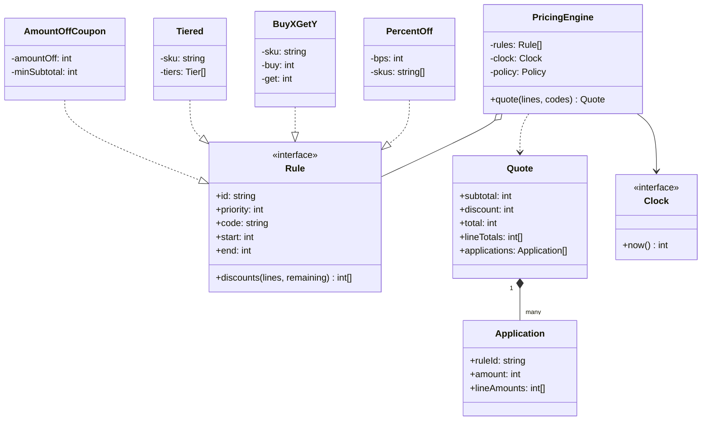
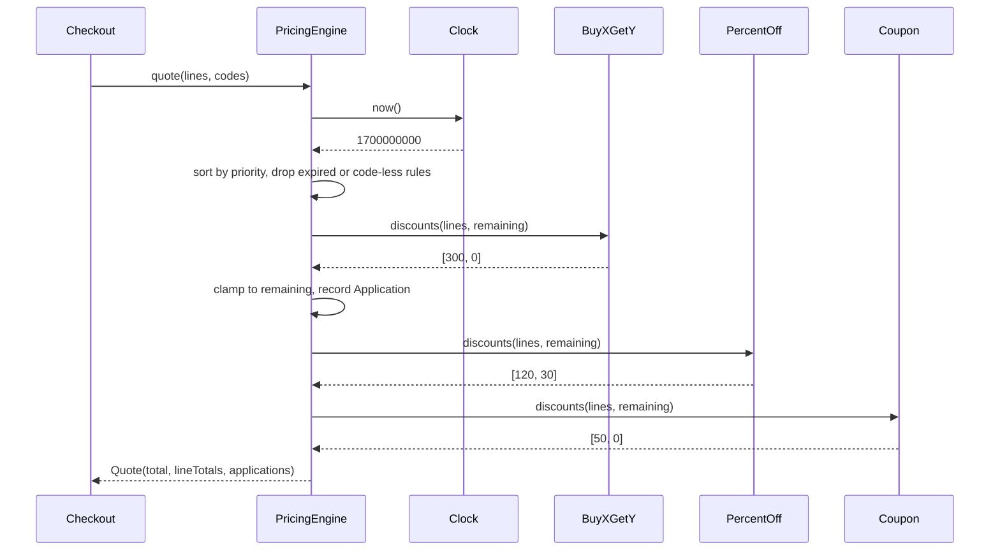

## In one minute
- A pricing engine is a pure function: cart, active rules, codes and a clock go in; a total and an itemised explanation come out. Everything else (admin screens, campaigns, analytics) hangs off that function.
- Rules are the part that changes weekly, so each one is a **Strategy** behind one small interface. The engine owns the ordering, the stacking policy and the clamping, so a new rule type never touches existing ones.
- Order is a business decision hidden in code. "20% off then 5 off" and "5 off then 20% off" give different totals ([Stripe docs](https://docs.stripe.com/billing/subscriptions/coupons)), so priority and stacking policy must be explicit data, not the accident of a list.
- Money is integer minor units with one stated rounding rule, and every discount is allocated back to lines without losing a unit. A total that cannot be explained line by line will be disputed and refunded wrongly.
- The shape is **multi-step consistency under policy**: many independent rules must compose into one number that stays correct when rules are added, expire or conflict. The same design appears in tax engines, shipping-rate calculators and cloud billing credits.

## Requirements

Functional:
- A cart has lines of `(sku, unit price, quantity)`. The engine returns a subtotal, a total, per-line totals and the list of rules that fired, each with its amount.
- Rule types: percentage off (optionally for some SKUs), buy X get Y free, quantity tiers, and coupon codes that take a fixed amount off the order.
- Rules have a priority, a validity window and an optional code the customer must present.
- A stacking policy decides whether all eligible rules apply in order, or only the single best one.

Non-functional:
- Deterministic: the same cart, rules, codes and clock reading always give the same quote, so a quote can be replayed in a dispute.
- Never negative, never lose or invent a minor unit: the sum of the applied discounts equals subtotal minus total, and the line totals sum to the total.
- A quote for a 50-line cart with 100 active rules finishes in well under a millisecond in-process; the network call to the pricing service dominates.

Out of scope: tax, shipping rates, multi-currency conversion, per-customer redemption limits and promotion authoring UI. They are named in Extensibility.

## Entities and relationships

- **Line** is an immutable value: SKU, unit price in minor units, quantity. Resist a `Product` class with a `getDiscountedPrice` method; discounts are a property of the cart in context, not of the product.
- **Rule** is the strategy interface: given the lines and the amount still payable per line, return one discount per line. Concrete rules are `PercentOff`, `BuyXGetY`, `Tiered` and `AmountOffCoupon`. Each carries shared metadata: id, priority, optional code, and a validity window.
- **PricingEngine** owns the sorted rule list, the injected **Clock** and the stacking **Policy**. It decides eligibility, runs rules in order, clamps results and builds the quote.
- **Quote** is the output value. It contains **Applications**, one per rule that fired, each with the rule id, total amount and the per-line split. The explanation is not a log line bolted on later; it is part of the return type.

Relationships: the engine aggregates rules but rules do not know about each other or about the engine. A quote references rule ids, not rule objects, so it can be stored and shown after the rule is edited or deleted. In a real system you would also store the rule *version* beside the id; see Extensibility.

Eligibility has two layers, and keeping them apart matters. The engine owns the cross-cutting checks (window, code presented). The rule owns what only it understands (does this SKU match, has the tier been reached, is the minimum spend met). This split is the **Specification** idea from Evans and Fowler's paper ([Specifications](https://martinfowler.com/apsupp/spec.pdf)): a rule's conditions are small testable predicates that can be combined, instead of an `if` ladder inside the pricing loop.

## Class diagram



## Key flows

A quote is a single pass over the eligible rules, in priority order. Each rule sees what is still payable after earlier rules, which is what makes order matter.



Under the **best-only** policy the loop changes in one place: instead of applying each result, the engine evaluates every eligible rule against the original amounts, keeps the one with the largest total discount (ties go to the earlier rule in priority order) and applies only that. Shopify describes the same fallback: when discounts cannot combine, "the best discount for the customer's cart is always applied" ([Shopify Help Center](https://help.shopify.com/en/manual/discounts/discount-combinations)).

## Design patterns used and why

- **Strategy** for each rule type. The engine calls one method, `discounts`, and knows nothing about buy-X-get-Y arithmetic. A new promotion type is a new class and a new test, with no edit to the loop. The rule is a pure function of lines and remaining amounts, which is also what makes it testable without a database.
- **Chain of Responsibility**, in its list-plus-driver form. Each rule gets a turn and passes the reduced amounts to the next. The classic linked-handler form (each handler holds a reference to its successor) is a poor fit because priority is data that changes: a sorted list is reorderable, inspectable and loggable, and a linked chain is not. The difference from the textbook pattern is that every handler contributes instead of the first capable handler stopping the chain.
- **Specification** for eligibility. Window checks, "code presented", "SKU matches", "minimum spend reached" are small predicates. Compose them with `and`/`or` when rules multiply; keep them as plain methods until then.
- **Value objects** for `Line`, `Quote` and `Application`. They are immutable, compared by value, and safe to cache or store. Fowler's Money pattern makes the same argument for amounts: wrap the unit and the rounding behind one type so nobody does raw arithmetic ([Money, Fowler](https://martinfowler.com/eaaCatalog/money.html)).
- **Dependency injection** for the clock. A promotion that starts at 09:00 must be testable at 08:59:59 and 09:00:00 without sleeping.

Resist a `Decorator` stack of `PriceWithTenPercentOff(PriceWithCoupon(Price))`. It looks elegant for two rules, but you cannot sort it by priority at runtime, cannot show which layer produced which amount, and cannot switch to best-only without rebuilding the chain.

## Concurrency and edge cases

- **Quotes are read-only.** The engine holds an immutable sorted rule list and does no writes, so concurrent quotes need no lock. Rule changes publish a new engine (copy on write) and swap one pointer. A quote already in flight finishes on the old rule set.
- **Redemption is the stateful part.** A coupon with a global cap of 500 uses is a counter, and "check the counter, then place the order" is a race. Quoting stays pure; *redeeming* happens at order placement with an atomic conditional increment, and a failed redemption sends the customer back to a fresh quote. Stripe counts both attaching a coupon and entering a promotion code toward the same `max_redemptions` ([Stripe docs](https://docs.stripe.com/billing/subscriptions/coupons)).
- **Rounding.** Percentages produce fractions of a minor unit. The practice code uses half-up on `amount * bps` in integers. Other rules exist (round half to even is common in accounting), and what matters is picking one and applying it at one place ([Rounding, Wikipedia](https://en.wikipedia.org/wiki/Rounding)). Never use floats for money: 0.1 has no exact binary form ([Goldberg](https://docs.oracle.com/cd/E19957-01/806-3568/ncg_goldberg.html)).
- **Minor units are per currency.** Yen has no minor unit, so 500 JPY is `500` while 10 USD is `1000` ([Stripe docs](https://docs.stripe.com/currencies)). Store the currency with every amount and take the exponent from a table, not from an assumption of two decimals.
- **Allocation.** An order-level coupon of 1.00 on a 1.50 cart must land on the lines, or a partial return cannot compute what to refund. Split pro rata with floor division, then hand the leftover minor units out one by one. The sum is exact by construction.
- **Floors and clamps.** Clamp each rule's result to what is still payable per line, so no rule or combination can push a line below zero. The engine clamps rather than trusting rules, because rules are written by many people.
- **Time.** Windows are half-open: valid at `start`, invalid at `end`. Evaluate the clock once per quote so a rule cannot be valid for line 1 and expired for line 2.
- **Minimum spend** is checked against the amount still payable after earlier rules in this design. That is a policy choice; some stores check the original subtotal. Document which, and test the boundary.

## In the wild
- **Kogan, 2011: stackable vouchers sold hardware at a loss.** On 10 August 2011 a bug in Kogan's coupon system let a 30 dollar PayPal voucher combine with a free-delivery deal. After a forum post alerted shoppers, an Android TV device (the Agora Android TV Portal) with a normal price of 159 dollars sold for 9, with more than 500 sold plus hundreds of other items before the fix landed at about 10:39am. The terms allowed Kogan to cancel the orders; it honoured them and its founder said the error was entirely its responsibility ([ITWire](https://itwire.com/it-industry-news/market/kogan-suffers-website-bug-will-honour-all-sales)). The lesson for the engine is that stacking needs an explicit policy and a floor on the total, not just a list of rules that each look reasonable alone.
- **Shopify, current docs: combination classes and fixed order.** Shopify applies product discounts first, then order discounts on the subtotal after them, then shipping. Two percentage order discounts are both computed from the original subtotal (10% and 20% off 100 is 70), but a percentage and a fixed amount apply in that sequence. Combination is opt-in per class, and limits are explicit: up to 25 automatic discounts, 5 product or order codes and one shipping code per order ([Shopify Help Center](https://help.shopify.com/en/manual/discounts/discount-combinations)). The design lesson is that a platform with many merchants cannot leave order implicit.
- **Stripe, current docs: order of stacked discounts matters.** Stripe allows up to 20 discounts on a subscription, item or invoice, states that "20% off then 5 USD off" differs from the reverse when both kinds are present, and rejects a coupon plus a promotion code created from the same coupon ([Stripe docs](https://docs.stripe.com/billing/subscriptions/coupons)). It also separates the coupon (the discount logic) from the promotion code (a customer-facing code with its own restrictions), the same split this design makes between rule and code eligibility.

## Down the stack

### Layer 1: The contract
`quote(lines, codes)` returns `subtotal = sum(unit x qty)`, `total >= 0` and `discount = subtotal - total`. Every application has `0 < amount`, its line amounts sum to the amount, and the applications sum to the discount. No line total is negative. With the same lines, codes, rule set and clock reading, the result is byte-identical. Under stack, rules apply in `(priority, id)` order, each against the amounts left by its predecessors. Under best-only, exactly one application or none appears. A rule that is expired, not yet started, or demands an absent code contributes nothing and does not appear in the quote.

### Layer 2: The mechanism
The engine sorts rules once at construction by `(priority, id)`; the id tie-break makes ordering total, so two rules with equal priority cannot swap places between runs. Per quote it computes a `remaining` array of line amounts, filters rules with the window and code predicates, then loops. For each rule it calls `discounts(lines, remaining)`, clamps each entry to `[0, remaining[i]]`, and if the sum is positive subtracts it and appends an `Application`. Percentages use `(amount * bps + 5000) / 10000` with integer division, where `bps` is basis points (1000 = 10%). Buy-X-get-Y gives `qty / (buy + get) * get` free units, using floor division so a partial group earns nothing. Tiered rules scan sorted `(min_qty, bps)` pairs and keep the last tier reached. The fixed coupon caps at the payable total and uses largest-remainder style allocation: `floor(cap * r_i / total)` per line, then one extra unit per line, in order, until the leftover is spent. The leftover is smaller than the number of lines that still have room, so one pass always suffices.

### Layer 3: The machine
Everything is `int64` arithmetic on a handful of values per line. A multiply or divide costs a few CPU cycles (integer division is the slow one at tens of cycles on many x86 cores), so 100 rules over 50 lines is on the order of 5,000 operations, a few microseconds in Go or Rust and tens to a few hundred microseconds in Python, which pays for a dynamic attribute lookup and a method call per rule per line. In Go, a call through the `Rule` interface loads the method from the interface table and jumps indirectly, around 2 ns, and the compiler cannot inline it; at this volume that is irrelevant. The slices (`remaining`, per-rule results) are small, short-lived allocations, so allocation, not arithmetic, dominates. Reuse a scratch buffer per request only if profiling says so. Overflow is the real hazard: `amount * bps` for a 10^12 minor-unit amount and 10^4 bps reaches 10^16, within `int64`'s 9.2 x 10^18 but not within JavaScript's 2^53, about 9 x 10^15. TypeScript needs `BigInt` once totals can reach that range. Floats are worse: `0.1 + 0.2` is `0.30000000000000004` because a binary double cannot hold 0.1, and a 53-bit mantissa quietly rounds a different way per platform and per operation order.

### Why it's built this way
1. Customers see and dispute totals, so the total must be reproducible from recorded inputs, which forces a pure function and an injected clock.
2. Promotions are created by marketing weekly while checkout code ships monthly, so rules sit behind one interface and priority and policy are data.
3. Order changes the answer, so order must be explicit, total (ties broken) and displayed in the explanation.
4. Rules come from many authors, so the engine, not each rule, enforces the invariants (clamp at zero, exact sums).
5. Money cannot be fractional or approximate, so integers in minor units and one rounding rule in one place.

## Extensibility

- **Rule versions and audit.** Store `(rule_id, version)` on every application and persist the quote with the order. Editing a campaign then cannot rewrite history, and support can replay the quote exactly.
- **Per-customer limits ("one per customer").** This needs state, so add a `RedemptionStore` interface consulted at order placement, not inside `quote`. Quoting stays pure; the store is the single place with a race.
- **Cross-class combination (Shopify-style).** Give each rule a class (product, order, shipping) and a set of classes it may combine with. The engine checks that every pair of applied rules allows each other and falls back to best-only when they do not.
- **Mutual exclusion groups.** Add a `group` field: within a group only the best rule wins, across groups all stack. This sits between the two policies and covers "only one seasonal sale at a time".
- **Tax and multi-currency.** Tax is computed after discounts in most jurisdictions but not all, so make it a second stage after the discount stage rather than a rule. Currency conversion happens before pricing, with the exponent per currency carried on the amount type.
- **Rules as data.** Once campaigns come from an admin tool, serialise rules to JSON with a type tag and build them through a factory. Keep the classes; add a validator that rejects a rule that could produce a negative amount.

## Leadership lens

- Build first: the engine loop, the clamping and the invariants test (applications sum to the discount, line totals sum to the total). Add rule types after that, since each is small once the contract is pinned.
- Ask in review: what is the stacking policy and who owns changing it; what happens when two rules share a priority; what is the rounding rule and where does it live; what is the floor on the total; how is a quote replayed after the rule changes.
- Pricing mistakes are expensive and public. Kogan could cancel orders under its terms and chose not to, which shows the real cost is trust and cash rather than engineering. Put a below-cost alert and a maximum-discount guard on the quote path, and add a dry-run mode that previews a new campaign against yesterday's carts before it goes live.
- Ownership: marketing owns what the rules say, engineering owns what the engine guarantees. A validated rule format and a preview tool let marketing move quickly without being able to break an invariant.
- Cost drivers are mostly human: support time on disputed totals and refunds computed from unexplained numbers. The explanation field pays for itself there.

## Check yourself
1. Two rules, "20% off" and "5.00 off", are both eligible. Why is the order not a detail, and where should it be decided?
   **Answer:** On a 100.00 line, percentage first gives 75.00 and fixed first gives 76.00, so the business outcome differs. The order is a policy, held as explicit priority data with a tie-break on rule id, not left to insertion order.
2. Why does the engine clamp each rule's result instead of trusting the rule?
   **Answer:** Rules are written by many people and combine in ways their authors did not test. Clamping to the amount still payable guarantees no line goes negative, whatever a single rule returns.
3. A 1.00 coupon applies to lines of 1.00 and 0.50. What allocation avoids losing or inventing a cent?
   **Answer:** Take floor of the coupon times each line's share of the total, then give the leftover units out one by one to lines that still have room. The line discounts then sum exactly to the coupon.
4. Which part of coupon handling must not live inside the pure quote function, and why?
   **Answer:** Redemption counting (global caps, one per customer). It is shared mutable state with a check-then-act race, so it belongs at order placement with an atomic conditional update.
## Practice
**Task:** Implement a pricing engine. `PricingEngine(rules, clock, policy)` takes rule objects and returns an explainable `Quote` from `quote(lines, codes)`. A line is `(sku, unit_price, qty)` in minor units. Rules sort by `(priority, id)`; a rule is eligible when the clock reading is at or after its `start`, before its `end` (`end == 0` means never) and its `code` is empty or among the presented codes. Implement `PercentOff` (basis points, optional SKU list, half-up rounding), `BuyXGetY` (each full group of `buy + get` units frees `get` units), `Tiered` (the highest reached `(min_qty, bps)` tier) and `AmountOffCoupon` (capped at the payable total, split across lines pro rata with the leftover units handed out in line order, honouring a minimum spend). Under `stack` every eligible rule applies in order to the amounts the previous rules left; under `best_only` only the rule with the largest discount on the original amounts applies. The engine clamps every per-line discount to `[0, remaining]` and records an application only when it is positive.

```python starter
from dataclasses import dataclass

STACK = "stack"
BEST_ONLY = "best_only"


@dataclass(frozen=True)
class Line:
    sku: str
    unit_price: int  # minor units
    qty: int


@dataclass(frozen=True)
class Application:
    rule_id: str
    amount: int
    line_amounts: tuple


@dataclass(frozen=True)
class Quote:
    subtotal: int
    discount: int
    total: int
    line_totals: tuple
    applications: tuple


class Rule:
    """end == 0 means the rule never expires. code == "" means no code needed."""

    def __init__(self, rule_id, priority, code="", start=0, end=0):
        self.rule_id = rule_id
        self.priority = priority
        self.code = code
        self.start = start
        self.end = end

    def discounts(self, lines, remaining):
        """Return one discount per line, in minor units."""
        raise NotImplementedError


class PercentOff(Rule):
    def __init__(self, rule_id, priority, bps, skus=(), **window):
        super().__init__(rule_id, priority, **window)
        self.bps = bps
        self.skus = tuple(skus)  # empty means every line

    def discounts(self, lines, remaining):
        # TODO: bps/10000 of each matching line's remaining amount, rounded half up
        raise NotImplementedError


class BuyXGetY(Rule):
    def __init__(self, rule_id, priority, sku, buy, get, **window):
        super().__init__(rule_id, priority, **window)
        self.sku, self.buy, self.get = sku, buy, get

    def discounts(self, lines, remaining):
        # TODO: every (buy + get) units makes `get` units free
        raise NotImplementedError


class Tiered(Rule):
    def __init__(self, rule_id, priority, sku, tiers, **window):
        super().__init__(rule_id, priority, **window)
        self.sku = sku
        self.tiers = sorted(tiers)  # (min_qty, bps)

    def discounts(self, lines, remaining):
        # TODO: the highest tier whose min_qty <= qty sets the percentage for that line
        raise NotImplementedError


class AmountOffCoupon(Rule):
    def __init__(self, rule_id, priority, code, amount_off, min_subtotal=0, **window):
        super().__init__(rule_id, priority, code=code, **window)
        self.amount_off = amount_off
        self.min_subtotal = min_subtotal

    def discounts(self, lines, remaining):
        # TODO: cap at the remaining total, split across lines pro rata, no cent lost
        raise NotImplementedError


class PricingEngine:
    def __init__(self, rules, clock, policy=STACK):
        self._rules = sorted(rules, key=lambda r: (r.priority, r.rule_id))
        self._clock = clock
        self._policy = policy

    def quote(self, lines, codes=()):
        # TODO: filter eligible rules, apply per policy, return an explainable Quote
        raise NotImplementedError
```

```python tests
class FakeClock:
    def __init__(self, t=0):
        self.t = t

    def now(self):
        return self.t


def engine(rules, policy=STACK, clock=None):
    return PricingEngine(rules, clock or FakeClock(), policy)


def test_percent_rounds_half_up_in_minor_units():
    q = engine([PercentOff("p10", 1, 1000)]).quote([Line("A", 999, 1)])
    assert q.discount == 100, "10% of 999 is 99.9, rounds to 100"
    assert q.total == 899


def test_buy_x_get_y_counts_whole_groups():
    e = engine([BuyXGetY("b2g1", 1, "A", 2, 1)])
    assert e.quote([Line("A", 300, 5)]).discount == 300
    assert e.quote([Line("A", 300, 6)]).discount == 600
    assert e.quote([Line("A", 300, 2)]).discount == 0


def test_tiered_uses_highest_reached_tier():
    e = engine([Tiered("vol", 1, "A", [(5, 500), (10, 1000)])])
    assert e.quote([Line("A", 200, 4)]).discount == 0
    assert e.quote([Line("A", 200, 5)]).discount == 50
    assert e.quote([Line("A", 200, 10)]).discount == 200


def test_stacking_order_follows_priority():
    cart = [Line("A", 10000, 1)]
    pct_first = engine([PercentOff("p20", 1, 2000), AmountOffCoupon("c5", 2, "C", 500)])
    assert pct_first.quote(cart, ["C"]).total == 7500
    coupon_first = engine([PercentOff("p20", 2, 2000), AmountOffCoupon("c5", 1, "C", 500)])
    assert coupon_first.quote(cart, ["C"]).total == 7600


def test_best_only_applies_one_rule():
    rules = [PercentOff("p10", 1, 1000), AmountOffCoupon("c15", 2, "C", 1500)]
    q = engine(rules, BEST_ONLY).quote([Line("A", 10000, 1)], ["C"])
    assert [a.rule_id for a in q.applications] == ["c15"]
    assert q.total == 8500


def test_coupon_needs_code_and_valid_window():
    clock = FakeClock(50)
    e = engine([AmountOffCoupon("c", 1, "SAVE", 500, start=10, end=100)], clock=clock)
    cart = [Line("A", 2000, 1)]
    assert e.quote(cart).discount == 0, "no code, no discount"
    assert e.quote(cart, ["SAVE"]).discount == 500
    clock.t = 100
    assert e.quote(cart, ["SAVE"]).discount == 0, "expired at end"


def test_coupon_is_capped_and_split_without_losing_a_cent():
    e = engine([AmountOffCoupon("c", 1, "C", 100)])
    q = e.quote([Line("A", 100, 1), Line("B", 50, 1)], ["C"])
    assert q.line_totals == (33, 17)
    assert q.discount == 100
    big = engine([AmountOffCoupon("c", 1, "C", 1000)])
    assert big.quote([Line("A", 100, 1), Line("B", 50, 1)], ["C"]).total == 0


def test_explanation_adds_up():
    rules = [PercentOff("p10", 1, 1000), BuyXGetY("b1g1", 0, "A", 1, 1)]
    q = engine(rules).quote([Line("A", 500, 2), Line("B", 300, 1)])
    assert [a.rule_id for a in q.applications] == ["b1g1", "p10"]
    assert sum(a.amount for a in q.applications) == q.discount
    assert q.subtotal - q.discount == q.total == sum(q.line_totals)
```

```python solution
from dataclasses import dataclass

STACK = "stack"
BEST_ONLY = "best_only"


@dataclass(frozen=True)
class Line:
    sku: str
    unit_price: int  # minor units
    qty: int


@dataclass(frozen=True)
class Application:
    rule_id: str
    amount: int
    line_amounts: tuple


@dataclass(frozen=True)
class Quote:
    subtotal: int
    discount: int
    total: int
    line_totals: tuple
    applications: tuple


def pct(amount, bps):
    return (amount * bps + 5000) // 10000


class Rule:
    """end == 0 means the rule never expires. code == "" means no code needed."""

    def __init__(self, rule_id, priority, code="", start=0, end=0):
        self.rule_id = rule_id
        self.priority = priority
        self.code = code
        self.start = start
        self.end = end

    def discounts(self, lines, remaining):
        """Return one discount per line, in minor units."""
        raise NotImplementedError


class PercentOff(Rule):
    def __init__(self, rule_id, priority, bps, skus=(), **window):
        super().__init__(rule_id, priority, **window)
        self.bps = bps
        self.skus = tuple(skus)  # empty means every line

    def discounts(self, lines, remaining):
        return [pct(rem, self.bps) if (not self.skus or ln.sku in self.skus) else 0
                for ln, rem in zip(lines, remaining)]


class BuyXGetY(Rule):
    def __init__(self, rule_id, priority, sku, buy, get, **window):
        super().__init__(rule_id, priority, **window)
        self.sku, self.buy, self.get = sku, buy, get

    def discounts(self, lines, remaining):
        out = []
        for ln in lines:
            free = (ln.qty // (self.buy + self.get)) * self.get if ln.sku == self.sku else 0
            out.append(free * ln.unit_price)
        return out


class Tiered(Rule):
    def __init__(self, rule_id, priority, sku, tiers, **window):
        super().__init__(rule_id, priority, **window)
        self.sku = sku
        self.tiers = sorted(tiers)  # (min_qty, bps)

    def discounts(self, lines, remaining):
        out = []
        for ln, rem in zip(lines, remaining):
            bps = 0
            if ln.sku == self.sku:
                for min_qty, tier_bps in self.tiers:
                    if ln.qty >= min_qty:
                        bps = tier_bps
            out.append(pct(rem, bps))
        return out


class AmountOffCoupon(Rule):
    def __init__(self, rule_id, priority, code, amount_off, min_subtotal=0, **window):
        super().__init__(rule_id, priority, code=code, **window)
        self.amount_off = amount_off
        self.min_subtotal = min_subtotal

    def discounts(self, lines, remaining):
        total = sum(remaining)
        if total == 0 or total < self.min_subtotal:
            return [0] * len(lines)
        cap = min(self.amount_off, total)
        shares = [cap * r // total for r in remaining]
        left = cap - sum(shares)
        for i in range(len(shares)):
            if left == 0:
                break
            if remaining[i] > shares[i]:
                shares[i] += 1
                left -= 1
        return shares


class PricingEngine:
    def __init__(self, rules, clock, policy=STACK):
        self._rules = sorted(rules, key=lambda r: (r.priority, r.rule_id))
        self._clock = clock
        self._policy = policy

    def _eligible(self, rule, codes, now):
        if now < rule.start or (rule.end != 0 and now >= rule.end):
            return False
        return rule.code == "" or rule.code in codes

    def _evaluate(self, rule, lines, remaining):
        raw = rule.discounts(lines, remaining)
        return [max(0, min(d, rem)) for d, rem in zip(raw, remaining)]

    def quote(self, lines, codes=()):
        now = self._clock.now()
        remaining = [ln.unit_price * ln.qty for ln in lines]
        subtotal = sum(remaining)
        eligible = [r for r in self._rules if self._eligible(r, codes, now)]
        chosen = []
        if self._policy == STACK:
            for rule in eligible:
                d = self._evaluate(rule, lines, remaining)
                if sum(d) > 0:
                    remaining = [rem - x for rem, x in zip(remaining, d)]
                    chosen.append(Application(rule.rule_id, sum(d), tuple(d)))
        else:
            best = None
            for rule in eligible:
                d = self._evaluate(rule, lines, remaining)
                if sum(d) > 0 and (best is None or sum(d) > best[1]):
                    best = (rule, sum(d), d)
            if best:
                remaining = [rem - x for rem, x in zip(remaining, best[2])]
                chosen.append(Application(best[0].rule_id, best[1], tuple(best[2])))
        total = sum(remaining)
        return Quote(subtotal, subtotal - total, total, tuple(remaining), tuple(chosen))
```

```typescript starter
export type Policy = "stack" | "best_only";

export interface Clock { now(): number }

export interface Line { sku: string; unitPrice: number; qty: number }

export interface Application { ruleId: string; amount: number; lineAmounts: number[] }

export interface Quote {
  subtotal: number;
  discount: number;
  total: number;
  lineTotals: number[];
  applications: Application[];
}

/** end === 0 means the rule never expires; code === "" means no code needed. */
export interface Meta { id: string; priority: number; code?: string; start?: number; end?: number }

export interface Rule {
  meta: Meta;
  /** One discount per line, in minor units. */
  discounts(lines: Line[], remaining: number[]): number[];
}

export class PercentOff implements Rule {
  constructor(public meta: Meta, private bps: number, private skus: string[] = []) {}
  discounts(lines: Line[], remaining: number[]): number[] {
    // TODO: bps/10000 of each matching line's remaining amount, rounded half up
    throw new Error("TODO");
  }
}

export class BuyXGetY implements Rule {
  constructor(public meta: Meta, private sku: string, private buy: number, private get: number) {}
  discounts(lines: Line[], remaining: number[]): number[] {
    // TODO: every (buy + get) units makes `get` units free
    throw new Error("TODO");
  }
}

export class Tiered implements Rule {
  constructor(public meta: Meta, private sku: string, private tiers: Array<[number, number]>) {}
  discounts(lines: Line[], remaining: number[]): number[] {
    // TODO: the highest tier whose minQty <= qty sets the percentage for that line
    throw new Error("TODO");
  }
}

export class AmountOffCoupon implements Rule {
  constructor(public meta: Meta, private amountOff: number, private minSubtotal = 0) {}
  discounts(lines: Line[], remaining: number[]): number[] {
    // TODO: cap at the remaining total, split across lines pro rata, no cent lost
    throw new Error("TODO");
  }
}

export class PricingEngine {
  constructor(private rules: Rule[], private clock: Clock, private policy: Policy = "stack") {}

  quote(lines: Line[], codes: string[] = []): Quote {
    // TODO: filter eligible rules, apply per policy, return an explainable Quote
    throw new Error("TODO");
  }
}
```

```typescript tests
class FakeClock implements Clock {
  constructor(public t = 0) {}
  now(): number { return this.t; }
}

function engine(rules: Rule[], policy: Policy = "stack", clock: Clock = new FakeClock()): PricingEngine {
  return new PricingEngine(rules, clock, policy);
}

test("percent rounds half up in minor units", () => {
  const q = engine([new PercentOff({ id: "p10", priority: 1 }, 1000)]).quote([{ sku: "A", unitPrice: 999, qty: 1 }]);
  assertEqual(q.discount, 100, "10% of 999 is 99.9, rounds to 100");
  assertEqual(q.total, 899);
});

test("buy x get y counts whole groups", () => {
  const e = engine([new BuyXGetY({ id: "b2g1", priority: 1 }, "A", 2, 1)]);
  assertEqual(e.quote([{ sku: "A", unitPrice: 300, qty: 5 }]).discount, 300);
  assertEqual(e.quote([{ sku: "A", unitPrice: 300, qty: 6 }]).discount, 600);
  assertEqual(e.quote([{ sku: "A", unitPrice: 300, qty: 2 }]).discount, 0);
});

test("tiered uses highest reached tier", () => {
  const e = engine([new Tiered({ id: "vol", priority: 1 }, "A", [[10, 1000], [5, 500]])]);
  assertEqual(e.quote([{ sku: "A", unitPrice: 200, qty: 4 }]).discount, 0);
  assertEqual(e.quote([{ sku: "A", unitPrice: 200, qty: 5 }]).discount, 50);
  assertEqual(e.quote([{ sku: "A", unitPrice: 200, qty: 10 }]).discount, 200);
});

test("stacking order follows priority", () => {
  const cart = [{ sku: "A", unitPrice: 10000, qty: 1 }];
  const pctFirst = engine([new PercentOff({ id: "p20", priority: 1 }, 2000),
    new AmountOffCoupon({ id: "c5", priority: 2, code: "C" }, 500)]);
  assertEqual(pctFirst.quote(cart, ["C"]).total, 7500);
  const couponFirst = engine([new PercentOff({ id: "p20", priority: 2 }, 2000),
    new AmountOffCoupon({ id: "c5", priority: 1, code: "C" }, 500)]);
  assertEqual(couponFirst.quote(cart, ["C"]).total, 7600);
});

test("best only applies one rule", () => {
  const rules = [new PercentOff({ id: "p10", priority: 1 }, 1000),
    new AmountOffCoupon({ id: "c15", priority: 2, code: "C" }, 1500)];
  const q = engine(rules, "best_only").quote([{ sku: "A", unitPrice: 10000, qty: 1 }], ["C"]);
  assertEqual(q.applications.map(a => a.ruleId), ["c15"]);
  assertEqual(q.total, 8500);
});

test("coupon needs code and valid window", () => {
  const clock = new FakeClock(50);
  const e = engine([new AmountOffCoupon({ id: "c", priority: 1, code: "SAVE", start: 10, end: 100 }, 500)], "stack", clock);
  const cart = [{ sku: "A", unitPrice: 2000, qty: 1 }];
  assertEqual(e.quote(cart).discount, 0, "no code, no discount");
  assertEqual(e.quote(cart, ["SAVE"]).discount, 500);
  clock.t = 100;
  assertEqual(e.quote(cart, ["SAVE"]).discount, 0, "expired at end");
});

test("coupon is capped and split without losing a cent", () => {
  const cart = [{ sku: "A", unitPrice: 100, qty: 1 }, { sku: "B", unitPrice: 50, qty: 1 }];
  const e = engine([new AmountOffCoupon({ id: "c", priority: 1, code: "C" }, 100)]);
  const q = e.quote(cart, ["C"]);
  assertEqual(q.lineTotals, [33, 17]);
  assertEqual(q.discount, 100);
  const big = engine([new AmountOffCoupon({ id: "c", priority: 1, code: "C" }, 1000)]);
  assertEqual(big.quote(cart, ["C"]).total, 0);
});

test("explanation adds up", () => {
  const rules = [new PercentOff({ id: "p10", priority: 1 }, 1000), new BuyXGetY({ id: "b1g1", priority: 0 }, "A", 1, 1)];
  const q = engine(rules).quote([{ sku: "A", unitPrice: 500, qty: 2 }, { sku: "B", unitPrice: 300, qty: 1 }]);
  assertEqual(q.applications.map(a => a.ruleId), ["b1g1", "p10"]);
  assertEqual(q.applications.reduce((s, a) => s + a.amount, 0), q.discount);
  assertEqual(q.subtotal - q.discount, q.total);
  assertEqual(q.lineTotals.reduce((s, x) => s + x, 0), q.total);
});
```

```typescript solution
export type Policy = "stack" | "best_only";

export interface Clock { now(): number }

export interface Line { sku: string; unitPrice: number; qty: number }

export interface Application { ruleId: string; amount: number; lineAmounts: number[] }

export interface Quote {
  subtotal: number;
  discount: number;
  total: number;
  lineTotals: number[];
  applications: Application[];
}

/** end === 0 means the rule never expires; code === "" means no code needed. */
export interface Meta { id: string; priority: number; code?: string; start?: number; end?: number }

export interface Rule {
  meta: Meta;
  /** One discount per line, in minor units. */
  discounts(lines: Line[], remaining: number[]): number[];
}

function pct(amount: number, bps: number): number {
  return Math.floor((amount * bps + 5000) / 10000);
}

export class PercentOff implements Rule {
  constructor(public meta: Meta, private bps: number, private skus: string[] = []) {}
  discounts(lines: Line[], remaining: number[]): number[] {
    return lines.map((ln, i) =>
      this.skus.length === 0 || this.skus.includes(ln.sku) ? pct(remaining[i], this.bps) : 0);
  }
}

export class BuyXGetY implements Rule {
  constructor(public meta: Meta, private sku: string, private buy: number, private get: number) {}
  discounts(lines: Line[], remaining: number[]): number[] {
    return lines.map(ln => ln.sku === this.sku
      ? Math.floor(ln.qty / (this.buy + this.get)) * this.get * ln.unitPrice : 0);
  }
}

export class Tiered implements Rule {
  private sorted: Array<[number, number]>;
  constructor(public meta: Meta, private sku: string, tiers: Array<[number, number]>) {
    this.sorted = [...tiers].sort((a, b) => a[0] - b[0]);
  }
  discounts(lines: Line[], remaining: number[]): number[] {
    return lines.map((ln, i) => {
      let bps = 0;
      if (ln.sku === this.sku) {
        for (const [minQty, tierBps] of this.sorted) if (ln.qty >= minQty) bps = tierBps;
      }
      return pct(remaining[i], bps);
    });
  }
}

export class AmountOffCoupon implements Rule {
  constructor(public meta: Meta, private amountOff: number, private minSubtotal = 0) {}
  discounts(lines: Line[], remaining: number[]): number[] {
    const total = remaining.reduce((s, x) => s + x, 0);
    if (total === 0 || total < this.minSubtotal) return remaining.map(() => 0);
    const cap = Math.min(this.amountOff, total);
    const shares = remaining.map(r => Math.floor((cap * r) / total));
    let left = cap - shares.reduce((s, x) => s + x, 0);
    for (let i = 0; i < shares.length && left > 0; i++) {
      if (remaining[i] > shares[i]) { shares[i]++; left--; }
    }
    return shares;
  }
}

const sum = (xs: number[]): number => xs.reduce((s, x) => s + x, 0);

export class PricingEngine {
  private rules: Rule[];

  constructor(rules: Rule[], private clock: Clock, private policy: Policy = "stack") {
    this.rules = [...rules].sort((a, b) =>
      a.meta.priority - b.meta.priority || (a.meta.id < b.meta.id ? -1 : a.meta.id > b.meta.id ? 1 : 0));
  }

  private eligible(rule: Rule, codes: string[], now: number): boolean {
    const m = rule.meta;
    if (now < (m.start ?? 0) || ((m.end ?? 0) !== 0 && now >= (m.end ?? 0))) return false;
    return !m.code || codes.includes(m.code);
  }

  private evaluate(rule: Rule, lines: Line[], remaining: number[]): number[] {
    return rule.discounts(lines, remaining).map((d, i) => Math.max(0, Math.min(d, remaining[i])));
  }

  quote(lines: Line[], codes: string[] = []): Quote {
    const now = this.clock.now();
    let remaining = lines.map(l => l.unitPrice * l.qty);
    const subtotal = sum(remaining);
    const eligible = this.rules.filter(r => this.eligible(r, codes, now));
    const applications: Application[] = [];
    const apply = (rule: Rule, d: number[]): void => {
      remaining = remaining.map((r, i) => r - d[i]);
      applications.push({ ruleId: rule.meta.id, amount: sum(d), lineAmounts: d });
    };
    if (this.policy === "stack") {
      for (const rule of eligible) {
        const d = this.evaluate(rule, lines, remaining);
        if (sum(d) > 0) apply(rule, d);
      }
    } else {
      let best: { rule: Rule; d: number[] } | null = null;
      for (const rule of eligible) {
        const d = this.evaluate(rule, lines, remaining);
        if (sum(d) > 0 && (best === null || sum(d) > sum(best.d))) best = { rule, d };
      }
      if (best) apply(best.rule, best.d);
    }
    const total = sum(remaining);
    return { subtotal, discount: subtotal - total, total, lineTotals: remaining, applications };
  }
}
```

```go starter
package practice

type Policy int

const (
	Stack Policy = iota
	BestOnly
)

type Clock interface{ Now() int64 }

type Line struct {
	SKU       string
	UnitPrice int64 // minor units
	Qty       int64
}

type Application struct {
	RuleID      string
	Amount      int64
	LineAmounts []int64
}

type Quote struct {
	Subtotal     int64
	Discount     int64
	Total        int64
	LineTotals   []int64
	Applications []Application
}

// Meta is shared by every rule. End == 0 means the rule never expires;
// Code == "" means no code is needed.
type Meta struct {
	ID       string
	Priority int
	Code     string
	Start    int64
	End      int64
}

type Rule interface {
	Meta() Meta
	// Discounts returns one discount per line, in minor units.
	Discounts(lines []Line, remaining []int64) []int64
}

type PercentOff struct {
	M    Meta
	Bps  int64
	SKUs []string // empty means every line
}

func (r PercentOff) Meta() Meta { return r.M }
func (r PercentOff) Discounts(lines []Line, remaining []int64) []int64 {
	panic("TODO") // bps/10000 of each matching line's remaining amount, rounded half up
}

type BuyXGetY struct {
	M        Meta
	SKU      string
	Buy, Get int64
}

func (r BuyXGetY) Meta() Meta { return r.M }
func (r BuyXGetY) Discounts(lines []Line, remaining []int64) []int64 {
	panic("TODO") // every (Buy + Get) units makes Get units free
}

type Tier struct{ MinQty, Bps int64 }

type Tiered struct {
	M     Meta
	SKU   string
	Tiers []Tier
}

func (r Tiered) Meta() Meta { return r.M }
func (r Tiered) Discounts(lines []Line, remaining []int64) []int64 {
	panic("TODO") // the highest tier with MinQty <= qty sets the percentage for that line
}

type AmountOffCoupon struct {
	M           Meta
	AmountOff   int64
	MinSubtotal int64
}

func (r AmountOffCoupon) Meta() Meta { return r.M }
func (r AmountOffCoupon) Discounts(lines []Line, remaining []int64) []int64 {
	panic("TODO") // cap at the remaining total, split pro rata, no cent lost
}

type PricingEngine struct{}

func NewPricingEngine(rules []Rule, clock Clock, policy Policy) *PricingEngine {
	return &PricingEngine{}
}

func (e *PricingEngine) Quote(lines []Line, codes []string) Quote {
	panic("TODO") // filter eligible rules, apply per policy, return an explainable Quote
}
```

```go tests
package practice

import "testing"

type fakeClock struct{ t int64 }

func (c *fakeClock) Now() int64 { return c.t }

func one(sku string, price, qty int64) []Line { return []Line{{sku, price, qty}} }

func TestPercentRoundsHalfUp(t *testing.T) {
	e := NewPricingEngine([]Rule{PercentOff{M: Meta{ID: "p10", Priority: 1}, Bps: 1000}}, &fakeClock{}, Stack)
	q := e.Quote(one("A", 999, 1), nil)
	if q.Discount != 100 || q.Total != 899 {
		t.Fatalf("got discount=%d total=%d", q.Discount, q.Total)
	}
}

func TestBuyXGetYCountsWholeGroups(t *testing.T) {
	e := NewPricingEngine([]Rule{BuyXGetY{M: Meta{ID: "b2g1", Priority: 1}, SKU: "A", Buy: 2, Get: 1}}, &fakeClock{}, Stack)
	for qty, want := range map[int64]int64{5: 300, 6: 600, 2: 0} {
		if got := e.Quote(one("A", 300, qty), nil).Discount; got != want {
			t.Fatalf("qty %d: got %d want %d", qty, got, want)
		}
	}
}

func TestTieredUsesHighestReachedTier(t *testing.T) {
	r := Tiered{M: Meta{ID: "vol", Priority: 1}, SKU: "A", Tiers: []Tier{{5, 500}, {10, 1000}}}
	e := NewPricingEngine([]Rule{r}, &fakeClock{}, Stack)
	for qty, want := range map[int64]int64{4: 0, 5: 50, 10: 200} {
		if got := e.Quote(one("A", 200, qty), nil).Discount; got != want {
			t.Fatalf("qty %d: got %d want %d", qty, got, want)
		}
	}
}

func TestStackingOrderFollowsPriority(t *testing.T) {
	cart := one("A", 10000, 1)
	pctFirst := NewPricingEngine([]Rule{
		PercentOff{M: Meta{ID: "p20", Priority: 1}, Bps: 2000},
		AmountOffCoupon{M: Meta{ID: "c5", Priority: 2, Code: "C"}, AmountOff: 500},
	}, &fakeClock{}, Stack)
	if got := pctFirst.Quote(cart, []string{"C"}).Total; got != 7500 {
		t.Fatalf("percent first: %d", got)
	}
	couponFirst := NewPricingEngine([]Rule{
		PercentOff{M: Meta{ID: "p20", Priority: 2}, Bps: 2000},
		AmountOffCoupon{M: Meta{ID: "c5", Priority: 1, Code: "C"}, AmountOff: 500},
	}, &fakeClock{}, Stack)
	if got := couponFirst.Quote(cart, []string{"C"}).Total; got != 7600 {
		t.Fatalf("coupon first: %d", got)
	}
}

func TestBestOnlyAppliesOneRule(t *testing.T) {
	e := NewPricingEngine([]Rule{
		PercentOff{M: Meta{ID: "p10", Priority: 1}, Bps: 1000},
		AmountOffCoupon{M: Meta{ID: "c15", Priority: 2, Code: "C"}, AmountOff: 1500},
	}, &fakeClock{}, BestOnly)
	q := e.Quote(one("A", 10000, 1), []string{"C"})
	if len(q.Applications) != 1 || q.Applications[0].RuleID != "c15" || q.Total != 8500 {
		t.Fatalf("got %+v", q)
	}
}

func TestCouponNeedsCodeAndValidWindow(t *testing.T) {
	c := &fakeClock{t: 50}
	e := NewPricingEngine([]Rule{AmountOffCoupon{M: Meta{ID: "c", Priority: 1, Code: "SAVE", Start: 10, End: 100}, AmountOff: 500}}, c, Stack)
	cart := one("A", 2000, 1)
	if got := e.Quote(cart, nil).Discount; got != 0 {
		t.Fatalf("no code: %d", got)
	}
	if got := e.Quote(cart, []string{"SAVE"}).Discount; got != 500 {
		t.Fatalf("with code: %d", got)
	}
	c.t = 100
	if got := e.Quote(cart, []string{"SAVE"}).Discount; got != 0 {
		t.Fatalf("expired: %d", got)
	}
}

func TestCouponCappedAndSplitWithoutLosingACent(t *testing.T) {
	cart := []Line{{"A", 100, 1}, {"B", 50, 1}}
	e := NewPricingEngine([]Rule{AmountOffCoupon{M: Meta{ID: "c", Priority: 1, Code: "C"}, AmountOff: 100}}, &fakeClock{}, Stack)
	q := e.Quote(cart, []string{"C"})
	if q.LineTotals[0] != 33 || q.LineTotals[1] != 17 || q.Discount != 100 {
		t.Fatalf("got %+v", q)
	}
	big := NewPricingEngine([]Rule{AmountOffCoupon{M: Meta{ID: "c", Priority: 1, Code: "C"}, AmountOff: 1000}}, &fakeClock{}, Stack)
	if got := big.Quote(cart, []string{"C"}).Total; got != 0 {
		t.Fatalf("total %d", got)
	}
}

func TestExplanationAddsUp(t *testing.T) {
	e := NewPricingEngine([]Rule{
		PercentOff{M: Meta{ID: "p10", Priority: 1}, Bps: 1000},
		BuyXGetY{M: Meta{ID: "b1g1", Priority: 0}, SKU: "A", Buy: 1, Get: 1},
	}, &fakeClock{}, Stack)
	q := e.Quote([]Line{{"A", 500, 2}, {"B", 300, 1}}, nil)
	if len(q.Applications) != 2 || q.Applications[0].RuleID != "b1g1" || q.Applications[1].RuleID != "p10" {
		t.Fatalf("order: %+v", q.Applications)
	}
	var applied, lines int64
	for _, a := range q.Applications {
		applied += a.Amount
	}
	for _, x := range q.LineTotals {
		lines += x
	}
	if applied != q.Discount || q.Subtotal-q.Discount != q.Total || lines != q.Total {
		t.Fatalf("does not add up: %+v", q)
	}
}
```

```go solution
package practice

import "sort"

type Policy int

const (
	Stack Policy = iota
	BestOnly
)

type Clock interface{ Now() int64 }

type Line struct {
	SKU       string
	UnitPrice int64 // minor units
	Qty       int64
}

type Application struct {
	RuleID      string
	Amount      int64
	LineAmounts []int64
}

type Quote struct {
	Subtotal     int64
	Discount     int64
	Total        int64
	LineTotals   []int64
	Applications []Application
}

// Meta is shared by every rule. End == 0 means the rule never expires;
// Code == "" means no code is needed.
type Meta struct {
	ID       string
	Priority int
	Code     string
	Start    int64
	End      int64
}

type Rule interface {
	Meta() Meta
	// Discounts returns one discount per line, in minor units.
	Discounts(lines []Line, remaining []int64) []int64
}

func pct(amount, bps int64) int64 { return (amount*bps + 5000) / 10000 }

func sum(xs []int64) int64 {
	var s int64
	for _, x := range xs {
		s += x
	}
	return s
}

type PercentOff struct {
	M    Meta
	Bps  int64
	SKUs []string // empty means every line
}

func (r PercentOff) Meta() Meta { return r.M }
func (r PercentOff) Discounts(lines []Line, remaining []int64) []int64 {
	out := make([]int64, len(lines))
	for i, ln := range lines {
		match := len(r.SKUs) == 0
		for _, s := range r.SKUs {
			if s == ln.SKU {
				match = true
			}
		}
		if match {
			out[i] = pct(remaining[i], r.Bps)
		}
	}
	return out
}

type BuyXGetY struct {
	M        Meta
	SKU      string
	Buy, Get int64
}

func (r BuyXGetY) Meta() Meta { return r.M }
func (r BuyXGetY) Discounts(lines []Line, remaining []int64) []int64 {
	out := make([]int64, len(lines))
	for i, ln := range lines {
		if ln.SKU == r.SKU {
			out[i] = ln.Qty / (r.Buy + r.Get) * r.Get * ln.UnitPrice
		}
	}
	return out
}

type Tier struct{ MinQty, Bps int64 }

type Tiered struct {
	M     Meta
	SKU   string
	Tiers []Tier
}

func (r Tiered) Meta() Meta { return r.M }
func (r Tiered) Discounts(lines []Line, remaining []int64) []int64 {
	tiers := append([]Tier(nil), r.Tiers...)
	sort.Slice(tiers, func(a, b int) bool { return tiers[a].MinQty < tiers[b].MinQty })
	out := make([]int64, len(lines))
	for i, ln := range lines {
		if ln.SKU != r.SKU {
			continue
		}
		var bps int64
		for _, t := range tiers {
			if ln.Qty >= t.MinQty {
				bps = t.Bps
			}
		}
		out[i] = pct(remaining[i], bps)
	}
	return out
}

type AmountOffCoupon struct {
	M           Meta
	AmountOff   int64
	MinSubtotal int64
}

func (r AmountOffCoupon) Meta() Meta { return r.M }
func (r AmountOffCoupon) Discounts(lines []Line, remaining []int64) []int64 {
	out := make([]int64, len(lines))
	total := sum(remaining)
	if total == 0 || total < r.MinSubtotal {
		return out
	}
	cap := r.AmountOff
	if cap > total {
		cap = total
	}
	for i, rem := range remaining {
		out[i] = cap * rem / total
	}
	left := cap - sum(out)
	for i := range out {
		if left == 0 {
			break
		}
		if remaining[i] > out[i] {
			out[i]++
			left--
		}
	}
	return out
}

type PricingEngine struct {
	rules  []Rule
	clock  Clock
	policy Policy
}

func NewPricingEngine(rules []Rule, clock Clock, policy Policy) *PricingEngine {
	sorted := append([]Rule(nil), rules...)
	sort.SliceStable(sorted, func(a, b int) bool {
		ma, mb := sorted[a].Meta(), sorted[b].Meta()
		if ma.Priority != mb.Priority {
			return ma.Priority < mb.Priority
		}
		return ma.ID < mb.ID
	})
	return &PricingEngine{rules: sorted, clock: clock, policy: policy}
}

func eligible(m Meta, codes []string, now int64) bool {
	if now < m.Start || (m.End != 0 && now >= m.End) {
		return false
	}
	if m.Code == "" {
		return true
	}
	for _, c := range codes {
		if c == m.Code {
			return true
		}
	}
	return false
}

func evaluate(r Rule, lines []Line, remaining []int64) []int64 {
	d := r.Discounts(lines, remaining)
	for i := range d {
		if d[i] < 0 {
			d[i] = 0
		}
		if d[i] > remaining[i] {
			d[i] = remaining[i]
		}
	}
	return d
}

func (e *PricingEngine) Quote(lines []Line, codes []string) Quote {
	now := e.clock.Now()
	remaining := make([]int64, len(lines))
	for i, ln := range lines {
		remaining[i] = ln.UnitPrice * ln.Qty
	}
	subtotal := sum(remaining)
	var apps []Application
	apply := func(r Rule, d []int64) {
		for i := range remaining {
			remaining[i] -= d[i]
		}
		apps = append(apps, Application{RuleID: r.Meta().ID, Amount: sum(d), LineAmounts: d})
	}
	var live []Rule
	for _, r := range e.rules {
		if eligible(r.Meta(), codes, now) {
			live = append(live, r)
		}
	}
	if e.policy == Stack {
		for _, r := range live {
			if d := evaluate(r, lines, remaining); sum(d) > 0 {
				apply(r, d)
			}
		}
	} else {
		var best Rule
		var bestD []int64
		for _, r := range live {
			d := evaluate(r, lines, remaining)
			if sum(d) > 0 && (best == nil || sum(d) > sum(bestD)) {
				best, bestD = r, d
			}
		}
		if best != nil {
			apply(best, bestD)
		}
	}
	total := sum(remaining)
	return Quote{Subtotal: subtotal, Discount: subtotal - total, Total: total, LineTotals: remaining, Applications: apps}
}
```

## Mock interview
**Prompt:** Design the pricing engine for a checkout service. Carts have up to 50 lines; marketing runs percentage sales, buy-two-get-one, quantity tiers and coupon codes, often several at once, and the service quotes about 2,000 carts per second at peak. Code the core classes and show how the total is computed and explained.

- Follow-up: Marketing says a 20% sale and a 5 dollar coupon must stack, but two 20% sales must not. How do you express that, and where does the order of application come from?
- Follow-up: A coupon capped at 500 redemptions is oversold by 40 during a flash sale. What went wrong and how do you fix it without slowing quotes?
- Follow-up: A customer returns one of three items bought with an order-level coupon. How much do you refund, and what did the original quote need to store to answer that?
- Follow-up: Why not just compute prices with doubles and round at the end?

**A strong answer covers:**
- A short requirements pass that fixes the stacking policy, rounding rule and minimum-spend semantics before any classes appear.
- A `Rule` strategy interface with a pure `discounts` method, and an engine that owns sorting, eligibility, clamping and the explanation, with priority and tie-break as data.
- Integer minor units with one rounding point, exact pro-rata allocation of order-level discounts to lines, and the invariants (no negative line, applications sum to the discount) stated as tests.
- An injected clock for validity windows and a stored rule version on each application so a quote can be replayed.
- Redemption limits handled as a separate, atomic, stateful step at order placement, with quotes staying pure and lock-free.
- A view on alternatives: best-only versus stack, exclusion groups, rules-as-data, and why a decorator chain or an `if` ladder does not scale.

## Sources and further study
**Primary**
- [Specifications (Evans and Fowler)](https://martinfowler.com/apsupp/spec.pdf): the original paper on composable business-rule predicates behind the eligibility design.
- [What Every Computer Scientist Should Know About Floating-Point Arithmetic (Goldberg)](https://docs.oracle.com/cd/E19957-01/806-3568/ncg_goldberg.html): why binary floats cannot hold decimal money.

**Systems docs**
- [Stripe: coupons and promotion codes](https://docs.stripe.com/billing/subscriptions/coupons): a production model of discount logic, customer-facing codes, durations, redemption limits and stacking restrictions.
- [Shopify: discount combinations](https://help.shopify.com/en/manual/discounts/discount-combinations): discount classes, order of application and explicit combination limits.
- [Stripe: currencies and minor units](https://docs.stripe.com/currencies): zero-decimal and two-decimal currencies, and why amounts carry a currency code.
- [Python decimal module](https://docs.python.org/3/library/decimal.html): decimal arithmetic with selectable rounding modes, the alternative to hand-rolled integer rounding.

**Books**
- *Design Patterns: Elements of Reusable Object-Oriented Software*, Gamma, Helm, Johnson and Vlissides: chapter 5 (Behavioral), covering Strategy and Chain of Responsibility.
- *Patterns of Enterprise Application Architecture*, Martin Fowler: the Money pattern in the Base Patterns chapter, on allocation without losing units.
- *Domain-Driven Design*, Eric Evans: chapter 9 "Making Implicit Concepts Explicit", where specifications are introduced.

**Other curricula**
- [Refactoring.Guru: Chain of Responsibility](https://refactoring.guru/design-patterns/chain-of-responsibility): presents the linked-handler form where one handler may stop the request, a useful contrast with this lesson's every-rule-contributes driver.

## Watch
- [Strategy Pattern, Design Patterns ep 1 (Christopher Okhravi)](https://www.youtube.com/watch?v=v9ejT8FO-7I): the pattern behind pluggable rules.
- [Specification Pattern for Object Oriented Programming and Domain Driven Design (Coding Blocks)](https://www.youtube.com/watch?v=NZ7mlH0JLW0): composing eligibility predicates.

## Free resources
- [Strategy pattern (Refactoring.Guru)](https://refactoring.guru/design-patterns/strategy): the pattern each rule type uses.
- [Value Object (Martin Fowler)](https://martinfowler.com/bliki/ValueObject.html): why quotes, lines and amounts are immutable values.
- [Rounding (Wikipedia)](https://en.wikipedia.org/wiki/Rounding): half-up, half-even and other tie-breaking rules.
- [Specification pattern (Wikipedia)](https://en.wikipedia.org/wiki/Specification_pattern): the combinator form of eligibility predicates.
