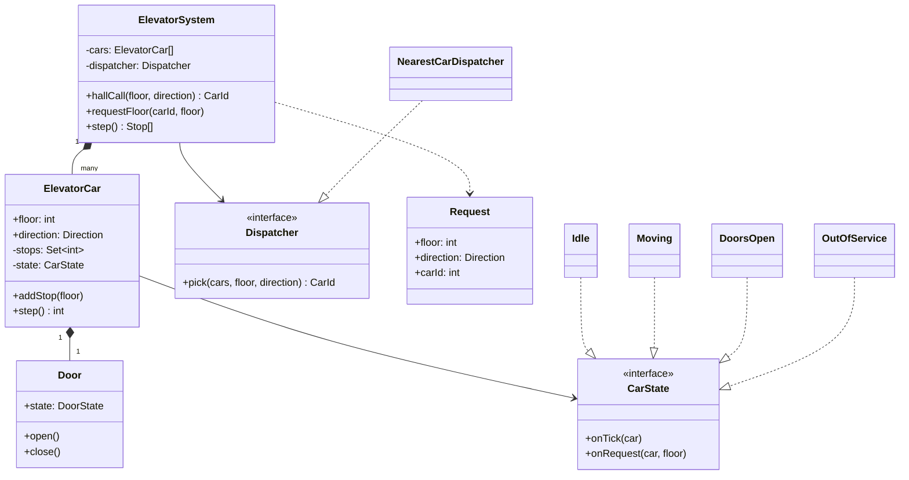
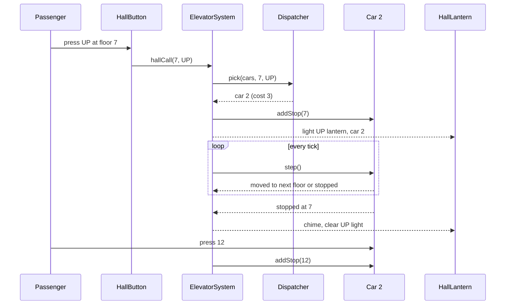

## In one minute
- An elevator system is a scheduler with motors attached. Two decisions dominate: which car answers a hall call (dispatch) and in what order a car visits its stops (the per-car algorithm).
- The per-car algorithm should be LOOK: keep going in the current direction while there are stops ahead, then reverse. It never starves a request, unlike "go to the nearest stop", and it is the same idea as the disk-scheduling algorithm of the same name.
- Drive the whole simulation from a deterministic `step()` tick. Real controllers run a fixed scan cycle; a tick-driven model is testable, replayable, and free of sleeps and threads in the core logic.
- Model each car as a state machine (idle, moving up, moving down, doors open, out of service) and the dispatcher as a strategy. Requirements change in those two places.
- The shape is **ordering under contention**: many requests, one shared resource that moves. It reappears as disk head scheduling, a delivery driver's route, and a database vacuum sweeping pages in order.

## Requirements

Functional:
- A building has `F` floors and `N` cars. Each floor has up and down hall buttons (the bottom and top floors have one each). Each car has a panel of floor buttons.
- A hall call is assigned to exactly one car. A car call (pressed inside) is served by that car.
- Cars move one floor at a time, stop at requested floors, open and close doors, and report position and direction to displays.
- Cars can be taken out of service for maintenance.

Non-functional:
- Every accepted request is eventually served (no starvation).
- Safety invariants hold always: never move with doors open, never open doors between floors.
- Reasonable average wait time; in an interview, say "minimise wait, bound the worst case" rather than promise optimality.

Out of scope: weight sensors, fire service modes, destination dispatch keypads and energy optimisation. Name them and put them in Extensibility.

## Entities and relationships

- **ElevatorSystem** is the controller and mediator. Buttons talk to it, never to cars directly. It owns the cars, the dispatcher and the tick loop.
- **ElevatorCar** holds its current floor, direction, door state and its set of pending stops. It runs LOOK on its own stops and does not know other cars exist.
- **Door** is a small state machine (closed, opening, open, closing). Keeping it separate lets you add a door-obstruction sensor without touching movement logic.
- **Request** is a value: either a hall call (floor plus direction) or a car call (car id plus floor). Making requests objects is the Command pattern in miniature: they can be queued, logged and replayed.
- **Dispatcher** is an interface with one method: given the cars and a hall call, return a car. Nearest-car, zoning and destination dispatch are implementations.
- **Display** and hall lanterns observe car position and direction.

Relationships: the system is composed of cars; each car owns one door and its stop set. Requests are transient and get folded into a car's stop set once assigned. The dispatcher reads car state but never mutates it.

## Class diagram



## Key flows

A hall call is assigned at once; movement happens only on ticks. Separating "decide" from "move" is what makes the system deterministic.



## Design patterns used and why

- **State** for the car. Unlike a parking ticket, car states really behave differently. A floor request while out of service is rejected; a tick while doors are open counts down the dwell timer instead of moving; a tick while idle checks for new stops. One class per state keeps each `onTick` short and makes illegal transitions (move while doors open) impossible to write by accident.
- **Strategy** for dispatch. The first version picks the nearest suitable car. A busy office tower wants zoning in the morning rush (cars 1 to 3 serve floors 1 to 20 only); a hotel wants something else. Each is a `Dispatcher` implementation selected by configuration or time of day.
- **Mediator**: `ElevatorSystem` sits between buttons, cars and displays. Without it, every button would need references to every car.
- **Command**: requests are objects. You can queue them while the controller is mid-tick, log them for analysis and replay a day's traffic against a new dispatcher before shipping it.
- **Observer** for lanterns and floor displays: they subscribe to car events and do not poll.

## Concurrency and edge cases

- **Asynchronous input, synchronous core.** Buttons are pressed at any moment from many places; the scheduler must see a consistent snapshot. Put requests on a queue (or take a mutex), drain the queue at the start of each tick, then step every car. The core logic never runs on two threads at once, which removes a whole class of bugs.
- **Request for the floor you are passing.** A car moving at 2 m/s cannot stop at a floor it is half a metre from. Real controllers compute the next floor where stopping is still possible and only accept stops at or beyond it. In the tick model, the car commits to the next floor as soon as it starts moving.
- **Request for the current floor.** If the car is idle there, reopen the doors instead of moving. The practice code serves it on the next tick without moving.
- **Duplicate presses.** People press the button five times. Stops are a set, so repeats are free and idempotent.
- **Starvation.** Shortest-seek-first (always go to the nearest stop) can leave someone on floor 30 waiting forever while floors 2 to 6 keep calling. LOOK bounds the wait: a request is reached within at most two sweeps.
- **Direction of hall calls.** An up call at floor 7 should not be answered by a car passing 7 on its way down; the passenger would ride the wrong way. Production cars keep separate up and down stop sets. The practice keeps one set and handles direction only in dispatch, which is a reasonable interview simplification if you say so.
- **Car taken out of service with stops pending.** Its hall calls must be reassigned to other cars, or those passengers wait forever. The car calls die with it; passengers inside are taken to the nearest floor.

## Down the stack

### Layer 1: The contract
Each accepted hall call is assigned to exactly one in-service car, and that car stops at the floor within a bounded number of ticks (at most about two full sweeps, `2F`, for LOOK with no new competing requests ahead). A car moves at most one floor per tick and never moves on a tick when it opened doors. Given the same initial state and the same sequence of requests at the same ticks, the system produces the same stops in the same order. That last property is what makes the design testable.

### Layer 2: The mechanism
Each car keeps a set of stop floors and a direction. On a tick: if the current floor is a stop, serve it; otherwise pick a direction (continue if any stop lies ahead, reverse if not; when idle, go toward the nearest stop) and move one floor. That is LOOK. SCAN differs only in that it travels to the end of the shaft before reversing, which wastes trips in a building. Dispatch scores each car with a cost: distance if the car is idle or already heading toward the call in the call's direction, distance plus a large penalty otherwise, and picks the minimum with ties broken by car id. Real group controllers replace distance with an estimated time to arrival that counts the stops already queued in front of the call, and can reassign calls when a better car frees up.

### Layer 3: The machine
Real elevators run on programmable logic controllers or embedded boards with a fixed scan cycle: read every input (buttons, floor sensors, door switches), run the logic, write every output, repeat, typically every few to tens of milliseconds. That is exactly the `step()` model. Floor position comes from sensors in the shaft or encoders on the motor; a variable-frequency drive ramps the motor to limit jerk. A mid-rise car travels around 1 to 2.5 m/s and floors are about 3 to 4 m apart, so a floor passes in a couple of seconds and a door cycle takes several more. The dispatcher's arithmetic takes microseconds, so compute is never the bottleneck. Safety does not depend on any of this software: door interlocks are wired in a hardware safety chain, and a mechanical governor trips the safety gear if the car overspeeds. Software decides where to go; hardware decides whether moving is allowed.

### Why it's built this way
1. Cars are slow and expensive and passengers are impatient, so the order of stops matters more than the speed of the code.
2. Nearest-first minimises average travel but starves the far floors, so a sweep (LOOK) trades a little average time for a bounded worst case.
3. Inputs arrive from many places at any time, so a fixed tick that snapshots inputs gives deterministic, testable behaviour, and matches how PLCs already run.
4. Traffic patterns differ by building and by hour, so dispatch is a swappable strategy rather than code inside the car.
5. Bugs here can hurt people, so the hardware enforces the safety invariants independently of the scheduler.

## Extensibility

- **Separate up and down stops:** replace the single stop set with two, and let a car pick up only calls in its current direction. LOOK still works; the reversal point now also checks the other set.
- **Destination dispatch:** passengers enter their destination in the lobby and are told which car to take. The request becomes `(origin, destination)` and the dispatcher groups people going to nearby floors. Only the `Request` type and a new dispatcher change.
- **Zoning and peak modes:** a dispatcher that consults a schedule. In the morning up-peak, idle cars return to the lobby.
- **Capacity:** add load to the car state; a full car skips hall calls but still serves car calls.
- **Fire service and maintenance:** new car states. Fire recall sends every car to a designated floor and ignores all calls; the State pattern makes this an added class, not an edited switch statement.
- **Express cars and sky lobbies:** cars carry the set of floors they can serve, and the dispatcher filters on it.

## Leadership lens

- Build first: the single-car LOOK state machine with a deterministic tick and a replay test harness. Every later dispatcher is judged by replaying recorded traffic through it, so the harness is the most valuable asset.
- Ask in review: what is the worst-case wait and how do you know; what happens to assigned calls when a car goes out of service; which invariants live in hardware and which in software.
- Measure what passengers feel: average and 95th-percentile wait and journey time, from logs, per hour of day. Tune dispatch against those, not against intuition.
- Ownership: safety-critical control and scheduling should be separate components with separate review bars. A dispatcher bug costs seconds; a door-interlock bug costs lives.
- In an interview, say which simplifications you make (one stop set, no capacity) before coding. It shows you know the real problem is bigger.

## Check yourself
1. Why does LOOK not starve requests while shortest-seek-first can?
   **Answer:** LOOK only reverses when no stops remain ahead, so any waiting floor is reached within at most two sweeps. Shortest-seek-first always picks the nearest stop, so a steady stream of nearby requests can keep a far floor waiting forever.
2. Why should the dispatcher penalise a car that is moving away from the call?
   **Answer:** That car must finish its sweep and come back, so its true arrival time is much longer than its distance suggests. Using raw distance would assign calls to cars that cannot serve them soon.
3. What does a tick-driven `step()` model buy you over a thread per car with sleeps?
   **Answer:** Determinism: the same inputs at the same ticks produce the same outputs, so tests are exact and recorded traffic can be replayed against a new algorithm. It also matches the scan cycle real controllers use.
4. Where would you put "never move with the doors open" so that a scheduler bug cannot violate it?
   **Answer:** In the car's state machine, so the moving transition is impossible from the doors-open state, and ultimately in the hardware safety chain, which cuts power regardless of what software asks for.

## Practice
**Task:** Implement an `ElevatorSystem` with `num_floors` floors (0 to `num_floors - 1`) and `num_cars` cars, all starting idle at floor 0. `request_floor(car_id, floor)` adds a stop to that car; `hall_call(floor, direction)` assigns the call to the car with the lowest cost and returns its id, where cost is the distance if the car is idle or is moving in the call's direction toward or at the floor, and distance plus `2 * num_floors` otherwise; ties go to the lowest car id. `step()` advances every car by one tick using LOOK and returns the `(car_id, floor)` pairs where cars stopped this tick, in car id order. On a tick, a car with no stops becomes idle; a car whose current floor is a stop serves it without moving; otherwise it picks a direction (keep going if stops remain ahead, reverse if not, and when idle head to the nearest stop, preferring up on a tie), moves one floor, and stops there if it is a stop. A car becomes idle when it serves its last stop. Invalid floors, cars or directions raise an error.

```python starter
from enum import IntEnum


class Direction(IntEnum):
    DOWN = -1
    IDLE = 0
    UP = 1


class ElevatorSystem:
    def __init__(self, num_floors, num_cars):
        self.num_floors = num_floors

    def request_floor(self, car_id, floor):
        raise NotImplementedError

    def hall_call(self, floor, direction):
        # TODO: lowest-cost car, ties to lowest id
        raise NotImplementedError

    def step(self):
        # TODO: LOOK for every car; return [(car_id, floor), ...]
        raise NotImplementedError

    def position(self, car_id):
        raise NotImplementedError
```

```python tests
def run(system, ticks):
    stops = []
    for _ in range(ticks):
        stops.extend(system.step())
    return stops


def test_travels_to_requested_floor():
    s = ElevatorSystem(10, 1)
    s.request_floor(0, 3)
    assert [s.step() for _ in range(3)] == [[], [], [(0, 3)]]
    assert s.position(0) == (3, Direction.IDLE)


def test_look_finishes_sweep_before_reversing():
    s = ElevatorSystem(10, 1)
    s.request_floor(0, 2)
    s.request_floor(0, 5)
    assert run(s, 3) == [(0, 2)]
    s.request_floor(0, 1)
    assert run(s, 20) == [(0, 5), (0, 1)]
    assert s.position(0) == (1, Direction.IDLE)


def test_request_at_current_floor():
    s = ElevatorSystem(5, 1)
    s.request_floor(0, 0)
    assert s.step() == [(0, 0)]
    assert s.position(0) == (0, Direction.IDLE)


def test_dispatch_picks_nearest_idle_car():
    s = ElevatorSystem(10, 2)
    s.request_floor(1, 6)
    run(s, 6)
    assert s.position(1) == (6, Direction.IDLE)
    assert s.hall_call(5, Direction.DOWN) == 1
    assert s.hall_call(1, Direction.UP) == 0


def test_dispatch_uses_direction():
    s = ElevatorSystem(10, 2)
    s.request_floor(0, 9)
    run(s, 2)
    assert s.position(0) == (2, Direction.UP)
    assert s.hall_call(4, Direction.UP) == 0, "car 0 is heading up toward 4"
    assert s.hall_call(4, Direction.DOWN) == 1, "car 0 would ride the wrong way"
    assert s.hall_call(1, Direction.UP) == 1, "floor 1 is behind car 0"


def test_ties_go_to_lowest_id():
    s = ElevatorSystem(10, 3)
    assert s.hall_call(3, Direction.UP) == 0


def test_duplicates_and_parallel_cars():
    s = ElevatorSystem(10, 2)
    s.request_floor(0, 4)
    s.request_floor(0, 4)
    s.request_floor(1, 1)
    assert s.step() == [(1, 1)]
    assert run(s, 10) == [(0, 4)]


def test_invalid_input():
    s = ElevatorSystem(10, 2)
    for call in (lambda: s.request_floor(0, 10), lambda: s.request_floor(2, 1),
                 lambda: s.hall_call(-1, Direction.UP), lambda: s.hall_call(3, Direction.IDLE)):
        failed = False
        try:
            call()
        except ValueError:
            failed = True
        assert failed
```

```python solution
from enum import IntEnum


class Direction(IntEnum):
    DOWN = -1
    IDLE = 0
    UP = 1


class Car:
    def __init__(self):
        self.floor = 0
        self.direction = Direction.IDLE
        self.stops = set()

    def step(self):
        if not self.stops:
            self.direction = Direction.IDLE
            return None
        if self.floor in self.stops:
            return self._serve()
        self.direction = self._choose_direction()
        self.floor += int(self.direction)
        if self.floor in self.stops:
            return self._serve()
        return None

    def _serve(self):
        self.stops.discard(self.floor)
        if not self.stops:
            self.direction = Direction.IDLE
        return self.floor

    def _choose_direction(self):
        above = [f for f in self.stops if f > self.floor]
        below = [f for f in self.stops if f < self.floor]
        if self.direction == Direction.UP and above:
            return Direction.UP
        if self.direction == Direction.DOWN and below:
            return Direction.DOWN
        if above and below:
            up_gap = min(above) - self.floor
            down_gap = self.floor - max(below)
            return Direction.DOWN if down_gap < up_gap else Direction.UP
        return Direction.UP if above else Direction.DOWN


class ElevatorSystem:
    def __init__(self, num_floors, num_cars):
        self.num_floors = num_floors
        self.cars = [Car() for _ in range(num_cars)]

    def _check_floor(self, floor):
        if floor < 0 or floor >= self.num_floors:
            raise ValueError("floor out of range: %d" % floor)

    def _car(self, car_id):
        if car_id < 0 or car_id >= len(self.cars):
            raise ValueError("no such car: %d" % car_id)
        return self.cars[car_id]

    def request_floor(self, car_id, floor):
        self._check_floor(floor)
        self._car(car_id).stops.add(floor)

    def _cost(self, car, floor, direction):
        distance = abs(car.floor - floor)
        if car.direction == Direction.IDLE:
            return distance
        heading_toward = (floor - car.floor) * int(car.direction) >= 0
        if car.direction == direction and heading_toward:
            return distance
        return distance + 2 * self.num_floors

    def hall_call(self, floor, direction):
        self._check_floor(floor)
        if direction not in (Direction.UP, Direction.DOWN):
            raise ValueError("hall call needs UP or DOWN")
        best = min(range(len(self.cars)),
                   key=lambda i: (self._cost(self.cars[i], floor, direction), i))
        self.cars[best].stops.add(floor)
        return best

    def step(self):
        stopped = []
        for i, car in enumerate(self.cars):
            floor = car.step()
            if floor is not None:
                stopped.append((i, floor))
        return stopped

    def position(self, car_id):
        car = self._car(car_id)
        return (car.floor, car.direction)
```

```typescript starter
export enum Direction { Down = -1, Idle = 0, Up = 1 }

export class ElevatorSystem {
  constructor(private numFloors: number, numCars: number) {}

  requestFloor(carId: number, floor: number): void {
    throw new Error("TODO");
  }

  hallCall(floor: number, direction: Direction): number {
    throw new Error("TODO");
  }

  step(): Array<[number, number]> {
    throw new Error("TODO");
  }

  position(carId: number): [number, Direction] {
    throw new Error("TODO");
  }
}
```

```typescript tests
function run(s: ElevatorSystem, ticks: number): Array<[number, number]> {
  const out: Array<[number, number]> = [];
  for (let i = 0; i < ticks; i++) out.push(...s.step());
  return out;
}

function throws(fn: () => void): boolean {
  try { fn(); return false; } catch (e) { return true; }
}

test("travels to requested floor", () => {
  const s = new ElevatorSystem(10, 1);
  s.requestFloor(0, 3);
  assertEqual([s.step(), s.step(), s.step()], [[], [], [[0, 3]]]);
  assertEqual(s.position(0), [3, Direction.Idle]);
});

test("LOOK finishes sweep before reversing", () => {
  const s = new ElevatorSystem(10, 1);
  s.requestFloor(0, 2);
  s.requestFloor(0, 5);
  assertEqual(run(s, 3), [[0, 2]]);
  s.requestFloor(0, 1);
  assertEqual(run(s, 20), [[0, 5], [0, 1]]);
  assertEqual(s.position(0), [1, Direction.Idle]);
});

test("request at current floor", () => {
  const s = new ElevatorSystem(5, 1);
  s.requestFloor(0, 0);
  assertEqual(s.step(), [[0, 0]]);
  assertEqual(s.position(0), [0, Direction.Idle]);
});

test("dispatch picks nearest idle car", () => {
  const s = new ElevatorSystem(10, 2);
  s.requestFloor(1, 6);
  run(s, 6);
  assertEqual(s.position(1), [6, Direction.Idle]);
  assertEqual(s.hallCall(5, Direction.Down), 1);
  assertEqual(s.hallCall(1, Direction.Up), 0);
});

test("dispatch uses direction", () => {
  const s = new ElevatorSystem(10, 2);
  s.requestFloor(0, 9);
  run(s, 2);
  assertEqual(s.position(0), [2, Direction.Up]);
  assertEqual(s.hallCall(4, Direction.Up), 0, "car 0 is heading up toward 4");
  assertEqual(s.hallCall(4, Direction.Down), 1, "car 0 would ride the wrong way");
  assertEqual(s.hallCall(1, Direction.Up), 1, "floor 1 is behind car 0");
});

test("ties go to lowest id", () => {
  const s = new ElevatorSystem(10, 3);
  assertEqual(s.hallCall(3, Direction.Up), 0);
});

test("duplicates and parallel cars", () => {
  const s = new ElevatorSystem(10, 2);
  s.requestFloor(0, 4);
  s.requestFloor(0, 4);
  s.requestFloor(1, 1);
  assertEqual(s.step(), [[1, 1]]);
  assertEqual(run(s, 10), [[0, 4]]);
});

test("invalid input", () => {
  const s = new ElevatorSystem(10, 2);
  assert(throws(() => s.requestFloor(0, 10)), "floor too high");
  assert(throws(() => s.requestFloor(2, 1)), "no car 2");
  assert(throws(() => s.hallCall(-1, Direction.Up)), "negative floor");
  assert(throws(() => s.hallCall(3, Direction.Idle)), "idle is not a call direction");
});
```

```typescript solution
export enum Direction { Down = -1, Idle = 0, Up = 1 }

class Car {
  floor = 0;
  direction = Direction.Idle;
  stops = new Set<number>();

  step(): number | null {
    if (this.stops.size === 0) {
      this.direction = Direction.Idle;
      return null;
    }
    if (this.stops.has(this.floor)) return this.serve();
    this.direction = this.chooseDirection();
    this.floor += this.direction;
    return this.stops.has(this.floor) ? this.serve() : null;
  }

  private serve(): number {
    this.stops.delete(this.floor);
    if (this.stops.size === 0) this.direction = Direction.Idle;
    return this.floor;
  }

  private chooseDirection(): Direction {
    const all = [...this.stops];
    const above = all.filter((f) => f > this.floor);
    const below = all.filter((f) => f < this.floor);
    if (this.direction === Direction.Up && above.length > 0) return Direction.Up;
    if (this.direction === Direction.Down && below.length > 0) return Direction.Down;
    if (above.length > 0 && below.length > 0) {
      const upGap = Math.min(...above) - this.floor;
      const downGap = this.floor - Math.max(...below);
      return downGap < upGap ? Direction.Down : Direction.Up;
    }
    return above.length > 0 ? Direction.Up : Direction.Down;
  }
}

export class ElevatorSystem {
  private cars: Car[] = [];

  constructor(private numFloors: number, numCars: number) {
    for (let i = 0; i < numCars; i++) this.cars.push(new Car());
  }

  private checkFloor(floor: number): void {
    if (floor < 0 || floor >= this.numFloors) throw new Error("floor out of range: " + floor);
  }

  private car(carId: number): Car {
    const car = this.cars[carId];
    if (!car) throw new Error("no such car: " + carId);
    return car;
  }

  requestFloor(carId: number, floor: number): void {
    this.checkFloor(floor);
    this.car(carId).stops.add(floor);
  }

  private cost(car: Car, floor: number, direction: Direction): number {
    const distance = Math.abs(car.floor - floor);
    if (car.direction === Direction.Idle) return distance;
    const headingToward = (floor - car.floor) * car.direction >= 0;
    if (car.direction === direction && headingToward) return distance;
    return distance + 2 * this.numFloors;
  }

  hallCall(floor: number, direction: Direction): number {
    this.checkFloor(floor);
    if (direction !== Direction.Up && direction !== Direction.Down) {
      throw new Error("hall call needs Up or Down");
    }
    let best = 0;
    let bestCost = Infinity;
    this.cars.forEach((car, i) => {
      const c = this.cost(car, floor, direction);
      if (c < bestCost) { best = i; bestCost = c; }
    });
    this.cars[best].stops.add(floor);
    return best;
  }

  step(): Array<[number, number]> {
    const stopped: Array<[number, number]> = [];
    this.cars.forEach((car, i) => {
      const floor = car.step();
      if (floor !== null) stopped.push([i, floor]);
    });
    return stopped;
  }

  position(carId: number): [number, Direction] {
    const car = this.car(carId);
    return [car.floor, car.direction];
  }
}
```

```go starter
package practice

import "errors"

type Direction int

const (
	Down Direction = -1
	Idle Direction = 0
	Up   Direction = 1
)

var ErrInvalidInput = errors.New("invalid input")

type Stop struct {
	Car   int
	Floor int
}

type System struct{}

func NewSystem(floors, cars int) *System {
	return &System{}
}

func (s *System) RequestFloor(car, floor int) error {
	panic("TODO")
}

func (s *System) HallCall(floor int, dir Direction) (int, error) {
	panic("TODO")
}

func (s *System) Step() []Stop {
	panic("TODO")
}

func (s *System) Position(car int) (int, Direction) {
	panic("TODO")
}
```

```go tests
package practice

import (
	"errors"
	"reflect"
	"testing"
)

func run(s *System, ticks int) []Stop {
	var out []Stop
	for i := 0; i < ticks; i++ {
		out = append(out, s.Step()...)
	}
	return out
}

func wantPos(t *testing.T, s *System, car, floor int, dir Direction) {
	t.Helper()
	if f, d := s.Position(car); f != floor || d != dir {
		t.Fatalf("car %d at (%d,%d), want (%d,%d)", car, f, d, floor, dir)
	}
}

func wantCar(t *testing.T, s *System, floor int, dir Direction, want int) {
	t.Helper()
	got, err := s.HallCall(floor, dir)
	if err != nil || got != want {
		t.Fatalf("HallCall(%d,%d) = %d, %v; want %d", floor, dir, got, err, want)
	}
}

func TestTravelsToRequestedFloor(t *testing.T) {
	s := NewSystem(10, 1)
	s.RequestFloor(0, 3)
	if len(s.Step()) != 0 || len(s.Step()) != 0 {
		t.Fatal("stopped too early")
	}
	if got := s.Step(); !reflect.DeepEqual(got, []Stop{{0, 3}}) {
		t.Fatalf("got %v", got)
	}
	wantPos(t, s, 0, 3, Idle)
}

func TestLookFinishesSweepBeforeReversing(t *testing.T) {
	s := NewSystem(10, 1)
	s.RequestFloor(0, 2)
	s.RequestFloor(0, 5)
	if got := run(s, 3); !reflect.DeepEqual(got, []Stop{{0, 2}}) {
		t.Fatalf("got %v", got)
	}
	s.RequestFloor(0, 1)
	if got := run(s, 20); !reflect.DeepEqual(got, []Stop{{0, 5}, {0, 1}}) {
		t.Fatalf("got %v", got)
	}
	wantPos(t, s, 0, 1, Idle)
}

func TestRequestAtCurrentFloor(t *testing.T) {
	s := NewSystem(5, 1)
	s.RequestFloor(0, 0)
	if got := s.Step(); !reflect.DeepEqual(got, []Stop{{0, 0}}) {
		t.Fatalf("got %v", got)
	}
	wantPos(t, s, 0, 0, Idle)
}

func TestDispatchPicksNearestIdleCar(t *testing.T) {
	s := NewSystem(10, 2)
	s.RequestFloor(1, 6)
	run(s, 6)
	wantPos(t, s, 1, 6, Idle)
	wantCar(t, s, 5, Down, 1)
	wantCar(t, s, 1, Up, 0)
}

func TestDispatchUsesDirection(t *testing.T) {
	s := NewSystem(10, 2)
	s.RequestFloor(0, 9)
	run(s, 2)
	wantPos(t, s, 0, 2, Up)
	wantCar(t, s, 4, Up, 0)
	wantCar(t, s, 4, Down, 1)
	wantCar(t, s, 1, Up, 1)
}

func TestTiesGoToLowestID(t *testing.T) {
	s := NewSystem(10, 3)
	wantCar(t, s, 3, Up, 0)
}

func TestDuplicatesAndParallelCars(t *testing.T) {
	s := NewSystem(10, 2)
	s.RequestFloor(0, 4)
	s.RequestFloor(0, 4)
	s.RequestFloor(1, 1)
	if got := s.Step(); !reflect.DeepEqual(got, []Stop{{1, 1}}) {
		t.Fatalf("got %v", got)
	}
	if got := run(s, 10); !reflect.DeepEqual(got, []Stop{{0, 4}}) {
		t.Fatalf("got %v", got)
	}
}

func TestInvalidInput(t *testing.T) {
	s := NewSystem(10, 2)
	if err := s.RequestFloor(0, 10); !errors.Is(err, ErrInvalidInput) {
		t.Fatalf("floor too high: %v", err)
	}
	if err := s.RequestFloor(2, 1); !errors.Is(err, ErrInvalidInput) {
		t.Fatalf("no car 2: %v", err)
	}
	if _, err := s.HallCall(-1, Up); !errors.Is(err, ErrInvalidInput) {
		t.Fatalf("negative floor: %v", err)
	}
	if _, err := s.HallCall(3, Idle); !errors.Is(err, ErrInvalidInput) {
		t.Fatalf("idle direction: %v", err)
	}
}
```

```go solution
package practice

import (
	"errors"
	"fmt"
	"sync"
)

type Direction int

const (
	Down Direction = -1
	Idle Direction = 0
	Up   Direction = 1
)

var ErrInvalidInput = errors.New("invalid input")

type Stop struct {
	Car   int
	Floor int
}

type car struct {
	floor int
	dir   Direction
	stops map[int]bool
}

// step advances the car one tick using LOOK. It reports the floor served, if any.
func (c *car) step() (int, bool) {
	if len(c.stops) == 0 {
		c.dir = Idle
		return 0, false
	}
	if c.stops[c.floor] {
		return c.serve(), true
	}
	c.dir = c.chooseDirection()
	c.floor += int(c.dir)
	if c.stops[c.floor] {
		return c.serve(), true
	}
	return 0, false
}

func (c *car) serve() int {
	delete(c.stops, c.floor)
	if len(c.stops) == 0 {
		c.dir = Idle
	}
	return c.floor
}

func (c *car) chooseDirection() Direction {
	upGap, downGap := -1, -1
	for f := range c.stops {
		if f > c.floor && (upGap < 0 || f-c.floor < upGap) {
			upGap = f - c.floor
		}
		if f < c.floor && (downGap < 0 || c.floor-f < downGap) {
			downGap = c.floor - f
		}
	}
	above, below := upGap >= 0, downGap >= 0
	switch {
	case c.dir == Up && above:
		return Up
	case c.dir == Down && below:
		return Down
	case above && below:
		if downGap < upGap {
			return Down
		}
		return Up
	case above:
		return Up
	default:
		return Down
	}
}

type System struct {
	mu     sync.Mutex
	floors int
	cars   []*car
}

func NewSystem(floors, cars int) *System {
	s := &System{floors: floors}
	for i := 0; i < cars; i++ {
		s.cars = append(s.cars, &car{stops: map[int]bool{}})
	}
	return s
}

func (s *System) checkFloor(floor int) error {
	if floor < 0 || floor >= s.floors {
		return fmt.Errorf("%w: floor %d", ErrInvalidInput, floor)
	}
	return nil
}

func (s *System) RequestFloor(carID, floor int) error {
	s.mu.Lock()
	defer s.mu.Unlock()
	if err := s.checkFloor(floor); err != nil {
		return err
	}
	if carID < 0 || carID >= len(s.cars) {
		return fmt.Errorf("%w: car %d", ErrInvalidInput, carID)
	}
	s.cars[carID].stops[floor] = true
	return nil
}

func (s *System) cost(c *car, floor int, dir Direction) int {
	distance := c.floor - floor
	if distance < 0 {
		distance = -distance
	}
	if c.dir == Idle {
		return distance
	}
	if c.dir == dir && (floor-c.floor)*int(c.dir) >= 0 {
		return distance
	}
	return distance + 2*s.floors
}

func (s *System) HallCall(floor int, dir Direction) (int, error) {
	s.mu.Lock()
	defer s.mu.Unlock()
	if err := s.checkFloor(floor); err != nil {
		return 0, err
	}
	if dir != Up && dir != Down {
		return 0, fmt.Errorf("%w: hall call needs Up or Down", ErrInvalidInput)
	}
	best, bestCost := 0, -1
	for i, c := range s.cars {
		if cost := s.cost(c, floor, dir); bestCost < 0 || cost < bestCost {
			best, bestCost = i, cost
		}
	}
	s.cars[best].stops[floor] = true
	return best, nil
}

func (s *System) Step() []Stop {
	s.mu.Lock()
	defer s.mu.Unlock()
	stopped := []Stop{}
	for i, c := range s.cars {
		if floor, ok := c.step(); ok {
			stopped = append(stopped, Stop{Car: i, Floor: floor})
		}
	}
	return stopped
}

func (s *System) Position(carID int) (int, Direction) {
	s.mu.Lock()
	defer s.mu.Unlock()
	c := s.cars[carID]
	return c.floor, c.dir
}
```

## Mock interview
**Prompt:** Design the control software for a 30-floor office building with 6 elevators. Code the classes and a `step()`-driven simulation, and explain how a hall call is assigned and in what order a car serves its stops.

- Follow-up: At 8:45 a.m. hundreds of people arrive in the lobby and almost all go up. What changes in your dispatcher?
- Follow-up: A car is taken out of service while it has four hall calls assigned. Walk me through what happens to those passengers.
- Follow-up: Why LOOK and not "always go to the nearest requested floor"?

**A strong answer covers:**
- Requirements that separate hall calls from car calls, state the safety invariants and name the simplifications being made.
- A car state machine (idle, moving, doors open, out of service) and a dispatcher behind an interface, with the controller as mediator.
- LOOK per car with a clear argument about bounded waiting versus the starvation risk of nearest-first.
- A cost function that accounts for direction and queued stops, with deterministic tie-breaking.
- A tick-driven core with a request queue drained at the start of each tick, so the logic is single-threaded and replayable.
- Up-peak handling (return idle cars to the lobby, zoning) and reassignment of calls when a car fails.

## Watch
- [Low-Level Design Interview: Design an Elevator w/ a Ex-Meta Staff Engineer (Hello Interview)](https://www.youtube.com/watch?v=fODT0ldeBiU): a mock interview that shows how to scope the problem and structure the classes.
- [Elevator System | Google SWE Teaches Low Level Design Episode 3 (Jordan has no life)](https://www.youtube.com/watch?v=4OjHA-BcJhw): a code-first walkthrough including the scheduling logic.
- [State Pattern, Design Patterns ep 17 (Christopher Okhravi)](https://www.youtube.com/watch?v=N12L5D78MAA): the pattern behind the car's lifecycle, explained carefully.

## Free resources
- [Elevator algorithm (Wikipedia)](https://en.wikipedia.org/wiki/Elevator_algorithm): SCAN and LOOK as disk-scheduling algorithms, the same ideas used per car here.
- [Destination dispatch (Wikipedia)](https://en.wikipedia.org/wiki/Destination_dispatch): how modern high-rise systems group passengers by destination.
- [State pattern (Refactoring.Guru)](https://refactoring.guru/design-patterns/state): the car state machine as classes, with examples in several languages.
- [Strategy pattern (Refactoring.Guru)](https://refactoring.guru/design-patterns/strategy): the shape of a pluggable dispatcher.
- [Programmable logic controller (Wikipedia)](https://en.wikipedia.org/wiki/Programmable_logic_controller): the scan-cycle controllers that a `step()` model imitates.
