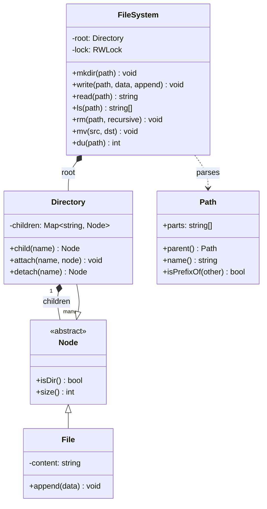
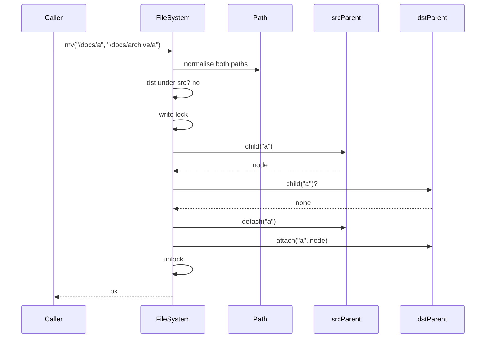

## In one minute
- An in-memory file system is a tree of named nodes with two kinds of node, files and directories. The **Composite** pattern gives both a common interface, and nearly every operation becomes "resolve a path to a node, then act on it".
- Path resolution is the core algorithm. Normalise once (split on `/`, drop empty parts and `.`, pop on `..`), then walk from the root, failing with a precise error at the first component that is missing or is a file.
- Separate the **name** from the **node**. A directory maps names to child nodes; the node does not need to know its own name. That one decision makes rename cheap, makes hard links possible later, and mirrors how Unix splits directory entries from inodes.
- `mv` is the operation that exposes weak designs: it must refuse to move a directory into its own subtree, must not clobber an existing target silently, and must look atomic to concurrent readers.
- The shape is **finding things fast** in a hierarchy, plus **contention** when several threads mutate the same subtree. The same tree-with-paths design appears in configuration stores (ZooKeeper znodes, etcd key prefixes), URL routers, and cloud console resource hierarchies.

## Requirements

Functional:
- Absolute paths such as `/home/ana/notes.txt`. Support `.` and `..` and tolerate repeated slashes.
- `mkdir` creates a directory and any missing parents.
- `write` creates or overwrites a file, with an append mode; the parent directory must already exist.
- `read` returns a file's content; `ls` lists a directory's children in sorted order, or a file's own name.
- `rm` removes a file or an empty directory, or a whole subtree when asked to recurse.
- `mv` renames or moves a file or directory to a new full path.
- `du` reports the total bytes under a path.

Non-functional:
- Every operation costs O(depth) for resolution plus the work of the operation itself, independent of the total number of files.
- Errors are specific and deterministic (no such path, not a directory, is a directory, directory not empty, already exists), because callers branch on them.
- Safe under concurrent callers in one process.

Out of scope: persistence, permissions and owners, symbolic links, file handles with seek offsets, and quotas.

## Entities and relationships

- **Node** is the abstract component: anything that can live in a directory. It exposes `size()` and `isDir()`.
- **File** is a leaf. It holds content.
- **Directory** is the composite. It holds a map from child name to node. Its size is the sum of its children.
- **Path** is a value object: a list of normalised components. It is parsed once at the API boundary.
- **FileSystem** is the facade with the public operations. It owns the root directory and the lock.
- **Metadata** (created, modified, size) belongs on the node, not in the directory entry, so that two names pointing at one node (a hard link) agree on it.

Relationships: a directory is composed of its children; removing a directory removes them. The file system composes the root. A path does not reference nodes at all; it is resolved on every call, which is what keeps it valid across renames.

## Class diagram



## Key flows

`mv /docs/a /docs/archive/a` resolves both parents, checks for a cycle and an existing target, then detaches and reattaches the node under one write lock. No content is copied.



## Design patterns used and why

- **Composite** is the backbone. `du`, recursive `rm` and recursive copy all treat a file and a directory uniformly: a directory's size is the sum of its children's sizes, a file's size is its length. Without Composite, every recursive operation grows an `if file ... else ...` ladder, and adding a third node type (symlink) touches all of them. See [Composite](composite.md) for the pattern itself.
- **Facade**: `FileSystem` is the only public type. Callers never hold a `Directory` reference, which is what lets the lock protect everything and lets you change internals (a sorted map, a trie of path segments) without breaking callers.
- **Value object** for paths. Normalisation is subtle (`/a/./b//../c` is `/a/c`), so do it in one place and test it hard. Error messages then quote the normalised path, which makes them stable.
- **Visitor** or a plain recursive walk for reporting operations such as `du`, `find` and `tree`. With two node types, a recursive method on `Node` is clearer than a full Visitor; switch when operations multiply faster than node types. See [Visitor](visitor.md).
- **Command** and **Memento** become relevant if you add undo or snapshots: each mutation is a command with an inverse, or the tree is copied on write so old roots stay readable. The [Design Version Control System](design-version-control-system.md) lesson takes that idea further.

What not to put in the model: a `parent` pointer on every node unless you need upward walks, because it must be updated on every move and is easy to leave stale; and the node's own name, for the reasons above.

## Concurrency and edge cases

- **Moving a directory into itself.** `mv /a /a/b/c` would detach `/a` and attach it under its own descendant, creating a cycle that is unreachable from the root. Compare normalised components: if `src` is a prefix of `dst`, refuse. Compare components, not strings, or `/ab` looks like it is under `/a`.
- **Moving onto an existing name.** Unix `rename(2)` silently replaces an existing file target. Interview designs usually refuse instead, and say so. Whatever you choose, never replace a non-empty directory.
- **Root.** `rm /` and `mv / /x` must fail. `..` at the root stays at the root, as on Unix.
- **A file in the middle of a path.** `mkdir /a/b` when `/a` is a file must fail with "not a directory", not overwrite the file.
- **Writing to a directory path** fails with "is a directory"; reading a directory likewise.
- **Concurrent readers and writers.** The simplest correct design is one readers-writer lock for the whole tree: `read`, `ls` and `du` share it, mutations take it exclusively. It serialises writers, which is fine for an in-process tool. Per-directory locks scale better but turn `mv` into a two-lock operation that needs a global ordering (Linux takes a filesystem-wide rename mutex for cross-directory renames for exactly this reason) to avoid deadlock.
- **Very deep or very wide trees.** Recursive `du` and `rm -r` can overflow the stack on pathological depth; use an explicit stack. A directory with a million entries makes sorted `ls` cost O(n log n) each call; keep children in a sorted structure if `ls` is hot.

## Down the stack

### Layer 1: The contract
Every operation either succeeds completely or fails with one specific error and changes nothing. After `mv(src, dst)` returns, `src` does not resolve and `dst` resolves to the same node with the same content, and no reader ever sees both or neither. `ls` returns names in byte order. `du` equals the sum of content lengths of all files under the path at one instant. Resolution cost is proportional to path depth, not to the number of files.

### Layer 2: The mechanism
Linux splits the same ideas into objects you can name. A **dentry** (directory entry) maps a name in a parent to an **inode**; the inode holds size, timestamps, link count and the pointers to data. The dentry cache (dcache) is a hash table keyed by (parent dentry, name), so path walking is one hash lookup per component, mostly lock-free under RCU. `rename(2)` is atomic with respect to lookups: another process sees either the old name or the new one. Linux's own tmpfs is an in-memory file system built from exactly these pieces, with page-cache pages as file content. On disk, ext4 stores large directories as an HTree, a hashed B-tree of names, so lookup in a 100,000-entry directory stays a few block reads. Our design is the same shape in miniature: the directory map plays the dentry role, the node object plays the inode role.

### Layer 3: The machine
Each path component in the in-memory design costs one hash of a short string (a few ns) and one map probe, which is usually one or two cache misses at around 80 ns each from DRAM. A 6-level path resolves in well under a microsecond. Memory per entry is dominated by overhead: a Go map entry plus string header plus node struct is roughly 100 to 200 bytes before any content, so a million empty files cost on the order of 150 MB. An uncontended `sync.RWMutex` read lock costs tens of nanoseconds, but on many cores the shared reader counter becomes a contended cache line, which is why the kernel uses RCU for path walks instead of a reader lock.

### Why it's built this way
1. Users think in paths, but paths are just names; the stable thing is the node. So directories map names to nodes and nodes do not store their names.
2. Because names live only in directories, rename is "remove one map entry, add another", O(1) and with no data copied, even for a directory holding gigabytes.
3. Cheap rename invites misuse (moving a directory under itself), so the cycle check is mandatory at the one place that changes structure.
4. Lookups vastly outnumber mutations, so reads share a lock (or, in the kernel, avoid locks with RCU), while structural changes serialise.
5. Recursive operations dominate the rest of the API, so the node hierarchy is a Composite and each recursion is written once.

## Extensibility

- **Symbolic links:** a third node type holding a target path. Resolution follows it with a hop limit (Linux uses 40) to break loops. Composite keeps `du` and `rm` working; only resolution changes.
- **Hard links:** allow two directory entries to point at one node and add a link count on the node. `rm` decrements the count and frees the node at zero. This works only because names are not stored on nodes.
- **Permissions:** add owner and mode bits to the node and check them during resolution (execute permission on every directory you traverse) and at the final node. The check sits in the facade, not scattered in callers.
- **Persistence:** add a write-ahead log of mutations (`mkdir`, `write`, `mv`) and replay it at startup, or snapshot the tree periodically. The facade already funnels every mutation through one place, which is where the log hook goes.
- **Watchers:** an Observer registry keyed by path prefix, notified after each mutation commits, outside the lock, so a slow watcher cannot stall writers.

## Leadership lens

- Build first: path normalisation and resolution with an exhaustive test table, then `mv` with the cycle check. Almost every bug in this design traces back to one of those two.
- Ask in review: where are paths normalised; are names stored in one place only; what does `mv` do when the target exists; how is the cycle check done (components or strings); what is the locking story for cross-directory moves.
- Decide early whether you are mimicking POSIX semantics exactly or choosing safer ones (refusing to overwrite on `mv`). Mixed semantics produce surprising bugs for callers who know Unix.
- In an interview, write the resolver and Composite nodes in the first 15 minutes, then spend the rest on `mv`, errors and concurrency.

## Check yourself
1. Why should a node not store its own name?
   **Answer:** Because the name belongs to the directory entry. Storing it in two places means rename must update both, and hard links (two names for one node) become impossible to represent correctly.
2. How do you detect that `mv /a /a/b` would create a cycle, and why compare components rather than strings?
   **Answer:** Check whether the source's components are a prefix of the destination's. A string prefix check wrongly treats `/ab` as inside `/a`.
3. Why is a whole-tree readers-writer lock acceptable here, and when would you abandon it?
   **Answer:** It is simple and correct, and in-process mutations are microseconds, so writers rarely wait long. Abandon it when many cores contend on the reader count or writers in unrelated subtrees block each other; then move to per-directory locks with a global order for renames, or to copy-on-write.
4. `du` on a directory and `size()` on a file share a signature. Which pattern makes that natural, and what does it save?
   **Answer:** Composite. Recursive operations are written once against `Node`, and adding a new node type does not require editing every caller.

## Practice
**Task:** Implement `FileSystem` with absolute paths. Normalise every path by splitting on `/`, dropping empty parts and `.`, and popping one component for `..` (staying at the root); a path that does not start with `/` fails with `bad path: <path>`, and every other error quotes the normalised path (root is `/`). `mkdir(path)` creates missing directories along the path and fails with `not a directory: <prefix>` if a component is a file. `write(path, data, append=False)` creates or overwrites (or appends to) a file; it fails with `no such directory: <parent>` if the parent is missing or a file, and with `is a directory: <path>` for a directory or the root. `read(path)` fails with `no such file: <path>` or `is a directory: <path>`. `ls(path)` returns sorted child names for a directory, `[name]` for a file, or fails with `no such path: <path>`. `rm(path, recursive=False)` fails on the root with `cannot remove root`, on a missing path, and on a non-empty directory without `recursive` with `directory not empty: <path>`. `mv(src, dst)` moves a node to the new full path: `no such path: <src>` if the source is missing, `cannot move into itself: <src>` if `dst` equals or is under `src`, `already exists: <dst>` if the target exists, and `no such directory: <parent>` if the target parent is missing. `du(path)` returns the total content length under the path, or fails with `no such path: <path>`.

```python starter
class FileSystem:
    def __init__(self):
        pass

    def mkdir(self, path):
        raise NotImplementedError

    def write(self, path, data, append=False):
        raise NotImplementedError

    def read(self, path):
        raise NotImplementedError

    def ls(self, path):
        raise NotImplementedError

    def rm(self, path, recursive=False):
        raise NotImplementedError

    def mv(self, src, dst):
        raise NotImplementedError

    def du(self, path):
        raise NotImplementedError
```

```python tests
def error_of(fn):
    try:
        fn()
    except ValueError as e:
        return str(e)
    return ""


def test_mkdir_write_read_ls():
    fs = FileSystem()
    fs.mkdir("/home/ana")
    fs.write("/home/ana/notes.txt", "hello")
    fs.write("/home/ana/notes.txt", " world", append=True)
    fs.write("/home/ana/b.txt", "x")
    assert fs.read("/home/ana/notes.txt") == "hello world"
    assert fs.ls("/home/ana") == ["b.txt", "notes.txt"]
    assert fs.ls("/home/ana/b.txt") == ["b.txt"]
    assert fs.ls("/") == ["home"]


def test_path_normalisation():
    fs = FileSystem()
    fs.mkdir("//a/./b/../c/")
    assert fs.ls("/a") == ["c"]
    fs.write("/a/c/../f", "12")
    assert fs.read("/../a/f") == "12", ".. at root stays at root"
    assert error_of(lambda: fs.ls("a/c")) == "bad path: a/c"


def test_type_errors():
    fs = FileSystem()
    fs.mkdir("/d")
    fs.write("/d/f", "data")
    assert error_of(lambda: fs.mkdir("/d/f/g")) == "not a directory: /d/f"
    assert error_of(lambda: fs.write("/d", "x")) == "is a directory: /d"
    assert error_of(lambda: fs.write("/nope/f", "x")) == "no such directory: /nope"
    assert error_of(lambda: fs.write("/d/f/g", "x")) == "no such directory: /d/f"
    assert error_of(lambda: fs.read("/d")) == "is a directory: /d"
    assert error_of(lambda: fs.read("/d/zz")) == "no such file: /d/zz"
    assert error_of(lambda: fs.ls("/d/zz/../q")) == "no such path: /d/q"


def test_rm():
    fs = FileSystem()
    fs.mkdir("/a/b")
    fs.write("/a/b/f", "1")
    assert error_of(lambda: fs.rm("/a")) == "directory not empty: /a"
    assert error_of(lambda: fs.rm("/")) == "cannot remove root"
    assert error_of(lambda: fs.rm("/x")) == "no such path: /x"
    fs.rm("/a/b/f")
    fs.rm("/a/b")
    assert fs.ls("/a") == []
    fs.mkdir("/a/c/d")
    fs.rm("/a", recursive=True)
    assert fs.ls("/") == []


def test_mv_moves_subtree():
    fs = FileSystem()
    fs.mkdir("/docs/archive")
    fs.mkdir("/docs/2024")
    fs.write("/docs/2024/r.txt", "report")
    fs.mv("/docs/2024", "/docs/archive/y2024")
    assert fs.ls("/docs") == ["archive"]
    assert fs.read("/docs/archive/y2024/r.txt") == "report"
    fs.mv("/docs/archive/y2024/r.txt", "/r.txt")
    assert fs.read("/r.txt") == "report"


def test_mv_errors():
    fs = FileSystem()
    fs.mkdir("/a/b")
    fs.mkdir("/ab")
    fs.write("/t", "x")
    assert error_of(lambda: fs.mv("/a", "/a/b/c")) == "cannot move into itself: /a"
    assert error_of(lambda: fs.mv("/a", "/a")) == "cannot move into itself: /a"
    assert error_of(lambda: fs.mv("/a", "/t")) == "already exists: /t"
    assert error_of(lambda: fs.mv("/q", "/z")) == "no such path: /q"
    assert error_of(lambda: fs.mv("/a", "/nope/a")) == "no such directory: /nope"
    fs.mv("/a", "/ab/a")
    assert fs.ls("/ab") == ["a"], "/ab is not inside /a"


def test_du():
    fs = FileSystem()
    fs.mkdir("/p/q")
    fs.write("/p/one", "abc")
    fs.write("/p/q/two", "defgh")
    assert fs.du("/p") == 8
    assert fs.du("/p/q/two") == 5
    assert fs.du("/") == 8
    assert error_of(lambda: fs.du("/none")) == "no such path: /none"
```

```python solution
class _File:
    def __init__(self):
        self.content = ""

    def is_dir(self):
        return False

    def size(self):
        return len(self.content)


class _Dir:
    def __init__(self):
        self.children = {}

    def is_dir(self):
        return True

    def size(self):
        return sum(c.size() for c in self.children.values())


def _parts(path):
    if not path.startswith("/"):
        raise ValueError("bad path: " + path)
    out = []
    for p in path.split("/"):
        if p == "" or p == ".":
            continue
        if p == "..":
            if out:
                out.pop()
        else:
            out.append(p)
    return out


def _fmt(parts):
    return "/" + "/".join(parts)


class FileSystem:
    def __init__(self):
        self._root = _Dir()

    def _walk(self, parts):
        node = self._root
        for p in parts:
            if not node.is_dir() or p not in node.children:
                return None
            node = node.children[p]
        return node

    def mkdir(self, path):
        parts = _parts(path)
        node = self._root
        for i, p in enumerate(parts):
            child = node.children.get(p)
            if child is None:
                child = _Dir()
                node.children[p] = child
            elif not child.is_dir():
                raise ValueError("not a directory: " + _fmt(parts[: i + 1]))
            node = child

    def write(self, path, data, append=False):
        parts = _parts(path)
        if not parts:
            raise ValueError("is a directory: /")
        parent = self._walk(parts[:-1])
        if parent is None or not parent.is_dir():
            raise ValueError("no such directory: " + _fmt(parts[:-1]))
        node = parent.children.get(parts[-1])
        if node is not None and node.is_dir():
            raise ValueError("is a directory: " + _fmt(parts))
        if node is None:
            node = _File()
            parent.children[parts[-1]] = node
        node.content = node.content + data if append else data

    def read(self, path):
        parts = _parts(path)
        node = self._walk(parts)
        if node is None:
            raise ValueError("no such file: " + _fmt(parts))
        if node.is_dir():
            raise ValueError("is a directory: " + _fmt(parts))
        return node.content

    def ls(self, path):
        parts = _parts(path)
        node = self._walk(parts)
        if node is None:
            raise ValueError("no such path: " + _fmt(parts))
        if not node.is_dir():
            return [parts[-1]]
        return sorted(node.children)

    def rm(self, path, recursive=False):
        parts = _parts(path)
        if not parts:
            raise ValueError("cannot remove root")
        node = self._walk(parts)
        if node is None:
            raise ValueError("no such path: " + _fmt(parts))
        if node.is_dir() and node.children and not recursive:
            raise ValueError("directory not empty: " + _fmt(parts))
        del self._walk(parts[:-1]).children[parts[-1]]

    def mv(self, src, dst):
        s = _parts(src)
        d = _parts(dst)
        node = self._walk(s) if s else None
        if node is None:
            raise ValueError("no such path: " + _fmt(s))
        if d[: len(s)] == s:
            raise ValueError("cannot move into itself: " + _fmt(s))
        if not d:
            raise ValueError("already exists: /")
        parent = self._walk(d[:-1])
        if parent is None or not parent.is_dir():
            raise ValueError("no such directory: " + _fmt(d[:-1]))
        if d[-1] in parent.children:
            raise ValueError("already exists: " + _fmt(d))
        del self._walk(s[:-1]).children[s[-1]]
        parent.children[d[-1]] = node

    def du(self, path):
        parts = _parts(path)
        node = self._walk(parts)
        if node is None:
            raise ValueError("no such path: " + _fmt(parts))
        return node.size()
```

```typescript starter
export class FileSystem {
  mkdir(path: string): void { throw new Error("TODO"); }
  write(path: string, data: string, append: boolean = false): void { throw new Error("TODO"); }
  read(path: string): string { throw new Error("TODO"); }
  ls(path: string): string[] { throw new Error("TODO"); }
  rm(path: string, recursive: boolean = false): void { throw new Error("TODO"); }
  mv(src: string, dst: string): void { throw new Error("TODO"); }
  du(path: string): number { throw new Error("TODO"); }
}
```

```typescript tests
function errorOf(fn: () => void): string {
  try { fn(); } catch (e) { return (e as Error).message; }
  return "";
}

test("mkdir write read ls", () => {
  const fs = new FileSystem();
  fs.mkdir("/home/ana");
  fs.write("/home/ana/notes.txt", "hello");
  fs.write("/home/ana/notes.txt", " world", true);
  fs.write("/home/ana/b.txt", "x");
  assertEqual(fs.read("/home/ana/notes.txt"), "hello world");
  assertEqual(fs.ls("/home/ana"), ["b.txt", "notes.txt"]);
  assertEqual(fs.ls("/home/ana/b.txt"), ["b.txt"]);
  assertEqual(fs.ls("/"), ["home"]);
});

test("path normalisation", () => {
  const fs = new FileSystem();
  fs.mkdir("//a/./b/../c/");
  assertEqual(fs.ls("/a"), ["c"]);
  fs.write("/a/c/../f", "12");
  assertEqual(fs.read("/../a/f"), "12", ".. at root stays at root");
  assertEqual(errorOf(() => fs.ls("a/c")), "bad path: a/c");
});

test("type errors", () => {
  const fs = new FileSystem();
  fs.mkdir("/d");
  fs.write("/d/f", "data");
  assertEqual(errorOf(() => fs.mkdir("/d/f/g")), "not a directory: /d/f");
  assertEqual(errorOf(() => fs.write("/d", "x")), "is a directory: /d");
  assertEqual(errorOf(() => fs.write("/nope/f", "x")), "no such directory: /nope");
  assertEqual(errorOf(() => fs.write("/d/f/g", "x")), "no such directory: /d/f");
  assertEqual(errorOf(() => fs.read("/d")), "is a directory: /d");
  assertEqual(errorOf(() => fs.read("/d/zz")), "no such file: /d/zz");
  assertEqual(errorOf(() => fs.ls("/d/zz/../q")), "no such path: /d/q");
});

test("rm", () => {
  const fs = new FileSystem();
  fs.mkdir("/a/b");
  fs.write("/a/b/f", "1");
  assertEqual(errorOf(() => fs.rm("/a")), "directory not empty: /a");
  assertEqual(errorOf(() => fs.rm("/")), "cannot remove root");
  assertEqual(errorOf(() => fs.rm("/x")), "no such path: /x");
  fs.rm("/a/b/f");
  fs.rm("/a/b");
  assertEqual(fs.ls("/a"), []);
  fs.mkdir("/a/c/d");
  fs.rm("/a", true);
  assertEqual(fs.ls("/"), []);
});

test("mv moves subtree", () => {
  const fs = new FileSystem();
  fs.mkdir("/docs/archive");
  fs.mkdir("/docs/2024");
  fs.write("/docs/2024/r.txt", "report");
  fs.mv("/docs/2024", "/docs/archive/y2024");
  assertEqual(fs.ls("/docs"), ["archive"]);
  assertEqual(fs.read("/docs/archive/y2024/r.txt"), "report");
  fs.mv("/docs/archive/y2024/r.txt", "/r.txt");
  assertEqual(fs.read("/r.txt"), "report");
});

test("mv errors", () => {
  const fs = new FileSystem();
  fs.mkdir("/a/b");
  fs.mkdir("/ab");
  fs.write("/t", "x");
  assertEqual(errorOf(() => fs.mv("/a", "/a/b/c")), "cannot move into itself: /a");
  assertEqual(errorOf(() => fs.mv("/a", "/a")), "cannot move into itself: /a");
  assertEqual(errorOf(() => fs.mv("/a", "/t")), "already exists: /t");
  assertEqual(errorOf(() => fs.mv("/q", "/z")), "no such path: /q");
  assertEqual(errorOf(() => fs.mv("/a", "/nope/a")), "no such directory: /nope");
  fs.mv("/a", "/ab/a");
  assertEqual(fs.ls("/ab"), ["a"], "/ab is not inside /a");
});

test("du", () => {
  const fs = new FileSystem();
  fs.mkdir("/p/q");
  fs.write("/p/one", "abc");
  fs.write("/p/q/two", "defgh");
  assertEqual(fs.du("/p"), 8);
  assertEqual(fs.du("/p/q/two"), 5);
  assertEqual(fs.du("/"), 8);
  assertEqual(errorOf(() => fs.du("/none")), "no such path: /none");
});
```

```typescript solution
abstract class FsNode {
  abstract isDir(): boolean;
  abstract size(): number;
}

class FileNode extends FsNode {
  content = "";
  isDir(): boolean { return false; }
  size(): number { return this.content.length; }
}

class DirNode extends FsNode {
  children = new Map<string, FsNode>();
  isDir(): boolean { return true; }
  size(): number {
    let total = 0;
    for (const c of this.children.values()) total += c.size();
    return total;
  }
}

function parts(path: string): string[] {
  if (!path.startsWith("/")) throw new Error("bad path: " + path);
  const out: string[] = [];
  for (const p of path.split("/")) {
    if (p === "" || p === ".") continue;
    if (p === "..") out.pop();
    else out.push(p);
  }
  return out;
}

function fmt(ps: string[]): string {
  return "/" + ps.join("/");
}

export class FileSystem {
  private root = new DirNode();

  private walk(ps: string[]): FsNode | undefined {
    let node: FsNode = this.root;
    for (const p of ps) {
      if (!(node instanceof DirNode)) return undefined;
      const next: FsNode | undefined = node.children.get(p);
      if (!next) return undefined;
      node = next;
    }
    return node;
  }

  private parentDir(ps: string[]): DirNode | undefined {
    const node = this.walk(ps.slice(0, -1));
    return node instanceof DirNode ? node : undefined;
  }

  mkdir(path: string): void {
    const ps = parts(path);
    let node: DirNode = this.root;
    ps.forEach((p, i) => {
      let child = node.children.get(p);
      if (!child) {
        child = new DirNode();
        node.children.set(p, child);
      } else if (!(child instanceof DirNode)) {
        throw new Error("not a directory: " + fmt(ps.slice(0, i + 1)));
      }
      node = child as DirNode;
    });
  }

  write(path: string, data: string, append: boolean = false): void {
    const ps = parts(path);
    if (ps.length === 0) throw new Error("is a directory: /");
    const parent = this.parentDir(ps);
    if (!parent) throw new Error("no such directory: " + fmt(ps.slice(0, -1)));
    const name = ps[ps.length - 1];
    let node = parent.children.get(name);
    if (node instanceof DirNode) throw new Error("is a directory: " + fmt(ps));
    if (!node) {
      node = new FileNode();
      parent.children.set(name, node);
    }
    const f = node as FileNode;
    f.content = append ? f.content + data : data;
  }

  read(path: string): string {
    const ps = parts(path);
    const node = this.walk(ps);
    if (!node) throw new Error("no such file: " + fmt(ps));
    if (node instanceof DirNode) throw new Error("is a directory: " + fmt(ps));
    return (node as FileNode).content;
  }

  ls(path: string): string[] {
    const ps = parts(path);
    const node = this.walk(ps);
    if (!node) throw new Error("no such path: " + fmt(ps));
    if (!(node instanceof DirNode)) return [ps[ps.length - 1]];
    return Array.from(node.children.keys()).sort();
  }

  rm(path: string, recursive: boolean = false): void {
    const ps = parts(path);
    if (ps.length === 0) throw new Error("cannot remove root");
    const node = this.walk(ps);
    if (!node) throw new Error("no such path: " + fmt(ps));
    if (node instanceof DirNode && node.children.size > 0 && !recursive) {
      throw new Error("directory not empty: " + fmt(ps));
    }
    this.parentDir(ps)!.children.delete(ps[ps.length - 1]);
  }

  mv(src: string, dst: string): void {
    const s = parts(src);
    const d = parts(dst);
    const node = s.length > 0 ? this.walk(s) : undefined;
    if (!node) throw new Error("no such path: " + fmt(s));
    if (d.length >= s.length && s.every((p, i) => d[i] === p)) {
      throw new Error("cannot move into itself: " + fmt(s));
    }
    if (d.length === 0) throw new Error("already exists: /");
    const parent = this.parentDir(d);
    if (!parent) throw new Error("no such directory: " + fmt(d.slice(0, -1)));
    const name = d[d.length - 1];
    if (parent.children.has(name)) throw new Error("already exists: " + fmt(d));
    this.parentDir(s)!.children.delete(s[s.length - 1]);
    parent.children.set(name, node);
  }

  du(path: string): number {
    const ps = parts(path);
    const node = this.walk(ps);
    if (!node) throw new Error("no such path: " + fmt(ps));
    return node.size();
  }
}
```

```go starter
package practice

type FileSystem struct{}

func NewFileSystem() *FileSystem { return &FileSystem{} }

func (f *FileSystem) Mkdir(path string) error                         { panic("TODO") }
func (f *FileSystem) Write(path, data string, appendData bool) error  { panic("TODO") }
func (f *FileSystem) Read(path string) (string, error)                { panic("TODO") }
func (f *FileSystem) Ls(path string) ([]string, error)                { panic("TODO") }
func (f *FileSystem) Rm(path string, recursive bool) error            { panic("TODO") }
func (f *FileSystem) Mv(src, dst string) error                        { panic("TODO") }
func (f *FileSystem) Du(path string) (int, error)                     { panic("TODO") }
```

```go tests
package practice

import (
	"reflect"
	"testing"
)

func errText(err error) string {
	if err == nil {
		return ""
	}
	return err.Error()
}

func must(t *testing.T, err error) {
	t.Helper()
	if err != nil {
		t.Fatal(err)
	}
}

func wantErr(t *testing.T, err error, want string) {
	t.Helper()
	if errText(err) != want {
		t.Fatalf("got %q want %q", errText(err), want)
	}
}

func wantLs(t *testing.T, fs *FileSystem, path string, want []string) {
	t.Helper()
	got, err := fs.Ls(path)
	must(t, err)
	if len(got) == 0 && len(want) == 0 {
		return
	}
	if !reflect.DeepEqual(got, want) {
		t.Fatalf("ls %s: got %v want %v", path, got, want)
	}
}

func TestMkdirWriteReadLs(t *testing.T) {
	fs := NewFileSystem()
	must(t, fs.Mkdir("/home/ana"))
	must(t, fs.Write("/home/ana/notes.txt", "hello", false))
	must(t, fs.Write("/home/ana/notes.txt", " world", true))
	must(t, fs.Write("/home/ana/b.txt", "x", false))
	if got, _ := fs.Read("/home/ana/notes.txt"); got != "hello world" {
		t.Fatalf("got %q", got)
	}
	wantLs(t, fs, "/home/ana", []string{"b.txt", "notes.txt"})
	wantLs(t, fs, "/home/ana/b.txt", []string{"b.txt"})
	wantLs(t, fs, "/", []string{"home"})
}

func TestPathNormalisation(t *testing.T) {
	fs := NewFileSystem()
	must(t, fs.Mkdir("//a/./b/../c/"))
	wantLs(t, fs, "/a", []string{"c"})
	must(t, fs.Write("/a/c/../f", "12", false))
	if got, _ := fs.Read("/../a/f"); got != "12" {
		t.Fatalf(".. at root stays at root, got %q", got)
	}
	_, err := fs.Ls("a/c")
	wantErr(t, err, "bad path: a/c")
}

func TestTypeErrors(t *testing.T) {
	fs := NewFileSystem()
	must(t, fs.Mkdir("/d"))
	must(t, fs.Write("/d/f", "data", false))
	wantErr(t, fs.Mkdir("/d/f/g"), "not a directory: /d/f")
	wantErr(t, fs.Write("/d", "x", false), "is a directory: /d")
	wantErr(t, fs.Write("/nope/f", "x", false), "no such directory: /nope")
	wantErr(t, fs.Write("/d/f/g", "x", false), "no such directory: /d/f")
	_, err := fs.Read("/d")
	wantErr(t, err, "is a directory: /d")
	_, err = fs.Read("/d/zz")
	wantErr(t, err, "no such file: /d/zz")
	_, err = fs.Ls("/d/zz/../q")
	wantErr(t, err, "no such path: /d/q")
}

func TestRm(t *testing.T) {
	fs := NewFileSystem()
	must(t, fs.Mkdir("/a/b"))
	must(t, fs.Write("/a/b/f", "1", false))
	wantErr(t, fs.Rm("/a", false), "directory not empty: /a")
	wantErr(t, fs.Rm("/", false), "cannot remove root")
	wantErr(t, fs.Rm("/x", false), "no such path: /x")
	must(t, fs.Rm("/a/b/f", false))
	must(t, fs.Rm("/a/b", false))
	wantLs(t, fs, "/a", nil)
	must(t, fs.Mkdir("/a/c/d"))
	must(t, fs.Rm("/a", true))
	wantLs(t, fs, "/", nil)
}

func TestMvMovesSubtree(t *testing.T) {
	fs := NewFileSystem()
	must(t, fs.Mkdir("/docs/archive"))
	must(t, fs.Mkdir("/docs/2024"))
	must(t, fs.Write("/docs/2024/r.txt", "report", false))
	must(t, fs.Mv("/docs/2024", "/docs/archive/y2024"))
	wantLs(t, fs, "/docs", []string{"archive"})
	if got, _ := fs.Read("/docs/archive/y2024/r.txt"); got != "report" {
		t.Fatalf("got %q", got)
	}
	must(t, fs.Mv("/docs/archive/y2024/r.txt", "/r.txt"))
	if got, _ := fs.Read("/r.txt"); got != "report" {
		t.Fatalf("got %q", got)
	}
}

func TestMvErrors(t *testing.T) {
	fs := NewFileSystem()
	must(t, fs.Mkdir("/a/b"))
	must(t, fs.Mkdir("/ab"))
	must(t, fs.Write("/t", "x", false))
	wantErr(t, fs.Mv("/a", "/a/b/c"), "cannot move into itself: /a")
	wantErr(t, fs.Mv("/a", "/a"), "cannot move into itself: /a")
	wantErr(t, fs.Mv("/a", "/t"), "already exists: /t")
	wantErr(t, fs.Mv("/q", "/z"), "no such path: /q")
	wantErr(t, fs.Mv("/a", "/nope/a"), "no such directory: /nope")
	must(t, fs.Mv("/a", "/ab/a"))
	wantLs(t, fs, "/ab", []string{"a"})
}

func TestDu(t *testing.T) {
	fs := NewFileSystem()
	must(t, fs.Mkdir("/p/q"))
	must(t, fs.Write("/p/one", "abc", false))
	must(t, fs.Write("/p/q/two", "defgh", false))
	for path, want := range map[string]int{"/p": 8, "/p/q/two": 5, "/": 8} {
		if got, err := fs.Du(path); err != nil || got != want {
			t.Fatalf("du %s: got %d %v want %d", path, got, err, want)
		}
	}
	_, err := fs.Du("/none")
	wantErr(t, err, "no such path: /none")
}
```

```go solution
package practice

import (
	"fmt"
	"sort"
	"strings"
	"sync"
)

// node is the Composite component: a file has content, a directory has children.
type node struct {
	isDir    bool
	content  string
	children map[string]*node
}

func newDir() *node { return &node{isDir: true, children: map[string]*node{}} }

func (n *node) size() int {
	if !n.isDir {
		return len(n.content)
	}
	total := 0
	for _, c := range n.children {
		total += c.size()
	}
	return total
}

type FileSystem struct {
	mu   sync.RWMutex
	root *node
}

func NewFileSystem() *FileSystem { return &FileSystem{root: newDir()} }

func split(path string) ([]string, error) {
	if !strings.HasPrefix(path, "/") {
		return nil, fmt.Errorf("bad path: %s", path)
	}
	out := []string{}
	for _, p := range strings.Split(path, "/") {
		switch p {
		case "", ".":
		case "..":
			if len(out) > 0 {
				out = out[:len(out)-1]
			}
		default:
			out = append(out, p)
		}
	}
	return out, nil
}

func fmtPath(ps []string) string { return "/" + strings.Join(ps, "/") }

func (f *FileSystem) walk(ps []string) *node {
	n := f.root
	for _, p := range ps {
		if !n.isDir {
			return nil
		}
		next, ok := n.children[p]
		if !ok {
			return nil
		}
		n = next
	}
	return n
}

func (f *FileSystem) parentDir(ps []string) *node {
	n := f.walk(ps[:len(ps)-1])
	if n == nil || !n.isDir {
		return nil
	}
	return n
}

func (f *FileSystem) Mkdir(path string) error {
	ps, err := split(path)
	if err != nil {
		return err
	}
	f.mu.Lock()
	defer f.mu.Unlock()
	n := f.root
	for i, p := range ps {
		child, ok := n.children[p]
		if !ok {
			child = newDir()
			n.children[p] = child
		} else if !child.isDir {
			return fmt.Errorf("not a directory: %s", fmtPath(ps[:i+1]))
		}
		n = child
	}
	return nil
}

func (f *FileSystem) Write(path, data string, appendData bool) error {
	ps, err := split(path)
	if err != nil {
		return err
	}
	if len(ps) == 0 {
		return fmt.Errorf("is a directory: /")
	}
	f.mu.Lock()
	defer f.mu.Unlock()
	parent := f.parentDir(ps)
	if parent == nil {
		return fmt.Errorf("no such directory: %s", fmtPath(ps[:len(ps)-1]))
	}
	name := ps[len(ps)-1]
	n, ok := parent.children[name]
	if ok && n.isDir {
		return fmt.Errorf("is a directory: %s", fmtPath(ps))
	}
	if !ok {
		n = &node{}
		parent.children[name] = n
	}
	if appendData {
		n.content += data
	} else {
		n.content = data
	}
	return nil
}

func (f *FileSystem) Read(path string) (string, error) {
	ps, err := split(path)
	if err != nil {
		return "", err
	}
	f.mu.RLock()
	defer f.mu.RUnlock()
	n := f.walk(ps)
	if n == nil {
		return "", fmt.Errorf("no such file: %s", fmtPath(ps))
	}
	if n.isDir {
		return "", fmt.Errorf("is a directory: %s", fmtPath(ps))
	}
	return n.content, nil
}

func (f *FileSystem) Ls(path string) ([]string, error) {
	ps, err := split(path)
	if err != nil {
		return nil, err
	}
	f.mu.RLock()
	defer f.mu.RUnlock()
	n := f.walk(ps)
	if n == nil {
		return nil, fmt.Errorf("no such path: %s", fmtPath(ps))
	}
	if !n.isDir {
		return []string{ps[len(ps)-1]}, nil
	}
	names := make([]string, 0, len(n.children))
	for name := range n.children {
		names = append(names, name)
	}
	sort.Strings(names)
	return names, nil
}

func (f *FileSystem) Rm(path string, recursive bool) error {
	ps, err := split(path)
	if err != nil {
		return err
	}
	if len(ps) == 0 {
		return fmt.Errorf("cannot remove root")
	}
	f.mu.Lock()
	defer f.mu.Unlock()
	n := f.walk(ps)
	if n == nil {
		return fmt.Errorf("no such path: %s", fmtPath(ps))
	}
	if n.isDir && len(n.children) > 0 && !recursive {
		return fmt.Errorf("directory not empty: %s", fmtPath(ps))
	}
	delete(f.parentDir(ps).children, ps[len(ps)-1])
	return nil
}

func isPrefix(a, b []string) bool {
	if len(a) > len(b) {
		return false
	}
	for i := range a {
		if a[i] != b[i] {
			return false
		}
	}
	return true
}

// Mv detaches and reattaches under one write lock, so readers see old or new, never both.
func (f *FileSystem) Mv(src, dst string) error {
	s, err := split(src)
	if err != nil {
		return err
	}
	d, err := split(dst)
	if err != nil {
		return err
	}
	f.mu.Lock()
	defer f.mu.Unlock()
	var n *node
	if len(s) > 0 {
		n = f.walk(s)
	}
	if n == nil {
		return fmt.Errorf("no such path: %s", fmtPath(s))
	}
	if isPrefix(s, d) {
		return fmt.Errorf("cannot move into itself: %s", fmtPath(s))
	}
	if len(d) == 0 {
		return fmt.Errorf("already exists: /")
	}
	parent := f.parentDir(d)
	if parent == nil {
		return fmt.Errorf("no such directory: %s", fmtPath(d[:len(d)-1]))
	}
	name := d[len(d)-1]
	if _, exists := parent.children[name]; exists {
		return fmt.Errorf("already exists: %s", fmtPath(d))
	}
	delete(f.parentDir(s).children, s[len(s)-1])
	parent.children[name] = n
	return nil
}

func (f *FileSystem) Du(path string) (int, error) {
	ps, err := split(path)
	if err != nil {
		return 0, err
	}
	f.mu.RLock()
	defer f.mu.RUnlock()
	n := f.walk(ps)
	if n == nil {
		return 0, fmt.Errorf("no such path: %s", fmtPath(ps))
	}
	return n.size(), nil
}
```

## Mock interview
**Prompt:** Design and implement an in-memory file system for a build tool's sandbox: up to 200,000 files, absolute paths, `mkdir -p`, read, write, append, list, remove and move, used by 16 worker threads at once. Show the classes, then code path resolution and `mv`.

- Follow-up: A worker calls `mv /out /out/tmp/out`. What happens in your code, and what would happen without a check?
- Follow-up: Profiling shows workers blocked on your global lock while writing into unrelated directories. How do you change the locking without introducing deadlocks in `mv`?
- Follow-up: The team now wants symbolic links. What changes in resolution, and how do you stop a link loop from hanging a worker?

**A strong answer covers:**
- Composite nodes with names held only in directory maps, and a reason (cheap rename, hard links later).
- A single normalisation function for paths, tested against `.`, `..`, repeated slashes and the root.
- A precise error vocabulary that matches Unix intuitions, with deliberate deviations stated.
- `mv` with a component-wise cycle check, an existing-target policy and detach-then-attach under one lock.
- A locking plan that starts with a readers-writer lock and evolves to per-directory locks with a global order for cross-directory renames, or copy-on-write roots.
- Symlink resolution with a hop limit, and recursive operations written once against the node interface.

## Watch
- [Google Coding Interview Question, Leetcode 588 (WorkWithGoogler)](https://www.youtube.com/watch?v=SJmYTJEVa_U): the classic interview form of this problem, with the tree structure built step by step.
- [588. Design In-Memory File System (Programming Live with Larry)](https://www.youtube.com/watch?v=9jDWqWH-BXE): a live solve that shows where path handling trips people up.
- [Design In-Memory File System, Leetcode 588 in Python (Cracking FAANG)](https://www.youtube.com/watch?v=Eb8GRDxyhfI): a compact Python implementation to compare with the practice solution.

## Free resources
- [Overview of the Linux Virtual File System (kernel.org)](https://www.kernel.org/doc/html/latest/filesystems/vfs.html): how the kernel separates dentries from inodes and resolves paths, the real version of this design.
- [Files and Directories (OSTEP)](https://pages.cs.wisc.edu/~remzi/OSTEP/file-intro.pdf): a clear chapter on the file system API, hard links, `rename` and why names are separate from inodes.
- [File System Implementation (OSTEP)](https://pages.cs.wisc.edu/~remzi/OSTEP/file-implementation.pdf): how directories and inodes are laid out on disk.
- [rename(2) manual page (man7.org)](https://man7.org/linux/man-pages/man2/rename.2.html): the exact atomicity and error semantics of the system call your `mv` imitates.
- [Composite pattern (Refactoring.Guru)](https://refactoring.guru/design-patterns/composite): the pattern that lets files and directories share one interface.
- [Inode (Wikipedia)](https://en.wikipedia.org/wiki/Inode): background on inodes, link counts and what directory entries actually store.
