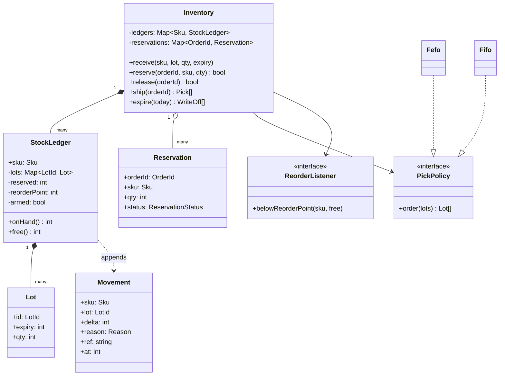
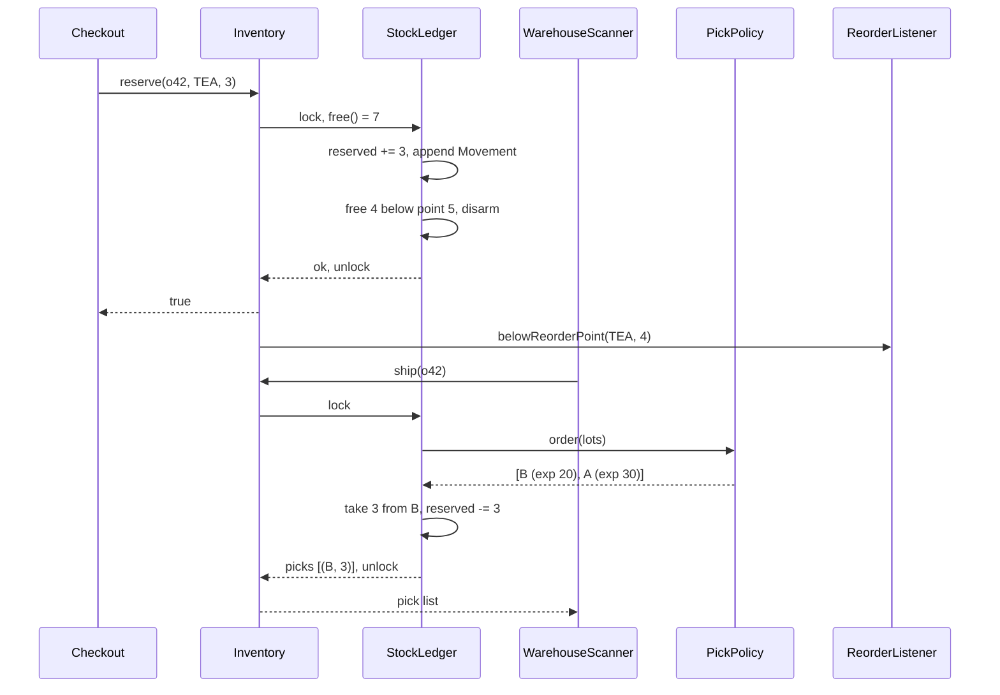

## In one minute
- An inventory system answers one question under pressure: "can I promise this unit to this customer?" Everything else (receiving, counting, reordering) exists to keep that answer honest.
- Keep three numbers apart for every item: **on hand** (physically in the building), **reserved** (promised to orders not yet shipped) and **free** (on hand minus reserved). Most inventory bugs are one of these being computed from the wrong source.
- Stock sits in **lots** with their own expiry or cost, and the order you consume them in (FIFO, FEFO) is a per-product-line policy. Put it behind a strategy.
- Every change is a **movement** with a reason (receipt, pick, write-off, count adjustment), so a stock discrepancy is explainable instead of a mystery.
- The problem shape is **contention** on a counter that many callers want to decrement, plus **trust but verify** because the physical world drifts away from the database. You meet the same shape in seat maps, cloud quota and API credits.

## Requirements

Functional:
- Track stock per SKU, split into lots. A lot has an id, a quantity and an optional expiry date.
- Receive stock into a lot at a warehouse.
- Reserve stock for an order without choosing physical units yet; release the reservation if the order is cancelled.
- Ship a reserved order: pick concrete lots according to the consumption policy and decrement them.
- Write off expired lots on a daily run and apply cycle-count adjustments when a count disagrees with the system.
- Raise a reorder alert when free stock falls below a per-SKU reorder point.

Non-functional:
- Never promise more units than exist, even with many checkout servers reserving at once.
- Every balance change is auditable: who, when, why, which lot.
- Reserve in a few milliseconds; checkout waits on it.

Out of scope: purchase-order workflow with suppliers, demand forecasting, multi-warehouse allocation (covered in [Design Amazon](../sdi/design-amazon.md)), and valuation for the general ledger. Name them, then park them in Extensibility.

## Entities and relationships

- **Product** (SKU): a catalogue entry with a unit of measure. It holds no quantities, so catalogue edits and stock changes never contend for one row.
- **Lot**: a batch of one SKU received together. It has an id, an expiry (or none), a received date and a remaining quantity. It is the unit you consume and the unit a recall targets.
- **StockLedger**: the per-SKU aggregate that owns its lots, its reserved total and its reorder state. It is where invariants live, so every mutation goes through it.
- **Reservation**: an order's claim on a quantity of one SKU, with a status (active, shipped, released). It does not point at lots; lots are chosen at pick time.
- **Movement**: an immutable record of a change: SKU, lot, signed quantity, reason, reference (order or count id) and timestamp.
- **PickPolicy**: given a SKU's lots, returns the order to consume them in. **ReorderListener** receives "below reorder point" events.
- **Inventory**: the façade that callers use. It maps SKUs to ledgers and order ids to reservations.

Relationships: a ledger is composed of its lots (a lot has no meaning outside its SKU). A reservation references a SKU by id; it does not own stock. Movements are appended by the ledger and never edited. Inventory aggregates ledgers and holds the policy and listeners by reference.

The decision that matters most is **reserve does not pick lots**. A lot chosen at checkout can expire or go missing before packing and strand the order. Reserving a quantity and choosing lots at pick time lets the warehouse substitute freely.

## Class diagram



## Key flows

Reserve is the checkout hot path and ship the warehouse one. Both change the same ledger, so both take its lock.



## Design patterns used and why

- **Strategy** for the pick policy. Groceries and medicine use FEFO (first expiry, first out). Hardware uses FIFO by received date. A fashion retailer may pick from the lot nearest the packing bench. These rules differ per product line and change over time, so they belong behind one interface, not in an `if category ==` chain inside `ship`.
- **Observer** for reorder alerts, with an important detail: the alert is **edge-triggered**. It fires once when free stock crosses below the point and re-arms only when stock climbs back to or above it. A level-triggered alert fires on every reservation while stock stays low, and the purchasing team learns to ignore it. See [Observer](observer.md) for the mechanics; here the subtle part is the armed flag.
- **Façade**: `Inventory` is the only entry point. Callers never touch a lot directly, which keeps every invariant in one place and lets you swap the in-memory ledger for a database-backed repository later.
- **Event log, kept light**: each change appends a `Movement`. This is not full [Event Sourcing](../sd/event-sourcing.md) (you still store current balances for speed), but it gives you the audit trail and the ability to rebuild a balance when someone asks "where did 40 units go?".
- **Value objects** for `Movement`, `Pick` and quantities with units, so "3 cases" and "3 each" cannot be added by accident.

What not to use: a `Singleton` inventory, for the same reason as in [Design Parking Lot](design-parking-lot.md); and a class per product type. Perishable and non-perishable goods differ in data (an expiry) and in policy (a strategy), not in behaviour that needs dispatch.

## Concurrency and edge cases

- **Last units, many checkouts.** Two servers both read free = 1 and both reserve. The fix is to make check-and-decrement one atomic step: a mutex per ledger in memory, or a conditional update in SQL (`UPDATE stock SET reserved = reserved + $1 WHERE sku = $2 AND on_hand - reserved >= $1`) and checking the row count. This is the same pattern as in [Design Flash Sale](../sdi/design-flash-sale.md), where the counter is much hotter.
- **Lock granularity.** One lock per SKU, not one for the whole store. A promotion on tea should not block a reservation for coffee. If an order needs several SKUs, acquire their locks in a fixed order (sorted by SKU) or reserve one SKU at a time with compensation on failure; otherwise two orders with the same two SKUs in opposite order deadlock.
- **Expiry after reservation.** A lot can expire between checkout and packing. After the nightly write-off, on hand may drop below reserved, so free goes negative. That is a true fact about the world, not a bug to hide. Ship must then refuse an order it cannot fill and leave the reservation active, so customer service sees a short order instead of a crashed packing station.
- **Duplicate requests.** Checkout retries on timeout. Key reservations by order id and reject a second reservation for the same id; see [Idempotency](../sd/idempotency.md). The same applies to `ship`: a scanner that sends the event twice must not pick twice.
- **Cycle counts.** A count that finds 47 when the system says 50 becomes an adjustment movement of minus 3 referencing the count, never an overwrite to 47, which would hide the loss.
- **Lot identity.** The same lot id arriving with a different expiry is a supplier data error. Reject it rather than merging, or you may ship expired food from a lot the system thinks is fresh.

## Down the stack

### Layer 1: The contract
`reserve(order, sku, q)` either increases reserved by exactly `q` and returns true, or returns false and changes nothing; it succeeds only if free is at least `q` at the moment the ledger is locked. `ship(order)` either decrements lots by a total of exactly the reserved quantity in policy order and marks the reservation shipped, or changes nothing. Free stock is `on_hand - reserved` and may be negative only after a write-off. Every successful mutation appends one movement per lot touched, and summing a SKU's movements reproduces its on-hand count.

### Layer 2: The mechanism
In memory, a ledger holds a hash map from lot id to `(expiry, qty)`, a reserved integer and an armed flag. FEFO ordering is a sort by `(expiry, lot id)` at pick time, O(L log L) for L lots, which is fine because a SKU rarely has more than a few dozen live lots. A min-heap keyed by expiry makes it O(log L) per pick if you have thousands. In a relational database the shape is two tables: `lot(sku, lot_id, expiry, qty)` with an index on `(sku, expiry, lot_id)`, and `stock(sku, on_hand, reserved, reorder_point)` as the contended row. Reservation is a single conditional `UPDATE` on `stock`. Shipping runs `SELECT ... FROM lot WHERE sku = $1 AND qty > 0 ORDER BY expiry, lot_id FOR UPDATE`, decrements rows in a loop, and inserts movements, all in one transaction. The append-only `movement` table is usually partitioned by month.

### Layer 3: The machine
The contended object is one row, which in Postgres means one heap tuple and one row lock. Every successful reservation writes a new tuple version and a WAL record, and the commit waits for `fsync` of the WAL, roughly 0.1 to 1 ms on NVMe. Group commit lets many transactions share one flush, which is why a single hot SKU can still take a few thousand reservations per second. Beyond that, row-lock waits dominate: each waiter sleeps on a lock and is woken in turn, adding queueing delay that grows with the number of waiters. In memory, the same operation is an uncontended `sync.Mutex` at about 20 ns plus a map lookup, so a single process can reserve millions of units per second. Pickers walk for minutes, so contention only matters for checkout spikes, not the warehouse floor.

### Why it's built this way
1. Customers are promised stock at checkout, long before anyone walks to a shelf, so the system needs a promise (reserved) separate from physical stock (on hand).
2. Physical stock is consumed in batches with different expiry and cost, so on hand is a set of lots, not one number, and the choice of lot belongs at pick time when the picker is standing there.
3. Shelves and databases drift apart through theft, damage and mis-scans, so changes are recorded as reasoned movements that can be audited and reconciled.
4. Many checkouts hit the same popular SKU at once, so check-and-decrement must be atomic on one row or one lock, and that lock must be per SKU so unrelated products do not queue behind each other.
5. Purchasing teams have limited attention, so alerts fire on the crossing, not on every low reading.

## Extensibility

- **Multiple warehouses:** key ledgers by `(warehouse, sku)` and add an allocation step before reservation that chooses the warehouse. That allocator is the core of [Design Amazon](../sdi/design-amazon.md); the ledger does not change.
- **Reservation expiry:** carts that never check out should release stock. Add an expiry time to the reservation and treat expired ones as released lazily on the next read, the pattern from [Preventing Double Booking](../sdi/preventing-double-booking.md).
- **Costing:** finance wants cost of goods sold. Store unit cost on each lot; FIFO costing then falls out of the pick list. Changing to weighted average cost is a new valuation strategy, not a change to picking.
- **Recalls:** "find every order that received lot B7" is a query on movements by lot. This is why the movement row carries the lot id even for picks.

## Leadership lens

- Build first: the ledger with atomic reserve and ship, the movement log and a reconciliation report (system count versus last cycle count). A wrong reorder threshold costs a delayed shipment; an untraceable stock loss costs an audit finding.
- Ask in design review: what makes reserve atomic; can free go negative and who sees it; how does a duplicate checkout request behave; which consumption policy each product line uses, and who owns that decision.
- The biggest operational cost is reconciliation, not code: budget for count tooling and an adjustment screen with mandatory reason codes.
- Ownership: checkout owns reservations, the warehouse owns picking and counts, purchasing owns reorder points. One service with three entry points beats three services sharing a table.

## Check yourself
1. Why does reservation decrement free stock without choosing a lot?
   **Answer:** The lot that is best to ship (earliest expiry, nearest shelf) may change before packing, and a reserved lot could expire or turn out to be missing. Reserving a quantity keeps the promise while leaving lot choice to pick time.
2. A cycle count finds 47 units where the system shows 50. Why record a movement of minus 3 rather than setting the balance to 47?
   **Answer:** The movement preserves the fact and size of the loss with a reason and a reference, so balances still equal the sum of movements and loss prevention can see the trend. Overwriting hides the discrepancy.
3. Free stock for a SKU is minus 2 after the nightly expiry run. Is that a bug?
   **Answer:** No. Units promised to customers expired before shipping, so the system now owes more than it holds. Showing a negative number surfaces short orders; clamping it to zero would hide them.
4. Why fire the reorder alert only on the crossing, not whenever free stock is below the point?
   **Answer:** Level-triggered alerts repeat on every reservation while stock is low and train people to ignore them. An edge trigger produces one actionable event and re-arms after replenishment.

## Practice
**Task:** Implement `Inventory(reorder_points)`, where `reorder_points` maps SKU to an integer threshold (SKUs without one never alert). `receive(sku, lot, qty, expiry)` adds `qty` units to a lot; it fails for `qty < 1` or when the lot exists with a different expiry. `free(sku)` returns on hand minus reserved. `reserve(order_id, sku, qty)` fails for `qty < 1` or an order id seen before; it returns false and changes nothing when free stock is below `qty`, else reserves and returns true. `release(order_id)` cancels an active reservation and returns true, otherwise false. `ship(order_id)` fails unless the reservation is active; it picks lots in FEFO order (by expiry, then lot id), removes emptied lots, marks the order shipped and returns the picks as `(lot, qty)` pairs, or returns nothing and changes nothing if on hand is below the reserved amount. `expire(today)` removes every lot with `expiry <= today` and returns `(sku, lot, qty)` sorted by SKU then lot. After every change to a SKU, if its alert is armed and free stock is below its point, append the SKU to `alerts()` and disarm; if disarmed and free stock is at or above the point, re-arm.

```python starter
class Inventory:
    def __init__(self, reorder_points):
        self._points = dict(reorder_points)

    def receive(self, sku, lot, qty, expiry):
        # TODO: ValueError for qty < 1 or an existing lot with a different expiry
        raise NotImplementedError

    def free(self, sku):
        raise NotImplementedError

    def reserve(self, order_id, sku, qty):
        # TODO: ValueError for qty < 1 or a reused order id; False when short
        raise NotImplementedError

    def release(self, order_id):
        raise NotImplementedError

    def ship(self, order_id):
        # TODO: FEFO picks as [(lot, qty)]; None when on hand is short
        raise NotImplementedError

    def expire(self, today):
        raise NotImplementedError

    def alerts(self):
        raise NotImplementedError
```

```python tests
def raises(fn):
    try:
        fn()
    except ValueError:
        return True
    return False


def test_free_counts_reservations():
    inv = Inventory({})
    inv.receive("tea", "A", 10, 100)
    assert inv.reserve("o1", "tea", 4) is True
    assert inv.free("tea") == 6
    assert inv.reserve("o2", "tea", 7) is False, "never partial"
    assert inv.free("tea") == 6
    assert inv.free("coffee") == 0


def test_ship_picks_earliest_expiry_first():
    inv = Inventory({})
    inv.receive("milk", "B", 5, 20)
    inv.receive("milk", "A", 5, 30)
    inv.receive("milk", "C", 2, 20)
    inv.reserve("o1", "milk", 8)
    assert inv.ship("o1") == [("B", 5), ("C", 2), ("A", 1)]
    assert inv.free("milk") == 4
    inv.reserve("o2", "milk", 4)
    assert inv.ship("o2") == [("A", 4)]


def test_release_and_state_errors():
    inv = Inventory({})
    inv.receive("tea", "A", 5, 100)
    inv.reserve("o1", "tea", 5)
    assert inv.release("o1") is True
    assert inv.release("o1") is False
    assert inv.free("tea") == 5
    assert raises(lambda: inv.ship("o1")), "released order cannot ship"
    assert raises(lambda: inv.reserve("o1", "tea", 1)), "order id reused"
    assert raises(lambda: inv.ship("nope"))


def test_expire_then_short_ship():
    inv = Inventory({})
    inv.receive("milk", "L1", 5, 10)
    inv.receive("milk", "L2", 2, 50)
    inv.receive("bread", "K1", 3, 9)
    assert inv.reserve("o1", "milk", 6) is True
    assert inv.expire(10) == [("bread", "K1", 3), ("milk", "L1", 5)]
    assert inv.free("milk") == -4
    assert inv.ship("o1") is None
    inv.receive("milk", "L3", 4, 60)
    assert inv.ship("o1") == [("L2", 2), ("L3", 4)]
    assert inv.free("milk") == 0


def test_reorder_alert_is_edge_triggered():
    inv = Inventory({"tea": 5})
    inv.receive("tea", "A", 10, 100)
    inv.reserve("o1", "tea", 4)
    assert inv.alerts() == []
    inv.reserve("o2", "tea", 2)
    assert inv.alerts() == ["tea"]
    inv.reserve("o3", "tea", 1)
    assert inv.alerts() == ["tea"], "no repeat while low"
    inv.receive("tea", "B", 10, 200)
    inv.reserve("o4", "tea", 10)
    assert inv.alerts() == ["tea", "tea"], "re-armed after restock"


def test_release_rearms_alert():
    inv = Inventory({"tea": 3})
    inv.receive("tea", "A", 4, 100)
    inv.reserve("o1", "tea", 2)
    inv.release("o1")
    inv.reserve("o2", "tea", 2)
    assert inv.alerts() == ["tea", "tea"]


def test_validation():
    inv = Inventory({})
    assert raises(lambda: inv.receive("tea", "A", 0, 100))
    inv.receive("tea", "A", 3, 100)
    assert raises(lambda: inv.receive("tea", "A", 3, 101)), "expiry mismatch"
    inv.receive("tea", "A", 2, 100)
    assert inv.free("tea") == 5
    assert raises(lambda: inv.reserve("o1", "tea", 0))
```

```python solution
class Inventory:
    def __init__(self, reorder_points):
        self._points = dict(reorder_points)
        self._lots = {}
        self._reserved = {}
        self._orders = {}
        self._armed = {}
        self._alerts = []

    def receive(self, sku, lot, qty, expiry):
        if qty < 1:
            raise ValueError("quantity must be positive")
        lots = self._lots.setdefault(sku, {})
        if lot in lots:
            if lots[lot][0] != expiry:
                raise ValueError("lot " + lot + " already has another expiry")
            lots[lot][1] += qty
        else:
            lots[lot] = [expiry, qty]
        self._check(sku)

    def _on_hand(self, sku):
        return sum(q for _, q in self._lots.get(sku, {}).values())

    def free(self, sku):
        return self._on_hand(sku) - self._reserved.get(sku, 0)

    def reserve(self, order_id, sku, qty):
        if qty < 1:
            raise ValueError("quantity must be positive")
        if order_id in self._orders:
            raise ValueError("order id already used: " + order_id)
        if self.free(sku) < qty:
            return False
        self._orders[order_id] = [sku, qty, "active"]
        self._reserved[sku] = self._reserved.get(sku, 0) + qty
        self._check(sku)
        return True

    def release(self, order_id):
        order = self._orders.get(order_id)
        if order is None or order[2] != "active":
            return False
        order[2] = "released"
        self._reserved[order[0]] -= order[1]
        self._check(order[0])
        return True

    def ship(self, order_id):
        order = self._orders.get(order_id)
        if order is None or order[2] != "active":
            raise ValueError("no active reservation: " + order_id)
        sku, qty = order[0], order[1]
        if self._on_hand(sku) < qty:
            return None
        lots = self._lots[sku]
        picks = []
        need = qty
        for lot in sorted(lots, key=lambda k: (lots[k][0], k)):
            take = min(need, lots[lot][1])
            picks.append((lot, take))
            lots[lot][1] -= take
            if lots[lot][1] == 0:
                del lots[lot]
            need -= take
            if need == 0:
                break
        self._reserved[sku] -= qty
        order[2] = "shipped"
        self._check(sku)
        return picks

    def expire(self, today):
        out = []
        for sku in sorted(self._lots):
            lots = self._lots[sku]
            gone = [lot for lot in sorted(lots) if lots[lot][0] <= today]
            for lot in gone:
                out.append((sku, lot, lots[lot][1]))
                del lots[lot]
            if gone:
                self._check(sku)
        return out

    def _check(self, sku):
        if sku not in self._points:
            return
        f = self.free(sku)
        armed = self._armed.get(sku, True)
        if armed and f < self._points[sku]:
            self._alerts.append(sku)
            self._armed[sku] = False
        elif not armed and f >= self._points[sku]:
            self._armed[sku] = True

    def alerts(self):
        return list(self._alerts)
```

```typescript starter
export type Pick = [string, number];
export type WriteOff = [string, string, number];

export class Inventory {
  constructor(reorderPoints: Record<string, number>) {}

  receive(sku: string, lot: string, qty: number, expiry: number): void {
    throw new Error("TODO");
  }

  free(sku: string): number {
    throw new Error("TODO");
  }

  reserve(orderId: string, sku: string, qty: number): boolean {
    throw new Error("TODO");
  }

  release(orderId: string): boolean {
    throw new Error("TODO");
  }

  ship(orderId: string): Pick[] | null {
    throw new Error("TODO");
  }

  expire(today: number): WriteOff[] {
    throw new Error("TODO");
  }

  alerts(): string[] {
    throw new Error("TODO");
  }
}
```

```typescript tests
function throwsErr(fn: () => void): boolean {
  try { fn(); return false; } catch (e) { return true; }
}

test("free counts reservations", () => {
  const inv = new Inventory({});
  inv.receive("tea", "A", 10, 100);
  assertEqual(inv.reserve("o1", "tea", 4), true);
  assertEqual(inv.free("tea"), 6);
  assertEqual(inv.reserve("o2", "tea", 7), false, "never partial");
  assertEqual(inv.free("tea"), 6);
  assertEqual(inv.free("coffee"), 0);
});

test("ship picks earliest expiry first", () => {
  const inv = new Inventory({});
  inv.receive("milk", "B", 5, 20);
  inv.receive("milk", "A", 5, 30);
  inv.receive("milk", "C", 2, 20);
  inv.reserve("o1", "milk", 8);
  assertEqual(inv.ship("o1"), [["B", 5], ["C", 2], ["A", 1]]);
  assertEqual(inv.free("milk"), 4);
  inv.reserve("o2", "milk", 4);
  assertEqual(inv.ship("o2"), [["A", 4]]);
});

test("release and state errors", () => {
  const inv = new Inventory({});
  inv.receive("tea", "A", 5, 100);
  inv.reserve("o1", "tea", 5);
  assertEqual(inv.release("o1"), true);
  assertEqual(inv.release("o1"), false);
  assertEqual(inv.free("tea"), 5);
  assert(throwsErr(() => inv.ship("o1")), "released order cannot ship");
  assert(throwsErr(() => inv.reserve("o1", "tea", 1)), "order id reused");
  assert(throwsErr(() => inv.ship("nope")));
});

test("expire then short ship", () => {
  const inv = new Inventory({});
  inv.receive("milk", "L1", 5, 10);
  inv.receive("milk", "L2", 2, 50);
  inv.receive("bread", "K1", 3, 9);
  assertEqual(inv.reserve("o1", "milk", 6), true);
  assertEqual(inv.expire(10), [["bread", "K1", 3], ["milk", "L1", 5]]);
  assertEqual(inv.free("milk"), -4);
  assertEqual(inv.ship("o1"), null);
  inv.receive("milk", "L3", 4, 60);
  assertEqual(inv.ship("o1"), [["L2", 2], ["L3", 4]]);
  assertEqual(inv.free("milk"), 0);
});

test("reorder alert is edge triggered", () => {
  const inv = new Inventory({ tea: 5 });
  inv.receive("tea", "A", 10, 100);
  inv.reserve("o1", "tea", 4);
  assertEqual(inv.alerts(), []);
  inv.reserve("o2", "tea", 2);
  assertEqual(inv.alerts(), ["tea"]);
  inv.reserve("o3", "tea", 1);
  assertEqual(inv.alerts(), ["tea"], "no repeat while low");
  inv.receive("tea", "B", 10, 200);
  inv.reserve("o4", "tea", 10);
  assertEqual(inv.alerts(), ["tea", "tea"], "re-armed after restock");
});

test("release re-arms alert", () => {
  const inv = new Inventory({ tea: 3 });
  inv.receive("tea", "A", 4, 100);
  inv.reserve("o1", "tea", 2);
  inv.release("o1");
  inv.reserve("o2", "tea", 2);
  assertEqual(inv.alerts(), ["tea", "tea"]);
});

test("validation", () => {
  const inv = new Inventory({});
  assert(throwsErr(() => inv.receive("tea", "A", 0, 100)));
  inv.receive("tea", "A", 3, 100);
  assert(throwsErr(() => inv.receive("tea", "A", 3, 101)), "expiry mismatch");
  inv.receive("tea", "A", 2, 100);
  assertEqual(inv.free("tea"), 5);
  assert(throwsErr(() => inv.reserve("o1", "tea", 0)));
});
```

```typescript solution
export type Pick = [string, number];
export type WriteOff = [string, string, number];

interface LotState { expiry: number; qty: number }
interface Order { sku: string; qty: number; status: "active" | "released" | "shipped" }

export class Inventory {
  private points = new Map<string, number>();
  private lots = new Map<string, Map<string, LotState>>();
  private reserved = new Map<string, number>();
  private orders = new Map<string, Order>();
  private armed = new Map<string, boolean>();
  private fired: string[] = [];

  constructor(reorderPoints: Record<string, number>) {
    for (const k of Object.keys(reorderPoints)) this.points.set(k, reorderPoints[k]);
  }

  receive(sku: string, lot: string, qty: number, expiry: number): void {
    if (qty < 1) throw new Error("quantity must be positive");
    let lots = this.lots.get(sku);
    if (!lots) { lots = new Map(); this.lots.set(sku, lots); }
    const existing = lots.get(lot);
    if (existing) {
      if (existing.expiry !== expiry) throw new Error("lot " + lot + " already has another expiry");
      existing.qty += qty;
    } else {
      lots.set(lot, { expiry, qty });
    }
    this.check(sku);
  }

  private onHand(sku: string): number {
    let total = 0;
    for (const l of (this.lots.get(sku) ?? new Map<string, LotState>()).values()) total += l.qty;
    return total;
  }

  free(sku: string): number {
    return this.onHand(sku) - (this.reserved.get(sku) ?? 0);
  }

  reserve(orderId: string, sku: string, qty: number): boolean {
    if (qty < 1) throw new Error("quantity must be positive");
    if (this.orders.has(orderId)) throw new Error("order id already used: " + orderId);
    if (this.free(sku) < qty) return false;
    this.orders.set(orderId, { sku, qty, status: "active" });
    this.reserved.set(sku, (this.reserved.get(sku) ?? 0) + qty);
    this.check(sku);
    return true;
  }

  release(orderId: string): boolean {
    const o = this.orders.get(orderId);
    if (!o || o.status !== "active") return false;
    o.status = "released";
    this.reserved.set(o.sku, this.reserved.get(o.sku)! - o.qty);
    this.check(o.sku);
    return true;
  }

  ship(orderId: string): Pick[] | null {
    const o = this.orders.get(orderId);
    if (!o || o.status !== "active") throw new Error("no active reservation: " + orderId);
    if (this.onHand(o.sku) < o.qty) return null;
    const lots = this.lots.get(o.sku)!;
    const ordered = [...lots.keys()].sort((a, b) => {
      const d = lots.get(a)!.expiry - lots.get(b)!.expiry;
      return d !== 0 ? d : (a < b ? -1 : a > b ? 1 : 0);
    });
    const picks: Pick[] = [];
    let need = o.qty;
    for (const id of ordered) {
      const l = lots.get(id)!;
      const take = Math.min(need, l.qty);
      picks.push([id, take]);
      l.qty -= take;
      if (l.qty === 0) lots.delete(id);
      need -= take;
      if (need === 0) break;
    }
    this.reserved.set(o.sku, this.reserved.get(o.sku)! - o.qty);
    o.status = "shipped";
    this.check(o.sku);
    return picks;
  }

  expire(today: number): WriteOff[] {
    const out: WriteOff[] = [];
    for (const sku of [...this.lots.keys()].sort()) {
      const lots = this.lots.get(sku)!;
      const gone = [...lots.keys()].sort().filter((id) => lots.get(id)!.expiry <= today);
      for (const id of gone) {
        out.push([sku, id, lots.get(id)!.qty]);
        lots.delete(id);
      }
      if (gone.length > 0) this.check(sku);
    }
    return out;
  }

  private check(sku: string): void {
    const point = this.points.get(sku);
    if (point === undefined) return;
    const f = this.free(sku);
    const armed = this.armed.get(sku) ?? true;
    if (armed && f < point) {
      this.fired.push(sku);
      this.armed.set(sku, false);
    } else if (!armed && f >= point) {
      this.armed.set(sku, true);
    }
  }

  alerts(): string[] {
    return [...this.fired];
  }
}
```

```go starter
package practice

import "errors"

var (
	ErrInvalidQty     = errors.New("quantity must be positive")
	ErrExpiryMismatch = errors.New("lot exists with another expiry")
	ErrDuplicateOrder = errors.New("order id already used")
	ErrNotActive      = errors.New("no active reservation")
	ErrShortStock     = errors.New("on hand is below the reserved amount")
)

type Pick struct {
	Lot string
	Qty int
}

type WriteOff struct {
	SKU string
	Lot string
	Qty int
}

type Inventory struct{}

func NewInventory(reorderPoints map[string]int) *Inventory {
	return &Inventory{}
}

func (inv *Inventory) Receive(sku, lot string, qty, expiry int) error { panic("TODO") }

func (inv *Inventory) Free(sku string) int { panic("TODO") }

func (inv *Inventory) Reserve(orderID, sku string, qty int) (bool, error) { panic("TODO") }

func (inv *Inventory) Release(orderID string) bool { panic("TODO") }

func (inv *Inventory) Ship(orderID string) ([]Pick, error) { panic("TODO") }

func (inv *Inventory) Expire(today int) []WriteOff { panic("TODO") }

func (inv *Inventory) Alerts() []string { panic("TODO") }
```

```go tests
package practice

import (
	"errors"
	"reflect"
	"testing"
)

func mustReceive(t *testing.T, inv *Inventory, sku, lot string, qty, expiry int) {
	t.Helper()
	if err := inv.Receive(sku, lot, qty, expiry); err != nil {
		t.Fatalf("receive %s/%s: %v", sku, lot, err)
	}
}

func mustReserve(t *testing.T, inv *Inventory, id, sku string, qty int) bool {
	t.Helper()
	ok, err := inv.Reserve(id, sku, qty)
	if err != nil {
		t.Fatalf("reserve %s: %v", id, err)
	}
	return ok
}

func TestFreeCountsReservations(t *testing.T) {
	inv := NewInventory(map[string]int{})
	mustReceive(t, inv, "tea", "A", 10, 100)
	if !mustReserve(t, inv, "o1", "tea", 4) || inv.Free("tea") != 6 {
		t.Fatalf("free=%d", inv.Free("tea"))
	}
	if mustReserve(t, inv, "o2", "tea", 7) || inv.Free("tea") != 6 {
		t.Fatal("reservation must never be partial")
	}
	if inv.Free("coffee") != 0 {
		t.Fatal("unknown sku has zero free")
	}
}

func TestShipPicksEarliestExpiryFirst(t *testing.T) {
	inv := NewInventory(map[string]int{})
	mustReceive(t, inv, "milk", "B", 5, 20)
	mustReceive(t, inv, "milk", "A", 5, 30)
	mustReceive(t, inv, "milk", "C", 2, 20)
	mustReserve(t, inv, "o1", "milk", 8)
	picks, err := inv.Ship("o1")
	want := []Pick{{"B", 5}, {"C", 2}, {"A", 1}}
	if err != nil || !reflect.DeepEqual(picks, want) {
		t.Fatalf("picks=%v err=%v", picks, err)
	}
	if inv.Free("milk") != 4 {
		t.Fatalf("free=%d", inv.Free("milk"))
	}
	mustReserve(t, inv, "o2", "milk", 4)
	if picks, _ := inv.Ship("o2"); !reflect.DeepEqual(picks, []Pick{{"A", 4}}) {
		t.Fatalf("picks=%v", picks)
	}
}

func TestReleaseAndStateErrors(t *testing.T) {
	inv := NewInventory(map[string]int{})
	mustReceive(t, inv, "tea", "A", 5, 100)
	mustReserve(t, inv, "o1", "tea", 5)
	if !inv.Release("o1") || inv.Release("o1") || inv.Free("tea") != 5 {
		t.Fatal("release should succeed exactly once")
	}
	if _, err := inv.Ship("o1"); !errors.Is(err, ErrNotActive) {
		t.Fatalf("want ErrNotActive, got %v", err)
	}
	if _, err := inv.Reserve("o1", "tea", 1); !errors.Is(err, ErrDuplicateOrder) {
		t.Fatalf("want ErrDuplicateOrder, got %v", err)
	}
	if _, err := inv.Ship("nope"); !errors.Is(err, ErrNotActive) {
		t.Fatalf("want ErrNotActive, got %v", err)
	}
}

func TestExpireThenShortShip(t *testing.T) {
	inv := NewInventory(map[string]int{})
	mustReceive(t, inv, "milk", "L1", 5, 10)
	mustReceive(t, inv, "milk", "L2", 2, 50)
	mustReceive(t, inv, "bread", "K1", 3, 9)
	mustReserve(t, inv, "o1", "milk", 6)
	got := inv.Expire(10)
	want := []WriteOff{{"bread", "K1", 3}, {"milk", "L1", 5}}
	if !reflect.DeepEqual(got, want) {
		t.Fatalf("expire=%v", got)
	}
	if inv.Free("milk") != -4 {
		t.Fatalf("free=%d", inv.Free("milk"))
	}
	if _, err := inv.Ship("o1"); !errors.Is(err, ErrShortStock) {
		t.Fatalf("want ErrShortStock, got %v", err)
	}
	mustReceive(t, inv, "milk", "L3", 4, 60)
	picks, err := inv.Ship("o1")
	if err != nil || !reflect.DeepEqual(picks, []Pick{{"L2", 2}, {"L3", 4}}) {
		t.Fatalf("picks=%v err=%v", picks, err)
	}
	if inv.Free("milk") != 0 {
		t.Fatalf("free=%d", inv.Free("milk"))
	}
}

func TestReorderAlertIsEdgeTriggered(t *testing.T) {
	inv := NewInventory(map[string]int{"tea": 5})
	mustReceive(t, inv, "tea", "A", 10, 100)
	mustReserve(t, inv, "o1", "tea", 4)
	if len(inv.Alerts()) != 0 {
		t.Fatalf("alerts=%v", inv.Alerts())
	}
	mustReserve(t, inv, "o2", "tea", 2)
	mustReserve(t, inv, "o3", "tea", 1)
	if !reflect.DeepEqual(inv.Alerts(), []string{"tea"}) {
		t.Fatalf("alerts=%v", inv.Alerts())
	}
	mustReceive(t, inv, "tea", "B", 10, 200)
	mustReserve(t, inv, "o4", "tea", 10)
	if !reflect.DeepEqual(inv.Alerts(), []string{"tea", "tea"}) {
		t.Fatalf("alerts=%v", inv.Alerts())
	}
}

func TestReleaseRearmsAlert(t *testing.T) {
	inv := NewInventory(map[string]int{"tea": 3})
	mustReceive(t, inv, "tea", "A", 4, 100)
	mustReserve(t, inv, "o1", "tea", 2)
	inv.Release("o1")
	mustReserve(t, inv, "o2", "tea", 2)
	if !reflect.DeepEqual(inv.Alerts(), []string{"tea", "tea"}) {
		t.Fatalf("alerts=%v", inv.Alerts())
	}
}

func TestValidation(t *testing.T) {
	inv := NewInventory(map[string]int{})
	if err := inv.Receive("tea", "A", 0, 100); !errors.Is(err, ErrInvalidQty) {
		t.Fatalf("want ErrInvalidQty, got %v", err)
	}
	mustReceive(t, inv, "tea", "A", 3, 100)
	if err := inv.Receive("tea", "A", 3, 101); !errors.Is(err, ErrExpiryMismatch) {
		t.Fatalf("want ErrExpiryMismatch, got %v", err)
	}
	mustReceive(t, inv, "tea", "A", 2, 100)
	if inv.Free("tea") != 5 {
		t.Fatalf("free=%d", inv.Free("tea"))
	}
	if _, err := inv.Reserve("o1", "tea", 0); !errors.Is(err, ErrInvalidQty) {
		t.Fatalf("want ErrInvalidQty, got %v", err)
	}
}
```

```go solution
package practice

import (
	"errors"
	"fmt"
	"sort"
	"sync"
)

var (
	ErrInvalidQty     = errors.New("quantity must be positive")
	ErrExpiryMismatch = errors.New("lot exists with another expiry")
	ErrDuplicateOrder = errors.New("order id already used")
	ErrNotActive      = errors.New("no active reservation")
	ErrShortStock     = errors.New("on hand is below the reserved amount")
)

type Pick struct {
	Lot string
	Qty int
}

type WriteOff struct {
	SKU string
	Lot string
	Qty int
}

type lotState struct {
	expiry int
	qty    int
}

type status int

const (
	active status = iota
	released
	shipped
)

type order struct {
	sku    string
	qty    int
	status status
}

type Inventory struct {
	mu       sync.Mutex
	points   map[string]int
	lots     map[string]map[string]*lotState
	reserved map[string]int
	orders   map[string]*order
	disarmed map[string]bool
	alerts   []string
}

func NewInventory(reorderPoints map[string]int) *Inventory {
	return &Inventory{
		points:   reorderPoints,
		lots:     map[string]map[string]*lotState{},
		reserved: map[string]int{},
		orders:   map[string]*order{},
		disarmed: map[string]bool{},
	}
}

func (inv *Inventory) Receive(sku, lot string, qty, expiry int) error {
	if qty < 1 {
		return ErrInvalidQty
	}
	inv.mu.Lock()
	defer inv.mu.Unlock()
	lots := inv.lots[sku]
	if lots == nil {
		lots = map[string]*lotState{}
		inv.lots[sku] = lots
	}
	if l, ok := lots[lot]; ok {
		if l.expiry != expiry {
			return fmt.Errorf("%w: %s", ErrExpiryMismatch, lot)
		}
		l.qty += qty
	} else {
		lots[lot] = &lotState{expiry: expiry, qty: qty}
	}
	inv.check(sku)
	return nil
}

func (inv *Inventory) onHand(sku string) int {
	total := 0
	for _, l := range inv.lots[sku] {
		total += l.qty
	}
	return total
}

func (inv *Inventory) free(sku string) int { return inv.onHand(sku) - inv.reserved[sku] }

func (inv *Inventory) Free(sku string) int {
	inv.mu.Lock()
	defer inv.mu.Unlock()
	return inv.free(sku)
}

// Reserve checks and claims free stock under one lock, so two callers cannot both take the last unit.
func (inv *Inventory) Reserve(orderID, sku string, qty int) (bool, error) {
	if qty < 1 {
		return false, ErrInvalidQty
	}
	inv.mu.Lock()
	defer inv.mu.Unlock()
	if _, ok := inv.orders[orderID]; ok {
		return false, fmt.Errorf("%w: %s", ErrDuplicateOrder, orderID)
	}
	if inv.free(sku) < qty {
		return false, nil
	}
	inv.orders[orderID] = &order{sku: sku, qty: qty, status: active}
	inv.reserved[sku] += qty
	inv.check(sku)
	return true, nil
}

func (inv *Inventory) Release(orderID string) bool {
	inv.mu.Lock()
	defer inv.mu.Unlock()
	o, ok := inv.orders[orderID]
	if !ok || o.status != active {
		return false
	}
	o.status = released
	inv.reserved[o.sku] -= o.qty
	inv.check(o.sku)
	return true
}

func (inv *Inventory) Ship(orderID string) ([]Pick, error) {
	inv.mu.Lock()
	defer inv.mu.Unlock()
	o, ok := inv.orders[orderID]
	if !ok || o.status != active {
		return nil, fmt.Errorf("%w: %s", ErrNotActive, orderID)
	}
	if inv.onHand(o.sku) < o.qty {
		return nil, ErrShortStock
	}
	lots := inv.lots[o.sku]
	ids := make([]string, 0, len(lots))
	for id := range lots {
		ids = append(ids, id)
	}
	sort.Slice(ids, func(i, j int) bool {
		a, b := lots[ids[i]], lots[ids[j]]
		if a.expiry != b.expiry {
			return a.expiry < b.expiry
		}
		return ids[i] < ids[j]
	})
	var picks []Pick
	need := o.qty
	for _, id := range ids {
		l := lots[id]
		take := need
		if l.qty < take {
			take = l.qty
		}
		picks = append(picks, Pick{id, take})
		l.qty -= take
		if l.qty == 0 {
			delete(lots, id)
		}
		need -= take
		if need == 0 {
			break
		}
	}
	inv.reserved[o.sku] -= o.qty
	o.status = shipped
	inv.check(o.sku)
	return picks, nil
}

func (inv *Inventory) Expire(today int) []WriteOff {
	inv.mu.Lock()
	defer inv.mu.Unlock()
	skus := make([]string, 0, len(inv.lots))
	for s := range inv.lots {
		skus = append(skus, s)
	}
	sort.Strings(skus)
	out := []WriteOff{}
	for _, s := range skus {
		lots := inv.lots[s]
		ids := make([]string, 0, len(lots))
		for id, l := range lots {
			if l.expiry <= today {
				ids = append(ids, id)
			}
		}
		sort.Strings(ids)
		for _, id := range ids {
			out = append(out, WriteOff{s, id, lots[id].qty})
			delete(lots, id)
		}
		if len(ids) > 0 {
			inv.check(s)
		}
	}
	return out
}

// check is the edge-triggered reorder rule; callers hold the lock.
func (inv *Inventory) check(sku string) {
	point, ok := inv.points[sku]
	if !ok {
		return
	}
	f := inv.free(sku)
	if !inv.disarmed[sku] && f < point {
		inv.alerts = append(inv.alerts, sku)
		inv.disarmed[sku] = true
	} else if inv.disarmed[sku] && f >= point {
		inv.disarmed[sku] = false
	}
}

func (inv *Inventory) Alerts() []string {
	inv.mu.Lock()
	defer inv.mu.Unlock()
	return append([]string(nil), inv.alerts...)
}
```

## Mock interview
**Prompt:** Design the inventory core for an online grocer with 40,000 SKUs, two warehouses and about 30 orders per second at peak, many of them for the same 200 popular items. Code the classes for receiving, reserving and shipping stock, and explain how you stop the system from selling milk it does not have.

- Follow-up: A batch of yoghurt expires overnight while 120 units are reserved. What does the system show the next morning, and who acts on it?
- Follow-up: The warehouse wants to pick the lot closest to the packing bench instead of the earliest expiry for non-perishables. What changes?
- Follow-up: Two checkout servers reserve the last carton at the same moment. Walk through the lock or SQL statement that resolves it.

**A strong answer covers:**
- The on-hand, reserved and free split, with reservation against the SKU and lot choice deferred to pick time.
- Lots with expiry and a pick policy behind a strategy interface (FEFO for perishables, a location-based policy for the rest).
- An atomic check-and-reserve per SKU (a mutex or a conditional `UPDATE` with a row-count check), with per-SKU locking and a fixed lock order for multi-SKU orders.
- An append-only movement log with reason codes, and cycle counts applied as adjustments rather than overwrites.
- Honest handling of expiry after reservation: free goes negative, ship refuses short orders, and someone owns the follow-up.
- Edge-triggered reorder alerts and idempotent reserve and ship keyed by order id.

## Watch
- [Strategy Pattern, Design Patterns ep 1 (Christopher Okhravi)](https://www.youtube.com/watch?v=v9ejT8FO-7I): the pattern behind pluggable pick policies.
- [Observer Pattern, Design Patterns ep 2 (Christopher Okhravi)](https://www.youtube.com/watch?v=_BpmfnqjgzQ): subscriptions and notifications, the basis for reorder alerts.

## Free resources
- [FIFO and LIFO accounting (Wikipedia)](https://en.wikipedia.org/wiki/FIFO_and_LIFO_accounting): how the order of consuming lots changes reported cost, which is why pick policy matters to finance.
- [Reorder point (Wikipedia)](https://en.wikipedia.org/wiki/Reorder_point): the formula behind the threshold the alert watches.
- [Event Sourcing (Martin Fowler)](https://martinfowler.com/eaaDev/EventSourcing.html): the full version of the movement log idea, and when it is worth it.
- [Explicit locking (PostgreSQL docs)](https://www.postgresql.org/docs/current/explicit-locking.html): row locks and `FOR UPDATE`, used when picking lots inside a transaction.
- [Strategy pattern (Refactoring.Guru)](https://refactoring.guru/design-patterns/strategy): examples of swapping algorithms behind one interface.
